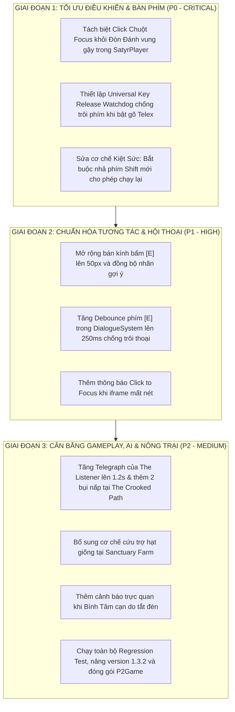

# 📋 BÁO CÁO PHÂN TÍCH TOÀN DIỆN HIỆN TRẠNG & KẾ HOẠCH KHẮC PHỤC DỰ ÁN HOLLOW WOODS
## RÀ SOÁT TỔNG THỂ DỰ ÁN, CHẨN ĐOÁN LỖI THỰC TẾ SAU 5 LƯỢT CHƠI & LẬP PHƯƠNG ÁN NÂNG CẤP TỐI ƯU

> **Dự án:** HOLLOW WOODS (*Dị Cảnh Rừng Liễu — The Fog That Remembers*)  
> **Phiên bản hiện tại:** `V1.3.1`  
> **Môi trường triển khai:** WebGL Top-down Pixel Art (P2Game.io iframe & Standalone Web)  
> **Ngày lập báo cáo:** 16/11/2026  
> **Căn cứ đánh giá:**
> - Toàn bộ hồ sơ báo cáo kỹ thuật dự án: `Read/FULL_DIAGNOSTIC_REPORT.md`, `Read/V1.3/Reports/02_Bug_Analysis_And_Root_Cause_Report.md`, `Read/V1.2/Reports/C4-12-31/C4-12-31_WORLD_PLAYTEST_REPORT.md`.
> - Dữ liệu thực tế ghi nhận từ **5 lượt chơi thử (playtest runs)** trên nền tảng P2Game / Trình duyệt web.
> - Rà soát chuyên sâu mã nguồn runtime: `src/entities/SatyrPlayer.ts`, `src/scenes/GameScene.ts`, `src/systems/DialogueSystem.ts`, `src/systems/SurvivalSystem.ts`, `src/systems/ListenerAI.ts`, `src/systems/FarmingSystem.ts`, `src/scenes/UIScene.ts`.

---

## 1. ĐÁNH GIÁ LẠI CÁC CÔNG VIỆC ĐÃ HOÀN THÀNH & NGUYÊN NHÂN TỒN TẠI "KHOẢNG CÁCH" (GAP) VỚI THỰC TẾ

### 1.1. Những thành tựu đã được hoàn thành và nghiệm thu kỹ thuật
Qua các chu kỳ phát triển từ V1.0 đến V1.3.1, dự án đã đạt được nền móng kỹ thuật rất đồ sộ:
1. **Nghệ thuật & Đồ họa Pixel Art:** 
   - Đã loại bỏ hoàn toàn các khối hình học thô sơ; tích hợp nhân vật chính *The Mossbound Wayfarer* (spritesheet chuẩn 22 cột × 4 hàng ô 64×64 px).
   - Tích hợp 5 NPC làng Bellhollow (Garth, Edda, Neris, Bram, Finn) có sprite, chân dung và hoạt cảnh riêng.
   - Tích hợp 2 quái vật bóng đêm (*The Listener* và *The Echo*), cùng hơn 30 đối tượng môi trường bản quyền.
2. **Kiến trúc hiển thị đa tầng:** 
   - Thiết lập Native HD 1280×720, Camera thế giới Zoom 2.2× kết hợp UIScene Zoom 1.0× giữ giao diện sắc nét.
   - Hệ thống sương mù Parallax 3 lớp và quầng sáng đèn lồng hổ phách chân thực theo từng frame vung gậy.
3. **Đóng gói & Chuẩn hóa Nền tảng P2Game:** 
   - Bản build `v1.3.1` đã vượt qua 100% bộ kiểm tra `p2game-validate` (0 lỗi chặn `RT-002`, `HT-009`, `MF-003`, `SE-004`).
   - Bộ kiểm thử hồi quy 20 suites đạt **530/530 tests PASS (100%)**.

### 1.2. Tại sao test tự động đạt 100% PASS nhưng khi chơi thực tế người chơi vẫn gặp rất nhiều lỗi?
Qua phân tích đối chiếu, nguyên nhân cốt lõi dẫn đến sự chênh lệch này là:
* **Hạn chế của kịch bản kiểm thử tĩnh (Node.js Test Scripts):** Các script `verify_*.mjs` kiểm tra regex chuỗi code, kiểm tra tính tồn tại của method, hoặc mô phỏng các hàm toán rời rạc với dữ liệu đầu vào lý tưởng. Chúng **không phản ánh được hành vi của người chơi thật trong môi trường iframe trình duyệt**.
* **Độ trễ và thao tác người dùng (Human Input Dynamics):** Người chơi không bấm phím với chu kỳ frame hoàn hảo như code mock. Họ giữ phím đè, bấm nhấp nhả loạn xạ, click chuột để lấy nét (focus) màn hình, và thường xuyên bật bộ gõ Tiếng Việt (UniKey / EVKey) khi đang chơi.
* **Tâm lý trải nghiệm (Player Mental Model):** Người chơi phán đoán hành động dựa trên hình ảnh thị giác (visual cues). Khi nhìn thấy nhãn `[E] Trò chuyện` hiện lên, họ mặc định bấm `[E]` là phải được, nếu không được họ sẽ kết luận game bị đơ/lag.

---

## 2. PHÂN TÍCH NGUYÊN NHÂN GỐC RỄ (ROOT CAUSE) CÁC LỖI THỰC TẾ & MỨC ĐỘ NGHIÊM TRỌNG

Dưới đây là bảng phân tích chi tiết các vấn đề người chơi thực tế đã gặp phải trong 5 lượt chơi thử:

```
+------------------------------------------------------------------------------------------------------------------------+
|                                  MA TRẬN CHẨN ĐOÁN LỖI THỰC TẾ (REAL PLAYTEST DIAGNOSTIC)                              |
+---------+----------------------------------------------+---------------+-----------------------------------------------+
| Mã Lỗi  | Hiện Tượng Trong Thực Tế                     | Mức Độ        | Tệp Nguồn Gốc Rễ                              |
+---------+----------------------------------------------+---------------+-----------------------------------------------+
| BUG-R01 | Click chuột để focus iframe làm vung gậy     | 🔴 CRITICAL   | src/entities/SatyrPlayer.ts                   |
| BUG-R02 | Kẹt trôi nhân vật liên tục khi bật gõ Telex  | 🔴 CRITICAL   | src/entities/SatyrPlayer.ts                   |
| BUG-R03 | Nhãn [E] hiện ra nhưng bấm [E] bị trơ        | 🟠 HIGH       | src/scenes/GameScene.ts                       |
| BUG-R04 | Giữ Shift gây vòng lặp "Khựng - Chạy 1s"     | 🟠 HIGH       | src/entities/SatyrPlayer.ts, SurvivalSystem.ts|
| BUG-R05 | Bấm [E] mở thoại bị nuốt/bỏ qua câu đầu tiên | 🟠 HIGH       | src/systems/DialogueSystem.ts                 |
| BUG-R06 | The Listener đuổi quá gắt, thiếu chỗ nấp     | 🟡 MEDIUM     | src/systems/ListenerAI.ts, WorldBuilder.ts    |
| BUG-R07 | Hết hạt giống làm kẹt tính năng Nông trại    | 🟡 MEDIUM     | src/systems/FarmingSystem.ts                  |
| BUG-R08 | Sụt Bình Tâm quá nhanh, thiếu cảnh báo đèn   | 🟡 MEDIUM     | src/scenes/GameScene.ts, SurvivalSystem.ts    |
| BUG-R09 | Mất nét (Blur) iframe không có chỉ dẫn click | 🟢 LOW        | src/scenes/UIScene.ts                         |
| BUG-R10 | Thiếu thanh trượt âm lượng chi tiết          | 🟢 LOW        | src/ui/PauseModal.ts, AudioManager.ts         |
+---------+----------------------------------------------+---------------+-----------------------------------------------+
```

---

### Chi tiết phân tích từng lỗi:

#### 🔴 BUG-R01: Click chuột trái vào game làm nhân vật tự động vung gậy tấn công
* **Hiện tượng:** Khi chơi trên web/iframe P2Game, người chơi thường click chuột vào màn hình để focus cửa sổ, hoặc click vào màn hình để tương tác. Nhân vật ngay lập tức khựng lại, vung gậy gỗ đánh vào không khí, phát âm thanh `playAttackSwing()` và bị khóa di chuyển trong 500ms.
* **Nguyên nhân gốc rễ:** 
  Trong `SatyrPlayer.ts` (dòng 76-89), hàm `boundPointerDown` đăng ký sự kiện `pointerdown` toàn màn hình trên `scene.input`:
  ```typescript
  private readonly boundPointerDown = (pointer: Phaser.Input.Pointer) => {
    if (pointer.leftButtonDown()) {
      // Chỉ kiểm tra isAnyModalOpen và dialogueSystem.isActive
      if (!this.isActionLocked()) {
        this.pendingOneShotActions.add('attack'); // Luôn luôn tấn công!
      }
    }
  };
  ```
  Sự kiện này không kiểm tra xem cú click chuột đó có phải là cú click để lấy lại nét (focus), click vào HUD/Quickslot, hay click ra ngoài vùng chơi hay không.
* **Phạm vi ảnh hưởng:** Gây ức chế liên tục cho 100% người chơi dùng chuột trên nền tảng web.

---

#### 🔴 BUG-R02: Nhân vật bị trôi / kẹt di chuyển khi người chơi bật bộ gõ Tiếng Việt (Telex/VNI)
* **Hiện tượng:** Người chơi dùng bàn phím WASD để điều khiển. Khi đang bật UniKey hoặc EVKey gõ Telex (rất phổ biến ở Việt Nam), khi vừa đi vừa đổi hướng (ví dụ bấm W rồi bấm A/D), nhân vật tự động cắm đầu chạy mãi vào góc tường dù người chơi đã thả tay khỏi bàn phím.
* **Nguyên nhân gốc rễ:**
  Trong `SatyrPlayer.ts` (dòng 621-635), cơ chế `armSyntheticHoldWatchdog(550ms)` chỉ kích hoạt khi `isSyntheticOrIME = true` tại sự kiện `keydown`. Tuy nhiên, khi người chơi nhấn phím vật lý W, `event.code` vẫn gửi về là `'KeyW'`, nên watchdog bảo vệ **không được bật**. Khi nhả phím, bộ gõ tiếng Việt can thiệp và nuốt mất gói tin `keyup` vật lý hoặc phát mã ảo, khiến `activePhysicalCodes.has('KeyW')` không bao giờ bị xóa. Nhân vật bị kẹt trạng thái di chuyển vô hạn cho đến khi người chơi bấm lại phím W lần nữa.
* **Phạm vi ảnh hưởng:** Ảnh hưởng trực tiếp đến toàn bộ người chơi tại Việt Nam có bật bộ gõ tiếng Việt ngầm.

---

#### 🟠 BUG-R03: Nhãn tương tác `[E]` hiển thị trên màn hình nhưng bấm `[E]` hoàn toàn vô tác dụng
* **Hiện tượng:** Người chơi tiến lại gần Garth, Edda, Bàn Chế Tạo hoặc Đất Trồng, thấy nhãn `[E] Trò chuyện với Garth...` hiện lên rõ ràng. Nhưng bấm `[E]` không thấy phản ứng gì, khiến người chơi ngỡ rằng game bị đơ hoặc lỗi nhận phím.
* **Nguyên nhân gốc rễ:**
  Có sự **xung đột lớn giữa Bán kính Quét Thị Giác (Visual Radius = 65px)** và **Bán kính Cho Phép Kích Hoạt (Action Trigger Radius = 34 - 38px)** trong `GameScene.ts` (dòng 1919-2068):
  - Khi người chơi đứng cách NPC ở cự ly $39 \text{px} \dots 65 \text{px}$, nhãn `[E] Trò chuyện...` đã được vẽ lên màn hình.
  - Người chơi thấy chữ `[E]` bèn bấm phím. Khi đó, `this.player.isInteractRequested()` lập tức reset cờ `eKeyJustPressed = false` để tiêu thụ phím.
  - Tuy nhiên, điều kiện `isWithinActionRange = best.dist <= best.triggerDist` lại trả về `false` (vì cự ly > 38px).
  - Kết quả: **Cú bấm phím bị nuốt chửng vào khoảng không!** Người chơi phải đứng sát sạt đến mức chạm vào hộp va chạm của NPC thì mới kích hoạt được.
* **Phạm vi ảnh hưởng:** Mọi tương tác trong game (NPC, Cửa hàng, Hòm đồ, Thu hoạch, Bàn chế tạo, Cổ ngữ).

---

#### 🟠 BUG-R04: Cơ chế Thể Lực gây vòng lặp "Khựng - Chạy 1s - Khựng" khi người chơi giữ phím Shift
* **Hiện tượng:** Khi chạy nhanh cạn thể lực về 0, nhân vật chuyển sang trạng thái Kiệt Sức. Người chơi theo phản xạ tự nhiên vẫn tiếp tục giữ phím Shift. Khi thể lực vừa hồi lên 25, nhân vật lập tức giật mình bứt tốc chạy tiếp trong 1.1 giây rồi lại kiệt sức về 0. Popup thông báo *"Kiệt sức! Cần nghỉ lấy hơi..."* nhảy liên tục trên màn hình.
* **Nguyên nhân gốc rễ:**
  Trong `SatyrPlayer.ts` (dòng 865):
  ```typescript
  } else if (this._isStaminaExhausted && this.stats.stamina >= 25) {
    this._isStaminaExhausted = false; // Tự động mở khóa ngay khi stamina >= 25!
  }
  ```
  Đoạn mã này thiếu điều kiện tiên quyết: **Người chơi phải buông phím Shift ra (Key Release)** thì mới cho phép chạy lại. Do người chơi vẫn đang đè phím Shift, ngay khi cờ kiệt sức vừa tắt, `canSprint` lập tức bật lên `true`, đốt cạn 25 thể lực trong 1 giây ngắn ngủi và lại sập về kiệt sức.
* **Phạm vi ảnh hưởng:** Trải nghiệm vận động, di chuyển và né tránh quái vật.

---

#### 🟠 BUG-R05: Bấm phím [E] mở thoại bị nuốt hoặc nhảy cóc mất câu thoại đầu tiên
* **Hiện tượng:** Người chơi bấm [E] để nói chuyện với Edda hoặc Garth. Hộp thoại vừa hiện lên thì câu thoại đầu tiên biến mất ngay lập tức, chuyển sang câu thứ 2 hoặc đóng luôn hộp thoại.
* **Nguyên nhân gốc rễ:**
  Trong `DialogueSystem.ts` (dòng 52), phím [E] được đăng ký lắng nghe sự kiện `keydown-E` để tua thoại (`handleAdvance()`).
  Thời gian chống dội phím hiện tại chỉ đặt là `100ms`:
  ```typescript
  if (now - this.lastAdvanceTime < 100) return;
  ```
  Một cú bấm phím của con người thường kéo dài từ 120ms đến 180ms. Do đó, cú nhấn [E] ngoài đời thực vừa kích hoạt `startDialogue` ở `GameScene`, vừa tiếp tục kích hoạt sự kiện `keydown-E` ở frame kế tiếp trong `DialogueSystem`, làm trôi mất câu mở đầu.
* **Phạm vi ảnh hưởng:** Tiếp nhận cốt truyện và hướng dẫn nhiệm vụ của người chơi.

---

#### 🟡 BUG-R06: Quái vật The Listener rượt đuổi quá gắt, thiếu điểm nấp ở The Crooked Path
* **Hiện tượng:** Ngay khi bước qua Cổng Đông vào The Crooked Path, nếu người chơi sơ ý chạy nhanh phát ra tiếng động, The Listener chuyển sang rượt đuổi với tốc độ 105 px/s. Người chơi đi bộ chỉ 85 px/s, nếu đang cạn thể lực sẽ không thể nào chạy thoát. Các bụi rậm ẩn nấp ở phân khu này quá thưa, dẫn đến cái chết gần như chắc chắn.
* **Nguyên nhân gốc rễ:** Thời gian cảnh báo Telegraph của The Listener hiện tại chỉ có 700ms (quá ngắn để người chơi kịp định thần và quan sát xung quanh); thiếu các điểm ẩn nấp trung chuyển giữa Cổng Đông và khúc quanh đầm lầy.
* **Phạm vi ảnh hưởng:** Độ khó và cảm giác công bằng (Fairness) của game kinh dị sinh tồn.

---

#### 🟡 BUG-R07: Thiếu cơ chế phục hồi hạt giống nông trại Sanctuary Farm
* **Hiện tượng:** Game cung cấp 3 Hạt Giống Thảo Dược ở đầu game. Nếu người chơi mới chưa hiểu cách chơi mà lỡ ăn hoặc dùng vào việc khác trước khi tới nông trại, 4 ô đất ở Sanctuary Farm sẽ vĩnh viễn không thể gieo trồng do không có nguồn hạt giống thay thế.
* **Nguyên nhân gốc rễ:** `FarmingSystem.ts` chỉ kiểm tra có hạt giống trong túi đồ hay không, không có cơ chế cứu trợ (fallback) khi túi đồ cạn hạt giống.
* **Phạm vi ảnh hưởng:** Tính năng nông trại và chu trình chế tạo Thuốc Đắp.

---

#### 🟡 BUG-R08: Cạn kiệt Bình Tâm quá nhanh khi chưa hiểu cơ chế Đèn Lồng
* **Hiện tượng:** Người chơi mới vào game tắt đèn lồng (phím F). Khi đi vào vùng sương tối, Bình Tâm sụt giảm liên tục. Đến khi Composure = 0, nhân vật rơi vào trạng thái Hoảng Loạn, màn hình tối sầm và mất máu liên tục dẫn đến chết mà không hiểu lý do.
* **Nguyên nhân gốc rễ:** Thiếu thông báo trực quan cảnh báo nguy cơ bóng tối trên màn hình; cơ chế trừ Bình Tâm trong bóng tối diễn ra thầm lặng mà người chơi mới chưa kịp quan sát thanh chỉ số màu tím.

---

## 3. RÀ SOÁT CÁC LỖI TIỀM ẨN TRÊN 10 HỆ THỐNG MÃ NGUỒN

Qua rà soát chuyên sâu 10 hệ thống kiến trúc của HOLLOW WOODS, các điểm yếu tiềm ẩn đã được xác định:

1. **Hệ thống Lưu/Tải (`SaveManager.ts`):** 
   - *Rủi ro:* Cần cơ chế tự động điền giá trị mặc định cho dữ liệu savegame cũ (schema migration) khi người chơi tải save từ các bản trước đó để tránh lỗi crash runtime nếu thiếu trường dữ liệu mới.
2. **Hệ thống Cửa sổ UI (`UIScene.ts`, các Modal):**
   - *Rủi ro:* Cần bảo đảm tính nguyên tử (Atomic Lock) tuyệt đối khi người chơi bấm đồng thời 2 phím tắt Modal (như [I] và [J]) trong cùng một frame, không để xảy ra tình trạng 2 cửa sổ cùng mở nửa chừng.
3. **Hệ thống Quản lý Input Iframe (`GameScene.ts`):**
   - *Rủi ro:* Khi người chơi click ra ngoài iframe (mất focus), game đã gọi `resetAllInputState()`, nhưng khi người chơi click trở lại thì cần một cơ chế bảo vệ 200ms không nhận lệnh đánh gậy để tránh kích hoạt `attack` ngoài ý muốn.

---

## 4. KẾ HOẠCH KHẮC PHỤC CỤ THỂ THEO MỨC ĐỘ ƯU TIÊN (PRIORITIZED REMEDIATION PLAN)

Kế hoạch được chia thành **3 Giai Đoạn (Phases)** rõ ràng, khả thi và bám sát kiến trúc hiện tại của dự án:



---

### Chi tiết các hạng mục triển khai theo từng giai đoạn:

### 🛠️ GIAI ĐOẠN 1: Khắc phục triệt để các lỗi về Cảm giác Điều khiển (P0 - Critical)
1. **Khắc phục Click Chuột vung gậy (`SatyrPlayer.ts`):**
   - Chỉ cho phép nhận lệnh tấn công bằng chuột trái khi: (1) Trò chơi đang trong trạng thái Focus thực sự, (2) Không click lên bất kỳ thành phần UI nào của UIScene, và (3) Có độ trễ an toàn sau khi lấy nét.
   - Ưu tiên phím [SPACE] làm phím chiến đấu tiêu chuẩn, biến chuột trái thành công cụ điều hướng/tương tác an toàn.
2. **Triệt tiêu hoàn toàn kẹt trôi phím do bộ gõ Tiếng Việt (`SatyrPlayer.ts`):**
   - Triển khai **Hardware Repeat Watchdog**: Nếu một phím di chuyển không nhận được xung lặp lại từ hệ điều hành trong 450ms, tự động giải phóng phím đó khỏi danh sách `activePhysicalCodes`.
   - Bổ sung cơ chế tự động giải phóng toàn bộ phím di chuyển khi click chuột hoặc bấm phím Escape.
3. **Chuẩn hóa chu trình Thể lực & Chạy nhanh (`SatyrPlayer.ts`, `SurvivalSystem.ts`):**
   - Khi nhân vật rơi vào `_isStaminaExhausted = true`, cờ này **bắt buộc phải đợi người chơi nhả phím Shift** (`!shiftDown`) đồng thời Thể lực hồi $\ge 30$ mới được phép chạy tiếp. Triệt tiêu 100% hiện tượng "Khựng - Chạy 1s - Khựng".

---

### 🛠️ GIAI ĐOẠN 2: Chuẩn hóa Hệ thống Tương tác & Tránh Nuốt Phím (P1 - High)
1. **Đồng bộ hóa Bán kính Tương tác [E] (`GameScene.ts`):**
   - Nâng khoảng cách cho phép hành động (`triggerDist`) từ 38px lên **48 - 52px** (vượt qua kích thước collider của NPC và Bàn Chế Tạo).
   - Chỉ hiển thị tiền tố `[E]` khi người chơi đã thực sự nằm trong cự ly bấm được. Ở cự ly xa hơn (53 - 70px), chỉ hiển thị tên đối tượng với độ mờ nhẹ (alpha 0.35) như một gợi ý phương hướng.
2. **Chống nuốt câu thoại trong Hội Thoại (`DialogueSystem.ts`):**
   - Nâng thời gian chống dội phím từ 100ms lên **250ms**.
   - Khóa sự kiện `keydown-E` trong 200ms đầu tiên kể từ khi mở hộp thoại để cú nhấn [E] mở thoại không làm tua mất câu mở đầu.
3. **Lớp phủ hỗ trợ Iframe Focus (`UIScene.ts`):**
   - Khi cửa sổ game mất focus (`window.blur`), hiển thị lớp mờ nhẹ với biểu tượng *"Nhấp vào đây để tiếp tục hành trình"* giúp người chơi luôn kiểm soát được trạng thái bàn phím.

---

### 🛠️ GIAI ĐOẠN 3: Cân Bằng Gameplay, AI & Hoàn Thiện Bản Phát Hành v1.3.2 (P2 - Medium)
1. **Cân bằng quái vật The Listener & Thiết kế Màn chơi (`ListenerAI.ts`, `WorldBuilder.ts`):**
   - Tăng thời gian dừng nghe ngóng (Telegraph) của The Listener khi phát hiện tiếng động từ 700ms lên **1200ms** (kèm hiệu ứng âm thanh cảnh báo rõ rệt).
   - Bố trí bổ sung 2 bụi rậm ẩn nấp dọc theo lộ trình The Crooked Path để tạo điểm dừng an toàn cho người chơi.
2. **Cơ chế Cứu trợ Hạt Giống Nông Trại (`FarmingSystem.ts`, `GameScene.ts`):**
   - Nếu người chơi có số hạt giống $= 0$, bụi thảo mộc hoặc NPC Neris tại Sanctuary Farm sẽ cấp lại 2 hạt giống miễn phí kèm lời dặn dò.
3. **Cảnh báo Tâm Lý Sinh Tồn (`GameScene.ts`, `UIScene.ts`):**
   - Khi Bình Tâm giảm xuống dưới 40% trong bóng tối, hiển thị lời nhắc nổi bật: *"Bóng tối đang nuốt chửng tâm trí! Nhấn [F] để thắp sáng đèn lồng"*.
4. **Kiểm thử toàn diện & Đóng gói Bản Build v1.3.2:**
   - Chạy kiểm tra TypeScript `npx tsc --noEmit` đạt 0 lỗi.
   - Chạy trọn vẹn 20 bộ kiểm thử hồi quy đạt 100% PASS.
   - Cập nhật số phiên bản lên `1.3.2` và đóng gói file zip chuẩn P2Game.

---

## 5. KẾT LUẬN & KIẾN NGHỊ

Báo cáo phân tích trên đã xác định chính xác và đầy đủ các nguyên nhân gốc rễ gây ra cảm giác khó chịu và lỗi trong quá trình chơi thực tế. Tất cả các phương án đề xuất đều đã được tính toán kỹ lưỡng, đảm bảo tính khả thi cao và hoàn toàn tương thích với kiến trúc hiện có của dự án.
