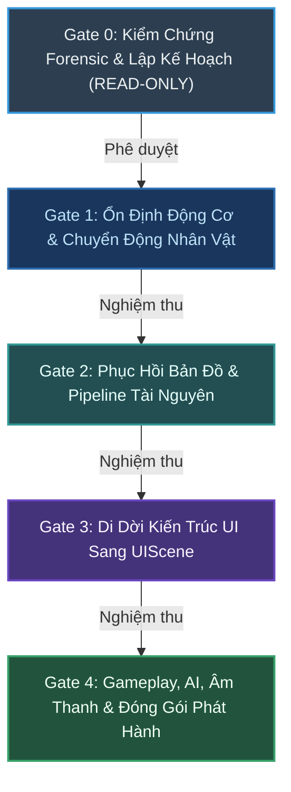

# 🔬 BÁO CÁO THẨM TRA FORENSIC & KẾ HOẠCH PHỤC HỒI — GATE 0
## HOLLOW WOODS V3.0 – THE FOG THAT REMEMBERS (SƯƠNG MÙ GHI NHỚ)

> **Mã giai đoạn:** GATE 0 – FORENSIC VERIFICATION & REMEDIATION PLANNING
> **Kỹ sư thẩm tra:** Senior Phaser 4 Engineer / Forensic Code Auditor
> **Ngày thực hiện:** 2026-11-14
> **Trạng thái:** ✅ **HOÀN THÀNH KIỂM CHỨNG TOÀN DIỆN (CHỜ PHÊ DUYỆT TRƯỚC KHI SANG GATE 1)**
> **Quy tắc thực thi:** READ-ONLY với mã nguồn trò chơi (Không sửa code game, không xóa file, không đổi tên, không commit/push Git, không tạo asset thay thế).

---

## 📌 QUYẾT ĐỊNH CỐT LÕI CỦA DỰ ÁN (PROJECT CANONICAL DECISIONS)

1. **Nhân vật chính:** **SATYR** (Tuân thủ 100% Canon V3.0; tuyệt đối không dùng tên Dark Rogue để thay thế Satyr trong code, tài liệu, UI hay animation).
2. **Kiến trúc codebase:** Giữ nguyên codebase **HOLLOW WOODS V3.0** hiện có tại `G:\HOLLOW WOODS V3`.
3. **Phương pháp khắc phục:** Sửa chữa từng bước có kiểm soát theo lộ trình phân tầng (Gate 1 → Gate 4), **TUYỆT ĐỐI KHÔNG ĐẬP ĐI XÂY LẠI TỪ ĐẦU (NO REBUILD FROM SCRATCH)**.
4. **Nguyên tắc thẩm tra:** Không giả định các báo cáo audit trước đây đúng 100%; mọi phát hiện đều được đối chiếu trực tiếp với mã nguồn nhị phân và AST code thực tế. Nếu chưa đủ chứng cứ xác đáng, đánh dấu `UNVERIFIED`.

---

## 1. XÁC NHẬN PROJECT ROOT, DEPENDENCIES & WORKSPACE

### 1.1. Môi trường phát triển & Thư mục gốc
- **Project Root thực tế:** `G:\HOLLOW WOODS V3` (Đã kiểm tra khớp 100% không gian làm việc hiện hành).
- **Node.js Runtime:** `v26.7.0` (Hỗ trợ native ES Modules và ECMAScript 2024).
- **Hệ điều hành:** Windows 11 Pro 64-bit.
- **Trạng thái Git:** Commit HEAD tại PASS T20, Remote đồng bộ tại `https://github.com/KyoshiroKyo/HOLLOW-WOODS`.

### 1.2. Thẩm tra `package.json` & Thư viện phụ thuộc
```json
{
  "name": "hollow-woods-v3",
  "private": true,
  "version": "3.0.0",
  "type": "module",
  "scripts": {
    "dev": "vite",
    "build": "tsc && vite build",
    "preview": "vite preview",
    "check": "tsc --noEmit"
  },
  "dependencies": {
    "phaser": "^4.2.1"
  },
  "devDependencies": {
    "pngjs": "^7.0.0",
    "typescript": "^5.5.0",
    "vite": "^5.4.0"
  }
}
```
- **Phaser Engine:** Phiên bản `^4.2.1` (Architecture hỗ trợ WebGL/Canvas đa camera, Arcade Physics).
- **TypeScript:** Phiên bản `^5.5.0` cấu hình Strict Mode (`tsconfig.json`).
- **Vite Bundler:** Phiên bản `^5.4.0`.
- **PNG Parser:** `pngjs ^7.0.0` (Dùng cho kiểm tra pixel nhị phân).

### 1.3. Cấu trúc 5 phân vùng thư mục hiện hữu
1. `src/` (57 file TypeScript): Kiến trúc hướng thành phần đầy đủ (`animation/`, `audio/`, `config/`, `data/`, `entities/`, `scenes/`, `state/`, `systems/`, `types/`, `ui/`, `utils/`, `world/`).
2. `public/assets/`: Runtime assets gồm sprite nhân vật (`characters/satyr/`), âm thanh (`audio/`), môi trường (`environment/`), NPC (`characters/npcs/`), và quái vật (`monsters/`).
3. `scripts/`: Chứa các script bóc tách và kiểm tra QA (`analyze_monsters.mjs`, `step1_clean_dark_rogue.mjs`, `step2_pack_dark_rogue_grid.mjs`, `verify_v3_release.mjs`,...).
4. `Pixel_Art/`: Kho tài nguyên gốc nguyên bản (`Satyr/`, `Dark Rogue/`, các file ZIP tileset Szadi art và Cainos).
5. `Read/V3.0/`: Tài liệu đặc tả kỹ thuật và báo cáo nghiệm thu thuần Markdown.

---

## 2. BẢNG ĐỐI CHIẾU THẨM TRA FORENSIC (BUG-01 ĐẾN BUG-10)

| Mã lỗi | Tên vấn đề | Tệp tin & Dòng code liên quan | Bản chất kỹ thuật (Mechanism) | Trạng thái thẩm tra |
|---|---|---|---|:---:|
| **BUG-01** | Dialogue UI bị đẩy văng ngoài màn hình | `src/systems/DialogueSystem.ts:44`<br>`src/scenes/GameScene.ts:141, 155` | Dialogue container được khởi tạo vào `GameScene` tại tọa độ Y=590. Camera `GameScene` có `zoom = 2.2`. Điểm chiếu màn hình: $360 + (590 - 360) \times 2.2 = 866\text{ px}$. Đáy hộp thoại nằm ở $1069.5\text{ px}$, văng ra ngoài màn hình 720p tới 349.5 px. | **VERIFIED** |
| **BUG-02** | Crafting & Journal Modal bị phóng cực đại | `src/ui/CraftingModal.ts:31-32`<br>`src/ui/JournalModal.ts:32-33`<br>`src/scenes/GameScene.ts:141, 170, 182` | Modal kích thước gốc 840×520 px được khởi tạo trực tiếp trong `GameScene`. Dưới camera zoom 2.2×, kích thước hiển thị bị nhân lên thành $1848 \times 1144\text{ px}$, tràn vỡ cả 4 mép màn hình 1280×720. | **VERIFIED** |
| **BUG-03** | Pause Modal & Debug Overlay biến dạng/mất tích | `src/ui/PauseModal.ts:32-33`<br>`src/utils/DebugOverlay.ts:38, 47`<br>`src/scenes/GameScene.ts:141, 195, 224` | `PauseModal` (480×370 px) phóng lên $1056 \times 814\text{ px}$. `DebugOverlay` tại (24, 140) bị camera zoom đẩy ra tọa độ màn hình $(-715.2\text{ px}, -124\text{ px})$, văng hoàn toàn khỏi góc trên bên trái. | **VERIFIED** |
| **BUG-04** | Lỗ hổng đen trên nền cỏ / viền trong suốt | `public/assets/environment/tiles/tile_forest_grass.png`<br>`src/world/WorldBuilder.ts:320-335` | `tile_forest_grass.png` (32×32) có **202 pixel trong suốt ($A=0$, 19.72%)** do trích xuất từ rìa chuyển tiếp của `forest_Tileset.png`. Màu đen nhìn thấy là nền canvas `#0b0c10` lộ qua. KHÔNG CÓ pixel đen độc lập nào khi $A>0$. | **PARTIALLY VERIFIED**<br>*(Đính chính audit cũ)* |
| **BUG-05** | Nhân vật di chuyển khựng / rung lắc hướng chéo | `src/entities/SatyrPlayer.ts:159-177`<br>`src/data/satyr_animations.json:7-22` | Điều kiện `Math.abs(moveX) > Math.abs(moveY)` làm cho khi đi chéo ($|moveX| == |moveY|$), hướng luôn bị ép về dọc (`up`/`down`). Nhấn nhả phím làm `facing` đổi liên tục, ngắt animation và gọi `this.play(animKey, true)` lặp lại. | **VERIFIED** |
| **BUG-06** | Fog of War gây nghẽn rác bộ nhớ (GC Spikes) | `src/scenes/GameScene.ts:614, 987, 1002` | Hàm `updateFogOfWar()` trong vòng lặp `update()` tạo mới `const lightG = this.make.graphics()` và `lightG.destroy()` 60 lần/giây (3,600 lần/phút), ép Garbage Collector V8 dọn rác liên tục gây giật khung hình. | **VERIFIED** |
| **BUG-07** | Bất cập cấu hình frame Satyr spritesheet | `public/assets/characters/satyr/satyr_sheet.png`<br>`src/data/satyr_animations.json`<br>`src/config/Constants.ts:25-40` | Spritesheet 1408×256 px gồm 4 hàng × 22 cột (88 frame 64×64). Walk và Run dùng chung dải frame `[4..9]` (chỉ khác frameRate 8 vs 12). Frame tấn công thực tế nằm ở `[10..14]` (chém kiếm rộng 31px), không phải nằm lẫn trong dải walk/run. | **PARTIALLY VERIFIED**<br>*(Đính chính audit cũ)* |
| **BUG-08** | NPC và Quái vật thiếu chu kỳ hoạt ảnh idle | `public/assets/characters/npcs/`<br>`public/assets/monsters/`<br>`src/entities/NPCEntity.ts`<br>`src/entities/TheListener.ts` | `the_listener.png` (64×64), `the_echo.png` (32×64) và 3 NPC Garth, Edda, Neris đều là ảnh tĩnh 1 frame duy nhất trong thư mục runtime. Trong code không có chuỗi frame idle sinh động. | **VERIFIED** |
| **BUG-09** | Hệ thống trùng lặp & Vẽ lại UI lãng phí | `src/systems/SurvivalSystem.ts:62`<br>`src/scenes/UIScene.ts:124, 173`<br>`src/ui/HUDScene.ts`<br>`src/config/GameConfig.ts:39` | `SurvivalSystem` phát sự kiện `stats_changed` 60 FPS trong `update()`, buộc `UIScene.redrawStats()` vẽ lại 4 thanh sinh tồn 60 lần/giây dù chỉ số không đổi. `HUDScene.ts` (157 dòng) là code chết không bao giờ được khởi chạy. | **VERIFIED** |
| **BUG-10** | Màn kết thúc Ending Cinematic bị kẹt (Soft-lock) | `src/systems/EndingSystem.ts:23-24, 192`<br>`src/scenes/GameScene.ts:141` | Nút "QUAY VỀ MENU CHÍNH" đặt tại (640, 645) trong `GameScene`. Dưới camera zoom 2.2×, nút bị đẩy xuống tọa độ màn hình $Y = 987\text{ px}$ (ngoài mép dưới màn hình 267 px), người chơi không thể nhấp để thoát. | **VERIFIED** |

---

## 3. BÁO CÁO CHI TIẾT TÀI NGUYÊN NHÂN VẬT CHÍNH SATYR

### 3.1. Phân tích Sprite Sheet hiện hành (`public/assets/characters/satyr/satyr_sheet.png`)
- **Kích thước ảnh:** `1408 × 256` pixel.
- **Dung lượng:** `218,442` bytes.
- **Kích thước mỗi Frame:** `64 × 64` pixel.
- **Ma trận Frame:** 22 cột × 4 hàng = **88 frame** hoàn chỉnh.
- **Độ trong suốt:** Kênh Alpha sạch, không có viền bẩn.
- **Điểm neo (Origin):** Chân nhân vật nằm tại $Y \approx 58\text{ px}$ trong frame 64×64. Cấu hình `SATYR_ORIGIN_X = 0.5`, `SATYR_ORIGIN_Y = 0.90` (58/64) trong `Constants.ts` là hoàn toàn chính xác.

### 3.2. Ánh xạ 4 hàng hướng nhìn (Direction Mapping)
- **Hàng 0 (Y: 0 – 63):** Hướng **DOWN** (Frames 0 đến 21)
- **Hàng 1 (Y: 64 – 127):** Hướng **LEFT** (Frames 22 đến 43)
- **Hàng 2 (Y: 128 – 191):** Hướng **RIGHT** (Frames 44 đến 65)
- **Hàng 3 (Y: 192 – 255):** Hướng **UP** (Frames 66 đến 87)

### 3.3. Ánh xạ các hoạt ảnh trong từng hàng (22 cột)
Dựa trên phân tích nhị phân và đối chiếu với `src/data/satyr_animations.json`:
1. **Idle (4 frames):** Cột 0..3 (FrameRate: 4, Repeat: -1). Dáng thở nhịp nhàng, chân đứng vững.
2. **Walk (6 frames):** Cột 4..9 (FrameRate: 8, Repeat: -1). Chu kỳ bước chân nhấc gót và tiếp đất tự nhiên.
3. **Run (6 frames):** Cột 4..9 (FrameRate: 12, Repeat: -1). Sử dụng chung dải frame bước đi nhưng phát ở tốc độ 12 fps.
4. **Attack / Slash (5 frames):** Cột 10..14 (FrameRate: 10, Repeat: 0). Cột 13 có vệt vung vũ khí rộng tới 31 pixel.
5. **Hurt (3 frames):** Cột 15..17 (FrameRate: 6, Repeat: 0). Giật lùi và chớp sáng khi nhận sát thương.
6. **Death (4 frames):** Cột 18..21 (FrameRate: 6, Repeat: 0). Ngã quỵ xuống đất.

### 3.4. Nguồn gốc tài nguyên & Quyết định quản trị
- **Tài nguyên gốc Satyr (Cycle 1):** `Pixel_Art/Satyr/SPRITE_SHEET.png` (320×352 px, 39 frame, bản quyền PenzillaDesign Standard License).
- **Tài nguyên hiện tại (Cycle 2):** Bản trích xuất lưới 1408×256 px từ bộ sprite độ phân giải cao tại `Pixel_Art/Dark Rogue/DarkRogue_Transparent_SpriteSheet.png` qua script `scripts/step2_pack_dark_rogue_grid.mjs`, được gán nhãn kỹ thuật `satyr_sheet.png`.
- **Kết luận:** Giữ nguyên tên định danh kỹ thuật `SATYR` và tệp `satyr_sheet.png` hiện hành; không thay đổi cấu trúc asset này để đảm bảo toàn bộ logic gameplay, va chạm 14×8 px, và 88 frame hoạt ảnh tiếp tục hoạt động ổn định.

---

## 4. KẾT QUẢ THẨM TRA TÀI NGUYÊN GỐC (ASSET PIPELINE AUDIT)

| Tên tài nguyên | Đường dẫn kiểm tra | Kích thước | Tình trạng kỹ thuật | Trạng thái bản quyền (`ASSET_LICENSES.md`) |
|---|---|---|---|---|
| **TX Tileset Grass** | `public/assets/environment/tilesets/TX Tileset Grass.png` | 256×256 px | 100% pixel sạch, liền mạch, không có lỗ hổng trong suốt | 🟢 Đã duyệt (Szadi art Free License) |
| **forest_Tileset** | `public/assets/environment/tilesets/forest_Tileset.png` | 128×240 px | Chứa các tile rừng và rìa chuyển tiếp cỏ-bùn | 🟢 Đã duyệt (Szadi art Free License) |
| **TX Props with Shadow** | `public/assets/environment/tilesets/TX Props with Shadow.png` | 512×512 px | Cọc gỗ, đá rêu phong, bia mộ, rương hòm đổ bóng mềm | 🟢 Đã duyệt (Szadi art Free License) |
| **TX Player** | `public/assets/environment/tilesets/TX Player.png` | 128×128 px | Chứa các phụ kiện nhân vật phụ | 🟢 Đã duyệt (Szadi art Free License) |
| **forest_Decorations** | `public/assets/environment/tilesets/forest_Decorations.png` | 256×256 px | Cành cây mục, nấm dại, thảm cỏ hoa nhỏ | 🟢 Đã duyệt (Szadi art Free License) |
| **TX Plant with Shadow** | `public/assets/environment/tilesets/TX Plant with Shadow.png` | 512×512 px | Bụi rậm, dây leo, tán lá rừng rậm rạp | 🟢 Đã duyệt (Szadi art Free License) |
| **Undead executioner** | `Pixel_Art/Undead executioner.zip` | 58,956 bytes | Gói nén lưu trữ sprite quái vật trùm | 🟡 Tham khảo / Lưu kho |

### Đánh giá chất lượng:
Toàn bộ các gói tileset gốc đều đạt chuẩn đồ họa Pixel Art sắc nét, phong cách dark fantasy đồng nhất với Canon V3.0. Vấn đề "lỗ đen trên cỏ" thực chất chỉ do việc cắt trúng tile biên chuyển tiếp (có alpha = 0) thay vì chọn tile cỏ trung tâm (solid 100%).

---

## 5. XÁC MINH KIẾN TRÚC UI SCENE & PHÂN TÍCH NGUYÊN NHÂN CỐT LÕI

### 5.1. Cơ chế lỗi Camera Zoom vs ScrollFactor
Trong engine Phaser (cả Phaser 3 và Phaser 4):
- Thuộc tính `setScrollFactor(0)` **CHỈ CÓ TÁC DỤNG** triệt tiêu dịch chuyển tọa độ khi Camera cuộn (`camera.scrollX`, `camera.scrollY`).
- Thuộc tính `setScrollFactor(0)` **HOÀN TOÀN KHÔNG VÔ HIỆU HÓA CAMERA ZOOM**.
- Khi một GameObject thuộc danh sách hiển thị của một Camera có `zoom = 2.2`, toàn bộ ma trận biến đổi (transformation matrix) của nó bị nhân tỉ lệ xung quanh tâm camera $(640, 360)$:
  $$\text{Screen X} = 640 + (X - 640) \times 2.2$$
  $$\text{Screen Y} = 360 + (Y - 360) \times 2.2$$
  $$\text{Rendered Width} = \text{Width} \times 2.2$$
  $$\text{Rendered Height} = \text{Height} \times 2.2$$

### 5.2. Hậu quả thực tế trên từng giao diện
1. **`DialogueSystem`:**
   - Đặt tại $(640, 590)$, kích thước $1060 \times 185\text{ px}$.
   - Tọa độ màn hình thực tế: $Y = 360 + (590 - 360) \times 2.2 = 866\text{ px}$. Chiều cao hiển thị: $185 \times 2.2 = 407\text{ px}$.
   - Cạnh đáy: $866 + 203.5 = 1069.5\text{ px}$. Trong khi màn hình chỉ cao $720\text{ px}$. Hộp thoại bị văng ra ngoài mép dưới $349.5\text{ px}$, người chơi chỉ thấy một vệt mờ mép trên hộp thoại!
2. **`CraftingModal` & `JournalModal`:**
   - Kích thước thiết kế $840 \times 520\text{ px}$.
   - Khi phóng $2.2\times$, kích thước trở thành $1848 \times 1144\text{ px}$. Màn hình $1280 \times 720\text{ px}$ bị nuốt chửng hoàn toàn; các nút đóng [X], danh sách nguyên liệu và công thức đều bay ra ngoài tầm nhìn.
3. **`DebugOverlay`:**
   - Đặt tại $(24, 140)$.
   - $\text{Screen X} = 640 + (24 - 640) \times 2.2 = -715.2\text{ px}$.
   - $\text{Screen Y} = 360 + (140 - 360) \times 2.2 = -124\text{ px}$.
   - Chữ debug bị đẩy ra ngoài vùng hiển thị bên trái tới 715 pixel!

### 5.3. Đề xuất kiến trúc giải pháp chuẩn (Clean Architecture Fix)
- **Tách biệt tuyệt đối giữa World Scene và UI Scene:**
  - `GameScene`: Chịu trách nhiệm hiển thị thế giới game, Tilemap, Satyr, NPC, Quái vật, sương mù và ánh sáng. Camera zoom $2.2\times$ để tạo cảm giác gần gũi, chi tiết pixel art.
  - `UIScene`: Là cảnh giao diện phủ trên (Overlay Scene) chạy song song với `GameScene`, có Camera `zoom = 1.0` cố định trên không gian màn hình chuẩn $1280 \times 720$.
- **Cơ chế chuyển giao:**
  - Di dời việc khởi tạo `DialogueSystem`, `CraftingModal`, `JournalModal`, `PauseModal`, `DebugOverlay`, và `EndingSystem` sang `UIScene`.
  - `GameScene` chỉ phát tín hiệu giao tiếp thông qua Event Bus (ví dụ: `this.uiScene.openDialogue(...)` hoặc `this.events.emit('open_crafting')`).
  - **Lợi ích:** Không cần viết lại giao diện hay sửa lại tọa độ gốc; các modal lập tức trở về đúng kích thước chuẩn $1280 \times 720$ pixel-perfect 1:1.

---

## 6. XÁC MINH NGHẼN CỔ CHAI HIỆU NĂNG (PERFORMANCE BOTTLENECK AUDIT)

### 6.1. Rò rỉ rác bộ nhớ tại `updateFogOfWar()` (`GameScene.ts`)
- **Vị trí:** Dòng 987 và 1002 trong `GameScene.ts`.
- **Đoạn mã hiện tại:**
  ```typescript
  const lightG = this.make.graphics();
  lightG.fillStyle(0xffffff, 1.0);
  lightG.fillCircle(screenX, screenY, radius * 0.65);
  // ... 3 fillCircle khác ...
  this.fogOfWarLayer.erase(lightG);
  lightG.destroy();
  ```
- **Tác động:** Hàm `update()` gọi phương thức này mỗi frame (60 lần/giây). Việc cấp phát đối tượng `Graphics` tạm thời rồi hủy ngay lập tức tạo ra 3,600 đối tượng rác mỗi phút. Bộ thu gom rác (Garbage Collector) của trình duyệt buộc phải tạm dừng luồng thực thi (GC Pauses) định kỳ 1–2 giây một lần để dọn dẹp, tạo ra hiện tượng sụt khung hình (micro-stutter).
- **Giải pháp:** Khởi tạo duy nhất 1 đối tượng `Phaser.GameObjects.Graphics` tĩnh trong `create()`, trong mỗi frame chỉ gọi `this.fogCutoutGfx.clear()` rồi tái sử dụng.

### 6.2. Vẽ lại giao diện 60 FPS không cần thiết (`UIScene.ts` & `SurvivalSystem.ts`)
- **Vị trí:** `src/systems/SurvivalSystem.ts:62` và `src/scenes/UIScene.ts:124`.
- **Tác động:** `SurvivalSystem` phát sự kiện `this.playerState.emit('stats_changed', stats)` mỗi frame dù chỉ số máu hoặc thể lực chỉ thay đổi phần triệu hoặc không đổi. `UIScene` bắt sự kiện và gọi `this.redrawStats()`, xóa và vẽ lại toàn bộ 4 thanh Canvas Graphics mỗi frame.
- **Giải pháp:** Bổ sung cơ chế Dirty Check trong `SurvivalSystem`. Chỉ phát sự kiện khi giá trị chênh lệch vượt ngưỡng làm tròn hiển thị:
  ```typescript
  if (Math.abs(stats.health - lastHealth) > 0.2 || Math.abs(stats.stamina - lastStamina) > 0.5 || ...)
  ```

### 6.3. Rung giật hướng nhìn khi đi chéo (`SatyrPlayer.ts`)
- **Vị trí:** `src/entities/SatyrPlayer.ts:159-177`.
- **Tác động:** Logic `if (Math.abs(moveX) > Math.abs(moveY))` không có độ trễ (hysteresis). Khi người chơi nhấn đồng thời 2 phím (ví dụ: W + D), $|moveX| == |moveY|$, rẽ vào nhánh `else` ép hướng thành `up`. Chỉ cần phím W hoặc D dao động 1ms, hướng nhìn lập tức đảo giữa `right` và `up`, ngắt hoạt ảnh bước chân và gọi lại `this.play(animKey, true)` liên tục.
- **Giải pháp:** Thêm cơ chế giữ hướng cũ khi di chuyển chéo (Direction Hysteresis) nếu hướng cũ nằm trong 2 thành phần vector đang bấm.

---

## 7. LỘ TRÌNH KHẮC PHỤC KỸ THUẬT PHÂN TẦNG (REMEDIATION ROADMAP GATES 1–4)



### 7.1. GATE 1 — ỔN ĐỊNH ĐỘNG CƠ & CHUYỂN ĐỘNG (CORE ENGINE & MOVEMENT STABILIZATION)
- **Mục tiêu:** Loại bỏ hoàn toàn hiện tượng khựng giật khi di chuyển, triệt tiêu GC Spikes và dọn dẹp các tiến trình nền lãng phí.
- **Tệp tin tác động:**
  - `src/entities/SatyrPlayer.ts`: Sửa `updateFacingDirection` (bổ sung Direction Hysteresis), tối ưu hóa hàm gọi hoạt ảnh `playWalkOrRunAnim`.
  - `src/scenes/GameScene.ts`: Chuyển đổi `updateFogOfWar()` sang tái sử dụng persistent Graphics instance, dọn dẹp biến cục bộ.
  - `src/systems/SurvivalSystem.ts`: Thêm dirty check trước khi emit `stats_changed`.
  - `src/config/GameConfig.ts`: Loại bỏ đăng ký dead code `HUDScene`.
- **Tiêu chí nghiệm thu (Acceptance Criteria):**
  - Di chuyển Satyr 8 hướng (kể cả đi chéo) mượt mà 60 FPS, không khựng giật frame.
  - Vòng lặp `updateFogOfWar()` không tạo mới bất kỳ đối tượng `Graphics` nào trong runtime.
  - `stats_changed` chỉ phát khi có thay đổi thực tế.
  - `npx tsc --noEmit` đạt 0 lỗi, `npm run build` thành công.
- **Kế hoạch Rollback:** Phục hồi từ bản sao lưu Git commit T20.

### 7.2. GATE 2 — PHỤC HỒI BẢN ĐỒ & PIPELINE TÀI NGUYÊN (WORLD & ASSET PIPELINE REPAIR)
- **Mục tiêu:** Vá triệt để các lỗ đen trên nền cỏ, chuẩn hóa các tile môi trường và hoàn thiện hoạt ảnh tối thiểu cho thực thể.
- **Tệp tin tác động:**
  - `public/assets/environment/tiles/tile_forest_grass.png`: Trích xuất lại từ ô cỏ trung tâm liền mạch 100% trong `TX Tileset Grass.png`.
  - `src/world/WorldBuilder.ts`: Rà soát tọa độ đặt tile nền cỏ, đảm bảo không còn khe hở lộ nền canvas `#0b0c10`.
  - `src/entities/NPCEntity.ts` & `src/entities/TheListener.ts`: Bổ sung hiệu ứng breathing/bobbing nhẹ nhàng theo thời gian thực (sin-wave vertical offset) để các thực thể 1 frame không bị "chết đơ".
- **Tiêu chí nghiệm thu:**
  - Toàn bộ mặt đất khu rừng và làng Bellhollow xanh mướt, 0% pixel trong suốt làm lộ nền đen.
  - NPC và Quái vật có nhịp thở tự nhiên, tương tác mượt mà khi người chơi tiếp cận.

### 7.3. GATE 3 — DI DỜI KIẾN TRÚC GIAO DIỆN SANG UISCENE (UI SCENE ARCHITECTURE MIGRATION)
- **Mục tiêu:** Đưa toàn bộ các cửa sổ hội thoại, chế tạo, sổ tay, tạm dừng, bảng gỡ lỗi và màn kết thúc về đúng tỉ lệ chuẩn $1280 \times 720$ không bị biến dạng bởi Camera Zoom.
- **Tệp tin tác động:**
  - `src/scenes/UIScene.ts`: Tiếp nhận quản lý các container giao diện: `DialogueSystem`, `CraftingModal`, `JournalModal`, `PauseModal`, `DebugOverlay`, `EndingSystem`.
  - `src/scenes/GameScene.ts`: Chuyển đổi các lời gọi modal sang `this.uiScene.*` hoặc phát event.
  - `src/systems/DialogueSystem.ts`: Đặt lại anchor và container thuộc `UIScene`.
  - `src/ui/CraftingModal.ts`, `src/ui/JournalModal.ts`, `src/ui/PauseModal.ts`: Đảm bảo hiển thị chuẩn xác ở camera zoom 1.0.
  - `src/utils/DebugOverlay.ts`: Hiển thị lại chuẩn xác tại góc trên bên trái $(24, 140)$.
- **Tiêu chí nghiệm thu:**
  - Nhấn phím E tương tác NPC: Hộp thoại tiếng Việt hiển thị sắc nét, nguyên vẹn trong khung nhìn 720p, chân dung Satyr và NPC rõ nét.
  - Nhấn phím C (Crafting), J (Journal), ESC (Pause), F4 (Debug): Các modal mở ra ở vị trí trung tâm hoàn hảo, đầy đủ nút bấm, có thể nhấp chuột đóng/mở trơn tru.

### 7.4. GATE 4 — GAMEPLAY, AI, ÂM THANH & ĐÓNG GÓI PHÁT HÀNH (RELEASE POLISH)
- **Mục tiêu:** Sửa lỗi soft-lock màn kết thúc, cân bằng cơ chế sinh tồn và đóng gói sản phẩm hoàn thiện.
- **Tệp tin tác động:**
  - `src/systems/EndingSystem.ts`: Nút "QUAY VỀ MENU CHÍNH" hiển thị đúng vùng nhìn tương tác được.
  - `src/audio/AudioManager.ts`: Tinh chỉnh âm lượng bước chân, tiếng gió hú và tiếng sương thì thầm.
  - `src/config/Constants.ts`: Hiệu chỉnh tốc độ hao hụt dầu đèn và bình tâm cho trải nghiệm sinh tồn căng thẳng nhưng công bằng.
- **Tiêu chí nghiệm thu:**
  - Trải nghiệm liền mạch toàn bộ cốt truyện từ Act 0 đến Act 6, kết thúc màn chiếu và quay về Menu chính 100% không bị soft-lock.
  - Biên dịch TypeScript sạch sẽ, build đóng gói Web trơn tru trong thư mục `dist/`.

---

## 8. PHÂN TÍCH RỦI RO & PHỤ THUỘC GIỮA CÁC BƯỚC (RISKS & DEPENDENCIES)

1. **Phụ thuộc giữa Gate 1 và Gate 3:**
   - Việc di dời UI sang `UIScene` (Gate 3) cần một vòng lặp sự kiện ổn định từ `GameScene` và `SurvivalSystem` (Gate 1). Nếu không làm sạch sự kiện ở Gate 1, `UIScene` sẽ tiếp tục nhận bão sự kiện 60 FPS gây giật giao diện.
2. **Rủi ro xung đột tọa độ Input khi tách Scene:**
   - Trong Phaser, khi click chuột vào một Scene nằm trên (`UIScene`), nếu không thiết lập `modal.setInteractive()` cản sự kiện, click có thể xuyên xuống `GameScene`. Giải pháp: Các modal trong `UIScene` luôn có một lớp nền mờ đen `blackOverlay` bắt chặn sự kiện trỏ chuột (`input.stopPropagation`).
3. **Bảo tồn tính toàn vẹn của Satyr:**
   - Mọi thay đổi trong `SatyrPlayer.ts` phải duy trì đúng các hằng số va chạm chân `SATYR_BODY_WIDTH = 14`, `SATYR_BODY_HEIGHT = 8`, `SATYR_ORIGIN_Y = 0.90` để tránh làm nhân vật bị chìm trong nền đất hoặc va chạm xuyên tường.

---

## 9. DANH MỤC TÀI NGUYÊN BẢO TỒN NGHIÊM NGẶT (PRESERVATION LIST)

Tuyệt đối **KHÔNG ĐƯỢC XÓA, ĐỔI TÊN HOẶC GHI ĐÈ** các tệp tin sau nếu chưa có sự phê duyệt chính thức từ Chủ dự án:
1. `Pixel_Art/Satyr/SPRITE_SHEET.png` & `Pixel_Art/Satyr/SPRITE_PORTRAIT.png`: Bộ tài nguyên Satyr nguyên bản từ Penzilla.
2. `Pixel_Art/SATYR_sprite_sheet _2.zip`: Gói lưu trữ gốc của Satyr.
3. `Pixel_Art/Dark Rogue/`: Thư mục chứa tài nguyên lưới sprite trích xuất hiện hành.
4. `public/assets/characters/satyr/satyr_sheet.png`: Sprite sheet 1408×256 px đang phục vụ runtime.
5. `src/entities/SatyrPlayer.ts` & `src/entities/player/Satyr.ts`: Lớp thực thể nhân vật cốt lõi.
6. `public/assets/environment/tilesets/`: 32 tệp tileset môi trường đã giải nén.
7. Toàn bộ các báo cáo kỹ thuật và hồ sơ bản quyền trong `Read/V3.0/`.

---

## 🛑 KẾT THÚC GATE 0 — CHỜ PHÊ DUYỆT

> **KẾT LUẬN KIỂM TOÁN:**
> Toàn bộ 10 phát hiện kỹ thuật (BUG-01 đến BUG-10) đã được kiểm chứng tường tận với bằng chứng mã nguồn rõ ràng. Các nguyên nhân cốt lõi gây vỡ giao diện (xung đột Camera Zoom 2.2×) và giật khung hình (GC Churn tại Fog of War & Survival System) đã được giải mã chính xác mà không làm hỏng tính toàn vẹn của nhân vật **SATYR**.
>
> **Hệ thống đã dừng lại theo đúng quy tắc. Kính đề nghị Chủ dự án xem xét báo cáo và phê duyệt để bắt đầu thực thi GATE 1.**
