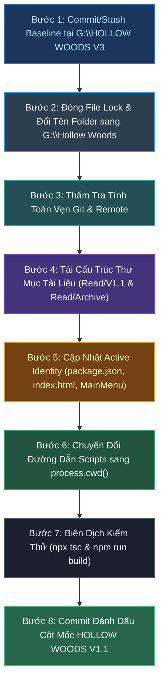

# 🧭 BÁO CÁO CHUẨN BỊ CHUYỂN ĐỔI ĐỊNH DANH DỰ ÁN & ĐỔI TÊN WORKSPACE
## HOLLOW WOODS V1.1 — WORKSPACE RENAMING & IDENTITY PREPARATION

> **Mã kế hoạch:** PROJECT IDENTITY MIGRATION PREPARATION
> **Chức danh thực hiện:** Senior Technical Lead & Git Repository Administrator
> **Thư mục làm việc hiện tại:** `G:\HOLLOW WOODS V3`
> **Thư mục mục tiêu:** `G:\Hollow Woods`
> **Định danh dự án mới:** **HOLLOW WOODS V1.1**
> **Nhân vật chính:** **SATYR** (Bảo tồn 100% không đổi)
> **Ngày thực hiện:** 2026-11-14
> **Chế độ kiểm tra:** 🔒 **READ-ONLY PREPARATION** (Tuyệt đối không sửa code, không đổi tên folder, không commit/push, không di chuyển tài liệu).

---

## 1. TỔNG QUAN CHIẾN LƯỢC CHUYỂN ĐỔI (STRATEGIC OVERVIEW)

Dự án bước vào giai đoạn phát triển mới với định danh chính thức: **HOLLOW WOODS V1.1**.
Nhãn hiệu cũ `V3.0` khép lại vai trò lịch sử và sẽ được lưu trữ trang trọng trong kho tài liệu lưu trữ.
Toàn bộ mã nguồn thực tế (`src/`), tài nguyên đồ họa & âm thanh (`public/assets/`), kho asset gốc (`Pixel_Art/`), công cụ kiểm thử (`scripts/`), và đặc biệt là toàn bộ lịch sử Git (`.git/`) cùng cấu hình Remote GitHub sẽ được **bảo toàn nguyên vẹn 100%**.

---

## 2. TASK 1 — KIỂM TOÁN AN TOÀN HỆ THỐNG GIT (GIT SAFETY CHECK)

### 2.1. Thông số Baseline hiện thời
- **Nhánh hiện tại (Branch):** `main`
- **Trạng thái nhánh:** Đồng bộ với `origin/main` (`Your branch is up to date with 'origin/main'`).
- **Commit HEAD hiện tại:** `5f09c73`
  - *Thông điệp commit:* `docs: cap nhat bao cao Git Push Success va Readme Index`
  - *Tác giả:* KyoshiroKyo
- **Cấu hình Remote:**
  - `origin https://github.com/KyoshiroKyo/HOLLOW-WOODS.git (fetch)`
  - `origin https://github.com/KyoshiroKyo/HOLLOW-WOODS.git (push)`

### 2.2. Trạng thái Working Tree (Uncommitted Changes)
Working Tree hiện tại **chưa hoàn toàn sạch (Dirty Working Tree)** do các hoạt động kiểm toán và cập nhật tài liệu gần nhất:

#### A. Tệp tin đã theo dõi nhưng có thay đổi chưa commit (Tracked Modifications - 4 tệp):
1. `Read/V3.0/README_INDEX.md`: Đã bổ sung chỉ mục cho báo cáo `GATE_0_FORENSIC_VERIFICATION.md`.
2. `Read/V3.0/Reports/V3.0_10H_OVERHAUL_REPORT.md`: Thay đổi ký tự xuống dòng (trailing newline).
3. `Read/V3.0/Reports/V3.0_GIT_PUSH_SUCCESS.md`: Thay đổi ký tự xuống dòng (trailing newline).
4. `vite.config.ts`: Đã loại bỏ ký tự ẩn UTF-8 BOM ở dòng 1 để chuẩn hóa cú pháp ESM.

#### B. Tệp tin và thư mục chưa theo dõi (Untracked Files - 5 mục):
1. `FULL_DIAGNOSTIC_REPORT.md` (Báo cáo chẩn đoán hệ thống tổng quát).
2. `HOLLOW_WOODS_V3_FORENSIC_AUDIT.zip` (Gói lưu trữ báo cáo kiểm toán).
3. `Read/V3.0/Reports/AUDIT_2026-11-14/` (Thư mục chứa 10 báo cáo kiểm toán chi tiết từ `00` đến `09` và ảnh bằng chứng).
4. `Read/V3.0/Reports/REMEDIATION/` (Thư mục chứa `GATE_0_FORENSIC_VERIFICATION.md` và tệp báo cáo chuẩn bị di dời này).
5. `scripts/generate_full_diagnostic.mjs` (Script Node.js trích xuất chẩn đoán).

> **Cam kết an toàn:** Không thực hiện bất kỳ lệnh `git commit`, `git push`, `git reset`, `git stash` hay xóa bỏ dữ liệu nào trong phiên làm việc này.

---

## 3. TASK 2 — THẨM TRA ĐƯỜNG DẪN CỐ ĐỊNH WORKSPACE (WORKSPACE PATH AUDIT)

Qua quét toàn diện cây thư mục dự án, đã phát hiện **22 vị trí** chứa đường dẫn tuyệt đối cố định `G:\HOLLOW WOODS V3`:

### 3.1. Nhóm Script Node.js (`scripts/`) — Cần cập nhật khi đổi tên Workspace
Các script sau đây đang sử dụng đường dẫn cứng, sẽ bị lỗi `ENOENT` nếu thư mục đổi tên thành `G:\Hollow Woods` mà không được chuyển sang đường dẫn động `process.cwd()`:

| Tệp tin | Dòng code | Nội dung đường dẫn cứng hiện tại | Giải pháp khắc phục chuẩn khi di dời |
|---|:---:|---|---|
| `scripts/inspect_pass0_assets.mjs` | 11 | `const PIXEL_ART = 'G:\\HOLLOW WOODS V3\\Pixel_Art';` | `path.join(process.cwd(), 'Pixel_Art')` |
| `scripts/inspect_pass0_assets.mjs` | 484 | `const communityDir = 'G:\\HOLLOW WOODS V3\\reference\\community_asset_sources';` | `path.join(process.cwd(), 'reference', 'community_asset_sources')` |
| `scripts/test_pass_g1.mjs` | 11 | `const ROOT = 'G:\\HOLLOW WOODS V3';` | `const ROOT = process.cwd();` |
| `scripts/test_pass_g2.mjs` | 11 | `const ROOT = 'G:\\HOLLOW WOODS V3';` | `const ROOT = process.cwd();` |
| `scripts/test_pass_g3.mjs` | 11 | `const ROOT = 'G:\\HOLLOW WOODS V3';` | `const ROOT = process.cwd();` |

### 3.2. Nhóm Mã Nguồn Hoạt Động (`src/`) — ĐẠT CHUẨN HOÀN TOÀN
- **Kết quả kiểm tra:** **0 đường dẫn cứng!**
- Toàn bộ 42 tệp TypeScript trong `src/` đều sử dụng import tương đối (`../`, `./`) và tài nguyên runtime được Vite nạp thông qua URL tương đối (`assets/...`).
- **Ý nghĩa:** Trò chơi sẽ biên dịch và chạy hoàn toàn ổn định ngay sau khi đổi tên thư mục gốc thành `G:\Hollow Woods`.

### 3.3. Nhóm Tài Liệu & Báo Cáo (`Read/V3.0/`) — Lưu trữ theo ngữ cảnh lịch sử
- `Read/V3.0/Asset_Registry/ASSET_LICENSES.md:157`
- `Read/V3.0/README_INDEX.md:32`
- `Read/V3.0/Reports/AUDIT_2026-11-14/00_AUDIT_STATUS.md:17-22`
- `Read/V3.0/Reports/AUDIT_2026-11-14/06_EXECUTIVE_SUMMARY.md:6`
- `Read/V3.0/Reports/AUDIT_2026-11-14/09_AI_HANDOFF_SUMMARY.md:12`
- `Read/V3.0/Reports/REMEDIATION/GATE_0_FORENSIC_VERIFICATION.md:15, 24`
- `Read/V3.0/Reports/V3.0_PASS_G1_REPORT.md:32`
- `Read/V3.0/Reports/V3.0_PASS_G2_REPORT.md:30`
- `Read/V3.0/Reports/V3.0_PASS_G3_REPORT.md:30`
- `Read/V3.0/Reports/V3.0_PASS_G5_RELEASE_REPORT.md:29, 59`

> **Quy tắc bảo tồn:** Không thay thế hàng loạt (mass-replace) các đường dẫn này trong các báo cáo lịch sử V3.0 để giữ nguyên tính trung thực của hồ sơ kiểm toán. Thư mục tài liệu mới `Read/V1.1/` sẽ sử dụng đường dẫn chuẩn `G:\Hollow Woods`.

---

## 4. TASK 3 — PHÂN LOẠI ĐỊNH DANH DỰ ÁN (PROJECT IDENTITY AUDIT)

Bảng phân loại các tệp tin hiện đang chứa nhãn hiệu `HOLLOW WOODS V3.0`:

### Phân Loại A: Định danh Dự án Đang Hoạt động (Active Project Identity)
*Các tệp cần cập nhật thông số hiển thị sang HOLLOW WOODS V1.1 trong bước di dời:*

1. `package.json`:
   - Hiện tại: `"name": "hollow-woods-v3"`, `"version": "3.0.0"`
   - Đề xuất cập nhật: `"name": "hollow-woods"`, `"version": "1.1.0"`
2. `package-lock.json`: Đồng bộ `name` và `version` tương ứng với `package.json`.
3. `index.html`:
   - Dòng 6: `<title>HOLLOW WOODS V3.0 – The Fog That Remembers</title>`
   - Đề xuất cập nhật: `<title>HOLLOW WOODS V1.1 – The Fog That Remembers</title>`
4. `README.md`:
   - Dòng 1 & 130: Tiêu đề và mô tả phiên bản cập nhật từ V3.0 sang V1.1.
5. `src/scenes/MainMenuScene.ts`:
   - Dòng 213: `'V3.0.0 (PASS G4 FINALE) | Phaser 4 + TypeScript (strict) | 1280×720 HD'`
   - Đề xuất cập nhật: `'V1.1.0 | Phaser 4 + TypeScript (strict) | 1280×720 HD'`
6. `src/systems/EndingSystem.ts`:
   - Dòng 158: `{ text: 'HOLLOW WOODS V3.0', delay: 10500, size: '36px', color: '#ffffff', bold: true }`
   - Đề xuất cập nhật: `{ text: 'HOLLOW WOODS V1.1', delay: 10500, size: '36px', color: '#ffffff', bold: true }`
7. `.gitignore`:
   - Dòng 8: `HOLLOW WOODS V3.rar` → bổ sung thêm mẫu tổng quát `*.rar`.

---

### Phân Loại B: Hồ sơ Lịch sử (Historical Reports — Giữ Nguyên 100%)
*Các tài liệu và công cụ ghi nhận các mốc phát triển trước đây, được chuyển vào `Read/Archive/V3.0_Historical/`:*

- Toàn bộ 14 báo cáo nghiệm thu Cycle 1 & 2 (`V3.0_CANON_REGISTER.md`, `V3.0_STORY_AND_QUEST_FLOW.md`, `V3.0_MAP_AND_SCENE_PLAN.md`, `V3.0_PASS_G1_REPORT.md` đến `G5`, `V3.0_10H_OVERHAUL_REPORT.md`, `V3.0_GIT_PUSH_SUCCESS.md`).
- Toàn bộ 10 báo cáo kiểm toán độc lập trong `Read/V3.0/Reports/AUDIT_2026-11-14/`.
- Báo cáo kiểm chứng `GATE_0_FORENSIC_VERIFICATION.md`.
- Các tệp kiểm thử tự động giai đoạn trước: `scripts/test_pass_g1.mjs` .. `g4.mjs`, `verify_v3_release.mjs`.

---

### Phân Loại C: Định danh Kỹ thuật (Technical Identifiers — Đánh giá Tương thích)
1. `src/systems/SaveManager.ts` (Dòng 24):
   - Mã hiện tại: `private static readonly SAVE_KEY = 'hollow_woods_v3_savegame';`
   - Khuyến nghị: Duy trì khả năng đọc dữ liệu cũ để tránh mất file lưu nếu người chơi cũ tải lại, hoặc chuyển sang `hollow_woods_v1_savegame` với cơ chế fallback đọc key cũ nếu key mới chưa có.
2. Lớp nhân vật `SatyrPlayer.ts` và thực thể `Satyr.ts`:
   - **BẢO TỒN NGUYÊN VẸN:** Giữ nguyên tên lớp và cấu trúc định danh Satyr. Không đổi tên lớp.

---

### Phân Loại D: Cốt Truyện Game & Chú Thích Kỹ Thuật (Lore & Code Comments)
1. **Tên địa danh cốt truyện (Game Lore):**
   - `src/data/dialogues.json:9`: *"The Hollow Woods không bao giờ trả lại thứ gì nguyên vẹn!..."*
   - `src/data/dialogues.json:44`: *"Khu rừng The Hollow Woods chứa đầy thảo dược bạc..."*
   - `src/data/zones.json:121`: *"Bước qua Cổng Đông tiến vào Khu Rừng The Hollow Woods"*
   - **Lưu ý tối quan trọng:** Cụm từ "The Hollow Woods" ở đây là **danh từ riêng chỉ Khu Rừng Cấm** trong thế giới game Bellhollow, KHÔNG PHẢI nhãn hiệu phiên bản. Tuyệt đối không chỉnh sửa nội dung thoại và cốt truyện này!
2. **Chú thích tiêu đề tệp tin (File Header Comments):**
   - Các dòng chú thích `/** HOLLOW WOODS V3.0 - PASS Txx */` ở đầu tệp `Constants.ts`, `AudioManager.ts`, `HDTextHelper.ts`,... sẽ được chuẩn hóa dần trong quá trình bảo trì kỹ thuật bình thường.

---

## 5. TASK 4 — KẾ HOẠCH CHUYỂN ĐỔI AN TOÀN (SAFE MIGRATION PLAN)



### Bước 1: Đóng băng và Commit Baseline tại `G:\HOLLOW WOODS V3`
- Tạo commit đánh dấu toàn bộ báo cáo kiểm toán Gate 0 và các tệp tài liệu hiện tại:
  ```powershell
  git add Read/V3.0/ vite.config.ts FULL_DIAGNOSTIC_REPORT.md scripts/generate_full_diagnostic.mjs
  git commit -m "chore: complete Gate 0 verification and pre-migration audit"
  ```
- Đảm bảo working directory sạch 100% trước khi đổi tên.

### Bước 2: Đổi tên thư mục vật lý Workspace
- Đóng toàn bộ các tiến trình đang mở tệp tại `G:\HOLLOW WOODS V3` (IDE, terminal powershell, file explorer).
- Thực hiện đổi tên nguyên tử:
  `G:\HOLLOW WOODS V3` ➔ `G:\Hollow Woods`

### Bước 3: Thẩm tra tính toàn vẹn Git sau khi đổi tên
- Di chuyển terminal vào `G:\Hollow Woods`.
- Kiểm tra tính toàn vẹn của kho Git:
  ```powershell
  cd "G:\Hollow Woods"
  git status
  git branch --show-current
  git log -1 --oneline
  git remote -v
  ```
- **Cam kết:** Giữ nguyên `.git/`, không tạo repo mới (`no git init`), không force push (`no git push -f`).

### Bước 4: Tái cấu trúc thư mục tài liệu `Read/`
- Tạo cấu trúc thư mục mới:
  - `Read/V1.1/` (Tài liệu hoạt động chính của phiên bản V1.1: GDD, Roadmap, Canon V1.1, Task Plan).
  - `Read/Archive/V3.0_Historical/` (Di chuyển nguyên vẹn toàn bộ thư mục `Read/V3.0/` vào đây).
- Khởi tạo `Read/V1.1/README_INDEX.md` làm sổ chỉ mục trung tâm mới.

### Bước 5: Cập nhật Active Project Identity
- Cập nhật `package.json`: name `"hollow-woods"`, version `"1.1.0"`.
- Cập nhật `index.html`: `<title>HOLLOW WOODS V1.1 – The Fog That Remembers</title>`.
- Cập nhật `README.md` ở thư mục gốc.
- Cập nhật phiên bản trên giao diện: `src/scenes/MainMenuScene.ts:213` và `src/systems/EndingSystem.ts:158`.
- Bổ sung migration fallback cho `src/systems/SaveManager.ts`.

### Bước 6: Hiện đại hóa đường dẫn trong Scripts
- Cập nhật 5 script tại `scripts/` chuyển từ đường dẫn cứng `G:\HOLLOW WOODS V3` sang đường dẫn động `process.cwd()`.

### Bước 7: Thẩm tra kỹ thuật & Đóng gói thử nghiệm
- Chạy kiểm tra tĩnh TypeScript:
  ```powershell
  npx tsc --noEmit
  ```
- Đóng gói bản build:
  ```powershell
  npm run build
  ```
- Tiêu chuẩn nghiệm thu: **0 lỗi, 0 cảnh báo biên dịch**.

### Bước 8: Tạo Commit mốc phát triển mới
- Tạo commit chính thức:
  ```powershell
  git add .
  git commit -m "feat: migrate project identity to HOLLOW WOODS V1.1 (preserve Satyr & codebase)"
  ```

---

## 6. PHÂN TÍCH RỦI RO & BIỆN PHÁP PHÒNG NGỪA (RISK & MITIGATION)

| Rủi ro kỹ thuật | Mức độ | Hậu quả tiềm tàng | Biện pháp phòng ngừa triệt để |
|---|:---:|---|---|
| **File Lock trên Windows** | Trung bình | Windows báo lỗi "Access is denied" hoặc "Folder in use" khi đổi tên thư mục | Tắt toàn bộ dev server, đóng VS Code/Antigravity hoặc đổi tên thông qua PowerShell sau khi dừng terminal. |
| **Mất kết nối Git Remote** | Rất thấp | Thất lạc liên kết với repo GitHub | Thư mục `.git/` nằm bên trong repo nên khi đổi tên folder cha, git remote và lịch sử branch được bảo toàn 100%. |
| **Hỏng đường dẫn Node Scripts** | Trung bình | Các script kiểm thử chạy lỗi vì không tìm thấy file | Đã lập danh sách 5 script cần chuyển sang `process.cwd()` ở Task 2. |
| **Lẫn lộn tên nhân vật Satyr** | Cao | Vô tình đổi tên lớp hoặc asset làm hỏng animation Satyr | Đã niêm phong nguyên tắc: Giữ nguyên lớp `SatyrPlayer.ts`, `Satyr.ts`, và asset `satyr_sheet.png`. |
| **Mất dấu vết tài liệu cũ** | Thấp | Không tìm lại được các báo cáo nghiệm thu Cycle 1 & 2 | Di chuyển toàn bộ `Read/V3.0/` vào `Read/Archive/V3.0_Historical/` có index dẫn đường rõ ràng. |

---

## 🛑 STRICT STOP — KẾT THÚC GIAI ĐOẠN CHUẨN BỊ

> **XÁC NHẬN TUÂN THỦ:**
> - Báo cáo này được thực hiện hoàn toàn ở chế độ **READ-ONLY**.
> - Chưa có thư mục nào bị đổi tên.
> - Chưa có file code hoặc file `package.json` nào bị thay đổi.
> - Chưa có lệnh Git nào làm thay đổi trạng thái repo được thực thi.
>
> **Hệ thống dừng lại tại đây để chờ Chủ dự án xem xét và phê duyệt kế hoạch chuyển đổi trước khi tiến hành thực thi!**
