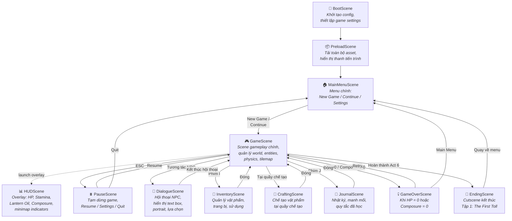
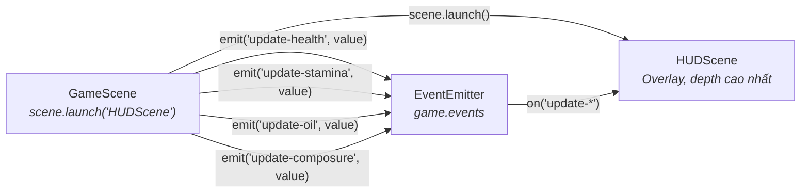
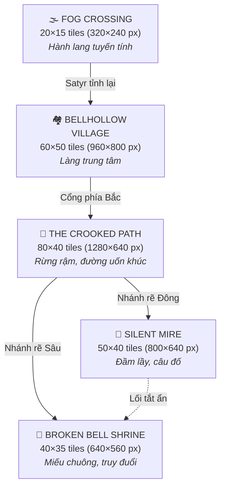
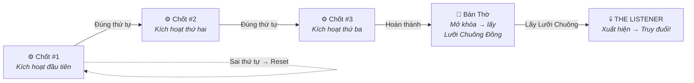
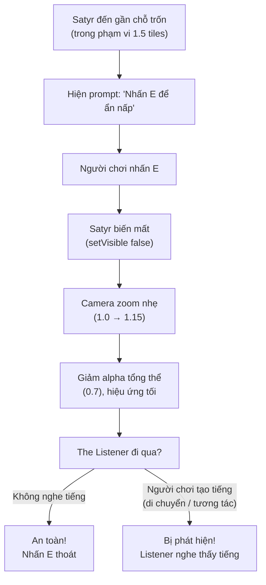
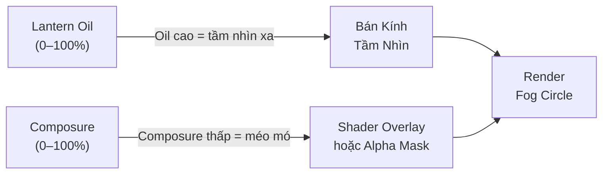
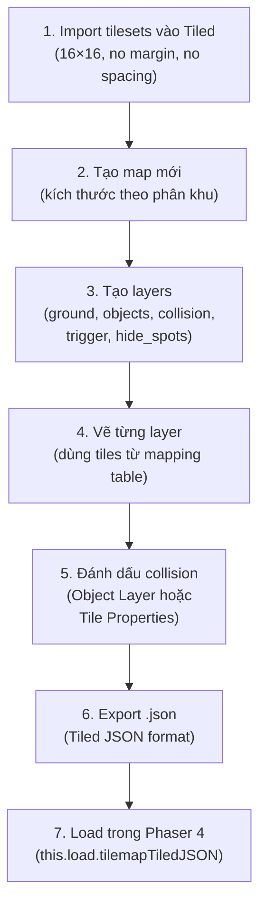
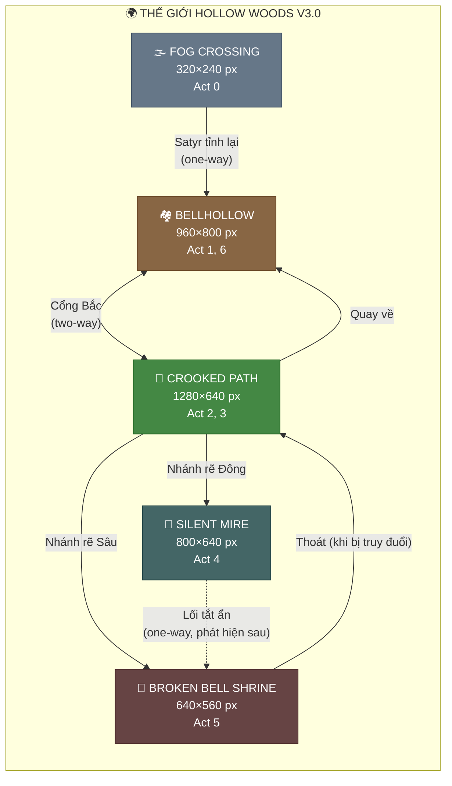

# 🗺️ HOLLOW WOODS V3.0 – KẾ HOẠCH BẢN ĐỒ & SCENE

> **Phiên bản:** V3.0 – THE FOG THAT REMEMBERS (SƯƠNG MÙ GHI NHỚ)
> **Ngày tạo:** 2026-11-14
> **Engine:** TypeScript + Phaser 4 + Vite
> **Độ phân giải ảo:** 640×360 pixels | Tile: 16×16 native
> **Scaling:** Nearest-neighbor, integer scaling (2× → 1280×720, 3× → 1920×1080)

---

## Mục Lục

1. [Sơ Đồ Kiến Trúc Scene Phaser 4](#1-sơ-đồ-kiến-trúc-scene-phaser-4)
2. [Bố Cục Không Gian 5 Phân Khu](#2-bố-cục-không-gian-5-phân-khu)
3. [Vị Trí Chỗ Trốn](#3-vị-trí-chỗ-trốn)
4. [Quy Chuẩn Camera 640×360](#4-quy-chuẩn-camera-640360)
5. [Tileset Mapping](#5-tileset-mapping)

---

## 1. Sơ Đồ Kiến Trúc Scene Phaser 4

> [!NOTE]
> Phaser 4 sử dụng class `Phaser.Scene`. Mỗi scene có 3 lifecycle method chính: `preload()`, `create()`, `update()`. HUD là **overlay scene** chạy song song với `GameScene` – không thay thế mà hiển thị chồng lên trên.

### 1.1 Luồng Scene Chính



### 1.2 Mô Tả Chi Tiết Từng Scene

| Scene | Class | Chức Năng | Lifecycle Trọng Tâm |
|-------|-------|-----------|---------------------|
| `BootScene` | `Phaser.Scene` | Khởi tạo config game, thiết lập `game.scale`, load font pixel | `create()` → chuyển sang `PreloadScene` |
| `PreloadScene` | `Phaser.Scene` | Tải tất cả asset (spritesheet, tilemap, audio, shader). Hiển thị thanh loading | `preload()` chính, `create()` → chuyển `MainMenuScene` |
| `MainMenuScene` | `Phaser.Scene` | Màn hình chính: New Game, Continue, Settings. Background animation sương mù | `create()` → render menu UI |
| `GameScene` | `Phaser.Scene` | Scene gameplay cốt lõi. Quản lý tilemap, nhân vật Satyr, NPC, entity, physics, trigger zone, sự kiện | `create()` → build world; `update()` → game loop mỗi frame |
| `HUDScene` | `Phaser.Scene` | **Overlay** chạy song song `GameScene`. Hiển thị 4 chỉ số: Health, Stamina, Lantern Oil, Composure. Cập nhật theo event | `create()` → render UI bars; `update()` → cập nhật giá trị |
| `PauseScene` | `Phaser.Scene` | Tạm dừng `GameScene` (pause physics & update). Menu: Resume, Settings, Quit | `create()` → hiển thị overlay tối + menu |
| `DialogueScene` | `Phaser.Scene` | Hội thoại NPC (Edda, Neris, dân làng). Hiển thị text box dưới, portrait trái, lựa chọn | `create()` → nhận dữ liệu hội thoại, render typewriter text |
| `InventoryScene` | `Phaser.Scene` | Grid vật phẩm. Sử dụng, xem mô tả, bỏ vật phẩm | `create()` → render inventory grid |
| `CraftingScene` | `Phaser.Scene` | Giao diện chế tạo: công thức, nguyên liệu, kết quả. Chỉ mở khi đứng tại quầy chế tạo | `create()` → load công thức khả dụng |
| `JournalScene` | `Phaser.Scene` | Nhật ký nhiệm vụ, manh mối đã thu thập, quy tắc đã học, ghi chú | `create()` → render danh sách tab |
| `GameOverScene` | `Phaser.Scene` | Khi Satyr chết (HP=0) hoặc mất trí (Composure=0). Hiệu ứng fade, thông báo | `create()` → hiệu ứng chết + menu retry |
| `EndingScene` | `Phaser.Scene` | Cutscene kết thúc Tập 1. Satyr rung chuông, sương rút, khe nhìn xuyên thời đại | `create()` → chạy chuỗi cutscene |

### 1.3 Cơ Chế Scene Overlay (HUD)



> [!IMPORTANT]
> `HUDScene` được khởi động bằng `this.scene.launch('HUDScene')` từ `GameScene`, **không phải** `this.scene.start()`. Điều này đảm bảo cả hai scene chạy đồng thời. Giao tiếp giữa `GameScene` và `HUDScene` thông qua `game.events` (EventEmitter toàn cục).

---

## 2. Bố Cục Không Gian 5 Phân Khu

### 2.1 Tổng Quan Phân Khu



### 2.2 Chi Tiết Từng Phân Khu

---

#### 🌫️ Phân Khu 1: FOG CROSSING (Vùng Sương Mở Đầu)

| Thuộc tính | Giá trị |
|------------|---------|
| **Kích thước** | 20×15 tiles = **320×240 pixels** |
| **Cấu trúc** | Hành lang tuyến tính, chỉ đi được một hướng (trái → phải) |
| **Bầu không khí** | Sương cực dày, tầm nhìn ≤ 3 tiles. Âm thanh tắt dần. Ánh sáng nhấp nháy xa |
| **Sự kiện** | Tutorial di chuyển (WASD), tiếng chuông xa xa, hiệu ứng mất ý thức |
| **Transition** | Satyr bất tỉnh → fade to black → tỉnh lại tại Bellhollow |

**Sơ đồ bố cục (text-based):**
```
┌──────────────────────────────────────┐
│ ░░░░░░░░░░░░░░░░░░░░░░░░░░░░░░░░░░ │  ░ = Sương dày
│ ░░░░░░ → → → → → → → → ░░░░░░░░░░ │  → = Hướng di chuyển
│ ░░░░ [SATYR] → → → → → → [X] ░░░░ │  [X] = Điểm bất tỉnh
│ ░░░░░░ → → → → → → → → ░░░░░░░░░░ │
│ ░░░░░░░░░░░░░░░░░░░░░░░░░░░░░░░░░░ │
└──────────────────────────────────────┘
```

**Tilemap layers:**
1. `ground` – Nền đất/cỏ mờ (barely visible)
2. `fog_overlay` – Layer sương mù alpha cao (0.85–0.95)
3. `collision` – Tường vô hình hai bên hành lang
4. `trigger` – Zone sự kiện (bất tỉnh, tutorial prompt)

---

#### 🏘️ Phân Khu 2: BELLHOLLOW VILLAGE (Làng Bellhollow)

| Thuộc tính | Giá trị |
|------------|---------|
| **Kích thước** | 60×50 tiles = **960×800 pixels** |
| **Cấu trúc** | Làng mở, nhiều lối đi, khu vực an toàn (ban đầu) |
| **Đặc điểm** | Nhà gỗ, tháp chuông trung tâm, giếng nước, quầy chế tạo, đường đất, hàng rào gỗ |
| **NPC** | Edda (nhà phía Tây), Neris (nhà phía Đông), dân làng rải rác |
| **Transition** | Cổng phía Bắc → The Crooked Path |

**Sơ đồ bố cục (text-based):**
```
        ═══════════ HÀNG RÀO GỖ ═══════════
       ║                                     ║
       ║   [Nhà Dân]    [Tháp Chuông]   [Nhà Dân]
       ║        ·            ⛪            ·
       ║   ─ ─ ─ ── ĐƯỜNG ĐẤT CHÍNH ── ─ ─ ─
       ║        ·                          ·
       ║  🏠 Nhà Edda   ⛲ Giếng    🏠 Nhà Neris
       ║        ·         Nước         ·
       ║   ─ ─ ─ ── ĐƯỜNG PHỤ ──── ─ ─ ─
       ║        ·                      ·
       ║     [Quầy      🔥 Lửa    [Kho
       ║    Chế Tạo]    Trại      Thảo Mộc]
       ║                                     ║
       ║══ CỔNG BẮC ══╗         ╔════════════║
                       ║         ║
                    → THE CROOKED PATH →
```

**Tilemap layers:**
1. `ground` – Đường đất, cỏ xanh, đá lát
2. `buildings_base` – Nền nhà, tường dưới
3. `buildings_top` – Mái nhà, trang trí trên
4. `objects` – Giếng, cột, bảng hiệu, thùng gỗ
5. `collision` – Hàng rào, tường nhà, chướng ngại vật
6. `npc_spawn` – Vị trí spawn NPC
7. `trigger` – Zone tương tác (cửa nhà, quầy chế tạo, cổng)
8. `interior_transition` – Zone chuyển vào nội thất nhà Edda / Neris

**Danh sách công trình:**

| # | Công Trình | Vị Trí (tile) | Kích Thước | Chức Năng |
|---|-----------|---------------|------------|-----------|
| 1 | Tháp Chuông | Trung tâm (30, 15) | 4×5 tiles | Landmark chính, chuông bị hỏng (thiếu lưỡi) |
| 2 | Nhà Edda | Tây (10, 22) | 5×4 tiles | Nhà NPC Edda – Người Giữ Chuông |
| 3 | Nhà Neris | Đông (45, 22) | 5×4 tiles | Nhà NPC Neris – Người Chữa Thảo Mộc |
| 4 | Giếng Nước | Trung tâm (30, 25) | 2×2 tiles | Lấy nước, điểm tương tác |
| 5 | Quầy Chế Tạo | Tây-Nam (12, 38) | 3×2 tiles | Mở `CraftingScene` |
| 6 | Lửa Trại | Trung tâm-Nam (28, 38) | 2×2 tiles | Save point, hồi Composure nhẹ |
| 7 | Kho Thảo Mộc | Đông-Nam (44, 38) | 3×3 tiles | Thu thập nguyên liệu từ Neris |
| 8 | Cổng Bắc | Bắc (30, 2) | 3×2 tiles | Transition → Crooked Path |
| 9 | Hàng Rào | Bao quanh | 1 tile rộng | Giới hạn khu vực làng |

---

#### 🌲 Phân Khu 3: THE CROOKED PATH (Con Đường Quanh Co)

| Thuộc tính | Giá trị |
|------------|---------|
| **Kích thước** | 80×40 tiles = **1280×640 pixels** |
| **Cấu trúc** | Rừng rậm, lối đi uốn khúc, nhiều nhánh rẽ |
| **Đặc điểm** | 3 Cột Đá Cổ Ngữ, bụi rậm ẩn nấp, thân cây rỗng |
| **Nguy hiểm** | The Listener tuần tra, The Echo xuất hiện ở rìa tầm nhìn |
| **Transition** | Nhánh rẽ Đông → Silent Mire, Nhánh rẽ Sâu → Broken Bell Shrine |

**Sơ đồ bố cục (text-based):**
```
← TỪ BELLHOLLOW (CỔNG BẮC)
         ║
    ┌────╨────────────────────────────────────────────────┐
    │    │                                                │
    │  [Lối Vào]──→ 🌿 Bụi ──→ 🪨 Cột Đá #1            │
    │              Rậm #1       (Cổ Ngữ)                 │
    │                    │                                │
    │         ┌──────────┘                                │
    │         │                                           │
    │    🌳 Thân Cây ──→ ── ── ──→ 🪨 Cột Đá #2         │
    │    Rỗng #1     đường uốn      (Cổ Ngữ)            │
    │                  khúc              │                │
    │    🌿 Bụi                ┌─────────┤                │
    │    Rậm #2                │         │                │
    │         │           ↓ NHÁNH RẼ     │                │
    │    🌳 Thân Cây      ĐÔNG       🌿 Bụi              │
    │    Rỗng #2          ↓          Rậm #3              │
    │         │      → SILENT        │                    │
    │         │        MIRE     🪨 Cột Đá #3             │
    │         │                 (Cổ Ngữ)                  │
    │         └──────────────────┤                        │
    │                            ↓ NHÁNH RẼ SÂU          │
    │                         → BROKEN BELL SHRINE       │
    └────────────────────────────────────────────────────┘
```

**Tilemap layers:**
1. `ground` – Đất rừng, rễ cây, lá rụng, lối mòn
2. `vegetation_low` – Cỏ, bụi thấp, nấm
3. `vegetation_high` – Tán cây phía trên (che một phần, alpha 0.6)
4. `objects` – Cột Đá Cổ Ngữ, thân cây rỗng, đá lớn
5. `collision` – Cây lớn, đá, bụi rậm không đi qua được
6. `hide_spots` – Zone chỗ trốn (thân cây rỗng, bụi rậm)
7. `trigger` – Zone transition (→ Silent Mire, → Shrine), zone sự kiện The Echo
8. `patrol_path` – Đường tuần tra The Listener (dùng cho AI pathfinding)

**Chi tiết 3 Cột Đá Cổ Ngữ:**

| Cột | Vị Trí (tile) | Nội Dung Cổ Ngữ | Manh Mối |
|-----|---------------|-----------------|----------|
| #1 | (25, 8) | Ký tự rune phát sáng | Gợi ý quy tắc "Đừng trả lời khi rừng gọi tên" |
| #2 | (55, 15) | Ký tự rune mờ dần | Gợi ý quy tắc "Đừng đi theo đèn thứ hai" |
| #3 | (60, 30) | Ký tự rune gần biến mất | Gợi ý vị trí lưỡi chuông tại Shrine |

---

#### 🪷 Phân Khu 4: SILENT MIRE (Đầm Lầy Im Lặng)

| Thuộc tính | Giá trị |
|------------|---------|
| **Kích thước** | 50×40 tiles = **800×640 pixels** |
| **Cấu trúc** | Địa hình ướt, bùn lầy, đảo nhỏ nối bằng cầu gỗ mục |
| **Đặc điểm** | Sương thấp, tầm nhìn ≤ 4 tiles. Khu vực câu đố chính |
| **Nguy hiểm** | Bùn hút chậm (giảm tốc độ), Composure giảm dần |
| **Câu đố** | Thu thập Phấn Phát Sáng và nguyên liệu cho Neris |

**Sơ đồ bố cục (text-based):**
```
← TỪ CROOKED PATH (NHÁNH RẼ ĐÔNG)
         ║
    ┌────╨──────────────────────────────────┐
    │    │                                  │
    │  [Lối vào]                            │
    │    │    ~~~~ bùn ~~~~                 │
    │    ├── 🌉 Cầu gỗ ──→ 🏝️ Đảo #1      │
    │    │                  (Phấn Phát      │
    │  ~~~~ bùn ~~~~        Sáng)          │
    │    │                     │            │
    │  🌳 Thân Cây    🌉 Cầu gỗ           │
    │  Rỗng #3         mục                 │
    │    │                ↓                 │
    │  🌿 Bụi        🏝️ Đảo #2            │
    │  Rậm #4        (Nguyên liệu          │
    │    │             thảo mộc)            │
    │  🌿 Bụi             │                │
    │  Rậm #5    ── ── ── ┘                │
    │    │                                  │
    │    └── Lối tắt ẩn → SHRINE ·····→    │
    └───────────────────────────────────────┘
```

**Tilemap layers:**
1. `ground` – Bùn, nước đọng, đất ướt, rêu
2. `water` – Lớp nước nông, animated tiles
3. `bridges` – Cầu gỗ mục (đi được nhưng có hiệu ứng kẽo kẹt)
4. `vegetation` – Bèo, cỏ đầm lầy, nấm phát quang
5. `objects` – Cây đổ, thân cây rỗng, đá rêu
6. `collision` – Khu vực bùn sâu (không đi qua), cây lớn
7. `slow_zone` – Khu vực bùn nông (giảm tốc độ 50%)
8. `hide_spots` – Zone chỗ trốn
9. `trigger` – Zone câu đố, thu thập, transition
10. `fog_low` – Sương thấp (alpha mask mạnh hơn bình thường)

**Câu đố Đầm Lầy:**
- Tìm 3 nhánh **Phấn Phát Sáng** trên các đảo nhỏ
- Dùng cầu gỗ di chuyển – một số cầu mục sẽ gãy (bẫy)
- Thu thập **Thảo mộc Đầm Lầy** cho Neris
- Composure giảm 1 điểm mỗi 30 giây trong khu vực này

---

#### 🔔 Phân Khu 5: THE BROKEN BELL SHRINE (Miếu Chuông Đổ Nát)

| Thuộc tính | Giá trị |
|------------|---------|
| **Kích thước** | 40×35 tiles = **640×560 pixels** |
| **Cấu trúc** | Miếu đá cổ, lối đi hẹp, khu vực bàn thờ trung tâm |
| **Đặc điểm** | Lưỡi Chuông Đồng, chốt cơ khí, bàn thờ cổ |
| **Nguy hiểm** | The Listener truy đuổi (chase sequence) – phải ẩn nấp |
| **Câu đố** | Đặt lưỡi chuông và kích hoạt 3 chốt cơ khí theo đúng thứ tự |

**Sơ đồ bố cục (text-based):**
```
← TỪ CROOKED PATH (NHÁNH RẼ SÂU)
         ║
    ┌────╨────────────────────────────┐
    │    │                            │
    │  [Lối vào]  🪨 Tường đá cổ     │
    │    │              │             │
    │    ├─→ Lối hẹp ──→ ⚙️ Chốt #1  │
    │    │                            │
    │    │    🪨 Tường đá              │
    │    │         │                  │
    │    ├─→ ── ──→ ⚙️ Chốt #2       │
    │    │                            │
    │  🌿 Bụi         🪨 Tường đá     │
    │  Rậm #6              │          │
    │    │                             │
    │    └──→ ── ──→ ⚙️ Chốt #3      │
    │                   │             │
    │         ┌─────────┘             │
    │         ↓                       │
    │    🔔 BÀN THỜ TRUNG TÂM        │
    │    [Lưỡi Chuông Đồng]          │
    │    (Đặt lưỡi chuông vào đây)   │
    │                                 │
    └─────────────────────────────────┘
```

**Tilemap layers:**
1. `ground` – Đá cổ, rêu, nứt nẻ
2. `walls` – Tường đá miếu, cột đá đổ
3. `objects` – Bàn thờ, chốt cơ khí (×3), lưỡi chuông, đèn dầu
4. `collision` – Tường, đá đổ, khu vực không đi được
5. `hide_spots` – Zone bụi rậm trốn
6. `trigger` – Zone tương tác chốt, zone lấy lưỡi chuông, zone bắt đầu truy đuổi
7. `chase_path` – Đường The Listener truy đuổi
8. `escape_route` – Lối thoát cho Satyr khi bị truy đuổi

**Câu đố Chốt Cơ Khí:**



> [!WARNING]
> Khi Satyr lấy Lưỡi Chuông Đồng, The Listener **ngay lập tức** xuất hiện và bắt đầu truy đuổi. Người chơi phải sử dụng chỗ trốn và Mồi Tiếng Động để thoát về Bellhollow.

---

### 2.3 Bảng Tổng Hợp Phân Khu

| Phân Khu | Tiles | Pixels | Đặc Trưng | Mối Đe Dọa | Act Liên Quan |
|----------|-------|--------|-----------|-------------|---------------|
| Fog Crossing | 20×15 | 320×240 | Hành lang tuyến tính, sương cực dày | Không (tutorial) | Act 0 |
| Bellhollow Village | 60×50 | 960×800 | Làng mở, NPC, chế tạo, an toàn | Không (ban đầu) → sương về cuối | Act 1, Act 6 |
| The Crooked Path | 80×40 | 1280×640 | Rừng rậm, nhiều nhánh, Cột Đá | The Listener tuần tra, The Echo | Act 2, Act 3 |
| Silent Mire | 50×40 | 800×640 | Đầm lầy, câu đố, tầm nhìn hạn chế | Composure drain, bùn hút | Act 4 |
| Broken Bell Shrine | 40×35 | 640×560 | Miếu cổ, câu đố chốt, truy đuổi | The Listener truy đuổi | Act 5 |

---

## 3. Vị Trí Chỗ Trốn

### 3.1 Tổng Hợp Chỗ Trốn Theo Phân Khu

| Phân Khu | Thân Cây Rỗng 🌳 | Bụi Rậm 🌿 | Tổng |
|----------|:-----------------:|:----------:|:----:|
| Fog Crossing | 0 | 0 | 0 |
| Bellhollow Village | 0 | 0 | 0 |
| The Crooked Path | **2** | **3** | **5** |
| Silent Mire | **1** | **2** | **3** |
| Broken Bell Shrine | 0 | **1** | **1** |
| **Tổng cộng** | **3** | **6** | **9** |

### 3.2 Chi Tiết Vị Trí

#### The Crooked Path (5 chỗ trốn)

| ID | Loại | Vị Trí (tile) | Ghi Chú |
|----|------|---------------|---------|
| `CP_HIDE_01` | Thân Cây Rỗng | (20, 14) | Gần lối vào, chỗ trốn đầu tiên người chơi phát hiện |
| `CP_HIDE_02` | Thân Cây Rỗng | (45, 25) | Giữa đường, gần Cột Đá #2 |
| `CP_HIDE_03` | Bụi Rậm | (15, 8) | Đầu đường, bên phải lối mòn |
| `CP_HIDE_04` | Bụi Rậm | (35, 20) | Ngã ba nhánh rẽ, vị trí chiến lược |
| `CP_HIDE_05` | Bụi Rậm | (65, 32) | Gần lối vào Shrine, chỗ trốn cuối |

#### Silent Mire (3 chỗ trốn)

| ID | Loại | Vị Trí (tile) | Ghi Chú |
|----|------|---------------|---------|
| `SM_HIDE_01` | Thân Cây Rỗng | (15, 18) | Bên cạnh cầu gỗ, cây đổ lớn |
| `SM_HIDE_02` | Bụi Rậm | (10, 28) | Gần bờ đầm lầy, cây bụi rậm rạp |
| `SM_HIDE_03` | Bụi Rậm | (30, 35) | Gần lối tắt ẩn đi Shrine |

#### Broken Bell Shrine (1 chỗ trốn)

| ID | Loại | Vị Trí (tile) | Ghi Chú |
|----|------|---------------|---------|
| `BS_HIDE_01` | Bụi Rậm | (12, 22) | Giữa lối hẹp, chỗ trốn duy nhất trong Shrine – rất quan trọng khi bị truy đuổi |

### 3.3 Cơ Chế Ẩn Nấp



> [!IMPORTANT]
> **Quy tắc ẩn nấp:**
> - Người chơi **nhấn phím E** khi đứng trong phạm vi 1.5 tiles của chỗ trốn
> - Nhân vật Satyr **biến mất** (`setVisible(false)`) và vô hiệu hóa collision
> - Camera **zoom nhẹ** (1.0 → 1.15) tạo cảm giác nhìn lén qua khe
> - Tổng thể **giảm alpha** (0.7) và thêm vignette tối
> - The Listener sẽ **đi qua** nếu không nghe thấy tiếng động
> - Nếu người chơi **tạo tiếng** (nhấn phím di chuyển, tương tác) → bị phát hiện, ẩn nấp thất bại
> - Nhấn **E lần nữa** hoặc đợi Listener đi xa → thoát khỏi chỗ trốn

**Code snippet mẫu (TypeScript):**
```typescript
// HideSpot.ts - Component cho chỗ trốn
class HideSpot {
  readonly id: string;           // VD: "CP_HIDE_01"
  readonly type: 'hollow_tree' | 'dense_bush';
  readonly position: { x: number; y: number };  // tile coords
  readonly interactRadius: number = 24;          // 1.5 tiles = 24px

  isOccupied: boolean = false;

  enter(player: Satyr, camera: Phaser.Cameras.Scene2D.Camera): void {
    this.isOccupied = true;
    player.setVisible(false);
    player.body.enable = false;
    camera.zoomTo(1.15, 300, 'Sine.easeInOut');
    // Thêm vignette overlay
  }

  exit(player: Satyr, camera: Phaser.Cameras.Scene2D.Camera): void {
    this.isOccupied = false;
    player.setVisible(true);
    player.body.enable = true;
    camera.zoomTo(1.0, 200, 'Sine.easeOut');
    // Xóa vignette overlay
  }
}
```

---

## 4. Quy Chuẩn Camera 640×360

### 4.1 Thông Số Kỹ Thuật

| Thông Số | Giá Trị | Ghi Chú |
|----------|---------|---------|
| **Virtual Resolution** | 640×360 pixels | Độ phân giải nội bộ game |
| **Tile Size** | 16×16 pixels (native) | Kích thước 1 ô tile |
| **Visible Tiles** | 40×22.5 tiles | Số tile hiển thị trên màn hình |
| **Target 2×** | 1280×720 pixels | Nearest-neighbor upscale |
| **Target 3×** | 1920×1080 pixels | Nearest-neighbor upscale |
| **Scaling Method** | Integer scaling | Chỉ nhân số nguyên (2×, 3×) |
| **Rendering** | Nearest-neighbor | CSS `image-rendering: pixelated` |
| **Camera Follow** | Smooth follow | Lerp 0.08–0.12, deadzone nhỏ |
| **Default Zoom** | 1.0× | Có thể thay đổi cho cutscene |

### 4.2 Thiết Lập Phaser 4 Config

```typescript
// game.config.ts
const gameConfig: Phaser.Types.Core.GameConfig = {
  type: Phaser.WEBGL,
  width: 640,
  height: 360,
  pixelArt: true,               // Bật nearest-neighbor tự động
  roundPixels: true,             // Tránh sub-pixel rendering
  scale: {
    mode: Phaser.Scale.FIT,      // Fit vào container
    autoCenter: Phaser.Scale.CENTER_BOTH,
    zoom: Phaser.Scale.MAX_ZOOM, // Integer scaling tối đa
  },
  physics: {
    default: 'arcade',
    arcade: {
      gravity: { x: 0, y: 0 },  // Top-down, không trọng lực
      debug: false,
    },
  },
  scene: [
    BootScene,
    PreloadScene,
    MainMenuScene,
    GameScene,
    HUDScene,
    PauseScene,
    DialogueScene,
    InventoryScene,
    CraftingScene,
    JournalScene,
    GameOverScene,
    EndingScene,
  ],
};
```

### 4.3 Camera Follow & Bounds

```typescript
// Trong GameScene.create()
setupCamera(zoneKey: string): void {
  const cam = this.cameras.main;

  // Smooth follow nhân vật Satyr
  cam.startFollow(this.player, true, 0.1, 0.1);

  // Deadzone nhỏ (tránh camera giật khi di chuyển nhẹ)
  cam.setDeadzone(32, 24);  // 2×1.5 tiles

  // Camera bounds theo từng phân khu
  const bounds = ZONE_BOUNDS[zoneKey];
  cam.setBounds(bounds.x, bounds.y, bounds.width, bounds.height);
}
```

### 4.4 Camera Bounds Theo Phân Khu

| Phân Khu | Bounds X | Bounds Y | Width | Height | Ghi Chú |
|----------|----------|----------|-------|--------|---------|
| Fog Crossing | 0 | 0 | 320 | 240 | Nhỏ hơn viewport → camera cố định |
| Bellhollow | 0 | 0 | 960 | 800 | Camera cuộn theo cả 2 trục |
| Crooked Path | 0 | 0 | 1280 | 640 | Camera cuộn chủ yếu theo trục X |
| Silent Mire | 0 | 0 | 800 | 640 | Camera cuộn theo cả 2 trục |
| Broken Bell Shrine | 0 | 0 | 640 | 560 | Camera cuộn nhẹ theo trục Y |

> [!NOTE]
> **Fog Crossing** (320×240) nhỏ hơn viewport (640×360). Camera sẽ được **cố định** ở giữa map, padding đen xung quanh để tạo cảm giác bí bách, hẹp.

### 4.5 Zoom Đặc Biệt

| Tình Huống | Zoom | Duration | Easing |
|------------|------|----------|--------|
| Mặc định gameplay | 1.0× | — | — |
| Ẩn nấp trong chỗ trốn | 1.15× | 300ms | Sine.easeInOut |
| Cutscene gặp NPC | 1.3× | 500ms | Cubic.easeInOut |
| Cutscene kết thúc Act 6 | 0.8× → 1.5× | 2000ms | Expo.easeInOut |
| Phát hiện Cột Đá Cổ Ngữ | 1.2× | 400ms | Quad.easeOut |
| The Listener xuất hiện | 1.0× (giữ nguyên) | — | Camera shake thay thế |

### 4.6 Fog of War / Sương Mù



**Công thức tầm nhìn:**
```typescript
// FogOfWar.ts
calculateVisibilityRadius(lanternOil: number, composure: number): number {
  const baseRadius = 5;    // tiles (80px)
  const maxRadius = 12;    // tiles (192px)
  const oilFactor = lanternOil / 100;  // 0.0 → 1.0

  let radius = baseRadius + (maxRadius - baseRadius) * oilFactor;

  // Composure thấp → tầm nhìn dao động (flicker)
  if (composure < 30) {
    radius *= 0.7 + Math.random() * 0.3;  // Dao động 70-100%
  }

  return radius;
}
```

**Triển khai kỹ thuật:**
- **Phương án A (Khuyến nghị):** Alpha mask hình tròn gradient, center tại vị trí Satyr. Đơn giản, hiệu suất tốt
- **Phương án B:** Custom shader (fragment shader) tạo fog circle với edge softness. Đẹp hơn nhưng phức tạp
- **Phương án C:** RenderTexture với nhiều light source (Satyr + các nguồn sáng khác). Linh hoạt nhất

> [!TIP]
> Với target 640×360 và pixel art, **Phương án A (Alpha Mask)** là đủ và dễ triển khai nhất. Sử dụng `Phaser.GameObjects.Graphics` vẽ hình tròn gradient, cập nhật mỗi frame theo vị trí Satyr.

### 4.7 CSS Scaling

```css
/* index.html hoặc style.css */
canvas {
  image-rendering: pixelated;          /* Chrome, Edge */
  image-rendering: crisp-edges;        /* Firefox */
  -ms-interpolation-mode: nearest-neighbor;  /* IE (legacy) */
}
```

---

## 5. Tileset Mapping

### 5.1 Danh Sách Asset Tileset

| # | Asset Package | Nội Dung Chính | Phân Khu Sử Dụng |
|---|--------------|----------------|-------------------|
| 1 | `Pixel Art Top Down - Basic v1.2.3.zip` | TX Tileset Grass, TX Tileset Stone Ground | Tất cả (nền đất, cỏ cơ bản) |
| 2 | `Pixel_Castle_Medieval_Tileset_v1.0.zip` | Nhà gỗ, mái rạ, tường đá, cổng, giếng | Bellhollow Village |
| 3 | `TopDownFantasy_Forest_v1.zip` | Tileset rừng, cây cối, trang trí rừng | Crooked Path, Silent Mire |
| 4 | `The Fan-tasy Tileset (Free) 1.5.9.zip` | Nhà cỏ, giếng, lửa trại | Bellhollow (bổ sung) |
| 5 | `Forest-Asset-Pack.zip` | Cây cối, bụi rậm, đá rừng | Crooked Path, Silent Mire |
| 6 | `Updated-Trees.zip` | Cây cối cập nhật, đa dạng hơn | Crooked Path (bổ sung) |
| 7 | `Pixel_Castle_Interior_Tileset_v1.0.zip` | Nội thất: sàn gỗ, tường trong, đồ nội thất | Nhà Edda, Nhà Neris (interior) |

### 5.2 Mapping Chi Tiết Theo Phân Khu

#### Fog Crossing

| Layer | Tileset Nguồn | Tiles Cụ Thể | Ghi Chú |
|-------|--------------|---------------|---------|
| `ground` | `Pixel Art Top Down - Basic` | TX Tileset Grass (tông tối) | Giảm saturation trong Tiled |
| `fog_overlay` | Tạo riêng | Alpha gradient tiles | Tạo bằng shader hoặc sprite overlay |

#### Bellhollow Village

| Layer | Tileset Nguồn | Tiles Cụ Thể | Ghi Chú |
|-------|--------------|---------------|---------|
| `ground` | `Pixel Art Top Down - Basic` | TX Tileset Grass, TX Tileset Stone Ground | Đường đất + cỏ xanh |
| `buildings_base` | `Pixel_Castle_Medieval_Tileset` | Tường gỗ, tường đá, nền nhà | Base layer các công trình |
| `buildings_top` | `Pixel_Castle_Medieval_Tileset` | Mái rạ, mái gỗ, ống khói | Render phía trên nhân vật |
| `objects` | `Pixel_Castle_Medieval_Tileset` + `Fan-tasy Tileset` | Giếng, cổng, bảng hiệu, thùng | Cổng từ Medieval, giếng bổ sung từ Fan-tasy |
| `decoration` | `Fan-tasy Tileset` | Lửa trại, hoa, cỏ trang trí | Animated tiles cho lửa |
| `interior` | `Pixel_Castle_Interior_Tileset` | Sàn gỗ, bàn, ghế, kệ sách, giường | Dùng khi vào nhà Edda / Neris |

#### The Crooked Path

| Layer | Tileset Nguồn | Tiles Cụ Thể | Ghi Chú |
|-------|--------------|---------------|---------|
| `ground` | `Pixel Art Top Down - Basic` | TX Tileset Grass (tông rừng), đất | Lối mòn + rừng nền |
| `vegetation_low` | `TopDownFantasy_Forest` | Cỏ rừng, nấm, rễ cây, lá rụng | Ground decorations |
| `vegetation_high` | `TopDownFantasy_Forest` + `Forest-Asset-Pack` | Tán cây, cành lá phía trên | Alpha 0.6, render trên nhân vật |
| `trees` | `Updated-Trees` + `Forest-Asset-Pack` | Thân cây, gốc cây, cây đổ | Collision objects |
| `objects` | Tạo riêng + `TopDownFantasy_Forest` | Cột Đá Cổ Ngữ, đá lớn | Cột Đá cần tạo custom sprite |

#### Silent Mire

| Layer | Tileset Nguồn | Tiles Cụ Thể | Ghi Chú |
|-------|--------------|---------------|---------|
| `ground` | `Pixel Art Top Down - Basic` | TX Tileset Grass (tông đầm lầy, bão hòa thấp) | Đất ướt, rêu |
| `water` | `TopDownFantasy_Forest` | Tiles nước nông, bèo | Animated tiles |
| `bridges` | `Pixel_Castle_Medieval_Tileset` | Cầu gỗ (repurpose từ Medieval set) | Có thể cần chỉnh màu |
| `vegetation` | `TopDownFantasy_Forest` + `Forest-Asset-Pack` | Cỏ đầm lầy, cây bụi ướt | Tông màu lạnh, xanh rêu |

#### Broken Bell Shrine

| Layer | Tileset Nguồn | Tiles Cụ Thể | Ghi Chú |
|-------|--------------|---------------|---------|
| `ground` | `Pixel Art Top Down - Basic` | TX Tileset Stone Ground | Nền đá cổ |
| `walls` | `Pixel_Castle_Medieval_Tileset` | Tường đá, cột đá | Chỉnh màu tối, rêu mốc |
| `objects` | Tạo riêng | Bàn thờ, chốt cơ khí (×3), lưỡi chuông | Custom sprites cần thiết |
| `decoration` | `TopDownFantasy_Forest` | Rêu, dây leo, đá vỡ | Tạo bầu không khí hoang phế |

### 5.3 Asset Cần Tạo Riêng (Custom)

> [!CAUTION]
> Các asset sau **chưa có** trong bộ tileset hiện tại và cần được tạo mới hoặc chỉnh sửa:

| # | Asset | Kích Thước | Phân Khu | Ưu Tiên |
|---|-------|-----------|----------|---------|
| 1 | Cột Đá Cổ Ngữ (×3 biến thể) | 16×32 px mỗi cột | Crooked Path | 🔴 Cao |
| 2 | Bàn Thờ Chuông | 32×32 px | Shrine | 🔴 Cao |
| 3 | Lưỡi Chuông Đồng (vật phẩm) | 16×16 px | Shrine | 🔴 Cao |
| 4 | Chốt Cơ Khí (×2 trạng thái: tắt/bật) | 16×16 px | Shrine | 🔴 Cao |
| 5 | Thân Cây Rỗng (chỗ trốn) | 32×32 px | Crooked Path, Silent Mire | 🟡 Trung bình |
| 6 | Bụi Rậm Đặc (chỗ trốn) | 16×16 px | Nhiều phân khu | 🟡 Trung bình |
| 7 | Cầu Gỗ Mục | 48×16 px | Silent Mire | 🟡 Trung bình |
| 8 | Phấn Phát Sáng (vật phẩm) | 16×16 px | Silent Mire | 🟢 Thấp |
| 9 | Fog overlay tiles | 16×16 px (nhiều biến thể alpha) | Fog Crossing | 🟢 Thấp |

### 5.4 Quy Trình Tilemap Trong Tiled



**Cấu trúc file Tilemap đề xuất:**

```
assets/
├── tilemaps/
│   ├── fog_crossing.json          # Map Fog Crossing
│   ├── bellhollow.json            # Map Bellhollow Village
│   ├── bellhollow_edda_interior.json   # Nội thất nhà Edda
│   ├── bellhollow_neris_interior.json  # Nội thất nhà Neris
│   ├── crooked_path.json         # Map Crooked Path
│   ├── silent_mire.json          # Map Silent Mire
│   └── broken_bell_shrine.json   # Map Broken Bell Shrine
└── tilesets/
    ├── grass_basic.png            # Từ Pixel Art Top Down Basic
    ├── stone_ground.png           # Từ Pixel Art Top Down Basic
    ├── medieval_exterior.png      # Từ Pixel_Castle_Medieval
    ├── medieval_interior.png      # Từ Pixel_Castle_Interior
    ├── forest_tiles.png           # Từ TopDownFantasy_Forest
    ├── fantasy_extras.png         # Từ Fan-tasy Tileset
    ├── forest_trees.png           # Từ Forest-Asset-Pack + Updated-Trees
    └── custom/
        ├── ancient_pillars.png    # Cột Đá Cổ Ngữ (custom)
        ├── shrine_objects.png     # Bàn thờ, chốt, lưỡi chuông (custom)
        ├── hide_spots.png         # Thân cây rỗng, bụi rậm (custom)
        └── fog_tiles.png          # Fog overlay tiles (custom)
```

---

## Phụ Lục A: Sơ Đồ Tổng Quan Kết Nối Phân Khu



---

## Phụ Lục B: Checklist Triển Khai

- [ ] Tạo Phaser 4 project với config 640×360
- [ ] Implement `BootScene` và `PreloadScene`
- [ ] Implement `MainMenuScene` cơ bản
- [ ] Tạo tilemap Fog Crossing trong Tiled
- [ ] Tạo tilemap Bellhollow Village trong Tiled
- [ ] Tạo tilemap nội thất nhà Edda & Neris
- [ ] Tạo tilemap Crooked Path trong Tiled
- [ ] Tạo tilemap Silent Mire trong Tiled
- [ ] Tạo tilemap Broken Bell Shrine trong Tiled
- [ ] Implement `GameScene` với tilemap loading
- [ ] Implement camera system (follow, bounds, zoom)
- [ ] Implement `HUDScene` overlay
- [ ] Implement Fog of War (alpha mask)
- [ ] Implement hệ thống chỗ trốn (HideSpot)
- [ ] Tạo custom asset: Cột Đá Cổ Ngữ
- [ ] Tạo custom asset: Bàn Thờ & Chốt Cơ Khí
- [ ] Tạo custom asset: Lưỡi Chuông Đồng
- [ ] Tạo custom asset: Thân Cây Rỗng & Bụi Rậm (hide spots)
- [ ] Implement các scene phụ (Dialogue, Inventory, Crafting, Journal)
- [ ] Implement `PauseScene`, `GameOverScene`, `EndingScene`
- [ ] Kiểm tra integer scaling trên 1280×720 và 1920×1080
- [ ] Kiểm tra `image-rendering: pixelated` trên các trình duyệt

---

> **Tài liệu này là một phần của bộ tài liệu HOLLOW WOODS V3.0**
> Xem thêm: `V3.0_CANON_REGISTER.md` | `V3.0_STORY_AND_QUEST_FLOW.md` | `V3.0_ASSET_GAP_REPORT.md` | `V3.0_DEVELOPMENT_TASK_PLAN.md`
