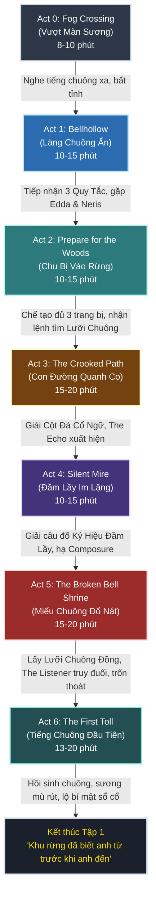
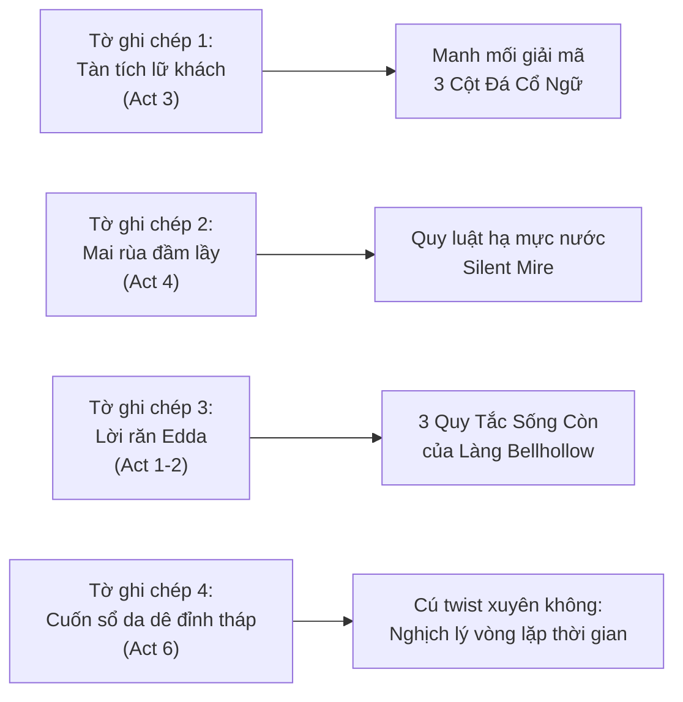

# 📖 THIẾT KẾ CỐT TRUYỆN VÀ LUỒNG NHIỆM VỤ CHI TIẾT V3.0
## TẬP 1: THE FIRST TOLL — TIẾNG CHUÔNG ĐẦU TIÊN
### HOLLOW WOODS V3.0 — THE FOG THAT REMEMBERS (SƯƠNG MÙ GHI NHỚ)

> *"THE FOG BROUGHT HIM HERE. THE FOREST REMEMBERS HIM."*  
> *"Sương mù đưa anh đến đây. Khu rừng đã ghi nhớ anh từ trước."*

---

| Thuộc tính | Chi tiết |
|---|---|
| **Dự án** | HOLLOW WOODS V3.0 |
| **Tác giả thiết kế** | story-quest Agent (Kịch bản & Thiết kế Nhiệm vụ) |
| **Ngày tạo** | 2026-11-14 |
| **Trạng thái** | ✅ Đã Chốt Kịch Bản Chi Tiết (Canon V3.0) |
| **Thời lượng mục tiêu** | **75 – 120 phút** (Trung bình: 90 phút cho lượt chơi đầu tiên) |
| **Công nghệ mục tiêu** | TypeScript + Phaser 4 + Vite (Top-Down 3/4, 640×360 native) |
| **Nhân vật chính** | Satyr (Lữ khách xuyên không qua Màn Sương The Veil) |

---

## MỤC LỤC
1. [TỔNG QUAN CỐT TRUYỆN TẬP 1](#1-tổng-quan-cốt-truyện-tập-1)
   - 1.1. Bối cảnh & Chủ đề tư tưởng
   - 1.2. Đường cong kịch tính (Dramatic Arc & Pacing Curve)
   - 1.3. Sơ đồ luồng tiến trình 7 Hồi (Mermaid Flowchart)
2. [HỆ THỐNG CƠ CHẾ NARRATIVE & NHIỆM VỤ](#2-hệ-thống-cơ-chế-narrative--nhiệm-vụ)
   - 2.1. Cấu trúc dữ liệu Quest & Trigger
   - 2.2. Tác động của 4 Chỉ số Sinh tồn đến Narrative
   - 2.3. Bảng tổng hợp Vật phẩm, Tài nguyên & Chế tạo
3. [CHI TIẾT 7 HỒI (ACT BREAKDOWN)](#3-chi-tiết-7-hồi-act-breakdown)
   - [Act 0: Fog Crossing — Vượt Màn Sương](#act-0-fog-crossing--vượt-màn-sương) *(8–10 phút)*
   - [Act 1: Bellhollow — Làng Chuông Ẩn](#act-1-bellhollow--làng-chuông-ẩn) *(10–15 phút)*
   - [Act 2: Prepare for the Woods — Chu Bị Vào Rừng](#act-2-prepare-for-the-woods--chu-bị-vào-rừng) *(10–15 phút)*
   - [Act 3: The Crooked Path — Con Đường Quanh Co](#act-3-the-crooked-path--con-đường-quanh-co) *(15–20 phút)*
   - [Act 4: Silent Mire — Đầm Lầy Im Lặng](#act-4-silent-mire--đầm-lầy-im-lặng) *(10–15 phút)*
   - [Act 5: The Broken Bell Shrine — Miếu Chuông Đổ Nát](#act-5-the-broken-bell-shrine--miếu-chuông-đổ-nát) *(15–20 phút)*
   - [Act 6: The First Toll — Tiếng Chuông Đầu Tiên](#act-6-the-first-toll--tiếng-chuông-đầu-tiên) *(13–20 phút)*
4. [TÀI LIỆU CỔ & TỰ SỰ MÔI TRƯỜNG (LORE DOCUMENTS)](#4-tài-liệu-cổ--tự-sự-môi-trường-lore-documents)
5. [BẢNG KỸ THUẬT QUEST TRIGGERS & EVENT FLAGS](#5-bảng-kỹ-thuật-quest-triggers--event-flags)
6. [HƯỚNG DẪN KIỂM THỬ KỊCH BẢN (NARRATIVE QA CHECKLIST)](#6-hướng-dẫn-kiểm-thử-kịch-bản-narrative-qa-checklist)

---

## 1. TỔNG QUAN CỐT TRUYỆN TẬP 1

### 1.1. Bối cảnh & Chủ đề tư tưởng
- **Chủ đề chính:** Nỗi kinh hoàng của sự lãng quên, nghịch lý thời gian và ký ức bị bóp méo. Thế giới không phải là một chiến trường đối kháng trực diện mà là một bài toán sinh tồn tâm lý nơi sự im lặng, quan sát và tôn trọng quy tắc cổ là chìa khóa duy nhất để sống sót.
- **Thế giới:** Thế giới trung cổ u uất bao bọc bởi **The Veil (Màn Sương)**. Ngôi làng **Bellhollow** nhỏ bé tồn tại thoi thóp bên cạnh khu rừng cấm **The Hollow Woods**.
- **Nhân vật Satyr:** Một lữ khách hiện đại/bán cổ điển bị cuốn qua Màn Sương. Satyr mất đi phần lớn ký ức về lai lịch của mình nhưng nhận ra một nghịch lý đáng sợ: mọi cổ vật, dấu vết và lời nguyền tại thế giới này dường như đều được khắc ghi hình bóng của chính anh từ nhiều thế kỷ trước.

### 1.2. Đường cong kịch tính (Dramatic Arc & Pacing Curve)

```
Căng thẳng
  ▲                                                            [Act 6: Cao trào & Hé mở]
  │                                                                 / \
  │                                           [Act 5: Rượt đuổi]   /   \
  │                                                  /\           /     \ Kết thúc
  │                                                 /  \         /       \ lửng
  │                                [Act 3: Bất an] /    \       /
  │                                      /\       /      \     /
  │                      [Act 2: Chu bị]/  \     /        \___/ [Act 6: Phục hồi chuông]
  │                            /\      /    \___/ [Act 4: Đầm lầy im lặng / Bí bách]
  │             [Act 1: Ngỡ ngàng]/  \____/
  │   [Act 0:   /
  │    Lạc lõng]
  └──────────────────────────────────────────────────────────────────────────► Thời gian
     0-10m     10-25m         25-40m   40-60m      60-75m      75-95m      95-120m
```

### 1.3. Sơ đồ luồng tiến trình 7 Hồi (Mermaid Flowchart)



---

## 2. HỆ THỐNG CƠ CHẾ NARRATIVE & NHIỆM VỤ

### 2.1. Cấu trúc dữ liệu Quest & Trigger
Mỗi nhiệm vụ trong game được quản lý bằng bộ trạng thái thống nhất:
- `quest_id`: Mã định danh (VD: `Q00_WAKE_UP`, `Q01_MEET_VILLAGERS`, `Q02_GATHER_RESOURCES`, `Q03_ANCIENT_RUNES`, `Q04_SILENT_MIRE_PUZZLE`, `Q05_RETRIEVE_CLAPPER`, `Q06_RING_THE_BELL`).
- `stage`: Số nguyên phản ánh tiến độ từng bước trong Act.
- `status`: `UNASSIGNED` | `ACTIVE` | `COMPLETED` | `FAILED`.
- `objectives`: Danh sách các mục tiêu con hiển thị trên HUD / Journal.

### 2.2. Tác động của 4 Chỉ số Sinh tồn đến Narrative
1. **Health (Máu - Max 100):** Khi bị tấn công bởi The Listener hoặc dính bẫy gai rừng, Satyr sẽ khập khiễng, tốc độ di chuyển giảm 25%, xuất hiện vết máu trên mặt đất thu hút Kẻ Lắng Nghe.
2. **Stamina (Thể lực - Max 100):** Tiêu hao khi chạy nhanh (Sprint). Tiếng thở dốc của Satyr tăng âm lượng tiếng ồn phát ra, khiến Kẻ Lắng Nghe dễ phát hiện hơn.
3. **Lantern Oil (Dầu Đèn - Max 100%):** Nguồn ánh sáng duy nhất xuyên thủng The Veil. Khi dầu cạn kiệt, bán kính nhìn thấy giảm xuống còn 32 pixel (bán kính người), đồng thời Composure tụt nhanh gấp 3 lần.
4. **Composure (Bình Tâm - Max 100):** Đo lường sự tỉnh táo tâm lý trước The Veil:
   - *Composure > 70:* Nhìn rõ môi trường, âm thanh tự nhiên chuẩn xác.
   - *40 <= Composure <= 70:* Màn hình giật nhẹ, tiếng thì thầm vô nghĩa vang bên tai, xuất hiện bóng ảo ở rìa tầm nhìn.
   - *Composure < 40:* Xuất hiện ảo ảnh sai lệch (thấy ảo ảnh lối đi, tiếng gọi tên Satyr giả mạo, bản đồ bị làm mờ chữ).

### 2.3. Bảng tổng hợp Vật phẩm, Tài nguyên & Chế tạo

| Tên Vật Phẩm | Tên Kỹ Thuật (ID) | Phân Loại | Nguồn Thu Thập | Công Dụng Gameplay / Cốt Truyện |
|---|---|---|---|---|
| **Đèn Lồng Cổ** | `item_lantern` | Thiết bị cốt lõi | Có sẵn từ Act 0 | Chiếu sáng xuyên màn sương; tiêu hao Lantern Oil |
| **Bình Dầu Thô** | `res_oil_canister` | Tài nguyên | Rương nhà làng, kho cũ | Dùng để chế tạo Nạp dầu đèn |
| **Gỗ Khô** | `res_dry_wood` | Tài nguyên | Bụi cây khô, cọc gỗ rìa rừng | Dùng chế mồi tiếng động & nhóm đuốc |
| **Đá Lửa** | `res_flint` | Dụng cụ | Bếp lò nhà Edda | Dùng đánh lửa, mồi lửa chế tạo |
| **Nhựa Cây Dính** | `res_tree_resin` | Tài nguyên | Thân cây cổ thụ The Crooked Path | Chất kết dính làm mồi tiếng động |
| **Thảo Dược Bạc** | `res_herbs` | Tài nguyên | Bờ suối làng & rìa đầm lầy | Nguyên liệu chế Thuốc Đắp |
| **Thuốc Đắp Thảo Mộc** | `item_herbal_poultice`| Vật phẩm hồi máu | Chế tạo (Neris hướng dẫn) | Hồi 40 Health, giảm tiếng rên rỉ |
| **Mồi Tiếng Động** | `item_noisemaker` | Vật phẩm chiến thuật| Chế tạo (Gỗ + Nhựa + Đá lửa) | Ném ra xa tạo tiếng lách tách thu hút The Listener |
| **Ghi Chép Cột Đá** | `lore_rune_note` | Vật phẩm cốt truyện | Túi lữ khách chết khô (Act 3) | Giải mã thứ tự 3 Cột Đá Cổ Ngữ |
| **Ký Hiệu Đầm Lầy** | `lore_mire_symbol`| Vật phẩm cốt truyện | Bia đá vỡ cạnh đầm lầy (Act 4) | Manh mối giải câu đố nước rút Silent Mire |
| **Lưỡi Chuông Đồng**| `quest_bronze_clapper`| Vật phẩm nhiệm vụ | Điện thờ Miếu Chuông Đổ Nát | Trọng lượng nặng (-15% tốc độ), gắn vào chuông Bellhollow |
| **Nhật Ký Kẻ Lạc Lối**| `lore_satyr_journal`| Cổ vật cốt truyện | Đỉnh Tháp Chuông Bellhollow | Chứa nét chữ và bức chân dung hệt như Satyr |

---

## 3. CHI TIẾT 7 HỒI (ACT BREAKDOWN)

---

### ACT 0: FOG CROSSING — VƯỢT MÀN SƯƠNG
*Thời lượng ước tính: 8 – 10 phút*  
*Địa điểm: Fog Crossing (Khuôn khổ tuyến tính: 320×240 px)*  
*Không khí: Mù mịt, cô lập, mất phương hướng, âm thanh nghẹt đặc.*

```
                 [Vùng Sương Dày Đặc] ──► (Ánh sáng trắng bùng nổ)
                         ▲                           │
[Bắt đầu: Lạc sương] ───┘                           ▼
(Tutorial: WASD, E)                         (Bất tỉnh / Tiếng chuông xa)
                                                     │
                                                     ▼
                                        [Tỉnh lại rìa làng Bellhollow]
```

#### 1. Mục tiêu cốt truyện
- Giới thiệu nhân vật chính Satyr trong hoàn cảnh mất phương hướng hoàn toàn giữa The Veil.
- Hướng dẫn điều khiển cơ bản (Tutorial di chuyển `WASD`, tương tác phím `E`, bật/tắt đèn lồng `F`).
- Đưa người chơi làm quen với áp lực sinh tồn: tầm nhìn hẹp, âm thanh môi trường bị triệt tiêu, Composure giảm nhẹ tạo cảm giác ngột ngạt.

#### 2. Điều kiện hoàn thành / Chuyển Act
- Người chơi di chuyển qua hành lang sương mù tuyến tính, tiếp cận nguồn sáng kỳ dị màu xanh xám.
- Tương tác với chiếc chuông đá nứt vỡ giữa sương → Kích hoạt Cutscene: Màn sương gợn sóng dữ dội, một tiếng chuông trầm đục vang vọng từ cõi xa xăm, Satyr ngã quỵ bất tỉnh.
- Scene chuyển giao: Màn hình fade đen → Phát âm thanh gió rít và tiếng quạ kêu → Mở mắt thức dậy trên nền đất ẩm ven hàng rào làng Bellhollow.

#### 3. Vật phẩm & Tương tác môi trường
- `item_lantern`: Đèn lồng sắt cùn (có sẵn 25% dầu).
- `prop_fog_wall`: Màn sương dày chắn hai bên rìa, đi vào sẽ bị đẩy lùi và giảm 5 Composure.
- `prop_broken_stone_bell`: Chuông đá cổ bị nứt, vật thể tương tác cuối màn.

#### 4. Hội thoại mẫu

##### Đoạn 0.1: Tiếng độc thoại trong màn sương
> **Bối cảnh:** Satyr bước từng bước chậm chạp, hơi thở phả ra khói trắng trong sương đặc.
>
> **Satyr:** *(Thì thào, hơi thở ngắt quãng)*  
> "Màn sương này... nó không chỉ là hơi nước. Nó dính chặt vào da gà... nuốt chửng cả tiếng bước chân của mình."  
>
> *(Satyr nhìn xuống đôi bàn tay)*  
> "Mình đang đi đâu? Rừng thông ven quốc lộ đâu rồi? Tại sao ngay cả tên trường đại học... ký ức về ngày hôm qua... lại đang tan biến như bọt xà phòng thế này?"

##### Đoạn 0.2: Ánh sáng bí ẩn và tiếng chuông xa
> **Bối cảnh:** Satyr nhìn thấy một chấm sáng lập lòe xuyên qua làn sương xám ngắt.
>
> **Satyr:** *(Cảnh giác, giơ cao đèn lồng)*  
> "Đèn đường? Không... ánh sáng lạnh quá. Nó lập lòe như lân tinh."  
>
> *(Một tiếng chuông đồng vang lên từ sâu thẳm hư vô: BOONG... BOONG...)*  
>
> **Satyr:** *(Ôm đầu, quỳ sụp xuống)*  
> "Tiếng chuông... rung thẳng vào xương tủy! Đầu mình... đau như bị ai đó đóng đinh vào ký ức..."

#### 5. Ghi chú kỹ thuật cho Developer
- **Scene:** Khởi động từ `BootScene` → `PreloadScene` → `FogCrossingScene`.
- **Lighting Shader:** Áp dụng hiệu ứng Radial Mask giới hạn bán kính sáng ở 80px xung quanh Satyr. Xung quanh viền là màu xám mờ đục với hạt sương chuyển động (Particle System `fog_particles`).
- **Audio:** Bật ambient track `ambient_deep_fog.ogg` (low-pass filter ở 400Hz tạo cảm giác ù tai).
- **Trigger:** Box collider tại tọa độ x: 280, y: 120 kích hoạt event `EVENT_ACT0_FAINT`. Camera fade to black (1500ms), dừng âm thanh sương, phát sound cue `bell_distant_deep.wav`.

---

### ACT 1: BELLHOLLOW — LÀNG CHUÔNG ẨN
*Thời lượng ước tính: 10 – 15 phút*  
*Địa điểm: Bellhollow Village (Khu vực trung tâm: 960×800 px)*  
*Không khí: U ám, nghi kỵ, bầu không khí phòng thủ trung cổ, khói rơm rạ.*

```
[Tỉnh dậy ở Cổng Tây] ──► [Dân làng hoảng sợ] ──► [Gặp Edda: Tháp Chuông]
                                                         │
                                                         ▼
[Tiếp nhận 3 Quy Tắc] ◄── [Neris: Nhà Thuốc] ◄── [Nhận nhiệm vụ tìm Lưỡi Chuông]
```

#### 1. Mục tiêu cốt truyện
- Satyr tỉnh lại ở thế giới trung cổ và nhận thức được vị trí kỳ lạ của bản thân.
- Đối diện với thái độ kỳ thị, sợ hãi của dân làng khi biết anh bước ra từ Màn Sương.
- Gặp gỡ 2 NPC quan trọng:
  - **Edda (Người Giữ Chuông):** Giải thích về tai ương của Màn Sương, truyền thụ **3 Quy Tắc Sống Còn**.
  - **Neris (Người Chữa Thảo Mộc):** Sơ cứu vết thương cho Satyr, hướng dẫn cơ chế hồi máu và thảo mộc.
- Thiết lập nhiệm vụ trọng tâm của Episode 1: Tháp chuông làng bị mất **Lưỡi Chuông Đồng (Bronze Clapper)** khiến nghi thức xua sương không thể thực hiện.

#### 2. Điều kiện hoàn thành / Chuyển Act
- Nói chuyện đầy đủ với Edda tại chân Tháp Chuông.
- Nói chuyện với Neris tại Căn Nhà Thảo Mộc, nhận thuốc đắp đầu tiên và công thức pha chế.
- Kích hoạt Quest `Q02_PREPARE_EXPEDITION` (Chuyển sang Act 2).

#### 3. Vật phẩm & Địa điểm
- `item_herbal_poultice` (Neris tặng x1).
- `item_journal`: Sổ tay ghi chép nhiệm vụ và nhật ký của Satyr (mở giao diện Journal).
- Các địa điểm: Tháp Chuông Trung Tâm, Giếng Nước Cạn, Nhà Edda, Nhà Neris, Hàng Rào Gỗ Phòng Thủ.

#### 4. Hội thoại mẫu

##### Đoạn 1.1: Cuộc chạm trán dân làng hoảng loạn
> **Bối cảnh:** Satyr bước loạng choạng vào lối đi lát đá thô. Hai người đàn ông cầm cào gỗ và giáo thô lùi lại, nét mặt cắt không còn giọt máu.
>
> **Dân làng (Garth):** *(Quát lớn, mũi giáo run rẩy chĩa vào Satyr)*  
> "Đứng lại! Đừng bước thêm một bước nào nữa! Ngươi... vạt áo ngươi còn bám hơi sương trắng! Ngươi vừa bước ra từ Màn Sương Quỷ dữ!"  
>
> **Satyr:** *(Giơ hai tay lên, giọng khàn đặc)*  
> "Bình tĩnh đã! Tôi bị lạc... Tôi không mang vũ khí. Nơi này là đâu? Thị trấn nào thế này?"  
>
> **Dân làng (Garth):** *(Lầm bầm cầu nguyện)*  
> "Kẻ không có danh tính bước ra từ The Veil... Đi tìm bà Edda! Mau gọi Người Giữ Chuông! Trước khi kẻ này mang tai ương nhuộm đỏ hàng rào làng!"

##### Đoạn 1.2: Lời răn dạy của Edda tại Tháp Chuông
> **Bối cảnh:** Dưới chân tháp chuông bằng đá phong hóa, bà lão Edda với tấm khăn choàng len xám nhìn chằm chằm vào đôi mắt của Satyr.
>
> **Edda:** *(Gõ nhẹ đầu gậy gỗ xuống nền đá)*  
> "Khuôn mặt này... ánh nhìn này... Đã bao nhiêu mùa chuông câm lặng trôi qua kể từ khi có một kẻ sống sót bước qua Màn Sương The Veil? Cậu tên gì, kẻ lạ mặt?"  
>
> **Satyr:** "Mọi người gọi tôi là Satyr. Tôi nhớ mình đang băng qua một cánh rừng... rồi sương mù kéo đến, mọi thứ đảo lộn."  
>
> **Edda:** *(Thở dài trầm ngâm)*  
> "Satyr... cái tên nghe như âm vang từ bên kia ranh giới. Cậu chưa chết là một điều kỳ diệu, nhưng ở Bellhollow này, sống sót đòi hỏi sự kỷ luật máu. Hãy khắc cốt ghi tâm **Ba Quy Tắc** này nếu còn muốn nhìn thấy bình minh:  
> **Một:** Đừng bao giờ trả lời khi khu rừng cất tiếng gọi đúng tên mình.  
> **Hai:** Đừng bao giờ đi theo chiếc đèn thứ hai lập lòe xuất hiện trong sương.  
> **Ba:** Đừng bao giờ rung chuông khi màn sương đã tràn qua hàng rào làng."  
>
> **Satyr:** "Chiếc chuông trên đỉnh tháp kia... tại sao nó không kêu?"  
>
> **Edda:** "Vì nó đã mất đi trái tim. Lưỡi chuông bằng đồng đã bị ai đó kéo sâu vào khu rừng The Hollow Woods nhiều năm trước. Không có tiếng chuông xua sương, Bellhollow chỉ đang đợi ngày bị nuốt chửng hoàn toàn."

##### Đoạn 1.3: Sự an ủi và cảnh báo từ Neris
> **Bối cảnh:** Trong căn nhà nồng mùi ngải đắng, Neris nhẹ nhàng bôi bột thuốc màu xanh lục lên cổ tay trầy xước của Satyr.
>
> **Neris:** *(Giọng dịu dàng nhưng đượm buồn)*  
> "Thuốc này làm từ rễ cỏ sương và dạ thảo. Nó sẽ làm dịu vết bỏng lạnh của Màn Sương. Nhưng cậu Satyr này... khu rừng ngoài kia không hề giống bất cứ nơi nào cậu từng biết."  
>
> **Satyr:** "Tôi cảm thấy người trong làng nhìn tôi như thể tôi là một bóng ma."  
>
> **Neris:** "Họ sợ hãi. Nhưng tôi nhìn thấy trong mắt cậu một sự ràng buộc kỳ lạ. Cây cối trong The Hollow Woods có trí nhớ, chúng ghi nhớ từng bước chân của những kẻ từng đến... Cậu hãy chuẩn bị thật kỹ lưỡng trước khi nghĩ đến việc bước qua hàng rào."

#### 5. Ghi chú kỹ thuật cho Developer
- **Scene:** `BellhollowScene` (song song với `HUDScene`).
- **Dialogue System:** Kích hoạt `DialogueScene` khi Satyr bấm `E` gần NPC. Gửi event `START_DIALOGUE` kèm file hội thoại `act1_edda.json` và `act1_neris.json`.
- **NPC Animation:** Edda phát animation `idle_elder`, Neris phát `idle_mortar` (giã thuốc).
- **Save State:** Ghi `quest_act = 1`, `met_edda = true`, `met_neris = true` vào `SaveSystem`.

---

### ACT 2: PREPARE FOR THE WOODS — CHU BỊ VÀO RỪNG
*Thời lượng ước tính: 10 – 15 phút*  
*Địa điểm: Bellhollow Village & Rìa Hàng Rào Gỗ*  
*Không khí: Hối hả, căng thẳng trước giờ xuất hành, tiếng búa rèn và tiếng gỗ gãy.*

```
[Nhận danh sách chế tạo] ──► [Thu gom 5 loại tài nguyên] ──► [Bàn Chế Tạo Làng]
                                                                     │
                                                                     ▼
[Kiểm tra trang bị với Edda] ◄── [Nhận Lời Cho Phép Ra Cổng] ◄── [Chế tạo đủ 3 món]
```

#### 1. Mục tiêu cốt truyện
- Satyr phải thu thập các vật liệu thiết yếu quanh làng và rìa rừng để chế tạo bộ trang bị sinh tồn trước khi dấn thân vào The Hollow Woods.
- Học và thực hành cơ chế **Chế tạo (Crafting System)**:
  1. *Nạp đầy Dầu Đèn Lồng (Refill Lantern Oil).*
  2. *Chế tạo Thuốc Đắp Thảo Mộc (Herbal Poultice).*
  3. *Chế tạo Mồi Tạo Tiếng Động (Noise Maker).*
- Trình diện Edda tại Cổng Đông làng Bellhollow để nhận chìa khóa mở cổng hàng rào.

#### 2. Điều kiện hoàn thành / Chuyển Act
- Thu thập đủ các tài nguyên trong làng:
  - 2x Gỗ khô (`res_dry_wood`) nhặt tại góc đốn củi.
  - 1x Đá lửa (`res_flint`) tìm thấy cạnh lò rèn cũ.
  - 2x Nhựa cây (`res_tree_resin`) lấy từ cây thông cạnh hàng rào.
  - 2x Thảo mộc (`res_herbs`) mọc gần bờ mương làng.
  - 1x Can dầu đèn (`res_oil_canister`) trong nhà kho cũ phía Bắc.
- Chế tạo thành công ít nhất:
  - 1x Nạp dầu đèn lồng (đưa Lantern Oil lên 100%).
  - 1x Thuốc đắp thảo mộc dự phòng.
  - 2x Mồi tạo tiếng động.
- Tương tác với Edda tại Cổng Đông → Cánh cổng gỗ kẽo kẹt mở ra → Bước vào ranh giới The Hollow Woods.

#### 3. Vật phẩm & Chế tạo
- Bàn chế tạo làng (`prop_crafting_bench`): Nơi mở giao diện `CraftingScene`.
- Công thức chế tạo:
  - `Dầu Đèn`: Can Dầu Thô + Đèn Lồng → 100% Nhiên liệu.
  - `Thuốc Đắp`: 2x Thảo Dược + 1x Nước Sạch → 1x Thuốc Đắp (+40 HP).
  - `Mồi Tiếng Động`: 1x Gỗ Khô + 1x Nhựa Cây + 1x Đá Lửa → 2x Mồi Tiếng Động.

#### 4. Hội thoại mẫu

##### Đoạn 2.1: Lời dặn dò của Edda về chiếc Mồi Tiếng Động
> **Bối cảnh:** Satyr cầm trên tay hai quả cầu gỗ quấn nhựa thông gắn đá lửa vừa chế tạo xong.
>
> **Edda:** *(Nhìn chăm chú món đồ)*  
> "Khá lắm. Trong rừng sâu, kẻ thù nguy hiểm nhất không săn mồi bằng mắt. Nó săn bằng đôi tai dài gấp ba lần cánh tay cậu. Một hòn sỏi lăn, một cành cây gãy cũng đủ gọi nó đến."  
>
> **Satyr:** "Bà đang nói về 'Kẻ Lắng Nghe'?"  
>
> **Edda:** *(Hạ giọng thật nhỏ, mắt đảo quanh hàng rào)*  
> "Đừng gọi tên nó quá to! Khi cậu nghe thấy tiếng cành khô nứt vỡ nhịp nhàng trong bóng tối, hãy ném cái mồi này về hướng ngược lại. Tiếng đá lửa lách tách và nhựa cháy sẽ mua cho cậu vài giây quý giá để chui vào thân cây rỗng."

##### Đoạn 2.2: Trước Cánh Cổng Đông
> **Bối cảnh:** Cánh cổng gỗ dày ngăn cách làng Bellhollow với The Hollow Woods. Bên ngoài cổng, màn sương cuộn tròn như những con rắn khổng lồ.
>
> **Neris:** *(Chạy vội đến trao thêm một túi nhỏ)*  
> "Cầm lấy chỗ thảo mộc khô này, Satyr. Nếu cảm thấy đầu óc quay cuồng, ngửi lá này sẽ giúp cậu giữ vững sự tỉnh táo (Composure). Hãy nhớ: nếu thấy chiếc đèn lồng thứ hai sáng lên... tuyệt đối quay lưng bước đi!"  
>
> **Satyr:** *(Gật đầu, nắm chặt quai đèn lồng)*  
> "Tôi sẽ mang Lưỡi Chuông trở về. Tôi cần biết lý do tại sao khu rừng này lại gọi tên tôi trong những cơn mê sảng."

#### 5. Ghi chú kỹ thuật cho Developer
- **Scene:** `CraftingScene` tương tác qua phím tắt `C` hoặc tương tác vật lý với bàn chế tạo.
- **Quest Tracking:** Cập nhật biến đếm tài nguyên trong HUD. Khi đủ 3 món chế tạo, kích hoạt cờ `flag_ready_for_woods = true`.
- **Door Trigger:** Cổng rào chuyển từ trạng thái `LOCKED` sang `OPEN` qua trigger `COLLIDER_VILLAGE_EAST_GATE`.
- **Audio:** BGM chuyển dần từ `village_theme_peaceful.ogg` sang `tense_border_wind.ogg` khi tiếp cận cổng đông.

---

### ACT 3: THE CROOKED PATH — CON ĐƯỜNG QUANH CO
*Thời lượng ước tính: 15 – 20 phút*  
*Địa điểm: The Crooked Path (Khu rừng quanh co: 1280×640 px)*  
*Không khí: Hoang vu, cây cối vặn vẹo như cánh tay người, lối mòn tự dịch chuyển.*

```
[Vào Con Đường Quanh Co] ──► [Lối mòn biến đổi] ──► [Nhặt Bút Tích Lữ Khách]
                                                           │
                                                           ▼
[Mở Cổng Đá Cổ] ◄── [Giải Mã Thứ Tự Cột Đá] ◄── [The Echo xuất hiện ở rìa tầm nhìn]
```

#### 1. Mục tiêu cốt truyện
- Satyr bước chân vào khu rừng The Hollow Woods; chứng kiến không gian phi tuyến tính của Màn Sương (đường đi phía sau bị sương nuốt chửng).
- Chạm trán hiện tượng siêu nhiên đầu tiên: **The Echo (Tiếng Vọng)** — bóng hình mờ ảo ở rìa tầm nhìn lặp lại tiếng bước chân và tiếng thì thào của Satyr.
- Giải câu đố môi trường đầu tiên: **Ba Cột Đá Cổ Ngữ (The Runestone Puzzle)** để giải trừ phong ấn rễ cây chặn lối vào đầm lầy.

#### 2. Điều kiện hoàn thành / Chuyển Act
- Tìm thấy xác lữ khách cũ bên gốc cây phong ba, nhặt được tờ ghi chép manh mối `lore_rune_note`.
- Quan sát bóng hình The Echo chỉ dẫn hoặc đánh lừa (người chơi phải tỉnh táo phân biệt).
- Kích hoạt đúng thứ tự 3 Cột Đá Cổ Ngữ:
  1. *Cột Đá Chim Quạ (Rune of the Crow) — Biểu tượng Khởi Hành.*
  2. *Cột Đá Rễ Mục (Rune of the Root) — Biểu tượng Chìm Lắng.*
  3. *Cột Đá Lưỡi Chuông (Rune of the Bell) — Biểu tượng Thức Tỉnh.*
- Rễ cây cổ thụ nâng lên mở ra lối đi hướng dốc xuống đầm lầy Silent Mire.

#### 3. Vật phẩm & Manh mối
- `lore_rune_note`: Tờ giấy da mục nát vẽ hình 3 biểu tượng và dòng chữ: *"Con quạ cất cánh khi mặt trời lặn vào rễ cây, trước khi tiếng chuông đánh thức kẻ ngủ say."*
- 3 Cột đá tương tác: `prop_rune_pillar_1`, `prop_rune_pillar_2`, `prop_rune_pillar_3`.
- 2 Thân cây rỗng (`hiding_hollow_tree_01`, `02`) và 3 Bụi rậm rậm rạp (`hiding_bush_01..03`).

#### 4. Hội thoại mẫu

##### Đoạn 3.1: Con đường tự dịch chuyển
> **Bối cảnh:** Satyr quay đầu nhìn lại, con đường đất vừa đi qua đã biến mất, thay vào đó là bức tường dây leo chằng chịt và màn sương ngùn ngụt.
>
> **Satyr:** *(Nuốt nước bọt, tim đập nhanh)*  
> "Cổng làng... biến mất rồi? Mới chỉ đi chưa đầy năm mươi bước! Lối đi sau lưng đã bị bẻ cong hoàn toàn. Khu rừng này... nó đang đóng kín cái bẫy lại."

##### Đoạn 3.2: Cuộc chạm trán The Echo
> **Bối cảnh:** Ở góc trên màn hình, sát mép vòng tròn ánh sáng đèn lồng, một bóng đen với vóc dáng giống hệt Satyr lướt qua thân cây.
>
> **Giọng nói từ sương:** *(Thì thào bằng chính giọng của Satyr, âm vang méo mó)*  
> "...Satyr... Satyr... chiếc đèn thứ hai... lại đây..."  
>
> **Satyr:** *(Lùi lại một bước, chỉ số Composure tụt 10 điểm)*  
> "Cái gì thế kia?! Giọng của mình? Nó đang đứng ngay mép bóng tối... Không! Edda đã dặn: Quy tắc thứ nhất — Không được trả lời khi khu rừng gọi tên mình!"  
>
> *(Satyr im lặng nín thở, bóng đen rùng mình rồi tan biến vào màn sương, để lại một dấu vết phát sáng màu lục trên thân cây dẫn về phía cột đá).*

##### Đoạn 3.3: Giải mã Cột Đá Cổ Ngữ
> **Bối cảnh:** Satyr đứng trước 3 cột đá phủ đầy rêu phong xếp theo hình tam giác quanh gốc đại thụ.
>
> **Satyr:** *(So sánh ghi chép với mặt đá)*  
> "Dòng thơ trên mảnh giấy... 'Con quạ cất cánh khi mặt trời lặn vào rễ cây, trước khi tiếng chuông đánh thức kẻ ngủ say'. Đầu tiên phải là Chim Quạ... tiếp đến là Rễ Mục... và cuối cùng mới là Lưỡi Chuông. Nếu bấm sai, phiến đá sẽ phát ra âm thanh kích động khu rừng."

#### 5. Ghi chú kỹ thuật cho Developer
- **Scene:** `CrookedPathScene`.
- **Dynamic Fog Wall:** Lập trình cơ chế chặn đường lùi bằng invisible wall sau khi người chơi đi qua waypoint `wp_forest_entry`.
- **Entity Scripting (The Echo):** Script `TheEcho.ts` điều khiển một entity tàng hình chỉ hiển thị sprite alpha 0.4 khi nằm ở khoảng cách 180px–220px tính từ tâm người chơi. Phát âm thanh 3D spatial `echo_whisper_player.ogg`.
- **Puzzle Logic (`RunestonePuzzle.ts`):** 
  - Khai báo mảng `targetSequence = [1, 3, 2]`.
  - Nếu tương tác đúng thứ tự: Mỗi cột sáng lên, phát âm thanh `chime_correct.wav`. Hoàn thành chuỗi: kích hoạt camera shake, mở rào cản rễ cây.
  - Nếu sai thứ tự: Đặt lại toàn bộ, trừ 15 Composure, phát âm thanh cảnh báo cành cây gãy.

---

### ACT 4: SILENT MIRE — ĐẦM LẦY IM LẶNG
*Thời lượng ước tính: 10 – 15 phút*  
*Địa điểm: Silent Mire (Khu đầm lầy: 800×640 px)*  
*Không khí: Ẩm ướt, sương bò sát mặt nước, bọt khí nổ lách tách, lạnh thấu xương.*

```
[Bước xuống Đầm Lầy] ──► [Tiếng bước chân bì bõm tăng âm lượng]
                                    │
                                    ▼
[Cơ chế giữ im lặng] ──► [Composure suy giảm nhanh] ──► [Ảo giác thị giác]
                                                              │
                                                              ▼
[Hạ mực nước đầm lầy] ◄── [Giải Đố Ký Hiệu 3 Trụ Cầu] ◄── [Tìm Bút Tích Cũ]
```

#### 1. Mục tiêu cốt truyện
- Satyr dấn thân vào vùng đầm lầy Silent Mire — nơi mà âm thanh bị khuếch đại bất thường dưới làn nước và bùn lầy.
- Giới thiệu cơ chế **Âm lượng tiếng ồn (Noise System)**: Di chuyển bình thường tạo ra tiếng bì bõm lớn; người chơi buộc phải chuyển sang chế độ lén lút (Sneak / Đi chậm) để hạn chế gây tiếng động.
- Trải nghiệm sự sụt giảm nghiêm trọng của **Composure** do ảo giác và khí sương độc hại.
- Giải câu đố môi trường: Kích hoạt 3 van cọc đá ngầm để hạ mực nước, làm lộ lối đi đá dẫn đến Miếu Chuông.

#### 2. Điều kiện hoàn thành / Chuyển Act
- Di chuyển qua các bãi bùn lầy lội mà không làm cạn kiệt Composure.
- Tìm thấy mảnh ghi chép `lore_mire_symbol` khắc trên một mai rùa đá khổng lồ.
- Nhận biết các ký hiệu đúng để kích hoạt 3 trụ đá ngập nước, làm nước rút xuống để lộ cây cầu đá dẫn thẳng tới cổng Miếu Chuông Đổ Nát.

#### 3. Vật phẩm & Nguy cơ
- Địa hình nước sâu: Giảm 40% tốc độ di chuyển, tăng 100% âm lượng tiếng động nếu chạy.
- `lore_mire_symbol`: Manh mối giải đố hiển thị trong Journal.
- Nguồn hồi Composure: Bụi hoa Đèn Sương (Ghost Lily) phát ánh sáng vàng dịu giúp hồi 15 Composure khi đứng cạnh.

#### 4. Hội thoại mẫu

##### Đoạn 4.1: Bước chân vào vùng đầm lầy cấm
> **Bối cảnh:** Nước bùn đen ngập đến ống chân Satyr. Mỗi bước nhấc lên đều phát ra tiếng hút bùn "chẹp... chẹp" vang vọng đáng sợ.
>
> **Satyr:** *(Nghiến răng, hạ thấp trọng tâm)*  
> "Nước lạnh như băng... và tiếng bùn này... nó vang xa quá. Ở nơi im ắng đến chết người này, từng tiếng bì bõm nghe như tiếng gõ trống vậy. Mình phải đi thật chậm... nhón từng ngón chân."

##### Đoạn 4.2: Sự hành hạ của ảo giác
> **Bối cảnh:** Chỉ số Composure tụt xuống dưới 40. Màn hình của người chơi xuất hiện các mảng màu tím mờ, tiếng cười thì thào và hình ảnh một con đường khô ráo giả tạo xuất hiện giữa đầm lầy.
>
> **Satyr:** *(Thở hổn hển, đồng tử co giật)*  
> "Kia là... đường khô ráo? Có cả đèn lồng treo trên cọc gỗ... Có người đang đứng vẫy tay... Khoan đã!"  
>
> *(Satyr đưa tay dụi mắt, nhìn kỹ lại)*  
> "Chiếc đèn thứ hai! Đó chính là chiếc đèn thứ hai trong quy tắc của Edda! Nếu bước theo nó, mình sẽ lún thẳng xuống hố bùn không đáy. Bình tĩnh... hít thở sâu... dùng dầu thảo dược của Neris mau!"

##### Đoạn 4.3: Tìm thấy manh mối trên mai rùa đá
> **Bối cảnh:** Giữa đầm lầy nhô lên một mai rùa bằng đá hoa cương phủ rêu đen.
>
> **Satyr:** *(Soi đèn lồng vào mặt đá chạm khắc)*  
> "Ba trụ cọc tương ứng với ba con nước: Nước Ròng, Nước Đứng và Nước Lớn. Khắc ấn hình Mặt Trăng Khuyết là chiếc cọc cần xoay đầu tiên... Chiếc cọc hình Giọt Nước Vỡ là chiếc thứ hai... và cuối cùng là Con Mắt Nhắm Nghiền."

#### 5. Ghi chú kỹ thuật cho Developer
- **Scene:** `SilentMireScene`.
- **Water Physics / Footstep Noise:** Khi `player.isInWater === true`, gắn tag âm thanh bước chân `step_water_deep.wav`, giá trị `StealthSystem.noiseLevel` nhân hệ số 2.2x.
- **Composure Hallucination System:** Khi `player.composure < 40`, kích hoạt shader `PostProcessing_Distortion` và render tilemap layer ẩn `Layer_Hallucination_FakePath` (đường đi ảo dẫn vào hố chết).
- **Water Drainage Animation:** Khi giải xong 3 trụ, kích hoạt tween giảm alpha và tọa độ Y của `water_overlay`, đổi collision của cầu đá từ `obstacle` sang `walkable`.

---

### ACT 5: THE BROKEN BELL SHRINE — MIẾU CHUÔNG ĐỔ NÁT
*Thời lượng ước tính: 15 – 20 phút*  
*Địa điểm: The Broken Bell Shrine (Khu đền thờ cổ: 640×560 px)*  
*Không khí: Hoang tàn, rợn ngợp, tiếng thở gầm gừ vô hình, áp lực tột độ.*

```
[Tiến vào Miếu Chuông] ──► [Tìm thấy Lưỡi Chuông Đồng] ──► [Giải đố cơ khí rút lưỡi chuông]
                                                                     │
                                                                     ▼
[Kích hoạt cơ quan] ──► [Tiếng sắt rít vang dội] ──► [THE LISTENER XUẤT HIỆN!]
                                                              │
                                                              ▼
[Trốn thoát về bìa rừng] ◄── [Dùng mồi tiếng động] ◄── [Ẩn nấp thân cây / Bụi rậm]
```

#### 1. Mục tiêu cốt truyện
- Thâm nhập vào trung tâm Miếu Chuông Đổ Nát — một công trình bằng đá khổng lồ bị rễ cây rừng xuyên thủng.
- Định vị **Lưỡi Chuông Đồng (Bronze Bell Clapper)** đang bị khóa chặt trên bệ thờ cơ khí cổ xưa.
- Giải câu đố mở chốt bệ thờ: Đặt đúng 3 chốt cơ học bánh răng để giải phóng lưỡi chuông.
- **Sự kiện bùng nổ:** Khi rút lưỡi chuông, cơ quan sắt phát ra tiếng rít chói tai xé toạc không gian → **The Listener (Kẻ Lắng Nghe)** xuất hiện chính thức!
- Thực hiện chuỗi hành động sinh tồn đỉnh cao: Tránh né, nấp bụi rậm/thân cây rỗng, sử dụng Mồi Tiếng Động (Noise Maker) để đánh lạc hướng quái vật và trốn thoát khỏi miếu.

#### 2. Điều kiện hoàn thành / Chuyển Act
- Giải xong cơ cấu chốt bệ thờ và nhặt `quest_bronze_clapper` vào túi đồ (lưu ý: trọng lượng làm Satyr giảm 15% tốc độ chạy).
- Sống sót qua màn săn lùng của The Listener:
  - Cắt đuôi thành công tầm phát hiện của The Listener.
  - Sử dụng ít nhất 1 Mồi tiếng động hoặc ẩn nấp qua 2 chu kỳ tuần tra của quái vật.
- Vượt qua cổng tàn tích chạy ngược về hướng đường mòn dẫn về làng Bellhollow.

#### 3. Vật phẩm & Thực thể
- `quest_bronze_clapper`: Lưỡi chuông bằng đồng đúc tinh xảo, khắc những cổ tự lấp lánh màu xám bạc.
- Thực thể **The Listener (Kẻ Lắng Nghe)**: 
  - Tạo hình: Cao lêu nghêu, không có mắt, đầu mang cấu trúc như màng nhĩ dị dạng với những thớ cơ rung bần bật, tay dài quét sát mặt đất.
  - Trạng thái AI: `PATROL` (Tuần tra) → `INVESTIGATE` (Điều tra nguồn ồn) → `CHASE` (Truy sát khi nghe tiếng động lớn) → `SEARCH` (Lùng sục chỗ trốn).
- Điểm ẩn nấp (`Hiding Spot`): 1 thân cây cổ thụ rỗng ruột ở góc Tây, 2 cụm bụi gai rậm rạp.

#### 4. Hội thoại mẫu

##### Đoạn 5.1: Chiêm ngưỡng Lưỡi Chuông trên bệ thờ
> **Bối cảnh:** Giữa gian thờ đổ nát không mái che, tia trăng mờ chiếu rọi lên một khối đồng thau sáng bóng cắm chặt vào bệ đá bánh răng.
>
> **Satyr:** *(Tiến lại gần, mắt mở to)*  
> "Đây rồi... Lưỡi Chuông Đồng của tháp Bellhollow! Kỳ lạ thật... nó nằm ở đây cả trăm năm mà không hề bám một vết rỉ sét nào. Trên thân nó có khắc chữ..."  
>
> *(Satyr đọc dòng chữ nhỏ khắc trên đồng)*  
> *"Dành cho người trở lại lần thứ hai."*  
>
> **Satyr:** *(Lạnh sống lưng)*  
> "Lần thứ hai? Ai trở lại cơ chứ?"

##### Đoạn 5.2: Cơ quan sập bẫy và sự thức tỉnh của Kẻ Lắng Nghe
> **Bối cảnh:** Satyr xoay chiếc chốt cơ học cuối cùng. Một tiếng "CẠCH... KÉTTTTT" bằng kim loại vang lên đinh tai nhức óc. Đàn quạ đen trên tán cây bay dạt lên trời.
>
> *(Từ sâu trong hang tối của miếu thờ, một tiếng rít dài bằng sóng hạ âm dội thẳng vào lồng ngực. Mặt đất rung chuyển nhẹ).*
>
> **Satyr:** *(Tim thắt lại, vội vàng ôm lấy lưỡi chuông nặng trĩu)*  
> "Chết tiệt! Tiếng ồn lớn quá! Nó đang đến... Bước chân nó đang giẫm nát các cành khô ngoài cổng đền!"

##### Đoạn 5.3: Căng thẳng tột độ trong thân cây rỗng
> **Bối cảnh:** Satyr chui tọt vào thân cây rỗng, nín thở. Qua khe nứt của vỏ cây, thân hình cao lêu nghêu của The Listener lướt qua, cái đầu dị dạng nghiêng ngả lắng nghe từng rung động trong không khí.
>
> **Satyr:** *(Nghĩ trong đầu, nhịp tim hiển thị thình thịch trên màn hình)*  
> *(Nó đứng ngay ngoài... cách mình chưa đầy hai mét. Chỉ cần thở mạnh một tiếng là nó sẽ xé toạc lớp vỏ gỗ này. Mình phải dùng Mồi Tiếng Động... ném về phía góc tường đổ đằng kia!)*  
>
> *(Satyr mở hé tay, kích hoạt mồi tiếng động ném ra xa. Tiếng lách tách nổ ra ở bức tường gạch. The Listener quay ngoắt đầu lại, gầm gừ lao vút về phía âm thanh).*  
>
> **Satyr:** *(Lách khỏi thân cây)*  
> "Ngay bây giờ! Chạy mau!"

#### 5. Ghi chú kỹ thuật cho Developer
- **Scene:** `BellShrineScene`.
- **Puzzle System (`BellShrinePuzzle.ts`):** 3 bánh răng xoay tương tác bằng phím `E` để khớp các rãnh răng cưa. Khi khớp hoàn toàn: nhả item `quest_bronze_clapper`, phát sfx `metal_grind_loud.wav`.
- **Boss AI State Machine (`TheListener.ts`):**
  - Spawn tại điểm `sp_listener_entry`.
  - Bán kính nghe: Bình thường 150px; khi có tiếng chạy/tiếng kim loại: 400px.
  - Khi player vào `HidingSpot`: Gọi `player.hide()`, giảm alpha player = 0, camera zoom nhẹ vào khe nấp. Listener chuyển sang trạng thái `SEARCH` quanh khu vực trong 8 giây rồi rời đi nếu không có tiếng ồn mới.
- **Audio Cue:** Nhạc nền chuyển sang track săn lùng dồn dập `pursuit_heartbeat_percussion.ogg`.

---

### ACT 6: THE FIRST TOLL — TIẾNG CHUÔNG ĐẦU TIÊN
*Thời lượng ước tính: 13 – 20 phút*  
*Địa điểm: Bellhollow Village & Đỉnh Tháp Chuông (Khu vực cao nhất)*  
*Không khí: Tuyệt vọng, sương mù bao vây tứ bề, ánh sáng siêu thực, hồi kết chấn động.*

```
[Về đến Làng Bellhollow] ──► [Màn Sương Đang Tràn Qua Hàng Rào!]
                                       │
                                       ▼
[Dân làng co cụm tuyệt vọng] ──► [Edda thúc giục leo lên Tháp Chuông]
                                       │
                                       ▼
[Lắp Lưỡi Chuông Đồng] ──► [Kéo dây chuông: TIẾNG RUNG ĐẦU TIÊN!]
                                       │
                                       ▼
[Màn Sương dạt lùi] ──► [Khe Nứt Thời Đại mở ra vài giây (Thế giới hiện đại)]
                                       │
                                       ▼
[Nhặt cuốn sổ da cổ] ──► [Hé lộ bức chân dung giống hệt Satyr từ thế kỷ trước]
                                       │
                                       ▼
[Kết thúc Tập 1: "Khu rừng đã biết anh từ trước khi anh đến."]
```

#### 1. Mục tiêu cốt truyện
- Satyr mang Lưỡi Chuông Đồng trở về Bellhollow trong cảnh ngàn cân treo sợi tóc: The Veil đang tràn qua hàng rào gỗ làng, khói sương cuồn cuộn nuốt chửng từng góc nhà.
- Vượt qua sự hỗn loạn của dân làng, trèo lên đỉnh Tháp Chuông trung tâm.
- Lắp đặt Lưỡi Chuông Đồng vào quả chuông khổng lồ và thực hiện nghi thức gióng lên **Tiếng Chuông Đầu Tiên (The First Toll)**.
- **Hiện tượng kỳ vĩ:** Sóng âm của chuông xé toạc Màn Sương, đẩy lùi The Veil ra ngoài ranh giới làng.
- Một **Khe Nhìn Xuyên Thời Đại (Temporal Rift)** mở ra trong vài giây ngay trên đỉnh tháp: Satyr nhìn thấy hình ảnh thành phố hiện đại với ánh đèn neon, tiếng còi xe và bóng dáng của chính mình trước khi lạc vào sương.
- Phát hiện cuốn sổ nhật ký bọc da dê cổ xưa nằm trong hốc đá tháp chuông: Nét chữ, trang phục và bức chân dung vẽ một lữ khách mang tên Satyr từ ba trăm năm trước.
- Khép lại Tập 1 bằng câu tagline định mệnh.

#### 2. Điều kiện hoàn thành / Chuyển Act
- Tiếp cận chân tháp chuông, nói chuyện với Edda đang bị thương.
- Hoàn thành minigame trèo thang tháp chuông và tương tác lắp lưỡi chuông (`prop_bell_mount`).
- Bấm chuỗi phím tương tác kéo dây chuông (QTE nhịp điệu: 3 lần kéo chuông chuẩn xác).
- Kích hoạt Cutscene kết thúc Tập 1 (`EndingScene`).

#### 3. Vật phẩm & Cổ vật kết thúc
- `lore_ancient_satyr_diary`: Cuốn nhật ký cổ xưa có hình vẽ Satyr và dòng chữ viết tay bằng ngôn ngữ hiện đại.
- Cảnh quan đỉnh tháp: Toàn cảnh làng Bellhollow trong vòng tròn sương mù rút lui, vòm trời rực sáng tia chớp bạc.

#### 4. Hội thoại mẫu

##### Đoạn 6.1: Cơn nguy khốn của Bellhollow
> **Bối cảnh:** Khói sương trắng xộc qua các khe nẹp của hàng rào làng. Tiếng la khóc hoảng loạn của dân làng vang khắp nơi. Edda tựa lưng vào bậc thềm đá tháp chuông, hơi thở dồn dập.
>
> **Edda:** *(Nhìn thấy Satyr chạy tới với khối đồng trên tay)*  
> "Cậu... cậu đã trở về! Cậu thật sự mang nó ra khỏi nanh vuốt của khu rừng!"  
>
> **Satyr:** *(Gấp gáp)*  
> "Bà Edda! Quy tắc thứ ba... bà từng nói 'Đừng rung chuông khi màn sương đã vượt qua hàng rào làng' cơ mà! Nhìn kìa, sương đã ngập đến giếng nước rồi!"  
>
> **Edda:** *(Nắm chặt lấy cổ tay áo Satyr, ánh mắt rực lửa tuyệt vọng)*  
> "Quy tắc đó là dành cho những kẻ phàm trần! Nếu không rung chuông bây giờ, tất cả chúng ta sẽ bị Màn Sương xóa sạch ký ức trước nửa đêm! Hãy leo lên, Satyr! Hãy dùng tiếng chuông để nhắc nhở khu rừng này rằng chúng ta vẫn còn tồn tại!"

##### Đoạn 6.2: Tiếng Chuông Đầu Tiên và Khe Nứt Thời Gian
> **Bối cảnh:** Trên đỉnh tháp lộng gió, Satyr gắn chặt chốt đồng vào quả chuông lớn. Anh nắm lấy sợi dây thừng bện thô, dùng toàn bộ sức lực kéo mạnh xuống.
>
> *(BOOOOONGGGGGG...!)*  
>
> *(Một làn sóng âm hữu hình màu vàng kim quét qua màn hình. Màn sương gào thét như một sinh vật sống rồi cuộn tròn dạt lùi ra xa).*  
>
> *(Không gian trên đỉnh tháp nứt toác ra một vệt sáng chói lòa. Trong vài giây ngắn ngủi, Satyr sững sờ nhìn thấy hình ảnh của một giao lộ hiện đại: đèn giao thông chớp nháy màu đỏ, bóng người đi ô dưới cơn mưa tầm tã, và tiếng còi xe hơi vọng lại).*  
>
> **Satyr:** *(Đưa tay về phía vệt sáng, nghẹn ngào)*  
> "Thế giới của tôi... Nhà của tôi... Đó là ngã tư đường quen thuộc! Tôi không phải sinh ra ở đây!"  
>
> *(Vệt sáng sập lại như một bong bóng vỡ vụn. Gió ngừng thổi, chỉ còn lại tiếng ngân vang trầm bổng của quả chuông đồng).*

##### Đoạn 6.3: Bí mật trong cuốn sổ bọc da dê (Hồi kết Tập 1)
> **Bối cảnh:** Dưới bệ đặt chuông, một ngăn đá bí mật đã trượt mở do chấn động của tiếng chuông. Satyr cúi xuống nhặt lên một cuốn sổ da cũ kỹ đã ố vàng.
>
> **Satyr:** *(Lật từng trang giấy giòn rụm)*  
> "Nét mực này... Đây là bút bi hiện đại? Không thể nào... Ai lại có thứ này ở thế kỷ này?"  
>
> *(Satyr dừng lại ở trang cuối cùng. Một bức phác họa bằng chì than hiện ra: Khuôn mặt của chính anh, chiếc áo khoác này, chiếc đèn lồng này, kèm theo một dòng chữ đề ngày 14 tháng 11 năm 1726).*  
>
> **Dòng nhật ký cổ:**  
> *"Hôm nay ta lại nghe tiếng chuông của chính mình gióng lên từ tương lai. Màn sương không bao giờ quên. Nó chỉ giữ lại những kẻ thuộc về nó."*  
>
> **Satyr:** *(Nhìn ra khu rừng The Hollow Woods đang lặng lẽ chìm trong màn sương đen xa xa)*  
> "Khu rừng này... không phải mình vô tình lạc vào nó. Nó đã chờ đợi mình... từ hàng trăm năm trước."  
>
> *(Màn hình fade sang màu đen sâu thẳm).*  
>
> **Dòng chữ kết thúc hiện lên:**  
> *"HOLLOW WOODS V3.0 — TẬP 1: THE FIRST TOLL KẾT THÚC"*  
> *"THE FOG BROUGHT HIM HERE. THE FOREST REMEMBERS HIM."*

#### 5. Ghi chú kỹ thuật cho Developer
- **Scene:** `TowerTopScene` và `CutsceneScene`.
- **Rhythm QTE Event:** Minigame kéo chuông gồm 3 mốc căn thời gian (Timing Bar). Khi bấm phím `SPACE` trúng điểm xanh (Perfect), kích hoạt hiệu ứng Shockwave Shader lan tỏa từ quả chuông ra mép màn hình.
- **Temporal Rift Effect:** Sử dụng hiệu ứng Glitch Shader kết hợp Sprite cắt lớp hiển thị ảnh background hiện đại (`bg_modern_crossroad.png`) trong thời gian 3.5 giây với âm thanh radio frequency glitch `sfx_temporal_rift_glitch.ogg`.
- **Ending Transition:** Khóa di chuyển của nhân vật, hiển thị UI đọc nhật ký dạng fullscreen lật trang (`JournalInspectScene`), sau đó chuyển thẳng sang `EndingScene` với danh sách Credit và nút "Lưu Tiến Độ & Trở Về Menu".

---

## 4. TÀI LIỆU CỔ & TỰ SỰ MÔI TRƯỜNG (LORE DOCUMENTS)

Xuyên suốt Tập 1, hệ thống tài liệu tìm thấy (Lore Documents) đóng vai trò là xương sống tự sự môi trường, giúp người chơi từng bước ghép nối bức tranh toàn cảnh:



### Chi tiết 4 Cổ Thư Canon Tập 1:

#### 1. Mảnh Da Mục Bên Bụi Cây (Act 3 — The Crooked Path)
- **ID:** `lore_rune_note`
- **Vị trí:** Trong túi của bộ hài cốt khô bên cạnh Cột Đá thứ nhất.
- **Nội dung:**  
  *"Nếu ngươi đang đọc những dòng này, nghĩa là ngươi cũng như ta — bị mê hoặc bởi tiếng chuông vô hình mà bước chân vào Con Đường Quanh Co. Hãy nhớ thứ tự thức tỉnh: Đôi cánh của loài Quạ dẫn lối qua bóng đêm; Rễ Cây giữ cho linh hồn không tan biến; và chỉ khi ấy, Tiếng Chuông mới không gọi đến tử thần. Đừng tin vào bóng hình đi sau lưng ngươi. Đó không phải là người đồng hành... đó là cái bóng của chính ngươi bị khu rừng đánh cắp."*

#### 2. Khắc Ấn Trên Mai Rùa Đá (Act 4 — Silent Mire)
- **ID:** `lore_mire_symbol`
- **Vị trí:** Mặt trên mai rùa đá khổng lồ ngập nước.
- **Nội dung:**  
  *"Nước đầm lầy là nước mắt của những kẻ đã bị lãng quên. Muốn qua bờ bên kia, phải làm nước cạn. Chạm vào Trăng Khuyết để gọi gió đông; chạm vào Giọt Nước Vỡ để xé toạc dòng chảy; chạm vào Con Mắt Nhắm để ru ngủ đầm lầy. Kẻ nào chạy trên bùn sẽ đánh thức thứ bên dưới."*

#### 3. Bài Ca Ghi Nhớ Của Bellhollow (Act 1 — Nhà Edda)
- **ID:** `lore_bellhollow_rules`
- **Vị trí:** Tấm bảng gỗ treo cạnh lò sưởi nhà Người Giữ Chuông.
- **Nội dung:**  
  *"Sương trắng qua rào, chớ gõ chuông vang;  
  Tên ai rừng gọi, chớ có bẽ bàng;  
  Hai đèn lập lòe, bước lùi chớ vội;  
  Kẻ nào trái lệnh, thịt nát xương tan."*

#### 4. Nhật Ký Người Lữ Khách Vô Danh (Act 6 — Đỉnh Tháp Chuông)
- **ID:** `lore_ancient_satyr_diary`
- **Vị trí:** Hốc đá phong ấn sau bệ treo chuông đồng.
- **Nội dung:**  
  *"Ngày 14 tháng 11 năm 1726... hoặc có thể là năm 2026? Thời gian ở đây chỉ là một vòng xoắn ốc vô tận. Ta đã cố gắng cảnh báo bản thân mình của lần sau. Ta đã đúc lại lưỡi chuông này bằng chính ký ức của mình. Nếu cậu đang cầm cuốn sổ này, Satyr à, hãy hiểu rằng chiếc chuông không phải để cứu ngôi làng... Nó để đánh thức khu rừng."*

---

## 5. BẢNG KỸ THUẬT QUEST TRIGGERS & EVENT FLAGS

Bảng ma trận ánh xạ logic dành cho lập trình viên kịch bản (`QuestTriggers.ts` và `SaveSystem.ts`):

| Hồi | Mã Nhiệm Vụ | Mã Event / Flag | Trigger Điều Kiện | Hành Động Hệ Thống / Scene Transition |
|---|---|---|---|---|
| **Act 0** | `Q00_WAKE_UP` | `FLAG_ACT0_COMPLETED` | Chạm chuông đá vỡ tọa độ (280, 120) | Camera fade to black; Chuyển sang `BellhollowScene` |
| **Act 1** | `Q01_MEET_VILLAGERS`| `FLAG_MET_EDDA_NERIS` | Xong hội thoại Edda & Neris | Cập nhật Journal; Mở khóa cửa hàng rào phía Đông |
| **Act 2** | `Q02_PREPARE_EXPEDITION` | `FLAG_CRAFTING_DONE` | Inventory có: 1 Dầu đầy, 1 Thuốc, 2 Mồi | Kích hoạt đối thoại Edda mở cổng làng sang Rừng |
| **Act 3** | `Q03_ANCIENT_RUNES` | `FLAG_RUNES_SOLVED` | Nhấn đúng thứ tự Cột 1 → Cột 3 → Cột 2 | Kích hoạt tween rễ cây mở đường; Chuyển sang Đầm Lầy |
| **Act 4** | `Q04_SILENT_MIRE_PUZZLE` | `FLAG_MIRE_DRAINED` | Kích hoạt 3 van cọc đá ngầm | Hạ mực nước đầm lầy; Mở cầu đá sang Miếu Chuông |
| **Act 5** | `Q05_RETRIEVE_CLAPPER` | `FLAG_CLAPPER_OBTAINED` | Rút Lưỡi Chuông khỏi bệ thờ | Spawn The Listener; Bật nhạc Chase; Kích hoạt stealth |
| **Act 5** | `Q05_ESCAPE_SHRINE` | `FLAG_ESCAPED_TO_VILLAGE`| Satyr chạm collider cổng làng phía Đông | Despawn Listener; Bật cảnh làng bị sương xâm lấn |
| **Act 6** | `Q06_RESTORE_BELL` | `FLAG_BELL_RESTORED` | Lắp Lưỡi Chuông vào bệ tháp | Mở giao diện minigame kéo chuông (QTE) |
| **Act 6** | `Q06_RING_THE_BELL` | `FLAG_EPISODE_1_FINISHED` | Hoàn thành 3 lần kéo chuông QTE | Kích hoạt Cutscene Rift thời gian & chuyển `EndingScene` |

---

## 6. HƯỚNG DẪN KIỂM THỬ KỊCH BẢN (NARRATIVE QA CHECKLIST)

Bảng tiêu chí nghiệm thu kịch bản và luồng trải nghiệm cho Tester:

- [ ] **Nhịp độ chơi (Pacing):** Người chơi bình thường hoàn thành Episode 1 trong khung thời gian **75 đến 120 phút** mà không bị tắc nghẽn vô lý ở bất kỳ câu đố nào.
- [ ] **Tutorial tự nhiên (Act 0):** Người chơi hiểu rõ cách di chuyển, tương tác và quản lý nguồn sáng mà không cần các hộp thoại hướng dẫn dày đặc văn bản.
- [ ] **Độ rõ ràng của 3 Quy Tắc:** Người chơi nắm được 3 quy tắc của Edda và nhận thức được hậu quả tức thì nếu vi phạm (ví dụ: trả lời tiếng The Echo hoặc đuổi theo ánh sáng thứ hai).
- [ ] **Cân bằng sinh tồn (Survival Balance):**
  - Đèn lồng không được cạn dầu hoàn toàn trước khi người chơi đến được điểm nhặt bình dầu tiếp theo nếu di chuyển hợp lý.
  - Composure phải tạo được áp lực sợ hãi (giật màn hình, tiếng thì thào) nhưng không gây "ức chế" quá mức dẫn đến Game Over liên tục ngoài ý muốn.
- [ ] **Trải nghiệm lén lút (Act 5):** The Listener phải tạo được cảm giác nghẹt thở. Cơ chế Mồi Tiếng Động (Noise Maker) và Thân Cây Rỗng (Hiding Spot) hoạt động chính xác 100%, không bị lỗi phát hiện xuyên vật cản.
- [ ] **Hiệu ứng cảm xúc màn kết (Act 6):** Sự chuyển biến từ tuyệt vọng (sương tràn qua hàng rào) sang vỡ òa kinh ngạc (tiếng chuông xua sương và khe nứt thời gian hiện đại) phải đạt hiệu ứng điện ảnh mượt mà, gợi mở mãnh liệt cho Tập 2.

---
*Tài liệu được biên soạn và bảo chứng bởi đội ngũ Thiết kế Cốt truyện V3.0 — HOLLOW WOODS PROJECT.*