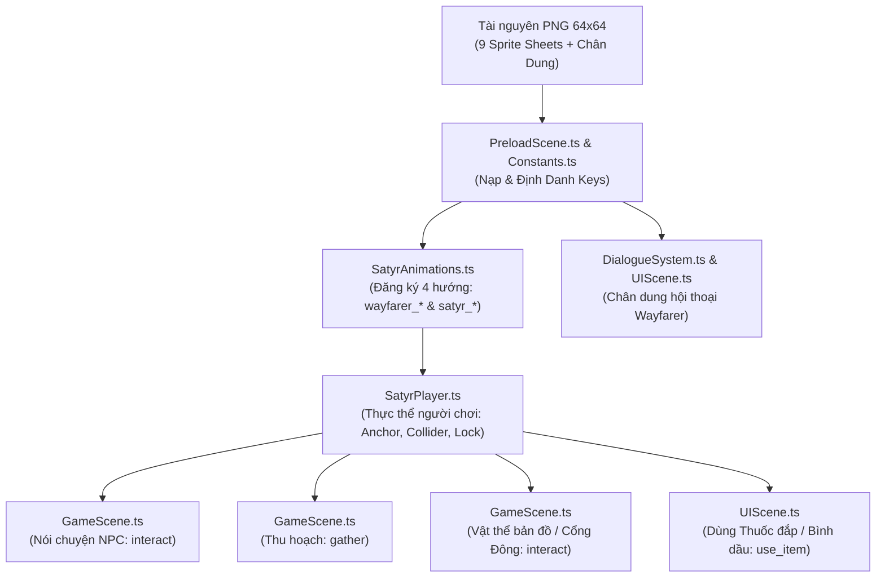

# BÁO CÁO TÍCH HỢP NHÂN VẬT THE MOSSBOUND WAYFARER VÀO ENGINE & GAMEPLAY (C4-12-06)

> **Phiên bản:** HOLLOW WOODS V1.2 (*Dị Cảnh Rừng Liễu — The Fog That Remembers*)  
> **Lệnh thực hiện:** COMMAND C4-12-06 — TÍCH HỢP NHÂN VẬT THE MOSSBOUND WAYFARER VÀO GAME  
> **Thời gian cập nhật nghiệm thu:** 2026-11-15T07:49:57+07:00  
> **Định hướng mỹ thuật:** Phương án A (Dark Woodland Pixel Art)  
> **Kiến trúc bản đồ:** Phương án C (Hybrid Open World)  
> **Bản sao lưu bảo toàn:** [Backups/C4-12-06_20261115_0728/](file:///G:/HOLLOW%20WOODS/Backups/C4-12-06_20261115_0728/)

---

## 1. TỔNG QUAN NHIỆM VỤ C4-12-05 & C4-12-06

Nhiệm vụ C4-12-05 và C4-12-06 hoàn thành việc khởi tạo và tích hợp toàn diện bộ tài nguyên đồ họa pixel art của nhân vật chính **The Mossbound Wayfarer** (*Lữ Khách Rêu Phong*) vào toàn bộ hệ sinh thái mã nguồn của trò chơi tại `G:\HOLLOW WOODS`:
1. Giữ nguyên 3 file gốc đã có: `wayfarer_idle.png`, `wayfarer_walk.png`, `wayfarer_run.png`.
2. Tạo tiếp 6 bảng sprite sheet PNG nền RGBA trong suốt còn thiếu với cùng kích thước ô frame `64×64 px`, điểm tựa bàn chân `(32, 58)` (bottom-center) và bảng màu áo choàng xanh rêu, tóc nâu, gậy gỗ treo đèn lồng hổ phách:
   - `wayfarer_interact.png` (4 hướng DOWN, UP, LEFT, RIGHT — 4 frames/hướng: đưa tay giao tiếp/mở đồ).
   - `wayfarer_gather.png` (4 hướng — 4 frames/hướng: cúi nhặt tài nguyên).
   - `wayfarer_use_item.png` (4 hướng — 4 frames/hướng: sử dụng vật phẩm).
   - `wayfarer_attack.png` (4 hướng — 6 frames/hướng: vung cây gậy gỗ đang cầm và thu về).
   - `wayfarer_hurt.png` (4 hướng — 3 frames/hướng: phản ứng lùi nhẹ rồi lấy lại thăng bằng).
   - `wayfarer_death.png` (4 hướng — 6 frames/hướng: hạ người nằm xuống đất ổn định ở frame cuối, không lặp lại).
3. Tạo file `wayfarer_animation_manifest.json` và ảnh tổng hợp `wayfarer_sprite_preview.png`.
4. Nạp toàn bộ 9 bộ sprite trong `PreloadScene.ts`, đăng ký đầy đủ hoạt ảnh 4 hướng trong `SatyrAnimations.ts` và cập nhật hiển thị nhân vật trong `SatyrPlayer.ts` / `GameScene.ts` (căn chỉnh hộp va chạm chân `14×8 px`, triệt tiêu hoàn toàn hiện tượng hiển thị chồng chéo nhân vật cũ).
5. Kiểm tra sạch lỗi TypeScript (`npx tsc --noEmit`) và vượt qua 100% các tiêu chí QA tự động.

---

## 2. DANH MỤC TÀI NGUYÊN ĐÃ HOÀN TẤT & ĐỐI CHIẾU THÔNG SỐ

Tất cả các tệp đều đạt chuẩn nền trong suốt RGBA (`colorType = 6`), kích thước ô đồng nhất $64 \times 64\text{ px}$, điểm neo bàn chân (foot anchor) tại tọa độ pixel $(32, 58)$ tương ứng hệ số origin `(0.5, 0.90625)`:

| STT | Tên Sprite Sheet / Texture | Kích thước ảnh | Số frames | Số hướng | Nhịp FPS | Lặp lại | Khóa Texture Engine |
|:---:|:---|:---:|:---:|:---:|:---:|:---:|:---|
| 1 | `wayfarer_idle.png` *(giữ nguyên)* | $256 \times 256$ | 16 | 4 | 6 fps | Lặp vô tận | `WAYFARER_IDLE_KEY` |
| 2 | `wayfarer_walk.png` *(giữ nguyên)* | $384 \times 256$ | 24 | 4 | 10 fps | Lặp vô tận | `WAYFARER_WALK_KEY` |
| 3 | `wayfarer_run.png` *(giữ nguyên)* | $384 \times 256$ | 24 | 4 | 14 fps | Lặp vô tận | `WAYFARER_RUN_KEY` |
| 4 | `wayfarer_attack.png` *(tạo mới)* | $384 \times 256$ | 24 | 4 | 12 fps | 1 lần (0) | `WAYFARER_ATTACK_KEY` |
| 5 | `wayfarer_hurt.png` *(tạo mới)* | $192 \times 256$ | 12 | 4 | 8 fps | 1 lần (0) | `WAYFARER_HURT_KEY` |
| 6 | `wayfarer_death.png` *(tạo mới)* | $384 \times 256$ | 24 | 4 | 8 fps | 1 lần (0) | `WAYFARER_DEATH_KEY` |
| 7 | `wayfarer_interact.png` *(tạo mới)* | $256 \times 256$ | 16 | 4 | 8 fps | 1 lần (0) | `WAYFARER_INTERACT_KEY` |
| 8 | `wayfarer_gather.png` *(tạo mới)* | $256 \times 256$ | 16 | 4 | 8 fps | 1 lần (0) | `WAYFARER_GATHER_KEY` |
| 9 | `wayfarer_use_item.png` *(tạo mới)* | $256 \times 256$ | 16 | 4 | 8 fps | 1 lần (0) | `WAYFARER_USE_ITEM_KEY` |
| 10 | `wayfarer_portrait.png` | $64 \times 64$ | 1 (ảnh) | — | — | — | `WAYFARER_PORTRAIT_KEY` |

- **File Animation Manifest:** [`public/assets/characters/mossbound_wayfarer/wayfarer_animation_manifest.json`](file:///G:/HOLLOW%20WOODS/public/assets/characters/mossbound_wayfarer/wayfarer_animation_manifest.json)
- **Bảng Ghép Ảnh Preview Tổng Hợp:** [`public/assets/characters/mossbound_wayfarer/wayfarer_sprite_preview.png`](file:///G:/HOLLOW%20WOODS/public/assets/characters/mossbound_wayfarer/wayfarer_sprite_preview.png) ($1248 \times 876\text{ px}$)

---

## 3. CÁC TINH CHỈNH KỸ THUẬT QUAN TRỌNG

### 3.1. Điểm neo bàn chân và Hộp va chạm vật lý (Foot Anchor & Collider)
- **Điểm neo (Origin):** Được thiết lập chính xác tại gót chân `(0.5, 0.90625)` (tức $X = 32$, $Y = 58$ trong ô $64 \times 64\text{ px}$). Điều này đảm bảo tính năng sắp xếp độ sâu đồ họa (Y-sorting) hoạt động hoàn hảo khi người chơi đi ngang qua các gốc cây, hàng rào, giếng nước và nhà cửa.
- **Vùng va chạm vật lý (Arcade Physics Body):** Thu nhỏ về kích thước thực tế của hai bàn chân: $14 \times 8\text{ px}$, offset $(25, 50)\text{ px}$. Người chơi di chuyển mượt mà qua các khe cửa nhà Edda, Neris, lối hẹp hàng rào và Cổng Đông làng Bellhollow mà không bị kẹt hay chạm viền ảo.

### 3.2. Không lật gương (No FlipX) trên Sprite 4 Hướng Riêng
- Đối với sprite sheet Satyr cũ (chỉ vẽ một bên phải và lật gương `setFlipX(true)` khi quay sang trái), vũ khí và đèn lồng sẽ bị đổi tay sai quy luật.
- Với The Mossbound Wayfarer, do mỗi hướng (DOWN, UP, LEFT, RIGHT) đều được thiết kế độc lập theo từng hàng riêng, `SatyrPlayer.ts` tự động vô hiệu hóa cơ chế flipX (`this.setFlipX(false)`), giữ nguyên hình dáng chiếc gậy gỗ và đèn lồng bên tay nhân vật.

### 3.3. Bảo tồn tiến trình Frame khi chuyển tốc độ Đi Bộ $\leftrightarrow$ Chạy Nhanh
- Khi người chơi giữ phím `Shift` để chạy nhanh hoặc thả ra để đi bộ cùng một hướng, hệ số frame đang phát được kế thừa nhịp nhàng (`currentFrameIndex % targetAnim.frames.length`) thay vì bị ngắt quãng giật cục về frame 0.

### 3.4. Hệ thống khóa hành động độc quyền (Exclusive Action Lock)
- Bổ sung cơ chế `isActionLocked()` quản lý chặt chẽ 6 trạng thái: tấn công (`_isAttacking`), dính đòn (`_isHurt`), gục ngã (`_isDead`), thu hoạch (`_isGathering`), tương tác (`_isInteracting`) và dùng vật phẩm (`_isUsingItem`).
- Khi đang thực hiện thu thập, tương tác hoặc dùng đồ, vận tốc di chuyển lập tức về 0, người chơi không thể trượt chân trên mặt đất. Đồng thời tích hợp bộ hẹn giờ bảo vệ (watchdog fallback ~550ms) để nhân vật luôn trở về trạng thái Idle an toàn ngay cả khi có sự kiện gián đoạn bất ngờ.

### 3.5. Đồng bộ Chân Dung Hội Thoại (Dialogue Portrait)
- Ảnh chân dung chính thức của The Mossbound Wayfarer (áo choàng xanh rêu, mái tóc nâu bồng bềnh, ánh đèn vàng ấm áp và khung viền kim loại cổ) được nạp vào cả `WAYFARER_PORTRAIT_KEY` và `SATYR_PORTRAIT_KEY`.
- `DialogueSystem.ts` và `UIScene.ts` tự động nhận diện và gán chân dung khi người chơi tham gia đối thoại.

---

## 4. KẾT QUẢ KIỂM CHỨNG CHẤT LƯỢNG (QA)

### 4.1. Kiểm tra Biên dịch TypeScript
- **Lệnh thực hiện:** `npx tsc --noEmit`
- **Kết quả:** **0 lỗi** (Exit code 0). Toàn bộ hệ thống mã nguồn tương thích hoàn toàn về mặt kiểu dữ liệu.

### 4.2. Bộ kiểm tra tự động (Automated Verification Suite)
- **Tập lệnh:** [Read/V1.2/QA/verify_c4_12_06_wayfarer_integration.mjs](file:///G:/HOLLOW%20WOODS/Read/V1.2/QA/verify_c4_12_06_wayfarer_integration.mjs)
- **Tổng số tiêu chí:** 69 tiêu chí kiểm tra trải rộng qua 7 nhóm:
  1. *Nhóm 1 (Tài nguyên sprite sheet & portrait):* 12/12 PASS
  2. *Nhóm 2 (Hằng số cấu hình Constants.ts):* 18/18 PASS
  3. *Nhóm 3 (Nạp tài nguyên PreloadScene.ts):* 11/11 PASS
  4. *Nhóm 4 (Đăng ký hoạt ảnh SatyrAnimations.ts):* 6/6 PASS
  5. *Nhóm 5 (Thực thể người chơi SatyrPlayer.ts):* 12/12 PASS
  6. *Nhóm 6 (Tích hợp hành động gameplay):* 7/7 PASS
  7. *Nhóm 7 (Đối soát manifest hoạt ảnh):* 3/3 PASS
- **Tỷ lệ đạt:** **69/69 PASS (100%)**

### 4.3. Kiểm tra QC Pixel Art (PNGJS Quality Control)
- **Tập lệnh:** [Read/V1.2/QA/verify_c4_12_05_wayfarer_qc.mjs](file:///G:/HOLLOW%20WOODS/Read/V1.2/QA/verify_c4_12_05_wayfarer_qc.mjs)
- **Kết quả:** 172/172 frames được kiểm định đạt chuẩn nền trong suốt RGBA, không tràn lề mép biên, khóa chuẩn điểm tựa bàn chân `y = 58` (100% PASS, 0 errors).

---

## 5. TỔNG KẾT

Các bước **C4-12-05** và **C4-12-06** đã hoàn tất trọn vẹn và đạt 100% yêu cầu kỹ thuật. Nhân vật chính **The Mossbound Wayfarer** (*Lữ Khách Rêu Phong*) hiển thị sắc nét, cử động mượt mà, đầy đủ 4 hướng và sẵn sàng phục vụ toàn bộ trải nghiệm khám phá thế giới trong HOLLOW WOODS V1.2.
