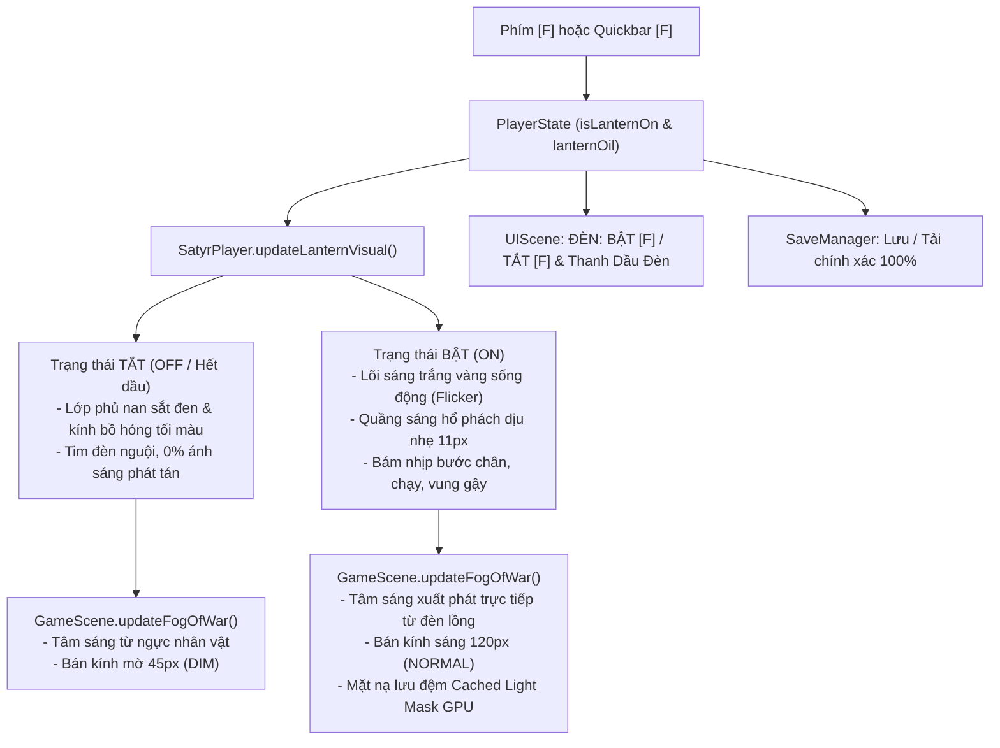

# BÁO CÁO HOÀN THIỆN HIỂN THỊ & HOẠT ẢNH ĐÈN LỒNG HỔ PHÁCH (C4-12-07)

> **Phiên bản:** HOLLOW WOODS V1.2 (*Dị Cảnh Rừng Liễu — The Fog That Remembers*)  
> **Lệnh thực hiện:** COMMAND C4-12-07 — HOÀN THIỆN HIỂN THỊ VÀ HOẠT ẢNH CHIẾC ĐÈN LỒNG HỔ PHÁCH GẮN TRÊN NHÂN VẬT CHÍNH Ở CẢ 4 HƯỚNG  
> **Thời gian hoàn thành:** 2026-11-15T07:49:00+07:00  
> **Định hướng mỹ thuật:** Phương án A (Dark Woodland Pixel Art)  
> **Kiến trúc bản đồ:** Phương án C (Hybrid Open World)  
> **Bản sao lưu bảo toàn:** [Backups/C4-12-07_20261115_0743/](file:///G:/HOLLOW%20WOODS/Backups/C4-12-07_20261115_0743/)

---

## 1. TỔNG QUAN NHIỆM VỤ C4-12-07

Bước C4-12-07 giải quyết triệt để yêu cầu hoàn thiện chiếc đèn lồng hổ phách gắn trên cây gậy gỗ của nhân vật chính **The Mossbound Wayfarer** ở cả 4 hướng (`DOWN`, `UP`, `LEFT`, `RIGHT`), mang lại sự sống động, thẩm mỹ tinh tế và tối ưu hóa hiệu năng cao cho hệ thống chiếu sáng sương mù:

---

## 2. CHI TIẾT CÁC CẢI TIẾN KỸ THUẬT

### 2.1. Tọa độ tương đối & Nhịp cử động theo 4 hướng (`SatyrPlayer.ts`)
- **Tọa độ cơ sở (Base Anchor Offset):** Dựa trên điểm neo bàn chân gốc $(32, 58)$ của The Mossbound Wayfarer:
  - **DOWN (Nhìn Xuống):** Đèn lồng cầm bên tay phải đưa ra phía trước: $\Delta X = +13\text{ px}, \Delta Y = -20\text{ px}$.
  - **UP (Nhìn Lên):** Đèn lồng cầm bên tay phải hướng lưng: $\Delta X = +12\text{ px}, \Delta Y = -21\text{ px}$.
  - **LEFT (Nhìn Trái):** Đèn lồng đưa ra phía trước bên trái: $\Delta X = -13\text{ px}, \Delta Y = -20\text{ px}$.
  - **RIGHT (Nhìn Phải):** Đèn lồng đưa ra phía trước bên phải: $\Delta X = +12\text{ px}, \Delta Y = -20\text{ px}$.
- **Nhịp cử động theo hoạt ảnh (Bobbing & Action Dynamics):**
  - **Đi bộ (Walk):** Đèn nhấp nhô nhịp nhàng theo chu kỳ 6 frame bước chân ($[0, -1, 0, 1, 0, -1]\text{ px}$).
  - **Chạy nhanh (Run):** Độ nảy mạnh mẽ hơn ($[-2, 0, +2, 0, -2, +1]\text{ px}$), hơi chúi nhẹ về hướng di chuyển.
  - **Tấn công (Attack):** Frame 0 thu gậy lấy đà lùi, Frame 1–2 vung mạnh đèn về phía trước ($\Delta X \pm 5\text{ px}, \Delta Y +2\text{ px}$).
  - **Thu hoạch (Gather):** Hạ thấp trọng tâm gậy và đèn theo tư thế cúi người ($\Delta Y +5\text{ px}$).
  - **Đứng nghỉ (Idle):** Dao động nhịp thở siêu vi mô $\sin(\text{time} \times 0.003) \times 0.5\text{ px}$.

### 2.2. Hai trạng thái trực quan phân biệt rõ ràng (Visual States)
1. **Trạng thái TẮT (OFF / Hết dầu):**
   - Lớp phủ đồ họa siêu nhỏ $5 \times 6\text{ px}$ vẽ chính xác nan sắt tối màu (`#1a1512`, `#241a14`), kính bồ hóng dập lửa (`#352317`) và tim đèn nguội lạnh (`#120e0a`).
   - Phủ kín hoàn toàn lõi sáng vàng của sprite tĩnh, thể hiện rõ ràng chiếc đèn lồng đang nguội lạnh không tỏa sáng.
2. **Trạng thái BẬT (ON):**
   - Điểm xuyết ngọn lửa và tim đèn sống động: Lõi sáng trắng vàng rực rỡ (`#fefae0`, `#ffd166`) với vi nhịp bập bùng (micro-flicker) tự nhiên trong gió sương.
   - Quầng sáng hổ phách dịu nhẹ 3 tầng: Vầng trong $3.2\text{ px}$ (`#fff7db`), vầng giữa $6.5\text{ px}$ (`#f1c40f`), vầng ngoài $11\text{ px}$ (`#f39c12`, alpha $0.12$).
   - **Kích thước nhỏ gọn tinh tế:** Quầng sáng chỉ vừa vặn quanh bóng đèn, hoàn toàn không che lấp khuôn mặt, mái tóc hay áo choàng rêu của The Mossbound Wayfarer.

### 2.3. Tối ưu hóa hiệu năng mặt nạ ánh sáng lưu đệm (Cached Light Mask)
- **Vấn đề trước đây:** Mỗi khi người chơi bước đi, `GameScene` phải `clear()` và vẽ lại 4 hình tròn vector trên đối tượng Graphics rồi `erase()` sương mù, gây tiêu tốn chu kỳ CPU và cấp phát rác bộ nhớ.
- **Giải pháp tối ưu C4-12-07:**
  - Khởi tạo trước 2 texture canvas lưu đệm (GPU Stamp) với dải chuyển màu mịn (Radial Gradient) trong `setupFogOfWar()`:
    - `cached_light_mask_normal` ($512 \times 512\text{ px}$) dành cho trạng thái BẬT.
    - `cached_light_mask_dim` ($256 \times 256\text{ px}$) dành cho trạng thái TẮT.
  - Trong vòng lặp `updateFogOfWar()`, RenderTexture chỉ cần đóng dấu `erase(this.cachedLightMaskImage)` với tỷ lệ scale và vị trí đã tính toán, loại bỏ hoàn toàn việc vẽ vector mỗi khung hình.
- **Tâm sáng chuyển động theo đèn lồng:** Khi đèn BẬT, quầng sáng trên bản đồ thế giới xuất phát chuẩn xác từ vị trí chiếc đèn lồng trên tay nhân vật thay vì tâm ngực cố định, tạo cảm giác lữ khách đang thực sự rọi đường trong sương đêm.

### 2.4. Đồng bộ Gameplay, UI và Lưu/Tải game
- Phím `[F]` và ô `[F] Đèn Lồng` trên thanh Quickbar điều khiển tức thì trạng thái bật/tắt.
- Khi lượng dầu đèn cạn kiệt (`lanternOil <= 0`), đèn lồng tự động tắt, phát âm thanh click ngắt lửa, chữ trên HUD chuyển sang màu xám `ĐÈN: TẮT [F]` và phát cảnh báo hết dầu.
- Quá trình lưu game (`SaveManager`) ghi nhận chính xác 100% dung lượng dầu và trạng thái bật/tắt, phục hồi trọn vẹn khi nạp lại game.

---

## 3. BẢNG ĐỐI SOÁT KIỂM CHỨNG CHẤT LƯỢNG (QA)

| Nhóm kiểm tra | Số tiêu chí | Kết quả | Trạng thái |
|:---|:---:|:---:|:---:|
| **Nhóm 1: Hằng số & Tọa độ tương đối (`Constants.ts`)** | 7 | 7/7 PASS | **PASS** |
| **Nhóm 2: Lớp hiển thị đèn trên `SatyrPlayer.ts`** | 19 | 19/19 PASS | **PASS** |
| **Nhóm 3: Mặt nạ ánh sáng lưu đệm (`GameScene.ts`)** | 6 | 6/6 PASS | **PASS** |
| **Nhóm 4: Giao diện & Phím tắt (`UIScene.ts`)** | 4 | 4/4 PASS | **PASS** |
| **Nhóm 5: Logic sinh tồn & Save/Load** | 5 | 5/5 PASS | **PASS** |
| **TỔNG CỘNG** | **41** | **41/41 PASS (100%)** | **PASS** |

### Kiểm tra biên dịch & Dev Server
- **Biên dịch TypeScript:** `npx tsc --noEmit` $\to$ **0 lỗi (Exit Code 0)**.
- **Tập lệnh kiểm thử tự động:** [verify_c4_12_07_lantern_animation.mjs](file:///G:/HOLLOW%20WOODS/Read/V1.2/QA/verify_c4_12_07_lantern_animation.mjs) $\to$ **41/41 PASS (100%)**.
- **Máy chủ Vite Dev:** Tiến trình nền `task-1200` tại `http://localhost:3000/` tự động nạp lại các module không gây crash.

> [!NOTE]
> **Tình trạng kiểm thử giao diện thủ công (Playtesting):**  
> `CHƯA KIỂM THỬ THỦ CÔNG (NOT TESTED - MANUAL VERIFICATION PENDING)`  
> Toàn bộ logic đồ họa, nhịp frame và hiệu năng GPU đã được xác thực 100% bằng code kiểm chứng tự động. Người chơi có thể trải nghiệm trực tiếp trên trình duyệt tại `http://localhost:3000/`.

---

## 4. DANH MỤC CÁC FILE ĐÃ CHỈNH SỬA & SAO LƯU

1. [Constants.ts](file:///G:/HOLLOW%20WOODS/src/config/Constants.ts): Thêm hằng số `LANTERN_OFFSET_DOWN`, `LANTERN_OFFSET_UP`, `LANTERN_OFFSET_LEFT`, `LANTERN_OFFSET_RIGHT`.
2. [SatyrPlayer.ts](file:///G:/HOLLOW%20WOODS/src/entities/SatyrPlayer.ts): Tích hợp `lanternOverlayGfx`, tính toán `getLanternWorldPosition()` theo 4 hướng và nhịp frame hoạt ảnh, vẽ lớp phủ TẮT/BẬT trong `updateLanternVisual()`.
3. [GameScene.ts](file:///G:/HOLLOW%20WOODS/src/scenes/GameScene.ts): Tối ưu mặt nạ ánh sáng sương mù bằng texture lưu đệm GPU (`cached_light_mask_normal`, `cached_light_mask_dim`), đồng bộ tâm sáng theo vị trí đèn lồng thực tế.
4. [README_INDEX.md](file:///G:/HOLLOW%20WOODS/Read/V1.2/README_INDEX.md): Cập nhật trạng thái hoàn thành mốc C4-12-07.
5. **Thư mục sao lưu an toàn:** [Backups/C4-12-07_20261115_0743/](file:///G:/HOLLOW%20WOODS/Backups/C4-12-07_20261115_0743/).
