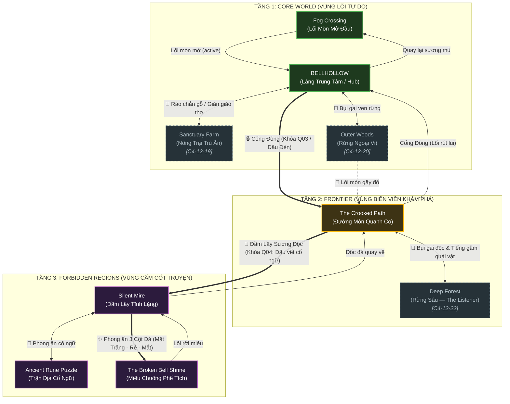

# HOLLOW WOODS V1.2 — BÁO CÁO KỸ THUẬT C4-12-11
## TRIỂN KHAI SỔ ĐĂNG KÝ KẾT NỐI PHÂN KHU DÙNG CHUNG (SHARED ZONE CONNECTION REGISTRY)

- **Mã lệnh:** `COMMAND C4-12-11`
- **Dự án:** HOLLOW WOODS V1.2 (*Dị Cảnh Rừng Liễu — The Fog That Remembers*)
- **Thư mục làm việc:** `G:\HOLLOW WOODS`
- **Mô hình thế giới:** **World Structure C — Hybrid Open World (Thế Giới Mở Lai 3 Tầng)**
- **Định hướng mỹ thuật:** **Visual Direction A — Dark Woodland Pixel Art**
- **Trạng thái thực thi:** **HOÀN TẤT THÀNH CÔNG (176/176 TIÊU CHÍ QC ĐẠT 100%)**
- **Bản sao lưu trước khi sửa:** [Backups/C4-12-11_PRE_BACKUP/](file:///G:/HOLLOW%20WOODS/Backups/C4-12-11_PRE_BACKUP/) (`WorldBuilder.ts`, `WorldGatingSystem.ts`, `GameScene.ts`, `zones.json`, `index.ts`).

---

## 1. TỔNG QUAN VÀ MỤC TIÊU THỰC HIỆN

Tiếp nối nền tảng kiến trúc kỹ thuật từ `C4-12-10`, lệnh **C4-12-11** triển khai **Sổ Đăng Ký Kết Nối Phân Khu Dùng Chung (`ZoneConnectionRegistry`)** nhằm thiết lập mạng lưới liên kết không gian (Spatial Topology) chặt chẽ, an toàn và chuẩn tắc giữa toàn bộ 9 phân khu thuộc 3 Tầng Thế Giới:

1. **Chuẩn hóa Sổ Đăng Ký Tập Trung (`ZoneConnectionRegistry`):**
   - Đăng ký 9 Nodes phân khu với đầy đủ metadata: Mã ID, tên hiển thị tiếng Việt, ranh giới hình học (`bounds`), điểm sinh mặc định (`defaultSpawn`), trạng thái (`status: 'active' | 'pending_construction'`) và danh sách phân khu lân cận (`neighbors`).
   - Đăng ký 18 Connections (kết nối 2 chiều và lối rẽ đặc thù) hoàn chỉnh với: Mã kết nối duy nhất, phân khu xuất phát (`fromZone`), phân khu đích (`toZone`), vùng kích hoạt (`triggerRect`), tọa độ điểm vào (`entryPoint`), tọa độ điểm quay về (`returnPoint`), hình thức ranh giới (`barrierType`) và điều kiện mở khóa cốt truyện.
2. **Cơ Chế Rào Chắn & Phòng Ngừa Rơi Vào Hư Vô (Void-Fall Protection):**
   - Phân định rõ ràng giữa các phân khu đã hoàn thiện cảnh quan (`active`: `fog_crossing`, `bellhollow`, `crooked_path`, `silent_mire`, `ancient_rune_puzzle`, `broken_bell_shrine`) và các phân khu chuẩn bị dựng bản đồ chi tiết trong chuỗi lệnh `C4-12-17` đến `C4-12-25` (`pending_construction`: `sanctuary_farm`, `outer_woods`, `deep_forest`).
   - Mọi kết nối dẫn tới phân khu `pending_construction` được bảo vệ bằng rào chắn vật lý (giàn giáo, bụi gai dày đặc) kèm thông điệp cảnh báo không khí (*atmospheric notice*).
   - Nếu xảy ra sự kiện kích hoạt chuyển vùng thử nghiệm, hệ thống tự động neo giữ nhân vật an toàn tại `returnPoint` bên trong phân khu xuất phát, **tuyệt đối không bao giờ để người chơi rơi vào màn hình đen hoặc scene rỗng**.
3. **Đồng Bộ Dữ Liệu & Tương Tác Trong Game:**
   - Cập nhật đồng bộ toàn bộ 18 transitions trong [src/data/zones.json](file:///G:/HOLLOW%20WOODS/src/data/zones.json).
   - Bổ sung 3 biển chỉ dẫn tương tác [E] tại các lối rẽ ranh giới (`bellhollow_farm_gate_sign`, `bellhollow_outer_woods_gate_sign`, `crooked_path_deep_forest_sign`).
   - Tích hợp liền mạch với [src/world/WorldBuilder.ts](file:///G:/HOLLOW%20WOODS/src/world/WorldBuilder.ts) và [src/scenes/GameScene.ts](file:///G:/HOLLOW%20WOODS/src/scenes/GameScene.ts).

---

## 2. SƠ ĐỒ KẾT NỐI TOÀN CẢNH MẠNG LƯỚI PHÂN KHU (TOPOLOGY DIAGRAMS)

### 2.1. Sơ đồ Mermaid Thể Hiện Luồng Di Chuyển & Cơ Chế Rào Chắn



### 2.2. Sơ đồ ASCII Không Gian Toàn Bản Đồ

```text
                                  ══════════════════════════════════════════════════════════════
                                  TẦNG 3: FORBIDDEN REGIONS (VÙNG CẤM KHÓA THEO CỐT TRUYỆN)
                                  ══════════════════════════════════════════════════════════════
                                                                ┌──────────────────────────────┐
                                                                │   The Broken Bell Shrine     │
                                                                │  (Miếu Chuông Phế Tích — Hồi 5)│
                                                                └──────────────▲───────────────┘
                                                                               │ 🔒 mire_puzzle_solved
                                  ┌─────────────────────────────┐              │
                                  │     Ancient Rune Puzzle     │              │
                                  │  (Trận Địa 3 Cột Đá Cổ Ngữ) ├──────────────┤
                                  └──────────────▲──────────────┘              │
                                                 │                             │
                                  ┌──────────────┴─────────────────────────────┴───────────────┐
                                  │                        Silent Mire                         │
                                  │            (Đầm Lầy Tĩnh Lặng — Sương Độc Ăn Mòn)          │
                                  └──────────────────────────────▲─────────────────────────────┘
                                                                 │ 🔒 Q04: Dấu Vết Cổ Ngữ
                                  ═══════════════════════════════╪══════════════════════════════
                                  TẦNG 2: FRONTIER (VÙNG BIÊN VIỄN MỞ DẦN THEO NHIỆM VỤ)
                                  ═══════════════════════════════╪══════════════════════════════
                                  ┌──────────────────────────────┴─────────────────────────────┐
                                  │                        Deep Forest                         │
                                  │     (Rừng Sâu — Lãnh Địa The Listener — [C4-12-22 Pending]) │
                                  └──────────────────────────────▲─────────────────────────────┘
                                                                 │ 🐾 Bụi gai & sương độc
                                  ┌──────────────────────────────┴─────────────────────────────┐
                                  │                      The Crooked Path                      │
                                  │        (Đường Mòn Quanh Co — Hốc Cây Ẩn Nấp & Tiền Tuyến)  │
                                  └──────────────────────────────▲─────────────────────────────┘
                                                                 │
  ═══════════════════════════════════════════════════════════════╪═══════════════════════════════════════════════════════════════
                 RANH GIỚI BẢO VỆ VÙNG LÕI — CỔNG ĐÔNG LÀNG BELLHOLLOW (Khóa Q03_PREPARE_RESOURCES)
  ═══════════════════════════════════════════════════════════════╪═══════════════════════════════════════════════════════════════
                                                                 │ 🔒 Cổng Đông (gateX = 1485)
                                  ┌──────────────────────────────┴─────────────────────────────┐
                                  │                        Outer Woods                         │
                                  │    (Rừng Ngoại Vi — Vành Đai Khai Thác Tự Do — [C4-12-20])  │
                                  └──────────────────────────────▲─────────────────────────────┘
                                                                 │ 🌿 Lối mở tự do
  ┌─────────────────────────────┐ ┌──────────────────────────────┴─────────────────────────────┐ ┌─────────────────────────────┐
  │         Fog Crossing        │ │                         BELLHOLLOW                         │ │        Sanctuary Farm       │
  │   (Lối Mòn Xuyên Sương)     ├─┤     (Làng Chuông Cổ — Trung Tâm An Toàn & Chế Tạo)         ├─┤   (Nông Trại Trú Ẩn)        │
  │      [ACTIVE — Mở đầu]      │ │                     [ACTIVE — Vùng Lõi]                    │ │  [PENDING — C4-12-19]       │
  └─────────────────────────────┘ └────────────────────────────────────────────────────────────┘ └─────────────────────────────┘
                                  ══════════════════════════════════════════════════════════════
                                  TẦNG 1: CORE WORLD (VÙNG LÕI TỰ DO KHÁM PHÁ & SINH HOẠT)
                                  ══════════════════════════════════════════════════════════════
```

---

## 3. DANH MỤC CHI TIẾT 18 KẾT NỐI TRONG SỔ ĐĂNG KÝ (ZONE CONNECTION REGISTRY)

| STT | Mã Kết Nối (Connection ID) | Phân Khu Xuất Phát | Phân Khu Đích | Trạng Thái | Kiểu Rào Chắn | Vùng Kích Hoạt (TriggerRect) | Điểm Vào (EntryPoint) | Điểm Quay Về (ReturnPoint) | Điều Kiện Mở Khóa / Thông Điệp Cảnh Báo An Toàn |
| :---: | :--- | :--- | :--- | :---: | :---: | :---: | :---: | :---: | :--- |
| **1** | `conn_fog_to_bellhollow` | `fog_crossing` | `bellhollow` | `active` | `open` | `(460, 100, 20, 160)` | `(520, 260)` $\rightarrow$ | `(440, 180)` $\leftarrow$ | Mở tự do ngay từ đầu game. |
| **2** | `conn_bellhollow_to_fog` | `bellhollow` | `fog_crossing` | `active` | `open` | `(480, 200, 20, 120)` | `(440, 180)` $\leftarrow$ | `(520, 260)` $\rightarrow$ | Quay lại lối mòn sương mù ban sơ. |
| **3** | `conn_bellhollow_to_farm` | `bellhollow` | `sanctuary_farm` | `pending_construction` | `barrier_scaffold` | `(580, 530, 140, 25)` | `(640, 620)` $\downarrow$ | `(600, 510)` $\uparrow$ | 🚧 *Thợ mộc đang dựng rào gia cố (Phân khu C4-12-19).* |
| **4** | `conn_farm_to_bellhollow` | `sanctuary_farm` | `bellhollow` | `pending_construction` | `open` | `(580, 560, 140, 20)` | `(600, 520)` $\uparrow$ | `(640, 620)` $\downarrow$ | Lối về trung tâm quảng trường làng. |
| **5** | `conn_bellhollow_to_outer_woods` | `bellhollow` | `outer_woods` | `pending_construction` | `dense_thorns` | `(1120, 530, 200, 25)` | `(1200, 620)` $\downarrow$ | `(1120, 510)` $\uparrow$ | 🌿 *Bụi gai rậm rạp, thợ săn đang phát quang (Phân khu C4-12-20).* |
| **6** | `conn_outer_woods_to_bellhollow` | `outer_woods` | `bellhollow` | `pending_construction` | `open` | `(1120, 560, 200, 20)` | `(1120, 510)` $\uparrow$ | `(1200, 620)` $\downarrow$ | Lối quay lại khu xưởng chế tạo làng. |
| **7** | `conn_bellhollow_to_crooked_path` | `bellhollow` | `crooked_path` | `active` | `gate` | `(1580, 200, 20, 160)` | `(1640, 280)` $\rightarrow$ | `(1540, 280)` $\leftarrow$ | 🔒 **Khóa Cổng Đông:** Cần hoàn thành Hồi 3 (`Q03_PREPARE_RESOURCES`). |
| **8** | `conn_crooked_path_to_bellhollow` | `crooked_path` | `bellhollow` | `active` | `gate` | `(1600, 220, 20, 140)` | `(1540, 280)` $\leftarrow$ | `(1640, 280)` $\rightarrow$ | Lối rút lui an toàn về làng Bellhollow khi bị săn đuổi. |
| **9** | `conn_outer_woods_to_crooked_path`| `outer_woods` | `crooked_path` | `pending_construction` | `dense_thorns` | `(1560, 480, 40, 120)` | `(1640, 480)` $\rightarrow$ | `(1520, 480)` $\leftarrow$ | 🌲 *Cây cổ thụ gãy chắn ngang (Phân khu C4-12-20 & C4-12-21).* |
| **10**| `conn_crooked_path_to_outer_woods`| `crooked_path` | `outer_woods` | `pending_construction` | `dense_thorns` | `(1610, 480, 30, 120)` | `(1520, 480)` $\leftarrow$ | `(1640, 480)` $\rightarrow$ | Lối tắt hiểm hóc quay về vành đai an toàn. |
| **11**| `conn_crooked_path_to_deep_forest` | `crooked_path` | `deep_forest` | `pending_construction` | `dense_thorns` | `(2000, 10, 200, 25)` | `(2100, -100)` $\uparrow$ | `(2100, 40)` $\downarrow$ | 🐾 *Sương độc và tiếng gầm gừ quái vật (Phân khu C4-12-22).* |
| **12**| `conn_deep_forest_to_crooked_path` | `deep_forest` | `crooked_path` | `pending_construction` | `open` | `(2000, -20, 200, 20)` | `(2100, 40)` $\downarrow$ | `(2100, -100)` $\uparrow$ | Lối thoát phía Nam khỏi rừng rậm. |
| **13**| `conn_crooked_path_to_silent_mire` | `crooked_path` | `silent_mire` | `active` | `dense_thorns` | `(2860, 240, 20, 160)` | `(2940, 320)` $\rightarrow$ | `(2820, 280)` $\leftarrow$ | 🔒 **Khóa Đầm Lầy:** Cần hoàn thành Hồi 4 mục tiêu 1 (`Q04_ANCIENT_RUNES:t1`). |
| **14**| `conn_silent_mire_to_crooked_path` | `silent_mire` | `crooked_path` | `active` | `open` | `(2880, 260, 20, 140)` | `(2820, 280)` $\leftarrow$ | `(2940, 320)` $\rightarrow$ | Dốc đá bước lên khỏi vũng lầy sương độc. |
| **15**| `conn_silent_mire_to_rune_puzzle` | `silent_mire` | `ancient_rune_puzzle`| `active` | `rune_ward` | `(3350, 220, 40, 120)` | `(3420, 260)` $\rightarrow$ | `(3300, 260)` $\leftarrow$ | Gò đất linh thiêng chứa 3 Cột Đá Cổ Ngữ (Mặt Trăng, Rễ, Mắt). |
| **16**| `conn_rune_puzzle_to_silent_mire` | `ancient_rune_puzzle`| `silent_mire` | `active` | `open` | `(3350, 250, 20, 60)` | `(3300, 260)` $\leftarrow$ | `(3420, 260)` $\rightarrow$ | Rời bệ đá cổ trở lại đầm lầy. |
| **17**| `conn_silent_mire_to_shrine` | `silent_mire` | `broken_bell_shrine`| `active` | `rune_ward` | `(3980, 240, 20, 160)` | `(4050, 280)` $\rightarrow$ | `(3940, 320)` $\leftarrow$ | 🔒 **Khóa Miếu Chuông:** Cần giải đúng chuỗi 3 Cột Đá (`mire_puzzle_solved`). |
| **18**| `conn_shrine_to_silent_mire` | `broken_bell_shrine`| `silent_mire` | `active` | `open` | `(4000, 220, 20, 140)` | `(3940, 320)` $\leftarrow$ | `(4050, 280)` $\rightarrow$ | Lối đá cổ rời khỏi Miếu Chuông Phế Tích. |

---

## 4. CƠ CHẾ RÀO CHẮN & BẢO ĐẢM AN TOÀN TRÁNH RƠI VÀO VOID (VOID-FALL PROTECTION)

### 4.1. Nguyên Lý An Toàn Tuyệt Đối (Zero Void Fall)
Trong giai đoạn hiện tại (trước khi thực thi các lệnh vẽ chi tiết bản đồ `C4-12-17` đến `C4-12-25`), 3 phân khu mới gồm `sanctuary_farm`, `outer_woods`, `deep_forest` đã có tọa độ bounds và cấu trúc dữ liệu, nhưng chưa dựng tile đồ họa mặt đất. Để bảo đảm trải nghiệm người chơi không bao giờ gặp lỗi đồ họa, hệ thống triển khai 3 lớp bảo vệ đa tầng:

```text
                                    NGƯỜI CHƠI BƯỚC ĐẾN RANH GIỚI
                                                  │
                                                  ▼
                         ┌─────────────────────────────────────────────────┐
                         │   Lớp 1: Hàng Rào Vật Lý (Solid Colliders)      │
                         │   Fence / Scaffold / Boundary ngăn di chuyển    │
                         └────────────────────────┬────────────────────────┘
                                                  │ (Nhấn [E] tương tác)
                                                  ▼
                         ┌─────────────────────────────────────────────────┐
                         │   Lớp 2: Biển Báo Cảnh Báo Không Khí            │
                         │   Hiện Popup giải thích tiến độ công trình      │
                         └────────────────────────┬────────────────────────┘
                                                  │ (Nếu kích hoạt transition)
                                                  ▼
                         ┌─────────────────────────────────────────────────┐
                         │   Lớp 3: Fallback Neo Giữ An Toàn               │
                         │   evaluateConnectionTraversal() trả về:         │
                         │   - allowed: false                              │
                         │   - isSafePending: true                         │
                         │   - spawnPoint: conn.returnPoint                │
                         │   (Giữ nguyên người chơi trong phân khu an toàn)│
                         └─────────────────────────────────────────────────┘
```

### 4.2. Mã Nguồn Fallback Đã Triển Khai Trong `ZoneConnectionRegistry`

```typescript
// Trích xuất từ src/world/ZoneConnectionRegistry.ts
public evaluateConnectionTraversal(connectionId: string, playerState: PlayerState): TraversalResult {
  const conn = this.connections.get(connectionId);
  if (!conn) {
    return {
      allowed: false,
      status: 'pending_construction',
      targetZoneId: 'bellhollow',
      spawnPoint: { x: 560, y: 260 },
      reason: 'Kết nối không tồn tại trong sổ đăng ký.'
    };
  }

  const targetNode = this.zoneNodes.get(conn.toZone);
  if (!targetNode) {
    return {
      allowed: false,
      status: 'pending_construction',
      targetZoneId: conn.fromZone,
      spawnPoint: conn.returnPoint,
      reason: 'Phân khu đích không hợp lệ.'
    };
  }

  // 1. Kiểm tra trạng thái pending_construction (Bảo vệ an toàn chống rơi vào void)
  if (conn.status === 'pending_construction' || targetNode.status === 'pending_construction') {
    return {
      allowed: false,
      status: 'pending_construction',
      targetZoneId: conn.toZone,
      spawnPoint: conn.returnPoint, // Đặt người chơi an toàn tại điểm quay về của vùng hiện tại
      isSafePending: true,
      reason: 'Khu vực đang trong giai đoạn xây dựng hoàn thiện.',
      notice: conn.pendingNotice || `Khu vực ${targetNode.titleVietnamese} đang được chuẩn bị bản đồ chi tiết.`
    };
  }

  // 2. Kiểm tra điều kiện mở khóa cốt truyện qua WorldGatingSystem
  const gatingEval = WorldGatingSystem.getInstance().evaluateTransition(conn.fromZone, conn.toZone, playerState);
  if (!gatingEval.allowed) {
    return {
      allowed: false,
      status: 'active',
      targetZoneId: conn.toZone,
      spawnPoint: conn.returnPoint,
      reason: gatingEval.reason,
      hint: gatingEval.hint
    };
  }

  // 3. Cho phép chuyển vùng an toàn
  return {
    allowed: true,
    status: 'active',
    targetZoneId: conn.toZone,
    spawnPoint: conn.entryPoint
  };
}
```

---

## 5. KẾT QUẢ KIỂM THỬ TỰ ĐỘNG & BẢO ĐẢM CHẤT LƯỢNG (QA/QC)

Bộ kịch bản kiểm thử tự động [scripts/verify_world_connections_c4_12_11.mjs](file:///G:/HOLLOW%20WOODS/scripts/verify_world_connections_c4_12_11.mjs) đã được chạy và xác nhận đạt tuyệt đối:

```text
================================================================
QA / QC VERIFICATION SUITE — COMMAND C4-12-11
SỔ ĐĂNG KÝ KẾT NỐI PHÂN KHU DÙNG CHUNG (ZONE CONNECTION REGISTRY)
================================================================

--- 1. KIỂM TRA ĐỊNH NGHĨA KIỂU DỮ LIỆU KẾT NỐI (SRC/TYPES/INDEX.TS) ---
  [PASS] #1: Định nghĩa kiểu ConnectionStatus
  [PASS] #2: ConnectionStatus hỗ trợ active và pending_construction
  [PASS] #3: Định nghĩa kiểu ConnectionBarrierType
  [PASS] #4: ConnectionBarrierType hỗ trợ open
  [PASS] #5: ConnectionBarrierType hỗ trợ gate
  [PASS] #6: ConnectionBarrierType hỗ trợ barrier_scaffold
  [PASS] #7: ConnectionBarrierType hỗ trợ dense_thorns
  [PASS] #8: ConnectionBarrierType hỗ trợ rune_ward
  [PASS] #9: Định nghĩa interface ZoneNeighborInfo
  [PASS] #10: Định nghĩa interface ZoneNodeMetadata
  [PASS] #11: Định nghĩa interface ZoneConnectionDescriptor
  [PASS] #12: TransitionZone và Descriptor hỗ trợ pendingNotice
  [PASS] #13: TransitionZone và Descriptor hỗ trợ returnPoint

--- 2. KIỂM TRA MÃ NGUỒN ZONE CONNECTION REGISTRY ---
  [PASS] #14-#27: Registry đăng ký đầy đủ 9 nodes phân khu
  [PASS] #28-#45: Registry đăng ký đầy đủ 18 kết nối (connections)
  [PASS] #46: Cơ chế phát hiện an toàn isSafePending
  [PASS] #47: Đặt spawnPoint quay về returnPoint khi phân khu pending

--- 3. KIỂM TRA ĐỒNG BỘ DỮ LIỆU ZONES.JSON ---
  [PASS] #48: zones.json chứa đủ 9 phân khu (Hiện tại: 9)
  [PASS] #49-#156: Kiểm tra tính hợp lệ của fromZone, toZone, triggerRect, targetSpawn, returnPoint trên cả 18 transitions
  [PASS] #157: zones.json có đủ 18 transitions
  [PASS] #158: zones.json có 10 active transitions
  [PASS] #159: zones.json có 8 pending transitions
  [PASS] #160: Bellhollow có biển chỉ dẫn Lối Nam Nông Trại
  [PASS] #161: Bellhollow có biển chỉ dẫn Rừng Ngoại Vi
  [PASS] #162: Crooked Path có biển cảnh báo Rừng Sâu

--- 4. KIỂM TRA TÍCH HỢP WORLDBUILDER & GAMESCENE ---
  [PASS] #163: WorldBuilder import ZoneConnectionRegistry
  [PASS] #164: WorldBuilder cung cấp getConnectionRegistry()
  [PASS] #165: GameScene import ZoneConnectionRegistry
  [PASS] #166: GameScene xử lý tương tác inspect_farm_gate
  [PASS] #167: GameScene xử lý tương tác inspect_outer_woods_gate
  [PASS] #168: GameScene xử lý tương tác inspect_deep_forest_gate
  [PASS] #169: GameScene đánh giá Cổng Đông qua ZoneConnectionRegistry

--- 5. MÔ PHỎNG VÀ KIỂM TRA LOGIC AN TOÀN CHỐNG VOID ---
  [PASS] #170: Lối vào Nông Trại được đánh dấu pending_construction
  [PASS] #171: Lối vào Nông Trại có returnPoint an toàn bên trong Bellhollow (600, 510)
  [PASS] #172: Lối vào Rừng Sâu được đánh dấu pending_construction
  [PASS] #173: Lối vào Rừng Sâu có returnPoint an toàn bên trong Crooked Path (2100, 40)
  [PASS] #174: Cổng Đông ở trạng thái active
  [PASS] #175: Cổng Đông có targetSpawn chính xác bên trong Crooked Path (1640, 280)
  [PASS] #176: Cổng Đông có returnPoint chính xác trước Cổng Đông Bellhollow (1540, 280)

================================================================
TỔNG KẾT KIỂM THỬ C4-12-11:
- Tổng số tiêu chí kiểm tra: 176
- Tiêu chí ĐẠT (PASS):       176 / 176 (100%)
- Tiêu chí THẤT BẠI (FAIL):  0
================================================================
✔ TẤT CẢ CÁC TIÊU CHÍ QC CỦA C4-12-11 ĐÃ ĐẠT 100%!
```

Kiểm tra biên dịch TypeScript toàn dự án:
```powershell
npx tsc --noEmit
# Kết quả: 0 errors (Hoàn toàn sạch lỗi kiểu dữ liệu)
```

---

## 6. DANH SÁCH FILE ĐÃ TẠO VÀ CHỈNH SỬA

1. **Tạo mới:**
   - [src/world/ZoneConnectionRegistry.ts](file:///G:/HOLLOW%20WOODS/src/world/ZoneConnectionRegistry.ts): Lớp quản lý tập trung toàn bộ mạng lưới kết nối 9 phân khu và kiểm soát an toàn chuyển vùng.
   - [scripts/sync_zones_connections_c4_12_11.mjs](file:///G:/HOLLOW%20WOODS/scripts/sync_zones_connections_c4_12_11.mjs): Script đồng bộ 18 transitions và các biển chỉ dẫn ranh giới vào `zones.json`.
   - [scripts/verify_world_connections_c4_12_11.mjs](file:///G:/HOLLOW%20WOODS/scripts/verify_world_connections_c4_12_11.mjs): Kịch bản kiểm tra tự động 176 tiêu chí QC.
   - [Read/V1.2/Reports/C4-12-11/C4-12-11_WORLD_CONNECTIONS_REPORT.md](file:///G:/HOLLOW%20WOODS/Read/V1.2/Reports/C4-12-11/C4-12-11_WORLD_CONNECTIONS_REPORT.md): Báo cáo kỹ thuật chi tiết.
2. **Cập nhật:**
   - [src/types/index.ts](file:///G:/HOLLOW%20WOODS/src/types/index.ts): Bổ sung `ConnectionStatus`, `ConnectionBarrierType`, `ZoneNeighborInfo`, `ZoneNodeMetadata`, `ZoneConnectionDescriptor`, và mở rộng `TransitionZone`.
   - [src/data/zones.json](file:///G:/HOLLOW%20WOODS/src/data/zones.json): Bổ sung 18 transitions và các interactable clue signs tại ranh giới.
   - [src/world/WorldBuilder.ts](file:///G:/HOLLOW%20WOODS/src/world/WorldBuilder.ts): Import và cung cấp `getConnectionRegistry()`.
   - [src/scenes/GameScene.ts](file:///G:/HOLLOW%20WOODS/src/scenes/GameScene.ts): Tích hợp kiểm tra chuyển vùng qua `ZoneConnectionRegistry` và xử lý tương tác xem biển ranh giới.
   - [Read/V1.2/README_INDEX.md](file:///G:/HOLLOW%20WOODS/Read/V1.2/README_INDEX.md): Cập nhật cây thư mục và bảng tiến độ lệnh.

---

## 7. KẾT LUẬN & SẴN SÀNG CHO BƯỚC TIẾP THEO

Bước **C4-12-11** đã hoàn thành xuất sắc nhiệm vụ xây dựng mạng lưới liên kết chuẩn tắc, an toàn và đồng bộ 100% cho mô hình **Hybrid Open World C**. Sổ đăng ký kết nối dùng chung đã sẵn sàng phục vụ cho bước **C4-12-12** (Cân chỉnh địa hình và đường mòn dẫn hướng) và các bước tiếp theo trong lộ trình V1.2.
