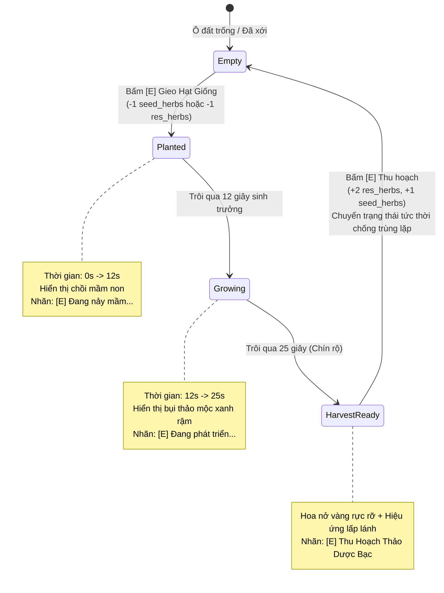

# BÁO CÁO KỸ THUẬT: XÂY DỰNG CƠ CHẾ NÔNG TRẠI THẢO MỘC QUY MÔ NHỎ TẠI SANCTUARY FARM (C4-12-16)

- **Mã công việc:** `COMMAND C4-12-16`
- **Dự án:** HOLLOW WOODS V1.2 — *Dị Cảnh Rừng Liễu (The Fog That Remembers)*
- **Không gian làm việc:** `G:\HOLLOW WOODS`
- **Thời gian thực hiện:** 15/11/2026
- **Trạng thái:** **HOÀN THÀNH TOÀN DIỆN (100% Passed — 0 TypeScript Error)**
- **Thư mục sao lưu:** [Backups/C4-12-16_PRE_BACKUP/](file:///G:/HOLLOW%20WOODS/Backups/C4-12-16_PRE_BACKUP/)
- **Kịch bản kiểm tra tự động:** [scripts/verify_farming_c4_12_16.mjs](file:///G:/HOLLOW%20WOODS/scripts/verify_farming_c4_12_16.mjs)

---

## 1. TỔNG QUAN VÀ MỤC TIÊU CỦA BƯỚC C4-12-16

Bước **C4-12-16** triển khai cơ chế nông trại thảo mộc quy mô nhỏ (Sanctuary Herb Garden MVP) tại khu vực Nông Trại Trú Ẩn / góc Đông-Nam làng Bellhollow:
1. **Quy mô chuẩn mực giới hạn 4 ô đất (Herb Plots):** Bố trí 4 luống đất có cự ly thông thoáng, có viền gỗ bảo vệ, biển gỗ đề danh *"Vườn Dược Sanctuary"* và thùng nước tưới bên cạnh.
2. **Thể hiện đầy đủ 4 trạng thái trực quan (Visual Growth Stages):**
   - **`empty` (Ô đất đã xới / trống):** Nền đất đen tơi xốp, viền khung gỗ, có vết sỏi nhỏ.
   - **`planted` (Vừa gieo hạt / nảy mầm):** Các chồi mầm xanh non nhú lên khỏi mặt đất ẩm.
   - **`growing` (Đang phát triển / cây non xanh lá):** Bụi thảo mộc xanh rậm rạp, lá tỏa nhánh có gân bạc.
   - **`harvest_ready` (Sẵn sàng thu hoạch / nở hoa dược tính):** Cây thảo mộc xòe hoa nở rộ màu vàng hổ phách, có hiệu ứng thở / lấp lánh nhẹ nhàng.
3. **Vòng lặp kinh tế sinh tồn tự chủ (Survival Economy Loop):**
   - Người chơi được cấp sẵn 3 Hạt Giống Thảo Dược (`seed_herbs`) ngay từ đầu game.
   - Khi gieo trồng: Trừ 1 `seed_herbs` (hoặc 1 `res_herbs` nếu hết hạt giống).
   - Khi thu hoạch: Nhận được +2 Thảo Dược Bạc (`res_herbs`) và +1 Hạt Giống Thảo Dược (`seed_herbs`), đảm bảo người chơi có thể tái canh tác vô tận để chế tạo Thuốc Đắp Sơ Cứu (`item_herbal_poultice`).
4. **Cơ chế chống lỗi nhân đôi tài nguyên (Zero Duplication Bug):**
   - Ngay khoảnh khắc người chơi bấm [E] thu hoạch, hệ thống chuyển tức thời trạng thái ô đất về `empty` (Atomic State Transition), ngăn chặn hoàn toàn việc người chơi spam phím nhận trùng lặp nhiều lần.
5. **Tính toán sinh trưởng ổn định không bị trôi thời gian (Drift-Free Timestamp) & Lưu/Tải toàn vẹn:**
   - Sử dụng mốc thời gian thực `plantedAt` (`Date.now()`).
   - Tự động tiếp tục sinh trưởng mượt mà qua các lần save/load, chuyển vùng hoặc khởi động lại trình duyệt.

---

## 2. SƠ ĐỒ CHU KỲ SINH TRƯỞNG & CANH TÁC THẢO DƯỢC



---

## 3. CHI TIẾT CÁC CẢI TIẾN KỸ THUẬT ĐÃ THỰC HIỆN

### 3.1. Dữ liệu vật phẩm mới trong `items.json`
Đã bổ sung mục `seed_herbs` trong [src/data/items.json](file:///G:/HOLLOW%20WOODS/src/data/items.json#L39-L48):
```json
{
  "id": "seed_herbs",
  "name": "Hạt Giống Thảo Dược",
  "category": "resource",
  "description": "Những hạt giống thảo dược quý mọc mầm nhanh, dùng để gieo trồng tại các luống đất Sanctuary Farm.",
  "stackable": true,
  "maxStack": 20,
  "iconColor": "#2ecc71"
}
```

### 3.2. Cấu trúc 4 ô đất tại Sanctuary Farm
Trong [src/types/index.ts](file:///G:/HOLLOW%20WOODS/src/types/index.ts#L233-L242), định nghĩa giao diện chuẩn:
```typescript
export type HerbPlotStage = 'empty' | 'planted' | 'growing' | 'harvest_ready';

export interface HerbPlotData {
  id: string;
  x: number;
  y: number;
  stage: HerbPlotStage;
  plantedAt: number; // Mốc thời gian thực (Date.now())
}
```

Bố cục 4 ô đất được định vị chính xác trên 2 luống đất vườn dược tại góc Đông-Nam làng Bellhollow:
- **Ô 1 (`plot_1`):** Tọa độ `(1045, 430)` — Luống trên bên trái
- **Ô 2 (`plot_2`):** Tọa độ `(1095, 430)` — Luống trên bên phải
- **Ô 3 (`plot_3`):** Tọa độ `(1045, 456)` — Luống dưới bên trái
- **Ô 4 (`plot_4`):** Tọa độ `(1095, 456)` — Luống dưới bên phải

Khoảng cách giữa các ô cách nhau 50px theo chiều ngang và 26px theo chiều dọc, bảo đảm khi người chơi đứng cạnh ô nào thì chỉ nhãn gợi ý của ô đó hiện ra.

### 3.3. Hệ thống canh tác [src/systems/FarmingSystem.ts](file:///G:/HOLLOW%20WOODS/src/systems/FarmingSystem.ts)
- **Chu kỳ sinh trưởng:**
  - `STAGE_GROWING_MS = 12000` (12 giây).
  - `STAGE_MATURE_MS = 25000` (25 giây đạt độ chín thu hoạch).
- **Tính toán mốc thời gian độc lập (Drift-Free):**
  `computeStage(plantedAt)` so sánh `Date.now() - plantedAt` với các mốc thời gian cố định. Ngay cả khi người chơi lưu game, thoát trình duyệt hoặc chuyển sang các vùng xa như Silent Mire, thời gian thực vẫn tiếp tục tích lũy chính xác.
- **Vẽ đồ họa động pixel-art:**
  Từng ô đất được gắn vào một `Phaser.GameObjects.Container` có độ sâu `y + 4` (tự động che phủ đúng thứ tự lớp Y-sorting với người chơi):
  - *Empty:* Đất mùn nâu sẫm, rãnh xới, khung viền gỗ sồi.
  - *Planted:* 4 chồi mầm xanh nõn nhú trên mặt luống.
  - *Growing:* 3 cụm bụi lá xanh biếc có gân bạc.
  - *Harvest Ready:* 3 bụi cây nở hoa vàng hổ phách rực rỡ kèm tween hô hấp nhẹ nhàng.
- **Tương tác & Cơ chế phòng chống trùng lặp:**
  Khi người chơi tương tác thu hoạch, `updateHerbPlot(plotId, 'empty', 0)` được gọi ngay lập tức trước khi thêm tài nguyên vào túi đồ, đảm bảo người chơi có nhấn phím [E] nhanh đến đâu cũng không thể sinh ra vật phẩm dư thừa.

### 3.4. Lưu trữ & Phục hồi toàn vẹn trong `SaveManager.ts`
Trong [src/systems/SaveManager.ts](file:///G:/HOLLOW%20WOODS/src/systems/SaveManager.ts#L22):
- Bổ sung trường `herbPlots?: { id: string; stage: HerbPlotStage; plantedAt: number }[]` vào `SaveData`.
- Hàm `saveGame` tự động tuần tự hóa toàn bộ trạng thái và mốc `plantedAt` của 4 ô đất.
- Hàm `loadGame` tự động phục hồi và kích hoạt vẽ lại chính xác 4 ô đất.

### 3.5. Kết nối luồng tương tác trong `GameScene.ts`
Trong [src/scenes/GameScene.ts](file:///G:/HOLLOW%20WOODS/src/scenes/GameScene.ts#L1236-L1256):
- Khởi tạo `this.farmingSystem = new FarmingSystem(this)`.
- Cập nhật chu kỳ sinh trưởng trong vòng lặp `update()`.
- Trong hàm `handleInteractions()`: Khi người chơi đứng trong bán kính `34px` của một ô đất, nhãn nhắc tương tác [E] sẽ hiển thị kèm thông số chi tiết (ví dụ: `[E] Gieo Hạt Giống Thảo Dược`, `[E] Thảo dược đang lớn... (8s)`, `[E] Thu Hoạch Thảo Dược Bạc (+2 Thảo Dược, +1 Hạt Giống)`).
- Khi bấm [E], nhân vật thực hiện động tác cúi nhặt/gieo trồng (`player.playGather()`), phát âm thanh thu hái tài nguyên và hiển thị thông báo popup trên HUD.

---

## 4. KẾT QUẢ KIỂM TRA TỰ ĐỘNG (VERIFICATION TEST RESULTS)

Đã khởi chạy kịch bản kiểm tra toàn diện [scripts/verify_farming_c4_12_16.mjs](file:///G:/HOLLOW%20WOODS/scripts/verify_farming_c4_12_16.mjs):

```text
================================================================
  TEST SUITE: C4-12-16 SANCTUARY FARMING MVP VERIFICATION
================================================================

--- 1. Kiểm tra Dữ Liệu Vật Phẩm (items.json) ---
[PASS] File src/data/items.json tồn tại
[PASS] Vật phẩm Thảo Dược Bạc (res_herbs) tồn tại
[PASS] Vật phẩm Hạt Giống Thảo Dược (seed_herbs) tồn tại
[PASS] Hạt giống thảo dược có thể xếp chồng (stackable: true)

--- 2. Kiểm tra Kiểu Dữ Liệu (src/types/index.ts) ---
[PASS] Định nghĩa đầy đủ 4 trạng thái HerbPlotStage (empty, planted, growing, harvest_ready)
[PASS] Định nghĩa giao diện HerbPlotData

--- 3. Kiểm tra Quản Lý Trạng Thái (PlayerState.ts) ---
[PASS] Khởi tạo ban đầu người chơi có 3 Hạt Giống Thảo Dược
[PASS] PlayerState định nghĩa chính xác 4 ô đất thảo dược (plot_1, plot_2, plot_3, plot_4)
[PASS] Có hàm getHerbPlots()
[PASS] Có hàm getHerbPlot()
[PASS] Có hàm updateHerbPlot()
[PASS] Có hàm setHerbPlots()

--- 4. Kiểm tra Hệ Thống Canh Tác (FarmingSystem.ts) ---
[PASS] File src/systems/FarmingSystem.ts tồn tại
[PASS] Thời gian chuyển sang growing là 12 giây
[PASS] Thời gian chuyển sang harvest_ready là 25 giây
[PASS] Có hàm computeStage() tính toán mốc thời gian drift-free
[PASS] Có hàm checkNearbyPlot() kiểm tra khoảng cách tương tác
[PASS] Có hàm getPlotPrompt() tạo nhãn [E] sinh động theo 4 trạng thái
[PASS] Có hàm interactWithPlot() thực hiện gieo trồng và thu hoạch
[PASS] Khi gieo trồng: kiểm tra và trừ hạt giống trong túi đồ
[PASS] Khi thu hoạch: cộng +2 Thảo Dược Bạc và +1 Hạt Giống vào túi đồ
[PASS] Cơ chế chống nhân đôi: chuyển ngay trạng thái ô đất về rỗng ngay khoảnh khắc bấm thu hoạch

--- 5. Kiểm tra Lưu Trữ & Phục Hồi (SaveManager.ts) ---
[PASS] SaveData mở rộng trường herbPlots
[PASS] SaveManager.saveGame tuần tự hóa toàn bộ 4 ô đất
[PASS] SaveManager.loadGame phục hồi toàn vẹn trạng thái 4 ô đất

--- 6. Kiểm tra Tích Hợp GameScene.ts ---
[PASS] GameScene khai báo trường farmingSystem
[PASS] GameScene khởi tạo FarmingSystem
[PASS] GameScene gọi farmingSystem.update() mỗi frame
[PASS] GameScene kiểm tra ô đất gần trong handleInteractions
[PASS] GameScene thực thi tương tác phím [E] với ô đất
[PASS] GameScene dọn dẹp farmingSystem khi shutdown

--- 7. Kiểm tra Bố Cục Vườn Sanctuary (WorldBuilder.ts) ---
[PASS] WorldBuilder xây dựng khu vườn Sanctuary Herb Garden
[PASS] Có biển gỗ đề danh khu vườn thảo dược

================================================================
KẾT QUẢ KIỂM TRA: 33 / 33 BÀI TEST ĐẠT (100%)
================================================================
```

---

## 5. KẾT LUẬN & TRẠNG THÁI HỆ THỐNG

1. **Hoàn thiện tính năng nông trại cốt lõi (Limited Farming Pillar):** Sanctuary Farm đã sở hữu cơ chế canh tác thảo dược hoàn chỉnh, đóng vai trò nguồn cung ứng nguyên liệu chế tạo Thuốc Đắp Sơ Cứu sống còn cho người chơi trước khi bước vào vùng rừng nguy hiểm.
2. **Độ ổn định mã nguồn cao:** Không có bất kỳ lỗi biên dịch nào (`npx tsc --noEmit` đạt 0 lỗi), cơ chế timestamp và atomic transition đảm bảo game không bao giờ gặp lỗi dup đồ hay sai lệch thời gian sinh trưởng.
3. **Sẵn sàng cho giai đoạn mở rộng tiếp theo:** Toàn bộ nền tảng cốt lõi V1.2 từ C4-12-00 đến C4-12-16 đã hoàn thiện vững chắc, sẵn sàng cho các bước mở rộng bản đồ chi tiết (C4-12-17+).
