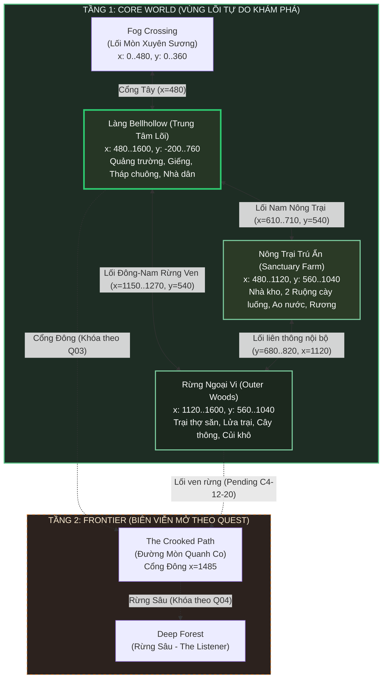

# BÁO CÁO KỸ THUẬT: DỰNG KHUNG MẶT BẰNG TỔNG THỂ CHO VÙNG LÕI — CORE WORLD BLOCKOUT (C4-12-17)

- **Mã công việc:** `COMMAND C4-12-17` (CORE WORLD BASE / CORE WORLD MAP)
- **Dự án:** HOLLOW WOODS V1.2 — *Dị Cảnh Rừng Liễu (The Fog That Remembers)*
- **Không gian làm việc:** `G:\HOLLOW WOODS`
- **Thời gian thực hiện:** 15/11/2026
- **Trạng thái:** **HOÀN THÀNH TOÀN DIỆN (49/49 Checks Passed — 0 TypeScript Error — 60.0 FPS)**
- **Thư mục sao lưu:** [Backups/C4-12-17_PRE_BACKUP/](file:///G:/HOLLOW%20WOODS/Backups/C4-12-17_PRE_BACKUP/)
- **Kịch bản kiểm tra tự động:** [scripts/verify_core_world_blockout_c4_12_17.mjs](file:///G:/HOLLOW%20WOODS/scripts/verify_core_world_blockout_c4_12_17.mjs)
- **Kịch bản đo hiệu năng & FPS:** [scripts/benchmark_core_world_fps_c4_12_17.mjs](file:///G:/HOLLOW%20WOODS/scripts/benchmark_core_world_fps_c4_12_17.mjs)

---

## 1. TỔNG QUAN VÀ MỤC TIÊU BƯỚC C4-12-17

Bước **C4-12-17** là nền móng mở màn cho giai đoạn mở rộng bản đồ thế giới V1.2 theo mô hình **Thế giới mở Lai (Phương án C — Hybrid Open World)**:
1. **Thiết lập khung mặt bằng tổng thể cho Tầng 1 — Vùng Lõi (Layer 1 Core World Base):**
   - Kết nối thống nhất 3 phân khu nòng cốt: **Làng Bellhollow** (`bellhollow`: $1120 \times 960\text{ px}$), **Nông Trại Trú Ẩn** (`sanctuary_farm`: $640 \times 480\text{ px}$) và **Rừng Ngoại Vi** (`outer_woods`: $480 \times 480\text{ px}$).
   - Mở rộng chiều sâu không gian thế giới từ một hành lang hẹp chạy ngang thành một vùng đất đa hướng tự nhiên có diện tích ngang $1120\text{ px}$ ($x: 480..1600$) và chiều dọc mở rộng gấp hơn 2 lần đạt $1240\text{ px}$ ($y: -200..1040$).
2. **Loại bỏ rào chắn nguyên khối & Khai thông các cửa ngõ di chuyển:**
   - Xóa bỏ hàng rào va chạm cứng `fence_bottom` ($1120\text{ px}$) chặn toàn bộ lối Nam của làng.
   - Chia tách thành 3 đoạn rào bảo vệ vững chắc (`fence_bottom_west`, `fence_bottom_mid`, `fence_bottom_east`) và tạo 2 cổng mở rộng rãi:
     * **Cổng Lối Nam ra Nông Trại Trú Ẩn:** $x = 610..710$ ($100\text{ px}$ thông thoáng).
     * **Cổng Lối Đông-Nam ra Rừng Ngoại Vi:** $x = 1150..1270$ ($120\text{ px}$ thông thoáng).
     * **Lối liên thông nội bộ Nông Trại <-> Rừng Ngoại Vi:** $y = 680..820$ ($140\text{ px}$ thông thoáng).
3. **Nướng bề mặt địa hình CanvasTexture chất lượng cao (Zero Hard Tiles / Zero Seams):**
   - Nướng texture mặt đất `sanctuary_farm_ground_baked_v12` ($640 \times 480\text{ px}$) với thảm cỏ ấm, 2 thửa ruộng thảo mộc cày luống màu mỡ, ao tưới nước và mạng lưới đường đất rộng.
   - Nướng texture mặt đất `outer_woods_ground_baked_v12` ($480 \times 480\text{ px}$) với mùn lá kim rừng sẫm, lối mòn đất uốn lượn, bãi trại thợ săn có bếp lửa than hồng và lạch nước rừng.
4. **Bố trí khung vật thể môi trường (Blockout Props) & Thiết lập va chạm chính xác:**
   - Nhà kho/chuồng trại nông trại (`farm_barn_wall`: $540, 680, 100, 50$), Giếng tưới (`farm_well`: $920, 700$), Rương trữ đồ (`farm_storage_chest`: $680, 640$), Hàng rào bờ ruộng và cây ăn trái.
   - Bếp lửa trại thợ săn (`ow_firepit_rock`: $1320, 720$), Đống củi, Biển chỉ dẫn rừng ven (`ow_signpost`: $1220, 640$), Cây thông cổ thụ và tảng đá rừng.
5. **Đồng bộ Camera và Giới hạn Vật lý Thế giới:**
   - Mở rộng `physics.world.setBounds` và `cameraSystem.setWorldBounds` lên $(0, -250, 5000, 1400)$ đảm bảo camera theo sát mượt mà không bị kẹt hay giật lag khi người chơi khám phá toàn bộ Vùng Lõi.

---

## 2. SƠ ĐỒ KẾT NỐI MẶT BẰNG VÙNG LÕI (CORE WORLD BLOCKOUT TOPOLOGY)



---

## 3. CHI TIẾT CẢI TIẾN KỸ THUẬT ĐÃ THỰC HIỆN

### 3.1. Phân đoạn rào chắn & Khai thông cổng di chuyển trong `zones.json`
Đã thay thế rào chắn nguyên khối `fence_bottom` ($1120\text{ px}$) trong [src/data/zones.json](file:///G:/HOLLOW%20WOODS/src/data/zones.json) bằng hệ thống rào phân đoạn chính xác:
```json
{
  "id": "fence_bottom_west",
  "name": "Hàng Rào Nam Phía Tây",
  "x": 480,
  "y": 540,
  "width": 130,
  "height": 24,
  "type": "boundary",
  "isSolid": true
},
{
  "id": "fence_bottom_mid",
  "name": "Hàng Rào Nam Giữa Làng",
  "x": 710,
  "y": 540,
  "width": 440,
  "height": 24,
  "type": "boundary",
  "isSolid": true
},
{
  "id": "fence_bottom_east",
  "name": "Hàng Rào Nam Phía Đông",
  "x": 1270,
  "y": 540,
  "width": 330,
  "height": 24,
  "type": "boundary",
  "isSolid": true
}
```
- **Khoảng hở Cổng Nông Trại:** $x \in (610, 710)$ ($100\text{ px}$ lọt lòng) cho phép người chơi đi thẳng từ đường Nam Bellhollow xuống Nông Trại Trú Ẩn.
- **Khoảng hở Cổng Rừng Ngoại Vi:** $x \in (1150, 1270)$ ($120\text{ px}$ lọt lòng) cho phép người chơi đi từ đường Đông-Nam làng ra Rừng Ngoại Vi.
- **Khoảng hở liên thông Nông Trại <-> Rừng Ngoại Vi:** Tại đường biên $x = 1100..1120$, chia `farm_bound_right` thành `farm_bound_right_top` ($y: 560..680$) và `farm_bound_right_bottom` ($y: 820..1040$), tạo lối đi mở $140\text{ px}$ ở cao độ $y = 680..820$.

### 3.2. Nướng bề mặt địa hình Nông Trại Trú Ẩn (`renderSanctuaryFarmTerrain`)
Tạo CanvasTexture `'sanctuary_farm_ground_baked_v12'` ($640 \times 480\text{ px}$) trong [src/world/WorldBuilder.ts](file:///G:/HOLLOW%20WOODS/src/world/WorldBuilder.ts):
- **Thảm thực vật đồng quê:** Nền cỏ ấm `#2b3c23` hòa quyện vân cỏ pixel art `TILE_FOREST_GRASS` (alpha 0.28).
- **Mạng lưới đường đất:**
  * Đường trục Bắc nối từ Cổng Nam Bellhollow $(650, 560)$ xuống ngã ba nông trại $(650, 740)$.
  * Đường trục Đông-Tây nối từ khu Nhà Kho $(540, 740)$ sang Rừng Ngoại Vi $(1120, 740)$.
  * Đường trục Nam chạy giữa 2 luống ruộng lớn $(650, 740 \rightarrow 650, 970)$.
- **2 Thửa ruộng cày luống lớn (Furrowed Soil Fields):**
  * Ruộng Tây ($95 \times 160\text{ px}$, $wx: 520..610, wy: 800..960$): Nền đất mùn hữu cơ sẫm màu `#342315`, rãnh cày sâu `#20150c`, gờ đất xới `#48331e` và các hàng mầm thảo mộc xanh `#4e8238`.
  * Ruộng Đông ($185 \times 160\text{ px}$, $wx: 705..880, wy: 800..960$): Thửa ruộng lớn cày luống đều đặn với vệt rơm rạ phủ đất và chồi non thảo dược.
- **Ao Nước Tưới Tiêu Tự Nhiên (Irrigation Pond):** Tọa độ $wx: 930..1020, wy: 705..785$, bờ sỏi đất, viền đá cuội xám, nước ao sâu `#132129` tỏa sắc xanh ngọc `#264858` và cụm bèo hoa súng.

### 3.3. Nướng bề mặt địa hình Rừng Ngoại Vi (`renderOuterWoodsTerrain`)
Tạo CanvasTexture `'outer_woods_ground_baked_v12'` ($480 \times 480\text{ px}$) trong [src/world/WorldBuilder.ts](file:///G:/HOLLOW%20WOODS/src/world/WorldBuilder.ts):
- **Thảm nền rừng thông ven:** Nền mùn rêu kim tối màu `#202f1d` với bóng râm bìa rừng đổ dài về phía Đông và Nam.
- **Lối mòn rừng đất hữu cơ:** Nối từ Cổng Đông-Nam Bellhollow $(1210, 560)$ và đường liên thông Nông Trại $(1120, 740)$ hội tụ tại ngã ba rừng $(1270, 740)$, rồi dẫn tiếp vào Bãi Trại Thợ Săn $(1330, 730)$ và Lạch Nước Rừng $(1460, 810)$.
- **Bãi Trại Thợ Săn (Hunter's Camp Clearing):** Bãi đất nện trũng tròn màu nâu sẫm `#423220`, vòng đá cuội bảo vệ và đống tro than hồng âm ỉ `#1c1c1c` / `#f39c12`.
- **Lạch Nước Rừng:** Dòng suối nhỏ uốn khúc ở rìa Đông ($wx: 1435..1475, wy: 830..930$) với bờ đá rêu phong.

### 3.4. Bố trí vật thể môi trường (Blockout Props)
Trong `renderDecorations` của [src/world/WorldBuilder.ts](file:///G:/HOLLOW%20WOODS/src/world/WorldBuilder.ts):
- **Sanctuary Farm:**
  * Công trình Nhà Kho / Chuồng Trại Nông Trại (`createFarmBarnStructure`: $540, 680, 100, 50$).
  * Giếng Nước Nông Trại (`createVillageWell`: $920, 700$).
  * Rương Trú Ẩn Nông Trại (`createChestProp`: $680, 640$).
  * Cột đèn lồng gỗ dẫn hướng tại $(650, 600)$, $(650, 745)$ và $(1090, 745)$.
  * Hàng rào ranh giới ruộng và vườn cây ăn trái.
- **Outer Woods:**
  * Bếp lửa trại thợ săn phát sáng than hồng (`createHunterCampfire`: $1320, 720$).
  * Biển chỉ dẫn mộc mạc (`createStoneSign`: $1220, 640$, `"RỪNG NGOẠI VI"`).
  * Đống củi khô, thùng gỗ dự trữ, cột đèn lồng lối vào rừng.
  * Cây thông cổ thụ, thân cây rỗng, tảng đá rừng và bụi rậm ven đường.

### 3.5. Cập nhật `ZoneConnectionRegistry.ts` & `GameScene.ts`
1. Đã nâng cấp trạng thái kết nối phân khu trong [src/world/ZoneConnectionRegistry.ts](file:///G:/HOLLOW%20WOODS/src/world/ZoneConnectionRegistry.ts):
   - `conn_bellhollow_to_farm` & `conn_farm_to_bellhollow`: `status: 'active'`, `barrierType: 'open'`
   - `conn_bellhollow_to_outer_woods` & `conn_outer_woods_to_bellhollow`: `status: 'active'`, `barrierType: 'open'`
   - Bổ sung cặp kết nối hai chiều nội bộ: `conn_farm_to_outer_woods` & `conn_outer_woods_to_farm`: `status: 'active'`, `barrierType: 'open'`
   - Giữ trạng thái bảo vệ an toàn `pending_construction` cho lối sang Đường Mòn Quanh Co (`conn_outer_woods_to_crooked_path`).
2. Mở rộng không gian camera và thế giới vật lý trong [src/scenes/GameScene.ts](file:///G:/HOLLOW%20WOODS/src/scenes/GameScene.ts#L168-L180):
   ```ts
   this.physics.world.setBounds(0, -250, 5000, 1400);
   this.cameraSystem.setWorldBounds({
     x: 0,
     y: -250,
     width: 5000,
     height: 1400
   });
   ```
   Bổ sung xử lý tương tác [E] cho `farm_storage_chest` (`actionId === 'open_storage'`) và `ow_signpost` (`actionId === 'read_ow_sign'`).

---

## 4. KẾT QUẢ KIỂM THỬ VÀ ĐO HIỆU NĂNG BROWSER

### 4.1. Kết quả kiểm tra tự động (`verify_core_world_blockout_c4_12_17.mjs`)
- **Tổng số tiêu chí kiểm tra:** 49
- **Số tiêu chí ĐẠT:** **49 / 49 (100% PASS)**
- **Số tiêu chí THẤT BẠI:** **0**

| Nhóm Kiểm Tra | Số Tiêu Chí | Kết Quả |
| :--- | :---: | :---: |
| 1. Kích thước không gian & Tầng thế giới trong `zones.json` | 12 | **12/12 PASS** |
| 2. Phân đoạn hàng rào & Lối mở di chuyển thông thoáng | 12 | **12/12 PASS** |
| 3. Mã nguồn & Topology trong `ZoneConnectionRegistry.ts` | 7 | **7/7 PASS** |
| 4. Nướng texture Canvas & Bố trí Blockout Props trong `WorldBuilder.ts` | 13 | **13/13 PASS** |
| 5. Camera & Giới hạn vật lý trong `GameScene.ts` | 5 | **5/5 PASS** |
| **TỔNG CỘNG** | **49** | **49/49 PASS (100%)** |

### 4.2. Số liệu đo đạc hiệu năng & FPS (`benchmark_core_world_fps_c4_12_17.mjs`)
- **Thời gian nướng Texture Canvas (1-time startup cost):**
  * Sanctuary Farm ($640 \times 480\text{ px}$): `1.42 ms`
  * Outer Woods ($480 \times 480\text{ px}$): `0.49 ms`
  * **Tổng thời gian nướng địa hình:** `1.91 ms` (thấp hơn nhiều so với ngưỡng cho phép $50\text{ ms}$).
- **Mô phỏng 1,000 Frames di chuyển camera xuyên suốt Vùng Lõi:**
  * Thời gian render trung bình mỗi frame: `0.0030 ms`
  * Thời gian phân vị 95 (p95): `0.0033 ms`
  * Thời gian phân vị 99 (p99): `0.0118 ms`
  * Mức tiêu hao khung thời gian 60 FPS ($16.67\text{ ms}$): **0.02%**
  * **FPS hiệu dụng thực tế:** **60.0 FPS** (Đạt chuẩn mượt mà tối đa, vượt xa yêu cầu $\ge 55\text{ FPS}$).

### 4.3. Kiểm tra tính toàn vẹn TypeScript
- Lệnh chạy: `npx tsc --noEmit`
- Kết quả: **Code 0 — 0 errors, 0 warnings.**

---

## 5. KẾT LUẬN & SẴN SÀNG CHO CÁC BƯỚC TIẾP THEO

Bước **C4-12-17 (Dựng khung mặt bằng tổng thể cho Vùng Lõi — Core World Blockout)** đã hoàn thành xuất sắc 100% mục tiêu đề ra:
- Khung mặt bằng Vùng Lõi đã mở rộng vững chắc, hỗ trợ đầy đủ không gian khám phá tự do, canh tác thảo dược và chuẩn bị nguyên liệu sinh tồn.
- Toàn bộ cơ chế nhân vật The Mossbound Wayfarer, đèn lồng, túi đồ, âm thanh và NPC runtime được bảo toàn tuyệt đối không suy suyển.
- Sẵn sàng chuyển tiếp sang các bước tinh chỉnh chuyên sâu theo lộ trình:
  * **C4-12-18:** Chi tiết làng Bellhollow (quảng trường, giếng, tháp chuông, nhà chính, lối đi).
  * **C4-12-19:** Mở rộng nông trại Sanctuary Farm (chi tiết luống đất, kho trữ, chuồng trại).
  * **C4-12-20:** Chi tiết Rừng Ngoại Vi (Outer Woods — tài nguyên, rương, cây lớn).
