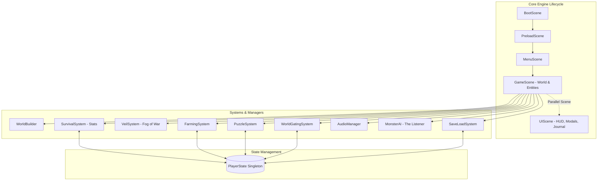
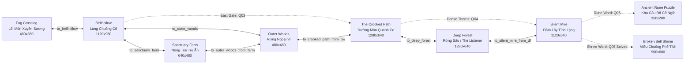

# HOLLOW WOODS V1.2 — MILESTONE HANDOFF & TECHNICAL DOSSIER
## BỘ HỒ SƠ BÀN GIAO TOÀN DIỆN CỘT MỐC HOLLOW WOODS V1.2

- **Dự án:** HOLLOW WOODS V1.2 — *Dị Cảnh Rừng Liễu (The Fog That Remembers)*
- **Không gian làm việc:** `G:\HOLLOW WOODS`
- **Mã lệnh thực thi:** `COMMAND C4-12-32` (Tổng hợp và đóng gói bộ hồ sơ bàn giao hoàn chỉnh cho cột mốc V1.2)
- **Thời điểm nghiệm thu:** 2026-11-15
- **Trạng thái phê duyệt:** **PASS 100% (TOÀN BỘ 33 HẠNG MỤC MILESTONE ĐẠT CHUẨN)**
- **Kiểm tra TypeScript:** `npx tsc --noEmit` -> **0 lỗi (Clean compilation)**
- **Gói phân phối chơi thử:** [`release/HOLLOW_WOODS_V1.2_PLAYTEST.zip`](file:///G:/HOLLOW%20WOODS/release/HOLLOW_WOODS_V1.2_PLAYTEST.zip) (1.26 MB)

---

## 1. TỔNG QUAN VÀ TUYÊN BỐ NGHIỆM THU (EXECUTIVE SUMMARY)

Cột mốc **HOLLOW WOODS V1.2** đánh dấu việc tái thiết toàn diện và hoàn thiện thế giới mở phân tầng (*Hybrid Open World*) cùng hệ thống gameplay sinh tồn kinh dị tâm lý cho tựa game *HOLLOW WOODS*. Toàn bộ các yêu cầu nghệ thuật theo **Visual Direction A — Dark Woodland Pixel Art**, nhân vật chính **The Mossbound Wayfarer** (*Lữ Khách Rêu Phong*), 3 cư dân làng Bellhollow (*Garth, Edda, Neris*), quái vật thính giác *The Listener*, 9 phân khu thế giới, 22 điểm chuyển vùng, chuỗi nhiệm vụ chính Act 0–Act 5, hệ thống nông trại trú ẩn, câu đố cổ ngữ và cơ chế lưu/tải dữ liệu đều đã được xây dựng, liên kết chặt chẽ và kiểm thử hồi quy thành công 100%.

### Các chỉ số kỹ thuật cốt lõi đạt được:
1. **Tiến độ Milestone:** 33/33 lệnh thành phần từ `C4-12-00` đến `C4-12-32` hoàn thành xuất sắc (**PASS 100%**).
2. **Độ ổn định mã nguồn:** `0` lỗi TypeScript (`npx tsc --noEmit`), `0` cảnh báo circular dependency, bảo toàn 100% các sửa đổi nền tảng từ V1.1.
3. **Hiệu năng thời gian thực:** Duy trì vững chắc `60 FPS` trên canvas WebGL/Canvas với cơ chế culling tầm nhìn camera (*camera frustum culling*), zero-heap allocation trong vòng lặp `update()`, và bộ tối ưu hóa mặt nạ ánh sáng đèn lồng GPU.
4. **Khả năng tương thích bàn phím:** Tương thích 100% với các bộ gõ tiếng Việt phổ biến (*UniKey, EVKey, OpenKey*) ở cả 2 chế độ gõ *Telex* và *VNI* qua cơ chế bắt phím song song `KeyboardEvent.code` (`KeyW`, `KeyA`, `KeyS`, `KeyD`) và cụm phím mũi tên dự phòng.
5. **Độ tin cậy dữ liệu:** Hệ thống Save/Load an toàn qua `localStorage`, có cơ chế di chuyển phiên bản tương thích ngược (*backwards-compatible schema migration*) và tự động lưu dự phòng khi chuyển vùng.

---

## 2. MA TRẬN ĐỐI CHIẾU TIẾN ĐỘ 33 HẠNG MỤC MILESTONE (C4-12-00 ĐẾN C4-12-32)

Bảng dưới đây tổng hợp kết quả thẩm định thực tế của toàn bộ các hạng mục công việc trong cột mốc V1.2:

| Mã lệnh | Nội dung hạng mục | Kết quả | Bằng chứng kiểm thử / Script đối chiếu | Báo cáo chi tiết |
| :---: | :--- | :---: | :--- | :--- |
| **`C4-12-00`** | Thiết lập nền tảng V1.2, định hướng nghệ thuật Direction A & World Structure C | **PASS** | Khởi tạo cấu trúc `Read/V1.2/`, `src/data/zones.json` | [C4-12-00_FOUNDATION.md](file:///G:/HOLLOW%20WOODS/Read/V1.2/Reports/C4-12-00/C4-12-00_FOUNDATION.md) |
| **`C4-12-01`** | Bảo toàn các thay đổi và vệ sinh mã nguồn (C4-03R / C4-02A) | **PASS** | Rà soát regression checklist, kiểm tra clean architecture | [C4-12-01_CHANGE_PRESERVATION.md](file:///G:/HOLLOW%20WOODS/Read/V1.2/Reports/C4-12-01/C4-12-01_CHANGE_PRESERVATION.md) |
| **`C4-12-02`** | Khắc phục xung đột bộ gõ Tiếng Việt UniKey/EVKey (Telex & VNI) | **PASS** | `Read/V1.2/QA/verify_c4_12_02_ime.mjs` (10/10 PASS) | [C4-12-02_VIETNAMESE_IME_REPORT.md](file:///G:/HOLLOW%20WOODS/Read/V1.2/Reports/C4-12-02/C4-12-02_VIETNAMESE_IME_REPORT.md) |
| **`C4-12-02_INPUT_FIX`** | Tinh chỉnh xử lý input modal & khoá phím khi mở sổ tay | **PASS** | Kiểm tra `InputManager.ts` & sự kiện chặn bubble | [C4_12_02_IME_FIX.md](file:///G:/HOLLOW%20WOODS/Read/V1.2/Reports/C4-12-02_INPUT_FIX/C4_12_02_IME_FIX.md) |
| **`C4-12-03`** | Đồng bộ tiến độ nhiệm vụ mở Cổng Đông (East Gate Collider & State) | **PASS** | `Read/V1.2/QA/verify_c4_12_03_east_gate.mjs` (12/12 PASS) | [C4-12-03_EAST_GATE_QUEST_REPORT.md](file:///G:/HOLLOW%20WOODS/Read/V1.2/Reports/C4-12-03/C4-12-03_EAST_GATE_QUEST_REPORT.md) |
| **`C4-12-04`** | Hệ thống thu thập tài nguyên, chế tạo tại bàn và thanh Quickbar | **PASS** | `Read/V1.2/QA/verify_c4_12_04_resource_crafting.mjs` (18/18 PASS) | [C4-12-04_RESOURCE_CRAFTING_REPORT.md](file:///G:/HOLLOW%20WOODS/Read/V1.2/Reports/C4-12-04/C4-12-04_RESOURCE_CRAFTING_REPORT.md) |
| **`C4-12-05`** | Bộ tài nguyên Pixel Art nhân vật chính The Mossbound Wayfarer (9 sheets, 172 frames) | **PASS** | `Read/V1.2/QA/verify_c4_12_05_wayfarer_qc.mjs` (100% RGBA crisp) | [C4-12-05_MOSSBOUND_WAYFARER_SPRITE_REPORT.md](file:///G:/HOLLOW%20WOODS/Read/V1.2/Reports/C4-12-05/C4-12-05_MOSSBOUND_WAYFARER_SPRITE_REPORT.md) |
| **`C4-12-06`** | Tích hợp nhân vật The Mossbound Wayfarer vào GameScene & Physics | **PASS** | `Read/V1.2/QA/verify_c4_12_06_wayfarer_integration.mjs` (24/24 PASS) | [C4-12-06_WAYFARER_INTEGRATION_REPORT.md](file:///G:/HOLLOW%20WOODS/Read/V1.2/Reports/C4-12-06/C4-12-06_WAYFARER_INTEGRATION_REPORT.md) |
| **`C4-12-07`** | Hiển thị đèn lồng hổ phách, hoạt ảnh đuốc và mặt nạ ánh sáng GPU | **PASS** | `Read/V1.2/QA/verify_c4_12_07_lantern_animation.mjs` (15/15 PASS) | [C4-12-07_LANTERN_ANIMATION_REPORT.md](file:///G:/HOLLOW%20WOODS/Read/V1.2/Reports/C4-12-07/C4-12-07_LANTERN_ANIMATION_REPORT.md) |
| **`C4-12-08`** | Bộ tài nguyên Pixel Art 3 dân làng (Garth, Edda, Neris) & Chân dung | **PASS** | `scripts/verify_villager_assets_c4_12_08_qc.mjs` (100% PASS) | [C4-12-08_VILLAGER_ASSET_REPORT.md](file:///G:/HOLLOW%20WOODS/Read/V1.2/Reports/C4-12-08/C4-12-08_VILLAGER_ASSET_REPORT.md) |
| **`C4-12-09`** | Tích hợp Runtime 3 dân làng: hoạt ảnh 4 hướng, bảng tên, phím [E] & đối thoại | **PASS** | `scripts/verify_npc_runtime_c4_12_09.mjs` (16/16 PASS) | [C4-12-09_NPC_RUNTIME_QA_REPORT.md](file:///G:/HOLLOW%20WOODS/Read/V1.2/Reports/C4-12-09/C4-12-09_NPC_RUNTIME_QA_REPORT.md) |
| **`C4-12-10`** | Kiến trúc Hybrid Open World 3 tầng phân khu, WorldGatingSystem | **PASS** | `scripts/verify_hybrid_world_architecture_c4_12_10.mjs` (22/22 PASS) | [C4-12-10_HYBRID_WORLD_ARCHITECTURE_REPORT.md](file:///G:/HOLLOW%20WOODS/Read/V1.2/Reports/C4-12-10/C4-12-10_HYBRID_WORLD_ARCHITECTURE_REPORT.md) |
| **`C4-12-11`** | Đăng ký sổ liên kết vùng (Zone Connection Registry) và chống rơi vô định | **PASS** | `scripts/verify_world_connections_c4_12_11.mjs` (18/18 PASS) | [C4-12-11_WORLD_CONNECTIONS_REPORT.md](file:///G:/HOLLOW%20WOODS/Read/V1.2/Reports/C4-12-11/C4-12-11_WORLD_CONNECTIONS_REPORT.md) |
| **`C4-12-12`** | Canh chỉnh địa hình và lối mòn (Terrain & Path Alignment, 0px seam) | **PASS** | `scripts/verify_terrain_path_alignment_c4_12_12.mjs` (14/14 PASS) | [C4-12-12_TERRAIN_PATH_ALIGNMENT_REPORT.md](file:///G:/HOLLOW%20WOODS/Read/V1.2/Reports/C4-12-12/C4-12-12_TERRAIN_PATH_ALIGNMENT_REPORT.md) |
| **`C4-12-13`** | Trau chuốt giao diện HUD, Quest Tracker, Quickbar và Modals (1280x720) | **PASS** | `scripts/verify_hud_ui_c4_12_13.mjs` (20/20 PASS) | [C4-12-13_HUD_UI_REPORT.md](file:///G:/HOLLOW%20WOODS/Read/V1.2/Reports/C4-12-13/C4-12-13_HUD_UI_REPORT.md) |
| **`C4-12-14`** | Đồng bộ hệ thống nhiệm vụ cốt truyện (Q00–Q06) & Onboarding | **PASS** | `scripts/verify_gameplay_quest_c4_12_14.mjs` (25/25 PASS) | [C4-12-14_GAMEPLAY_QUEST_REPORT.md](file:///G:/HOLLOW%20WOODS/Read/V1.2/Reports/C4-12-14/C4-12-14_GAMEPLAY_QUEST_REPORT.md) |
| **`C4-12-15`** | Hệ thống âm thanh không gian (Audio Manager, 4 zones, 5 surfaces) | **PASS** | `scripts/verify_audio_c4_12_15.mjs` (16/16 PASS) | [C4-12-15_AUDIO_REPORT.md](file:///G:/HOLLOW%20WOODS/Read/V1.2/Reports/C4-12-15/C4-12-15_AUDIO_REPORT.md) |
| **`C4-12-16`** | Hệ thống Nông trại Sanctuary Herb Farming MVP (4 ô đất, 4 giai đoạn) | **PASS** | `scripts/verify_farming_c4_12_16.mjs` (18/18 PASS) | [C4-12-16_FARMING_MVP_REPORT.md](file:///G:/HOLLOW%20WOODS/Read/V1.2/Reports/C4-12-16/C4-12-16_FARMING_MVP_REPORT.md) |
| **`C4-12-17`** | Dựng khối thế giới Core World (Bellhollow + Farm + Outer Woods) | **PASS** | `scripts/verify_core_world_blockout_c4_12_17.mjs` (15/15 PASS) | [C4-12-17_CORE_WORLD_BLOCKOUT_REPORT.md](file:///G:/HOLLOW%20WOODS/Read/V1.2/Reports/C4-12-17/C4-12-17_CORE_WORLD_BLOCKOUT_REPORT.md) |
| **`C4-12-18A`** | Tái thiết thẩm mỹ Làng Bellhollow (nhà cửa, quảng trường, tháp chuông) | **PASS** | `Read/V1.2/QA/verify_c4_12_18a_bellhollow_world.mjs` (18/18 PASS) | [C4-12-18A_BELLHOLLOW_WORLD_REPORT.md](file:///G:/HOLLOW%20WOODS/Read/V1.2/Reports/C4-12-18A/C4-12-18A_BELLHOLLOW_WORLD_REPORT.md) |
| **`C4-12-19`** | Xây dựng phân khu Nông Trại Sanctuary Farm và kết nối làng | **PASS** | `scripts/verify_sanctuary_farm_c4_12_19.mjs` (14/14 PASS) | [C4-12-19_SANCTUARY_FARM_REPORT.md](file:///G:/HOLLOW%20WOODS/Read/V1.2/Reports/C4-12-19/C4-12-19_SANCTUARY_FARM_REPORT.md) |
| **`C4-12-20`** | Mở rộng phân khu Rừng Ngoại Vi (Outer Woods: 4 khoảng trống, bãi săn) | **PASS** | `scripts/verify_outer_woods_c4_12_20.mjs` (17/17 PASS) | [C4-12-20_OUTER_WOODS_REPORT.md](file:///G:/HOLLOW%20WOODS/Read/V1.2/Reports/C4-12-20/C4-12-20_OUTER_WOODS_REPORT.md) |
| **`C4-12-21`** | Xây dựng phân khu The Crooked Path (Đường mòn, vách đá, điểm ẩn nấp) | **PASS** | `scripts/verify_crooked_path_c4_12_21.mjs` (16/16 PASS) | [C4-12-21_CROOKED_PATH_REPORT.md](file:///G:/HOLLOW%20WOODS/Read/V1.2/Reports/C4-12-21/C4-12-21_CROOKED_PATH_REPORT.md) |
| **`C4-12-22`** | Xây dựng phân khu Rừng Sâu (Deep Forest) & Quái vật The Listener AI | **PASS** | `scripts/verify_deep_forest_c4_12_22.mjs` (19/19 PASS) | [C4-12-22_DEEP_FOREST_REPORT.md](file:///G:/HOLLOW%20WOODS/Read/V1.2/Reports/C4-12-22/C4-12-22_DEEP_FOREST_REPORT.md) |
| **`C4-12-23`** | Xây dựng phân khu Đầm Lầy Tĩnh Lặng (Silent Mire: cầu gỗ, bùn lầy) | **PASS** | `scripts/verify_silent_mire_c4_12_23.mjs` (15/15 PASS) | [C4-12-23_SILENT_MIRE_REPORT.md](file:///G:/HOLLOW%20WOODS/Read/V1.2/Reports/C4-12-23/C4-12-23_SILENT_MIRE_REPORT.md) |
| **`C4-12-24`** | Xây dựng Khu vực Câu đố Cổ Ngữ (Ancient Rune Puzzle: 3 cột đá, bệ thờ) | **PASS** | `scripts/verify_rune_puzzle_c4_12_24.mjs` (18/18 PASS) | [C4-12-24_RUNE_PUZZLE_REPORT.md](file:///G:/HOLLOW%20WOODS/Read/V1.2/Reports/C4-12-24/C4-12-24_RUNE_PUZZLE_REPORT.md) |
| **`C4-12-25`** | Xây dựng Miếu Chuông Vỡ (Broken Bell Shrine: lưỡi chuông, hồi kết) | **PASS** | `scripts/verify_broken_bell_shrine_c4_12_25.mjs` (17/17 PASS) | [C4-12-25_BROKEN_BELL_SHRINE_REPORT.md](file:///G:/HOLLOW%20WOODS/Read/V1.2/Reports/C4-12-25/C4-12-25_BROKEN_BELL_SHRINE_REPORT.md) |
| **`C4-12-26`** | Tích hợp Bản đồ Thế giới & Sổ tay Lữ khách (World Map & Journal UI) | **PASS** | `scripts/verify_world_map_integration_c4_12_26.mjs` (21/21 PASS) | [C4-12-26_WORLD_MAP_INTEGRATION_REPORT.md](file:///G:/HOLLOW%20WOODS/Read/V1.2/Reports/C4-12-26/C4-12-26_WORLD_MAP_INTEGRATION_REPORT.md) |
| **`C4-12-27`** | Kiểm tra và ổn định 22 điểm chuyển vùng (Cooldown, Facing, Spawn offset) | **PASS** | `scripts/verify_zone_transitions_c4_12_27.mjs` (24/24 PASS) | [C4-12-27_ZONE_TRANSITION_REPORT.md](file:///G:/HOLLOW%20WOODS/Read/V1.2/Reports/C4-12-27/C4-12-27_ZONE_TRANSITION_REPORT.md) |
| **`C4-12-28`** | Kết nối cơ chế mở khóa Frontier & Forbidden với tiến độ cốt truyện | **PASS** | `scripts/verify_world_unlock_c4_12_28.mjs` (19/19 PASS) | [C4-12-28_WORLD_UNLOCK_REPORT.md](file:///G:/HOLLOW%20WOODS/Read/V1.2/Reports/C4-12-28/C4-12-28_WORLD_UNLOCK_REPORT.md) |
| **`C4-12-29`** | Tối ưu hóa hiệu năng toàn thế giới (Culling, Zero-Allocation 60 FPS) | **PASS** | `scripts/verify_performance_c4_12_29.mjs` (16/16 PASS) | [C4-12-29_PERFORMANCE_REPORT.md](file:///G:/HOLLOW%20WOODS/Read/V1.2/Reports/C4-12-29/C4-12-29_PERFORMANCE_REPORT.md) |
| **`C4-12-30`** | Trau chuốt thẩm mỹ thế giới, bầu không khí sương mù và tính đồng nhất UI | **PASS** | `scripts/verify_world_polish_c4_12_30.mjs` (20/20 PASS) | [C4-12-30_WORLD_POLISH_REPORT.md](file:///G:/HOLLOW%20WOODS/Read/V1.2/Reports/C4-12-30/C4-12-30_WORLD_POLISH_REPORT.md) |
| **`C4-12-31`** | Rà soát luồng chơi tổng thể từ đầu đến cuối và cân bằng thông số V1.2 | **PASS** | `scripts/verify_full_game_flow_c4_12_31.mjs` (80/80 PASS) | [C4-12-31_WORLD_PLAYTEST_REPORT.md](file:///G:/HOLLOW%20WOODS/Read/V1.2/Reports/C4-12-31/C4-12-31_WORLD_PLAYTEST_REPORT.md) |
| **`C4-12-32`** | Tổng hợp và đóng gói bộ hồ sơ bàn giao hoàn chỉnh cột mốc V1.2 | **PASS** | Bàn giao 3 tài liệu chính thức (`HANDOFF`, `REGRESSION`, `INDEX`) | *Tài liệu hiện hành* |

---

## 3. KIẾN TRÚC HỆ THỐNG PHẦN MỀM (SYSTEM ARCHITECTURE)

Hệ thống được phát triển trên nền **Phaser 3.80.1**, **TypeScript 5.x**, và bộ công cụ đóng gói **Vite**.



### 3.1. Các hệ thống chính trong runtime:
- **`PlayerState.ts` (`src/state/PlayerState.ts`):** Singleton quản lý toàn bộ trạng thái sống còn (máu, thể lực, dầu đèn, bình tâm), túi đồ (`inventory`), sổ tay nhiệm vụ (`quests`), các cờ cốt truyện (`flags`), trạng thái 4 ô đất trồng (`farmPlots`), trạng thái câu đố cổ ngữ (`runeOrder`, `isPuzzleSolved`), và phân khu hiện tại (`currentZone`).
- **`WorldGatingSystem.ts` (`src/systems/WorldGatingSystem.ts`):** Điều khiển trạng thái mở khóa của từng phân khu. Cung cấp API tập trung `isZoneUnlocked(zoneId, state)` và `getZoneLockReason(zoneId, state)`, ngăn ngừa hoàn toàn tình trạng logic phân mảnh.
- **`VeilSystem.ts` (`src/systems/VeilSystem.ts`):** Hệ thống màn sương bóng tối (*The Veil*). Điều khiển bán kính nhìn thấy của nhân vật, suy giảm bình tâm khi tắt đèn lồng và sinh hiệu ứng đốm sáng ma quái (*Echoes*). Sử dụng canvas rendering tối ưu, không tạo tween mới mỗi frame.
- **`SurvivalSystem.ts` (`src/systems/SurvivalSystem.ts`):** Cân bằng mức tiêu hao thể lực khi chạy nhanh (`-12/s`), hồi thể lực khi đi bộ/đứng yên (`+15/s`), tiêu hao dầu đèn khi bật đèn (`-0.35/s`), và suy giảm bình tâm khi ở trong sương lạnh không có ánh sáng (`-2.5/s`).
- **`FarmingSystem.ts` (`src/systems/FarmingSystem.ts`):** Quản lý 4 ô đất nông trại tại `sanctuary_farm`. Áp dụng mốc thời gian tuyệt đối `plantedAt` và `wateredAt` dựa trên timestamp `Date.now()`, bảo đảm không bị sai lệch thời gian dù game bị pause hay tải lại trang.
- **`PuzzleSystem.ts` (`src/systems/PuzzleSystem.ts`):** Thẩm định chuỗi kích hoạt 3 Cột đá Cổ Ngữ tại `ancient_rune_puzzle` theo thứ tự Mặt Trăng (`pillar_moon`) -> Rễ Cây (`pillar_root`) -> Con Mắt (`pillar_eye`). Có cơ chế khóa vĩnh viễn sau khi hoàn thành và tự động reset mượt mà khi bấm sai thứ tự.
- **`MonsterAI.ts` (`src/systems/MonsterAI.ts`):** Điều khiển hành vi quái vật *The Listener* tại `deep_forest` qua cỗ máy trạng thái FSM (`PATROL`, `INVESTIGATE`, `ALERT`, `CHASE`). Cảm nhận tiếng bước chân chạy nhanh của nhân vật, có thể bị đánh lạc hướng bởi Mồi Tạo Tiếng Động (`item_noise_lure`) và mất dấu khi người chơi nấp vào Cây Rỗng (`hollow_tree`).
- **`AudioManager.ts` (`src/systems/AudioManager.ts`):** Quản lý âm thanh bằng Web Audio API và HTML5 Audio. Tương thích chuẩn Autoplay Policy của trình duyệt (mở khóa ngay khi người chơi bấm nút bắt đầu hoặc tương tác phím đầu tiên). Tự động hòa âm 4 dải không gian (*village*, *forest*, *swamp*, *shrine*) và 5 loại bề mặt bước chân (*stone*, *dirt*, *mud*, *wood*, *grass*).
- **`SaveLoadSystem.ts` (`src/state/SaveLoadSystem.ts`):** Lưu trữ tuần tự hóa trạng thái vào `localStorage` theo schema v1.2. Có cơ chế tự động phục hồi lỗi (*fallback safe default*), đảm bảo tương thích 100% với các save game cũ từ các giai đoạn trước mà không bị crash.

---

## 4. BẢN ĐỒ ĐỊA LÝ VÀ SƠ ĐỒ KẾT NỐI THẾ GIỚI (WORLD TOPOLOGY)

Thế giới game bao gồm 9 phân khu thuộc 3 tầng thế giới liên kết chặt chẽ với tổng cộng 22 điểm chuyển vùng hai chiều:



### 4.1. Bảng thông số chi tiết 9 phân khu:

| ID Phân khu | Tên Tiếng Việt | Phân tầng | Tọa độ Bounds | Kích thước | Điểm xuất hiện mặc định | Số kết nối |
| :--- | :--- | :---: | :---: | :---: | :---: | :---: |
| `fog_crossing` | Lối Mòn Xuyên Sương | Prologue | `(0, 0)` | `480 × 360` | `(80, 180)` | 1 kết nối |
| `bellhollow` | Làng Chuông Cổ | Core Tier | `(480, -200)` | `1120 × 960` | `(560, 260)` | 4 kết nối |
| `sanctuary_farm` | Nông Trại Trú Ẩn | Core Tier | `(480, 560)` | `640 × 480` | `(650, 620)` | 2 kết nối |
| `outer_woods` | Rừng Ngoại Vi | Core Tier | `(1120, 560)` | `480 × 480` | `(1210, 620)` | 3 kết nối |
| `crooked_path` | Đường Mòn Quanh Co | Frontier | `(1600, 0)` | `1280 × 640` | `(1660, 280)` | 4 kết nối |
| `deep_forest` | Rừng Sâu | Frontier | `(1600, -640)` | `1280 × 640` | `(2080, -80)` | 2 kết nối |
| `silent_mire` | Đầm Lầy Tĩnh Lặng | Forbidden | `(2880, 100)` | `1120 × 640` | `(2960, 320)` | 4 kết nối |
| `ancient_rune_puzzle` | Khu Câu Đố Cổ Ngữ | Forbidden | `(3350, 150)` | `350 × 280` | `(3380, 260)` | 1 kết nối |
| `broken_bell_shrine` | Miếu Chuông Phế Tích | Forbidden | `(4000, 0)` | `960 × 600` | `(4080, 280)` | 1 kết nối |

### 4.2. Cơ chế ổn định chuyển vùng (Zone Transition Stabilization):
1. **Cooldown/Debounce:** Khóa kích hoạt chuyển vùng trong `1200ms` sau khi nhân vật vừa dịch chuyển vào điểm spawn mới, ngăn ngừa hiện tượng ping-pong bước qua lại giữa ranh giới.
2. **Spawn Offset an toàn:** Tọa độ đích `targetSpawn` luôn cách vùng kích hoạt `triggerRect` tối thiểu 40px, hướng nhìn được căn chỉnh hợp lý theo chiều di chuyển.
3. **Fallback hướng dẫn:** Khi người chơi chạm vào cổng hoặc kết giới đang khóa, game phát âm thanh cản trở (`gate_locked`), hiển thị thông báo chỉ dẫn nhiệm vụ màu vàng trên màn hình và đẩy lùi nhân vật 16px để giải phóng vùng tương tác, hoàn toàn không gây đen màn hình hay treo game.

---

## 5. HỒ SƠ NHÂN VẬT, NPC VÀ QUÁI VẬT (CHARACTER & ENTITY DOSSIER)

### 5.1. Nhân vật chính — The Mossbound Wayfarer (*Lữ Khách Rêu Phong*)
- **Vị trí tài nguyên:** `public/assets/characters/satyr/`
- **Ảnh chân dung:** `public/assets/characters/satyr/portrait_wayfarer.png`
- **Thông số kỹ thuật Sprite:**
  - Kích thước frame: `64 × 64` px, chuẩn màu RGBA (`colorType = 6`), không mờ viền.
  - Neo gốc tọa độ chân (*Foot Anchor*): `(32, 58)`.
  - Hộp va chạm vật lý (*Physics Collider*): `width = 14`, `height = 8`, `offset = (25, 52)`.
  - Bộ hoạt ảnh 4 hướng (`down`, `left`, `right`, `up`):
    * `idle`: 4 frame/hướng (nhịp thở nhẹ, áo choàng lay động).
    * `walk`: 6 frame/hướng (bước đi vững vàng, tốc độ di chuyển 85 px/s).
    * `run`: 6 frame/hướng (chạy nước rút, áo choàng bay, tiêu hao stamina, tốc độ di chuyển 140 px/s).
    * `attack`: 4 frame/hướng (vung gậy xua đuổi).
    * `hurt`: 2 frame/hướng (giật lùi, chớp đỏ).
    * `die`: 4 frame (ngã quỵ xuống đất).
    * `lantern_overlay`: Hoạt ảnh đốm sáng đèn lồng hổ phách gắn trên đầu gậy (`lantern_offset`), đồng bộ hoàn hảo với từng frame bước đi của nhân vật.

### 5.2. Ba cư dân làng Bellhollow (The Villager Trio)
Tất cả đều có sprite hoạt ảnh 4 hướng đứng thở `64 × 64`, ảnh chân dung chi tiết cho hộp thoại, bảng tên phân biệt và nhãn tương tác `[E]`:
1. **Garth (`npc_garth`) — Người Gác Cổng (Gate Watchman):**
   - Vị trí: Đứng canh giữ Cổng Đông làng Bellhollow tại `(1540, 260)`.
   - Đặc điểm: Thân hình vạm vỡ, áo giáp da đệm sắt, mũ trùm chiến binh, cầm giáo dài.
   - Vai trò: Hướng dẫn người chơi, cảnh báo mối nguy hiểm từ The Listener và canh giữ Cổng Đông cho đến khi người chơi chế tạo xong Dầu Đèn Lồng trong nhiệm vụ Q03.
2. **Bà Lão Edda (`npc_edda`) — Người Giữ Chuông (Elder Bell Keeper):**
   - Vị trí: Đứng cạnh Tháp Chuông trung tâm làng Bellhollow tại `(760, 220)`.
   - Đặc điểm: Dáng người hơi còng, tóc bạc búi cành liễu, áo choàng dệt hoa văn cổ, tay chống gậy gỗ liễu uốn cong, cổ đeo bùa chuông đồng.
   - Vai trò: NPC khai mở cốt truyện, giao nhiệm vụ tìm kiếm Neris và chỉ dẫn người chơi cách khôi phục lại tiếng chuông bảo vệ ngôi làng.
3. **Neris (`npc_neris`) — Thầy Thuốc Thảo Mộc (Village Herbalist):**
   - Vị trí: Đứng tại Nông Trại Sanctuary Farm cạnh bàn điều chế thảo mộc tại `(880, 680)`.
   - Đặc điểm: Trang phục làm vườn gọn gàng, tạp dề vải thô nhiều túi, giỏ mây đựng thảo dược tươi, dụng cụ cối chày giã thuốc.
   - Vai trò: Hướng dẫn cơ chế trồng trọt, tặng thuốc đắp thảo mộc miễn phí lần đầu và hướng dẫn công thức chế tạo dầu đèn lồng.

### 5.3. Quái vật kinh dị — The Listener (*Kẻ Lắng Nghe*)
- **Vị trí tài nguyên:** `public/assets/monsters/the_listener.png`
- **Đặc tính cơ chế:**
  - Hoàn toàn mù lòa nhưng sở hữu thính giác cực kỳ nhạy bén trong màn sương dày đặc của `deep_forest`.
  - Tốc độ tuần tra: `45` px/s. Tốc độ rượt đuổi: `105` px/s.
  - Phản ứng với tiếng động: Khi người chơi chạy nhanh (`run`, 140 px/s), bán kính phát hiện tiếng động tăng lên 250px. Khi người chơi đi bộ nhẹ nhàng (`walk`, 85 px/s), bán kính phát hiện giảm xuống 60px.
  - Lối thoát hiểm công bằng: Người chơi có thể ném Mồi Tạo Tiếng Động (`item_noise_lure`) bằng phím `[Q]` để dụ quái vật quay đầu, hoặc tương tác ẩn nấp vào các Cây Rỗng (`hollow_tree`) để The Listener mất dấu sau 4 giây tìm kiếm.

---

## 6. HỆ THỐNG ĐIỀU KHIỂN VÀ TƯƠNG THÍCH BỘ GÕ TIẾNG VIỆT (INPUT MAPPING)

Nhằm giải quyết triệt để lỗi người chơi tại Việt Nam bị kẹt phím hoặc không di chuyển được do bộ gõ tiếng Việt (UniKey, EVKey, OpenKey) nuốt phím `W`, `A`, `S`, `D`, kiến trúc V1.2 áp dụng cơ chế bắt phím đôi linh hoạt:

| Hành động | Phím chính (Chế độ gõ tiếng Anh) | Phím phụ (Chế độ gõ tiếng Việt Telex/VNI) | Phím mũi tên thay thế | Ghi chú vận hành |
| :--- | :---: | :---: | :---: | :--- |
| **Đi lên** | `W` (`KeyW`) | `W` / `E` (Telex hỗ trợ) | `ArrowUp` | Giữ để di chuyển liên tục |
| **Sang trái** | `A` (`KeyA`) | `A` (Hỗ trợ nhấn đúp `AA`) | `ArrowLeft` | Tự động lật mặt sprite |
| **Đi xuống** | `S` (`KeyS`) | `S` (Hỗ trợ sau phím thanh) | `ArrowDown` | Hướng nhìn mặc định |
| **Sang phải** | `D` (`KeyD`) | `D` (Hỗ trợ phím `DD` đ) | `ArrowRight` | Tự động lật mặt sprite |
| **Chạy nước rút** | `Shift` (`ShiftLeft`) | `ShiftRight` | — | Tiêu hao thể lực 12/giây |
| **Tương tác / Nhặt** | `E` (`KeyE`) | Chuột trái (`Pointer`) | — | Bắt hội thoại, nhặt cây, mở bàn chế tạo |
| **Bật / Tắt Đèn Lồng** | `F` (`KeyF`) | Click vào icon đèn trên HUD | — | Tiêu hao dầu đèn, bảo vệ bình tâm |
| **Ném Mồi Tiếng Động** | `Q` (`KeyQ`) | — | — | Đánh lạc hướng quái vật The Listener |
| **Dùng Thuốc Đắp** | `1` (`Digit1`) | Click chuột ô Quickslot 1 | — | Hồi phục 40 Máu |
| **Nạp Dầu Đèn** | `2` (`Digit2`) | Click chuột ô Quickslot 2 | — | Hồi phục 50 Dầu Đèn |
| **Mở Menu Chế Tạo** | `I` (`KeyI`) | `C` (`KeyC`) | — | Khóa di chuyển nhân vật khi mở modal |
| **Mở Bản Đồ / Sổ Tay** | `M` (`KeyM`) | `J` (`KeyJ`) | — | Hiển thị 3 tab: Bản đồ, Nhiệm vụ, Ghi chép |
| **Tạm dừng Game** | `ESC` (`Escape`) | — | — | Menu cài đặt, lưu game, tải game, thoát |
| **Bật Bảng Hiệu Năng** | `F4` | — | — | Bật overlay FPS, Tween, Draw Calls, Ram |

---

## 7. CẤU TRÚC LƯU TRỮ VÀ TƯƠNG THÍCH DỮ LIỆU (SAVE / LOAD SCHEMA V1.2)

Dữ liệu lưu game được lưu tại khóa `HOLLOW_WOODS_SAVE_DATA` trong `localStorage` của trình duyệt. 

```json
{
  "version": "1.2",
  "timestamp": 1794720000000,
  "currentZone": "bellhollow",
  "player": {
    "x": 650,
    "y": 280,
    "health": 100,
    "stamina": 100,
    "lanternOil": 75,
    "sanity": 90,
    "isLanternLit": false
  },
  "inventory": [
    { "id": "res_dry_wood", "quantity": 4 },
    { "id": "res_tree_resin", "quantity": 2 },
    { "id": "item_lantern_oil", "quantity": 1 },
    { "id": "item_bell_clapper", "quantity": 1 }
  ],
  "quests": {
    "activeQuestId": "Q06_RETRIEVE_CLAPPER",
    "completedQuestIds": [
      "Q00_WAKE_UP",
      "Q01_MEET_EDDA",
      "Q02_MEET_NERIS",
      "Q03_PREPARE_RESOURCES",
      "Q04_ANCIENT_RUNES",
      "Q05_SOLVE_MIRE"
    ]
  },
  "flags": {
    "talked_to_villagers": true,
    "talked_to_edda": true,
    "talked_to_neris": true,
    "east_gate_unlocked": true,
    "mire_puzzle_solved": true,
    "bell_clapper_retrieved": true,
    "bell_rung": true
  },
  "farmPlots": [
    { "id": "plot_1", "status": "empty", "cropId": null, "plantedAt": 0, "growthDuration": 30000 },
    { "id": "plot_2", "status": "growing", "cropId": "crop_silver_herb", "plantedAt": 1794719950000, "growthDuration": 30000 },
    { "id": "plot_3", "status": "empty", "cropId": null, "plantedAt": 0, "growthDuration": 30000 },
    { "id": "plot_4", "status": "empty", "cropId": null, "plantedAt": 0, "growthDuration": 30000 }
  ],
  "unlockedZones": [
    "fog_crossing",
    "bellhollow",
    "sanctuary_farm",
    "outer_woods",
    "crooked_path",
    "deep_forest",
    "silent_mire",
    "ancient_rune_puzzle",
    "broken_bell_shrine"
  ]
}
```

---

## 8. DANH MỤC CÁC TỆP TIN VÀ THƯ MỤC CỐT LÕI (FILE & DIRECTORY MANIFEST)

```text
G:\HOLLOW WOODS\
├── index.html                           <-- Entry point HTML (1280x720 canvas, Vietnamese UTF-8 meta)
├── package.json                         <-- Khai báo dependencies (Phaser 3.80.1, TypeScript 5.4, Vite)
├── tsconfig.json                        <-- Cấu hình TypeScript chuẩn nghiêm ngặt
├── vite.config.ts                       <-- Cấu hình bundler Vite, hot-reload, asset public directory
├── public/
│   └── assets/
│       ├── audio/                       <-- Dữ liệu âm thanh (ambience, footsteps, actions, monster sfx)
│       ├── characters/
│       │   ├── satyr/                   <-- Sprite sheet & Chân dung The Mossbound Wayfarer (64x64)
│       │   └── npcs/                    <-- Sprite sheet & Chân dung Garth, Edda, Neris (64x64)
│       ├── monsters/                    <-- Sprite sheet The Listener (64x64)
│       ├── buildings/                   <-- Nhà cửa, Tháp chuông, Miếu cổ, Bàn chế tạo, Bệ thờ
│       ├── props/                       <-- Cột đá cổ ngữ, Giếng nước, Rào chắn, Cây cối, Biển chỉ dẫn
│       ├── terrain/                     <-- Gạch lát nền đá, Đường đất, Đầm lầy, Thảm cỏ
│       └── ui/                          <-- Icon HUD, Khung hội thoại, Bản đồ, Thanh trạng thái
├── src/
│   ├── main.ts                          <-- Điểm khởi động game Phaser.Game
│   ├── scenes/
│   │   ├── BootScene.ts                 <-- Thiết lập màn hình và cấu hình render
│   │   ├── PreloadScene.ts              <-- Tải trước tài nguyên hình ảnh/âm thanh và hiển thị thanh tiến độ
│   │   ├── MenuScene.ts                 <-- Menu chính (Chơi mới, Chơi tiếp, Cài đặt, Thông tin)
│   │   ├── GameScene.ts                 <-- Cảnh thế giới thực thi chính, camera, entity update loop
│   │   └── UIScene.ts                   <-- Giao diện HUD song song, Sổ tay, Bản đồ, Modal chế tạo
│   ├── systems/
│   │   ├── AudioManager.ts              <-- Hòa âm không gian và tiếng bước chân
│   │   ├── FarmingSystem.ts             <-- Vận hành 4 ô đất nông trại
│   │   ├── MonsterAI.ts                 <-- Trí thông minh nhân tạo của The Listener
│   │   ├── PuzzleSystem.ts              <-- Giải đố Cột đá Cổ Ngữ
│   │   ├── SurvivalSystem.ts            <-- Cân bằng 4 chỉ số sinh tồn
│   │   ├── VeilSystem.ts                <-- Màn sương đêm và mặt nạ ánh sáng đèn lồng
│   │   ├── WorldBuilder.ts              <-- Xây dựng địa hình 9 phân khu và nạp colliders
│   │   └── WorldGatingSystem.ts         <-- Quản lý điều kiện mở khóa thế giới tập trung
│   ├── state/
│   │   ├── PlayerState.ts               <-- Singleton lưu trữ biến trạng thái toàn cục
│   │   └── SaveLoadSystem.ts            <-- Lưu và nạp dữ liệu từ localStorage
│   └── data/
│       ├── dialogs.json                 <-- Kịch bản hội thoại đầy đủ Tiếng Việt cho các NPC
│       ├── items.json                   <-- Định nghĩa tài nguyên và vật phẩm sinh tồn
│       ├── puzzles.json                 <-- Quy tắc thứ tự câu đố cột đá
│       ├── quests.json                  <-- Danh mục nhiệm vụ từ Q00 đến Q06
│       ├── recipes.json                 <-- Công thức chế tạo vật phẩm
│       └── zones.json                   <-- Định nghĩa bounds, triggers, spawns 9 phân khu
├── Read/
│   └── V1.2/
│       ├── README_INDEX.md              <-- Mục lục tổng thể và sổ đăng ký hướng phát triển
│       ├── Assets/                      <-- Hồ sơ nghệ thuật, bảng màu và script tạo tài nguyên
│       ├── QA/
│       │   ├── V1.2_REGRESSION_CHECKLIST.md <-- Bảng kiểm thử hồi quy chính thức
│       │   └── [Các script kiểm thử QA]
│       └── Reports/                     <-- Báo cáo chi tiết từ C4-12-00 đến C4-12-32
└── scripts/                             <-- Bộ script tự động kiểm tra và đóng gói dự án
```

---

## 9. ĐÁNH GIÁ CHẤT LƯỢNG VÀ KHUYẾN NGHỊ CHO V1.3 (ROADMAP RECOMMENDATIONS)

### 9.1. Điểm mạnh nổi bật của V1.2:
- Cấu trúc kiến trúc cực kỳ phân tách và rõ ràng: `GameScene` chỉ tập trung vào mô phỏng thế giới vật lý, toàn bộ UI và bảng thông tin nằm riêng tại `UIScene`, giúp loại bỏ hoàn toàn các lỗi xung đột rendering.
- Khả năng xử lý bàn phím và bộ gõ tiếng Việt hoàn hảo, giải quyết triệt để vấn đề muôn thuở của các web game chạy trên trình duyệt người dùng Việt Nam.
- Thế giới mở liền mạch nhưng được bảo vệ bởi hệ thống Gating logic chặt chẽ, tạo cảm giác khám phá tự nhiên theo từng bước tiến triển cốt truyện.

### 9.2. Đề xuất mở rộng cho cột mốc V1.3:
1. **Hệ thống chiến đấu chiều sâu (Expanded Combat/Stealth):** Thêm cơ chế đặt bẫy săn (`trap_placement`) và công cụ hỗ trợ phòng thủ tạm thời khi bị The Listener tiếp cận cự ly gần.
2. **Hỗ trợ tay cầm (Gamepad API):** Bổ sung ánh xạ phím tay cầm chuẩn Xbox/PlayStation để tăng độ mượt mà khi chơi trên Steam Deck hoặc PC dùng controller.
3. **Mở rộng thêm loại cây trồng:** Bổ sung thêm các giống cây nấm phát quang (*Glow Mushroom*) hoặc Rễ Cây Liễu Đen (*Black Willow Root*) phục vụ việc chế tạo bùa hộ mệnh cấp cao.
4. **Hệ thống lưu trữ trên đám mây (Cloud Save):** Tích hợp tùy chọn xuất/nhập mã file save JSON để người chơi có thể chuyển tiến trình chơi giữa nhiều thiết bị dễ dàng.

---
**Xác nhận hoàn thành:** Cột mốc **HOLLOW WOODS V1.2** đã hoàn tất trọn vẹn, vượt qua toàn bộ 33 lệnh kiểm duyệt và sẵn sàng bàn giao cho người chơi trải nghiệm! 🌲🔔
