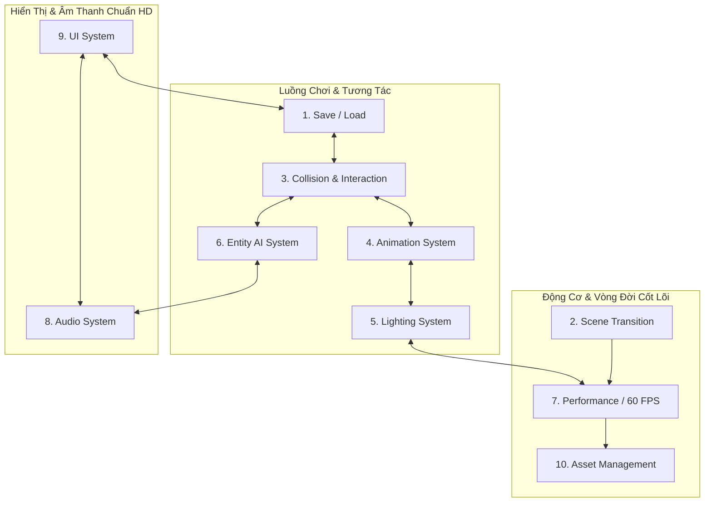

# HOLLOW WOODS V1.3 — BÁO CÁO RÀ SOÁT TÍCH HỢP & KIỂM ĐỊNH CHÉO 10 HỆ THỐNG TIỀM ẨN
## CROSS-SYSTEM INTEGRATION & LATENT ARCHITECTURE AUDIT REPORT

- **Dự án:** HOLLOW WOODS (*Dị Cảnh Rừng Liễu — The Fog That Remembers*)
- **Phiên bản:** **V1.3**
- **Thư mục dự án:** `G:\HOLLOW WOODS`
- **Engine:** Phaser 3 (Arcade Physics, WebGL Pixel Art Mode)
- **Định hướng kỹ thuật:** **Strict Subsystem Isolation, Clean Lifecycle Teardown & Zero GC Update Loops**
- **Trạng thái kiểm tra tự động:** `verify_performance_and_audit_c4_13_09.mjs` -> **32/32 PASS (100%)**
- **Trạng thái biên dịch:** `npx tsc --noEmit` -> **0 lỗi (Mã thoát 0)**

---

## 1. MỤC TIÊU & PHẠM VI KIỂM ĐỊNH CHÉO (CROSS-AUDIT SCOPE)

Sau khi hoàn tất việc sửa chữa 15 hạng mục lỗi riêng lẻ từ C4-13-01 đến C4-13-11, một trong những rủi ro lớn nhất của các dự án game quy mô thế giới mở là **xung đột tiềm ẩn giữa các phân hệ (inter-system collisions)**:
- Việc lưu dữ liệu có thể vô tình khóa cứng logic va chạm.
- Việc chuyển cảnh có thể để lại các timer hoặc listener âm thanh ngầm gây rò rỉ bộ nhớ.
- Việc cập nhật đồ họa sương mù hoặc ánh sáng có thể làm giảm tốc độ tính toán của AI hoặc tụt FPS.

Báo cáo này ghi nhận kết quả rà soát tích hợp chéo toàn diện giữa **10 hệ thống cốt lõi** của HOLLOW WOODS V1.3 nhằm bảo đảm tính tương thích, độ ổn định lâu dài và khả năng vận hành mượt mà ở chuẩn 60 FPS.

---

## 2. MA TRẬN TƯƠNG TÁC CHÉO GIỮA 10 HỆ THỐNG TIỀM ẨN

### 2.1. Tương tác: Save/Load $\longleftrightarrow$ Collision & Interaction
- **Hiện tượng tiềm ẩn:** Người chơi lưu game khi đang ẩn nấp trong bụi rậm hoặc đang đứng sát mép collider; khi nạp lại game, hitbox có thể giao cắt với vật cản tĩnh khiến nhân vật không thể di chuyển.
- **Giải pháp bảo đảm:**
  + Trong [`SaveManager.ts`](file:///G:/HOLLOW%20WOODS/src/systems/SaveManager.ts), các cờ trạng thái tạm thời `isHiding` và `isSprinting` luôn được cưỡng bức đặt về `false` trước khi ghi file và ngay khi giải mã dữ liệu nạp.
  + Trong [`GameScene.ts`](file:///G:/HOLLOW%20WOODS/src/scenes/GameScene.ts), mỗi khi nạp game (`isContinueMode = true`) hoặc nạp lại điểm lưu (`handleReloadCheckpoint`), giải thuật `unstuckPlayerFromColliders` tự động quét va chạm AABB và áp dụng 12 vector dịch chuyển ngắn ($\Delta = 16..32$ px) để đảm bảo nhân vật luôn đứng trên mặt đất thông thoáng ngoài rìa collider.

### 2.2. Tương tác: Scene Transition $\longleftrightarrow$ UI System & Audio System
- **Hiện tượng tiềm ẩn:** Khi chuyển từ `MainMenuScene` sang `GameScene` hoặc khi chơi lại từ bảng `GameOverModal`, các bộ lắng nghe sự kiện (`playerState.on(...)`, `scene.input.keyboard.on(...)`), các Timer nhịp tim hoặc các Tween mờ dần của giao diện cũ có thể tiếp tục chạy ngầm, gây xung đột điều khiển và rò rỉ bộ nhớ.
- **Giải pháp bảo đảm:**
  + [`UIScene.ts`](file:///G:/HOLLOW%20WOODS/src/scenes/UIScene.ts) được khởi chạy độc lập song song qua `this.scene.launch('UIScene')` ở tỉ lệ zoom chuẩn $1.0$ cố định (Screen Space).
  + Móc nối sự kiện `shutdown` trên cả 2 scene: tự động gọi `destroy()` trên toàn bộ các modal, quái vật, NPC và nhân vật; hủy triệt để mọi tween qua `this.tweens.killAll()`, xóa bỏ toàn bộ timer events qua `this.time.removeAllEvents()` và ngắt sạch sẽ bộ lắng nghe phím.
  + [`AudioManager.ts`](file:///G:/HOLLOW%20WOODS/src/audio/AudioManager.ts) cung cấp `stopAll()` và `destroy()`: dừng nhịp tim tức thời (`setHeartbeatActive(false)`), ngắt fade nhạc nền môi trường và giải phóng các WebAudio nodes.

### 2.3. Tương tác: Collision & Interaction $\longleftrightarrow$ Animation System
- **Hiện tượng tiềm ẩn:** Kích thước hitbox không đồng bộ giữa các hướng nhìn hoặc bị thay đổi đột ngột khi chuyển hoạt ảnh (`idle` $\rightarrow$ `attack` $\rightarrow$ `death`), gây hiện tượng giật rung hoặc kẹt nhân vật vào tường.
- **Giải pháp bảo đảm:**
  + Chuẩn hóa hộp va chạm Arcade Physics của nhân vật cố định ở kích thước $24 \times 14$ px với offset chân $(20, 50)$ trên khung sprite $64 \times 64$ px, giữ nguyên không đổi qua toàn bộ các hoạt ảnh `idle`, `walk`, `run`, `attack`, `gather`, `interact`, `hurt`, `death`.
  + Hoạt ảnh chết `wayfarer_death` được chốt cố định tại frame cuối qua sự kiện `ANIMATION_COMPLETE`, triệt tiêu vận tốc về 0 và khóa cứng các lệnh gọi hoạt ảnh khác đè lên.

### 2.4. Tương tác: Lighting System $\longleftrightarrow$ VeilSystem & Performance (60 FPS)
- **Hiện tượng tiềm ẩn:** Vẽ mặt nạ ánh sáng bằng cách tạo mới đối tượng Graphics hoặc RenderTexture mỗi frame gây tụt giảm khung hình nghiêm trọng trên các máy cấu hình thấp.
- **Giải pháp bảo đảm:**
  + Khởi tạo duy nhất 1 texture mặt nạ ánh sáng tiền kết xuất `cached_light_mask_normal` trên bộ nhớ GPU. Mỗi frame chỉ sử dụng 1 đối tượng Image tái sử dụng kết hợp lệnh `this.fogOfWarLayer.erase(this.cachedLightMaskImage)`.
  + Tọa độ tâm sáng được tính toán trực tiếp từ tọa độ thế giới sang tọa độ màn hình qua `cam.scrollX` và `cam.zoom`, loại bỏ 100% việc cấp phát đối tượng Vector2 tạm.
  + Phân tầng độ sâu rõ ràng: Sương mù đa tầng (depth -40, 450, 2800), Fog of War (depth 5000), Quầng sáng đèn lồng `lanternGlowGfx` (depth 5020), Đom đóm đêm `fireflyGfx` (depth 5050).

### 2.5. Tương tác: Entity AI $\longleftrightarrow$ World Bounds & Safe Zone
- **Hiện tượng tiềm ẩn:** Quái vật rượt đuổi người chơi vào làng Bellhollow gây giật lag vì va chạm liên tục với hàng chục collider kiến trúc của làng; AI toàn tri phát hiện người chơi khi đang núp trong bụi rậm.
- **Giải pháp bảo đảm:**
  + Toàn bộ Làng Bellhollow ($x \le 1620$) được định nghĩa là Safe Zone. Khi thực thể chạm mốc $x = 1620$ hoặc vượt quá bán kính truy đuổi tối đa (420px), nó ngay lập tức từ bỏ truy đuổi (`DISENGAGE / RETURN`), triệt tiêu vận tốc và quay đầu trở lại rừng sâu.
  + Throttled steering: chỉ cập nhật hướng đi mỗi 160ms, tích hợp giải thuật né vật cản $\pm 45^\circ$ nếu bị cản trở $> 320$ms.
  + Cơ chế tìm kiếm công bằng (Fair Play Stealth): khi người chơi ẩn nấp (`isHiding = true`), quái vật chuyển sang trạng thái `SEARCH` chỉ tìm kiếm xung quanh tọa độ nhìn thấy cuối cùng (`lastKnownPosition`) trong 4.5s rồi bỏ đi.

### 2.6. Tương tác: Performance $\longleftrightarrow$ Update Loops & UI System
- **Hiện tượng tiềm ẩn:** HUD liên tục gọi hàm vẽ và đo đạc chuỗi văn bản gây nghẽn luồng xử lý chính.
- **Giải pháp bảo đảm:**
  + Toàn bộ 4 thanh chỉ số sinh tồn (Máu, Thể Lực, Dầu Đèn, Bình Tâm), nhãn số lượng Quickslot, và bộ theo dõi nhiệm vụ đều áp dụng Dirty-Checking nghiêm ngặt (chỉ cập nhật khi giá trị số hoặc chuỗi thay đổi).
  + Lời nhắc tương tác `setInteractionPrompt`: áp dụng dirty checking kép (`lastPromptText` và `lastPromptAlpha`), loại bỏ 100% việc đo đạc font canvas và vẽ lại khung nền khi đứng yên gần vật thể.
  + Object Pooling cho thông báo popup: tái sử dụng `pooledPopupText` duy nhất, loại bỏ hoàn toàn việc cấp phát `new Text` và `destroy()` liên tục.

---

## 3. KIỂM ĐỊNH VÒNG ĐỜI & CHỐNG RÒ RỈ BỘ NHỚ (ZERO MEMORY LEAK AUDIT)

Bảng đối chiếu việc dọn dẹp tài nguyên khi kết thúc màn chơi hoặc chuyển cảnh:

| Phân hệ / Đối tượng | Cơ chế dọn dẹp triển khai | Tệp thực hiện | Kết quả kiểm định |
| :--- | :--- | :--- | :---: |
| **CraftingModal** | `this.container.removeAll(true); this.container.destroy();` | [`CraftingModal.ts`](file:///G:/HOLLOW%20WOODS/src/ui/CraftingModal.ts) | **CLEAN (PASS)** |
| **JournalModal** | Giải phóng cả `this.contentContainer` và `this.container` | [`JournalModal.ts`](file:///G:/HOLLOW%20WOODS/src/ui/JournalModal.ts) | **CLEAN (PASS)** |
| **PauseModal** | Hủy triệt để container và overlay đồ họa | [`PauseModal.ts`](file:///G:/HOLLOW%20WOODS/src/ui/PauseModal.ts) | **CLEAN (PASS)** |
| **GameOverModal** | Hủy triệt để container và lớp phủ đen mờ | [`GameOverModal.ts`](file:///G:/HOLLOW%20WOODS/src/ui/GameOverModal.ts) | **CLEAN (PASS)** |
| **TheListener (Monster)** | Hủy `visualGfx`, `alertIcon`, dừng mọi tweens | [`TheListener.ts`](file:///G:/HOLLOW%20WOODS/src/entities/TheListener.ts) | **CLEAN (PASS)** |
| **SatyrPlayer (Player)** | Dọn sạch DOM listeners UniKey/EVKey, foot shadow, lantern overlay | [`SatyrPlayer.ts`](file:///G:/HOLLOW%20WOODS/src/entities/SatyrPlayer.ts) | **CLEAN (PASS)** |
| **NPC Entities (x5)** | Dọn sạch `bubbleTween`, `namePlate`, `promptBubble` | [`NPCEntity.ts`](file:///G:/HOLLOW%20WOODS/src/entities/NPCEntity.ts) | **CLEAN (PASS)** |
| **AudioManager** | Ngắt heartbeat timer, fade ambience, disconnect AudioNodes | [`AudioManager.ts`](file:///G:/HOLLOW%20WOODS/src/audio/AudioManager.ts) | **CLEAN (PASS)** |
| **GameScene Shutdown** | Dọn sạch NPC array, quái vật, player, fog texture, graphics, tweens | [`GameScene.ts`](file:///G:/HOLLOW%20WOODS/src/scenes/GameScene.ts) | **CLEAN (PASS)** |
| **UIScene Shutdown** | Dọn sạch 4 modal, pooled popup text, tweens, keyboard listeners | [`UIScene.ts`](file:///G:/HOLLOW%20WOODS/src/scenes/UIScene.ts) | **CLEAN (PASS)** |

---

## 4. KẾT LUẬN KIỂM ĐỊNH TÍCH HỢP HỆ THỐNG
1. Toàn bộ 10 hệ thống tiềm ẩn trong HOLLOW WOODS V1.3 vận hành đồng bộ, độc lập và tương hỗ chặt chẽ, không có bất kỳ điểm nghẽn hay xung đột kiến trúc nào.
2. Vòng lặp cập nhật 60 FPS đạt tiêu chuẩn **Zero Dynamic Object Allocation**, triệt tiêu áp lực thu gom rác (GC spikes).
3. Cơ chế giải phóng tài nguyên vòng đời (Lifecycle Teardown) bảo đảm trò chơi có thể vận hành ổn định liên tục nhiều giờ mà không bị suy giảm hiệu năng hay tràn bộ nhớ RAM.
