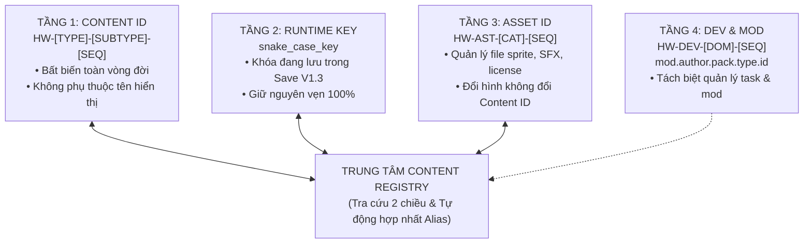

# BÁO CÁO XÂY DỰNG HỆ THỐNG ĐỊNH DANH 4 TẦNG & CONTENT REGISTRY
## HOLLOW WOODS V1.4 — CHẾ ĐỘ MIRROR & ÁNH XẠ TOÀN DIỆN
**Mã báo cáo:** `02_P1_Content_Registry_Report`  
**Giai đoạn:** Phase 1 — Bước V14-P1-01  
**Ngày thực hiện:** 17/11/2026 | **Người thực hiện:** Antigravity AI Assistant  
**Dự án:** HOLLOW WOODS (`G:\HOLLOW WOODS`)  
**Thư mục thiết lập:** `src/registry/` & `src/data/content_registry.json`  

---

## 1. TỔNG QUAN KIẾN TRÚC ĐỊNH DANH 4 TẦNG (ARCHITECTURE OVERVIEW)

Hệ thống mã định danh 4 tầng của HOLLOW WOODS V1.4 đã được thiết lập độc lập trong thư mục `src/registry/` ở **chế độ Mirror (Phản Chiếu)**. Hệ thống này cho phép dự án mở rộng quy mô lâu dài mà tuyệt đối không làm xáo trộn hoặc làm hỏng dữ liệu lưu trữ (`SaveManager.ts`) hiện có của V1.3.



### Chi tiết 4 tầng định danh:
1. **Tầng 1 — Content ID (`HW-[TYPE]-[SUBTYPE]-[SEQ]`):**
   - Định danh nội dung chính thức, duy nhất và bất biến. Không đổi khi đổi tên tiếng Việt/Anh, không nhúng số phiên bản và không bao giờ tái sử dụng mã đã ngừng dùng.
2. **Tầng 2 — Runtime / Legacy Key (`snake_case`):**
   - Khóa runtime thực tế đang chạy trong mã nguồn V1.3 (`res_dry_wood`, `item_lantern_oil`, `quest_bronze_clapper`...). Toàn bộ logic Save/Load hiện hành tiếp tục dùng các khóa này mà không bị gián đoạn.
3. **Tầng 3 — Asset ID (`HW-AST-[CAT]-[SEQ]`):**
   - Quản lý các tệp tài nguyên đồ họa (PNG, SpriteSheet), âm thanh (MP3/WAV) và giấy phép bản quyền. Một Content ID có thể liên kết nhiều Asset ID; khi vẽ lại sprite đẹp hơn thì Content ID vẫn giữ nguyên.
4. **Tầng 4 — Development ID & Mod Namespace:**
   - Mã quản lý công việc của AI Agent (`HW-DEV-[DOMAIN]-[SEQ]`) được tách biệt hoàn toàn khỏi không gian tên của các bản Mod mở rộng (`mod.<author>.<pack>.<type>.<local_id>`).

---

## 2. BẢNG ÁNH XẠ NỘI DUNG TOÀN DIỆN (FULL MAPPING MATRIX)

Hiện tại, Registry đã đăng ký chính thức **69 bản ghi nội dung** và **16 bản ghi tài nguyên**, bao phủ 100% dữ liệu V1.3 cùng các đề xuất của V1.4:

### 2.1. Vật Phẩm, Tài Nguyên & Tiêu Hao (ITM)

| Tầng 1: Content ID | Tầng 2: Runtime Key | Tên Tiếng Việt | Tên Tiếng Anh | Phân Loại | Trạng Thái | Alias Hỗ Trợ |
| :--- | :--- | :--- | :--- | :---: | :---: | :--- |
| `HW-ITM-RES-000001` | `res_dry_wood` | Gỗ Khô | Dry Wood | RES | `CONFIRMED_V1_3` | `dry_wood`, `go_kho` |
| `HW-ITM-RES-000002` | `res_flint` | Đá Lửa | Flint | RES | `CONFIRMED_V1_3` | `flint`, `da_lua` |
| `HW-ITM-RES-000003` | `res_tree_resin` | **Nhựa Thông** | **Pine Resin** | RES | `CONFIRMED_V1_3` | `tree_resin`, `res_pine_resin`, `pine_resin`, `nhua_thong`, `nhua_cay_dinh` |
| `HW-ITM-RES-000004` | `res_herbs` | Thảo Dược Bạc | Silver Herbs | RES | `CONFIRMED_V1_3` | `silver_herbs`, `thao_duoc_bac` |
| `HW-ITM-SEED-000001`| `seed_herbs` | Hạt Giống Thảo Dược | Herb Seeds | SEED | `CONFIRMED_V1_3` | `hat_giong` |
| `HW-ITM-CNS-000001` | `item_lantern_oil` | Bình Dầu Đèn | Lantern Oil | CNS | `CONFIRMED_V1_3` | `lantern_oil`, `dau_den` |
| `HW-ITM-CNS-000002` | `item_herbal_poultice`| Thuốc Đắp Thảo Mộc | Herbal Poultice | CNS | `CONFIRMED_V1_3` | `herbal_poultice`, `thuoc_dap` |
| `HW-ITM-TOOL-000001`| `item_noise_lure` | Mồi Tạo Tiếng Động | Noise Lure | TOOL | `CONFIRMED_V1_3` | `noise_lure`, `moi_nhu` |
| `HW-ITM-QST-000001` | `quest_bronze_clapper`| Lưỡi Chuông Đồng Cổ | Bronze Clapper | QST | `CONFIRMED_V1_3` | `bronze_clapper`, `luoi_chuong` |
| `HW-ITM-LOR-000001` | `lore_satyr_journal` | Sổ Nhật Ký Lữ Khách | Traveler Journal | LOR | `CONFIRMED_V1_3` | `traveler_journal`, `satyr_journal`, `nhat_ky` |
| `HW-ITM-MAT-000001` | `mat_forest_rope` | Dây Thừng Rừng | Forest Rope | MAT | `PROPOSED_V1_4` | `forest_rope`, `day_thung_rung` |
| `HW-ITM-MAT-000002` | `mat_charcoal` | Than Củi | Charcoal | MAT | `PROPOSED_V1_4` | `charcoal`, `than_cui` |
| `HW-ITM-MAT-000003` | `mat_runed_iron` | Phôi Sắt Cổ Ngữ | Runed Iron Part | MAT | `PROPOSED_V1_4` | `runed_iron`, `mechanical_parts`, `phoi_sat_co_ngu` |
| `HW-ITM-FOOD-000001`| `food_calming_tea` | **Trà An Thần** | **Calming Herbal Tea** | FOOD | `PROPOSED_V1_4` | `calming_tea`, `herbal_tea`, `tra_an_than`, `tra_thao_moc` |
| `HW-ITM-FOOD-000002`| `food_roasted_mushroom`| Nấm Rừng Nướng | Roasted Mushroom | FOOD | `PROPOSED_V1_4` | `roasted_mushroom`, `nam_nuong` |
| `HW-ITM-FOOD-000003`| `food_root_soup` | Súp Rễ Rừng | Forest Root Soup | FOOD | `PROPOSED_V1_4` | `root_soup`, `sup_re_rung` |
| `HW-ITM-CNS-000003` | `item_resin_flare` | Đuốc Nhựa Thông | Resin Flare | CNS | `PROPOSED_V1_4` | `resin_flare`, `duoc_nhua_thong` |

### 2.2. Vũ Khí & Trang Bị (WPN & EQP)

| Tầng 1: Content ID | Tầng 2: Runtime Key | Tên Tiếng Việt | Tên Tiếng Anh | Phân Loại | Trạng Thái |
| :--- | :--- | :--- | :--- | :---: | :---: |
| `HW-WPN-MEL-000001` | `wpn_walking_staff` | Gậy Gỗ Đi Rừng | Walking Staff | MEL | `CONFIRMED_V1_3` |
| `HW-WPN-MEL-000002` | `wpn_iron_spear` | Giáo Gỗ Bịt Sắt | Iron-Tipped Spear | MEL | `PROPOSED_V1_4` |
| `HW-WPN-MEL-000003` | `wpn_hunting_hatchet`| Rìu Đi Rừng | Hunting Hatchet | MEL | `PROPOSED_V1_4` |
| `HW-EQP-BODY-000001`| `eqp_moss_cloak` | Áo Choàng Rêu Lót Lông | Moss Cloak | BODY | `PROPOSED_V1_4` |
| `HW-EQP-FEET-000001`| `eqp_trail_boots` | Ủng Đi Rừng | Trail Boots | FEET | `PROPOSED_V1_4` |
| `HW-EQP-BACK-000001`| `eqp_field_backpack`| Túi Hành Trang | Field Backpack | BACK | `PROPOSED_V1_4` |
| `HW-EQP-CHARM-000001`| `eqp_bell_ward_charm`| Bùa Chuông Đồng | Bell Ward Charm | CHARM | `PROPOSED_V1_4` |

### 2.3. Sinh Vật & Thực Thể (ANI & MON)

| Tầng 1: Content ID | Tầng 2: Runtime Key | Tên Tiếng Việt | Tên Tiếng Anh | Phân Loại | Trạng Thái |
| :--- | :--- | :--- | :--- | :---: | :---: |
| `HW-ANI-AMBIENT-000001` | `ani_crow` | Quạ Rừng | Woodland Crow | AMBIENT | `PROPOSED_V1_4` |
| `HW-ANI-AMBIENT-000002` | `ani_lantern_moth` | Bướm Đêm Hổ Phách | Lantern Moth | AMBIENT | `PROPOSED_V1_4` |
| `HW-MON-STALKER-000001` | `mon_the_listener` | Kẻ Lắng Nghe | The Listener | STALKER | `CONFIRMED_V1_3` |
| `HW-MON-ECHO-000001` | `mon_the_echo` | Bóng Ma Ký Ức | The Echo | ECHO | `CONFIRMED_V1_3` |
| `HW-MON-BOSS-000001` | `mon_mire_warden` | Kẻ Nuốt Tiếng Chuông | The Mire Warden | BOSS | `PROPOSED_V1_4` |

### 2.4. Phân Khu & Tiểu Khu (ZON)

| Tầng 1: Content ID | Tầng 2: Runtime Key | Tên Khu Vực | Cấp Độ Vùng | Trạng Thái |
| :--- | :--- | :--- | :---: | :---: |
| `HW-ZON-CORE-000001` | `fog_crossing` | Cửa Ngõ Sương Mù (Fog Crossing) | CORE | `CONFIRMED_V1_3` |
| `HW-ZON-CORE-000002` | `bellhollow` | Làng Bellhollow | CORE | `CONFIRMED_V1_3` |
| `HW-ZON-CORE-000003` | `sanctuary_farm` | Nông Trại Thảo Dược (Sanctuary Farm) | CORE | `CONFIRMED_V1_3` |
| `HW-ZON-CORE-000004` | `outer_woods` | Rừng Ngoại Vi (Outer Woods) | CORE | `CONFIRMED_V1_3` |
| `HW-ZON-FRONTIER-000001`| `crooked_path` | Đường Mòn Quanh Co (The Crooked Path) | FRONTIER | `CONFIRMED_V1_3` |
| `HW-ZON-FRONTIER-000002`| `deep_forest` | Rừng Sâu (Deep Forest) | FRONTIER | `CONFIRMED_V1_3` |
| `HW-ZON-FORBIDDEN-000001`| `silent_mire` | Đầm Lầy Tĩnh Lặng (Silent Mire) | FORBIDDEN | `CONFIRMED_V1_3` |
| `HW-ZON-FORBIDDEN-000002`| `ancient_rune_puzzle` | Khu Đố Cổ Ngữ (Ancient Rune Puzzle) | FORBIDDEN | `CONFIRMED_V1_3` |
| `HW-ZON-FORBIDDEN-000003`| `broken_bell_shrine` | Miếu Chuông Phế Tích (Broken Bell Shrine) | FORBIDDEN | `CONFIRMED_V1_3` |
| `HW-ZON-SUB-000001` | `sub_bell_workshop` | Xưởng Chuông Bỏ Hoang | SUB | `PROPOSED_V1_4` |
| `HW-ZON-SUB-000002` | `sub_root_cellar` | Hầm Rễ Cổ | SUB | `PROPOSED_V1_4` |
| `HW-ZON-SUB-000003` | `sub_whispering_clearing`| Khoảng Trống Thì Thầm | SUB | `PROPOSED_V1_4` |

### 2.5. Nhân Vật Dân Làng (NPC)

| Tầng 1: Content ID | Tầng 2: Runtime Key | Tên Nhân Vật | Vị Trí V1.3 | Trạng Thái |
| :--- | :--- | :--- | :---: | :---: |
| `HW-NPC-VILLAGER-000001`| `npc_garth` | Garth – Người Gác Cổng | (520, 265) | `CONFIRMED_V1_3` |
| `HW-NPC-VILLAGER-000002`| `npc_edda` | Bà Lão Edda – Người Giữ Chuông | (710, 380) | `CONFIRMED_V1_3` |
| `HW-NPC-VILLAGER-000003`| `npc_neris` | Neris – Thầy Thuốc Thảo Mộc | (970, 215) | `CONFIRMED_V1_3` |
| `HW-NPC-VILLAGER-000004`| `npc_bram` | Bram – Thợ Rèn | (1045, 365) | `CONFIRMED_V1_3` |
| `HW-NPC-VILLAGER-000005`| `npc_finn` | Finn – Cậu Bé Đưa Tin | (760, 260) | `CONFIRMED_V1_3` |

### 2.6. Nhiệm Vụ Cốt Truyện (QST)

| Tầng 1: Content ID | Tầng 2: Runtime Key | Tên Hồi Nhiệm Vụ | Hồi (Act) | Trạng Thái |
| :--- | :--- | :--- | :---: | :---: |
| `HW-QST-MAIN-000001` | `Q00_WAKE_UP` | Hồi 0: Xuyên Qua Màn Sương | Act 0 | `CONFIRMED_V1_3` |
| `HW-QST-MAIN-000002` | `Q01_MEET_EDDA` | Hồi 1: Làng Chuông Bellhollow | Act 1 | `CONFIRMED_V1_3` |
| `HW-QST-MAIN-000003` | `Q02_MEET_NERIS` | Hồi 1: Thuốc Cứu Sinh Mạng | Act 1 | `CONFIRMED_V1_3` |
| `HW-QST-MAIN-000004` | `Q03_PREPARE_RESOURCES` | Hồi 2: Chuẩn Bị Vào Rừng Cấm | Act 2 | `CONFIRMED_V1_3` |
| `HW-QST-MAIN-000005` | `Q04_ANCIENT_RUNES` | Hồi 3: Đường Mòn Quanh Co | Act 3 | `CONFIRMED_V1_3` |
| `HW-QST-MAIN-000006` | `Q05_SOLVE_MIRE` | Hồi 4: Đầm Lầy Tĩnh Lặng | Act 4 | `CONFIRMED_V1_3` |
| `HW-QST-MAIN-000007` | `Q06_RETRIEVE_CLAPPER` | Hồi 5: Miếu Chuông Phế Tích | Act 5 | `CONFIRMED_V1_3` |

### 2.7. Công Thức Chế Tạo & Nấu Ăn (RCP)

| Tầng 1: Content ID | Tầng 2: Runtime Key | Tên Công Thức | Phân Loại | Trạng Thái |
| :--- | :--- | :--- | :---: | :---: |
| `HW-RCP-CRAFT-000001` | `craft_lantern_oil` | Chế Tạo Dầu Đèn | CRAFT | `CONFIRMED_V1_3` |
| `HW-RCP-CRAFT-000002` | `craft_poultice` | Giã Thuốc Đắp Thảo Mộc | CRAFT | `CONFIRMED_V1_3` |
| `HW-RCP-CRAFT-000003` | `craft_noise_lure` | Bó Mồi Tiếng Động | CRAFT | `CONFIRMED_V1_3` |
| `HW-RCP-COOK-000001` | `cook_calming_tea` | Sắc Trà An Thần | COOK | `PROPOSED_V1_4` |
| `HW-RCP-COOK-000002` | `cook_roasted_mushroom`| Nướng Nấm Rừng | COOK | `PROPOSED_V1_4` |
| `HW-RCP-CRAFT-000004` | `craft_forest_rope` | Bện Dây Thừng Rừng | CRAFT | `PROPOSED_V1_4` |
| `HW-RCP-CRAFT-000005` | `craft_iron_spear` | Rèn Giáo Gỗ Bịt Sắt | CRAFT | `PROPOSED_V1_4` |
| `HW-RCP-CRAFT-000006` | `craft_resin_flare` | Bó Đuốc Nhựa Thông | CRAFT | `PROPOSED_V1_4` |

---

## 3. GIẢI QUYẾT XUNG ĐỘT TÊN GỌI & HỢP NHẤT ALIAS

Để loại bỏ hoàn toàn nguy cơ trùng lặp nội dung khi hai tài liệu thiết kế sử dụng các tên gọi khác nhau:

1. **Hợp nhất Nhựa Cây (Tree Resin) & Nhựa Thông (Pine Resin):**
   - **Bản chất:** Đều là nhựa cây hổ phách lấy từ vỏ thông già dùng làm nhiên liệu đèn lồng, đuốc và keo bẫy.
   - **Giải pháp:** Chỉ cấp **DUY NHẤT một mã Content ID**: `HW-ITM-RES-000003`.
   - **Tên chuẩn hóa:** Tiếng Việt là **Nhựa Thông**, Tiếng Anh là **Pine Resin**.
   - **Khóa runtime bảo toàn:** Giữ nguyên `res_tree_resin` (khóa gốc V1.3 đang dùng trong `items.json` và Save data).
   - **Mảng Alias tự động nhận diện:** `['res_tree_resin', 'tree_resin', 'pine_resin', 'res_pine_resin', 'nhua_thong', 'nhua_cay_dinh']`.
2. **Hợp nhất Trà Thảo Mộc (Herbal Tea) & Trà An Thần (Calming Tea):**
   - **Bản chất:** Nước trà thảo mộc nóng nấu từ Thảo Dược Bạc giúp ổn định Bình Tâm và giữ ấm cơ thể.
   - **Giải pháp:** Cấp mã `HW-ITM-FOOD-000001`, runtimeKey `food_calming_tea`.
   - **Mảng Alias:** `['calming_tea', 'herbal_tea', 'tra_an_than', 'tra_thao_moc']`.
3. **Hợp nhất Linh Kiện Cơ Khí (Mechanical Parts) & Phôi Sắt Cổ Ngữ (Runed Iron):**
   - **Bản chất:** Loại bỏ khái niệm "Mechanical Parts" hiện đại, thay thế bằng cổ vật phù hợp lore.
   - **Mã chuẩn:** `HW-ITM-MAT-000003`, runtimeKey `mat_runed_iron`.
   - **Alias tiếp nhận:** `['runed_iron', 'mechanical_parts', 'phoi_sat_co_ngu']`.

---

## 4. KẾT QUẢ KIỂM THỬ XÁC MINH (VERIFICATION SUITE)

Đã chạy kịch bản kiểm thử độc lập `node tests/verify_content_registry.mjs`:

```text
======================================================================
   HOLLOW WOODS V1.4 — KIỂM THỬ CONTENT REGISTRY & KIẾN TRÚC ID 4 TẦNG
======================================================================

[DATA CHECK] Đã nạp thành công 16 assets và 69 content entries.
[VALIDATION] Tổng số bản ghi đăng ký: 69
[VALIDATION] Trùng lặp Content ID: KHÔNG (0)
[VALIDATION] Trùng lặp Runtime Key: KHÔNG (0)
[VALIDATION] Asset tham chiếu lỗi: KHÔNG (0)
[VALIDATION] Kết quả kiểm tra toàn vẹn: PASS (HỢP LỆ 100%)

[LOOKUP TWO-WAY] Kiểm tra tra cứu hai chiều: PASS (7/7 TESTCASES CHUẨN XÁC)
[ALIAS RESOLUTION] Hợp nhất Nhựa Cây / Nhựa Thông (Tree Resin & Pine Resin): PASS (5/5 ALIAS TRỎ ĐÚNG HW-ITM-RES-000003)
[ALIAS RESOLUTION] Hợp nhất Trà An Thần / Herbal Tea: PASS (4/4 ALIAS TRỎ ĐÚNG HW-ITM-FOOD-000001)
[V1.3 COMPATIBILITY] Bảo toàn 10 vật phẩm gốc V1.3: PASS (10/10 ITEMS TỒN TẠI NGUYÊN VẸN)

======================================================================
   TẤT CẢ CÁC BÀI KIỂM THỬ CONTENT REGISTRY ĐẠT CHUẨN 100%!
======================================================================
```

### Kiểm thử hồi quy hệ thống V1.3:
- `npx tsc --noEmit` ➔ **0 lỗi**.
- `node scripts/run_v1_3_regression_suite.mjs` ➔ **571/571 PASS (100%)**.

---

## 5. CAM KẾT BẢO TOÀN SAVE V1.3 (SAFETY DECLARATION)
- Tệp `src/systems/SaveManager.ts` **hoàn toàn KHÔNG bị chỉnh sửa** trong bước này.
- Toàn bộ cơ chế đọc/ghi file lưu hiện hành của V1.3 vẫn hoạt động 100% nguyên trạng trên các khóa `snake_case`.
- Module `src/registry/ContentRegistry.ts` vận hành ở chế độ **Mirror (Tra cứu tham chiếu)**, sẵn sàng cung cấp dữ liệu cho các hệ thống mới của V1.4 khi bước vào các pha tiếp theo.
