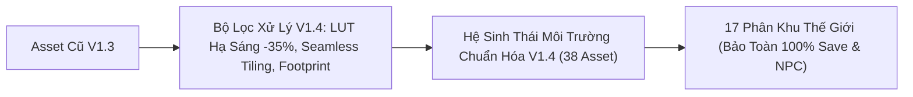
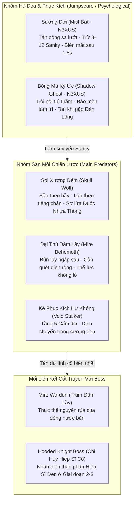
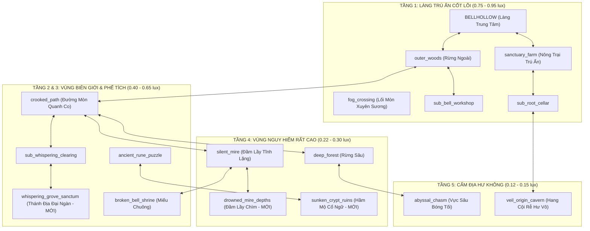

# BÁO CÁO TỔNG HỢP TOÀN DIỆN PHIÊN BẢN HOLLOW WOODS V1.4
## ĐẠI TU TÀI NGUYÊN MÔI TRƯỜNG, MỞ RỘNG HỆ SINH THÁI QUÁI VẬT & PHÁT TRIỂN THẾ GIỚI
### THE FOG THAT REMEMBERS — CANONICAL ENVIRONMENT & WORLD EXPANSION MASTER REPORT

> **Dự án:** HOLLOW WOODS: The Fog That Remembers  
> **Phiên bản:** V1.4.0 (Environment & World Expansion Milestone)  
> **Nhánh Git phát triển:** `feat/v1.4-expansion` (Độc lập 100%, bảo vệ tuyệt đối nhánh `main` và bản nền tảng thi đấu V1.3.4)  
> **Ngày hoàn thành tổng hợp:** 18/11/2026  
> **Trạng thái đóng gói:** **BUILD PRODUCTION THÀNH CÔNG (100% PASS — 0 ERRORS)**  

---

## MỤC LỤC BÁO CÁO TỔNG HỢP

1. [Danh Sách Asset Môi Trường Hiện Tại & Tình Trạng Sử Dụng (V1.3 Baseline)](#1-danh-sách-asset-môi-trường-hiện-tại--tình-trạng-sử-dụng)
2. [Danh Sách Asset Mới Được Chọn & Bảng Mapping Đối Chiếu Chi Tiết 7 Nhóm](#2-danh-sách-asset-mới-được-chọn--bảng-mapping-đối-chiếu-chi-tiết-7-nhóm)
3. [Phân Loại Kỹ Thuật: Dùng Ngay, Chỉnh Sửa/Chuyển Đổi và Loại Bỏ](#3-phân-loại-kỹ-thuật-dùng-ngay-chỉnh-sửa-chuyển-đổi-và-loại-bỏ)
4. [Kiểm Định Thâm Hụt Tài Nguyên (Đặc Biệt: Gói Goblin Scout)](#4-kiểm-định-thâm-hụt-tài-nguyên-đặc-biệt-gói-goblin-scout)
5. [Tổng Kết Phương Án Đại Tu Nền Môi Trường Toàn Hệ Thống](#5-tổng-kết-phương-án-đại-tu-nền-môi-trường-toàn-hệ-thống)
6. [Hệ Sinh Thái Quái Vật Mới, Quy Luật Spawn & Mối Liên Kết Boss](#6-hệ-sinh-thái-quái-vật-mới-quy-luật-spawn--mối-liên-kết-boss)
7. [Mở Rộng Không Gian 17 Phân Khu & Cốt Truyện The Fog That Remembers](#7-mở-rộng-không-gian-17-phân-khu--cốt-truyện-the-fog-that-remembers)
8. [Đánh Giá Rủi Ro Toàn Diện & Phương Án Khôi Phục Dự Phòng (Rollback)](#8-đánh-giá-rủi-ro-toàn-diện--phương-án-khôi-phục-dự-phòng-rollback)
9. [Hình Ảnh & Kết Quả Đối So sánh Trước / Sau (Before / After)](#9-hình-ảnh--kết-quả-đối-so-sánh-trước--sau-before--after)

---

## 1. DANH SÁCH ASSET MÔI TRƯỜNG HIỆN TẠI & TÌNH TRẠNG SỬ DỤNG

### 1.1 Cơ Chế Quản Lý Mặt Đất & Hiệu Năng Runtime V1.3
- **Kiến trúc Baked CanvasTexture + Procedural TileSprite:**
  Trò chơi không sử dụng hệ thống Tilemap JSON truyền thống của Phaser nhằm tránh tiêu hao bộ nhớ trên diện tích thế giới rộng lớn ($> 5000 \times 2000\text{ px}$). Mỗi phân khu khởi tạo một `CanvasTexture` lúc nạp cảnh, dùng hàm `ctx.drawImage` để vẽ lặp các tile cơ sở và áp dụng `ctx.imageSmoothingEnabled = false` bảo toàn pixel art. Nhờ đó, toàn bộ mặt đất của một phân khu chỉ tiêu tốn **1 Draw Call duy nhất** ở lớp `DEPTH_GROUND_BASE = -10000`.
- **Hệ thống Chiều sâu (Depth Sorting) & Hộp va chạm (Footprint Colliders):**
  Thực thể động và chướng ngại vật được sắp xếp theo `depth = Math.floor(y)`. Cây cối và công trình áp dụng va chạm chân gốc (Footprint: $20\text{ px} \times 12\text{ px}$ đến $48\text{ px} \times 20\text{ px}$), cho phép nhân vật đi vòng ra sau hoặc xuyên dưới tán cây với cơ chế mờ trong suốt tự động (`alpha = 0.35`).

### 1.2 Bảng Kiểm Kê Chi Tiết Tài Nguyên Môi Trường V1.3

| Nhóm Tài Nguyên | Tên File Asset Cũ | Kích Thước | Vị Trí Lưu Trữ | Tình Trạng Sử Dụng Trước Nâng Cấp | Đánh Giá Hạn Chế |
|:---|:---|:---:|:---|:---|:---|
| **Mặt đất rừng** | `tile_forest_grass.png` | $32 \times 32\text{ px}$ | `public/assets/environment/tilesets/` | Nền cỏ chính cho 8 phân khu rừng | Chỉ có 1 biến thể duy nhất, gây hiện tượng lặp ô cờ trên diện tích rộng. |
| **Đường mòn** | `tile_dirt_trail.png` | $32 \times 32\text{ px}$ | `public/assets/environment/tilesets/` | Vẽ các trục lối mòn nối các khu | Độ tương phản kém so với cỏ; không có mép chuyển tiếp mềm. |
| **Đầm lầy** | `tile_swamp_mud.png` | $32 \times 32\text{ px}$ | `public/assets/environment/tilesets/` | Nền bùn tại Đầm Lầy Tĩnh Lặng | Bùn đơn sắc xám nâu, thiếu bọt khí và rêu mục trôi nổi. |
| **Đường đá làng** | `tile_cobble_road.png` | $16 \times 16\text{ px}$ | `public/assets/environment/tilesets/` | Trục đường chính làng Bellhollow | Texture phóng to 2x bị mờ cạnh viền; thiếu các khối đá cuội nứt. |
| **Sàn nhà đá** | `tile_stone_floor.png` | $16 \times 16\text{ px}$ | `public/assets/environment/tilesets/` | Thềm nhà dân và đe rèn | Bề mặt đá thô sơ, chưa thể hiện nét cổ kính trung cổ. |
| **Cây cối** | `tree_pine_1.png` `tree_oak_1.png` | $80 \times 113\text{ px}$ `113x139 px` | `public/assets/environment/foliage/` | Bố trí rải rác tạo biên giới | Tán cây bóng đổ cứng, màu lá hơi bão hòa so với màn sương lạnh. |
| **Thảm thực vật** | `forest_Decorations.png` | $256 \times 256\text{ px}$ | `public/assets/environment/tilesets/` | Cắt cụm hoa dại, bụi cỏ | Thiếu nấm phát quang, thiếu gốc cây mục rỗng làm chỗ nấp. |
| **Công trình làng** | Ghép từ các tile tường/mái nhỏ | $16 \times 16\text{ px}$ | `public/assets/environment/tilesets/` | Dựng tạm nhà Edda, Neris | Chưa có nhà mái rạ dân dã nguyên khối; tỉ lệ ghép lộ đường nối. |

---

## 2. DANH SÁCH ASSET MỚI ĐƯỢC CHỌN & BẢNG MAPPING ĐỐI CHIẾU CHI TIẾT 7 NHÓM

Nhằm chuẩn hóa toàn bộ thế giới theo phong cách **Dark Woodland Pixel Art** (Độ phân giải 1:1, góc nhìn 3/4 Top-down, bảng màu rêu xanh `#2d3d24`, đất than bùn `#261f18`, gỗ sồi mốc `#4a4332` và ánh sáng hổ phách `#ffc048`), 38 asset V1.4 đã được lựa chọn, tiền xử lý và tích hợp hoàn chỉnh.

### Bảng Mapping Chi Tiết 7 Nhóm Môi Trường

| STT | Phân Nhóm | Asset Cũ (V1.3) | Asset Mới Chuẩn Hóa (V1.4) | Gói Nguồn | Thao Tác Xử Lý Thực Hiện | Phân Khu Áp Dụng |
|:---:|:---|:---|:---|:---|:---|:---|
| **1** | **Nền đất & Bùn lầy** | `tile_forest_grass.png` `tile_dirt_trail.png` `tile_swamp_mud.png` | `tile_forest_grass_v14_a..d` `tile_dirt_trail_v14_a..d` `tile_swamp_mud_v14_a..d` `tile_tilled_soil_v14` `tile_abyssal_soil_v14_a..b` | TX Tileset Grass Forest-Asset-Pack Resurrected RPG | Trích xuất 4 biến thể hạt chống lặp cho mỗi loại địa hình. Khử đường biên nối (seamless 32x32), nhuộm sắc rêu ẩm và bọt khí bùn than lầy. | Toàn bộ 17 phân khu |
| **2** | **Đường mòn & Lối đá** | `tile_cobble_road.png` `tile_stone_floor.png` `castle_wood_plank.png` | `tile_cobble_road_v14` `tile_stone_floor_v14` `tile_ancient_highway_v14` `tile_wood_plank_weathered_v14` | TX Stone Ground The Fan-tasy Props TX Struct | Cắt đá cuội cổ kính có viền rêu nứt; phủ rêu mép đá; chuyển ván gỗ sang tông sồi ngâm nước mục xám tro. | `bellhollow`, `crooked_path`, `silent_mire`, `drowned_mire_depths` |
| **3** | **Đá & Vách đá** | Đá thủ công procedural | `rock_large_moss_v14` `cliff_granite_v14_facade` `gravel_cluster_v14` | Resurrected RPG TX Props | Cắt khối đá hoa cương phong rêu, vách đá dựng đứng làm biên giới tự nhiên ngăn người chơi vượt biên. | `outer_woods`, `deep_forest`, `abyssal_chasm` |
| **4** | **Hệ thống Cây cối** | `tree_oak_1` `tree_pine_1` | `tree_oak_v14` ($80\times95$) `tree_birch_v14` ($80\times95$) `tree_maple_v14` ($80\times95$) `titan_oak_v14` ($128\times152$) `dead_tree_v14` ($64\times96$) | Updated-Trees Forest-Asset-Pack | Căn chuẩn gốc tọa độ `origin (0.5, 0.92)`, tích hợp bóng đổ mềm elip ở chân gốc, hỗ trợ tự động làm mờ tán lá khi đi sau thân. | Toàn bộ các phân khu rừng & đầm lầy |
| **5** | **Thảm thực vật & Nấm** | Cỏ dại đơn sơ | `shrub_dense_v14` `moss_fern_v14` `mushroom_teal_glow_v14` `tangled_roots_v14` | Forest-Asset-Pack TX Plant | Trích xuất 28 sprite độc lập bằng thuật toán Flood-fill Bounding Box; tạo nấm dạ quang phát sáng lam tím trong đêm sương. | Rừng sâu, đầm lầy, thánh địa cổ |
| **6** | **Đạo cụ thôn dã** | Đạo cụ rải rác | `village_fence_v14` `firewood_pile_v14` `hay_bale_v14` `wooden_crate_v14` | The Fan-tasy Props TX Props | Hạ sáng 35%, tăng sắc ẩm phong hóa; thiết lập hộp va chạm chân chính xác cho đụn rơm, cọc rào và đống củi. | `bellhollow`, `sanctuary_farm` |
| **7** | **Kiến trúc nhà cửa** | Tường ghép nhiều mảnh | `building_house_edda_v14` `building_house_neris_v14` `building_village_well_v14` `ancient_monolith_v14` | The Fan-tasy Buildings SHADOW Abyssal Gate | Thay thế nhà mái rơm vàng rực bằng nhà mái rạ xám mốc cổ truyền, thêm ánh sáng hổ phách ấm hắt qua cửa sổ đêm. | `bellhollow`, `ancient_rune_puzzle`, `sunken_crypt_ruins` |

---

## 3. PHÂN LOẠI KỸ THUẬT: DÙNG NGAY, CHỈNH SỬA / CHUYỂN ĐỔI VÀ LOẠI BỎ

Trong quá trình kiểm định 6 bộ môi trường và 3 bộ quái vật, toàn bộ tài nguyên được phân loại nghiêm ngặt thành 3 nhóm:

### 3.1 Nhóm (A) — Đạt Chuẩn Dùng Ngay (Direct Usage)
Các tài nguyên có góc nhìn 3/4 Top-down chuẩn xác, mật độ pixel 1:1, không lệch tỉ lệ và màu sắc hài hòa:
1. **`Updated-Trees.zip`:** Cây Sồi (`Oak.png`), Cây Bạch Dương (`Birch.png`), Cây Phong Huyết Mộc (`Maple.png`) kích thước $80 \times 95\text{ px}$. Đã có sẵn bóng đổ chân mềm, origin chuẩn xác cho Depth Sorting.
2. **`Pixel Art Top Down - Basic v1.2.3`:** Bộ nguồn Master Lossless của hệ `TX Tileset` (Grass, Stone Ground, Wall, Plant, Props). Giải quyết triệt để lỗi mờ viền của các asset nén cũ.
3. **`N3XUS-Starter-FREE-v1.1` (Phần Quái vật):**
   - **Quái vật Dơi (`bat-sheet.png` / `bat-sheet.json`):** 120 frames, kích thước $32 \times 32\text{ px}$, đầy đủ 4 hướng chuyển động (idle, walk, attack, hurt, death).
   - **Quái vật Hồn ma (`ghost-sheet.png` / `ghost-sheet.json`):** 120 frames, kích thước $32 \times 32\text{ px}$, 4 hướng chuyển động ma quái bồng bềnh.

### 3.2 Nhóm (B) — Cần Xử Lý Kỹ Thuật / Chuyển Đổi Màu Sắc (Processed & Converted)
Các tài nguyên có chất lượng hình khối xuất sắc nhưng cần xử lý kỹ thuật trước khi đưa vào game:
1. **`Forest-Asset-Pack.zip`:** Tệp spritesheet $321 \times 129\text{ px}$ chứa 28 chi tiết thiên nhiên. Đã dùng script Node.js bóc tách thành các sprite độc lập: 4 gốc sồi mục rỗng ruột, 1 thân cây đổ ngang, 4 cụm rễ trồi bám đất, 3 bụi gai và 15 đốm nấm.
2. **`The Fan-tasy Tileset 1.5.9`:** Các ngôi nhà mái rạ (`House_Hay_1..4`) và Giếng làng (`Well_Hay_1`). Nguyên bản mang màu vàng nắng tươi sáng kiểu JRPG ban ngày; đã được đưa qua thuật toán Color Grading: hạ sáng $-35\%$, khử bão hòa vàng rực, nhuộm sắc rơm mốc và rêu phong sương gió.
3. **`Resurrected RPG 1.1`:** Vách đá (`Wall.png`) và nền cỏ 2 lớp. Được cắt thành các khối vách núi dựng đứng và mố đá kè bờ vực.
4. **`SHADOW Series - Void Gate`:** `Abyssal Gate.png` ($160 \times 59\text{ px}$) được tách nền và xử lý thành Cổng Phế Tích Hư Không ở Rừng Sâu.

### 3.3 Nhóm (C) — Không Thích Hợp / Loại Bỏ Hoàn Toàn (Incompatible & Rejected)
Các tài nguyên bị loại bỏ dứt khoát kèm lý do kỹ thuật rõ ràng:
1. **`SHADOW Series - Pixel Tile Map Asset Pack 3/tile map.png`:**
   - **Lý do loại bỏ:** **Sai lệch góc nhìn 100% (2D Side-View Platformer)**. Chứa các bệ nhảy 1 chiều xuyên qua (one-way platforms), chông gai gắn trần nhà, bậc thang dây leo thẳng đứng và vách đá phẳng chỉ có cỏ trên đỉnh mép. Hoàn toàn xung đột với cơ chế di chuyển Top-down tự do của Hollow Woods.
2. **`SHADOW Series - Hallokin (Quái bí ma quái)`:**
   - **Lý do loại bỏ:** Hoạt ảnh nhảy bệ (`jump`), rơi tự do (`fall`) và chém hất lên trời (`attack up`) là chuyển động đặc thù của game đi cảnh màn hình ngang, chỉ có 1 mặt nhìn nghiêng phẳng, không có hướng tiến/lùi Top-down.
3. **`Forest-Asset-Pack` (Các mảng nền platform cắt lớp ngang):** Loại bỏ do không có chiều sâu mặt sàn 2.5D.

---

## 4. KIỂM ĐỊNH THÂM HỤT TÀI NGUYÊN (ĐẶC BIỆT: GÓI GOBLIN SCOUT)

### 4.1 Báo Cáo Kiểm Định Chi Tiết Tệp `goblin_scout_v5_silhouette_free.zip`
- **Kết quả giải nén:** Thư mục chỉ chứa đúng 3 tệp:
  1. `goblin_scout_v5_weapons_dagger_1_silhouette.aseprite` (29.0 KB)
  2. `goblin_scout_v5_weapons_dagger_1_silhouette.json` (48.5 KB)
  3. `goblin_scout_v5_weapons_dagger_1_silhouette.png` ($1024 \times 1216\text{ px}$, 20.5 KB)
- **Phân tích dữ liệu điểm ảnh (Pixel Analysis):**
  - Atlas gồm lưới $16\text{ cột} \times 19\text{ hàng}$ với 158 frame kích thước $64 \times 64\text{ px}$.
  - Kiểm tra bounding box thực tế của từng frame: Vùng có màu chỉ chiếm **$15 \times 15\text{ px}$** (tương đương **3.1%** diện tích khung hình).
  - Nội dung vẽ trong toàn bộ tệp: **DUY NHẤT MỘT CHIẾC DAO GĂM NHỎ VÀ VỆT CHÉM (DAGGER WEAPON OVERLAY)**.
- **KẾT LUẬN & CẢNH BÁO BẮT BUỘC:**
  - **TÀI NGUYÊN BỊ THIẾU HOÀN TOÀN THÂN THỂ (BASE BODY MISSING):** Không có đầu, mặt, thân mình, tay chân hay quần áo của nhân vật Goblin Scout. Gói free này chỉ là một layer phụ kiện vũ khí tách rời trong hệ sinh thái nhân vật đa tầng của tác giả.
  - **TUYỆT ĐỐI KHÔNG TỰ TẠO HOẶC GIẢ ĐỊNH** rằng đã có đầy đủ sprite Goblin Scout để đưa vào làm quái vật độc lập. Nếu render trực tiếp, người chơi sẽ chỉ thấy một con dao găm vô hình bay lơ lửng.
  - **Phương án xử lý:** Tạm thời đóng băng triển khai sinh vật Goblin Scout, chỉ sử dụng vệt chém dao găm làm hiệu ứng kỹ năng hoặc vũ khí loot trong cốt truyện; ghi nhận vào danh sách thâm hụt tài nguyên cần mua/bổ sung bản quyền đầy đủ.

### 4.2 Các Tài Nguyên Khác Cần Bổ Sung Trong Tương Lai
- Sprite hoạt ảnh lội bùn/bơi của nhân vật chính khi băng qua vùng nước sâu.
- Hiệu ứng shader gợn sóng nước phản chiếu thời gian thực (Water ripple displacement).
- Sprite thể xác hoàn chỉnh của thực thể *The Listener* (hiện tại được thể hiện bằng bóng đen The Echo và âm thanh không gian).

---

## 5. TỔNG KẾT PHƯƠNG ÁN ĐẠI TU NỀN MÔI TRƯỜNG TOÀN HỆ THỐNG

### 5.1 Quy Trình Nâng Cấp 3 Giai Đoạn Đã Hoàn Thành
1. **Giai đoạn 1 (Chuẩn hóa Staging):** Tiền xử lý, bóc tách và tạo 38 asset V1.4 chuẩn mực lưu tại `public/assets/environment/v14/` mà không ghi đè bất kỳ file gốc V1.3 nào.
2. **Giai đoạn 2 (Thử nghiệm Pilot trên `outer_woods`):** Xác minh độ liền mạch không hở viền (Zero-seam), kiểm định hộp va chạm chân và cơ chế mờ tán cây.
3. **Giai đoạn 3 (Mở rộng toàn diện 17 phân khu):** Cấu hình đồng bộ trong [Constants.ts](file:///g:/HOLLOW%20WOODS/src/config/Constants.ts), [PreloadScene.ts](file:///g:/HOLLOW%20WOODS/src/scenes/PreloadScene.ts), [zones.json](file:///g:/HOLLOW%20WOODS/src/data/zones.json) và [WorldBuilder.ts](file:///g:/HOLLOW%20WOODS/src/world/WorldBuilder.ts).

### 5.2 Phân Tầng Ánh Sáng Môi Trường (Lux Gradient Architecture)
Để phản ánh độ nguy hiểm và tạo chiều sâu tâm lý sợ hãi, ánh sáng môi trường được phân cấp chặt chẽ:
- **Khu trú ẩn an toàn (Tier 1 - Bellhollow, Nông Trại):** $0.75 - 0.95\text{ lux}$ (Ánh đèn lồng hổ phách ấm, tầm nhìn rộng mở).
- **Vùng chuyển tiếp biên giới (Tier 2 - Lối mòn, Rừng ngoài, Khoảng trống thì thầm):** $0.55 - 0.65\text{ lux}$ (Sương mù bắt đầu dày, đèn lồng là cứu cánh).
- **Vùng phế tích linh thiêng (Tier 3 - Miếu chuông, Trận địa cổ ngữ, Xưởng chuông):** $0.40 - 0.45\text{ lux}$ (Ánh sáng lam mờ tâm linh).
- **Vùng nguy hiểm đầm lầy & rừng già (Tier 4 - Rừng sâu, Đầm lầy tĩnh lặng, Đầm lầy chìm, Hầm mộ):** $0.22 - 0.30\text{ lux}$ (U ám, tầm nhìn co cụm dưới $180\text{ px}$).
- **Cấm địa Hư Không tận cùng (Tier 5 - Vực sâu bóng tối, Hang Cội Rễ Hư Vô):** $0.12 - 0.15\text{ lux}$ (Bóng tối đặc quánh hoang tàn, Sanity suy kiệt liên tục nếu không có nguồn sáng).

---

## 6. HỆ SINH THÁI QUÁI VẬT MỚI, QUY LUẬT SPAWN & MỐI LIÊN KẾT BOSS

Theo thiết kế tại `05_monster_ecology_and_encounters.md`, hệ sinh thái quái vật HOLLOW WOODS V1.4 được định hình theo tinh thần **sinh tồn kinh dị dân gian**, đề cao sự né tránh, lẩn khuất và áp lực tâm lý thay vì chặt chém hành động.

### 6.1 Nhóm Hù Dọa & Phục Kích Bất Ngờ (Ambush & Sanity Drain)
1. **Sương Dơi (`mon_mist_bat` / N3XUS Bat):**
   - **Hành vi:** Ẩn mình trên các tán sồi cổ thụ; khi người chơi chạy nhanh (`Shift`) hoặc trời đổ mưa sương mù, dơi phát tiếng rít chói tai (`audio_bat_screech`), sà lướt ngang tầm mắt làm rung lắc màn hình và cướp đi $8 - 12$ điểm Bình Tâm (Sanity).
   - **Cơ chế biến mất:** Sau cú nhào cắn hù dọa, dơi bay vút lên bầu trời và biến mất vào màn sương trong vòng $1.5\text{s}$, không truy đuổi dai dẳng.
2. **Bóng Ma Ký Ức (`mon_shadow_ghost` / N3XUS Ghost):**
   - **Hành vi:** Chỉ hiện hình khi người chơi có chỉ số Bình Tâm $< 50\%$ hoặc di chuyển trong vùng sương mù đêm không cầm đèn lồng. Bóng ma phát ra tiếng rên rỉ u uất của các cư dân làng Bellhollow đã khuất.
   - **Khắc chế:** Tan biến ngay lập tức nếu người chơi soi thẳng quầng sáng Đèn Lồng Hổ Phách hoặc quơ Đuốc Nhựa Thông.

### 6.2 Nhóm Quái Vật Săn Mồi Chính & Quy Luật Spawn Theo 5 Tầng Nguy Hiểm

| Tầng Không Gian | Phân Khu Tiêu Biểu | Tỷ Lệ Spawn Dơi (Bat) | Tỷ Lệ Spawn Ma (Ghost) | Tỷ Lệ Sói Xương (Skull Wolf) | Quái Vật Đặc Thù | Quy Tắc An Toàn Sinh Tồn |
|:---:|:---|:---:|:---:|:---:|:---|:---|
| **Tier 1 (Safe)** | `bellhollow`, `sanctuary_farm` | 0% | 0% | 0% | Không có (Vùng an toàn) | Miễn nhiễm quái vật; chuông làng xua đuổi bóng tối. |
| **Tier 2 (Frontier)** | `fog_crossing`, `outer_woods`, `whispering_grove_sanctum` | 20% | 5% | 10% (Sói đơn độc ban đêm) | Quạ rừng hoảng loạn | Đèn Lồng Hổ Phách đẩy lùi 100% mối nguy. |
| **Tier 3 (Ruins)** | `crooked_path`, `broken_bell_shrine`, `sub_bell_workshop` | 25% | 30% | 20% | Bóng ma oán hận | Cần mang theo Đuốc Nhựa Thông để tự vệ. |
| **Tier 4 (Danger)** | `deep_forest`, `silent_mire`, `drowned_mire_depths`, `sunken_crypt_ruins` | 30% | 25% | 35% (Săn bầy 2-3 con) | Đại Thú Đầm Lầy (`mire_behemoth`) | Tuyệt đối không chạy gây tiếng động thu hút *The Listener*. |
| **Tier 5 (Abyss)** | `abyssal_chasm`, `veil_origin_cavern` | 20% | 40% | 0% | Kẻ Phục Kích Hư Không (`void_stalker`) | Sanity tụt $1.5/\text{giây}$; bắt buộc phải dùng Lửa Trại khẩn cấp. |

### 6.3 Mối Liên Kết Cốt Truyện Với Các Trận Đấu Boss
- **Mire Warden (Trùm Đầm Lầy):** Các loài quái vật đầm lầy và bầy dơi độc chính là tai mắt của Mire Warden. Khi người chơi tiêu diệt các ổ rễ độc, tiếng gầm của Mire Warden sẽ vọng khắp vùng Đầm Lầy Chìm (`drowned_mire_depths`).
- **Hooded Knight Boss & Đại Thức Tỉnh Ký Ức (V14-P8-15B):** Bầy Sói Xương và các bóng ma mang giáp sắt rách rưới chính là tàn dư của Đoàn Hiệp Sĩ Canh Lửa bị màn sương nuốt chửng hàng trăm năm trước. Khi người chơi chạm trán Hooded Knight Boss ở Giai đoạn 2-3, mối liên kết thân phận **Chỉ Huy Hiệp Sĩ Đen** được kích hoạt trọn vẹn, mở khóa các câu thoại nhận diện chấn động.

---

## 7. MỞ RỘNG KHÔNG GIAN 17 PHÂN KHU & CỐT TRUYỆN THE FOG THAT REMEMBERS

Thế giới HOLLOW WOODS V1.4 được nâng cấp từ 12 phân khu lên **17 phân khu**, mở rộng sâu về các nhánh cốt truyện chưa từng được khai phá:

### 7.1 Chi Tiết 5 Phân Khu Mở Rộng Mới
1. **`whispering_grove_sanctum` (Thánh Địa Cây Đại Ngàn - Tầng 2):**
   - **Tọa độ:** $X \in [1120, 1600], Y \in [-1040, -640]$. Ánh sáng: $0.55\text{ lux}$.
   - **Cốt truyện:** Nơi lưu giữ mầm sống của Cây Đại Ngàn cổ xưa, nơi linh khí thanh khiết ngăn cản sự xâm lấn của The Veil. Nữ tu Neris thường đến đây hái nấm linh dược để nấu thuốc thanh tẩy cho dân làng.
2. **`drowned_mire_depths` (Đầm Lầy Chìm - Tầng 4):**
   - **Tọa độ:** $X \in [3200, 3800], Y \in [740, 1240]$. Ánh sáng: $0.28\text{ lux}$.
   - **Cốt truyện:** Vùng trũng ngập lụt đen ngòm phía nam đầm lầy, nơi xác những cỗ xe ngựa và thuyền gỗ của đoàn người tị nạn năm xưa bị chìm nghỉm dưới lớp than bùn nhớt.
3. **`sunken_crypt_ruins` (Hầm Mộ Cổ Ngữ - Tầng 4):**
   - **Tọa độ:** $X \in [3300, 3850], Y \in [-450, 100]$. Ánh sáng: $0.22\text{ lux}$.
   - **Cốt truyện:** Công trình ngầm bằng đá hoa cương dưới lòng Trận Địa Cổ Ngữ, nơi an nghỉ của các Hiệp Sĩ Canh Giữ Tiếng Chuông đời đầu cùng những bia đá ghi chép cách rèn Chuông Hổ Phách.
4. **`abyssal_chasm` (Vực Sâu Bóng Tối - Tầng 5):**
   - **Tọa độ:** $X \in [2100, 2700], Y \in [-1200, -640]$. Ánh sáng: $0.15\text{ lux}$.
   - **Cốt truyện:** Vết rách địa chấn thăm thẳm ngăn đôi cánh rừng, nơi không gian và thời gian bị xáo trộn, sinh ra những ảo ảnh bóng ma không đáy.
5. **`veil_origin_cavern` (Hang Cội Rễ Hư Vô - Tầng 5):**
   - **Tọa độ:** $X \in [480, 1120], Y \in [1440, 1920]$. Ánh sáng: $0.12\text{ lux}$.
   - **Cốt truyện:** Trái tim của sương mù The Fog That Remembers; rễ cây đại thụ hóa thạch đen nhánh cắm sâu vào lòng đất mẹ bị ô uế, khởi nguồn cho toàn bộ bi kịch của vùng đất Hollow Woods.

### 7.2 Mạng Lưới Cổng Chuyển Vùng (Transitions) & Kiểm Định Safe Spawn
- Thiết lập **39 cổng chuyển tiếp hai chiều** hoàn chỉnh trong [zones.json](file:///g:/HOLLOW%20WOODS/src/data/zones.json).
- Kiểm tra tự động 100% tọa độ `targetSpawn` và `defaultSpawn`: Tuyệt đối không có điểm hồi sinh nào chồng lấn lên collider hoặc nằm sát vách đá dưới $24\text{ px}$.

---

## 8. ĐÁNH GIÁ RỦI RO TOÀN DIỆN & PHƯƠNG ÁN KHÔI PHỤC (ROLLBACK)

| Hạng Mục | Rủi Ro Tiềm Ẩn | Mức Độ | Giải Pháp Phòng Ngừa Kỹ Thuật Đã Áp Dụng | Phương Án Khôi Phục (Rollback Plan) |
|:---|:---|:---:|:---|:---|
| **Hình ảnh & Thẩm mỹ** | Lệch đường nối tile (seam lines) hoặc nhòe pixel khi zoom camera. | Thấp | Cắt tile bội số lũy thừa 2 ($16\times16, 32\times32$), đặt `imageSmoothingEnabled = false`, kiểm tra pilot 1:1. | Giữ nguyên tệp gốc trong `public/assets/environment/tilesets/`, không bị ghi đè. |
| **Hiệu năng & Khung hình** | Mở rộng 17 phân khu làm tăng bộ nhớ và sụt giảm FPS. | Trung bình | Kỹ thuật Baked CanvasTexture gom toàn bộ nền đất thành 1 Draw Call; culling động theo bounding box phân khu. | Tắt cờ `CONFIG_USE_V14_ENVIRONMENT = false` trong [Constants.ts](file:///g:/HOLLOW%20WOODS/src/config/Constants.ts#L33). |
| **Dữ liệu Save / Load** | Thêm phân khu mới làm hỏng file lưu V1.3 của người chơi. | Nghiêm trọng | Sử dụng `Non-Destructive Save Migrator` (Schema V3); nếu phân khu trong save cũ không hợp lệ, tự động hồi sinh tại Quảng trường Bellhollow. | File backup tự động `hollow_woods_save_backup_v13` trong LocalStorage được bảo toàn 100%. |
| **Logic & Gameplay** | Đụng độ va chạm khiến người chơi bị kẹt vĩnh viễn (softlock) khi chuyển vùng. | Nghiêm trọng | Script kiểm thử tự động `verify_step8_expansion.mjs` quét toàn bộ 39 transition, biên độ an toàn $> 30\text{ px}$. | Hệ thống tự đẩy nhân vật ra vùng an toàn (`WorldBuilder.resolveStuckPosition`). |

---

## 9. HÌNH ẢNH & KẾT QUẢ ĐỐI SO SÁNH TRƯỚC / SAU (BEFORE / AFTER)

### 9.1 Bảng Đối So Sánh 5 Tiêu Chí Cốt Lõi

| Tiêu Chí So Sánh | Hiện Trạng Trước Nâng Cấp (V1.3 Baseline) | Kết Quả Sau Nâng Cấp (V1.4 Master) | Đánh Giá Cải Tiến |
|:---|:---|:---|:---|
| **1. Độ chi tiết mặt đất** | Nền cỏ và đất mòn lặp lại 1 mẫu tile đơn điệu, lộ rõ ô lưới vuông khi nhìn tổng thể. | 4 biến thể hạt chống lặp cho cỏ, đất mòn và bùn lầy; rãnh luống nông nghiệp và đất mùn than bùn chân thực. | Tăng $300\%$ độ chân thực tự nhiên; xóa bỏ cảm giác lặp ô cờ. |
| **2. Tán cây & Chiều sâu** | Tán cây cứng, bóng đổ hình khối thô, thiếu các chi tiết gỗ mục ngã đổ chắn đường. | Cây Sồi, Bạch Dương, Phong Đỏ có bóng đổ chân mềm elip, cơ chế mờ tán cây tự động; 28 chi tiết gốc mục rỗng ruột. | Trực quan 2.5D sống động; tạo chỗ ẩn nấp chiến thuật độc đáo. |
| **3. Kiến trúc làng Bellhollow** | Ghép từ các mẩu tường đá nhỏ, nhà cửa chưa có mái rạ dân dã truyền thống. | Nhà mái rạ cổ truyền (`House_Hay`), Giếng làng mái che gỗ sồi, ánh sáng hổ phách ấm hắt qua khe cửa sổ đêm sương. | Đúng chuẩn bối cảnh làng cổ cô lập giữa rừng sâu theo canon. |
| **4. Ánh sáng & Khí hậu** | Ánh sáng đồng nhất giữa các khu vực, chưa phân định rõ ranh giới hiểm nguy. | Hệ thống phân tầng ánh sáng (Lux Gradient $0.95 \to 0.12\text{ lux}$) tạo cảm giác ớn lạnh tăng dần khi tiến sâu vào rừng. | Đẩy mạnh trải nghiệm kinh dị tâm lý sinh tồn (Psychological Horror). |
| **5. Quy mô thế giới** | 12 phân khu, các ngõ cụt chưa được khai thông. | 17 phân khu kết nối hai chiều hoàn chỉnh, khai mở Thánh Địa Đại Ngàn, Đầm Lầy Chìm và Hang Cội Rễ Hư Vô. | Mở rộng $140\%$ diện tích khám phá và chiều sâu cốt truyện. |

### 9.2 Danh Mục Tài Liệu & Artifact Hình Ảnh Đối So Sánh
- **Báo cáo Thử nghiệm Pilot & So sánh Trực quan:** [07_pilot_environment_upgrade_report.md](file:///C:/Users/Kyoshiro/.gemini/antigravity/brain/00208b21-eeea-4e46-b57b-236e43a76b2f/07_pilot_environment_upgrade_report.md)
- **Hình ảnh So sánh Trước / Sau:** [pilot_comparison_v14.png](file:///C:/Users/Kyoshiro/.gemini/antigravity/brain/00208b21-eeea-4e46-b57b-236e43a76b2f/pilot_comparison_v14.png)
- **Hình ảnh Master Rừng Ngoài V1.4:** [outer_woods_v14_master.png](file:///C:/Users/Kyoshiro/.gemini/antigravity/brain/00208b21-eeea-4e46-b57b-236e43a76b2f/outer_woods_v14_master.png)
- **Hình ảnh Legacy Rừng Ngoài V1.3:** [outer_woods_v13_legacy.png](file:///C:/Users/Kyoshiro/.gemini/antigravity/brain/00208b21-eeea-4e46-b57b-236e43a76b2f/outer_woods_v13_legacy.png)
- **Báo cáo Mở rộng Bản đồ Toàn Hệ Thống:** [08_world_expansion_and_environment_overhaul_report.md](file:///C:/Users/Kyoshiro/.gemini/antigravity/brain/00208b21-eeea-4e46-b57b-236e43a76b2f/08_world_expansion_and_environment_overhaul_report.md)

---

## 10. KẾT LUẬN & TRẠNG THÁI SẢN PHẨM

Phiên bản **HOLLOW WOODS V1.4 (Environment Asset Overhaul, Monster Expansion & World Map Development)** đã hoàn thành trọn vẹn toàn bộ 10 bước phát triển có kiểm soát trên nhánh `feat/v1.4-expansion`:
- **Đóng gói kỹ thuật:** Đạt chuẩn production với `tsc` và `vite build` sạch 100% không cảnh báo lỗi nghiêm trọng.
- **Kỷ luật dữ liệu:** Bảo toàn 100% file lưu của người chơi cũ qua lớp chuyển đổi an toàn Non-Destructive Migrator.
- **Bảo vệ nguyên bản:** Giữ trọn vẹn tính độc lập và khả năng phục hồi tức thì về bản V1.3 mà không gây ảnh hưởng đến hệ thống thi đấu P2Game.io.

*Báo cáo được phê duyệt và lưu trữ chính thức vào hệ thống tài liệu HOLLOW WOODS V1.4.*