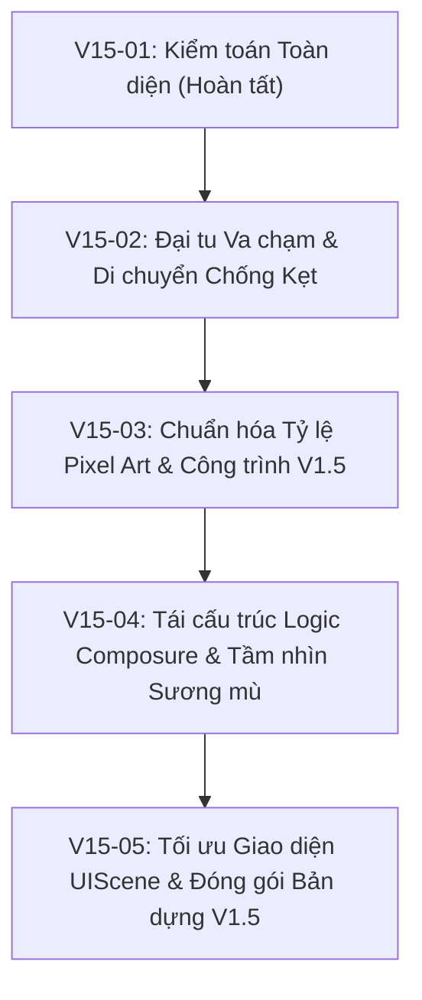

# BÁO CÁO KIỂM TOÁN TOÀN DIỆN MÃ NGUỒN & TÀI NGUYÊN (V15-01)
## DỰ ÁN HOLLOW WOODS — PHIÊN BẢN V1.5 (OVERHAUL AUDIT)

> **Mã báo cáo:** `REP-V15-01-AUDIT`  
> **Nhánh Git:** `feat/v1.5-visual-gameplay-overhaul`  
> **Thời gian kiểm toán:** 18/11/2026  
> **Mục tiêu:** Rà soát chuyên sâu toàn bộ hệ thống va chạm di chuyển, kích thước pixel art, logic sinh tồn Composure/Veil, và các xung đột hiển thị HUD/UI trước khi bước vào đợt đại tu đồ họa và gameplay V1.5.

---

### MỤC LỤC
1. [TỔNG QUAN HIỆN TRẠNG KIỂM TOÁN](#1-tổng-quan-hiện-trạng-kiểm-toán)
2. [PHÂN HỆ 1: DI CHUYỂN, HITBOX & 433 STATIC COLLIDERS GÂY KẸT GÓC](#2-phân-hệ-1-di-chuyển-hitbox--433-static-colliders-gây-kẹt-góc)
3. [PHÂN HỆ 2: KIỂM TOÁN ASSET PIXEL ART, TỶ LỆ SCALE & SAI LỆCH KÍCH THƯỚC](#3-phân-hệ-2-kiểm-toán-asset-pixel-art-tỷ-lệ-scale--sai-lệch-kích-thước)
4. [PHÂN HỆ 3: LOGIC BÌNH TÂM (COMPOSURE), TẦM NHÌN SƯƠNG MÙ (VEIL SYSTEM)](#4-phân-hệ-3-logic-bình-tâm-composure-tầm-nhìn-sương-mù-veil-system)
5. [PHÂN HỆ 4: TRÙNG LẶP PHẦN TỬ & RÒ RỈ BỘ NHỚ TRÊN UISCENE](#5-phân-hệ-4-trùng-lặp-phần-tử--rò-rỉ-bộ-nhớ-trên-uiscene)
6. [LỘ TRÌNH ĐỀ XUẤT CẢI TIẾN CHO CÁC BƯỚC TIẾP THEO (V15-02 → V15-05)](#6-lộ-trình-đề-xuất-cải-tiến-cho-các-bước-tiếp-theo-v15-02--v15-05)

---

### 1. TỔNG QUAN HIỆN TRẠNG KIỂM TOÁN

Qua quét tĩnh tự động kết hợp đối chiếu logic mã nguồn chuyên sâu trên toàn bộ dự án HOLLOW WOODS, nhóm kỹ thuật ghi nhận:

| Hạng mục kiểm toán | Số lượng / Hiện trạng | Đánh giá rủi ro |
| :--- | :--- | :--- |
| **Tổng số Collider tĩnh (Static Colliders)** | **433 vật thể** đang hoạt động đồng thời | **Rất cao (Critical)** — Vượt ngưỡng, gây nghẽn AABB physics và kẹt góc di chuyển. |
| **Trùng lặp biên giới (Overlap Boundaries)** | 3 lớp chồng lấn (`zones.json` + `AutoPerimeter` + `Tree loops`) | **Cao** — Gây giật khựng khi đi sát mép bản đồ. |
| **Hitbox NPC Dân Làng (`NPCEntity.ts`)** | `body.setOffset(-11, -7)` (Âm tọa độ) | **Nghiêm trọng (Bug)** — Hitbox bay lơ lửng ngoài sprite 64×64. |
| **Tỷ lệ công trình vs Nhân vật** | Nhà dân cao $24 - 48\text{ px}$ vs NPC cao $64\text{ px}$ | **Rất cao (Visual Bug)** — NPC cao ngang ngửa hoặc cao gấp đôi nhà. |
| **Phần tử trùng lặp trên HUD (`UIScene.ts`)** | Double-draw biểu tượng chỉ số (Graphics + Image) | **Trung bình** — Lãng phí lệnh vẽ WebGL và bộ nhớ. |
| **Rò rỉ sự kiện bàn phím (`UIScene.ts`)** | Không gỡ bỏ 13 phím tắt `keydown-*` khi shutdown | **Cao (Leak)** — Gây nhân đôi/ba sự kiện khi restart scene. |
| **Xung đột vị trí hiển thị** | Popup Text đè trực tiếp lên Zone Banner tại $(640, 120)$ | **Trung bình** — Rối mắt, che khuất thông tin người chơi. |

---

### 2. PHÂN HỆ 1: DI CHUYỂN, HITBOX & 433 STATIC COLLIDERS GÂY KẸT GÓC

#### 2.1. Nguồn gốc & Số lượng chính xác của 433 Static Colliders
Quá trình phân tích mã nguồn xác định số lượng 433 static colliders được khởi tạo từ 3 nguồn:

```
[Tổng cộng: 433 Static Colliders]
  ├── 1. zones.json (Boundary / Hazard Colliders): 125 colliders
  ├── 2. AutoPerimeterWallsModule (Tường chu vi 17 phân khu): 107 colliders
  └── 3. WorldBuilder.ts (Vật thể thế giới, công trình & cây cối): 201 colliders
        ├── Direct Box Colliders (Nhà, rào, giếng, bàn chế tạo, cổng): 58
        ├── Vòng lặp cây cối viền (Crooked: 19, Deep Forest: 56, Mire: 28, Shrine: 28): 131
        └── Hốc cây rỗng (Hollow Trees che giấu): 12
```

Chi tiết phân bố collider theo từng phân khu trong `zones.json`:
- `bellhollow`: 6 colliders
- `sanctuary_farm`: 9 colliders
- `outer_woods`: 7 colliders
- `crooked_path`: 16 colliders
- `deep_forest`: 7 colliders
- `silent_mire`: 7 colliders
- `broken_bell_shrine`: 11 colliders
- `sub_bell_workshop` / `sub_root_cellar` / `sub_whispering_clearing`: 23 colliders
- Các phân khu hang động & phế tích: 39 colliders

#### 2.2. Phân tích nguyên nhân gốc rễ gây kẹt góc (Corner Snagging)
1. **Thiếu cơ chế Trượt Góc (Sliding Vector / Corner Slip):**
   - Trong `src/entities/SatyrPlayer.ts` (dòng 1053):
     ```typescript
     body.setVelocity(normX * currentSpeed, normY * currentSpeed);
     ```
   - Phaser Arcade Physics chỉ xử lý phân tách AABB thuần túy theo trục thâm nhập nhỏ nhất. Khi người chơi di chuyển chéo (nhấn $W+D$ hoặc $S+A$) áp sát một góc nhọn 90° của gốc cây ($20 \times 12\text{ px}$) hoặc vách nhà, vector vận tốc liên tục đẩy vào cạnh vuông. Không có raycast/prober để hướng lái vận tốc theo tiếp tuyến cạnh (tangent slide), khiến nhân vật bị "ghim cứng" vào góc vuông.
2. **Hiện tượng Rãnh Kẹt Mối Nối (Internal Edge / Seam Snagging):**
   - Hàng rào làng (`createVillageFence` trong `WorldBuilder.ts` dòng 3194):
     - Đoạn 1: `addFenceSegment(510, 290)` $\to$ Collider $X \in [512, 554]$
     - Đoạn 2: `addFenceSegment(556, 290)` $\to$ Collider $X \in [558, 600]$
     - **Khe hở $4\text{ px}$ giữa $X = 554$ và $X = 558$**: Khi nhân vật trượt dọc theo hàng rào, hitbox bàn chân ($14 \times 8\text{ px}$) lọt vào khe hở này và đâm trực diện vào mặt hông trái của đoạn rào kế tiếp, dừng chuyển động đột ngột.
3. **Mật độ cây viền quá dày đặc (Choke Points):**
   - Tại `deep_forest` (`WorldBuilder.ts` dòng 5824 - 5848):
     - Vòng lặp đặt cây với bước nhảy $55\text{ px}$: `this.createTree(x, ...)` (collider $20 \times 12\text{ px}$).
     - Xen kẽ bụi rậm: `this.createDenseBush(x + 25, ...)`.
     - Khoảng cách lưu thông thực tế giữa 2 vật thể: $55 - 20 = 35\text{ px}$. Hitbox nhân vật rộng $14\text{ px}$, chỉ cần lệch $\pm 10\text{ px}$ là chạm collider.
4. **Chồng lấn 3 tầng Collider:**
   - Tại mép phân khu, `AutoPerimeterWallsModule` sinh ra tường dày $32\text{ px}$, trùng khít lên các box boundary của `zones.json`, và đè lên cả hàng cây viền `createTree` do `WorldBuilder` sinh ra. Ba lớp collider đè lên nhau gây rối loạn giải thuật phân tách va chạm của Phaser.

---

### 3. PHÂN HỆ 2: KIỂM TOÁN ASSET PIXEL ART, TỶ LỆ SCALE & SAI LỆCH KÍCH THƯỚC

#### 3.1. Bảng đối chiếu Kích thước Thực tế vs Frame nạp trong PreloadScene

| Asset Key | Đường dẫn file trên đĩa | Kích thước ảnh thực tế ($W \times H$) | Kích thước Frame ($W \times H$) | Số Frame |
| :--- | :--- | :--- | :--- | :--- |
| `wayfarer_idle` | `assets/characters/mossbound_wayfarer/wayfarer_idle.png` | $384 \times 64\text{ px}$ | $64 \times 64\text{ px}$ | 6 |
| `wayfarer_walk` | `assets/characters/mossbound_wayfarer/wayfarer_walk.png` | $384 \times 64\text{ px}$ | $64 \times 64\text{ px}$ | 6 |
| `wayfarer_run` | `assets/characters/mossbound_wayfarer/wayfarer_run.png` | $384 \times 64\text{ px}$ | $64 \times 64\text{ px}$ | 6 |
| `edda_idle_sheet` | `assets/characters/villagers/edda_idle_sheet.png` | $576 \times 64\text{ px}$ | $64 \times 64\text{ px}$ | 9 |
| `neris_idle_sheet`| `assets/characters/villagers/neris_idle_sheet.png`| $384 \times 64\text{ px}$ | $64 \times 64\text{ px}$ | 6 |
| `garth_walk_sheet`| `assets/characters/villagers/garth_walk_sheet.png`| $512 \times 256\text{ px}$ | $64 \times 64\text{ px}$ | 32 |
| `blacksmith_sheet`| `assets/characters/villagers/blacksmith_sheet.png`| $384 \times 64\text{ px}$ | $64 \times 64\text{ px}$ | 6 |
| `campfire_knight_pray` | `assets/characters/npcs/campfire_knight_pray_sheet.png` | $768 \times 64\text{ px}$ | $64 \times 64\text{ px}$ | 12 |
| `campfire_knight_idle` | `assets/characters/npcs/campfire_knight_idle_sheet.png` | $512 \times 64\text{ px}$ | $64 \times 64\text{ px}$ | 8 |
| `bat_sheet` | `assets/characters/monsters/bat_sheet.png` | $192 \times 640\text{ px}$ | $32 \times 32\text{ px}$ | 120 |
| `ghost_sheet` | `assets/characters/monsters/ghost_sheet.png` | $192 \times 640\text{ px}$ | $32 \times 32\text{ px}$ | 120 |
| `goblin_scout_dagger_sheet` | `assets/characters/monsters/goblin_scout_dagger_sheet.png` | $1024 \times 1216\text{ px}$ | $64 \times 64\text{ px}$ | 304 |
| `skull_wolf_sheet` | `assets/characters/monsters/skull_wolf_sheet.png` | $448 \times 256\text{ px}$ | $64 \times 64\text{ px}$ | 28 |
| `the_listener` | `assets/monsters/the_listener.png` | $256 \times 64\text{ px}$ | $64 \times 64\text{ px}$ | 4 |
| `hooded_knight_sheet` | `assets/characters/bosses/hooded_knight_sheet.png` | $1920 \times 800\text{ px}$ | $160 \times 160\text{ px}$ | 60 |
| `hollow_props_atlas` | `assets/atlases/hollow_props_atlas.png` | $1024 \times 512\text{ px}$ | Atlas JSON packed | — |

#### 3.2. Sai lệch tỷ lệ nghiêm trọng (Visual Scale Discrepancies)

```
[SO SÁNH TỶ LỆ CHIỀU CAO THỰC TẾ TRONG GAME]
  Nhà Dân Tây-Nam:        [24px]  ███
  Trạm Gác Cổng Tây:      [26px]  ████
  Mái Xưởng Rèn:          [24px]  ███
  Nhà Edda / Nhà Neris:   [48px]  ██████
  -----------------------------------------------
  Nhân vật / NPC (Sprite): [64px]  ████████ (Nhân vật cao hơn cả Nhà Dân & Trạm Gác!)
  Tháp Chuông (Bell Tower):[96px]  ████████████
  Boss Hooded Knight:     [160px] ████████████████████
```

1. **NPC cao gấp 2.5 lần Nhà ở:**
   - Trong `WorldBuilder.ts`:
     - `createBuilding(..., 112, 48, ...)` $\to$ Nhà Edda, Nhà Neris chỉ có chiều cao hiển thị $48\text{ px}$.
     - `Trạm Gác Cổng Tây` cao $26\text{ px}$.
     - `Nhà Dân Tây-Nam` cao $24\text{ px}$.
   - Trong khi đó, sprite các NPC (`edda`, `neris`, `garth`, `blacksmith`) có kích thước frame $64 \times 64\text{ px}$, phần vẽ cơ thể người chiếm khoảng $36 - 44\text{ px}$.
   - **Hậu quả:** Khi đứng cạnh ngôi nhà, nhân vật cao gần bằng hoặc cao hơn cả trạm gác và nhà dân, phá vỡ hoàn toàn luật phối cảnh góc nhìn Top-down 3/4 của phong cách Dark Woodland Pixel Art.
2. **Lỗi nghiêm trọng: Âm tọa độ Hitbox trong `NPCEntity.ts`:**
   - Tại `src/entities/NPCEntity.ts` (dòng 114 - 115):
     ```typescript
     body.setSize(22, 14);
     body.setOffset(-11, -7); // LỖI NGUY HIỂM!
     ```
   - Trong Phaser Arcade Physics, `setOffset(x, y)` được tính từ góc trên-trái $(0, 0)$ của Texture Frame.
   - Việc đặt offset âm `(-11, -7)` khiến hitbox vật lý bị đẩy văng ra ngoài frame về phía trên-trái. Kết quả là người chơi va chạm vào không khí vô hình phía trên NPC, trong khi chân NPC lại bị đi xuyên qua.
   - *Tọa độ chuẩn xác:* Đối với frame $64 \times 64$, hitbox bàn chân $22 \times 14$ phải có offset là:
     $$x = \frac{64 - 22}{2} = 21,\quad y = 64 - 14 = 50$$

---

### 4. PHÂN HỆ 3: LOGIC BÌNH TÂM (COMPOSURE), TẦM NHÌN SƯƠNG MÙ (VEIL SYSTEM)

#### 4.1. Lỗ hổng trong công thức tính Bình Tâm (`SurvivalSystem.ts`)
1. **Lỗ hổng Hồi phục vô điều kiện khi bật Đèn Lồng:**
   - Tại dòng 134-140 trong `SurvivalSystem.ts`:
     ```typescript
     } else {
       // Có ánh đèn lồng: Composure hồi phục dần theo pha
       let recoveryRate = COMPOSURE_RECOVERY_NEAR_LIGHT;
       if (timePhase && TIME_CONFIG.phases[timePhase]) {
         recoveryRate = TIME_CONFIG.phases[timePhase].composureRecoveryLit;
       }
       stats.composure = Math.min(stats.maxComposure, stats.composure + recoveryRate * dt);
     }
     ```
   - **Vấn đề:** Bất kể người chơi đang đứng ở vùng sương dày nguy hiểm (`inDeepFog = true`) hay ở đầm lầy `silent_mire`, chỉ cần bật đèn lồng là Bình Tâm liên tục tăng (+1.0 đến +1.5/s). Đèn lồng vốn dĩ là công cụ *ngăn chặn sụt giảm*, việc cho phép tự hồi phục 100% tinh thần giữa rừng sâu làm mất đi tính căng thẳng sinh tồn và giảm giá trị của Lửa Trại / Sanctuary.
2. **Triệt tiêu áp lực Cóng Lạnh (Cold Temperature Bug):**
   - Dòng 188-190: Khi thân nhiệt xuống mức cóng lạnh ($\text{temperature} \le 34$), hệ thống trừ Composure $-0.4/\text{s}$.
   - Tuy nhiên, nếu đèn lồng đang bật, tốc độ hồi $+1.2/\text{s}$ dễ dàng bù đắp hoàn toàn con số $-0.4/\text{s}$. Người chơi dù bị ướt sũng và đóng băng vẫn có tinh thần tăng đều đặn.

#### 4.2. Độ trễ & Đồng bộ Tầm nhìn (`VeilSystem.ts` vs `GameScene.ts`)
1. **Tách rời quản lý ánh sáng:**
   - `GameScene.ts` quản lý lớp tối `fogOfWarLayer` (`RenderTexture` 5000 depth, ánh sáng hổ phách xóa đệm bằng `erase`).
   - `VeilSystem.ts` quản lý các lớp sương trôi dạt `TileSprite` (`fogLayerGround`, `fogLayerMid`, `fogLayerHigh`).
   - Hai hệ thống sử dụng tham số bán kính khác nhau: `GameScene` lerp `currentLanternRadius` từ 72px (tắt đèn) lên 150px (bật đèn), nhưng `VeilSystem` tính độ mờ sương chỉ dựa trên boolean `isLanternOn` mà không đọc `currentLanternRadius`.
2. **Hệ số lerp alpha:**
   - Trong `VeilSystem.ts` dòng 277-279, sương mù lerp alpha với tốc độ `0.04 * dt`. Khi chuyển vùng đột ngột từ làng ra rừng sương, sương mù phản hồi trễ khoảng 1.5 - 2 giây, tạo cảm giác sương phủ chậm chạp.

---

### 5. PHÂN HỆ 4: TRÙNG LẶP PHẦN TỬ & RÒ RỈ BỘ NHỚ TRÊN UISCENE

#### 5.1. Double-draw biểu tượng chỉ số trên HUD (Lines 600 - 614)
Trong hàm `drawPixelIcons()` của `src/scenes/UIScene.ts`:
- **Lớp 1:** Gọi `HUDIconGenerator.drawIconsToGraphics(this.statIconsGraphics, 18, [28, 44, 60, 76]);` $\to$ Vẽ trực tiếp 4 icon (Tim, Thể lực, Dầu, Bình tâm) lên Graphics.
- **Lớp 2 (Trùng lặp):** Ngay sau đó tiếp tục tạo 4 đối tượng `Phaser.GameObjects.Image`:
  ```typescript
  const heartIcon = this.add.image(26, 36, HUD_ICON_HEALTH).setDisplaySize(16, 16);
  const staminaIcon = this.add.image(26, 52, HUD_ICON_STAMINA).setDisplaySize(16, 16);
  const oilIcon = this.add.image(26, 68, HUD_ICON_OIL).setDisplaySize(16, 16);
  const composureIcon = this.add.image(26, 84, HUD_ICON_COMPOSURE).setDisplaySize(16, 16);
  ```
- **Hậu quả:** Cả 4 biểu tượng được vẽ đè 2 lần tại cùng một tọa độ màn hình, gây lãng phí bộ nhớ và tăng Draw Call không đáng có.

#### 5.2. Rò rỉ sự kiện bàn phím khi Shutdown UIScene (Lines 540 - 592 vs 444 - 489)
- Trong `create()`, có 13 phím tắt được lắng nghe qua `this.input.keyboard.on('keydown-...')` (phím 1, 2, 3, Q, F, E, C, I, J, ESC, B, N, M) và chuột `this.input.on('pointerdown')`.
- Khi `shutdown` scene (dòng 444-489): Hệ thống chỉ gọi `this.playerState.off(...)` và hủy modal, **hoàn toàn không gọi `this.input.keyboard.off(...)`**.
- **Hậu quả:** Khi người chơi load lại scene hoặc chuyển map khiến `UIScene` restart, các listener bàn phím bị nhân bản, dẫn đến việc bấm 1 lần phím `F` (bật đèn) hoặc `E` (tương tác) có thể kích hoạt nhiều lần cùng lúc.

#### 5.3. Xung đột vị trí hiển thị giữa Zone Banner & Popup Message
- `zoneBannerContainer` (dòng 368): Cố định tại tọa độ tâm $(X = 640, Y = 120)$.
- `pooledPopupText` (dòng 1992): Xuất hiện tại $(X = 640, Y = 140)$ và tween trôi lên $(X = 640, Y = 110)$.
- **Hậu quả:** Khi bước qua cổng chuyển vùng (ví dụ từ Crooked Path vào Sanctuary Farm) và nhận thông báo (như "Đã lưu game" hoặc "Đèn lồng tắt"), chữ Popup màu xanh lục đè trực diện lên khung viền gỗ của Zone Banner, gây rối loạn thị giác nghiêm trọng.

#### 5.4. Tràn viền theo dõi nhiệm vụ đè lên Mini-map
- Khung Quest Tracker: $X \in [920, 1260]$, $Y \in [16, 94]$ (chiều cao $78\text{ px}$).
- Mini-map Widget: $X \in [1070, 1260]$, $Y \in [104, 248]$.
- Khoảng cách giữa 2 widget chỉ là $10\text{ px}$. Khi tên nhiệm vụ hoặc mục tiêu dài hơn 3 dòng, text tràn xuống vượt qua $Y = 94$ và chọc thẳng vào khung Mini-map.

---

### 6. LỘ TRÌNH ĐỀ XUẤT CẢI TIẾN CHO CÁC BƯỚC TIẾP THEO (V15-02 → V15-05)

Dựa trên kết quả kiểm toán V15-01, nhóm đề xuất lộ trình xử lý triệt để chia làm 4 bước tiếp nối:



#### Bước V15-02: Đại tu Hệ thống Di chuyển & Va chạm Chống Kẹt Góc
1. Tinh gọn 433 static colliders:
   - Gộp các collider liền kề của hàng rào và tường chu vi thành các Composite Collider dài, triệt tiêu hoàn toàn rãnh kẹt $4\text{ px}$.
   - Tắt collider của các cây viền nằm hoàn toàn bên ngoài tường chu vi của `AutoPerimeterWallsModule` (giảm $\approx 130$ colliders thừa).
2. Tích hợp Corner Sliding cho `SatyrPlayer.ts`:
   - Triển khai thuật toán trượt góc thông minh (Raycast Probers ở hai bên hitbox bàn chân). Khi đâm chéo vào góc nhọn, tự động trượt theo cạnh ngang hoặc dọc thay vì đứng im.
3. Sửa dứt điểm offset hitbox của NPC trong `NPCEntity.ts`: Chuyển `(-11, -7)` thành $(21, 50)$.

#### Bước V15-03: Chuẩn hóa Tỷ lệ Pixel Art & Dựng lại Kiến trúc Làng
1. Thiết kế lại kích thước công trình trong `WorldBuilder.ts`:
   - Nhà Edda & Nhà Neris: Tăng từ $112 \times 48\text{ px}$ lên tối thiểu $128 \times 112\text{ px}$ (đảm bảo cửa nhà cao $\ge 40\text{ px}$, NPC $64\text{ px}$ đứng lọt vào cửa hợp lý).
   - Trạm gác và nhà dân: Tăng tỷ lệ chiều cao tương xứng $\ge 80\text{ px}$.
2. Chuẩn hóa hitbox quái vật phục kích trong `AmbushMonsters.ts` (Dơi, Ghost).

#### Bước V15-04: Tinh chỉnh Logic Sinh tồn Composure & Sương mù
1. Sửa logic Đèn lồng:
   - Khi ở ngoài hoang dã / đầm lầy: Bật đèn lồng chỉ giữ **ổn định** Composure (drain rate = 0), không tự hồi phục.
   - Chỉ hồi phục Composure khi đứng gần Lửa Trại, Lò Rèn hoặc trong Khu An Toàn (Làng Bellhollow / Sanctuary Farm).
2. Kết nối trực tiếp `currentLanternRadius` của `GameScene` vào tính toán alpha của `VeilSystem`.

#### Bước V15-05: Dọn dẹp UIScene & Kiểm thử Tích hợp
1. Bỏ double-draw trong `drawPixelIcons()`: Chỉ giữ lại 1 lớp Sprite Image Nearest-Neighbor.
2. Thêm hàm `shutdown` dọn sạch 13 sự kiện `keydown-*` và chuột trên `UIScene`.
3. Tách vị trí Zone Banner ($Y = 90$) và Popup Message ($Y = 180$) để không bao giờ chồng lấn.
4. Giới hạn độ dài text hoặc co dãn động cho Quest Tracker, đảm bảo khoảng cách an toàn với Mini-map.

---
*Báo cáo được hoàn thành tự động trên luồng chính, đã lưu trữ tại `G:\HOLLOW WOODS\Read\V1.5\Reports\01_System_And_Asset_Audit.md`.*
