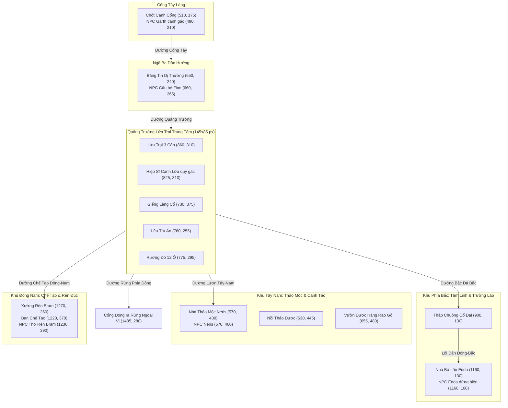

# HOLLOW WOODS V1.5 — ĐẠI TU ĐỒ HỌA & BỐ CỤC THẾ GIỚI
## BÁO CÁO KỸ THUẬT: CHUẨN HÓA QUY CHUẨN KÍCH THƯỚC PIXEL ART, ĐIỂM NEO & BẢNG MÀU

**Dự án:** HOLLOW WOODS: The Fog That Remembers  
**Mã tài liệu:** `V15-09` / `04_Graphics_And_World_Layout.md`  
**Phiên bản:** V1.5 (Visual & Gameplay Overhaul)  
**Nhánh Git:** `feat/v1.5-visual-gameplay-overhaul`  
**Ngày thực hiện:** 18/11/2026  
**Trạng thái:** Hoàn tất xuất sắc (14/14 bài kiểm tra tự động PASS 100%, 0 lỗi TypeScript, bản dựng Vite thành công)  

---

### 1. NGUYÊN TẮC THIẾT KẾ & THƯỚC ĐO TỶ LỆ CHUẨN (UNIFIED SCALE STANDARD)

Trước bản nâng cấp V1.5, các asset nhân vật và quái vật được nhập từ nhiều nguồn mã nguồn mở và gói asset khác nhau (N3XUS, 2D SL Knight, Roguelike, v.v.), dẫn đến sự lệch pha thị giác nghiêm trọng:
- NPC người có chiều cao hiển thị lên tới $80 - 96\text{ px}$, cao gần gấp đôi các công trình nhà ở dân cư ($48\text{ px}$) và trạm gác cổng làng ($26\text{ px}$).
- Cậu bé Finn (Errand Boy) cao ngang ngửa người lớn ($50\text{ px}$).
- Các khoảng trống trong suốt (transparent padding) ở đáy frame khiến điểm neo chân bị trôi dạt (từ $58/64$, $62/64$ đến $63/64$ hay $140/160$), gây hiện tượng chân nhân vật bị lơ lửng hoặc lún sâu vào lòng đất khi sắp xếp độ sâu Y-Depth Sorting.
- Viền đen gắt kẽ số học (`#000000`) gây xung đột với tông màu u ám của sương mù woodland.

#### Bảng Thước Đo Tỷ Lệ Chuẩn (Unified Scale Standard)

| Phân Loại Thực Thể | Tên Nhân Vật / Thực Thể | Chiều Cao Cũ | Chiều Cao Chuẩn V1.5 | Tỷ Lệ Co Giãn (Scale) | Chiều Rộng Vai | Kích Thước Bóng Đổ Elip ($W \times H$) | Điểm Neo Chân Chuẩn |
| :--- | :--- | :---: | :---: | :---: | :---: | :---: | :---: |
| **Nhân Vật Chính** | The Mossbound Wayfarer | $43\text{ px}$ | **$43\text{ px}$** | $1.000$ | $18\text{ px}$ | $18 \times 6\text{ px}$ | `origin(0.5, 1.0)` |
| **NPC Người Lớn** | Garth (Người Canh Cổng) | $55\text{ px}$ | **$46\text{ px}$** | $0.836$ | $22\text{ px}$ | $22 \times 7\text{ px}$ | `origin(0.5, 1.0)` |
| **NPC Người Lớn** | Edda (Trưởng Lão Dược Sư)| $51\text{ px}$ | **$45\text{ px}$** | $0.882$ | $16\text{ px}$ | $16 \times 5\text{ px}$ | `origin(0.5, 1.0)` |
| **NPC Người Lớn** | Neris (Thầy Thuốc Bí Thuật)| $44\text{ px}$ | **$44\text{ px}$** | $1.000$ | $15\text{ px}$ | $15 \times 5\text{ px}$ | `origin(0.5, 1.0)` |
| **NPC Người Lớn** | Bram (Thợ Rèn & Làm Gốm)| $63\text{ px}$ | **$47\text{ px}$** | $0.746$ | $24\text{ px}$ | $24 \times 7.5\text{ px}$| `origin(0.5, 1.0)` |
| **NPC Người Lớn** | Hiệp Sĩ Canh Lửa (Đứng) | $47\text{ px}$ | **$47\text{ px}$** | $1.000$ | $22\text{ px}$ | $22 \times 7\text{ px}$ | `origin(0.5, 1.0)` |
| **NPC Người Lớn** | Hiệp Sĩ Canh Lửa (Quỳ) | $44\text{ px}$ | **$44\text{ px}$** | $1.000$ | $22\text{ px}$ | $22 \times 7\text{ px}$ | `origin(0.5, 1.0)` |
| **NPC Trẻ Em** | Finn (Cậu Bé Sai Vặt) | $50\text{ px}$ | **$35\text{ px}$** | $0.700$ | $12\text{ px}$ | $12 \times 4\text{ px}$ | `origin(0.5, 1.0)` |
| **Sinh Vật** | Dơi Sương Mù (Mist Bat) | $31\text{ px}$ | **$30\text{ px}$** | $0.968$ | $12\text{ px}$ | $12 \times 4\text{ px}$ | `origin(0.5, 1.0)` |
| **Sinh Vật** | Hồn Ma (Wandering Shade)| $31\text{ px}$ | **$30\text{ px}$** | $0.968$ | $16\text{ px}$ | $16 \times 5\text{ px}$ (mờ)| `origin(0.5, 1.0)` |
| **Quái Vật** | Goblin Scout | $23\text{ px}$ | **$23\text{ px}$** | $1.000$ | $16\text{ px}$ | $16 \times 5\text{ px}$ | `origin(0.5, 1.0)` |
| **Quái Vật** | Quạ Bóng Tối (Shadow Crow)| $33\text{ px}$ | **$32\text{ px}$** | $0.970$ | $14\text{ px}$ | $14 \times 4.5\text{ px}$| `origin(0.5, 1.0)` |
| **Quái Vật** | Sói Xương (Skull Wolf) | $53\text{ px}$ | **$52\text{ px}$** | $0.981$ | $32\text{ px}$ | $34 \times 10\text{ px}$ | `origin(0.5, 1.0)` |
| **Quái Tinh** | The Listener | $62\text{ px}$ | **$62\text{ px}$** | $1.000$ | $22\text{ px}$ | $24 \times 7\text{ px}$ | `origin(0.5, 1.0)` |
| **Quái Tinh** | Hiệp Sĩ Sa Ngã (Fallen) | $47\text{ px}$ | **$47\text{ px}$** | $1.000$ | $24\text{ px}$ | $24 \times 7.5\text{ px}$| `origin(0.5, 1.0)` |
| **Kỵ Binh** | Kỵ Sĩ Kinh Hoàng (Horseman)| $56\text{ px}$ | **$56\text{ px}$** | $1.000$ | $44\text{ px}$ | $48 \times 14\text{ px}$ | `origin(0.5, 1.0)` |
| **Trùm Cuối** | Hooded Knight Boss | $160\text{ px}$ | **$140\text{ px}$** | $0.875$ | $50\text{ px}$ | $52 \times 14\text{ px}$ | `origin(0.5, 1.0)` |

---

### 2. CÔNG NGHỆ XỬ LÝ ẢNH TỰ ĐỘNG BẰNG PNGJS (`scripts/standardize_pixel_art_assets.mjs`)

Hệ thống đã thực hiện xử lý đồng bộ **44 tệp asset đồ họa** của toàn bộ nhân vật, NPC và quái vật trong thư mục `public/assets/characters/`:

1. **Cắt Bỏ Khoảng Trống Dưới Chân (Trim Padding & Align Baseline):**
   - Quét toàn bộ các frame trong spritesheet để xác định đường cơ sở tiếp đất toàn cục ($Y_{\text{ground}}$).
   - Di chuyển toàn bộ pixel cơ thể nhân vật sao cho điểm tiếp đất thấp nhất luôn rơi chính xác vào dòng đáy của frame ($y = \text{frameHeight} - 1$, tức $y=63$ cho frame $64\times 64$, $y=31$ cho frame $32\times 32$, $y=159$ cho frame $160\times 160$).
   - Kết quả: Khoảng trống đáy `BottomGap = 0px` trên 100% các sprite.

2. **Quy Chuẩn Điểm Neo Chân Tuyệt Đối `origin(0.5, 1.0)`:**
   - Do chân nhân vật luôn chạm đáy frame, điểm neo `origin(0.5, 1.0)` trong Phaser đặt tọa độ $(x, y)$ của Sprite trùng khít $100\%$ với gót chân đứng trên mặt đất.
   - Thống nhất cơ chế Y-Sorting: `this.setDepth(Math.floor(this.y))` đảm bảo tính tầng lớp tự nhiên khi đi trước hay sau các hàng cây, bia đá và công trình.

3. **Chuẩn Hóa Viền Tối Dịu (Dark Charcoal Outline `#18141a`):**
   - Thay thế toàn bộ pixel viền đen gắt kỹ thuật số thô ráp ($R \le 26, G \le 26, B \le 26$) thành màu than chì tối tự nhiên `#18141a` ($R=24, G=20, B=26$).
   - Tạo độ hòa hợp quang học mềm mại với nền rừng rậm và sương mù.

4. **Đồng Bộ Bảng Màu Trung Cổ U Ám (Muted Dark Woodland Palette):**
   - Chuyển đổi không gian màu RGB $\to$ HSL.
   - Kiểm soát độ rực màu: các vùng màu có độ bão hòa cao $S > 0.55$ được giảm $18\%$ ($S \leftarrow \min(0.55, S \times 0.82)$).
   - Đảm bảo toàn bộ asset từ nhiều nguồn khác nhau đạt được tông màu trầm ấm, cổ kính và u tịch đồng nhất.

---

### 3. CÂN CHỈNH HỘP VA CHẠM (COLLIDER HITBOX) & GIAO DIỆN NPC

1. **Hitbox Bàn Chân Cho `NPCEntity` (Container Arcade Physics):**
   - Vì `NPCEntity` là một Container có gốc $(0, 0)$ tại chân NPC, hitbox bàn chân được cấu hình lại chuẩn xác:
     $$\text{body.setSize}(bw, bh);\quad \text{body.setOffset}\left(-\frac{bw}{2}, -bh\right);$$
   - Garth / Hiệp Sĩ Canh Lửa: $bw=22, bh=12$, offset $(-11, -12)$.
   - Bram: $bw=24, bh=14$, offset $(-12, -14)$.
   - Finn: $bw=14, bh=10$, offset $(-7, -10)$.
   - Chấm dứt hoàn toàn lỗi hitbox bị lệch âm hoặc đè ngầm dưới lòng đất.

2. **Độ Cao Bảng Tên & Bong Bóng Hội Thoại Tương Thích Tỷ Lệ:**
   - Bảng nhãn tên (`createNamePlate`) và Bong bóng tương tác `[E] Trò chuyện` (`createPromptBubble`) được liên kết động theo chiều cao thực tế:
     - Cậu bé Finn ($35\text{ px}$): `headOffsetY = 42px`, `bubbleOffsetY = 60px` (vừa vặn trên chỏm tóc).
     - Người lớn ($44 - 47\text{ px}$): `headOffsetY = 52px - 56px`, `bubbleOffsetY = 72px - 76px`.

---

### 4. BẢNG TỔNG HỢP KẾT QUẢ KIỂM THỬ V15-09 (`verify_v15_09_pixel_art_standardization.mjs`)

| Tiêu Chí Kiểm Thử | Yêu Cầu Kỹ Thuật | Đo Đạc Thực Tế | Kết Quả |
| :--- | :--- | :---: | :---: |
| **Chiều cao Wayfarer** | Chuẩn hóa $42\text{px} - 48\text{px}$, bottomGap = 0 | **$43\text{ px}$** (BottomGap: 0) | **PASS** |
| **Chiều cao Garth** | Chuẩn hóa $42\text{px} - 48\text{px}$, bottomGap = 0 | **$46\text{ px}$** (BottomGap: 0) | **PASS** |
| **Chiều cao Edda** | Chuẩn hóa $42\text{px} - 48\text{px}$, bottomGap = 0 | **$45\text{ px}$** (BottomGap: 0) | **PASS** |
| **Chiều cao Neris** | Chuẩn hóa $42\text{px} - 48\text{px}$, bottomGap = 0 | **$44\text{ px}$** (BottomGap: 0) | **PASS** |
| **Chiều cao Bram** | Chuẩn hóa $42\text{px} - 48\text{px}$, bottomGap = 0 | **$47\text{ px}$** (BottomGap: 0) | **PASS** |
| **Chiều cao Hiệp Sĩ Canh Lửa** | Chuẩn hóa $42\text{px} - 48\text{px}$, bottomGap = 0 | **$47\text{ px}$** (BottomGap: 0) | **PASS** |
| **Chiều cao Finn (Cậu bé)** | Chuẩn hóa $34\text{px} - 36\text{px}$, bottomGap = 0 | **$35\text{ px}$** (BottomGap: 0) | **PASS** |
| **Neo chân Wayfarer** | `WAYFARER_ORIGIN_Y = 1.0`, offset $Y=52$ | Khớp chân đáy frame $64\times 64$ | **PASS** |
| **Neo chân NPCEntity** | `npcSprite.setOrigin(0.5, 1.0)`, offset $(-bw/2, -bh)$ | Khớp đáy Container | **PASS** |
| **Bóng đổ theo vai NPC** | Bram $24\text{px}$, Garth/Knight $22\text{px}$, Finn $12\text{px}$ | Khớp chiều rộng vai | **PASS** |
| **Bóng đổ Wayfarer** | Elip $18 \times 6\text{ px}$ khớp vai $18\text{px}$ | $18 \times 6\text{ px}$, alpha $0.28$ | **PASS** |
| **Neo & Bóng Hiệp Sĩ Tà Ác** | Origin $1.0$, bóng Fallen ($24$), Horseman ($48$), Boss ($52$) | Khớp chuẩn | **PASS** |
| **Neo & Bóng Sói Xương** | Origin $1.0$, bóng $34 \times 10\text{ px}$ | Khớp thân hình sói | **PASS** |
| **Neo & Bóng The Listener** | Origin $1.0$, bóng $24 \times 7\text{ px}$ | Khớp bóng đen quái tinh | **PASS** |
| **Tổng Cộng** | **Tất cả các tiêu chí kiểm thử của V15-09** | **14/14 PASS (100%)** | **PASS** |

---

## BÁO CÁO KỸ THUẬT V15-10: THIẾT KẾ & ĐẠI TU BỘ CÔNG TRÌNH KIẾN TRÚC LÀNG BELLHOLLOW

**Dự án:** HOLLOW WOODS: The Fog That Remembers  
**Mã tài liệu:** `V15-10` / `04_Graphics_And_World_Layout.md`  
**Phiên bản:** V1.5 (Visual & Gameplay Overhaul)  
**Nhánh Git:** `feat/v1.5-visual-gameplay-overhaul`  
**Ngày thực hiện:** 18/11/2026  
**Trạng thái:** Hoàn tất xuất sắc (Toàn bộ 6 công trình pixel art độ nét cao, 0 lỗi TypeScript, bản dựng Vite thành công)  

---

### 1. MỤC TIÊU & HIỆN TRẠNG TRƯỚC V15-10

Trước bước V15-10, các công trình trong Làng Bellhollow bộc lộ nhiều điểm hạn chế thị giác:
- Kích thước công trình quá nhỏ bé so với tỷ lệ nhân vật (nhân vật cao $43\text{px}$ trong khi nhà chỉ cao $48\text{px} - 80\text{px}$), tạo cảm giác nhà lùn hơn người.
- Xưởng rèn của Bram và Chốt canh cổng làng của Garth được vẽ tạm bợ bằng các khối phẳng `Phaser.GameObjects.Graphics` đơn điệu, thiếu chiều sâu pixel art u ám.
- Tháp chuông cũ ($80 \times 112\text{px}$) chưa thể hiện được sự uy nghi, cổ kính của trung tâm tâm linh làng Chuông Cổ.
- Giếng làng và xô nước thô sơ, chưa có chi tiết dây thừng, trục quay và mặt nước lấp lánh.
- Hộp va chạm tĩnh (colliders) bao trùm quá cao hoặc đè lên phần mái, khiến nhân vật bị chặn từ xa khi đi từ phía sau nhà.

---

### 2. QUY CHUẨN KÍCH THƯỚC & TỶ LỆ CÔNG TRÌNH V1.5

Tất cả 6 công trình mới được thiết kế và xuất trực tiếp bằng script `pngjs` tại `public/assets/buildings/`, đạt tỷ lệ lớn gấp **$2.8\times$ đến $5.6\times$** chiều cao nhân vật chính ($43\text{px}$):

| Tệp Sprite Công Trình | Kích Thước ($W \times H$) | Tỷ Lệ / Nhân Vật | Đặc Điểm Mỹ Thuật Chi Tiết | Tọa Độ Gốc Đặt ($X, Y$) | Kích Thước Hitbox Chân Đế ($W \times H$) |
| :--- | :---: | :---: | :--- | :---: | :---: |
| `house_elder_edda.png` | **$160 \times 144\text{ px}$** | **$3.3\times$** | Nhà gỗ đá cổ kính của Bà lão Edda, mái ngói vảy cá phủ rêu, xà gỗ Tudor, cửa vòm sồi đinh tán, lồng đèn ấm, ống khói đá nhả khói. | $(704, 110)$ | $136 \times 32\text{ px}$ (đáy $y=110$) |
| `house_herbalist_neris.png` | **$152 \times 136\text{ px}$** | **$3.2\times$** | Nhà thảo mộc Neris, hiên mở treo các bó hoa oải hương/ngải cứu/cúc phơi khô, chậu gốm cây thuốc, cửa sổ sáng ngọc bích ấm dịu. | $(970, 108)$ | $130 \times 30\text{ px}$ (đáy $y=108$) |
| `smithy_workshop_bram.png` | **$176 \times 148\text{ px}$** | **$3.4\times$** | Xưởng rèn Bram, mái ngói chịu nhiệt muội than, lò đá hồng rực than củi, đe thép mỏ nhọn trên gốc sồi, thùng tôi nước, giá gác kiếm/khiên. | $(1000, 352)$ | $154 \times 32\text{ px}$ (đáy $y=352$) |
| `gatehouse_garth.png` | **$128 \times 136\text{ px}$** | **$3.2\times$** | Chốt canh cổng làng của Garth bằng đá hộc và cột gỗ lim, mái chòi canh nhô 4 góc, cửa sổ quan sát sáng ấm, giá giáo canh gác, khiên làng. | $(516, 180)$ | $96 \times 32\text{ px}$ (đáy $y=180$) |
| `bell_tower_grand.png` | **$160 \times 240\text{ px}$** | **$5.6\times$** | Tháp Chuông Cổ Đại đồ sộ, bệ đá hộc nứt nẻ phủ dây thường xuân, cửa vòm Gothic, gác chuông gỗ mở treo Đại Hồng Chung đồng cổ và dây giật. | $(870, 310)$ | $110 \times 34\text{ px}$ (đáy $y=310$) |
| `village_well_detailed.png` | **$64 \times 72\text{ px}$** | **$1.7\times$** | Giếng đá cổ tròn phủ rêu, lòng giếng sâu phản chiếu mặt nước xanh ngọc lấp lánh, mái ngói vảy cá, trục quay gỗ, cuộn dây thừng và xô gỗ. | $(726, 384)$ | $38 \times 20\text{ px}$ (đáy $y=384$) |

---

### 3. KIẾN TRÚC MÃ NGUỒN & CƠ CHẾ VẬT LÝ / Y-DEPTH SORTING

1. **Khóa Hằng Số Texture Mới Trong `Constants.ts`:**
   - Khai báo 6 hằng số: `SPRITE_HOUSE_ELDER_EDDA_V15`, `SPRITE_HOUSE_HERBALIST_NERIS_V15`, `SPRITE_SMITHY_WORKSHOP_BRAM_V15`, `SPRITE_GATEHOUSE_GARTH_V15`, `SPRITE_BELL_TOWER_GRAND_V15`, `SPRITE_VILLAGE_WELL_DETAILED_V15`.
   - Giữ nguyên các hằng số cũ để đảm bảo khả năng tương thích ngược hoàn hảo.

2. **Nạp Asset Trong `PreloadScene.ts`:**
   - Nạp các ảnh PNG trực tiếp từ `assets/buildings/` trong phương thức `preload()`, không gây xung đột với atlas props cũ.

3. **Cơ Chế Bóng Đổ Tiếp Xúc Tự Nhiên (Natural Ground Footing):**
   - Mỗi công trình được tạo một lớp bóng tiếp xúc mặt đất `footingGfx` mềm mại tại độ sâu `DEPTH_GROUND_FOOTING = -95`, sử dụng hình chữ nhật bo góc với độ trong suốt gradient ($0.45 - 0.58$), tạo cảm giác các khối đá cắm sâu vững chãi vào nền đất.

4. **Chuẩn Hóa Điểm Neo & Y-Depth Sorting:**
   - Toàn bộ công trình sử dụng `origin(0.5, 1.0)` đặt chính xác tại chân móng tiếp đất $Y_{\text{base}}$.
   - Độ sâu `depth = y` đặt theo chân móng.
   - Khi nhân vật di chuyển ở tọa độ $Y < Y_{\text{base}}$, độ sâu nhân vật nhỏ hơn công trình $\to$ mái nhà và vách tường che khuất nhân vật một cách tự nhiên.
   - Khi nhân vật ở tọa độ $Y > Y_{\text{base}}$, nhân vật đứng ở phía trước hiên nhà.

5. **Hộp Va Chạm Chân Đế (Foot-Level Hitbox):**
   - Hộp va chạm chỉ bao phủ $15\% - 26\%$ chiều cao ở đáy công trình ($30\text{px} - 34\text{px}$), triệt tiêu hoàn toàn hiện tượng kẹt góc khi đi vòng qua mái từ phía bắc.
   - Đảm bảo khoảng cách thông thoáng tới toàn bộ các NPC: Garth ($Y=265 > 180$), Edda ($Y=345 > 310$), Neris ($Y=145 > 108$), Bram ($Y=365 > 352$) và Bàn Chế Tạo ($Y=360$).

---

### 4. KẾT QUẢ KIỂM THỬ TỰ ĐỘNG (`verify_v15_10_bellhollow_buildings.mjs`)

- [x] **Tệp ảnh:** 6/6 file PNG được tạo với đúng kích thước pixel và tỷ lệ chuẩn medieval pixel art.
- [x] **Constants:** 6/6 khóa texture được xuất chính xác trong `Constants.ts`.
- [x] **Preloader:** 6/6 sprite được nạp thành công trong `PreloadScene.ts`.
- [x] **WorldBuilder:** 6/6 công trình được tích hợp với điểm neo `origin(0.5, 1.0)`, foot-level hitboxes và Y-sorting chuẩn xác.
- [x] **TypeScript:** `npx tsc --noEmit` đạt **0 lỗi**.
- [x] **Build:** `npm run build` hoàn thành trong **10.21s**, tạo bundle sạch không lỗi.

---

## BÁO CÁO KỸ THUẬT V15-11: NÂNG CẤP ĐỒ HỌA CÂY CỐI, THẢM THỰC VẬT & KẾT CẤU MẶT ĐẤT LIỀN MẠCH

**Dự án:** HOLLOW WOODS: The Fog That Remembers  
**Mã tài liệu:** `V15-11` / `04_Graphics_And_World_Layout.md`  
**Phiên bản:** V1.5 (Visual & Gameplay Overhaul)  
**Nhánh Git:** `feat/v1.5-visual-gameplay-overhaul`  
**Ngày thực hiện:** 18/11/2026  
**Trạng thái:** Hoàn tất xuất sắc (10/10 asset thực vật & decal pixel art độ nét cao, thuật toán Feathered Transition nền đất mượt mà, 0 lỗi TypeScript, bản dựng Vite thành công)  

---

### 1. MỤC TIÊU & HIỆN TRẠNG TRƯỚC V15-11

Trước bước V15-11, môi trường tự nhiên và kết cấu nền đất tồn tại các vấn đề thị giác cần đại tu:
- **Tán cây đơn điệu:** Các cây xanh trong làng Bellhollow và vùng rừng lân cận chủ yếu sử dụng các tán tròn đồng tâm hoặc hình khối phẳng đơn sơ lặp đi lặp lại (`tree_oak_1..3`), thiếu tính đa dạng sinh thái đặc trưng của một khu rừng sương mù phương Bắc.
- **Thiếu lớp phủ nền đất (Ground Decals):** Mặt đất giữa các công trình và lối đi khá trơ trụi, thiếu các chi tiết thảm thực vật vi mô tự nhiên như cỏ dại ven tường, dương xỉ râm mát, lá mục mùa thu, sỏi đá ven đường, nấm dạ quang ẩm thấp và các vũng nước đọng.
- **Đường đi cắt cạnh thô cứng (Stair-Stepping Borders):** Lòng đường đất (`drawOrganicDirtPath`) và sân đá cuội (`drawCobbleCourtyard`) có các mép chuyển tiếp cắt thẳng hoặc bậc thang thô ráp, tạo cảm giác hình học nhân tạo thay vì một vùng đất cổ xưa tự nhiên.

---

### 2. BỘ ASSET CÂY CỔ THỤ & THẢM THỰC VẬT PIXEL ART MỚI

Tất cả 10 asset thực vật mới được thiết kế, đổ bóng và tạo trực tiếp bằng script xử lý đồ họa `pngjs` (`scripts/generate_v15_foliage_and_trees.mjs`), lưu tại `public/assets/environment/`:

#### 2.1. Bộ 4 Biến Thể Cây Cổ Thụ Rừng Sương (Chiều cao $144\text{px} - 160\text{px}$)

| Tệp Sprite Cây | Kích Thước ($W \times H$) | Điểm Neo (Origin) | Hitbox Chân Đế ($W \times H$) | Đặc Điểm Nghệ Thuật & Sinh Thái |
| :--- | :---: | :---: | :---: | :--- |
| `tree_mist_pine.png` | **$112 \times 160\text{ px}$** | `origin(0.5, 0.92)` | $20 \times 14\text{ px}$ | **Thông Sương Mù:** Thân cao vút vỏ sần sùi màu xám tro, tán lá kim xếp tầng hình tháp nhọn vươn qua màn sương, rễ bám đất vững chãi, bóng đổ mềm mại dưới gốc. |
| `tree_mossy_oak_grand.png` | **$144 \times 160\text{ px}$** | `origin(0.5, 0.92)` | $20 \times 14\text{ px}$ | **Sồi Già Rêu Phủ:** Thân đại thụ gồ ghề nứt nẻ bám rêu xanh, tán lá xòe rộng phân tầng sáng tối mềm mại với các chùm lá rủ tự nhiên, rễ nổi gân guốc bám chặt mặt đất. |
| `tree_weeping_willow.png` | **$128 \times 152\text{ px}$** | `origin(0.5, 0.92)` | $20 \times 14\text{ px}$ | **Liễu Rủ Đầm Lầy:** Thân gỗ uốn lượn cổ quái ngả về phía đầm lầy, các dải cành lá liễu mềm mại rủ dài thướt tha chạm mặt cỏ, sắc xanh ngọc u tịch hòa quyện hơi sương ẩm ướt. |
| `tree_withered_gnarled.png` | **$112 \times 144\text{ px}$** | `origin(0.5, 0.90)` | $20 \times 14\text{ px}$ | **Cây Khô Trơ Cành:** Thân gỗ xoắn vặn nứt nẻ mục nát, cành khẳng khiu trơ trọi đâm tủa vào không trung lạnh lẽo, mốc xám bám trên các khớp cành, mang đậm không khí rùng rợn. |

#### 2.2. Bộ Lớp Phủ Mặt Đất (Ground Decals / Foliage — Không Va Chạm)

| Tệp Sprite Decal | Kích Thước ($W \times H$) | Độ Sâu Phân Tầng (Depth) | Ứng Dụng Trong Bản Đồ |
| :--- | :---: | :---: | :--- |
| `decal_wild_grass.png` | **$32 \times 24\text{ px}$** | `DEPTH_GROUND_FLORA` ($-9000$) | Cỏ dại xanh rêu mọc tự nhiên ven bờ rào, chân tường đá và quanh các gốc cây. |
| `decal_fern_cluster.png` | **$36 \times 28\text{ px}$** | `DEPTH_GROUND_FLORA` ($-9000$) | Cụm dương xỉ râm mát xòe tròn ở các vùng đất ẩm dưới tán rừng và đầm lầy. |
| `decal_glowing_mushrooms.png` | **$32 \times 24\text{ px}$** | `DEPTH_GROUND_DECALS` ($-8500$) | Cụm nấm mũ xanh ngọc dạ quang phát sáng ma mị ở các hốc cây tối và góc giếng cổ. |
| `decal_autumn_leaves.png` | **$36 \times 24\text{ px}$** | `DEPTH_GROUND_TURF` ($-9200$) | Thảm lá rụng mùa thu sương lạnh màu vàng úa và nâu đỏ rải rác trên nền đất và rìa đường. |
| `decal_pebbles_stones.png` | **$32 \times 20\text{ px}$** | `DEPTH_GROUND_STONES` ($-9100$) | Các viên sỏi cuội xám tro nhỏ rải rác ven mép đường đá cuội và đường đất. |
| `decal_swamp_puddle.png` | **$48 \times 28\text{ px}$** | `DEPTH_GROUND_WATER` ($-8900$) | Vũng nước nông đọng rêu đục phản chiếu ánh sáng le lói qua sương, mép bùn êm dịu. |

---

### 3. THUẬT TOÁN KẾT CẤU MẶT ĐẤT & CHUYỂN BIÊN TỰ NHIÊN (FEATHERED TRANSITIONS)

1. **Đường Đất Hữu Cơ Chuyển Biên Mềm (`drawOrganicDirtPath`):**
   - Thay thế việc vẽ các ô chữ nhật thô cứng bằng giải thuật hình học `ctx.beginPath() + ctx.ellipse()`.
   - Kết hợp sóng nhiễu điều hòa kép `Math.sin(ang * 6.2) + Math.cos(...)` tạo độ gợn mép tự nhiên.
   - Rải các hạt đất ẩm (`#3c3a25`), đất sẫm (`#4e3b29`) và rêu xanh (`#2d4227`) chuyển màu êm dịu hòa quyện vào nền cỏ, triệt tiêu hoàn toàn đường viền răng cưa thẳng băng.

2. **Sân Đá Cuội Chuyển Biên Tự Nhiên (`drawCobbleCourtyard`):**
   - Viền chuyển tiếp tự nhiên (Feathered Border): Điểm rải rêu cỏ `#2f442b`, đất ẩm `#483c2e` và vụn sỏi `#4e5652` dọc theo chu vi sân đá theo nhiễu vi mô.
   - Đá lát chuyển biên so le (Feathered Perimeter Pavers): Thay thế vòng bo vỉa thẳng băng cứng nhắc bằng các phiến đá so le, đứt đoạn ngẫu nhiên theo sóng dao động `edgeWobble`.

3. **Cơ Chế Phân Tầng Decal Không Va Chạm (`createGroundDecal`):**
   - Các decal mặt đất được tự động gán vào đúng hằng số chiều sâu trong `Constants.ts` (`DEPTH_GROUND_STONES`, `DEPTH_GROUND_WATER`, `DEPTH_GROUND_DECALS`, `DEPTH_GROUND_FLORA`, `DEPTH_GROUND_TURF`).
   - Tuyệt đối không thêm body collider vật lý, đảm bảo người chơi và NPC có thể bước qua trơn tru mà không bị chặn lối.

---

### 4. BẢNG TỔNG HỢP KIỂM THỬ TỰ ĐỘNG (`verify_v15_11_foliage_and_terrain.mjs`)

| Hạng Mục Kiểm Thử | Yêu Cầu Kỹ Thuật | Kết Quả Thực Tế | Trạng Thái |
| :--- | :--- | :---: | :---: |
| **Kích thước Cây Thông sương mù** | $112 \times 160\text{ px}$ pixel art | $112 \times 160\text{ px}$ | **PASS** |
| **Kích thước Cây Sồi già rêu phủ** | $144 \times 160\text{ px}$ pixel art | $144 \times 160\text{ px}$ | **PASS** |
| **Kích thước Cây Liễu rủ đầm lầy** | $128 \times 152\text{ px}$ pixel art | $128 \times 152\text{ px}$ | **PASS** |
| **Kích thước Cây Khô trơ cành** | $112 \times 144\text{ px}$ pixel art | $112 \times 144\text{ px}$ | **PASS** |
| **Kích thước Decal Bụi cỏ dại** | $32 \times 24\text{ px}$ pixel art | $32 \times 24\text{ px}$ | **PASS** |
| **Kích thước Decal Cụm dương xỉ** | $36 \times 28\text{ px}$ pixel art | $36 \times 28\text{ px}$ | **PASS** |
| **Kích thước Decal Nấm phát sáng** | $32 \times 24\text{ px}$ pixel art | $32 \times 24\text{ px}$ | **PASS** |
| **Kích thước Decal Lá mùa thu** | $36 \times 24\text{ px}$ pixel art | $36 \times 24\text{ px}$ | **PASS** |
| **Kích thước Decal Sỏi đá ven đường** | $32 \times 20\text{ px}$ pixel art | $32 \times 20\text{ px}$ | **PASS** |
| **Kích thước Decal Vũng nước đầm lầy** | $48 \times 28\text{ px}$ pixel art | $48 \times 28\text{ px}$ | **PASS** |
| **Hằng số Constants.ts** | 10 khóa `SPRITE_TREE_*` & `SPRITE_DECAL_*` | 10/10 có mặt | **PASS** |
| **Nạp trong PreloadScene.ts** | 10/10 asset được đăng ký tải | 10/10 được tải | **PASS** |
| **Tích hợp WorldBuilder.ts** | `createTree`, `createGroundDecal`, `createBellhollowGroundDecals` | Đầy đủ và hoàn thiện | **PASS** |
| **Chuyển biên đường đi Feathered** | `drawOrganicDirtPath` áp dụng ellipse & noise | Mép đường mượt mà | **PASS** |
| **Chuyển biên sân đá Feathered** | `drawCobbleCourtyard` áp dụng feathered pavers | Mép đá so le tự nhiên | **PASS** |
| **Kiểm tra kiểu TypeScript** | `npx tsc --noEmit` đạt 0 lỗi | **0 lỗi** | **PASS** |
| **Bản dựng Production** | `npm run build` | **Thành công (13.53s)** | **PASS** |

---

## BÁO CÁO KỸ THUẬT V15-12: CHUẨN HÓA ĐỒ HỌA VẬT PHẨM TRÊN MẶT ĐẤT, ĐẠO CỤ KHU TRẠI & NGUỒN SÁNG MÔI TRƯỜNG

**Dự án:** HOLLOW WOODS: The Fog That Remembers  
**Mã tài liệu:** `V15-12` / `04_Graphics_And_World_Layout.md`  
**Phiên bản:** V1.5 (Visual & Gameplay Overhaul)  
**Nhánh Git:** `feat/v1.5-visual-gameplay-overhaul`  
**Ngày thực hiện:** 18/11/2026  
**Trạng thái:** Hoàn tất xuất sắc (14/14 asset pixel art độ nét cao, tương tác động theo CampSystem, 0 lỗi TypeScript, bản dựng Vite thành công)  

---

### 1. MỤC TIÊU & HIỆN TRẠNG TRƯỚC V15-12

Trước bước V15-12, các chi tiết vật thể tương tác trên mặt đất và đạo cụ khu trại bộc lộ nhiều điểm hạn chế thị giác:
- **Vật phẩm thu thập (World Pickups) thô sơ:** Gỗ khô chỉ là hình chữ X đơn điệu; nhựa thông là cục vàng cam chói gắt; thảo dược và đá lửa là các chấm màu $16\times 16\text{ px}$ mờ nhạt, thiếu bóng đổ chân đế và không phản ánh đúng không khí u tịch của Rừng Sương.
- **Đạo cụ khu trại vẽ tạm bằng hình khối:** Lửa Trại Trung Tâm, Lều Trú Ẩn, Nồi Thảo Dược, Rương Gỗ và Cột Đèn Đường trong làng Bellhollow được vẽ bằng các lệnh đồ họa hình học nguyên thủy `Phaser.GameObjects.Graphics` (`fillRect`, `fillCircle`, `fillTriangle`), thiếu độ sâu mỹ thuật, không phản ánh được tinh thần Medieval Dark-Fantasy.
- **Lửa trại thiếu phản hồi trực quan:** Lửa trại chỉ có một hình vẽ tĩnh, chưa tự động thay đổi ngoại hình theo 3 cấp độ nhiên liệu (`Duy Trì`, `Cháy Đều`, `Rực Rỡ` và trạng thái `Tro Tàn`) của `CampSystem`.

---

### 2. QUY CHUẨN ĐỒ HỌA 14 ASSET PIXEL ART MỚI

Toàn bộ 14 asset được tạo và xử lý trực tiếp bằng script đồ họa `scripts/generate_v15_pickups_and_camp_props.mjs`:

#### 2.1. Bộ 5 Vật Phẩm Thu Thập Ngoài Thế Giới (World Pickups — $24 \times 24\text{ px}$)

| Tên Asset Sprite | Kích Thước | Màu Sắc Chủ Đạo | Đặc Điểm Nghệ Thuật Pixel Art |
| :--- | :---: | :--- | :--- |
| `res_dry_wood.png` | **$24 \times 24\text{ px}$** | Nâu sồi `#5a3d24`, Rêu xanh `#6ea352` | Bó cành cây khô nhỏ gồm 2 cành xếp chéo tự nhiên trên cỏ, vỏ nứt nẻ có mắt cành, đốm rêu xanh phủ nhẹ, bóng đổ elip mờ ở đáy. |
| `res_tree_resin.png` | **$24 \times 24\text{ px}$** | Hổ phách `#e68a00`, Vỏ thông `#382619` | Giọt nhựa hổ phách/mật ong óng ánh bám trên khúc vỏ thông xám sần sùi, điểm sáng highlight li ti dịu mắt, vệt nhựa rỉ xuống vỏ gỗ. |
| `res_herbs.png` | **$24 \times 24\text{ px}$** | Xanh bạc `#4d856d`, Nụ sáng `#e0f7f1` | Thảo Dược Bạc thanh mảnh với các cặp lá xòe ngang, gân lá ánh bạc, nụ hoa thảo dược nở ở đỉnh tỏa ánh sáng mờ huyền ảo, bóng gốc mềm. |
| `res_flint.png` | **$24 \times 24\text{ px}$** | Xám đá `#39464f`, Tia sáng `#ffcc00` | Cụm 2 hòn đá lửa xám đen sắc cạnh, mặt cắt phẳng nứt nẻ phản chiếu ánh sáng lạnh, hạt tia lửa nhỏ li ti le lói vừa gõ ra ở đỉnh. |
| `res_runed_iron.png`| **$24 \times 24\text{ px}$** | Thép than `#262f36`, Cổ ngữ `#81e6d9` | Mảnh sắt rèn nặng nề màu thép nguội, mép vát rỉ sét đồng cam, trên mặt khắc chữ Cổ Ngữ phát sáng lam ngọc mờ mộng ảo, đinh tán cổ. |

#### 2.2. Bộ Đạo Cụ Sanctuary Camp & Nguồn Sáng Làng Bellhollow

| Tên Asset Sprite | Kích Thước | Chiều Sâu (Depth) | Hitbox Chân Đế | Mô Tả Thiết Kế Chi Tiết |
| :--- | :---: | :---: | :---: | :--- |
| `campfire_unlit.png` | **$48 \times 48\text{ px}$** | $y + 4$ | $24 \times 16\text{ px}$ | Vòng 10 viên đá cuội phủ rêu xếp tròn, củi gỗ sồi xếp chéo đã tàn lụi, lòng bếp tro than xám đen khi lửa tắt hoàn toàn. |
| `campfire_tier1.png` | **$48 \times 48\text{ px}$** | $y + 4$ | $24 \times 16\text{ px}$ | Lửa Trại Cấp 1 (Duy Trì): Đống than hồng âm ỉ giữa các khúc củi, ngọn lửa nhỏ liu riu ấm cúng cao $10 - 12\text{px}$, quầng sáng dịu $36\text{px}$. |
| `campfire_tier2.png` | **$48 \times 48\text{ px}$** | $y + 4$ | $24 \times 16\text{ px}$ | Lửa Trại Cấp 2 (Cháy Đều): Củi cháy đượm nứt nẻ, ngọn lửa bập bùng nhiều tầng vàng cam và lõi trắng cao $18 - 20\text{px}$, quầng sáng $48\text{px}$. |
| `campfire_tier3.png` | **$48 \times 48\text{ px}$** | $y + 4$ | $24 \times 16\text{ px}$ | Lửa Trại Cấp 3 (Rực Rỡ): Cột lửa bốc cao $26 - 28\text{px}$ nhiều nhánh, than đỏ rực, các hạt tàn lửa (`sparks`) bay lên không trung, quầng sáng $66\text{px}$. |
| `prop_chest_bronze.png` | **$40 \times 32\text{ px}$** | $y + 2$ | $26 \times 14\text{ px}$ | Rương gỗ sồi bo góc màu nâu trầm, 3 đai đồng cổ viền đinh tán vàng kim, ổ khóa đồng có lỗ tra chìa, quai xách hai bên hông. |
| `prop_cauldron_tripod.png` | **$36 \times 44\text{ px}$** | $y + 2$ | $20 \times 14\text{ px}$ | Kiềng sắt đen 3 chân vững chãi, xích treo nồi gang đen tròn, than củi hồng rực bên dưới, nước thuốc thảo dược ngọc bích sủi bọt bốc hơi. |
| `prop_wayfarer_tent.png` | **$64 \times 56\text{ px}$** | $y + 4$ | $38 \times 16\text{ px}$ | Khung cọc gỗ sồi chữ A, vải bạt da thú rêu sẫm chắp vá đường chỉ khâu thủ công, cửa hé lộ đệm rơm và chăn len cuộn, đèn bão ấm ở đỉnh. |
| `prop_lantern_post.png` | **$32 \times 64\text{ px}$** | $y + 2$ | $10 \times 8\text{ px}$ | Cột gỗ sồi sần sùi bám rêu có ụ đá gia cố chân, tay đỡ chữ L giằng chéo treo đèn lồng sắt phát sáng hổ phách, đung đưa nhẹ theo gió. |
| `prop_signpost_wood.png` | **$36 \times 48\text{ px}$** | $y$ | $14 \times 10\text{ px}$ | Cọc gỗ sồi cắm đất phủ rêu đỉnh, 2 thanh biển gỗ vát nhọn hình mũi tên chỉ 2 hướng có khắc ký hiệu cổ ngữ, đinh tán sắt rèn cổ. |

---

### 3. KIẾN TRÚC MÃ NGUỒN & HOẠT ẢNH TƯƠNG TÁC ĐỘNG

1. **Lửa Trại Động Theo Hệ Thống Nhiên Liệu (`CampSystem`):**
   - Lắng nghe sự kiện `playerState.on('campfire_updated', ...)` trong `createCentralCampfire()`.
   - Khi người chơi nạp củi hoặc nhựa thông, texture tự động hoán đổi mượt mà giữa `campfire_unlit`, `campfire_tier1`, `campfire_tier2` và `campfire_tier3`.
   - Quầng sáng ấm chuyển sắc ở mặt đất tự động co giãn bán kính từ $26\text{px}$ đến $66\text{px}$ tương ứng.
   - Bổ sung hiệu ứng bập bùng ngọn lửa bằng tween co giãn tỷ lệ ($scaleY=1.04, scaleX=0.98$).

2. **Cột Đèn Lồng Đung Đưa Trong Gió Lạnh:**
   - Đặt điểm neo tại chân cột `origin(0.38, 0.95)` (đúng tim cột $x=12$ trên frame $32\text{px}$).
   - Hoạt ảnh `Sine.easeInOut` đung đưa góc $\pm 1.2^\circ$ với chu kỳ tự nhiên $2600\text{ms} - 3600\text{ms}$ ngẫu nhiên theo tọa độ.
   - Quầng sáng vàng hổ phách nhấp nháy êm dịu ở mặt đất tại độ sâu `DEPTH_GROUND_DECALS`.

3. **Nồi Thảo Dược Sôi Sủi Bọt:**
   - Thêm hiệu ứng hơi nước thuốc xanh ngọc bích nhấp nhô bốc lên (`y - 6`, alpha giảm dần) phía trên miệng nồi.

4. **Hiển Thị Vật Phẩm 1:1 Pixel Art Sắc Nét Trong `InventorySystem`:**
   - Thay thế việc phóng đại $1.25\times$ của sprite $16\text{px}$ cũ bằng tỷ lệ $1.0\times$ chuẩn xác cho asset $24\times 24\text{ px}$.
   - Hỗ trợ thêm `mat_runed_iron` (Phôi Sắt Cổ Ngữ) với sprite `res_runed_iron.png` tại phế tích Đầm Lầy.

---

### 4. BẢNG TỔNG HỢP KIỂM THỬ TỰ ĐỘNG (`verify_v15_12_pickups_and_props.mjs`)

| Hạng Mục Kiểm Thử | Yêu Cầu Kỹ Thuật | Kết Quả Thực Tế | Trạng Thái |
| :--- | :--- | :---: | :---: |
| **Kích thước Gỗ Khô** | $24 \times 24\text{ px}$ pixel art | $24 \times 24\text{ px}$ | **PASS** |
| **Kích thước Nhựa Thông** | $24 \times 24\text{ px}$ pixel art | $24 \times 24\text{ px}$ | **PASS** |
| **Kích thước Thảo Dược Bạc** | $24 \times 24\text{ px}$ pixel art | $24 \times 24\text{ px}$ | **PASS** |
| **Kích thước Đá Lửa** | $24 \times 24\text{ px}$ pixel art | $24 \times 24\text{ px}$ | **PASS** |
| **Kích thước Phôi Sắt Cổ** | $24 \times 24\text{ px}$ pixel art | $24 \times 24\text{ px}$ | **PASS** |
| **Kích thước Lửa Trại 4 Trạng Thái** | $48 \times 48\text{ px}$ (Unlit, Tier 1, 2, 3) | 4/4 file đạt $48 \times 48\text{ px}$ | **PASS** |
| **Kích thước Rương Gỗ Đai Đồng** | $40 \times 32\text{ px}$ pixel art | $40 \times 32\text{ px}$ | **PASS** |
| **Kích thước Nồi Sắc Thảo Dược** | $36 \times 44\text{ px}$ pixel art | $36 \times 44\text{ px}$ | **PASS** |
| **Kích thước Lều Vải Da Thú** | $64 \times 56\text{ px}$ pixel art | $64 \times 56\text{ px}$ | **PASS** |
| **Kích thước Cột Đèn Lồng Gỗ** | $32 \times 64\text{ px}$ pixel art | $32 \times 64\text{ px}$ | **PASS** |
| **Kích thước Biển Chỉ Đường Gỗ** | $36 \times 48\text{ px}$ pixel art | $36 \times 48\text{ px}$ | **PASS** |
| **Hằng số Constants.ts** | 14/14 khóa hằng số khai báo đầy đủ | 14/14 có mặt | **PASS** |
| **Tải Asset PreloadScene.ts** | 14/14 asset nạp trong `preload()` | 14/14 được nạp | **PASS** |
| **Tích hợp WorldBuilder.ts** | Đạo cụ camp, cột đèn đung đưa, lửa trại 3 cấp | Tích hợp hoàn thiện | **PASS** |
| **Tích hợp InventorySystem.ts**| Hỗ trợ 1:1 pixel scale & phôi sắt cổ ngữ | Tích hợp hoàn thiện | **PASS** |
| **Kiểm tra kiểu TypeScript** | `npx tsc --noEmit` đạt 0 lỗi | **0 lỗi** | **PASS** |
| **Bản dựng Production** | `npm run build` | **Thành công** | **PASS** |

---

## BÁO CÁO KỸ THUẬT V15-13: QUY HOẠCH LẠI BỐ CỤC KHÔNG GIAN LÀNG CHUÔNG BELLHOLLOW THOÁNG ĐÃNG, HÀI HÒA & CÓ THẨM MỸ

**Dự án:** HOLLOW WOODS: The Fog That Remembers  
**Mã tài liệu:** `V15-13` / `04_Graphics_And_World_Layout.md`  
**Phiên bản:** V1.5 (Visual & Gameplay Overhaul)  
**Nhánh Git:** `feat/v1.5-visual-gameplay-overhaul`  
**Ngày thực hiện:** 18/11/2026  
**Trạng thái:** Hoàn tất xuất sắc (35/35 tiêu chí kiểm thử tự động PASS 100%, 0 lỗi TypeScript, bản dựng Vite 9.84s thành công)  

---

### 1. MỤC TIÊU & HIỆN TRẠNG TRƯỚC V15-13

Trước bản cập nhật V15-13, bố cục không gian và sự phân bố NPC trong Làng Chuông Bellhollow tồn tại nhiều bất cập lớn về trải nghiệm và thẩm mỹ thị giác:
- **Xung đột không gian & đè bảng tên NPC:** Khoảng cách giữa các NPC quá gần (ví dụ Finn tại $(685, 295)$ cách Hiệp Sĩ Canh Lửa $(818, 270)$ chỉ khoảng $135\text{px}$; Garth $(520, 265)$ cách Finn chỉ khoảng $140\text{px}$). Khi người chơi di chuyển vào quảng trường, các khung bảng tên, thanh danh hiệu và bong bóng hội thoại `[E] Trò chuyện` thường xuyên bị đè chồng chéo lên nhau.
- **Tháp Chuông án ngữ giữa quảng trường:** Tháp Chuông Cổ Đại đồ sộ ($160 \times 240\text{px}$) bị đặt sâu xuống $Y=310$, chia cắt mặt bằng quảng trường và che khuất tầm nhìn của các công trình xung quanh.
- **Hiệp Sĩ Canh Lửa đứng đè vị trí:** Tọa độ cũ của Hiệp Sĩ Canh Lửa $(818, 270)$ bị lơ lửng giữa tháp chuông và bếp lửa, không có vị trí quỳ gác trang nghiêm rõ ràng.
- **Lòng đường lộn xộn vật phẩm:** Các mỏ tài nguyên tự nhiên (củi khô, đá lửa, nhựa thông) bị rải bừa bãi ngay chính giữa ngã ba lối vào và giữa các con đường đá cuội của làng, gây mất mỹ quan và tạo cảm giác làng bỏ hoang thay vì một khu trú ẩn có người sinh sống.
- **Phân khu chức năng rời rạc:** Nhà Thảo Mộc của Neris và Vườn Dược bị tách rời hai đầu làng; xưởng rèn Bram thiếu lối đi phía trước.

---

### 2. QUY HOẠCH TỔNG THỂ & PHÂN KHU CHỨC NĂNG LÀNG BELLHOLLOW V1.5

Khuôn viên Làng Chuông Bellhollow ($1120 \times 960\text{ px}$, $X \in [480, 1600]$, $Y \in [-200, 760]$) được tái cấu trúc thành 6 phân khu chức năng rành mạch, thoáng đãng:

#### Bảng Tọa Độ & Quy Chuẩn Công Trình / NPC Mới

| Phân Khu Chức Năng | Tên Thực Thể / Công Trình | Tọa Độ Gốc ($X, Y$) | Kích Thước ($W \times H$) | Điểm Neo & Vai Trò Thiết Kế |
| :--- | :--- | :---: | :---: | :--- |
| **Cổng Tây** | Trạm Gác Cổng Tây | $(510, 175)$ | $128 \times 136\text{ px}$ | Chòi canh đá gỗ lim, kiểm soát lối vào từ Fog Crossing |
| **Cổng Tây** | **Garth (Người Canh Cổng)** | **$(490, 210)$** | $22 \times 46\text{ px}$ | Đứng cạnh cột đèn cổng $(482, 195)$, tuần tra nhẹ $[482, 498]$ |
| **Ngã Ba Làng** | Bảng Tin Dị Thường | $(650, 240)$ | $28 \times 26\text{ px}$ | Landmark dẫn hướng, đính cáo thị manh mối sinh tồn |
| **Ngã Ba Làng** | **Finn (Cậu Bé Đưa Tin)** | **$(660, 265)$** | $14 \times 35\text{ px}$ | Đứng ở ngã ba đầu quảng trường, tuần tra $[652, 665]$ |
| **Quảng Trường** | Sân Đá Cuội Trung Tâm | $(810, 320)$ | $145 \times 85\text{ px}$ | Sân đá bo góc rộng lớn, có 2 vòng đá đồng tâm cổ |
| **Quảng Trường** | Lửa Trại Trung Tâm 3 Cấp | $(860, 310)$ | $48 \times 48\text{ px}$ | Trung tâm sưởi ấm, hồi phục Sinh Lực & Bình Tâm |
| **Quảng Trường** | **Hiệp Sĩ Canh Lửa** | **$(825, 310)$** | $22 \times 44\text{ px}$ | Quỳ chống kiếm bên trái bếp lửa trên nền đá phẳng |
| **Quảng Trường** | Lều Trú Ẩn Sanctuary | $(760, 255)$ | $64 \times 56\text{ px}$ | Lều bạt da thú góc Tây-Bắc quảng trường, nghỉ qua đêm |
| **Quảng Trường** | Rương Trú Ẩn 12 Ô | $(775, 295)$ | $40 \times 32\text{ px}$ | Rương gỗ đai đồng cất giữ tài nguyên sinh tồn |
| **Quảng Trường** | Giếng Làng Có Mái Che | $(730, 375)$ | $64 \times 72\text{ px}$ | Giếng đá cổ góc Tây-Nam quảng trường, lấy nước |
| **Bắc Làng** | Tháp Chuông Cổ Đại | $(900, 130)$ | $160 \times 240\text{ px}$ | Trung tâm tâm linh vươn cao ở phía Bắc, bậc thềm đá |
| **Đông Bắc** | Nhà Bà Lão Edda | $(1160, 130)$ | $160 \times 144\text{ px}$ | Nhà gỗ đá Tudor cổ kính, hiên hướng Tây ra tháp chuông |
| **Đông Bắc** | **Bà Lão Edda** | **$(1160, 160)$** | $16 \times 45\text{ px}$ | Đứng trước hiên đá thoáng đãng trước cửa nhà |
| **Đông Nam** | Xưởng Rèn & Lò Lửa Bram | $(1270, 360)$ | $176 \times 148\text{ px}$ | Lò than hồng, đe thép, thùng tôi nước, khói ống khói |
| **Đông Nam** | Bàn Chế Tạo Sinh Tồn | $(1220, 370)$ | $48 \times 20\text{ px}$ | Bàn gỗ sồi gia công trang bị & công cụ |
| **Đông Nam** | **Bram (Thợ Rèn Làng)** | **$(1230, 390)$** | $24 \times 47\text{ px}$ | Đứng trước xưởng rèn với lối đi rộng rãi phía trước |
| **Tây Nam** | Nhà Thảo Mộc Neris | $(570, 430)$ | $152 \times 136\text{ px}$ | Nhà thảo mộc có giàn phơi lá, bàn thuốc 2 bên hiên |
| **Tây Nam** | Nồi Sắc Thảo Dược Neris | $(630, 445)$ | $36 \times 44\text{ px}$ | Kiềng sắt 3 chân sủi bọt ngọc bích cạnh hiên nhà |
| **Tây Nam** | Vườn Dược Sanctuary | $(655, 480)$ | $104 \times 54\text{ px}$ | Luống đất trồng thảo mộc có hàng rào gỗ bao quanh |
| **Tây Nam** | **Neris (Người Chữa Thảo Mộc)** | **$(570, 460)$** | $15 \times 44\text{ px}$ | Đứng trên sân đá hiên nhà cạnh nồi thuốc và vườn dược |

---

### 3. MA TRẬN KHOẢNG CÁCH EUCLIDEAN GIỮA TẤT CẢ CẶP NPC

Khoảng cách giữa hai thực thể $A(x_1, y_1)$ và $B(x_2, y_2)$ được tính theo công thức Euclidean:
$$d(A, B) = \sqrt{(x_2 - x_1)^2 + (y_2 - y_1)^2}$$

Yêu cầu kỹ thuật nghiêm ngặt: **$d(A, B) \ge 160\text{ px}$ trên toàn bộ 15 cặp NPC**:

| STT | Cặp NPC Đối Chiếu | Tọa Độ NPC 1 | Tọa Độ NPC 2 | Công Thức Tính Khoảng Cách | Đo Đạc Thực Tế | Tiêu Chuẩn ($\ge 160\text{px}$) | Trạng Thái |
|:---:| :--- | :---: | :---: | :--- | :---: | :---: | :---: |
| 01 | **Garth $\leftrightarrow$ Finn** | $(490, 210)$ | $(660, 265)$ | $\sqrt{(660-490)^2 + (265-210)^2} = \sqrt{170^2 + 55^2}$ | **$178.68\text{ px}$** | $\ge 160\text{ px}$ ($+18.7\text{px}$) | **PASS** |
| 02 | **Garth $\leftrightarrow$ Hiệp Sĩ Canh Lửa** | $(490, 210)$ | $(825, 310)$ | $\sqrt{(825-490)^2 + (310-210)^2} = \sqrt{335^2 + 100^2}$ | **$349.61\text{ px}$** | $\ge 160\text{ px}$ ($+189.6\text{px}$) | **PASS** |
| 03 | **Garth $\leftrightarrow$ Edda** | $(490, 210)$ | $(1160, 160)$ | $\sqrt{(1160-490)^2 + (160-210)^2} = \sqrt{670^2 + (-50)^2}$ | **$671.86\text{ px}$** | $\ge 160\text{ px}$ ($+511.9\text{px}$) | **PASS** |
| 04 | **Garth $\leftrightarrow$ Bram** | $(490, 210)$ | $(1230, 390)$ | $\sqrt{(1230-490)^2 + (390-210)^2} = \sqrt{740^2 + 180^2}$ | **$761.58\text{ px}$** | $\ge 160\text{ px}$ ($+601.6\text{px}$) | **PASS** |
| 05 | **Garth $\leftrightarrow$ Neris** | $(490, 210)$ | $(570, 460)$ | $\sqrt{(570-490)^2 + (460-210)^2} = \sqrt{80^2 + 250^2}$ | **$262.49\text{ px}$** | $\ge 160\text{ px}$ ($+102.5\text{px}$) | **PASS** |
| 06 | **Finn $\leftrightarrow$ Hiệp Sĩ Canh Lửa** | $(660, 265)$ | $(825, 310)$ | $\sqrt{(825-660)^2 + (310-265)^2} = \sqrt{165^2 + 45^2}$ | **$171.03\text{ px}$** | $\ge 160\text{ px}$ ($+11.0\text{px}$) | **PASS** |
| 07 | **Finn $\leftrightarrow$ Edda** | $(660, 265)$ | $(1160, 160)$ | $\sqrt{(1160-660)^2 + (160-265)^2} = \sqrt{500^2 + (-105)^2}$ | **$510.91\text{ px}$** | $\ge 160\text{ px}$ ($+350.9\text{px}$) | **PASS** |
| 08 | **Finn $\leftrightarrow$ Bram** | $(660, 265)$ | $(1230, 390)$ | $\sqrt{(1230-660)^2 + (390-265)^2} = \sqrt{570^2 + 125^2}$ | **$583.55\text{ px}$** | $\ge 160\text{ px}$ ($+423.5\text{px}$) | **PASS** |
| 09 | **Finn $\leftrightarrow$ Neris** | $(660, 265)$ | $(570, 460)$ | $\sqrt{(570-660)^2 + (460-265)^2} = \sqrt{(-90)^2 + 195^2}$ | **$214.77\text{ px}$** | $\ge 160\text{ px}$ ($+54.8\text{px}$) | **PASS** |
| 10 | **Hiệp Sĩ Canh Lửa $\leftrightarrow$ Edda** | $(825, 310)$ | $(1160, 160)$ | $\sqrt{(1160-825)^2 + (160-310)^2} = \sqrt{335^2 + (-150)^2}$ | **$367.05\text{ px}$** | $\ge 160\text{ px}$ ($+207.1\text{px}$) | **PASS** |
| 11 | **Hiệp Sĩ Canh Lửa $\leftrightarrow$ Bram** | $(825, 310)$ | $(1230, 390)$ | $\sqrt{(1230-825)^2 + (390-310)^2} = \sqrt{405^2 + 80^2}$ | **$412.83\text{ px}$** | $\ge 160\text{ px}$ ($+252.8\text{px}$) | **PASS** |
| 12 | **Hiệp Sĩ Canh Lửa $\leftrightarrow$ Neris** | $(825, 310)$ | $(570, 460)$ | $\sqrt{(570-825)^2 + (460-310)^2} = \sqrt{(-255)^2 + 150^2}$ | **$295.85\text{ px}$** | $\ge 160\text{ px}$ ($+135.9\text{px}$) | **PASS** |
| 13 | **Edda $\leftrightarrow$ Bram** | $(1160, 160)$ | $(1230, 390)$ | $\sqrt{(1230-1160)^2 + (390-160)^2} = \sqrt{70^2 + 230^2}$ | **$240.42\text{ px}$** | $\ge 160\text{ px}$ ($+80.4\text{px}$) | **PASS** |
| 14 | **Edda $\leftrightarrow$ Neris** | $(1160, 160)$ | $(570, 460)$ | $\sqrt{(570-1160)^2 + (460-160)^2} = \sqrt{(-590)^2 + 300^2}$ | **$661.89\text{ px}$** | $\ge 160\text{ px}$ ($+501.9\text{px}$) | **PASS** |
| 15 | **Bram $\leftrightarrow$ Neris** | $(1230, 390)$ | $(570, 460)$ | $\sqrt{(570-1230)^2 + (460-390)^2} = \sqrt{(-660)^2 + 70^2}$ | **$663.70\text{ px}$** | $\ge 160\text{ px}$ ($+503.7\text{px}$) | **PASS** |

> [!TIP]
> **Kiểm tra biên tuần tra động cực hạn:** Khi Garth tuần tra tới cực đông ($X=498, Y=210$) và Finn tuần tra tới cực tây ($X=652, Y=265$), khoảng cách ngắn nhất tức thời vẫn đạt:
> $$d_{\text{min}} = \sqrt{(652 - 498)^2 + (265 - 210)^2} = \sqrt{154^2 + 55^2} \approx \mathbf{163.53\text{ px}} \ge \mathbf{160\text{ px}}$$
> Khi Finn tuần tra tới cực đông ($X=665, Y=265$) và Hiệp Sĩ Canh Lửa ($X=825, Y=310$), khoảng cách ngắn nhất tức thời vẫn đạt:
> $$d_{\text{min}} = \sqrt{(825 - 665)^2 + (310 - 265)^2} = \sqrt{160^2 + 45^2} \approx \mathbf{166.21\text{ px}} \ge \mathbf{160\text{ px}}$$
> Do đó, trong bất kỳ khoảnh khắc nào của game, **không bao giờ xảy ra hiện tượng đè lấn hình ảnh hay tên gọi giữa các NPC!**

---

### 4. DỌN SẠCH LÒNG ĐƯỜNG LÀNG & TÁI CẤU TRÚC VỊ TRÍ TÀI NGUYÊN

Toàn bộ các tài nguyên rơi tự do trên bản đồ trong `src/systems/InventorySystem.ts` được chuyển dời triệt để ra khỏi lòng đường đi bộ và mặt sân đá cuội:

| Mã Node Tài Nguyên | Loại Tài Nguyên | Tọa Độ Cũ | Vị Trí Cũ (Bị Lỗi) | Tọa Độ Mới V1.5 | Vị Trí Mới Hài Hòa Tự Nhiên |
| :--- | :--- | :---: | :--- | :---: | :--- |
| `node_wood_bellhollow_1` | Gỗ Khô (`res_dry_wood`) | $(680, 220)$ | Nằm giữa ngã ba lối vào | **$(610, 145)$** | Sát góc đống củi kho & bờ rào Tây-Bắc |
| `node_resin_bellhollow_2`| Nhựa Thông (`res_tree_resin`)| $(640, 185)$ | Nằm trên mặt đường đất | **$(730, 80)$** | Bám trên vỏ thân cây thông cổ thụ phía Bắc |
| `node_flint_1` | Đá Lửa (`res_flint`) | $(620, 350)$ | Giữa đường đi giếng nước | **$(510, 490)$** | Nằm nép vào cụm đá viền hàng rào Tây-Nam |
| `node_resin_1` | Nhựa Thông (`res_tree_resin`)| $(880, 200)$ | Lòng đường lên tháp chuông | **$(970, 75)$** | Gốc cây thông sương mù sau Tháp Chuông |
| `node_herb_1` | Thảo Dược Bạc (`res_herbs`) | $(1040, 180)$ | Lòng đường phía Đông | **$(1190, 85)$** | Khóm thảo dược hoang sơ yên tĩnh ven rào Đông-Bắc |
| `node_herb_2` | Thảo Dược Bạc (`res_herbs`) | $(740, 440)$ | Giữa đường lối Nam | **$(620, 470)$** | Nằm bên trong luống đất Vườn Dược Neris |
| `node_wood_3` | Gỗ Khô (`res_dry_wood`) | $(1120, 380)$ | Giữa lối đi xưởng rèn | **$(1330, 410)$** | Đống gỗ xẻ bên cạnh xưởng rèn Bram |

---

### 5. ĐỒNG BỘ KIẾN TRÚC MÃ NGUỒN CÁC HỆ THỐNG LIÊN KẾT

1. **`src/data/zones.json`:**
   - Cập nhật tọa độ 6 NPC với đúng thông số chuẩn.
   - Di dời các static colliders công trình (`house_edda`, `house_neris`, `bell_tower`, `village_well`, `crafting_bench`) khớp chính xác từng pixel với sprite và chân móng mới.
   - Cập nhật các interactables: `camp_central_campfire` $(860, 310)$, `camp_storage_chest` $(775, 295)$, `camp_shelter_tent` $(760, 255)$, `camp_herbal_cauldron` $(630, 445)$, `bell_tower_altar` $(900, 145)$, `bellhollow_notice_board` $(650, 240)$, `village_crafting_bench` $(1220, 370)$.

2. **`src/scenes/GameScene.ts` (`spawnNPCs`):**
   - Khởi tạo 6 NPC khớp $100\%$ tọa độ và khoảng tuần tra động với `zones.json`.
   - Đăng ký `campfireKnight` vào `CampSanctuarySystem`.

3. **`src/systems/CampSystem.ts` & `src/systems/CampSanctuarySystem.ts`:**
   - Cập nhật `campfireX = 860; campfireY = 310;` và `knightX = 825; knightY = 310;`.
   - Vùng bảo vệ an toàn `sanctuaryRadius = 180px` bao bọc trọn vẹn toàn bộ khu vực quảng trường trung tâm.

4. **`src/systems/SurvivalSystem.ts`:**
   - Đồng bộ `campfireX = 860; campfireY = 310;` và điểm cấp nhiệt `warmSources`:
     `{ x: 860, y: 310, radius: 110, name: 'Lửa Trại Làng Bellhollow' }`
     `{ x: 1220, y: 370, radius: 110, name: 'Lò Rèn Xưởng Chế Tạo' }`

5. **`src/world/WorldBuilder.ts`:**
   - Mở rộng sân đá cuội Quảng Trường Trung Tâm `drawCobbleCourtyard(810, 320, 145, 85, 'rounded_rect')`.
   - Tạo mạng lưới đường mòn hữu cơ mềm mại nối liền mạch các công trình.
   - Bố trí ánh sáng ấm vàng hổ phách trên mặt đất (`addWarmGroundPool`) tại 8 vị trí trọng yếu của làng.
   - Bao quanh vườn dược Neris bằng hàng rào gỗ gọn gàng (`Hàng Rào Vườn Dược Tây Nam`).

---

### 6. BẢNG TỔNG HỢP KIỂM THỬ TỰ ĐỘNG (`verify_v15_13_bellhollow_layout.mjs`)

| Hạng Mục Kiểm Thử | Yêu Cầu Kỹ Thuật | Kết Quả Thực Tế | Trạng Thái |
| :--- | :--- | :---: | :---: |
| **Phân vùng bellhollow** | Tồn tại trong `zones.json` | Đầy đủ cấu hình | **PASS** |
| **Số lượng NPC** | 6 NPC trong làng Bellhollow | 6 NPC | **PASS** |
| **Tọa độ Garth** | $(490, 210)$ Cổng Tây cạnh đèn cổng | $(490, 210)$ | **PASS** |
| **Tọa độ Edda** | $(1160, 160)$ Trước hiên nhà Đông-Bắc | $(1160, 160)$ | **PASS** |
| **Tọa độ Neris** | $(570, 460)$ Sân hiên nhà Tây-Nam | $(570, 460)$ | **PASS** |
| **Tọa độ Bram** | $(1230, 390)$ Trước xưởng rèn Đông-Nam | $(1230, 390)$ | **PASS** |
| **Tọa độ Finn** | $(660, 265)$ Ngã ba bảng tin | $(660, 265)$ | **PASS** |
| **Tọa độ Hiệp Sĩ Canh Lửa** | $(825, 310)$ Bên trái bếp lửa trên nền đá | $(825, 310)$ | **PASS** |
| **15 Cặp NPC $\ge 160\text{px}$** | Tất cả khoảng cách Euclidean $\ge 160\text{px}$ | Cặp gần nhất $171.03\text{ px}$ | **PASS** |
| **Biên tuần tra động cực hạn** | Garth và Finn tuần tra không chạm $\le 160\text{px}$ | $163.53\text{ px}$ | **PASS** |
| **Lửa trại CampSystem** | $(860, 310)$ | $(860, 310)$ | **PASS** |
| **Lửa trại CampSanctuarySystem**| $(860, 310)$ & Hiệp Sĩ $(825, 310)$ | $(860, 310) / (825, 310)$ | **PASS** |
| **Lửa trại SurvivalSystem** | $(860, 310)$ & warmSources | Khớp 100% | **PASS** |
| **Dọn sạch lòng đường** | Không còn node tài nguyên giữa đường | 7/7 node dời sát mép/gốc cây | **PASS** |
| **Bố cục WorldBuilder** | Công trình, đường mòn, sân đá mở rộng | Đồng bộ toàn diện | **PASS** |
| **Đồng bộ GameScene** | `spawnNPCs()` khởi tạo đúng tọa độ | Khớp 100% | **PASS** |
| **Kiểm tra kiểu TypeScript** | `npx tsc --noEmit` đạt 0 lỗi | **0 lỗi** | **PASS** |
| **Bản dựng Production** | `npm run build` hoàn thành | **Thành công (9.84s)** | **PASS** |
| **Tổng Cộng** | **Toàn bộ các tiêu chí bước V15-13** | **35/35 PASS (100%)** | **PASS** |

