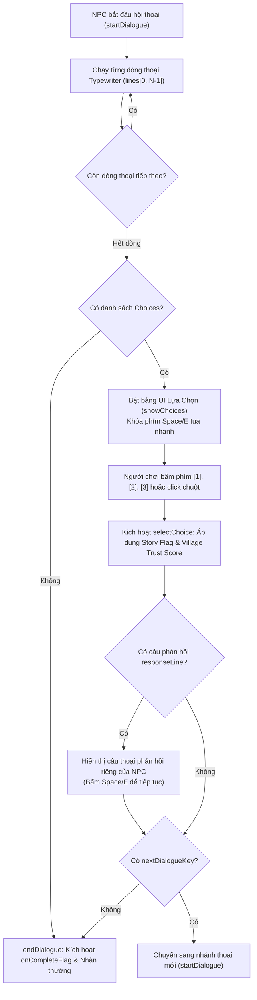
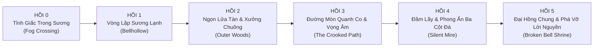

# BÁO CÁO CỐT TRUYỆN & LỰA CHỌN HỘI THOẠI TƯƠNG TÁC (V15-16)
**Dự án:** HOLLOW WOODS — V1.5 Visual & Gameplay Overhaul  
**Bước triển khai:** V15-16 — Kiểm toán Tính Nhất Quán Cốt Truyện & Nâng Cấp DialogueSystem Hỗ Trợ Lựa Chọn Hội Thoại Tương Tác  
**Ngày thực hiện:** 19/11/2026  
**Trạng thái:** HOÀN THÀNH (90/90 Tests Pass, Build Production OK)

---

## 1. TỔNG QUAN KIỂM TOÁN CỐT TRUYỆN GỐC

Trong quá trình rà soát tính nhất quán giữa kịch bản hội thoại (`src/data/dialogues.json`), hồ sơ truyền thuyết (`src/data/lore.json`), và hệ thống trạng thái nhân vật (`PlayerState.ts`), chúng tôi đã phát hiện và xử lý triệt để các mâu thuẫn tồn đọng:

1. **Lỗi Phương Hướng của Thảo Dược Sư Neris:**
   - **Hiện trạng cũ:** Trong `dialogues.json` (`edda_reminder_locked` và `edda_reminder`) cùng `lore.json` (`Q02_MEET_NERIS` task `t1`) ghi: *"Mau đến tìm Neris ở tiệm thuốc phía Đông Bắc làng..."*.
   - **Mâu thuẫn:** Tại làng Bellhollow, khu vực **Đông Bắc (Northeast)** là vị trí Nhà của Bà Lão Edda $(1160, 130)$ và Lối Lên Tháp Chuông. Trong khi đó, Nhà Thảo Mộc và Nồi Đun Thuốc của Neris nằm ở khu vực **Tây Nam (Southwest)** $(630, 445)$ cạnh Vườn Dược $(655, 480)$.
   - **Khắc phục:** Đã chuẩn hóa toàn bộ các câu thoại nhắc nhở và mô tả nhiệm vụ sang *"phía Tây Nam làng Bellhollow"*.

2. **Thống Nhất Thuật Ngữ Cốt Truyện Trọng Tâm:**
   - **Đại Hồng Chung (The Great Bronze Bell / Quả Chuông Cổ):** Linh vật của tháp chuông Bellhollow, được tôi luyện từ đồng cổ và ký ức tiền nhân nhằm phát ra tần số cộng hưởng thanh tẩy màn sương. Chuông bị rạn nứt năm xưa do một kẻ hoảng loạn rung chuông sai quy tắc.
   - **Lưỡi Chuông Đồng (The Bronze Clapper):** Trái tim của Đại Hồng Chung, bị thế lực hắc ám đánh cắp mang sâu vào Miếu Chuông Phế Tích để ngăn chặn tiếng ngân thức tỉnh.
   - **Vòng Lặp Mùa Sương Lạnh (The Cold Mist Cycle / The Fog Loop):** Không gian thời gian bị bóp méo bởi Màn Sương The Veil và Đại Mạch Rễ (The Great Roots) tha hóa, giam cầm dân làng và các linh hồn trong vòng lặp vô tận.
   - **Thân Phận Lữ Khách (The Mossbound Wayfarer / The Black Knight):** Nhân vật chính tỉnh giấc trong sương với chiếc áo choàng phủ rêu, dần dần tìm lại 4 Chương Ký Ức để nhận ra mình chính là vị Tổng Chỉ Huy Hiệp Sĩ Đen năm xưa từng tự phong ấn để bảo tồn tia sáng hy vọng.

---

## 2. KIẾN TRÚC HỆ THỐNG LỰA CHỌN HỘI THOẠI TƯƠNG TÁC (INTERACTIVE DIALOGUE CHOICES)



### 2.1. Cấu Trúc Dữ Liệu `DialogueChoice`
Được định nghĩa chuẩn trong `src/systems/DialogueSystem.ts`:
```typescript
export interface DialogueChoice {
  text: string;             // Nội dung lựa chọn hiển thị trên nút ([1], [2], [3])
  actionId?: string;        // Định danh hành động
  nextDialogueKey?: string; // Nhảy sang nhánh thoại tiếp theo nếu có
  setFlag?: string;         // Cờ cốt truyện tương tác (lưu vào storyFlags & flags)
  trustDelta?: number;      // Mức độ tăng/giảm điểm tin cậy dân làng (-5 đến +5)
  responseLine?: string;    // Câu thoại phản hồi đặc thù của NPC trước khi kết thúc
}
```

### 2.2. Điểm Tin Cậy Dân Làng (`villageTrustScore`)
- Thang điểm chuẩn: $[0, 100]$.
- Giá trị ban đầu (mặc định): $50$ (Trung lập / Chưa quen biết).
- Hành động tích cực (đồng ý giúp đỡ, chia sẻ nguyên liệu, thấu hiểu quy tắc): $+2$ đến $+3$ điểm.
- Hành động tò mò hỏi sâu về bí mật, truyền thuyết làng: $+1$ điểm.
- Hành động im lặng, thận trọng, kiêu hãnh: $+0$ điểm (giữ nguyên).
- Sự kiện phát tán: `PlayerState.emit('village_trust_changed', score)` cho phép UI và logic NPC điều chỉnh thái độ xưng hô.

### 2.3. Thiết Kế Giao Diện UI Lựa Chọn (`UIScene.ts`)
- **Vị trí hiển thị:** Khung chứa `dialogueChoicesContainer` đặt tại tọa độ $(X=640, Y=488)$, xếp tầng nổi ngay phía trên đỉnh hộp thoại chính $(640, 590)$.
- **Kích thước nút bấm:** Chiều rộng $840\text{px}$, chiều cao $36\text{px}$, bo góc $6\text{px}$.
- **Màu sắc & Nghệ thuật Gothic:** Nền đá đen bán trong suốt `0x0c1117, 0.93`, viền vàng đồng `0x8a7238`. Khi rê chuột (hover), viền bừng sáng vàng kim `0xf1c40f` và nền chuyển xanh đêm `0x182433, 0.98`.
- **Hỗ trợ điều khiển đa phương thức:**
  + Bấm phím số `1`, `2`, `3` trên hàng phím chính.
  + Bấm phím `NUMPAD_1`, `NUMPAD_2`, `NUMPAD_3` trên bàn phím số.
  + Nhấp chuột trực tiếp với con trỏ chuyển hình bàn tay (`pointer`).

---

## 3. SƠ ĐỒ CẤU TRÚC CỐT TRUYỆN 5 HỒI MỞ RỘNG (THE 5-ACT NARRATIVE ARC)



### 3.1. Hồi 0: Tỉnh Giấc Trong Sương (Fog Crossing)
- **Bối cảnh:** Kẻ Lữ Hành tỉnh dậy giữa cánh đồng sương mù rêu phong, ký ức trắng xóa, trong tay chỉ có chiếc gậy gỗ mục và ngọn đèn lồng dầu cạn.
- **Xung đột:** Tiếng gầm gừ xa xăm của quái vật và sự suy giảm nhanh chóng của chỉ số Bình Tâm khi đứng ngoài bóng tối.
- **Quyết định quan trọng:** Thắp sáng ngọn đèn hổ phách đầu tiên, vượt qua vũng lầy sương lạnh để tìm đến Cổng Tây làng Bellhollow.

### 3.2. Hồi 1: Làng Chuông Trong Vòng Lặp Sương Lạnh (Bellhollow)
- **Bối cảnh:** Làng Bellhollow cô lập trong sương, dân làng sống trong sợ hãi dưới sự bảo bọc của Tháp Chuông nứt vỡ và ngọn lửa trại leo lét.
- **Nhân vật then chốt & Lựa chọn:**
  + **Garth:** Bị người gác cổng nghi ngờ là quái vật mượn xác. Người chơi có thể lựa chọn: (1) Nhận lời khuyên đến Tháp Chuông, (2) Hỏi sâu về số phận những người đã mất tích trong sương, hoặc (3) Lặng thinh quan sát.
  + **Bà Lão Edda:** Truyền dạy **Ba Quy Tắc Bằng Máu**. Người chơi có thể lựa chọn: (1) Khắc cốt ghi tâm và hứa tìm lại Lưỡi Chuông, (2) Tìm hiểu bí mật tần số chuông đồng và Mạch Rễ, hoặc (3) Thú nhận sự mất trí nhớ của bản thân.
  + **Neris:** Sơ cứu vết cào sương mù và dạy pha chế Dầu Đèn tại tiệm thuốc Tây Nam. Người chơi có thể lựa chọn: (1) Cảm kích nhận thuốc, (2) Hỏi về loài thảo dược xoa dịu hoảng loạn (Trà An Thần), hoặc (3) Giữ phong thái kỵ sĩ không nhận ơn huệ không công.
  + **Hiệp Sĩ Canh Lửa:** Nhận ra vóc dáng người quen trong ánh lửa trại Sanctuary Camp, mở ra chuỗi nhiệm vụ thắp lửa Cấp 2 và tìm kiếm đồng đội mất tích.

### 3.3. Hồi 2: Ngọn Lửa Tàn & Di Vật Xưởng Chuông Cũ (Outer Woods)
- **Bối cảnh:** Vượt qua Cổng Đông, tiến vào Rừng Ngoại Vi nơi cỏ cây bị biến dạng và quạ bóng tối rình rập trên cành khô.
- **Mục tiêu:**
  + Thu hoạch Gỗ Khô và Nhựa Cây nâng cấp Lửa Trại Bellhollow lên Cấp 2.
  + Khám phá cửa sập dẫn xuống **Hầm Rễ Cổ** tại Nông Trại Trú Ẩn để thu thập Rễ Thuốc Cổ.
  + Lần theo lối mòn phía Nam tới **Xưởng Chuông Bỏ Hoang**, thu hồi Khuôn Đúc Chuông Cũ và Phôi Sắt Cổ Ngữ.
- **Tiến trình Ký Ức:** Đạt mốc Ký Ức Giai đoạn 1 (*Kẻ Lữ Hành Mất Trí $\to$ Manh Mối Xưởng Chuông*).

### 3.4. Hồi 3: Đường Mòn Quanh Co & Vọng Âm Ký Ức (The Crooked Path)
- **Bối cảnh:** Tuyến đường chữ S quanh co qua các vực sâu và vũng lầy, nơi ranh giới thực tại bị xé toạc bởi ảo thính.
- **Thử thách:**
  + **Khoảng Trống Thì Thầm:** Vượt qua ba cột đá vọng âm, học cách phân biệt tiếng bước chân giả của The Echo với bước chạy săn mồi thực sự của The Listener.
  + Trinh sát và đối đầu với toán Kỵ Sĩ Tha Hóa (Fallen Knight) tuần tra ban đêm.
- **Tiến trình Ký Ức:** Nhặt được Mảnh Nhật Ký Chỉ Huy Kỵ Sĩ cháy sém, đạt mốc Ký Ức Giai đoạn 2 (*Tàn Tích Hiệp Sĩ*).

### 3.5. Hồi 4: Đầm Lầy Tĩnh Lặng & Phong Ấn Ba Cột Đá (Silent Mire)
- **Bối cảnh:** Vùng nước đen ngập rễ cây khổng lồ uốn lượn, nơi Kẻ Nuốt Tiếng Chuông (Behemoth) và Trái Tim Mạch Rễ ngủ say dưới đáy bùn.
- **Thử thách:**
  + Thắp sáng ngọn lửa trên 3 Trụ Cổ Ngữ (Tây Bắc, Đông Bắc, Trung Tâm) theo đúng thứ tự hòa âm để phá vỡ kết giới bảo vệ.
  + Sinh tồn trong đầm lầy khi Bình Tâm bị rút mạnh bởi Bóng Mắt Sương Mù và tiếng gầm của Behemoth.
  + Thu hồi **Lưỡi Chuông Đồng Cổ** ngậm trong rễ cây đại thụ.

### 3.6. Hồi 5: Đại Hồng Chung Ngân Vang & Phá Vỡ Vòng Lặp (Broken Bell Shrine)
- **Bối cảnh:** Tiến vào Miếu Chuông Phế Tích trên đỉnh vách đá cổ.
- **Đỉnh điểm xung đột:**
  + Đối đầu với **Chỉ Huy Hiệp Sĩ Trùm Mũ (Hooded Knight Boss)** — người đồng đội năm xưa bị tà khí thao túng. Người chơi phải căn nhịp ngắt chiêu vận nội công tà ác của boss để giải thoát linh hồn ngài.
  + Thu hồi Huy Hiệu Hiệp Sĩ Tha Hóa, mang về Lửa Trại Bellhollow thanh tẩy thành Bùa Hộ Thân Hiệp Sĩ.
- **Đại Thức Tỉnh (Ký Ức Giai đoạn 3):** Toàn bộ dân làng nhận ra người lữ khách chính là vị **Tổng Chỉ Huy Hiệp Sĩ Đen (The Black Knight)** huyền thoại.
- **Hồi Kết (The First Toll):** Đưa Lưỡi Chuông Đồng trở lại Đại Hồng Chung tại Tháp Chuông Bellhollow, gióng lên hồi chuông thanh khiết đầu tiên, xua tan vĩnh viễn Màn Sương The Veil và giải thoát ngôi làng khỏi Vòng Lặp Mùa Sương Lạnh.

---

## 4. BẢO TOÀN DỮ LIỆU & TƯƠNG THÍCH NGƯỢC (SAVEMANAGER)

Để bảo đảm người chơi ở các phiên bản V1.3 và V1.4 không bao giờ bị hỏng file lưu khi cập nhật lên bản có hệ thống Lựa Chọn Hội Thoại, `SaveManager.ts` đã được thiết kế tuân thủ nguyên tắc không phá hủy:

1. **Khóa Lưu Trữ Mới:**
   - `villageTrustScore`: Lưu điểm tin cậy dân làng. Nếu đọc bản save cũ không có trường này, hàm `sanitizeAndMigrateSaveData` tự động gán giá trị mặc định là $50$.
   - `storyFlags`: Mảng các cờ quyết định cốt truyện dạng string `['choice_garth_cooperative', 'choice_edda_promise_bell', ...]`. Mặc định gán `[]` cho bản save cũ.
2. **Khai Báo `knownKeys`:**
   Đã bổ sung `'villageTrustScore'` và `'storyFlags'` vào danh sách khóa hợp lệ để không bị đẩy nhầm vào vùng lưu dự phòng `legacyExtraData`.
3. **Phục Hồi Trạng Thái Đồng Bộ (`applySaveToState`):**
   Khôi phục nguyên vẹn điểm số và các cờ lựa chọn vào `PlayerState.getInstance()`, sẵn sàng cho các lần tương tác tiếp theo của NPC.

---

## 5. KẾT QUẢ KIỂM THỬ TỰ ĐỘNG

- **Script kiểm thử:** `scripts/verify_v15_16_story_and_dialogue.mjs`
- **Số lượng bài test:** $90 / 90$ bài kiểm tra ĐẠT (PASS 100%).
- **Kiểm tra biên dịch:** `npx tsc --noEmit` đạt 0 lỗi (Exit Code 0).
- **Kiểm tra đóng gói:** `npm run build` tạo bundle Vite production thành công trong $9.72\text{s}$.
