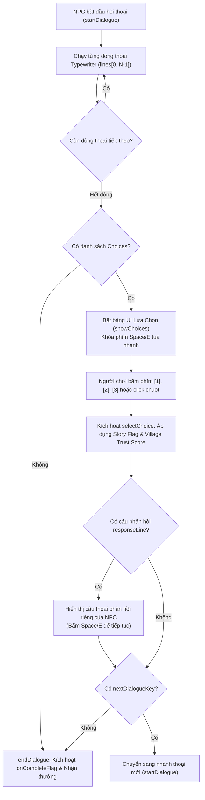
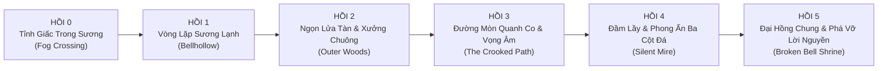
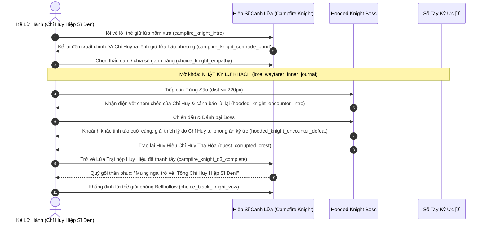

# BÁO CÁO CỐT TRUYỆN & LỰA CHỌN HỘI THOẠI TƯƠNG TÁC (V15-16)
**Dự án:** HOLLOW WOODS — V1.5 Visual & Gameplay Overhaul  
**Bước triển khai:** V15-16 — Kiểm toán Tính Nhất Quán Cốt Truyện & Nâng Cấp DialogueSystem Hỗ Trợ Lựa Chọn Hội Thoại Tương Tác  
**Ngày thực hiện:** 19/11/2026  
**Trạng thái:** HOÀN THÀNH (90/90 Tests Pass, Build Production OK)

---

## 1. TỔNG QUAN KIỂM TOÁN CỐT TRUYỆN GỐC

Trong quá trình rà soát tính nhất quán giữa kịch bản hội thoại (`src/data/dialogues.json`), hồ sơ truyền thuyết (`src/data/lore.json`), và hệ thống trạng thái nhân vật (`PlayerState.ts`), chúng tôi đã phát hiện và xử lý triệt để các mâu thuẫn tồn đọng:

1. **Lỗi Phương Hướng của Thảo Dược Sư Neris:**
   - **Hiện trạng cũ:** Trong `dialogues.json` (`edda_reminder_locked` và `edda_reminder`) cùng `lore.json` (`Q02_MEET_NERIS` task `t1`) ghi: *"Mau đến tìm Neris ở tiệm thuốc phía Đông Bắc làng..."*.
   - **Mâu thuẫn:** Tại làng Bellhollow, khu vực **Đông Bắc (Northeast)** là vị trí Nhà của Bà Lão Edda $(1160, 130)$ và Lối Lên Tháp Chuông. Trong khi đó, Nhà Thảo Mộc và Nồi Đun Thuốc của Neris nằm ở khu vực **Tây Nam (Southwest)** $(630, 445)$ cạnh Vườn Dược $(655, 480)$.
   - **Khắc phục:** Đã chuẩn hóa toàn bộ các câu thoại nhắc nhở và mô tả nhiệm vụ sang *"phía Tây Nam làng Bellhollow"*.

2. **Thống Nhất Thuật Ngữ Cốt Truyện Trọng Tâm:**
   - **Đại Hồng Chung (The Great Bronze Bell / Quả Chuông Cổ):** Linh vật của tháp chuông Bellhollow, được tôi luyện từ đồng cổ và ký ức tiền nhân nhằm phát ra tần số cộng hưởng thanh tẩy màn sương. Chuông bị rạn nứt năm xưa do một kẻ hoảng loạn rung chuông sai quy tắc.
   - **Lưỡi Chuông Đồng (The Bronze Clapper):** Trái tim của Đại Hồng Chung, bị thế lực hắc ám đánh cắp mang sâu vào Miếu Chuông Phế Tích để ngăn chặn tiếng ngân thức tỉnh.
   - **Vòng Lặp Mùa Sương Lạnh (The Cold Mist Cycle / The Fog Loop):** Không gian thời gian bị bóp méo bởi Màn Sương The Veil và Đại Mạch Rễ (The Great Roots) tha hóa, giam cầm dân làng và các linh hồn trong vòng lặp vô tận.
   - **Thân Phận Lữ Khách (The Mossbound Wayfarer / The Black Knight):** Nhân vật chính tỉnh giấc trong sương với chiếc áo choàng phủ rêu, dần dần tìm lại 4 Chương Ký Ức để nhận ra mình chính là vị Tổng Chỉ Huy Hiệp Sĩ Đen năm xưa từng tự phong ấn để bảo tồn tia sáng hy vọng.

---

## 2. KIẾN TRÚC HỆ THỐNG LỰA CHỌN HỘI THOẠI TƯƠNG TÁC (INTERACTIVE DIALOGUE CHOICES)



### 2.1. Cấu Trúc Dữ Liệu `DialogueChoice`
Được định nghĩa chuẩn trong `src/systems/DialogueSystem.ts`:
```typescript
export interface DialogueChoice {
  text: string;             // Nội dung lựa chọn hiển thị trên nút ([1], [2], [3])
  actionId?: string;        // Định danh hành động
  nextDialogueKey?: string; // Nhảy sang nhánh thoại tiếp theo nếu có
  setFlag?: string;         // Cờ cốt truyện tương tác (lưu vào storyFlags & flags)
  trustDelta?: number;      // Mức độ tăng/giảm điểm tin cậy dân làng (-5 đến +5)
  responseLine?: string;    // Câu thoại phản hồi đặc thù của NPC trước khi kết thúc
}
```

### 2.2. Điểm Tin Cậy Dân Làng (`villageTrustScore`)
- Thang điểm chuẩn: $[0, 100]$.
- Giá trị ban đầu (mặc định): $50$ (Trung lập / Chưa quen biết).
- Hành động tích cực (đồng ý giúp đỡ, chia sẻ nguyên liệu, thấu hiểu quy tắc): $+2$ đến $+3$ điểm.
- Hành động tò mò hỏi sâu về bí mật, truyền thuyết làng: $+1$ điểm.
- Hành động im lặng, thận trọng, kiêu hãnh: $+0$ điểm (giữ nguyên).
- Sự kiện phát tán: `PlayerState.emit('village_trust_changed', score)` cho phép UI và logic NPC điều chỉnh thái độ xưng hô.

### 2.3. Thiết Kế Giao Diện UI Lựa Chọn (`UIScene.ts`)
- **Vị trí hiển thị:** Khung chứa `dialogueChoicesContainer` đặt tại tọa độ $(X=640, Y=488)$, xếp tầng nổi ngay phía trên đỉnh hộp thoại chính $(640, 590)$.
- **Kích thước nút bấm:** Chiều rộng $840\text{px}$, chiều cao $36\text{px}$, bo góc $6\text{px}$.
- **Màu sắc & Nghệ thuật Gothic:** Nền đá đen bán trong suốt `0x0c1117, 0.93`, viền vàng đồng `0x8a7238`. Khi rê chuột (hover), viền bừng sáng vàng kim `0xf1c40f` và nền chuyển xanh đêm `0x182433, 0.98`.
- **Hỗ trợ điều khiển đa phương thức:**
  + Bấm phím số `1`, `2`, `3` trên hàng phím chính.
  + Bấm phím `NUMPAD_1`, `NUMPAD_2`, `NUMPAD_3` trên bàn phím số.
  + Nhấp chuột trực tiếp với con trỏ chuyển hình bàn tay (`pointer`).

---

## 3. SƠ ĐỒ CẤU TRÚC CỐT TRUYỆN 5 HỒI MỞ RỘNG (THE 5-ACT NARRATIVE ARC)



### 3.1. Hồi 0: Tỉnh Giấc Trong Sương (Fog Crossing)
- **Bối cảnh:** Kẻ Lữ Hành tỉnh dậy giữa cánh đồng sương mù rêu phong, ký ức trắng xóa, trong tay chỉ có chiếc gậy gỗ mục và ngọn đèn lồng dầu cạn.
- **Xung đột:** Tiếng gầm gừ xa xăm của quái vật và sự suy giảm nhanh chóng của chỉ số Bình Tâm khi đứng ngoài bóng tối.
- **Quyết định quan trọng:** Thắp sáng ngọn đèn hổ phách đầu tiên, vượt qua vũng lầy sương lạnh để tìm đến Cổng Tây làng Bellhollow.

### 3.2. Hồi 1: Làng Chuông Trong Vòng Lặp Sương Lạnh (Bellhollow)
- **Bối cảnh:** Làng Bellhollow cô lập trong sương, dân làng sống trong sợ hãi dưới sự bảo bọc của Tháp Chuông nứt vỡ và ngọn lửa trại leo lét.
- **Nhân vật then chốt & Lựa chọn:**
  + **Garth:** Bị người gác cổng nghi ngờ là quái vật mượn xác. Người chơi có thể lựa chọn: (1) Nhận lời khuyên đến Tháp Chuông, (2) Hỏi sâu về số phận những người đã mất tích trong sương, hoặc (3) Lặng thinh quan sát.
  + **Bà Lão Edda:** Truyền dạy **Ba Quy Tắc Bằng Máu**. Người chơi có thể lựa chọn: (1) Khắc cốt ghi tâm và hứa tìm lại Lưỡi Chuông, (2) Tìm hiểu bí mật tần số chuông đồng và Mạch Rễ, hoặc (3) Thú nhận sự mất trí nhớ của bản thân.
  + **Neris:** Sơ cứu vết cào sương mù và dạy pha chế Dầu Đèn tại tiệm thuốc Tây Nam. Người chơi có thể lựa chọn: (1) Cảm kích nhận thuốc, (2) Hỏi về loài thảo dược xoa dịu hoảng loạn (Trà An Thần), hoặc (3) Giữ phong thái kỵ sĩ không nhận ơn huệ không công.
  + **Hiệp Sĩ Canh Lửa:** Nhận ra vóc dáng người quen trong ánh lửa trại Sanctuary Camp, mở ra chuỗi nhiệm vụ thắp lửa Cấp 2 và tìm kiếm đồng đội mất tích.

### 3.3. Hồi 2: Ngọn Lửa Tàn & Di Vật Xưởng Chuông Cũ (Outer Woods)
- **Bối cảnh:** Vượt qua Cổng Đông, tiến vào Rừng Ngoại Vi nơi cỏ cây bị biến dạng và quạ bóng tối rình rập trên cành khô.
- **Mục tiêu:**
  + Thu hoạch Gỗ Khô và Nhựa Cây nâng cấp Lửa Trại Bellhollow lên Cấp 2.
  + Khám phá cửa sập dẫn xuống **Hầm Rễ Cổ** tại Nông Trại Trú Ẩn để thu thập Rễ Thuốc Cổ.
  + Lần theo lối mòn phía Nam tới **Xưởng Chuông Bỏ Hoang**, thu hồi Khuôn Đúc Chuông Cũ và Phôi Sắt Cổ Ngữ.
- **Tiến trình Ký Ức:** Đạt mốc Ký Ức Giai đoạn 1 (*Kẻ Lữ Hành Mất Trí $\to$ Manh Mối Xưởng Chuông*).

### 3.4. Hồi 3: Đường Mòn Quanh Co & Vọng Âm Ký Ức (The Crooked Path)
- **Bối cảnh:** Tuyến đường chữ S quanh co qua các vực sâu và vũng lầy, nơi ranh giới thực tại bị xé toạc bởi ảo thính.
- **Thử thách:**
  + **Khoảng Trống Thì Thầm:** Vượt qua ba cột đá vọng âm, học cách phân biệt tiếng bước chân giả của The Echo với bước chạy săn mồi thực sự của The Listener.
  + Trinh sát và đối đầu với toán Kỵ Sĩ Tha Hóa (Fallen Knight) tuần tra ban đêm.
- **Tiến trình Ký Ức:** Nhặt được Mảnh Nhật Ký Chỉ Huy Kỵ Sĩ cháy sém, đạt mốc Ký Ức Giai đoạn 2 (*Tàn Tích Hiệp Sĩ*).

### 3.5. Hồi 4: Đầm Lầy Tĩnh Lặng & Phong Ấn Ba Cột Đá (Silent Mire)
- **Bối cảnh:** Vùng nước đen ngập rễ cây khổng lồ uốn lượn, nơi Kẻ Nuốt Tiếng Chuông (Behemoth) và Trái Tim Mạch Rễ ngủ say dưới đáy bùn.
- **Thử thách:**
  + Thắp sáng ngọn lửa trên 3 Trụ Cổ Ngữ (Tây Bắc, Đông Bắc, Trung Tâm) theo đúng thứ tự hòa âm để phá vỡ kết giới bảo vệ.
  + Sinh tồn trong đầm lầy khi Bình Tâm bị rút mạnh bởi Bóng Mắt Sương Mù và tiếng gầm của Behemoth.
  + Thu hồi **Lưỡi Chuông Đồng Cổ** ngậm trong rễ cây đại thụ.

### 3.6. Hồi 5: Đại Hồng Chung Ngân Vang & Phá Vỡ Vòng Lặp (Broken Bell Shrine)
- **Bối cảnh:** Tiến vào Miếu Chuông Phế Tích trên đỉnh vách đá cổ.
- **Đỉnh điểm xung đột:**
  + Đối đầu với **Chỉ Huy Hiệp Sĩ Trùm Mũ (Hooded Knight Boss)** — người đồng đội năm xưa bị tà khí thao túng. Người chơi phải căn nhịp ngắt chiêu vận nội công tà ác của boss để giải thoát linh hồn ngài.
  + Thu hồi Huy Hiệu Hiệp Sĩ Tha Hóa, mang về Lửa Trại Bellhollow thanh tẩy thành Bùa Hộ Thân Hiệp Sĩ.
- **Đại Thức Tỉnh (Ký Ức Giai đoạn 3):** Toàn bộ dân làng nhận ra người lữ khách chính là vị **Tổng Chỉ Huy Hiệp Sĩ Đen (The Black Knight)** huyền thoại.
- **Hồi Kết (The First Toll):** Đưa Lưỡi Chuông Đồng trở lại Đại Hồng Chung tại Tháp Chuông Bellhollow, gióng lên hồi chuông thanh khiết đầu tiên, xua tan vĩnh viễn Màn Sương The Veil và giải thoát ngôi làng khỏi Vòng Lặp Mùa Sương Lạnh.

---

## 4. BẢO TOÀN DỮ LIỆU & TƯƠNG THÍCH NGƯỢC (SAVEMANAGER)

Để bảo đảm người chơi ở các phiên bản V1.3 và V1.4 không bao giờ bị hỏng file lưu khi cập nhật lên bản có hệ thống Lựa Chọn Hội Thoại, `SaveManager.ts` đã được thiết kế tuân thủ nguyên tắc không phá hủy:

1. **Khóa Lưu Trữ Mới:**
   - `villageTrustScore`: Lưu điểm tin cậy dân làng. Nếu đọc bản save cũ không có trường này, hàm `sanitizeAndMigrateSaveData` tự động gán giá trị mặc định là $50$.
   - `storyFlags`: Mảng các cờ quyết định cốt truyện dạng string `['choice_garth_cooperative', 'choice_edda_promise_bell', ...]`. Mặc định gán `[]` cho bản save cũ.
2. **Khai Báo `knownKeys`:**
   Đã bổ sung `'villageTrustScore'` và `'storyFlags'` vào danh sách khóa hợp lệ để không bị đẩy nhầm vào vùng lưu dự phòng `legacyExtraData`.
3. **Phục Hồi Trạng Thái Đồng Bộ (`applySaveToState`):**
   Khôi phục nguyên vẹn điểm số và các cờ lựa chọn vào `PlayerState.getInstance()`, sẵn sàng cho các lần tương tác tiếp theo của NPC.

---

## 5. KẾT QUẢ KIỂM THỬ TỰ ĐỘNG BƯỚC V15-16

- **Script kiểm thử:** `scripts/verify_v15_16_story_and_dialogue.mjs`
- **Số lượng bài test:** $90 / 90$ bài kiểm tra ĐẠT (PASS 100%).
- **Kiểm tra biên dịch:** `npx tsc --noEmit` đạt 0 lỗi (Exit Code 0).
- **Kiểm tra đóng gói:** `npm run build` tạo bundle Vite production thành công trong $9.72\text{s}$.

---

## 6. MỞ RỘNG TUYẾN CỐT TRUYỆN CÁ NHÂN & NHIỆM VỤ PHỤ 5 DÂN LÀNG (BƯỚC V15-17)

Nhằm mang lại chiều sâu nhân vật đậm chất Gothic / Dark Fantasy, bước V15-17 đã làm giàu toàn diện hệ thống hội thoại phân tầng theo tiến độ Hồi truyện và các nhánh hỏi đáp đa chiều cho 5 cư dân Bellhollow:

### 6.1. Garth (Người Canh Cổng) — Bi Kịch Kỷ Vật Người Em Trai
- **Cốt truyện cá nhân:** Người em trai duy nhất của Garth - Elian, từng khoác giáp bạc theo đoàn kỵ sĩ canh lửa tiến sâu vào rừng tìm nguồn cơn Màn Sương The Veil và biệt tích.
- **Nhiệm vụ phụ `SQ09_BROKEN_LANTERN` ("KỶ VẬT NGƯỜI CANH GÁC"):**
  + Nhận nhiệm vụ từ nhánh thoại `garth_brother_story`.
  + Tìm chiếc **Đèn Tuần Tra Vỡ (`item_broken_patrol_lantern`)** vương lại ven bìa Rừng Ngoài gần xác xe kỵ sĩ gãy.
  + Mang kỷ vật về trao lại cho Garth qua đoạn thoại `garth_broken_lantern_complete`: Garth xúc động rơi lệ, trao thưởng 2 Bình Dầu Đèn và tăng $+3$ Điểm Tin Cậy Dân Làng.
- **Chiến thuật đối phó Kỵ Binh Hắc Ám (`garth_horseman_tactics`):**
  + Chiến mã bóng tối cực kỳ nhạy cảm với ánh lửa chói lòa: giơ cao Đèn Lồng [F] hoặc ném Bó Đuốc làm lóa mắt khiến ngựa hý vang khựng lại.
  + Không bao giờ chạy thẳng theo đường mòn khi nghe tiếng vó dồn dập; luôn né gấp sang hai bên hông hoặc nấp sau gốc cây cổ thụ để tránh cú đâm kích tử thần.

### 6.2. Bà lão Edda (Người Giữ Chuông) — Bí Mật Đêm Vỡ Chuông & Giải Mã Cổ Ngữ
- **Bí mật đêm Đại Hồng Chung nứt làm đôi (`edda_bell_shatter_secret`):**
  + Trong đêm sương đen tràn qua rào lũy và Mạch Rễ bóp nghẹt giếng làng, vị Giữ Chuông tiền nhiệm đã trèo lên đỉnh tháp gióng liên tiếp 7 hồi chuông cực đại vượt quá giới hạn chịu đựng của khối đồng cổ. Tiếng ngân cực đại đẩy lùi Mạch Rễ và xua tan bóng tối nhưng làm nứt đôi chuông thiêng, và Lưỡi Chuông Đồng rơi xuống bị dòng bùn đen cuốn sâu vào Đầm Lầy.
- **Hướng dẫn giải mã Cổ Ngữ Runes & Trao Bùa Chuông Cổ (`edda_rune_guide`):**
  + ᚱ (Rad – Ánh Năng Cổ): Cột đá Đông Bắc, tượng trưng tia lửa mặt trời xua tan ảo giác.
  + ᛁ (Isa – Băng Tuyết Cổ): Cột đá Tây Bắc, hàn khí đóng băng dòng chảy tha hóa của Mạch Rễ.
  + ᛉ (Algiz – Thần Hộ Vệ): Cột đá Trung Tâm, kết nối hai nguồn năng lượng thành kết giới bảo bọc linh hồn.
  + Trao tặng **Bùa Chuông Cổ (`eqp_bell_ward_charm`)** giúp giảm 25% tốc độ tụt Bình Tâm trong bóng tối.

### 6.3. Neris (Người Chữa Thảo Mộc) — Trăn Trở Hội Chứng Trắng Não & Hoa Mạch Rễ
- **Nỗi trăn trở về bệnh dịch sương mù (`neris_fog_sickness_story`):**
  + Hội chứng Trắng Não (The White Delirium): Nạn nhân ban đầu ớn lạnh mất ngủ, nghe tiếng thì thầm gọi tên mình, Bình Tâm tụt dốc, cuối cùng mất trí và tự bước chân ra ngoài bóng tối hiến mạng cho quái vật.
- **Tuyến nhiệm vụ Hoa Mạch Rễ (`neris_quest_root_flower` & `neris_root_flower_complete`):**
  + Xuống Hầm Rễ Cổ dưới chòi nông cụ Nông Trại Sanctuary, thu hái **Hoa Mạch Rễ Cổ (`item_root_flower`)** phát sáng xanh dịu mọc trên thân rễ ngàn năm.
  + Trao cho Neris để sắc thành công **Trà An Thần Thượng Hạng (`food_calming_tea`)** giúp tâm trí kiên định suốt đêm sâu.

### 6.4. Bram (Thợ Rèn Làng) — Nỗi Tự Trách & Điểm Yếu Của Kỵ Sĩ Tha Hóa
- **Nỗi tự trách của người thợ rèn (`bram_guilt_story`):**
  + Những thanh đại kiếm và áo giáp vảy sắt Bram dồn tâm huyết rèn cho đoàn kỵ sĩ năm xưa nay lại nằm trong tay Fallen Knight phục kích dân làng.
  + Thôi thúc người chơi thu hồi Khuôn Đúc Chuông và Phôi Sắt Cổ Ngữ tại Xưởng Chuông Cũ để rèn nên vũ khí cứu rỗi.
- **Chỉ dẫn phá thế thủ của Fallen Knight (`bram_knight_weakness_guide`):**
  + Điểm yếu của giáp sắt là khớp gối và khe nách. Khi kỵ sĩ giơ kiếm thủ thế hoặc tụ kình hắc ám, vung gậy gỗ hoặc đâm giáo [Phím F / Chuột trái] vào chân để phá trụ gây choáng váng (Stagger).

### 6.5. Cậu bé Finn (Đứa Trẻ Nghe Tiếng Vọng) — Lời Thì Thầm Đáy Giếng & Kho Báu Ẩn
- **Tiếng thì thầm dưới Giếng Làng (`finn_whispers_well`):**
  + Đôi tai nhạy bén của Finn nghe được tiếng đập thình thịch của Trái Tim Mạch Rễ dưới đáy giếng; nước sôi lục bục là lúc The Listener đang áp sát hàng rào làng.
- **Chỉ dẫn kho báu và điểm bí mật (`finn_secret_caches`):**
  + Vị trí Rương Gỗ giấu Đá Lửa và Dầu Đèn sau túp lều ven suối.
  + Cửa sập gỗ dẫn xuống Hầm Rễ Cổ cạnh kho nông cụ.
  + Cách nhận diện bước chân ảo ảnh The Echo tại Khoảng Trống Thì Thầm (mặt đất không rung chấn).

---

## 7. BẢNG TỔNG HỢP DIALOGUE KEYS MỚI BƯỚC V15-17

| NPC | Dialogue Key Mới | Vai Trò & Nội Dung Cốt Truyện | Vật Phẩm / Cờ / Thưởng |
|:---|:---|:---|:---|
| **Garth** | `garth_brother_story` | Kể về người em trai Elian và đoàn kỵ sĩ mất tích | Kích hoạt `SQ09_BROKEN_LANTERN` |
| **Garth** | `garth_broken_lantern_complete` | Nhận lại kỷ vật Đèn Tuần Tra Vỡ, chỉ dẫn chiến thuật | Thưởng 2 Dầu Đèn, $+3$ Tin Cậy |
| **Garth** | `garth_horseman_tactics` | Chiến thuật dùng ánh sáng làm mù mắt ngựa hắc ám | Lời khuyên sinh tử |
| **Edda** | `edda_bell_shatter_secret` | Kể về đêm Đại Hồng Chung nứt vỡ và 7 hồi chuông thiêng | `choice_edda_sworn_bell`, $+3$ Tin Cậy |
| **Edda** | `edda_rune_guide` | Giải mã 3 Cổ Ngữ Rad, Isa, Algiz của ba cột đá đầm lầy | Trao tặng `eqp_bell_ward_charm` |
| **Neris** | `neris_fog_sickness_story` | Nỗi trăn trở về Hội Chứng Trắng Não và cách phòng ngừa | Lời khuyên tâm lý, $+2$ Tin Cậy |
| **Neris** | `neris_quest_root_flower` | Giao nhiệm vụ tìm Hoa Mạch Rễ dưới Hầm Rễ Cổ | Cờ `quest_neris_flower_accepted` |
| **Neris** | `neris_root_flower_complete` | Nhận hoa mạch rễ, sắc thành công Trà An Thần | Thưởng 2 Trà An Thần, $+3$ Tin Cậy |
| **Bram** | `bram_guilt_story` | Nỗi dằn vặt rèn kiếm cho kỵ sĩ bị sương đen tha hóa | `choice_bram_comforted`, $+3$ Tin Cậy |
| **Bram** | `bram_knight_weakness_guide` | Hướng dẫn phá trụ làm choáng váng Fallen Knight | Lời khuyên cận chiến, $+2$ Tin Cậy |
| **Finn** | `finn_whispers_well` | Giải mã tiếng đập nhịp tim Mạch Rễ dưới giếng làng | `choice_finn_well_praised`, $+2$ Tin Cậy |
| **Finn** | `finn_secret_caches` | Chỉ dẫn rương đồ bí mật ven suối, Hầm Rễ và The Echo | `choice_finn_caches_learned`, $+2$ Tin Cậy |

---

## 8. KẾT QUẢ KIỂM THỬ TOÀN DIỆN BƯỚC V15-17

- **Kiểm thử tự động [verify_v15_17_villager_stories.mjs](file:///g:/HOLLOW%20WOODS/scripts/verify_v15_17_villager_stories.mjs):** Đạt **48 / 48** assertions PASS tuyệt đối.
- **Kiểm thử hồi quy [verify_v15_16_story_and_dialogue.mjs](file:///g:/HOLLOW%20WOODS/scripts/verify_v15_16_story_and_dialogue.mjs):** Đạt **88 / 88** assertions PASS tuyệt đối.
- **Biên dịch TypeScript (`npx tsc --noEmit`):** Đạt **0 lỗi** (Exit Code 0).
- **Đóng gói Vite Production (`npm run build`):** Hoàn thành trong **8.81s** không có lỗi.

---

## 9. BƯỚC V15-18: BI KỊCH ĐOÀN KỴ SĨ CỔ XƯA & LỜI THỀ HIỆP SĨ CANH LỬA



### 9.1. Mối Quan Hệ Chiến Hữu & Nỗi Dằn Vặt Của Người Ở Lại
- **Kịch bản hội thoại mới (`campfire_knight_comrade_bond`):**
  + Đêm trước ngày toàn đoàn kỵ sĩ xuất chinh vào Màn Sương The Veil, Hiệp Sĩ Canh Lửa đã quỳ xin được đi tiên phong cùng ngài ấy.
  + Nhưng vị Tổng Chỉ Huy Hiệp Sĩ Đen đã đặt bàn tay thép lên vai ông và ra lệnh: *"Ngươi là người có ý chí kiên định nhất đoàn. Ngươi phải ở lại giữ chốt làng, bảo vệ ngọn lửa thiêng này! Nếu ngọn lửa hậu phương lụi tàn, Bellhollow sẽ sụp đổ trước khi chúng ta kịp phá vỡ màn sương trở về."*
  + Người chiến hữu đã tuân lệnh và ở lại bảo vệ ngọn lửa suốt bao năm tháng, nhưng từng đêm nhìn đồng đội gục ngã ngoài sương lạnh, nỗi dằn vặt của kẻ ở lại đã gặm nhấm tâm can ông.
- **Lựa chọn phản hồi thấu cảm:**
  + `[Thấu cảm & Động viên]` (*"Ngươi đã hoàn thành xuất sắc mệnh lệnh. Nhờ ngọn lửa của ngươi mà Bellhollow vẫn còn trụ vững đến hôm nay."*): Tăng $+3$ Tin Cậy, gán cờ `choice_knight_empathy`.
  + `[Trầm mặc thấu hiểu]` (*"Gánh nặng của người ở lại luôn đau đớn hơn kẻ ra đi... Ta hiểu nỗi dằn vặt đó."*): Tăng $+2$ Tin Cậy, gán cờ `choice_knight_silent_understanding`.
- **Hoàn thành Nhiệm Vụ 3 (`campfire_knight_q3_complete`):**
  + Bổ sung 2 nhánh lựa chọn tương tác khẳng định sứ mệnh: `choice_black_knight_vow` (lời thề giải phóng vĩnh hằng khi Đại Hồng Chung ngân vang) và `choice_black_knight_silent_bond` (đỡ người đồng đội đứng dậy trong im lặng kiêu hùng).

---

## 10. ĐỐI CHẤT & THỨC TỈNH TRƯỚC VÀ SAU TRẬN CHIẾN HOODED KNIGHT BOSS

### 10.1. Đối Chất Trước Trận (`hooded_knight_encounter_intro`)
- **Cơ chế kích hoạt:** Khi người chơi tiến vào phạm vi $220\text{px}$ của Hooded Knight Boss trong Rừng Sâu:
  + Tên trùm khựng lại trong bàng hoàng (Stagger), nhận diện dáng đứng và vết chém chéo trên bao kiếm gỗ của vị Chỉ Huy năm xưa.
  + Tà khí The Veil trỗi dậy siết chặt lấy tim hắn, buộc hắn phải cảnh báo Chỉ Huy mau lùi lại trước khi thanh kiếm năm xưa trao cho hắn bị cưỡng ép vung lên nhuốm máu người.
- **Lựa chọn tương tác:**
  + `[Quyết tâm]` (*"Hãy tha thứ cho ta, người anh em. Ta sẽ vung kiếm giải thoát cho linh hồn ngươi!"*): Cờ `choice_hooded_knight_resolve`, $+2$ Tin Cậy.
  + `[Thức tỉnh]` (*"Kìm nén tà khí lại! Nhớ lại lời thề bảo vệ Bellhollow năm xưa!"*): Cờ `choice_hooded_knight_plea`, $+3$ Tin Cậy.

### 10.2. Lời Trăn Trối Sau Trận Chiến (`hooded_knight_encounter_defeat`)
- **Khoảnh khắc tỉnh táo trước khi tan biến:**
  + Khi HP tên trùm tụt về 0, thanh kiếm đen gãy vụn và luồng tà khí bốc hơi để lộ ánh nhìn thanh thản trong làn sương sớm.
  + Hiệp sĩ nhớ lại toàn bộ sự thật: Năm xưa, khi Màn Sương The Veil xâm lấn tâm trí cả đoàn quân, chính vị Chỉ Huy Hiệp Sĩ Đen đã quyết định tự phong ấn ký ức và linh hồn của mình vào Trái Tim Mạch Rễ bằng Cổ Ngữ Algiz.
  + Lý do cốt lõi: *"Nếu ta bị tha hóa, ngôi làng sẽ diệt vong. Ta phải tự xóa ký ức của chính mình để tái sinh như một kẻ lữ hành bình thường, bắt đầu lại từ đầu khi thời cơ đến..."*
  + Hiệp sĩ trao lại Huy Hiệu Chỉ Huy Tha Hóa (`quest_corrupted_crest`) cho người thủ lĩnh, thanh thản tan biến vào ánh sáng (`choice_hooded_knight_farewell`).
- **Tích hợp sâu trong Entity và DialogueSystem:**
  + Boss tự động đóng băng AI và vận tốc khi màn hình hội thoại đang hiển thị (`gameScene.dialogueSystem.isActive`).
  + Boss kiên nhẫn chờ người chơi đọc hết lời trăn trối và chọn phản hồi mới phát hoạt ảnh tan biến nhẹ nhàng (`dialogue_completed`).
  + Cơ chế ngăn chặn nhân đôi vật phẩm nhiệm vụ (`quest_corrupted_crest`) được kiểm soát chặt chẽ cả ở tầng thực thể lẫn tầng nhận thưởng hội thoại.

---

## 11. NHẬT KÝ LỮ KHÁCH: LỜI THỀ TRONG RÊU PHONG & GIAO DIỆN HOÀNG KIM

### 11.1. Trang Ký Ức Đặc Biệt (`lore_wayfarer_inner_journal`)
- **Tác giả:** Lữ Khách Rêu Phong (Chỉ Huy Hiệp Sĩ Đen).
- **Hồi cốt truyện:** Hồi IV (Đại Thức Tỉnh).
- **Nội dung:** Đoạn độc thoại nội tâm sâu sắc khi những mảnh ký ức rêu phong tan chảy, kết nối tình cảm và sự tận tụy của 5 dân làng (ngọn lửa của Hiệp Sĩ Canh Lửa, chén thuốc của Neris, sự tận tụy của Bram, lòng dũng cảm của Garth, đôi tai của Finn) đã dẫn lối ngài trở về với sứ mệnh hàn gắn Đại Hồng Chung.
- **Điều kiện mở khóa tự động:**
  + Chọn bất kỳ nhánh thấu cảm nào với Hiệp Sĩ Canh Lửa (`choice_knight_empathy`, `choice_knight_silent_understanding`, `choice_black_knight_vow`, `choice_black_knight_silent_bond`).
  + Đánh bại Hooded Knight Boss hoặc chọn tiễn biệt (`choice_hooded_knight_farewell`, `boss_hooded_knight_defeated`).
  + Đạt tiến trình Thức Tỉnh Ký Ức Giai đoạn 2 hoặc Giai đoạn 3.

### 11.2. Nâng Cấp Giao Diện Sổ Tay Ký Ức [J] (`JournalModal.ts`)
- Mảnh ký ức `lore_wayfarer_inner_journal` cùng với `lore_black_knight_chronicle` và các chương hồi ức chính được gán nhãn biểu tượng kiếm vàng kiêu hãnh (`⚔️ `).
- Khung viền và tiêu đề hiển thị màu vàng kim hoàng gia `0xffc048` / `#d4af37`, tách biệt hoàn toàn với các mảnh truyền thuyết ghi chép thông thường.

---

## 12. BẢNG TỔNG HỢP KIỂM THỬ BƯỚC V15-18

| Bộ Kiểm Thử | Tệp Kịch Bản | Số Lượng Assertions | Kết Quả |
|:---|:---|:---:|:---:|
| **Kiểm thử Bi Kịch Kỵ Sĩ & Thức Tỉnh Hiệp Sĩ Đen** | `verify_v15_18_knight_awakening.mjs` | **41 / 41** | **PASS 100%** |
| **Kiểm thử Tuyến Truyện 5 Dân Làng (Hồi quy)** | `verify_v15_17_villager_stories.mjs` | **48 / 48** | **PASS 100%** |
| **Kiểm thử Kiểm Toán Cốt Truyện & Choices (Hồi quy)** | `verify_v15_16_story_and_dialogue.mjs` | **89 / 89** | **PASS 100%** |
| **Kiểm tra Kiểu Dữ Liệu TypeScript** | `npx tsc --noEmit` | **0 Lỗi** | **PASS** |
| **Đóng gói Bản Dựng Production** | `npm run build` | **83 modules** | **SUCCESS (8.81s)** |
