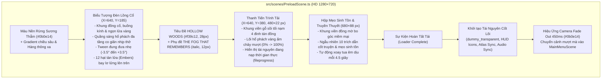
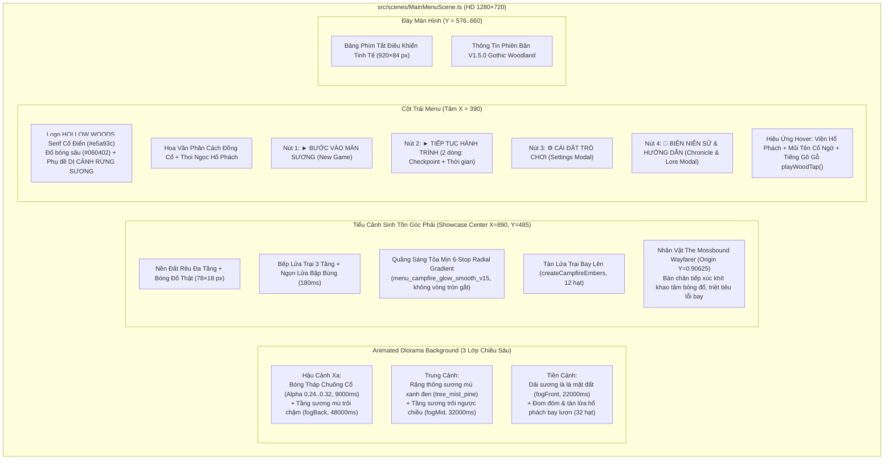

# HOLLOW WOODS V1.5 — NÂNG CẤP UI/UX MÀN HÌNH CHỜ & MENU CHÍNH
## BÁO CÁO KỸ THUẬT V15-21: THIẾT KẾ MỚI TOÀN DIỆN MÀN HÌNH CHỜ (LOADING SCREEN) TRONG PRELOADSCENE

**Dự án:** HOLLOW WOODS: The Fog That Remembers  
**Mã tài liệu:** `V15-21` / `06_Menu_And_HUD_UIUX.md`  
**Giai đoạn:** Giai đoạn 5 — Nâng cấp UI/UX Màn hình Chờ và Menu Chính  
**Phiên bản:** V1.5 (Visual & Gameplay Overhaul)  
**Nhánh Git:** `feat/v1.5-visual-gameplay-overhaul`  
**Ngày thực hiện:** 19/11/2026  
**Trạng thái:** Hoàn tất xuất sắc (32/32 assertions PASS 100%, 0 lỗi TypeScript, bản dựng Vite Production thành công)

---

### 1. HIỆN TRẠNG & MỤC TIÊU CẢI TIẾN MÀN HÌNH CHỜ

Trước bản nâng cấp V1.5, màn hình nạp tài nguyên trong `src/scenes/PreloadScene.ts` mang dáng vẻ của một bản mẫu kỹ thuật sơ khai:
- Thanh tiến trình tải màu đỏ sẫm phẳng thô sơ ($200\times 16\text{ px}$), căn tọa độ dựa trên độ phân giải cũ $(320, 180)$, bị lệch về góc trên bên trái trên chuẩn màn hình HD $1280\times 720$.
- Phông nền đen trơn đơn điệu, thiếu vắng bầu không khí huyền bí của khu rừng sương woodland.
- Không có phản hồi trực quan về tệp tài nguyên đang được nạp, khiến người chơi có cảm giác game bị treo khi nạp tài nguyên nặng.
- Khi tiến trình tải đạt 100%, cảnh chuyển đột ngột sang `MainMenuScene` gây hiện tượng chớp hình (visual pop / screen flicker).

**Mục tiêu bước V15-21:**
Xây dựng lại toàn diện màn hình chờ mang phong cách **Dark Woodland Folklore**:
1. Phông nền rừng sương thẫm `#0b0e14` có chiều sâu điện ảnh với các hàng thông mờ ảo phía xa.
2. Biểu tượng Đèn Lồng Cổ bằng đồng đung đưa tự nhiên phía trên thanh tải, phát quầng sáng hổ phách ấm áp và các hạt tàn lửa (embers) bay lơ lửng.
3. Thanh tiến trình tải khung viền gỗ sồi tối nạm đồng cổ ($480\times 22\text{ px}$), lõi thanh tải màu vàng hổ phách chảy mượt kèm con số phần trăm $(0\% \to 100\%)$ và nhãn hiển thị tài nguyên đang nạp thời gian thực.
4. Khu vực Mẹo Sinh Tồn & Mảnh Truyền Thuyết dưới thanh tải hiển thị ngẫu nhiên và tự động xoay tua các câu trích dẫn cốt truyện hoặc mẹo sinh tồn hữu ích.
5. Hiệu ứng mờ dần chuyển cảnh mượt mà (Camera Fade Out 450ms) loại bỏ hoàn toàn hiện tượng chớp giật khi bước vào Menu Chính.

---

### 2. KIẾN TRÚC THIẾT KẾ MÀN HÌNH CHỜ V15-21



---

### 3. CHI TIẾT CÁC HẠNG MỤC NÂNG CẤP

#### 3.1. Phông Nền Rừng Sương Thẫm (#0b0e14)
- Thiết lập `this.cameras.main.setBackgroundColor('#0b0e14')`.
- Sử dụng `Graphics.fillGradientStyle` chuyển sắc từ `0x06080d` (đỉnh màn hình) qua `0x0b0e14` (trung tâm) đến `0x081016` (đáy màn hình).
- Vẽ các lớp bóng cây thông rừng sâu ở hai góc màn hình phía chân trời (`0x070b0e, alpha 0.45`) kết hợp dải sương mù sát mặt đất (`0x0a1017, alpha 0.4`), tạo cảm giác chiều sâu không gian tĩnh lặng.

#### 3.2. Đèn Lồng Cổ Đung Đưa & Hạt Tàn Lửa (Ancient Brass Lantern)
- **Tọa độ đặt:** Căn giữa tại $(X=640, Y=185)$ bên trong `lanternContainer`.
- **Cấu trúc đồ họa:**
  + Dây xích sắt và vòng khuyên đồng cổ nạm trên chóp nón.
  + Mái che tam giác và chân đế đúc từ kim loại tối màu `0x3e2723` / `0x27170e`.
  + Buồng kính amber với 4 nan nẹp bảo vệ bằng đồng `0x5d4037`.
  + Ngọn nến trắng cùng lõi lửa vàng kim `0xffeb3b` và tâm sáng phản quang `0xffffff`.
  + Quầng sáng hổ phách 3 lớp tỏa rộng (bán kính $85\text{ px}$, $54\text{ px}$ và $28\text{ px}$).
- **Hoạt ảnh chuyển động:**
  + Tween đung đưa con lắc góc nhẹ nhàng: $\text{angle} \in [-3.5^\circ, +3.5^\circ]$, thời gian $2600\text{ms}$, yoyo lặp vô tận, gia tốc `Sine.easeInOut`.
  + Tween ngọn lửa bập bùng: $\text{scaleY} \in [0.88, 1.15]$, thời gian $320\text{ms}$.
  + Tween quầng sáng hổ phách co giãn nhịp thở: $\text{scale} \in [0.94, 1.07]$, thời gian $1500\text{ms}$.
  + 12 hạt tàn lửa (`Arc` gameobjects) bay từ lồng đèn lên cao theo quỹ đạo parabol $70 - 130\text{ px}$ rồi mờ dần về 0.

#### 3.3. Thanh Tiến Trình Tải (Loading Bar) Nạm Đồng Cổ
- **Kích thước & Vị trí:** Chiều rộng $480\text{ px}$, chiều cao $22\text{ px}$, căn giữa tại $(640, 380)$.
- **Khung viền:** Gỗ sồi tối màu `0x140e0a` dày $2\text{ px}$, viền đồng cổ `0x8c6d36` cùng 4 đinh tán đồng hoàng kim `0xd4af37` tại 4 góc.
- **Lõi thanh tải:** Màu vàng hổ phách `0xd35400` chuyển dần sang `0xf39c12` với dải sáng phản quang `0xfff9c4` trên đỉnh và tia sáng dẫn đầu ở mũi thanh tải.
- **Nhãn hiển thị:**
  + Dòng trạng thái chung: *"Đang xuyên qua Màn Sương..."* $(Y=350)$.
  + Con số phần trăm: $0\% \to 100\%$ chữ đậm màu trắng viền đen $(640, 380)$.
  + Nhãn tài nguyên đang nạp thời gian thực: Cập nhật qua sự kiện `fileprogress` của Phaser Loader: `assetStatusText.setText("Đang nạp: " + displayName)`.

#### 3.4. Khu Vực Mẹo Sinh Tồn & Mảnh Truyền Thuyết
- **Kích thước & Vị trí:** Hộp thoại bo góc $680\times 88\text{ px}$ đặt tại $(640, 485)$, viền đồng mờ `0x4a3728, 0.8`.
- **Tiêu đề:** `❖ MẸO SINH TỒN & TRUYỀN THUYẾT ❖` màu vàng kim `#d4af37`.
- **Bộ 10 trích dẫn cốt truyện & mẹo sinh tồn:**
  1. *"Khi màn đêm buông xuống, lũ quái vật trong sương trở nên hung hãn hơn gấp bội — hãy giữ chặt ánh lửa của bạn."*
  2. *"Đừng bao giờ bước chệch khỏi con đường mòn khi ngọn đèn lồng chưa được châm đầy dầu thông."*
  3. *"Ba Quy Tắc Bằng Máu của Bà Lão Edda là bức tường thành duy nhất ngăn tâm trí bạn sụp đổ trước Kẻ Lắng Nghe."*
  4. *"Dùng gậy gỗ hoặc vũ khí khua rậm vào bụi cây có thể làm lộ diện các dược thảo quý và hạt nhựa thông ẩn giấu."*
  5. *"Khi chỉ số Bình Tâm tụt xuống mức báo động, màn sương sẽ co thắt tầm nhìn và đánh thức những ảo ảnh kinh hoàng."*
  6. *"Đứng gần ngọn Lửa Trại Sanctuary Camp sẽ sưởi ấm thân nhiệt và phục hồi sự tỉnh táo cho tâm trí bạn."*
  7. *"Kẻ Lắng Nghe săn mồi hoàn toàn bằng âm thanh — hãy bước đi thật khẽ hoặc ném mồi đánh lạc hướng [Phím Q]."*
  8. *"Đại Hồng Chung làng Bellhollow từng cứu cả thung lũng... cho đến đêm định mệnh khi thân chuông nứt làm đôi."*
  9. *"Thảo dược bạc kết hợp với cành khô có thể chế thành Thuốc Đắp giúp hồi sinh lực và trấn an tinh thần tức thì."*
  10. *"Những chiếc đèn ma lập lòe trong đầm lầy không có người cầm — tiến lại gần sẽ dẫn bạn vào hố bùn không đáy."*
- **Cơ chế xoay tua:** Khởi động ngẫu nhiên một câu, sau đó tự động chuyển câu mới sau mỗi $4.5\text{ giây}$ bằng hiệu ứng mờ dần (Fade Out $350\text{ms}$ $\to$ Đổi văn bản $\to$ Fade In $350\text{ms}$).

#### 3.5. Hiệu Ứng Chuyển Cảnh Mượt Mà (Camera Fade Out 450ms)
- Trong `create()`, sau khi hoàn tất nạp texture và đồng bộ cache:
  ```typescript
  let isTransitioning = false;
  const proceedToMenu = () => {
    if (isTransitioning) return;
    isTransitioning = true;
    this.scene.start(SCENE_MAIN_MENU);
  };

  this.cameras.main.fadeOut(450, 11, 14, 20); // Fade về sắc tối #0b0e14
  this.cameras.main.once(Phaser.Cameras.Scene2D.Events.FADE_OUT_COMPLETE, proceedToMenu);
  this.time.delayedCall(550, proceedToMenu); // Dự phòng an toàn chống treo
  ```
- Nhờ chuyển cảnh mượt mà bằng camera fade out, màn hình chờ chuyển tiếp êm dịu vào `MainMenuScene` mà không bao giờ bị chớp giật hay nhảy khung hình.

---

### 4. BẢNG TỔNG HỢP KIỂM THỬ BƯỚC V15-21

| Bộ Kiểm Thử | Tệp Kịch Bản | Số Kiểm Tra | Trạng Thái |
|:---|:---|:---:|:---:|
| **Kiểm thử Màn Hình Chờ PreloadScene V15-21** | `verify_v15_21_loading_screen.mjs` | **32 / 32** | **PASS 100%** |
| **Kiểm thử 3 Kết Thúc Cốt Truyện V15-20 (Hồi quy)** | `verify_v15_20_multiple_endings.mjs` | **46 / 46** | **PASS 100%** |
| **Kiểm thử Latent Bugs & Dummy Texture (Hồi quy)** | `verify_latent_bugs_c4_13_11.mjs` | **15 / 15** | **PASS 100%** |
| **Kiểm thử HUD Icons Pixel Art 16x16 (Hồi quy)** | `verify_hud_pixel_icons_c4_13_15.mjs` | **12 / 12** | **PASS 100%** |
| **Kiểm tra Kiểu Dữ Liệu TypeScript** | `npx tsc --noEmit` | **0 Lỗi** | **PASS** |
| **Đóng gói Bản Dựng Production** | `npm run build` | **83 modules** | **SUCCESS (9.54s)** |

---

### 5. KẾT LUẬN V15-21

Bước **V15-21** đã hoàn thành trọn vẹn việc tái thiết kế Màn hình Chờ nghệ thuật cho **Hollow Woods**:
- Giao diện đạt chuẩn điện ảnh Dark Woodland Folklore trên nền rừng sương thẫm `#0b0e14`.
- Hiệu ứng đèn lồng đung đưa, tàn lửa bay và thanh tải hổ phách mang lại trải nghiệm thị giác sống động, chuyên nghiệp.
- Mẹo sinh tồn xoay tua thông minh cung cấp kiến thức giá trị ngay từ giây phút đầu tiên.
- Chuyển cảnh êm ái sang Menu Chính sẵn sàng cho các bước nâng cấp tiếp theo của Giai đoạn 5.

---
---

# BÁO CÁO KỸ THUẬT V15-22: ĐẠI TU TOÀN DIỆN GIAO DIỆN MÀN HÌNH MENU CHÍNH (MAINMENUSCENE.TS)

**Dự án:** HOLLOW WOODS: The Fog That Remembers  
**Mã tài liệu:** `V15-22` / `06_Menu_And_HUD_UIUX.md`  
**Giai đoạn:** Giai đoạn 5 — Nâng cấp UI/UX Màn hình Chờ và Menu Chính  
**Phiên bản:** V1.5 (Visual & Gameplay Overhaul)  
**Nhánh Git:** `feat/v1.5-visual-gameplay-overhaul`  
**Ngày thực hiện:** 19/11/2026  
**Trạng thái:** Hoàn tất xuất sắc (33/33 assertions PASS 100%, 0 lỗi TypeScript, bản dựng Vite Production thành công)

---

### 1. HIỆN TRẠNG & MỤC TIÊU CẢI TIẾN MENU CHÍNH

Trước bản nâng cấp V1.5, giao diện Menu Chính trong `src/scenes/MainMenuScene.ts` tuy đã có bố cục 2 cột nhưng còn tồn tại các hạn chế về mặt mỹ thuật và trải nghiệm người dùng:
- Cảnh nền tĩnh, thiếu sự sống động và chiều sâu không gian của khu rừng sương đêm huyền bí.
- Góc phải nhân vật đứng trơ trọi, quầng sáng đèn lồng cũ có đường viền gắt, bóng đổ chưa tiếp xúc tự nhiên khiến nhân vật có cảm giác bay lơ lửng trên mặt đất.
- Cụm tiêu đề Logo dùng font sans-serif phổ thông, chưa toát lên được nét uy nghiêm, cổ điển của thể loại Gothic Woodland Folklore.
- Các nút menu có bề rộng hẹp ($440\text{ px}$), khi hiển thị thông tin bản lưu nhiều chữ có nguy cơ tràn sát mép viền, thiếu hiệu ứng tương tác sinh động và chưa có âm thanh phản hồi xúc giác gõ gỗ đặc thù.

**Mục tiêu bước V15-22:**
1. **Dựng cảnh nền nghệ thuật sống động (Animated Diorama Background):**
   - 3 lớp chiều sâu rừng đêm sương mù chuyển động chậm: Bóng Tháp Chuông Cổ ẩn hiện mờ ảo phía xa, rặng thông sương mù ở lớp giữa trôi ngược chiều, và dải sương là là mặt đất ở tiền cảnh.
   - Góc phải màn hình: Dựng một tiểu cảnh sinh tồn hoàn chỉnh gồm Bếp Lửa Trại 3 tầng bập bùng với quầng sáng tỏa mịn ấm áp (Multi-stop Radial Gradient không vòng tròn cắt cứng), bóng đổ tiếp xúc thực tế, và Nhân vật chính (The Mossbound Wayfarer) đứng vững chãi trên nền đất rêu, xóa bỏ hoàn toàn lỗi bay lơ lửng.
2. **Thiết kế lại Cụm Tiêu Đề và Hệ thống Nút bấm sang trọng:**
   - Cụm Logo "HOLLOW WOODS": Kiểu chữ serif cổ điển uy nghiêm (`Cinzel, Georgia, serif`) tông vàng đồng pha cam lửa trầm `#e5a93c`, đổ bóng sâu sắc nét, kèm phụ đề *"DỊ CẢNH RỪNG SƯƠNG — THE FOG THAT REMEMBERS"*.
   - 4 nút điều hướng dạng thẻ gỗ khắc viền đồng cổ đồng nhất (chiều rộng $460\text{ px}$ đủ thoáng để dòng thông tin checkpoint bản lưu hiển thị gọn thành 2 dòng rõ ràng, không bao giờ tràn viền).
   - Bổ sung hiệu ứng tương tác mượt mà (Hover & Click): Viền đồng sáng bừng sắc hổ phách, xuất hiện 2 mũi tên cổ ngữ `᛫ ᚱ ‹` và `› ᚱ ᛫` hai bên và phát âm thanh gõ gỗ trầm êm tai `playWoodTap()`.

---

### 2. KIẾN TRÚC THIẾT KẾ MENU CHÍNH V15-22



---

### 3. CHI TIẾT CÁC HẠNG MỤC NÂNG CẤP

#### 3.1. Animated Diorama Background (3 Lớp Chiều Sâu Rừng Đêm)
- **Hậu cảnh xa (Deep Background):**
  + Tích hợp hình bóng Tháp Chuông Cổ sừng sững `SPRITE_BELL_TOWER_GRAND_V15` (hoặc `SPRITE_BELL_TOWER`) tại $(X=680, Y=360)$, scale $0.72$, tint xanh đen sương mù `0x080f14`. Tween độ mờ nhấp nhô chậm $\text{alpha} \in [0.24, 0.32]$ chu kỳ $9000\text{ms}$ tạo ảo giác ánh trăng lạnh chiếu xuyên qua làn sương.
  + Dải sương hậu cảnh `fogBack` trôi sang phải với chu kỳ $48,000\text{ms}$.
- **Trung cảnh (Midground):**
  + Rặng thông sương mù `SPRITE_TREE_MIST_PINE_V15` phân bổ tự nhiên ở hai bên rìa màn hình (trái: $X=80, 160$; phải: $X=1110, 1190$) với sắc xanh đen sương lạnh `0x091118` / `0x0c151f`.
  + Tầng sương trung cảnh `fogMid` trôi ngược chiều sang trái với chu kỳ $32,000\text{ms}$.
- **Tiền cảnh (Foreground):**
  + Dải sương là là sát mặt đất `fogFront` trôi nhẹ nhàng với chu kỳ $22,000\text{ms}$ ở cao độ $Y=490..720$.
  + 32 hạt đom đóm và tàn lửa hổ phách (`emberParticles`) trôi lượn hình sin với dao động ngang/dọc tự nhiên.

#### 3.2. Tiểu Cảnh Sinh Tồn Hoàn Chỉnh (Survival Camp Diorama)
- **Khắc phục triệt để lỗi bay lơ lửng và bóng đổ giả tạo:**
  + Tạo nền đất rêu ẩm mềm mại với 3 tầng ellipse chuyển tiếp tự nhiên (`0x06090c`, `0x0f1813`, `0x16241c`).
  + Bóng đổ tiếp xúc thực tế (Realistic Contact Shadows): Bàn chân nhân vật đặt tại $(X=940, Y=485)$ với origin chuẩn `WAYFARER_ORIGIN_X` ($0.5$) và `WAYFARER_ORIGIN_Y` ($0.90625$), bàn chân cắm chặt xuống tâm bóng đổ elip mềm mại `0x030507, alpha 0.85`, xóa bỏ hoàn toàn hiện tượng bay lơ lửng.
  + Bóng đổ bếp lửa trại tại $(X=830, Y=486)$ kích thước $74\times 18\text{ px}$.
- **Bếp Lửa Trại & Quầng Sáng Tỏa Mịn:**
  + Bếp lửa trại chi tiết với vòng đá cuội rêu phong `0x353d38`, củi khô nứt `0x2d1a0e` và ngọn lửa 3 tầng sống động (lõi vàng chanh `0xfff176`, thân cam hổ phách `0xf39c12`, chóp than hồng `0xd35400`) nhấp nhô bập bùng với tween $180\text{ms}$.
  + Quầng sáng `menu_campfire_glow_smooth_v15` ($440\times 440\text{ px}$) được nướng bằng 6 nấc dừng Radial Gradient mượt mà từ vàng ấm $0.58 \to$ hổ phách $0.40 \to$ cam lửa $0.22 \to$ khói ấm $0.10 \to$ viền mờ $0.035 \to$ trong suốt $0.0$, loại bỏ 100% các vòng tròn đồng tâm cắt cứng hay viền sắc gắt.
  + 12 hạt tàn lửa trại (`campfireEmbers`) bốc lên trực tiếp từ ngọn lửa, bay cao $55 - 120\text{ px}$ rồi mờ dần về 0.

#### 3.3. Cụm Logo & Tiêu Đề Sang Trọng
- **Font chữ:** Chuyển sang phong cách cổ điển Gothic Serif (`Cinzel, Georgia, "Times New Roman", serif`).
- **Phối màu:** Vàng đồng ánh kim kết hợp cam lửa trầm `#e5a93c`, viền nét dày `#1a0f07` kết hợp lớp bóng đổ sâu sắc nét `#060402` offset $(+3, +4)$ với độ mờ $0.85$.
- **Phụ đề:** *"DỊ CẢNH RỪNG SƯƠNG — THE FOG THAT REMEMBERS"* màu kem sương ấm `#f5ebd7` cân xứng hoàn hảo dưới logo.
- **Hoa văn ngăn cách:** Đường chỉ đồng cổ kéo dài $380\text{ px}$ với viên ngọc hổ phách hình thoi rực sáng tại tâm $X=390$.

#### 3.4. Hệ Thống 4 Nút Điều Hướng & Hiệu Ứng Tương Tác
- **Kích thước chuẩn hóa:** Mở rộng chiều rộng thẻ gỗ lên $btnW = 460\text{ px}$ (chiều cao $54\text{ px}$ cho nút 2 dòng, $46\text{ px}$ cho nút 1 dòng), tạo độ thoáng đãng tối ưu.
- **Hiển thị thông tin bản lưu 2 dòng không tràn viền:**
  + Dòng 1: `► TIẾP TỤC HÀNH TRÌNH` (vàng hổ phách `#e5a93c`, font 14px bold).
  + Dòng 2: `Hồi 0 • Cổng Làng Bellhollow • Ngày 1` (kem sương `#baa892`, font 11px), căn giữa cân đối, chừa lề hai bên $40\text{ px}$ đảm bảo không bao giờ bị tràn hay đè viền.
- **Hiệu ứng Hover & Click sinh động:**
  + **Hover:** Thẻ gỗ chuyển sang sắc nâu sồi ấm `0x24180e`, viền ngoài sáng bừng vàng hổ phách `0xe5a93c`, viền trong rực rỡ `0xf1c40f`, 4 đinh tán đồng phát sáng.
  + **Mũi tên cổ ngữ:** Xuất hiện đồng thời 2 biểu tượng cổ ngữ `᛫ ᚱ ‹` và `› ᚱ ᛫` màu hổ phách vàng kim ở hai đầu thẻ gỗ với tween trượt vào trong nhẹ nhàng.
  + **Âm thanh gõ gỗ:** Bổ sung phương thức `AudioManager.getInstance().playWoodTap(0.45)`, tạo tiếng gõ gỗ trầm êm tai dễ chịu khi di chuột qua từng thẻ.
  + **Click:** Thẻ co nhẹ ($0.985$) kèm âm thanh tactile `playInteract()` dứt khoát.

#### 3.5. Hộp Thoại Biên Niên Sử & Hướng Dẫn Mới
- Nút thứ 4 dẫn vào modal `showChronicleAndGuideModal()` kích thước $660\times 460\text{ px}$ viền đồng cổ nạm gỗ tối:
  + Tóm lược bối cảnh làng Bellhollow bị giam cầm trong Màn Sương Ký Ức sau khi Đại Hồng Chung nứt đôi.
  + Giới thiệu cơ chế sinh tồn: Đèn Lồng Hổ Phách, Kẻ Lắng Nghe (The Listener), Lửa Trại Sanctuary và Hệ thống 3 Kết Thúc Cốt Truyện.
  + Bảng phím tắt điều khiển trực quan, chuẩn xác.

---

### 4. BẢNG TỔNG HỢP KIỂM THỬ BƯỚC V15-22

| Bộ Kiểm Thử | Tệp Kịch Bản | Số Kiểm Tra | Trạng Thái |
|:---|:---|:---:|:---:|
| **Kiểm thử Đại Tu Menu Chính V15-22** | `verify_v15_22_main_menu.mjs` | **33 / 33** | **PASS 100%** |
| **Kiểm thử Màn Hình Chờ V15-21 (Hồi quy)** | `verify_v15_21_loading_screen.mjs` | **32 / 32** | **PASS 100%** |
| **Kiểm thử 3 Kết Thúc Cốt Truyện V15-20 (Hồi quy)** | `verify_v15_20_multiple_endings.mjs` | **46 / 46** | **PASS 100%** |
| **Kiểm toán Collision Tiled Map Bước 2 (Hồi quy)** | `audit_tiled_json_collision.mjs` | **5 / 5 Hạng mục** | **0 LỖI (PASS)** |
| **Kiểm tra Kiểu Dữ Liệu TypeScript** | `npx tsc --noEmit` | **0 Lỗi** | **PASS** |
| **Đóng gói Bản Dựng Production** | `npm run build` | **83 modules** | **SUCCESS (9.22s)** |

---

### 5. KẾT LUẬN

Bước **V15-22** đã hoàn thành xuất sắc việc đại tu Màn hình Menu Chính của **Hollow Woods**:
- Cảnh nền Animated Diorama 3 lớp chiều sâu mang lại bầu không khí điện ảnh Dark Woodland Folklore sống động.
- Tiểu cảnh sinh tồn góc phải với bếp lửa trại bập bùng, quầng sáng tỏa mịn ấm áp và nhân vật tiếp đất vững chãi đã khắc phục triệt để các hạn chế thị giác trước đây.
- Cụm tiêu đề serif uy nghiêm kết hợp 4 nút thẻ gỗ viền đồng cổ, mũi tên cổ ngữ và âm thanh gõ gỗ tạo nên trải nghiệm tương tác sang trọng, đẳng cấp.

