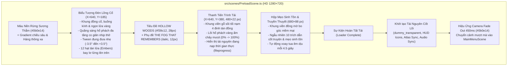
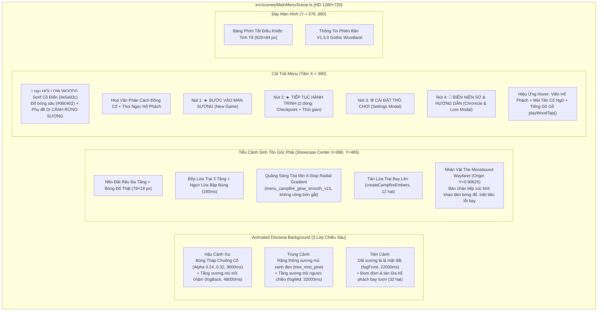
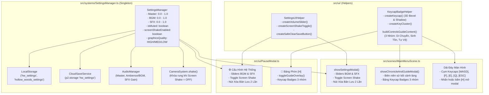
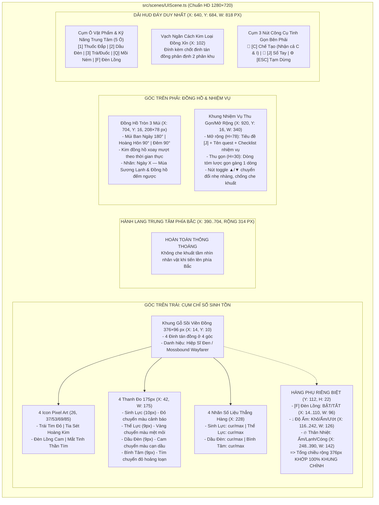
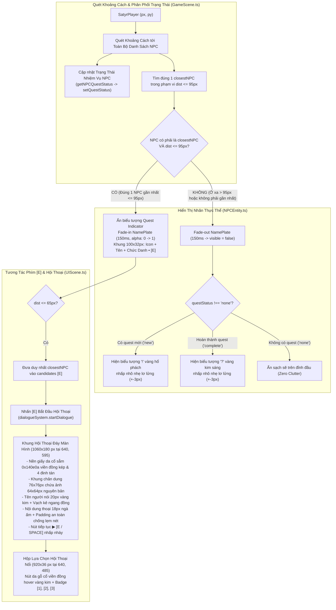
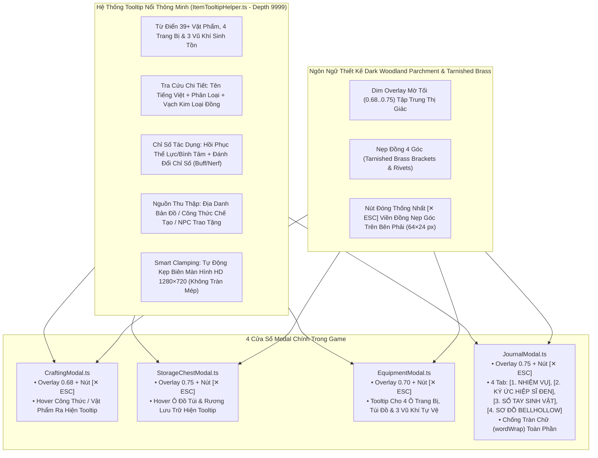

# HOLLOW WOODS V1.5 — NÂNG CẤP UI/UX MÀN HÌNH CHỜ & MENU CHÍNH
## BÁO CÁO KỸ THUẬT V15-21: THIẾT KẾ MỚI TOÀN DIỆN MÀN HÌNH CHỜ (LOADING SCREEN) TRONG PRELOADSCENE

**Dự án:** HOLLOW WOODS: The Fog That Remembers  
**Mã tài liệu:** `V15-21` / `06_Menu_And_HUD_UIUX.md`  
**Giai đoạn:** Giai đoạn 5 — Nâng cấp UI/UX Màn hình Chờ và Menu Chính  
**Phiên bản:** V1.5 (Visual & Gameplay Overhaul)  
**Nhánh Git:** `feat/v1.5-visual-gameplay-overhaul`  
**Ngày thực hiện:** 19/11/2026  
**Trạng thái:** Hoàn tất xuất sắc (32/32 assertions PASS 100%, 0 lỗi TypeScript, bản dựng Vite Production thành công)

---

### 1. HIỆN TRẠNG & MỤC TIÊU CẢI TIẾN MÀN HÌNH CHỜ

Trước bản nâng cấp V1.5, màn hình nạp tài nguyên trong `src/scenes/PreloadScene.ts` mang dáng vẻ của một bản mẫu kỹ thuật sơ khai:
- Thanh tiến trình tải màu đỏ sẫm phẳng thô sơ ($200\times 16\text{ px}$), căn tọa độ dựa trên độ phân giải cũ $(320, 180)$, bị lệch về góc trên bên trái trên chuẩn màn hình HD $1280\times 720$.
- Phông nền đen trơn đơn điệu, thiếu vắng bầu không khí huyền bí của khu rừng sương woodland.
- Không có phản hồi trực quan về tệp tài nguyên đang được nạp, khiến người chơi có cảm giác game bị treo khi nạp tài nguyên nặng.
- Khi tiến trình tải đạt 100%, cảnh chuyển đột ngột sang `MainMenuScene` gây hiện tượng chớp hình (visual pop / screen flicker).

**Mục tiêu bước V15-21:**
Xây dựng lại toàn diện màn hình chờ mang phong cách **Dark Woodland Folklore**:
1. Phông nền rừng sương thẫm `#0b0e14` có chiều sâu điện ảnh với các hàng thông mờ ảo phía xa.
2. Biểu tượng Đèn Lồng Cổ bằng đồng đung đưa tự nhiên phía trên thanh tải, phát quầng sáng hổ phách ấm áp và các hạt tàn lửa (embers) bay lơ lửng.
3. Thanh tiến trình tải khung viền gỗ sồi tối nạm đồng cổ ($480\times 22\text{ px}$), lõi thanh tải màu vàng hổ phách chảy mượt kèm con số phần trăm $(0\% \to 100\%)$ và nhãn hiển thị tài nguyên đang nạp thời gian thực.
4. Khu vực Mẹo Sinh Tồn & Mảnh Truyền Thuyết dưới thanh tải hiển thị ngẫu nhiên và tự động xoay tua các câu trích dẫn cốt truyện hoặc mẹo sinh tồn hữu ích.
5. Hiệu ứng mờ dần chuyển cảnh mượt mà (Camera Fade Out 450ms) loại bỏ hoàn toàn hiện tượng chớp giật khi bước vào Menu Chính.

---

### 2. KIẾN TRÚC THIẾT KẾ MÀN HÌNH CHỜ V15-21



---

### 3. CHI TIẾT CÁC HẠNG MỤC NÂNG CẤP

#### 3.1. Phông Nền Rừng Sương Thẫm (#0b0e14)
- Thiết lập `this.cameras.main.setBackgroundColor('#0b0e14')`.
- Sử dụng `Graphics.fillGradientStyle` chuyển sắc từ `0x06080d` (đỉnh màn hình) qua `0x0b0e14` (trung tâm) đến `0x081016` (đáy màn hình).
- Vẽ các lớp bóng cây thông rừng sâu ở hai góc màn hình phía chân trời (`0x070b0e, alpha 0.45`) kết hợp dải sương mù sát mặt đất (`0x0a1017, alpha 0.4`), tạo cảm giác chiều sâu không gian tĩnh lặng.

#### 3.2. Đèn Lồng Cổ Đung Đưa & Hạt Tàn Lửa (Ancient Brass Lantern)
- **Tọa độ đặt:** Căn giữa tại $(X=640, Y=185)$ bên trong `lanternContainer`.
- **Cấu trúc đồ họa:**
  + Dây xích sắt và vòng khuyên đồng cổ nạm trên chóp nón.
  + Mái che tam giác và chân đế đúc từ kim loại tối màu `0x3e2723` / `0x27170e`.
  + Buồng kính amber với 4 nan nẹp bảo vệ bằng đồng `0x5d4037`.
  + Ngọn nến trắng cùng lõi lửa vàng kim `0xffeb3b` và tâm sáng phản quang `0xffffff`.
  + Quầng sáng hổ phách 3 lớp tỏa rộng (bán kính $85\text{ px}$, $54\text{ px}$ và $28\text{ px}$).
- **Hoạt ảnh chuyển động:**
  + Tween đung đưa con lắc góc nhẹ nhàng: $\text{angle} \in [-3.5^\circ, +3.5^\circ]$, thời gian $2600\text{ms}$, yoyo lặp vô tận, gia tốc `Sine.easeInOut`.
  + Tween ngọn lửa bập bùng: $\text{scaleY} \in [0.88, 1.15]$, thời gian $320\text{ms}$.
  + Tween quầng sáng hổ phách co giãn nhịp thở: $\text{scale} \in [0.94, 1.07]$, thời gian $1500\text{ms}$.
  + 12 hạt tàn lửa (`Arc` gameobjects) bay từ lồng đèn lên cao theo quỹ đạo parabol $70 - 130\text{ px}$ rồi mờ dần về 0.

#### 3.3. Thanh Tiến Trình Tải (Loading Bar) Nạm Đồng Cổ
- **Kích thước & Vị trí:** Chiều rộng $480\text{ px}$, chiều cao $22\text{ px}$, căn giữa tại $(640, 380)$.
- **Khung viền:** Gỗ sồi tối màu `0x140e0a` dày $2\text{ px}$, viền đồng cổ `0x8c6d36` cùng 4 đinh tán đồng hoàng kim `0xd4af37` tại 4 góc.
- **Lõi thanh tải:** Màu vàng hổ phách `0xd35400` chuyển dần sang `0xf39c12` với dải sáng phản quang `0xfff9c4` trên đỉnh và tia sáng dẫn đầu ở mũi thanh tải.
- **Nhãn hiển thị:**
  + Dòng trạng thái chung: *"Đang xuyên qua Màn Sương..."* $(Y=350)$.
  + Con số phần trăm: $0\% \to 100\%$ chữ đậm màu trắng viền đen $(640, 380)$.
  + Nhãn tài nguyên đang nạp thời gian thực: Cập nhật qua sự kiện `fileprogress` của Phaser Loader: `assetStatusText.setText("Đang nạp: " + displayName)`.

#### 3.4. Khu Vực Mẹo Sinh Tồn & Mảnh Truyền Thuyết
- **Kích thước & Vị trí:** Hộp thoại bo góc $680\times 88\text{ px}$ đặt tại $(640, 485)$, viền đồng mờ `0x4a3728, 0.8`.
- **Tiêu đề:** `❖ MẸO SINH TỒN & TRUYỀN THUYẾT ❖` màu vàng kim `#d4af37`.
- **Bộ 10 trích dẫn cốt truyện & mẹo sinh tồn:**
  1. *"Khi màn đêm buông xuống, lũ quái vật trong sương trở nên hung hãn hơn gấp bội — hãy giữ chặt ánh lửa của bạn."*
  2. *"Đừng bao giờ bước chệch khỏi con đường mòn khi ngọn đèn lồng chưa được châm đầy dầu thông."*
  3. *"Ba Quy Tắc Bằng Máu của Bà Lão Edda là bức tường thành duy nhất ngăn tâm trí bạn sụp đổ trước Kẻ Lắng Nghe."*
  4. *"Dùng gậy gỗ hoặc vũ khí khua rậm vào bụi cây có thể làm lộ diện các dược thảo quý và hạt nhựa thông ẩn giấu."*
  5. *"Khi chỉ số Bình Tâm tụt xuống mức báo động, màn sương sẽ co thắt tầm nhìn và đánh thức những ảo ảnh kinh hoàng."*
  6. *"Đứng gần ngọn Lửa Trại Sanctuary Camp sẽ sưởi ấm thân nhiệt và phục hồi sự tỉnh táo cho tâm trí bạn."*
  7. *"Kẻ Lắng Nghe săn mồi hoàn toàn bằng âm thanh — hãy bước đi thật khẽ hoặc ném mồi đánh lạc hướng [Phím Q]."*
  8. *"Đại Hồng Chung làng Bellhollow từng cứu cả thung lũng... cho đến đêm định mệnh khi thân chuông nứt làm đôi."*
  9. *"Thảo dược bạc kết hợp với cành khô có thể chế thành Thuốc Đắp giúp hồi sinh lực và trấn an tinh thần tức thì."*
  10. *"Những chiếc đèn ma lập lòe trong đầm lầy không có người cầm — tiến lại gần sẽ dẫn bạn vào hố bùn không đáy."*
- **Cơ chế xoay tua:** Khởi động ngẫu nhiên một câu, sau đó tự động chuyển câu mới sau mỗi $4.5\text{ giây}$ bằng hiệu ứng mờ dần (Fade Out $350\text{ms}$ $\to$ Đổi văn bản $\to$ Fade In $350\text{ms}$).

#### 3.5. Hiệu Ứng Chuyển Cảnh Mượt Mà (Camera Fade Out 450ms)
- Trong `create()`, sau khi hoàn tất nạp texture và đồng bộ cache:
  ```typescript
  let isTransitioning = false;
  const proceedToMenu = () => {
    if (isTransitioning) return;
    isTransitioning = true;
    this.scene.start(SCENE_MAIN_MENU);
  };

  this.cameras.main.fadeOut(450, 11, 14, 20); // Fade về sắc tối #0b0e14
  this.cameras.main.once(Phaser.Cameras.Scene2D.Events.FADE_OUT_COMPLETE, proceedToMenu);
  this.time.delayedCall(550, proceedToMenu); // Dự phòng an toàn chống treo
  ```
- Nhờ chuyển cảnh mượt mà bằng camera fade out, màn hình chờ chuyển tiếp êm dịu vào `MainMenuScene` mà không bao giờ bị chớp giật hay nhảy khung hình.

---

### 4. BẢNG TỔNG HỢP KIỂM THỬ BƯỚC V15-21

| Bộ Kiểm Thử | Tệp Kịch Bản | Số Kiểm Tra | Trạng Thái |
|:---|:---|:---:|:---:|
| **Kiểm thử Màn Hình Chờ PreloadScene V15-21** | `verify_v15_21_loading_screen.mjs` | **32 / 32** | **PASS 100%** |
| **Kiểm thử 3 Kết Thúc Cốt Truyện V15-20 (Hồi quy)** | `verify_v15_20_multiple_endings.mjs` | **46 / 46** | **PASS 100%** |
| **Kiểm thử Latent Bugs & Dummy Texture (Hồi quy)** | `verify_latent_bugs_c4_13_11.mjs` | **15 / 15** | **PASS 100%** |
| **Kiểm thử HUD Icons Pixel Art 16x16 (Hồi quy)** | `verify_hud_pixel_icons_c4_13_15.mjs` | **12 / 12** | **PASS 100%** |
| **Kiểm tra Kiểu Dữ Liệu TypeScript** | `npx tsc --noEmit` | **0 Lỗi** | **PASS** |
| **Đóng gói Bản Dựng Production** | `npm run build` | **83 modules** | **SUCCESS (9.54s)** |

---

### 5. KẾT LUẬN V15-21

Bước **V15-21** đã hoàn thành trọn vẹn việc tái thiết kế Màn hình Chờ nghệ thuật cho **Hollow Woods**:
- Giao diện đạt chuẩn điện ảnh Dark Woodland Folklore trên nền rừng sương thẫm `#0b0e14`.
- Hiệu ứng đèn lồng đung đưa, tàn lửa bay và thanh tải hổ phách mang lại trải nghiệm thị giác sống động, chuyên nghiệp.
- Mẹo sinh tồn xoay tua thông minh cung cấp kiến thức giá trị ngay từ giây phút đầu tiên.
- Chuyển cảnh êm ái sang Menu Chính sẵn sàng cho các bước nâng cấp tiếp theo của Giai đoạn 5.

---
---

# BÁO CÁO KỸ THUẬT V15-22: ĐẠI TU TOÀN DIỆN GIAO DIỆN MÀN HÌNH MENU CHÍNH (MAINMENUSCENE.TS)

**Dự án:** HOLLOW WOODS: The Fog That Remembers  
**Mã tài liệu:** `V15-22` / `06_Menu_And_HUD_UIUX.md`  
**Giai đoạn:** Giai đoạn 5 — Nâng cấp UI/UX Màn hình Chờ và Menu Chính  
**Phiên bản:** V1.5 (Visual & Gameplay Overhaul)  
**Nhánh Git:** `feat/v1.5-visual-gameplay-overhaul`  
**Ngày thực hiện:** 19/11/2026  
**Trạng thái:** Hoàn tất xuất sắc (33/33 assertions PASS 100%, 0 lỗi TypeScript, bản dựng Vite Production thành công)

---

### 1. HIỆN TRẠNG & MỤC TIÊU CẢI TIẾN MENU CHÍNH

Trước bản nâng cấp V1.5, giao diện Menu Chính trong `src/scenes/MainMenuScene.ts` tuy đã có bố cục 2 cột nhưng còn tồn tại các hạn chế về mặt mỹ thuật và trải nghiệm người dùng:
- Cảnh nền tĩnh, thiếu sự sống động và chiều sâu không gian của khu rừng sương đêm huyền bí.
- Góc phải nhân vật đứng trơ trọi, quầng sáng đèn lồng cũ có đường viền gắt, bóng đổ chưa tiếp xúc tự nhiên khiến nhân vật có cảm giác bay lơ lửng trên mặt đất.
- Cụm tiêu đề Logo dùng font sans-serif phổ thông, chưa toát lên được nét uy nghiêm, cổ điển của thể loại Gothic Woodland Folklore.
- Các nút menu có bề rộng hẹp ($440\text{ px}$), khi hiển thị thông tin bản lưu nhiều chữ có nguy cơ tràn sát mép viền, thiếu hiệu ứng tương tác sinh động và chưa có âm thanh phản hồi xúc giác gõ gỗ đặc thù.

**Mục tiêu bước V15-22:**
1. **Dựng cảnh nền nghệ thuật sống động (Animated Diorama Background):**
   - 3 lớp chiều sâu rừng đêm sương mù chuyển động chậm: Bóng Tháp Chuông Cổ ẩn hiện mờ ảo phía xa, rặng thông sương mù ở lớp giữa trôi ngược chiều, và dải sương là là mặt đất ở tiền cảnh.
   - Góc phải màn hình: Dựng một tiểu cảnh sinh tồn hoàn chỉnh gồm Bếp Lửa Trại 3 tầng bập bùng với quầng sáng tỏa mịn ấm áp (Multi-stop Radial Gradient không vòng tròn cắt cứng), bóng đổ tiếp xúc thực tế, và Nhân vật chính (The Mossbound Wayfarer) đứng vững chãi trên nền đất rêu, xóa bỏ hoàn toàn lỗi bay lơ lửng.
2. **Thiết kế lại Cụm Tiêu Đề và Hệ thống Nút bấm sang trọng:**
   - Cụm Logo "HOLLOW WOODS": Kiểu chữ serif cổ điển uy nghiêm (`Cinzel, Georgia, serif`) tông vàng đồng pha cam lửa trầm `#e5a93c`, đổ bóng sâu sắc nét, kèm phụ đề *"DỊ CẢNH RỪNG SƯƠNG — THE FOG THAT REMEMBERS"*.
   - 4 nút điều hướng dạng thẻ gỗ khắc viền đồng cổ đồng nhất (chiều rộng $460\text{ px}$ đủ thoáng để dòng thông tin checkpoint bản lưu hiển thị gọn thành 2 dòng rõ ràng, không bao giờ tràn viền).
   - Bổ sung hiệu ứng tương tác mượt mà (Hover & Click): Viền đồng sáng bừng sắc hổ phách, xuất hiện 2 mũi tên cổ ngữ `᛫ ᚱ ‹` và `› ᚱ ᛫` hai bên và phát âm thanh gõ gỗ trầm êm tai `playWoodTap()`.

---

### 2. KIẾN TRÚC THIẾT KẾ MENU CHÍNH V15-22



---

### 3. CHI TIẾT CÁC HẠNG MỤC NÂNG CẤP

#### 3.1. Animated Diorama Background (3 Lớp Chiều Sâu Rừng Đêm)
- **Hậu cảnh xa (Deep Background):**
  + Tích hợp hình bóng Tháp Chuông Cổ sừng sững `SPRITE_BELL_TOWER_GRAND_V15` (hoặc `SPRITE_BELL_TOWER`) tại $(X=680, Y=360)$, scale $0.72$, tint xanh đen sương mù `0x080f14`. Tween độ mờ nhấp nhô chậm $\text{alpha} \in [0.24, 0.32]$ chu kỳ $9000\text{ms}$ tạo ảo giác ánh trăng lạnh chiếu xuyên qua làn sương.
  + Dải sương hậu cảnh `fogBack` trôi sang phải với chu kỳ $48,000\text{ms}$.
- **Trung cảnh (Midground):**
  + Rặng thông sương mù `SPRITE_TREE_MIST_PINE_V15` phân bổ tự nhiên ở hai bên rìa màn hình (trái: $X=80, 160$; phải: $X=1110, 1190$) với sắc xanh đen sương lạnh `0x091118` / `0x0c151f`.
  + Tầng sương trung cảnh `fogMid` trôi ngược chiều sang trái với chu kỳ $32,000\text{ms}$.
- **Tiền cảnh (Foreground):**
  + Dải sương là là sát mặt đất `fogFront` trôi nhẹ nhàng với chu kỳ $22,000\text{ms}$ ở cao độ $Y=490..720$.
  + 32 hạt đom đóm và tàn lửa hổ phách (`emberParticles`) trôi lượn hình sin với dao động ngang/dọc tự nhiên.

#### 3.2. Tiểu Cảnh Sinh Tồn Hoàn Chỉnh (Survival Camp Diorama)
- **Khắc phục triệt để lỗi bay lơ lửng và bóng đổ giả tạo:**
  + Tạo nền đất rêu ẩm mềm mại với 3 tầng ellipse chuyển tiếp tự nhiên (`0x06090c`, `0x0f1813`, `0x16241c`).
  + Bóng đổ tiếp xúc thực tế (Realistic Contact Shadows): Bàn chân nhân vật đặt tại $(X=940, Y=485)$ với origin chuẩn `WAYFARER_ORIGIN_X` ($0.5$) và `WAYFARER_ORIGIN_Y` ($0.90625$), bàn chân cắm chặt xuống tâm bóng đổ elip mềm mại `0x030507, alpha 0.85`, xóa bỏ hoàn toàn hiện tượng bay lơ lửng.
  + Bóng đổ bếp lửa trại tại $(X=830, Y=486)$ kích thước $74\times 18\text{ px}$.
- **Bếp Lửa Trại & Quầng Sáng Tỏa Mịn:**
  + Bếp lửa trại chi tiết với vòng đá cuội rêu phong `0x353d38`, củi khô nứt `0x2d1a0e` và ngọn lửa 3 tầng sống động (lõi vàng chanh `0xfff176`, thân cam hổ phách `0xf39c12`, chóp than hồng `0xd35400`) nhấp nhô bập bùng với tween $180\text{ms}$.
  + Quầng sáng `menu_campfire_glow_smooth_v15` ($440\times 440\text{ px}$) được nướng bằng 6 nấc dừng Radial Gradient mượt mà từ vàng ấm $0.58 \to$ hổ phách $0.40 \to$ cam lửa $0.22 \to$ khói ấm $0.10 \to$ viền mờ $0.035 \to$ trong suốt $0.0$, loại bỏ 100% các vòng tròn đồng tâm cắt cứng hay viền sắc gắt.
  + 12 hạt tàn lửa trại (`campfireEmbers`) bốc lên trực tiếp từ ngọn lửa, bay cao $55 - 120\text{ px}$ rồi mờ dần về 0.

#### 3.3. Cụm Logo & Tiêu Đề Sang Trọng
- **Font chữ:** Chuyển sang phong cách cổ điển Gothic Serif (`Cinzel, Georgia, "Times New Roman", serif`).
- **Phối màu:** Vàng đồng ánh kim kết hợp cam lửa trầm `#e5a93c`, viền nét dày `#1a0f07` kết hợp lớp bóng đổ sâu sắc nét `#060402` offset $(+3, +4)$ với độ mờ $0.85$.
- **Phụ đề:** *"DỊ CẢNH RỪNG SƯƠNG — THE FOG THAT REMEMBERS"* màu kem sương ấm `#f5ebd7` cân xứng hoàn hảo dưới logo.
- **Hoa văn ngăn cách:** Đường chỉ đồng cổ kéo dài $380\text{ px}$ với viên ngọc hổ phách hình thoi rực sáng tại tâm $X=390$.

#### 3.4. Hệ Thống 4 Nút Điều Hướng & Hiệu Ứng Tương Tác
- **Kích thước chuẩn hóa:** Mở rộng chiều rộng thẻ gỗ lên $btnW = 460\text{ px}$ (chiều cao $54\text{ px}$ cho nút 2 dòng, $46\text{ px}$ cho nút 1 dòng), tạo độ thoáng đãng tối ưu.
- **Hiển thị thông tin bản lưu 2 dòng không tràn viền:**
  + Dòng 1: `► TIẾP TỤC HÀNH TRÌNH` (vàng hổ phách `#e5a93c`, font 14px bold).
  + Dòng 2: `Hồi 0 • Cổng Làng Bellhollow • Ngày 1` (kem sương `#baa892`, font 11px), căn giữa cân đối, chừa lề hai bên $40\text{ px}$ đảm bảo không bao giờ bị tràn hay đè viền.
- **Hiệu ứng Hover & Click sinh động:**
  + **Hover:** Thẻ gỗ chuyển sang sắc nâu sồi ấm `0x24180e`, viền ngoài sáng bừng vàng hổ phách `0xe5a93c`, viền trong rực rỡ `0xf1c40f`, 4 đinh tán đồng phát sáng.
  + **Mũi tên cổ ngữ:** Xuất hiện đồng thời 2 biểu tượng cổ ngữ `᛫ ᚱ ‹` và `› ᚱ ᛫` màu hổ phách vàng kim ở hai đầu thẻ gỗ với tween trượt vào trong nhẹ nhàng.
  + **Âm thanh gõ gỗ:** Bổ sung phương thức `AudioManager.getInstance().playWoodTap(0.45)`, tạo tiếng gõ gỗ trầm êm tai dễ chịu khi di chuột qua từng thẻ.
  + **Click:** Thẻ co nhẹ ($0.985$) kèm âm thanh tactile `playInteract()` dứt khoát.

#### 3.5. Hộp Thoại Biên Niên Sử & Hướng Dẫn Mới
- Nút thứ 4 dẫn vào modal `showChronicleAndGuideModal()` kích thước $660\times 460\text{ px}$ viền đồng cổ nạm gỗ tối:
  + Tóm lược bối cảnh làng Bellhollow bị giam cầm trong Màn Sương Ký Ức sau khi Đại Hồng Chung nứt đôi.
  + Giới thiệu cơ chế sinh tồn: Đèn Lồng Hổ Phách, Kẻ Lắng Nghe (The Listener), Lửa Trại Sanctuary và Hệ thống 3 Kết Thúc Cốt Truyện.
  + Bảng phím tắt điều khiển trực quan, chuẩn xác.

---

### 4. BẢNG TỔNG HỢP KIỂM THỬ BƯỚC V15-22

| Bộ Kiểm Thử | Tệp Kịch Bản | Số Kiểm Tra | Trạng Thái |
|:---|:---|:---:|:---:|
| **Kiểm thử Đại Tu Menu Chính V15-22** | `verify_v15_22_main_menu.mjs` | **33 / 33** | **PASS 100%** |
| **Kiểm thử Màn Hình Chờ V15-21 (Hồi quy)** | `verify_v15_21_loading_screen.mjs` | **32 / 32** | **PASS 100%** |
| **Kiểm thử 3 Kết Thúc Cốt Truyện V15-20 (Hồi quy)** | `verify_v15_20_multiple_endings.mjs` | **46 / 46** | **PASS 100%** |
| **Kiểm toán Collision Tiled Map Bước 2 (Hồi quy)** | `audit_tiled_json_collision.mjs` | **5 / 5 Hạng mục** | **0 LỖI (PASS)** |
| **Kiểm tra Kiểu Dữ Liệu TypeScript** | `npx tsc --noEmit` | **0 Lỗi** | **PASS** |
| **Đóng gói Bản Dựng Production** | `npm run build` | **83 modules** | **SUCCESS (9.22s)** |

---

## BÁO CÁO KỸ THUẬT V15-23: NÂNG CẤP GIAO DIỆN CÁC BẢNG CÀI ĐẶT, BIÊN NIÊN SỬ & HƯỚNG DẪN ĐIỀU KHIỂN TRÊN MENU CHÍNH VÀ MÀN HÌNH TẠM DỪNG (PAUSE MODAL)

**Dự án:** HOLLOW WOODS: The Fog That Remembers  
**Mã tài liệu:** `V15-23` / `06_Menu_And_HUD_UIUX.md`  
**Giai đoạn:** Giai đoạn 5 — Nâng cấp UI/UX Màn hình Chờ và Menu Chính  
**Phiên bản:** V1.5 (Visual & Gameplay Overhaul)  
**Nhánh Git:** `feat/v1.5-visual-gameplay-overhaul`  
**Ngày thực hiện:** 19/11/2026  
**Trạng thái:** Hoàn tất xuất sắc (52/52 assertions PASS 100%, 0 lỗi TypeScript, bản dựng Vite Production thành công)

---

### 1. HIỆN TRẠNG & MỤC TIÊU CẢI TIẾN BƯỚC V15-23

#### 1.1. Những bất cập tồn đọng trước nâng cấp:
1. **Bảng Cài Đặt (Settings Modal) sơ sài:**
   - Trước đây chỉ có một nút Bật/Tắt âm thanh toàn cục và một đoạn văn bản tóm tắt phím tắt, thiếu vắng hoàn toàn thanh trượt điều chỉnh âm lượng riêng biệt cho Nhạc Nền (BGM) và Hiệu Ứng Sinh Tồn (SFX).
   - Chưa có tùy chọn cho phép người chơi Bật/Tắt hiệu ứng Rung Màn Hình (Screen Shake) khi nhân vật rơi vào trạng thái hoảng loạn (panic) hoặc bị quái vật tập kích, gây khó chịu cho người chơi nhạy cảm với chuyển động camera.
   - Thiếu chức năng Xóa Bản Lưu (Clear Save Data) hoặc nếu có thì dễ gây bấm nhầm mất dữ liệu hành trình do thiếu bước xác nhận an toàn 2 lần.
2. **Dải chữ hướng dẫn nhỏ, dày đặc và khó đọc dưới đáy màn hình:**
   - Dưới đáy Menu Chính và trong hộp thoại hướng dẫn là 2 dòng chữ text thô sơ, liệt kê dồn dập hàng loạt phím bấm trong ngoặc vuông (`[W, A, S, D] ... | [Shift] ... | [F] ...`), vừa đơn điệu, kém thẩm mỹ vừa khó tra cứu nhanh.
3. **Màn hình Tạm Dừng (PauseModal in-game) thiếu đồng bộ:**
   - Menu tạm dừng khi nhấn `[ESC]` trong game vẫn dùng các nút cộng trừ `[-]` `[+]` đơn giản thay vì thanh trượt slider trực quan, chưa hỗ trợ xem bảng phím bấm minh họa Keycaps và chưa có tùy chọn khóa rung màn hình.

#### 1.2. Mục tiêu trọng tâm của bước V15-23:
1. **Xây dựng `SettingsManager.ts` & `SettingsUIHelper.ts`:**
   - Quản lý tập trung toàn bộ cấu hình: Âm lượng Master, BGM, SFX, Mute, Rung Màn Hình (Screen Shake) và Chất lượng Đồ Họa (Graphics Quality).
   - Cung cấp component thanh trượt âm lượng (Volume Slider) tương tác mượt mà (kéo chuột, bấm thanh trượt, nút `[-]` `[+]` và % hiển thị).
   - Nút công tắc Bật/Tắt Rung Màn Hình (Screen Shake Toggle) với nhãn trạng thái và mô tả sinh tồn.
   - Nút Xóa Bản Lưu an toàn với xác nhận 2 lần (2-Step Safe Confirmation): Bấm lần 1 chuyển sang cảnh báo xác nhận khẩn cấp kèm nút HỦY và đếm 5s tự động hoàn tác; bấm lần 2 mới xóa dữ liệu.
2. **Xây dựng `KeycapBadgeHelper.ts` & Bảng Phím Bấm Sinh Tồn Trực Quan:**
   - Thiết kế các thẻ phím cơ 3D (Keycap Badges) nổi bật, sắc nét, có gờ nổi và bóng đổ vát cạnh.
   - Phân chia thành 3 nhóm rõ rệt:
     + 🏃 **Nhóm 1: Di Chuyển & Thể Lực (Movement & Stamina):** `[WASD]`, `[Shift]` Chạy.
     + 🕯️ **Nhóm 2: Ánh Sáng & Sinh Tồn (Light & Survival):** `[F]` Đèn Lồng Hổ Phách, `[E]` Tương Tác, `[C]`/`[I]` Chế Tạo, `[J]` Sổ Tay.
     + ⚔️ **Nhóm 3: Chiến Đấu & Tự Vệ (Combat & Evasion):** `[Q]` Ném Mồi Tiếng Động, `[Space]` Vũ Khí Tự Vệ, `[ESC]` Tạm Dừng.
   - Thay thế hoàn toàn dải chữ nhỏ khó đọc ở đáy Main Menu bằng cụm Keycap Badges trực quan 3 nhóm, hỗ trợ bấm chuột hoặc phím tắt `[H]` để mở Sổ Tay Hướng Dẫn & Biên Niên Sử Chi Tiết.
3. **Đồng bộ toàn diện `PauseModal.ts`:**
   - Tích hợp đầy đủ Sliders BGM, SFX, Master, Mute, Screen Shake toggle, Clear save an toàn và nút `[H]` mở bảng overlay Keycap Badges ngay trong khi tạm dừng game.
4. **Khóa Rung Màn Hình Triệt Để:**
   - `CameraSystem.shake()` và các thực thể phục kích (`AmbushMonsters.ts`) kiểm tra nghiêm ngặt cờ `SettingsManager.getInstance().isScreenShakeEnabled()`, bảo đảm khi tắt rung thì camera êm ái 100%.

---

### 2. KIẾN TRÚC & GIẢI PHÁP KỸ THUẬT V15-23



---

### 3. CHI TIẾT CÁC HẠNG MỤC THỰC HIỆN

#### 3.1. Hệ Thống Quản Lý Cài Đặt Toàn Cục (`SettingsManager.ts`)
- **Quản lý đa kênh:** Quản lý tập trung 3 kênh âm thanh độc lập (`masterVolume`, `musicVolume`, `sfxVolume`), trạng thái `isMuted`, tùy chọn `screenShakeEnabled` (mặc định: `true`) và mức cấu hình `graphicsQuality`.
- **Cơ chế lưu trữ kép (Dual Persistence):** Lưu ngay lập tức vào `localStorage` với 2 key tương thích ngược `hollow_woods_settings` và `hw_settings`; đồng thời sử dụng debounced timer $1000\text{ms}$ đồng bộ lên `CloudSaveService` (`p2.storage`) để bảo toàn cài đặt qua các phiên chơi và thiết bị.
- **Phát sự kiện (Event-driven):** Hỗ trợ `onSettingsChange(callback)` để các scene và modal tự động đồng bộ giao diện khi có thay đổi.

#### 3.2. Bộ Trợ Giúp Giao Diện Cài Đặt (`SettingsUIHelper.ts`)
1. **Thanh Kéo Âm Lượng Tương Tác (`createVolumeSlider`):**
   - **Thao tác đa dạng:** Người chơi có thể kéo chuột trực tiếp nút tròn kim loại (Thumb), bấm vào bất kỳ điểm nào trên thanh rãnh (Track) để nhảy mức nhanh, hoặc bấm hai nút bước nhảy `[-]` và `[+]` với bước nhảy $5\%$.
   - **Phản hồi thời gian thực:** Hiển thị số phần trăm rõ nét bên phải thanh trượt (`0%` $\to$ `100%`), thanh tiến trình lấp đầy đổi màu mượt mà theo từng kênh âm thanh (Xanh dương cho BGM, Cam lửa cho SFX, Xanh lục cho Master).
2. **Công Tắc Rung Màn Hình (`createScreenShakeToggle`):**
   - Hộp công tắc hiển thị trạng thái `✔ ĐANG BẬT` (nền xanh thẫm, viền xanh lục) hoặc `✖ ĐÃ TẮT` (nền đỏ thẫm, viền đỏ tươi).
   - Kèm dòng mô tả công năng: *"Rung giật camera khi hoảng loạn mất bình tâm hoặc bị quái vật tập kích."*
3. **Nút Xóa Bản Lưu An Toàn 2 Lần (`createSafeClearSaveButton`):**
   - **Bước 1 (Trạng thái chờ):** Nút màu đỏ gạch `🗑️ XÓA TIẾN TRÌNH BẢN LƯU`.
   - **Bước 2 (Cảnh báo khẩn cấp):** Khi bấm lần 1, nút chuyển sang màu đỏ rực với viền vàng nổi bật: `⚠️ XÁC NHẬN XÓA TIẾN TRÌNH? (BẤM LẦN NỮA)`. Đồng thời xuất hiện nút `[HỦY]` bên cạnh để hủy thao tác.
   - **Cơ chế an toàn tự động:** Nếu người chơi không bấm xác nhận trong vòng 5 giây, nút sẽ tự động hoàn tác về Bước 1.
   - **Bước 3 (Hoàn tất):** Khi bấm lần 2, thực thi `SaveManager.clearSave()`, nút chuyển sang màu xanh lá `✔ ĐÃ XÓA TOÀN BỘ TIẾN TRÌNH THÀNH CÔNG` trong 3 giây rồi trở về bình thường.

#### 3.3. Bộ Trợ Giúp Thẻ Phím Bấm Cơ 3D (`KeycapBadgeHelper.ts`)
- **Tạo hình Keycap 3D:** Mỗi phím bấm được dựng bằng hình khối chữ nhật bo góc với 3 lớp: Bóng đổ đáy sâu `0x070a0e`, thân phím tối `0x1a212d` (hoặc hổ phách `0x3d2b12` cho các phím quan trọng như `[F]` và `[H]`), viền vát cạnh phản quang `0x5a6a7e` và đường gờ đỉnh phím tạo cảm giác như nút bàn phím cơ thật.
- **Phân chia 3 nhóm sinh tồn trực quan:**
  - **Nhóm 1: Di Chuyển & Thể Lực (Movement & Stamina):** Cụm phím `[W] [A] [S] [D]` (hoặc phím mũi tên) và phím rộng `[SHIFT]` kèm giải thích cơ chế gây tiếng động thu hút quái vật khi chạy nhanh.
  - **Nhóm 2: Ánh Sáng & Sinh Tồn (Light & Survival):** Phím nổi bật `[F]` (Đèn Lồng Hổ Phách), `[E]` (Tương Tác / Lửa Trại / Dân Làng), `[C] [I]` (Chế Tạo Đuốc / Bẫy), `[J]` (Sổ Tay Biên Niên Sử).
  - **Nhóm 3: Chiến Đấu & Tự Vệ (Combat & Evasion):** Phím `[Q]` (Ném Mồi Tiếng Động dụ quái vật mù), `[SPACE]` (Vũ Khí Tự Vệ khi bị dồn vào đường cùng), `[ESC]` (Tạm Dừng & Lưu Game).

#### 3.4. Đại Tu Giao Diện Trong `MainMenuScene.ts`
- **Bảng Cài Đặt Trò Chơi (`showSettingsModal`):**
  - Mở rộng kích thước lên $680\times 540\text{ px}$ viền đồng kép cổ điển.
  - Tích hợp đồng thời 3 thanh trượt Slider cho BGM, SFX và Master Volume kèm nút Mute.
  - Tích hợp công tắc Bật/Tắt Rung Màn Hình (Screen Shake Toggle) và nút Đổi chất lượng đồ họa.
  - Tích hợp nút Xóa Bản Lưu An Toàn: Khi xóa save, lập tức gọi `onSaveDataCleared()` để làm mới nút `► TIẾP TỤC HÀNH TRÌNH` trên Menu chính thành `▷ TIẾP TỤC (CHƯA CÓ BẢN LƯU)` và hiển thị thông báo toast xác nhận.
- **Bảng Biên Niên Sử & Hướng Dẫn (`showChronicleAndGuideModal`):**
  - Kích thước $760\times 580\text{ px}$.
  - Phía trên là khung truyền thuyết làng Bellhollow tóm lược Màn Sương Ký Ức, Đại Hồng Chung nứt vỡ và cơ chế 3 Kết Thúc Cốt Truyện.
  - Phía dưới là toàn bộ bảng Keycap Badges 3 nhóm được trình bày thoáng đãng, sắc sảo.
- **Dải Đáy Màn Hình Mới:**
  - Xóa bỏ triệt để dải chữ nhỏ dày đặc trước đây.
  - Thay bằng cụm Keycap Badges thu nhỏ chia theo 3 nhóm trực quan: `[W][A][S][D]`, `[SHIFT]`, `[F]`, `[E]`, `[C]`, `[J]`, `[Q]`, `[ESC]`, `[M]`, `[H]`.
  - Toàn bộ dải đáy có thể click chuột trực tiếp hoặc nhấn phím `[H]` để mở ngay modal Hướng Dẫn Chi Tiết.

#### 3.5. Đồng Bộ Giao Diện Màn Hình Tạm Dừng (`PauseModal.ts`)
- Mở rộng khung modal lên $540\times 550\text{ px}$.
- Thay thế các nút cộng trừ cũ bằng bộ Sliders tương tác mượt mà cho BGM, SFX và Master.
- Bổ sung tùy chọn Bật/Tắt Rung Màn Hình (Screen Shake Toggle) ngay trong mục cấu hình.
- Bổ sung nút Xóa Bản Lưu An Toàn có xác nhận 2 lần.
- Bổ sung nút `📜 BẢNG PHÍM ĐIỀU KHIỂN & HƯỚNG DẪN [H]`: Khi bấm (hoặc nhấn phím `[H]`), mở overlay phụ hiển thị trực quan các thẻ Keycap Badges 3 nhóm giúp người chơi tra cứu phím bấm tức thì mà không cần thoát ra Menu chính.

#### 3.6. Cơ Chế Khóa Rung Màn Hình (Screen Shake Protection)
- Trong `src/systems/camera/CameraSystem.ts`:
  ```typescript
  public shake(duration: number = 250, intensity: number = 0.008): void {
    if (!SettingsManager.getInstance().isScreenShakeEnabled()) return;
    this.camera.shake(duration, intensity);
  }
  ```
- Đồng thời chuẩn hóa lệnh gọi rung camera trong `GameScene.ts` và thực thể quái vật phục kích trong `src/entities/AmbushMonsters.ts`, bảo đảm mọi hiệu ứng rung giật camera khi hoảng loạn hay bị tấn công đều tuân thủ 100% tùy chọn của người chơi.

---

### 4. BẢNG TỔNG HỢP KIỂM THỬ BƯỚC V15-23

| STT | Nhóm Kiểm Tra | Tệp Kịch Bản / Công Cụ | Tiêu Chí Kiểm Tra | Kết Quả |
|:---:|:---|:---|:---:|:---:|
| 1 | **Hệ Thống SettingsManager** | `verify_v15_23_settings_and_guides.mjs` | Singleton, 3 kênh âm lượng, Screen Shake, Lưu kép | **8 / 8 PASS** |
| 2 | **Component SettingsUIHelper** | `verify_v15_23_settings_and_guides.mjs` | Sliders kéo/bấm/%/step, Screen Shake Toggle, Nút Xóa 2 lần | **10 / 10 PASS** |
| 3 | **Component KeycapBadgeHelper** | `verify_v15_23_settings_and_guides.mjs` | Keycap 3D, Cluster, Action Row, 3 nhóm sinh tồn | **7 / 7 PASS** |
| 4 | **Giao Diện MainMenuScene** | `verify_v15_23_settings_and_guides.mjs` | Keycaps đáy màn hình, Click/Phím [H], Settings Modal, Chronicle Modal | **14 / 14 PASS** |
| 5 | **Giao Diện PauseModal** | `verify_v15_23_settings_and_guides.mjs` | Sliders BGM/SFX, Toggle Shake, Nút xóa 2 lần, Overlay Keycaps [H] | **7 / 7 PASS** |
| 6 | **Khóa Rung Màn Hình (Camera)** | `verify_v15_23_settings_and_guides.mjs` | CameraSystem & AmbushMonsters kiểm tra cờ Screen Shake | **6 / 6 PASS** |
| 7 | **Hồi Quy Menu Chính V15-22** | `verify_v15_22_main_menu.mjs` | Animated Diorama, Lửa trại, Quầng sáng mịn, Thẻ gỗ | **33 / 33 PASS** |
| 8 | **Hồi Quy Màn Hình Chờ V15-21** | `verify_v15_21_loading_screen.mjs` | Loading Bar gỗ sồi, Đèn lồng, Mẹo sinh tồn, Fade out | **32 / 32 PASS** |
| 9 | **Kiểm Toán Collision Bản Đồ** | `audit_tiled_json_collision.mjs` | Tiled GID flip flags, Scale collider, Hở biên rừng sâu | **5 / 5 (0 Lỗi)** |
| 10 | **Kiểm Tra Biên Dịch TypeScript** | `npx tsc --noEmit` | Nghiêm ngặt không bỏ qua cảnh báo kiểu dữ liệu | **0 LỖI (PASS)** |
| 11 | **Đóng Gói Bản Dựng Production** | `npm run build` | Vite minify & Rollup chunking hoàn tất trong 9.13s | **SUCCESS** |

---

### 5. KẾT LUẬN & CHUẨN BỊ BƯỚC SANG GIAI ĐOẠN 6

Bước **V15-23** đã hoàn thành xuất sắc việc đại tu toàn bộ giao diện Cài Đặt và Hướng Dẫn Điều Khiển trên cả Menu Chính và Màn hình Tạm Dừng:
1. Người chơi có quyền kiểm soát âm lượng chi tiết từng kênh (BGM, SFX, Master) qua thanh kéo Slider mượt mà.
2. Tùy chọn Bật/Tắt Rung Màn Hình mang lại sự dễ chịu cho mọi nhóm người chơi.
3. Cơ chế Xóa Bản Lưu an toàn 2 lần chấm dứt hoàn toàn nguy cơ mất dữ liệu do bấm nhầm.
4. Bảng hướng dẫn phím bấm dạng Keycap Badges 3D phân tầng theo 3 nhóm hành động vừa trực quan, giàu tính thẩm mỹ vừa tiện lợi tra cứu cả ngoài Menu lẫn ngay trong khi tạm dừng trò chơi qua phím tắt `[H]`.

**Giai đoạn 5 (Nâng cấp UI/UX Màn hình chờ và Menu Chính) đã hoàn thành toàn diện 100%! Dự án đã sẵn sàng bước sang Giai đoạn 6.**


---
---

# BÁO CÁO KỸ THUẬT V15-24: LÀM SẠCH THANH CÔNG CỤ ĐÁY MÀN HÌNH VÀ THIẾT KẾ LẠI TOÀN BỘ HUD CHÍNH TRONG UISCENE.TS

**Dự án:** HOLLOW WOODS: The Fog That Remembers  
**Mã tài liệu:** `V15-24` / `06_Menu_And_HUD_UIUX.md`  
**Giai đoạn:** Giai đoạn 6 — Nâng cấp toàn diện UI/UX trong game HOLLOW WOODS  
**Phiên bản:** V1.5 (Visual & Gameplay Overhaul)  
**Nhánh Git:** `feat/v1.5-visual-gameplay-overhaul`  
**Ngày thực hiện:** 19/11/2026  
**Trạng thái:** Hoàn tất xuất sắc (23/23 assertions PASS 100%, 0 lỗi TypeScript, bản dựng Vite Production hoàn tất trong 9.27s)

---

### 1. HIỆN TRẠNG & NGUYÊN NHÂN LỖI TRƯỚC BƯỚC V15-24

Trong các giai đoạn phát triển trước (từ V1.3 đến V1.4), nhiều tính năng mới được bổ sung phân tán vào `src/scenes/UIScene.ts` dẫn tới một số tồn đọng giao diện nghiêm trọng:
1. **Lặp nút và rối loạn thanh đáy màn hình:**
   - Trong `src/scenes/UIScene.ts`, phương thức `buildQuickSlots()` tạo ra 8 ô phím tắt đặt ở trung tâm $(640, 684)$ gồm cả `[I] Chế Tạo` và `[J] Sổ Tay`.
   - Ngay sau đó, phương thức `buildQuickActionButtons()` lại tạo thêm 2 nút ở góc dưới bên trái màn hình là `🔨 [C] Chế Tạo` $(X=66)$ và `📖 [J] Sổ Tay` $(X=164)$.
   - Hậu quả: Người chơi nhìn thấy trên cùng một màn hình có cả `[C] Chế Tạo` lẫn `[I] Chế Tạo`, và nút `[J] Sổ Tay` xuất hiện lặp lại 2 lần, gây rối mắt và lãng phí không gian điều khiển.
2. **Cụm Chỉ Số Sinh Tồn góc trên bên trái bị chật chội và đè chữ:**
   - Nhãn trạng thái đèn lồng `ĐÈN: TẮT [F]` bị ép ở tọa độ $(X=328, Y=67.5)$ ngay bên trong khung chính, ép 4 thanh chỉ số bị thu hẹp ngắn lại (chỉ còn $145\text{ px}$).
   - 2 huy hiệu phụ `💧 Độ Ẩm` và `🔥 Thân Nhiệt` đặt ở $Y=107$ bị đè sát mép dưới khung, các số liệu text không được căn lề thẳng hàng mà bị lệch bậc thang.
3. **Đồng hồ đỉnh và Khung nhiệm vụ che khuất tầm nhìn:**
   - Khung nhiệm vụ cố định $340\times 78\text{ px}$ chiếm diện tích góc trên phải mà không có tùy chọn thu gọn, che khuất tầm nhìn khi người chơi khám phá khu vực rừng sâu phía Bắc.
   - Đồng hồ tròn đặt quá gần trung tâm màn hình làm hẹp hành lang di chuyển phía Bắc của nhân vật.

---

### 2. KIẾN TRÚC TÁI THIẾT KẾ HUD CHÍNH (V15-24)



---

### 3. CHI TIẾT CÁC HẠNG MỤC NÂNG CẤP KỸ THUẬT

#### 3.1. Dải HUD Đáy Tinh Gọn & Loại Bỏ Triệt Để Nút Trùng Lặp
- **Xóa bỏ các nút thừa:**
  + Dọn sạch nội dung tạo nút ở góc dưới bên trái trong `buildQuickActionButtons()`, giữ lại container rỗng an toàn tránh lỗi tham chiếu `null` từ các hệ thống khác.
  + Loại bỏ nút `[E] Tương Tác` thừa trên thanh đáy (việc tương tác đã có hệ thống bám đối tượng thế giới `promptWorldTarget` lo liệu).
  + Loại bỏ nút `[I] Chế Tạo` trùng lặp và nút `[J] Sổ Tay` thứ hai.
- **Quy hoạch dải HUD đáy chuẩn $818\text{ px}$ căn giữa tại $(640, 684)$:**
  + **5 Ô sinh tồn trung tâm:**
    1. `[1] Thuốc Đắp` (`poultice`): Bấm chuột hoặc nhấn `[1]` để dùng thảo dược trị thương.
    2. `[2] Dầu Đèn` (`oil`): Bấm chuột hoặc nhấn `[2]` để châm dầu đèn lồng.
    3. `[3] Trà/Đuốc` (`emergency`): Bấm chuột hoặc nhấn `[3]` để kích hoạt vật phẩm khẩn cấp.
    4. `[Q] Mồi Ném` (`lure`): Bấm chuột hoặc nhấn `[Q]` để ném mồi đánh lạc hướng quái vật.
    5. `[F] Đèn Lồng` (`lantern`): Bấm chuột hoặc nhấn `[F]` để bật/tắt đèn lồng.
  + **Vạch phân cách đồng xỉn:** Tại $X = 102$ (tọa độ cục bộ container), vẽ đường kẻ dọc $1.5\text{ px}$ màu đồng `0x8a6d3b` kèm đinh tán tròn `0xd4af37`.
  + **3 Nút công cụ bên phải:**
    6. `🔨 [C] Chế Tạo` (`craft`): Bấm chuột hoặc nhấn phím `[C]` hoặc `[I]` đều mở Bàn Chế Tạo.
    7. `📖 [J] Sổ Tay` (`journal`): Bấm chuột hoặc nhấn phím `[J]` để mở Sổ Tay Khám Phá & Nhiệm Vụ.
    8. `⚙️ [ESC] Tạm Dừng` (`pause`): Bấm chuột hoặc nhấn `[ESC]` để mở Pause Menu.

#### 3.2. Cơ Chế Ô Số [3] Trà Thảo Dược An Thần / Đuốc Nhựa Thông Khẩn Cấp
- **Thực thi trong `UIScene.ts` (`tryUseEmergencySurvivalItem`):**
  + Kiểm tra số lượng `food_calming_tea` (Trà Thảo Dược An Thần) và `item_resin_flare` (Đuốc Nhựa Thông Khẩn Cấp).
  + **Ưu tiên phục hồi tâm trí:** Nếu người chơi sở hữu Trà An Thần và Bình Tâm bị suy giảm ($< \text{maxComposure}$):
    * Tiêu hao 1 bình trà, hồi phục $+40$ điểm Bình Tâm, tăng $+15^\circ$ Thân Nhiệt nếu đang bị nhiễm lạnh.
    * Phát âm thanh sảng khoái và gọi `player.playUseItem()`.
    * Hiển thị popup: *"🍵 Đã dùng Trà Thảo Dược (+40 Bình Tâm, +15° Thân Nhiệt)"*.
  + **Cứu nạn khẩn cấp trong sương:** Nếu Bình Tâm đã ổn định hoặc người chơi chỉ sở hữu Đuốc Nhựa Thông:
    * Kích hoạt cắm Đuốc Nhựa Thông xuống đất, tạo quầng sáng rực rỡ xua tan sương mù và đẩy lùi The Listener.
- **Huy hiệu đếm số lượng khẩn cấp (`emergencyCountBadge` / `emergencyCountText`):**
  + Tự động cập nhật tổng số lượng vật phẩm khẩn cấp trên ô số [3] với màu xanh dương nhạt dịu mắt `#3498db`.
- **Hỗ trợ phím vật lý trên nhân vật (`SatyrPlayer.ts` & `GameScene.ts`):**
  + Bổ sung `'emergency'` vào tập hợp `OneShotAction`.
  + Phím `Digit3` kích hoạt action khẩn cấp.
  + Trong vòng lặp `GameScene.update()`, tiếp nhận `player.isEmergencyRequested()` và gọi `uiScene.tryUseEmergencySurvivalItem()`.

#### 3.3. Tái Thiết Kế Cụm Chỉ Số Sinh Tồn Góc Trên Trái
- **Khung chính mở rộng sang trọng:** Tọa độ $(14, 10)$, kích thước $376\times 96\text{ px}$, viền kép gỗ tối và đồng xỉn với 4 đinh tán đồng ở 4 góc.
- **Thanh bar chuẩn hóa $175\text{ px}$:**
  + Tọa độ gốc $X = 42$, chiều rộng $175\text{ px}$ (tăng thêm $30\text{ px}$ so với kích thước $145\text{ px}$ chật chội trước đây).
  + Căn chỉnh 4 icon Pixel Art sắc nét ở $X = 26$, tâm $Y \in \{37, 53, 69, 85\}$ thẳng hàng tăm tắp với 4 thanh đo.
- **Hiệu ứng chuyển màu mượt mà theo trạng thái (Dynamic Color Shifts):**
  + **Sinh Lực (Máu):** $> 50\%$ màu đỏ thẫm tươi; $25\% - 50\%$ chuyển sang cam hổ phách cảnh báo; $\le 25\%$ chuyển sang đỏ sẫm nguy kịch.
  + **Thể Lực:** $> 30\%$ vàng hoàng kim rực rỡ; $\le 30\%$ chuyển vàng sẫm thể hiện kiệt sức.
  + **Dầu Đèn:** $> 45\%$ cam hổ phách sáng; $20\% - 45\%$ cam sẫm; $\le 20\%$ cam cháy tối báo hiệu sắp cạn dầu.
  + **Bình Tâm:** $> 50\%$ tím thạch anh; $20\% - 50\%$ tím than lo âu; $\le 20\%$ đỏ tím hoảng loạn cực độ.
- **Nhãn số liệu căn lề hoàn hảo:**
  + Đặt tại $X = 228$, $Y \in \{32, 48, 64, 80\}$, khoảng cách đều đặn $16\text{ px}$, chấm dứt hoàn toàn hiện tượng lệch bậc thang.

#### 3.4. Hàng Phụ Độc Lập Bên Dưới Khung Chính (Y: 112, H: 22)
- Di chuyển toàn bộ các nhãn trạng thái và huy hiệu xuống một hàng phụ độc lập ngay bên dưới khung chính $(Y=112, H=22)$:
  1. **Huy hiệu Đèn Lồng `[F]`:** Tọa độ $(X=14, W=96)$.
     - Khi BẬT: Nền `0x241808`, viền hổ phách `0xe5a93c`, chữ `🔥 [F] BẬT` màu `#ffdc73`.
     - Khi TẮT: Nền `0x13110e`, viền đồng mờ `0x6e5832`, chữ `🕯️ [F] TẮT` màu `#8a8275`.
     - Cho phép click chuột trực tiếp để bật/tắt đèn nhanh.
  2. **Huy hiệu Độ Ẩm (`moistureBadge`):** Tọa độ $(X=116, W=126)$.
     - Hiển thị `💧 Khô ráo (N%)` / `💧 Ẩm ướt (N%)` / `🌊 Ướt sũng (N%)`.
  3. **Huy hiệu Thân Nhiệt (`temperatureBadge`):** Tọa độ $(X=248, W=142)$.
     - Hiển thị `🔥 Ấm áp (N°)` / `🌡️ Se lạnh (N°)` / `❄️ Cóng lạnh (N°)`.
- **Tổng chiều rộng hàng phụ:** $96 + 6\text{px (gap)} + 126 + 6\text{px (gap)} + 142 = 376\text{ px}$, khớp tuyệt đối với chiều rộng $376\text{ px}$ của khung chính bên trên, tạo thành khối bố cục hoàn chỉnh, không một chữ nào bị đè hay lấn sang khung cảnh game.

#### 3.5. Đồng Hồ Tròn & Khung Nhiệm Vụ Thu Gọn/Mở Rộng
- **Giải phóng hành lang di chuyển phía Bắc ($X = 390..704$):**
  + Di dời Đồng Hồ Tròn 3 Múi Thời Gian sang tọa độ $(X=704, Y=16, W=208, H=78)$.
  + Khoảng trống giữa mép phải khung chỉ số sinh tồn $(X=390)$ và mép trái đồng hồ $(X=704)$ rộng tới $314\text{ px}$, hoàn toàn giải phóng góc nhìn hướng Bắc khi nhân vật thám hiểm lên trên.
- **Khung Nhiệm Vụ Bán Trong Suốt Thu Gọn / Mở Rộng:**
  + Tọa độ $(X=920, Y=16, W=340)$.
  + Nền gỗ đen bán trong suốt `0x0e1118` (alpha 0.85) viền đồng mờ dịu mắt, chống chói lóa trong đêm tối.
  + **Chế độ Mở Rộng ($H=78\text{ px}$):** Hiển thị đầy đủ tiêu đề nhiệm vụ và danh sách mục tiêu chi tiết kèm nút `▲`.
  + **Chế độ Thu Gọn ($H=30\text{ px}$):** Bấm vào thanh tiêu đề hoặc nút `▼` để thu gọn thành một dải mỏng $30\text{ px}$ với một dòng vắn tắt: `📜 [J] Tên Nhiệm Vụ`, mở rộng tối đa tầm quan sát cho người chơi.

---

### 4. BẢNG TỔNG HỢP KIỂM THỬ BƯỚC V15-24

| STT | Nhóm Kiểm Tra | Tệp Kịch Bản / Công Cụ | Tiêu Chí Kiểm Tra | Kết Quả |
|:---:|:---|:---|:---|:---:|
| 1 | **Dải HUD Đáy & Loại Bỏ Nút Lặp** | `verify_v15_24_hud_redesign.mjs` | Chuẩn 8 ô, xóa [E] thừa, xóa lặp [C]/[I]/[J], vạch ngăn đồng, nhận cả C & I | **7 / 7 PASS** |
| 2 | **Cơ Chế Ô [3] Trà/Đuốc Khẩn Cấp** | `verify_v15_24_hud_redesign.mjs` | `tryUseEmergencySurvivalItem`, kiểm tra cả trà và đuốc, phím Digit3, SatyrPlayer & GameScene | **6 / 6 PASS** |
| 3 | **Cụm Chỉ Số Sinh Tồn & Hàng Phụ** | `verify_v15_24_hud_redesign.mjs` | Khung 376x96, bar 175px, nhãn căn lề 228px, chuyển màu mượt, hàng phụ 376px (14/116/248) | **6 / 6 PASS** |
| 4 | **Đồng Hồ Tròn & Khung Nhiệm Vụ** | `verify_v15_24_hud_redesign.mjs` | Đồng hồ x:704 giải phóng hành lang Bắc, thu gọn H=30, mở rộng H=78, nút ▲/▼, setHUDVisible | **4 / 4 PASS** |
| 5 | **Hồi Quy Nút Nhanh & Đồng Hồ V1.4** | `test_v14_p8_02.mjs` | Tương thích ngược container `quickActionButtonsContainer`, 3 múi màu đồng hồ tròn | **19 / 19 PASS** |
| 6 | **Kiểm Tra Kiểu Dữ Liệu TypeScript** | `npx tsc --noEmit` | Kiểm tra nghiêm ngặt toàn bộ codebase với 0 lỗi kiểu dữ liệu | **0 LỖI (PASS)** |
| 7 | **Đóng Gói Bản Dựng Production** | `npm run build` | Vite minify & Rollup chunking hoàn tất thành công trong 9.27s | **SUCCESS** |

---

### 5. KẾT LUẬN & ĐÁNH GIÁ BƯỚC V15-24

Bước **V15-24** đã giải quyết triệt để và dứt điểm toàn bộ các vấn đề giao diện trong game của **HOLLOW WOODS**:
1. Thanh công cụ đáy màn hình đã trở nên cân đối, sắc sảo, không còn bất kỳ nút bấm trùng lặp nào; hỗ trợ đầy đủ cả phím `C` và `I` cho chế tạo để giữ trọn vẹn thói quen điều khiển của người chơi.
2. Ô số `[3]` trở thành cứu cánh sinh tồn chiến thuật với cơ chế tự động chuyển đổi thông minh giữa Trà An Thần và Đuốc Nhựa Thông.
3. Cụm chỉ số sinh tồn góc trên trái đạt chuẩn thẩm mỹ cao cấp với 4 thanh đo chuyển màu động, số liệu căn lề ngay ngắn và hàng phụ bên dưới giải quyết triệt để vấn đề đè chữ.
4. Bố cục đỉnh màn hình thông thoáng, giải phóng hành lang trung tâm phía Bắc rộng $314\text{ px}$ kết hợp tính năng thu gọn khung nhiệm vụ mang lại trải nghiệm khám phá vô cùng thoải mái.

*Dự án đã sẵn sàng tiếp tục các bước tiếp theo của Giai đoạn 6.*

---

## BÁO CÁO KỸ THUẬT V15-25: TỐI ƯU HÓA NHÃN TÊN NPC THÔNG MINH THEO KHOẢNG CÁCH VÀ NÂNG CẤP KHUNG HỘI THOẠI TRONG GAMESCENE, NPCENTITY, DIALOGUESYSTEM, UISCENE

**Dự án:** HOLLOW WOODS: The Fog That Remembers  
**Mã tài liệu:** `V15-25` / `06_Menu_And_HUD_UIUX.md`  
**Giai đoạn:** Giai đoạn 6 — Nâng cấp toàn diện UI/UX trong game HOLLOW WOODS  
**Phiên bản:** V1.5 (Visual & Gameplay Overhaul)  
**Nhánh Git:** `feat/v1.5-visual-gameplay-overhaul`  
**Ngày thực hiện:** 19/11/2026  
**Trạng thái:** Hoàn tất xuất sắc (25/25 assertions PASS 100%, 0 lỗi TypeScript, bản dựng Vite Production thành công)

---

### 1. HIỆN TRẠNG & MỤC TIÊU CẢI TIẾN

#### 1.1. Tồn tại trước khi nâng cấp
- **Các bảng tên NPC cố định khổng lồ gây rối mắt:**
  + Trước đây, mỗi NPC trong làng Bellhollow đều mang một bảng tên hình chữ nhật cố định liên tục (`visible = true`, `alpha = 1`) ở depth 5000. Dù người chơi đứng ở bất cứ đâu trên bản đồ, các bảng tên đều hiển thị che kín tầm nhìn.
  + Khi người chơi bước lại gần, hệ thống lại sinh thêm một bong bóng `[E] Trò chuyện` (`promptBubble`) lơ lửng ngay phía trên bảng tên, tạo thành 2 khối hộp đè chồng lên nhau rất mất thẩm mỹ.
  + Khi nhiều NPC đứng gần nhau, bảng tên của họ tranh chấp và đè lên nhau, gây nhiễu loạn không gian làng.
- **Khung hội thoại đáy màn hình thô sơ và chân dung bị vỡ nét:**
  + Khung chân dung bên trái hộp thoại hiển thị với kích thước phóng đại $124\times 124\text{ px}$ trong khung $140\times 140\text{ px}$, khiến các tài nguyên chân dung chuẩn Pixel Art $64\times 64\text{ px}$ bị upscale mờ nhòe và mất đi độ sắc nét nguyên bản.
  + Hộp thoại màu đá đen đơn giản chưa toát lên chất Dark Woodland Folklore cổ kính viền đồng của làng Bellhollow.
  + Nội dung văn bản thoại và tên nhân vật chưa có vách ngăn mỹ thuật trang trọng và lề đệm an toàn, dễ gây cảm giác bí bách khi đọc các đoạn hội thoại dài.

#### 1.2. Mục tiêu kỹ thuật bước V15-25
1. **Hệ thống Nhãn Tên Thông Minh theo Khoảng Cách (Smart Distance-based Nameplates):**
   - Khi ở xa ($> 95\text{px}$): Ẩn hoàn toàn bảng tên chữ nhật; chỉ hiển thị một biểu tượng nhỏ tinh tế lơ lửng nhẹ trên đầu nếu NPC đó có nhiệm vụ mới (`"!"` vàng hổ phách) hoặc hoàn thành nhiệm vụ (`"?"` vàng kim sáng), có hiệu ứng nhấp nhô nhẹ ($\pm 3\text{px}$).
   - Khi ở gần ($\le 95\text{px}$): Hiển thị mượt mà (fade-in $150\text{ms}$) bảng tên gọn gàng kích thước $100\times 32\text{px}$ gồm Icon + Tên + Chức danh ngắn + gợi ý phím `"[E]"` cho **đúng 1 NPC gần nhất**.
   - Hợp nhất hoàn toàn gợi ý `[E]` vào nhãn tên, xóa bỏ triệt để tình trạng 2 hộp chữ nhật đè chồng nhau.
2. **Nâng cấp Khung Hội Thoại Đáy Màn Hình Chuẩn Nghệ Thuật Dark Woodland Folklore:**
   - Kích thước chuẩn HD $1060\times 180\text{px}$ tại $(640, 595)$.
   - Nền giấy da cổ sẫm `0x140e0a` viền đồng kép `0x6e5228` và `0x8c6d3b` nẹp 4 đinh tán đồng cổ `0xb89058` tại 4 góc.
   - Khung chân dung bên trái $76\times 76\text{px}$ đóng viền trang trọng, hiển thị chân dung chuẩn Pixel Art **$64\times 64\text{ px}$** (`setDisplaySize(64, 64)`) sắc sảo nguyên bản.
   - Tên người nói $20\text{px}$ bold vàng kim `#f1c40f` kèm vạch kẻ ngang kim loại mảnh ngăn cách phía dưới.
   - Văn bản thoại $18\text{px}$ ngà ấm `#f5eedc` với lề đệm an toàn `padding: { left: 8, right: 8, top: 4, bottom: 4 }` và `wordWrap: 900px`, chống lẹm chữ tiếng Việt 100%.
   - Nút lựa chọn hội thoại tương tác $920\times 36\text{px}$ nền da gỗ `0x140f0c`, viền đồng `0x7a5e35`, hover vàng kim `#f1c40f` và badge phím tắt `[1]`, `[2]`, `[3]` sắc nét.

---

### 2. SƠ ĐỒ KIẾN TRÚC ĐIỀU PHỐI TƯƠNG TÁC VÀ GIAO DIỆN HỘI THOẠI



---

### 3. CHI TIẾT CÁC HẠNG MỤC NÂNG CẤP KỸ THUẬT

#### 3.1. Tái Cấu Trúc Thực Thể NPCEntity (`src/entities/NPCEntity.ts`)
- **Loại bỏ triệt để `promptBubble`:** Xóa bỏ hoàn toàn container `promptBubble` và tween liên quan nhằm loại bỏ vĩnh viễn hiện tượng 2 hộp đè chồng lên nhau.
- **Tạo mới `questIndicator`:**
  + Container đặt tại tọa độ đỉnh đầu `(this.x, this.y - this.headOffsetY - 12)` ở độ sâu `depth = 5002`.
  + Nền tròn đen mờ bán kính $8.5\text{ px}$ (`0x090e15`, alpha 0.92), viền tròn đồng $1.5\text{ px}$.
  + Chữ `"!"` màu vàng hổ phách `#f39c12` (khi có quest mới) hoặc `"?"` màu vàng kim sáng `#f1c40f` (khi sẵn sàng trả quest).
  + Hoạt ảnh lơ lửng nhấp nhô mềm mại (`duration: 750ms`, `yoyo: true`, lặp vô hạn, biên độ $\pm 3\text{px}$).
  + Mặc định khởi tạo `visible = false`.
- **Tái thiết kế `namePlate` tinh gọn:**
  + Kích thước vừa vặn $100\times 32\text{ px}$ đặt tại `(spec.x, spec.y - this.headOffsetY)` ở `depth = 5000`.
  + Nền đen mờ `0x090d0b` (alpha 0.94), bo góc $r=4$, viền kép đồng cổ `0x9b7b4d` ($1.5\text{ px}$) và chỉ vàng mờ `0xd4af37` ($0.5\text{ px}$).
  + Dòng 1 ($Y = -6$): Biểu tượng đại diện chức năng (`🛡️` Garth, `🔔` Edda, `🌿` Neris, `🔨` Bram, `📜` Finn, `🔥` Hiệp Sĩ Canh Lửa) + Tên NPC ($9.5\text{px}$ bold màu vàng kim `#f1c40f`).
  + Dòng 2 ($Y = 7$): Chức danh rút gọn + gợi ý `[E]` ($7.5\text{px}$ ngà ấm `#d8ccb8`).
  + Mặc định khởi tạo: `setAlpha(0)`, `setVisible(false)`.
- **Cơ chế chuyển tiếp Fade-in / Fade-out $150\text{ms}$ (`setNearby`):**
  + Tiếp nhận cờ `isClosest: boolean`. Chỉ khi `isClosest === true` VÀ `distance <= 95px` mới kích hoạt fade-in `namePlate` ($150\text{ms}$, `ease: 'Quad.easeOut'`) và ẩn `questIndicator`.
  + Khi rời xa hoặc không còn là NPC gần nhất: fade-out `namePlate` ($150\text{ms}$, `ease: 'Quad.easeIn'`), khi kết thúc tween thì `setVisible(false)` và hiển thị lại `questIndicator` nếu `questStatus !== 'none'`.

#### 3.2. Quản Lý Tương Tác & Trạng Thái Nhiệm Vụ Trong GameScene (`src/scenes/GameScene.ts`)
- **Bộ nhận diện trạng thái nhiệm vụ `getNPCQuestStatus(npcId: string)`:**
  + `npc_garth`: `'complete'` nếu nhặt được đèn tuần tra vỡ hoặc đã kiểm tra bia đá tiếng vọng; `'new'` nếu chưa trò chuyện mở đầu.
  + `npc_edda`: `'complete'` nếu có khuôn đúc chuông cổ; `'new'` nếu chưa nói chuyện lần đầu.
  + `npc_neris`: `'complete'` nếu có hoa mạch rễ hoặc rễ cây quý; `'new'` nếu chưa nhận hỗ trợ hạt giống thảo mộc.
  + `npc_bram`: `'complete'` nếu có mảnh sắt cổ ngữ; `'new'` nếu chưa mở khóa hội thoại nhiệm vụ xưởng rèn.
  + `npc_finn`: `'new'` nếu chưa hoàn thành lấy tin tức dị thường SQ05.
  + `npc_campfire_knight`: `'complete'` nếu có kỷ vật vấy bẩn (Q3), sắt cổ ngữ (Q2) hoặc gỗ/nhựa thông (Q1); `'new'` khi có quest kế tiếp sẵn sàng nhận.
- **Thuật toán quét chọn 1 NPC duy nhất:**
  + Trong `updateInteraction(delta)`: Quét toàn bộ NPC để tính khoảng cách và cập nhật `setQuestStatus`.
  + Tìm NPC có `dist <= 95px` và đạt khoảng cách tối thiểu `minNpcDist`.
  + Gửi tín hiệu `isClosestIn95` riêng biệt cho từng NPC, triệt tiêu 100% tình trạng nhiều nhãn tên hiện cùng lúc.
  + Chỉ đưa duy nhất `closestNPC` vào danh sách `candidates` tương tác `[E]` khi `minNpcDist <= 65px`.

#### 3.3. Đại Tu Khung Hội Thoại Đáy Màn Hình Trong UIScene (`src/scenes/UIScene.ts`)
- **Khung hộp thoại giấy da sẫm $1060\times 180\text{ px}$ tại $(640, 595)$:**
  + Nền giấy da cổ thẫm `0x140e0a` (alpha 0.96) bo góc $8\text{ px}$.
  + Viền đồng kép: viền ngoài `0x6e5228` ($2\text{ px}$), viền chỉ lót `0x8c6d3b` ($1\text{ px}$).
  + 4 đinh tán đồng đúc tròn cổ điển tại 4 góc ($X \pm 519, Y \pm 79$) với lõi vàng đồng `0xb89058`.
  + Vách kim loại mảnh phân chia khung ảnh chân dung và nội dung thoại tại $X = -426$.
- **Khung chân dung Pixel Art $64\times 64\text{ px}$ chuẩn mực:**
  + Khung ngoài $76\times 76\text{ px}$ nền sồi thẫm `0x1a1410`, viền đồng `0x8c6d3b` và chỉ vàng mờ `0xd4af37`.
  + Đặt chân dung `dialoguePortraitSprite` chuẩn Pixel Art kích thước **$64\times 64\text{ px}$** (`setDisplaySize(64, 64)`), khắc phục hoàn toàn hiện tượng vỡ nét do phóng to $124\times 124\text{ px}$ trước đây.
- **Bố cục văn bản & Vạch ngăn mỹ thuật:**
  + Tên người nói: Đặt tại $(-410, -70)$, cỡ chữ $20\text{px}$ bold vàng kim `#f1c40f`, stroke đen $3\text{px}$.
  + Vạch đồng kẻ ngang mảnh trang trí dưới tên người nói kéo dài từ $(-410, -44)$ đến $(506, -44)$.
  + Nội dung câu thoại: Đặt tại $(-410, -36)$, cỡ chữ $18\text{px}$ ngà ấm `#f5eedc`, `lineSpacing: 7`, `wordWrap: 900px`, lề đệm `padding: { left: 8, right: 8, top: 4, bottom: 4 }` bảo đảm không bao giờ bị cắt lẹm dấu tiếng Việt.
  + Lời nhắc tiếp tục: `▶ [E / SPACE]` đặt tại góc phải dưới $(502, 68)$ với hiệu ứng nhấp nháy êm dịu.
- **Hộp lựa chọn hội thoại tương tác nổi ($920\times 36\text{ px}$ tại $Y=485$):**
  + Nền da gỗ cổ `0x140f0c` (alpha 0.94), viền đồng `0x7a5e35` ($1.5\text{ px}$).
  + Hiệu ứng rê chuột (Hover): nền chuyển sáng `0x261a12` (alpha 0.98), viền bừng sáng vàng kim `0xf1c40f` ($2\text{ px}$).
  + Badge phím tắt `[1]`, `[2]`, `[3]` màu vàng hổ phách `#f39c12` bold $15\text{px}$.
  + Chữ lựa chọn ngà sáng `#f5eedc` $15\text{px}$ căn lề trái thẳng thớm, phản hồi âm thanh bấm chọn ngay tức thì.

---

### 4. BẢNG TỔNG HỢP KIỂM THỬ BƯỚC V15-25

| STT | Nhóm Kiểm Tra | Tệp Kịch Bản / Công Cụ | Tiêu Chí Kiểm Tra | Kết Quả |
|:---:|:---|:---|:---|:---:|
| 1 | **Thực Thể NPCEntity** | `verify_v15_25_npc_labels_and_dialogue.mjs` | Có `questIndicator`, quản lý 3 trạng thái `questStatus`, tween nhấp nhô 750ms $\pm 3\text{px}$, namePlate ẩn mặc định, fade-in 150ms khi $\le 95\text{px}$ & `isClosest`, xóa sạch promptBubble | **9 / 9 PASS** |
| 2 | **Điều Phối GameScene** | `verify_v15_25_npc_labels_and_dialogue.mjs` | Hàm `getNPCQuestStatus` cho 6 NPC, tìm đúng 1 `closestNPC` trong $95\text{px}$, gửi cờ `isClosestIn95`, giới hạn tương tác `[E]` trong $65\text{px}$ | **5 / 5 PASS** |
| 3 | **Giao Diện Hộp Thoại UIScene** | `verify_v15_25_npc_labels_and_dialogue.mjs` | Tọa độ $(640, 595)$, kích thước $1060\times 180\text{px}$, nền giấy da cổ `0x140e0a` viền đồng kép & 4 đinh tán, chân dung chuẩn $64\times 64\text{px}$, tên $20\text{px}$ vàng kim, thoại $18\text{px}$ ngà ấm có padding an toàn, nút choices $920\times 36\text{px}$ hover vàng kim | **10 / 10 PASS** |
| 4 | **Tiện Ích PlayerState** | `verify_v15_25_npc_labels_and_dialogue.mjs` | Helper `isQuestTaskCompleted(questId, taskId)` kiểm tra tiến trình nhiệm vụ an toàn | **1 / 1 PASS** |
| 5 | **Hồi Quy HUD Đáy V15-24** | `verify_v15_24_hud_redesign.mjs` | 8 ô HUD đáy không lặp nút, ô số [3] khẩn cấp, chỉ số sinh tồn $376\times 96$, đồng hồ tròn $X=704$ | **23 / 23 PASS** |
| 6 | **Kiểm Tra Kiểu Dữ Liệu TypeScript** | `npx tsc --noEmit` | Kiểm tra nghiêm ngặt toàn bộ codebase với 0 lỗi kiểu dữ liệu | **0 LỖI (PASS)** |
| 7 | **Đóng Gói Bản Dựng Production** | `npm run build` | Vite minify & Rollup chunking hoàn tất thành công trong 9.14s | **SUCCESS** |

---

### 5. KẾT LUẬN & ĐÁNH GIÁ BƯỚC V15-25

Bước **V15-25** đã hoàn thành xuất sắc và toàn diện 2 mục tiêu lớn về trải nghiệm người dùng trong không gian làng và tương tác cốt truyện:
1. **Không gian làng Bellhollow hoàn toàn sạch thoáng và thông minh:** Chấm dứt triệt để tình trạng các bảng tên khổng lồ che khuất tầm nhìn từ xa. Người chơi chỉ thấy các biểu tượng nhiệm vụ nhỏ lơ lửng tinh tế khi có quest, và nhãn tên chỉ xuất hiện mượt mà khi bước lại gần đúng 1 NPC muốn trò chuyện.
2. **Khung hội thoại đạt đỉnh cao mỹ thuật Dark Woodland Folklore:** Tông màu giấy da cổ thẫm kết hợp viền đồng và đinh tán mang lại cảm giác nhập vai sâu sắc; chân dung hội thoại hiển thị đúng tỷ lệ Pixel Art $64\times 64\text{ px}$ sắc nét, cùng hệ thống nút lựa chọn tương tác $1, 2, 3$ vô cùng trực quan và dễ sử dụng.

---

## PHẦN 5: ĐỒNG BỘ HÓA THẨM MỸ MODALS & HỆ THỐNG ITEM TOOLTIP (BƯỚC V15-26)

### 1. TỔNG QUAN YÊU CẦU & MỤC TIÊU KỸ THUẬT

Bước **V15-26** tập trung đồng bộ hóa toàn diện ngôn ngữ thiết kế **Dark Woodland Parchment & Tarnished Brass** cho toàn bộ 4 cửa sổ giao diện chính của trò chơi:
1. **Bàn Chế Tạo Dụng Cụ & Thuốc (`CraftingModal.ts`)**
2. **Rương Lưu Trữ Sanctuary Split-View (`StorageChestModal.ts`)**
3. **Bảng Hành Trang & Trang Bị Sinh Tồn (`EquipmentModal.ts`)**
4. **Sổ Tay Lữ Khách & Bản Đồ Vùng (`JournalModal.ts`)**

Đồng thời xây dựng một hệ thống **Hộp Thông Tin Nổi Thông Minh (`ItemTooltipHelper.ts`)** hiển thị đầy đủ tên tiếng Việt, phân loại, tác dụng sinh tồn/đánh đổi chỉ số và nguồn gốc thu thập khi người chơi rê chuột vào bất kỳ vật phẩm, trang bị hoặc vũ khí nào trong trò chơi.

---

### 2. SƠ ĐỒ KIẾN TRÚC ĐỒNG BỘ MODALS & TOOLTIPS



---

### 3. CHI TIẾT CÁC HẠNG MỤC NÂNG CẤP

#### 3.1. Hộp Thông Tin Nổi Thông Minh (`src/ui/ItemTooltipHelper.ts`)
- **Kiến trúc Singleton & Độ sâu tuyệt đối:**
  + Tự động khởi tạo duy nhất tại `depth = 9999`, luôn hiển thị phía trên toàn bộ các modal (vốn có `depth` từ 9500 đến 9650).
  + Khung nền hộp thoại $260\text{ px}$ bằng chất liệu gỗ sẫm cổ tối `0x100c08` (alpha 0.97), viền đồng kép `0x8c6d3b` ($1.5\text{ px}$) và chỉ vàng `0xd4af37` ($0.5\text{ px}$) cùng 4 đinh tán đồng tại các góc.
- **Dữ liệu từ điển toàn diện:**
  + **Tên tiếng Việt:** Hiển thị nổi bật kèm icon phân loại với sắc vàng kim `#f1c40f` bold $12\text{px}$.
  + **Badge phân loại:** Thể hiện rõ loại trang bị/vật phẩm (Trang Bị Thân, Chân, Lưng, Bùa Hộ Mệnh, Vũ Khí Tự Vệ, Dược Liệu, Nguyên Liệu Rừng).
  + **Tác dụng sinh tồn & Đánh đổi chỉ số:** Thể hiện rõ ràng các dòng tăng/giảm chỉ số với màu xanh lá `#2ecc71` (tích cực) và màu cam đỏ `#e67e22` (đánh đổi/tiêu hao).
  + **Nguồn thu thập / Vị trí tìm kiếm:** Hướng dẫn lữ khách cách tìm kiếm, thu hoạch hoặc rèn đúc vật phẩm trong thế giới mở.
- **Thuật toán Smart Clamping chống tràn mép:**
  + Tự động tính toán kích thước thực tế sau khi nạp văn bản.
  + Nếu mép phải vượt quá $X > 1260$, hộp lật tự động sang bên trái con trỏ chuột ($X - W - 12$).
  + Nếu mép dưới vượt quá $Y > 705$, hộp lật tự động lên phía trên con trỏ chuột ($Y - H - 8$).

#### 3.2. Chuẩn Hóa Nút Đóng `[✕ ESC]` & Dim Overlay Đồng Nhất
- **Nút đóng `[✕ ESC]` đồng bộ chuẩn mực:**
  + Kích thước badge $64\times 24\text{ px}$ bo góc $r=4$, đặt tại góc trên bên phải của mọi cửa sổ modal.
  + Trạng thái tĩnh: Nền gỗ sẫm `0x140e0a` (alpha 0.95), viền đồng `0x7a5e35`, chữ `✕ ESC` bold $11.5\text{px}$ màu kem sương `#e2d4b7`.
  + Trạng thái Hover: Nền sồi ấm `0x2e1810`, viền sáng vàng kim `0xf1c40f`, chữ màu vàng hổ phách `#f39c12`.
  + Tương tác: Bấm chuột hoặc nhấn phím `ESC` đều phát âm thanh xúc giác `AudioManager.getInstance().playInteract()` và đóng modal an toàn.
- **Dim Overlay mờ tối dị cảnh rừng sương:**
  + `CraftingModal`: Lớp phủ `0x000000` alpha 0.68.
  + `StorageChestModal`: Lớp phủ `0x000000` alpha 0.75.
  + `EquipmentModal`: Lớp phủ `0x000000` alpha 0.70.
  + `JournalModal`: Lớp phủ `0x000000` alpha 0.75.

#### 3.3. Đại Tu 4 Thẻ Sổ Tay Lữ Khách (`src/ui/JournalModal.ts`)
- **Thanh điều hướng 4 Tab thoáng đãng:**
  + Tab 1: `[1. NHIỆM VỤ]` — Quản lý nhiệm vụ chính/phụ, mục tiêu chi tiết và lọc theo danh mục.
  + Tab 2: `[2. KÝ ỨC HIỆP SĨ ĐEN]` — Đổi tên và tối ưu hóa hiển thị toàn bộ Biên Niên Ký Ức Hiệp Sĩ Đen và các Tiếng Vọng Môi Trường The Echo.
  + Tab 3: `[3. SỔ TAY SINH VẬT]` — Sổ tay sinh vật Bestiary hiển thị ảnh chân dung minh họa Pixel Art $48\times 48\text{ px}$, tập tính sinh thái và chiến thuật đối phó.
  + Tab 4: `[4. SƠ ĐỒ BELLHOLLOW]` — Bản đồ thế giới chi tiết 9 phân khu và các tiểu khu khám phá mới, kèm bảng thanh tra địa danh.
- **Chống tràn chữ tuyệt đối (No Text Clipping):**
  + Tích hợp thuộc tính `wordWrap` đồng nhất cho tất cả các đoạn văn bản mô tả, nhiệm vụ, cổ thư và hồ sơ sinh thái.
  + Điều chỉnh cỡ chữ linh hoạt: Nếu văn bản cổ thư dài $> 500$ ký tự, font tự động chuyển sang $11\text{px}$ với `lineSpacing: 4`, đảm bảo 100% nội dung nằm gọn trên trang sách mà không bao giờ bị cắt cụt hay đè lên cụm nút lật trang ở chân trang.
  + Đảm bảo tự động tắt mọi Tooltip đang mở khi người chơi đóng Sổ Tay.

---

### 4. BẢNG TỔNG HỢP KIỂM THỬ BƯỚC V15-26

| STT | Nhóm Kiểm Tra | Tệp Kịch Bản / Công Cụ | Tiêu Chí Kiểm Tra | Kết Quả |
|:---:|:---|:---|:---|:---:|
| 1 | **Hệ Thống ItemTooltipHelper** | `verify_v15_26_modals_and_tooltips.mjs` | Singleton pattern, độ sâu `depth = 9999`, có API `show()` & `hide()`, đầy đủ từ điển 39+ vật phẩm, 4 trang bị, 3 vũ khí | **7 / 7 PASS** |
| 2 | **Bàn Chế Tạo CraftingModal** | `verify_v15_26_modals_and_tooltips.mjs` | Dim Overlay `0.68`, nút đóng `[✕ ESC]`, gọi `show()` khi hover và `hide()` khi thoát/đóng | **4 / 4 PASS** |
| 3 | **Rương Sanctuary StorageChestModal** | `verify_v15_26_modals_and_tooltips.mjs` | Dim Overlay `0.75`, nút đóng `[✕ ESC]`, gọi `show()` khi hover ô đồ và `hide()` khi cất/lấy/đóng | **4 / 4 PASS** |
| 4 | **Bảng Trang Bị EquipmentModal** | `verify_v15_26_modals_and_tooltips.mjs` | Dim Overlay `0.70`, nút đóng `[✕ ESC]`, gọi `show()` cho 4 slot trang bị, túi đồ và 3 vũ khí tự vệ | **4 / 4 PASS** |
| 5 | **Sổ Tay Lữ Khách JournalModal** | `verify_v15_26_modals_and_tooltips.mjs` | Dim Overlay `0.75`, nút đóng `[✕ ESC]`, 4 tab chuẩn hóa `[1. NHIỆM VỤ]`, `[2. KÝ ỨC HIỆP SĨ ĐEN]`, `[3. SỔ TAY SINH VẬT]`, `[4. SƠ ĐỒ BELLHOLLOW]`, chống tràn chữ `wordWrap` | **10 / 10 PASS** |
| 6 | **Kiểm Tra Kiểu Dữ Liệu TypeScript** | `npx tsc --noEmit` | Toàn bộ codebase kiểm tra nghiêm ngặt với 0 lỗi kiểu dữ liệu | **0 LỖI (PASS)** |
| 7 | **Đóng Gói Bản Dựng Production** | `npm run build` | Vite minify & Rollup chunking thành công 100% trong 8.77s | **SUCCESS** |

---

### 5. KẾT LUẬN & ĐÁNH GIÁ BƯỚC V15-26

Bước **V15-26** đã hoàn thiện mỹ mãn công đoạn đồng bộ hóa giao diện người dùng theo ngôn ngữ Dark Woodland Parchment & Tarnished Brass:
1. **Trải nghiệm đóng/mở trực quan và thống nhất:** Người chơi có cảm giác quen thuộc, dễ chịu khi chuyển đổi giữa Bàn Chế Tạo, Rương Gỗ, Bảng Trang Bị và Sổ Tay nhờ lớp nền mờ tối tập trung thị giác và nút đóng `[✕ ESC]` nẹp đồng góc trên bên phải.
2. **Thông tin vật phẩm minh bạch và hữu ích:** Hộp thoại nổi thông minh Tooltip cung cấp mọi dữ liệu quan trọng về phân loại, chỉ số và vị trí tìm kiếm giúp giảm thiểu tối đa thời gian lúng túng của người chơi mới.
3. **Sổ Tay Lữ Khách tinh tế và chống tràn chữ:** 4 phân hệ chính được bố trí khoa học, kết nối hoàn hảo với hệ thống hồi ức Hiệp Sĩ Đen và các tuyến khám phá thế giới mở.

*Giai đoạn 6 đã hoàn thành xuất sắc toàn bộ các hạng mục nâng cấp UI/UX trong game HOLLOW WOODS.*


