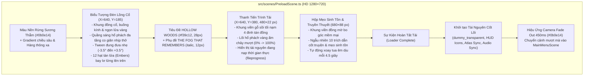

# HOLLOW WOODS V1.5 — NÂNG CẤP UI/UX MÀN HÌNH CHỜ & MENU CHÍNH
## BÁO CÁO KỸ THUẬT V15-21: THIẾT KẾ MỚI TOÀN DIỆN MÀN HÌNH CHỜ (LOADING SCREEN) TRONG PRELOADSCENE

**Dự án:** HOLLOW WOODS: The Fog That Remembers  
**Mã tài liệu:** `V15-21` / `06_Menu_And_HUD_UIUX.md`  
**Giai đoạn:** Giai đoạn 5 — Nâng cấp UI/UX Màn hình Chờ và Menu Chính  
**Phiên bản:** V1.5 (Visual & Gameplay Overhaul)  
**Nhánh Git:** `feat/v1.5-visual-gameplay-overhaul`  
**Ngày thực hiện:** 19/11/2026  
**Trạng thái:** Hoàn tất xuất sắc (32/32 assertions PASS 100%, 0 lỗi TypeScript, bản dựng Vite Production thành công)

---

### 1. HIỆN TRẠNG & MỤC TIÊU CẢI TIẾN MÀN HÌNH CHỜ

Trước bản nâng cấp V1.5, màn hình nạp tài nguyên trong `src/scenes/PreloadScene.ts` mang dáng vẻ của một bản mẫu kỹ thuật sơ khai:
- Thanh tiến trình tải màu đỏ sẫm phẳng thô sơ ($200\times 16\text{ px}$), căn tọa độ dựa trên độ phân giải cũ $(320, 180)$, bị lệch về góc trên bên trái trên chuẩn màn hình HD $1280\times 720$.
- Phông nền đen trơn đơn điệu, thiếu vắng bầu không khí huyền bí của khu rừng sương woodland.
- Không có phản hồi trực quan về tệp tài nguyên đang được nạp, khiến người chơi có cảm giác game bị treo khi nạp tài nguyên nặng.
- Khi tiến trình tải đạt 100%, cảnh chuyển đột ngột sang `MainMenuScene` gây hiện tượng chớp hình (visual pop / screen flicker).

**Mục tiêu bước V15-21:**
Xây dựng lại toàn diện màn hình chờ mang phong cách **Dark Woodland Folklore**:
1. Phông nền rừng sương thẫm `#0b0e14` có chiều sâu điện ảnh với các hàng thông mờ ảo phía xa.
2. Biểu tượng Đèn Lồng Cổ bằng đồng đung đưa tự nhiên phía trên thanh tải, phát quầng sáng hổ phách ấm áp và các hạt tàn lửa (embers) bay lơ lửng.
3. Thanh tiến trình tải khung viền gỗ sồi tối nạm đồng cổ ($480\times 22\text{ px}$), lõi thanh tải màu vàng hổ phách chảy mượt kèm con số phần trăm $(0\% \to 100\%)$ và nhãn hiển thị tài nguyên đang nạp thời gian thực.
4. Khu vực Mẹo Sinh Tồn & Mảnh Truyền Thuyết dưới thanh tải hiển thị ngẫu nhiên và tự động xoay tua các câu trích dẫn cốt truyện hoặc mẹo sinh tồn hữu ích.
5. Hiệu ứng mờ dần chuyển cảnh mượt mà (Camera Fade Out 450ms) loại bỏ hoàn toàn hiện tượng chớp giật khi bước vào Menu Chính.

---

### 2. KIẾN TRÚC THIẾT KẾ MÀN HÌNH CHỜ V15-21



---

### 3. CHI TIẾT CÁC HẠNG MỤC NÂNG CẤP

#### 3.1. Phông Nền Rừng Sương Thẫm (#0b0e14)
- Thiết lập `this.cameras.main.setBackgroundColor('#0b0e14')`.
- Sử dụng `Graphics.fillGradientStyle` chuyển sắc từ `0x06080d` (đỉnh màn hình) qua `0x0b0e14` (trung tâm) đến `0x081016` (đáy màn hình).
- Vẽ các lớp bóng cây thông rừng sâu ở hai góc màn hình phía chân trời (`0x070b0e, alpha 0.45`) kết hợp dải sương mù sát mặt đất (`0x0a1017, alpha 0.4`), tạo cảm giác chiều sâu không gian tĩnh lặng.

#### 3.2. Đèn Lồng Cổ Đung Đưa & Hạt Tàn Lửa (Ancient Brass Lantern)
- **Tọa độ đặt:** Căn giữa tại $(X=640, Y=185)$ bên trong `lanternContainer`.
- **Cấu trúc đồ họa:**
  + Dây xích sắt và vòng khuyên đồng cổ nạm trên chóp nón.
  + Mái che tam giác và chân đế đúc từ kim loại tối màu `0x3e2723` / `0x27170e`.
  + Buồng kính amber với 4 nan nẹp bảo vệ bằng đồng `0x5d4037`.
  + Ngọn nến trắng cùng lõi lửa vàng kim `0xffeb3b` và tâm sáng phản quang `0xffffff`.
  + Quầng sáng hổ phách 3 lớp tỏa rộng (bán kính $85\text{ px}$, $54\text{ px}$ và $28\text{ px}$).
- **Hoạt ảnh chuyển động:**
  + Tween đung đưa con lắc góc nhẹ nhàng: $\text{angle} \in [-3.5^\circ, +3.5^\circ]$, thời gian $2600\text{ms}$, yoyo lặp vô tận, gia tốc `Sine.easeInOut`.
  + Tween ngọn lửa bập bùng: $\text{scaleY} \in [0.88, 1.15]$, thời gian $320\text{ms}$.
  + Tween quầng sáng hổ phách co giãn nhịp thở: $\text{scale} \in [0.94, 1.07]$, thời gian $1500\text{ms}$.
  + 12 hạt tàn lửa (`Arc` gameobjects) bay từ lồng đèn lên cao theo quỹ đạo parabol $70 - 130\text{ px}$ rồi mờ dần về 0.

#### 3.3. Thanh Tiến Trình Tải (Loading Bar) Nạm Đồng Cổ
- **Kích thước & Vị trí:** Chiều rộng $480\text{ px}$, chiều cao $22\text{ px}$, căn giữa tại $(640, 380)$.
- **Khung viền:** Gỗ sồi tối màu `0x140e0a` dày $2\text{ px}$, viền đồng cổ `0x8c6d36` cùng 4 đinh tán đồng hoàng kim `0xd4af37` tại 4 góc.
- **Lõi thanh tải:** Màu vàng hổ phách `0xd35400` chuyển dần sang `0xf39c12` với dải sáng phản quang `0xfff9c4` trên đỉnh và tia sáng dẫn đầu ở mũi thanh tải.
- **Nhãn hiển thị:**
  + Dòng trạng thái chung: *"Đang xuyên qua Màn Sương..."* $(Y=350)$.
  + Con số phần trăm: $0\% \to 100\%$ chữ đậm màu trắng viền đen $(640, 380)$.
  + Nhãn tài nguyên đang nạp thời gian thực: Cập nhật qua sự kiện `fileprogress` của Phaser Loader: `assetStatusText.setText("Đang nạp: " + displayName)`.

#### 3.4. Khu Vực Mẹo Sinh Tồn & Mảnh Truyền Thuyết
- **Kích thước & Vị trí:** Hộp thoại bo góc $680\times 88\text{ px}$ đặt tại $(640, 485)$, viền đồng mờ `0x4a3728, 0.8`.
- **Tiêu đề:** `❖ MẸO SINH TỒN & TRUYỀN THUYẾT ❖` màu vàng kim `#d4af37`.
- **Bộ 10 trích dẫn cốt truyện & mẹo sinh tồn:**
  1. *"Khi màn đêm buông xuống, lũ quái vật trong sương trở nên hung hãn hơn gấp bội — hãy giữ chặt ánh lửa của bạn."*
  2. *"Đừng bao giờ bước chệch khỏi con đường mòn khi ngọn đèn lồng chưa được châm đầy dầu thông."*
  3. *"Ba Quy Tắc Bằng Máu của Bà Lão Edda là bức tường thành duy nhất ngăn tâm trí bạn sụp đổ trước Kẻ Lắng Nghe."*
  4. *"Dùng gậy gỗ hoặc vũ khí khua rậm vào bụi cây có thể làm lộ diện các dược thảo quý và hạt nhựa thông ẩn giấu."*
  5. *"Khi chỉ số Bình Tâm tụt xuống mức báo động, màn sương sẽ co thắt tầm nhìn và đánh thức những ảo ảnh kinh hoàng."*
  6. *"Đứng gần ngọn Lửa Trại Sanctuary Camp sẽ sưởi ấm thân nhiệt và phục hồi sự tỉnh táo cho tâm trí bạn."*
  7. *"Kẻ Lắng Nghe săn mồi hoàn toàn bằng âm thanh — hãy bước đi thật khẽ hoặc ném mồi đánh lạc hướng [Phím Q]."*
  8. *"Đại Hồng Chung làng Bellhollow từng cứu cả thung lũng... cho đến đêm định mệnh khi thân chuông nứt làm đôi."*
  9. *"Thảo dược bạc kết hợp với cành khô có thể chế thành Thuốc Đắp giúp hồi sinh lực và trấn an tinh thần tức thì."*
  10. *"Những chiếc đèn ma lập lòe trong đầm lầy không có người cầm — tiến lại gần sẽ dẫn bạn vào hố bùn không đáy."*
- **Cơ chế xoay tua:** Khởi động ngẫu nhiên một câu, sau đó tự động chuyển câu mới sau mỗi $4.5\text{ giây}$ bằng hiệu ứng mờ dần (Fade Out $350\text{ms}$ $\to$ Đổi văn bản $\to$ Fade In $350\text{ms}$).

#### 3.5. Hiệu Ứng Chuyển Cảnh Mượt Mà (Camera Fade Out 450ms)
- Trong `create()`, sau khi hoàn tất nạp texture và đồng bộ cache:
  ```typescript
  let isTransitioning = false;
  const proceedToMenu = () => {
    if (isTransitioning) return;
    isTransitioning = true;
    this.scene.start(SCENE_MAIN_MENU);
  };

  this.cameras.main.fadeOut(450, 11, 14, 20); // Fade về sắc tối #0b0e14
  this.cameras.main.once(Phaser.Cameras.Scene2D.Events.FADE_OUT_COMPLETE, proceedToMenu);
  this.time.delayedCall(550, proceedToMenu); // Dự phòng an toàn chống treo
  ```
- Nhờ chuyển cảnh mượt mà bằng camera fade out, màn hình chờ chuyển tiếp êm dịu vào `MainMenuScene` mà không bao giờ bị chớp giật hay nhảy khung hình.

---

### 4. BẢNG TỔNG HỢP KIỂM THỬ BƯỚC V15-21

| Bộ Kiểm Thử | Tệp Kịch Bản | Số Kiểm Tra | Trạng Thái |
|:---|:---|:---:|:---:|
| **Kiểm thử Màn Hình Chờ PreloadScene V15-21** | `verify_v15_21_loading_screen.mjs` | **32 / 32** | **PASS 100%** |
| **Kiểm thử 3 Kết Thúc Cốt Truyện V15-20 (Hồi quy)** | `verify_v15_20_multiple_endings.mjs` | **46 / 46** | **PASS 100%** |
| **Kiểm thử Latent Bugs & Dummy Texture (Hồi quy)** | `verify_latent_bugs_c4_13_11.mjs` | **15 / 15** | **PASS 100%** |
| **Kiểm thử HUD Icons Pixel Art 16x16 (Hồi quy)** | `verify_hud_pixel_icons_c4_13_15.mjs` | **12 / 12** | **PASS 100%** |
| **Kiểm tra Kiểu Dữ Liệu TypeScript** | `npx tsc --noEmit` | **0 Lỗi** | **PASS** |
| **Đóng gói Bản Dựng Production** | `npm run build` | **83 modules** | **SUCCESS (9.54s)** |

---

### 5. KẾT LUẬN

Bước **V15-21** đã hoàn thành trọn vẹn việc tái thiết kế Màn hình Chờ nghệ thuật cho **Hollow Woods**:
- Giao diện đạt chuẩn điện ảnh Dark Woodland Folklore trên nền rừng sương thẫm `#0b0e14`.
- Hiệu ứng đèn lồng đung đưa, tàn lửa bay và thanh tải hổ phách mang lại trải nghiệm thị giác sống động, chuyên nghiệp.
- Mẹo sinh tồn xoay tua thông minh cung cấp kiến thức giá trị ngay từ giây phút đầu tiên.
- Chuyển cảnh êm ái sang Menu Chính sẵn sàng cho các bước nâng cấp tiếp theo của Giai đoạn 5.
