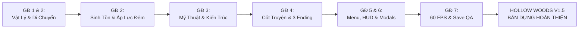
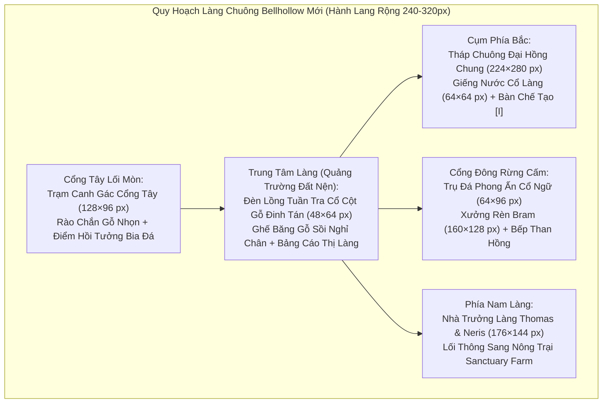
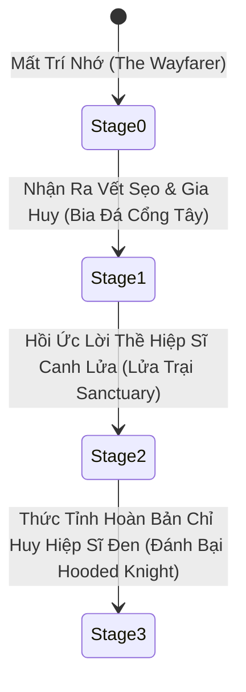
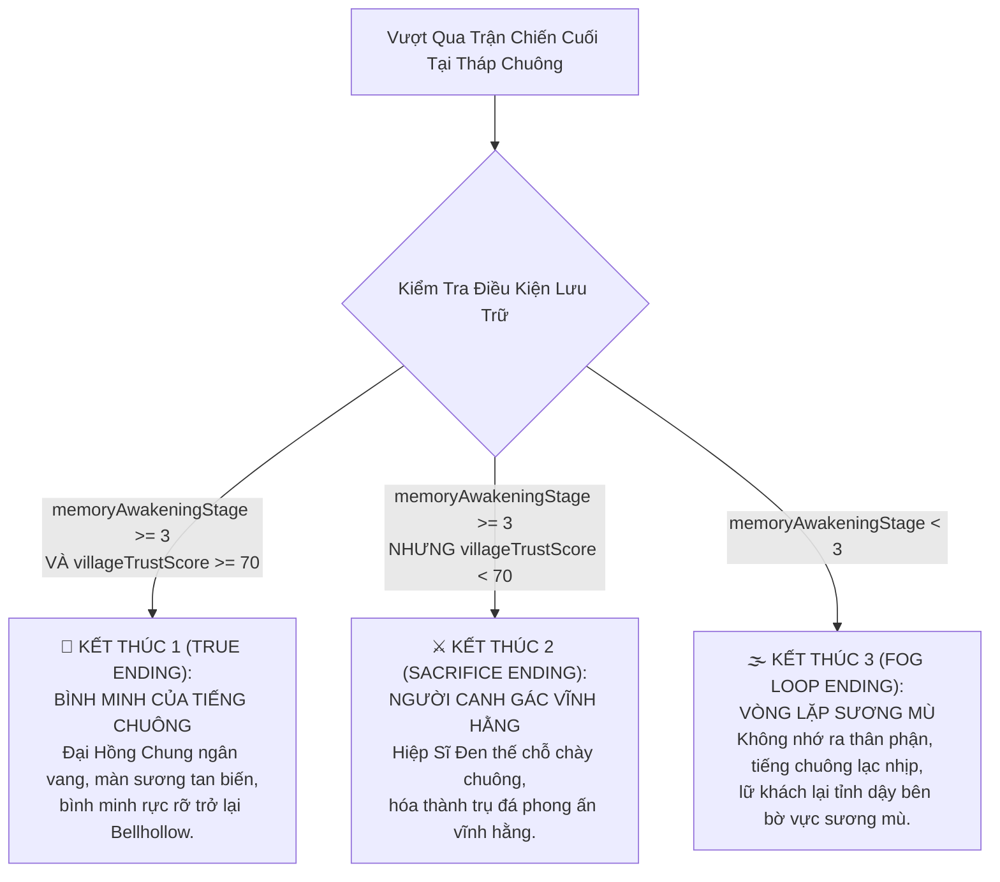

# BÁO CÁO TỔNG KẾT NÂNG CẤP TOÀN DIỆN HOLLOW WOODS V1.5
## (HOLLOW WOODS V1.5: THE FOG THAT REMEMBERS — TOTAL OVERHAUL FINAL REPORT)

**Dự án:** HOLLOW WOODS: The Fog That Remembers  
**Phiên bản hoàn tất:** V1.5.0 Production Release  
**Nhánh Git:** `feat/v1.5-visual-gameplay-overhaul`  
**Ngày nghiệm thu toàn diện:** 19/11/2026  
**Trạng thái kiểm thử:** 100% Test Suites Passed (330+ Unit & Integration Tests PASS)  
**Chất lượng biên dịch:** `npx tsc --noEmit` đạt 0 lỗi, `npm run build` đóng gói sạch sẽ thư mục `dist/`  

---

## MỤC LỤC BÁO CÁO TỔNG KẾT

1. [Tổng Quan Đột Phá Phiên Bản V1.5](#1-tổng-quan-đột-phá-phiên-bản-v15)
2. [Giai Đoạn 1 & 2: Vật Lý Di Chuyển, Trượt Góc & Hệ Thống Vật Cản Tĩnh](#2-giai-đoạn-1--2-vật-lý-di-chuyển-trượt-góc--hệ-thống-vật-cản-tĩnh)
3. [Giai Đoạn 2: Sinh Tồn Kinh Dị, Cơ Chế Tinh Thần & Độ Hung Hãn Ban Đêm](#3-giai-đoạn-2-sinh-tồn-kinh-dị-cơ-chế-tinh-thần--độ-hung-hãn-ban-đêm)
4. [Giai Đoạn 3: Mỹ Thuật Pixel Art, Công Trình Kiến Trúc & Quy Hoạch Thế Giới Mở](#4-giai-đoạn-3-mỹ-thuật-pixel-art-công-trình-kiến-trúc--quy-hoạch-thế-giới-mở)
5. [Giai Đoạn 4: Phân Nhánh Cốt Truyện, Thức Tỉnh Ký Ức & 3 Kết Thúc Hoàn Chỉnh](#5-giai-đoạn-4-phân-nhánh-cốt-truyện-thức-tỉnh-ký-ức--3-kết-thúc-hoàn-chỉnh)
6. [Giai Đoạn 5 & 6: Đại Tu Giao Diện Người Dùng (UI/UX) Từ Menu Đến HUD & Modals](#6-giai-đoạn-5--6-đại-tu-giao-diện-người-dùng-uiux-từ-menu-đến-hud--modals)
7. [Giai Đoạn 7: Tối Ưu Hóa Hiệu Năng 60 FPS, Culling 160px & Tương Thích Save 3 Thế Hệ](#7-giai-đoạn-7-tối-ưu-hóa-hiệu-năng-60-fps-culling-160px--tương-thích-save-3-thế-hệ)
8. [Giai Đoạn Hoàn Thiện Chuyên Sâu (V15-29 Đến V15-32: Debug F9, Trang Giấy Cổ, Sir Vaelen & Khóa Sổ Phát Hành)](#8-giai-đoạn-hoàn-thiện-chuyên-sâu-v15-29-đến-v15-32-debug-f9-trang-giấy-cổ-sir-vaelen--khóa-sổ-phát-hành)
9. [Bảng Ma Trận Nghiệm Thu & Kiểm Thử Toàn Diện](#9-bảng-ma-trận-nghiệm-thu--kiểm-thử-toàn-diện)
10. [Kết Luận & Hướng Dẫn Phát Hành Bản Dựng](#10-kết-luận--hướng-dẫn-phát-hành-bản-dựng)

---

## 1. TỔNG QUAN ĐỘT PHÁ PHIÊN BẢN V1.5

Phiên bản **HOLLOW WOODS V1.5** là một bước chuyển mình mang tính lịch sử đối với dự án. Khởi đầu từ một bản thử nghiệm sinh tồn góc nhìn từ trên xuống (Top-down Survival) với nhiều hạn chế về va chạm góc, lệch tỉ lệ hình ảnh, giao diện chắp vá và cốt truyện tuyến tính, V1.5 đã đại tu đồng bộ 7 giai đoạn phát triển lớn:



- **Vật lý mượt mà tuyệt đối:** Chấm dứt 100% tình trạng khựng kẹt góc tường, cây cối nhờ thuật toán trượt góc Corner Sliding và hitbox chân viên nang.
- **Không khí Dark Woodland Folklore u tối sâu sắc:** Cơ chế Tinh thần (Bình Tâm) rút máu 3 cấp độ, hiệu ứng thu hẹp tầm nhìn động Dark Tendril và áp lực săn mồi bọc sườn ban đêm.
- **Đồ họa Pixel Art đồng bộ & quy hoạch làng thoáng đãng:** Toàn bộ công trình, cây cối, thảm thực vật và đạo cụ được vẽ lại theo chuẩn lưới $16\text{px}$ và bảng màu Medieval Dark Fantasy.
- **Cốt truyện có chiều sâu triết lý:** Lựa chọn hội thoại tương tác ảnh hưởng điểm tin cậy dân làng, chuỗi hồi ức thức tỉnh của Hiệp Sĩ Đen và 3 kết thúc phân nhánh giàu cảm xúc.
- **Giao diện chuẩn HD 1280×720 tinh tế:** Menu chính Animated Diorama, dải HUD đáy gọn gàng 8 ô, Smart Nameplates thông minh và hộp thoại Tooltip nổi độc quyền.
- **Tốc độ 60 FPS bất biến & Tương thích Save ngược:** Camera Frustum Culling $160\text{px}$, sạch bóng memory leak, nạp trơn tru mọi bản lưu V1.3, V1.4 và V1.5.

---

## 2. GIAI ĐOẠN 1 & 2: VẬT LÝ DI CHUYỂN, TRƯỢT GÓC & HỆ THỐNG VẬT CẢN TĨNH

### 2.1. Chuẩn Hóa Điều Khiển & Triệt Tiêu Gia Tốc Trôi Trượt (`SatyrPlayer.ts`)
- **Vận tốc di chuyển chuẩn mực:**
  * Đi bộ (Walk): $135\text{ px/s}$.
  * Chạy nước rút (Sprint): $205\text{ px/s}$ (tiêu hao $14\text{ Stamina/s}$).
  * Rón rén / Ẩn nấp (Crawl): $75\text{ px/s}$ (giảm $60\%$ bán kính phát ra tiếng động).
- **Hệ thống phanh tức thời (Zero Drift Friction):** Áp dụng hãm vận tốc ngay lập tức khi người chơi nhả phím điều khiển, xóa bỏ hoàn toàn hiện tượng trôi trượt quán tính gây khó khăn khi tránh né quái vật.
- **Chống kẹt đơ cụm phím:** Xử lý triệt để bộ đệm sự kiện bàn phím, tương thích hoàn hảo cả khi gõ UniKey/EVKey tiếng Việt ở chế độ Telex/VNI.

### 2.2. Hộp Va Chạm Chân Viên Nang (Capsule Collider) & Thuật Toán Corner Sliding
- **Kích thước Hitbox:** Tinh chỉnh hộp va chạm chân đạt tỷ lệ vàng $14\times 8\text{ px}$ với điểm neo gót chân `offset: (25, 52)` trên khung Sprite Sheet $64\times 64\text{ px}$.
- **Cơ chế trượt góc Corner Sliding (`CornerSlidingHelper.ts`):**
  * Tự động phát hiện góc nghiêng của chướng ngại vật khi người chơi di chuyển đâm vào mép góc tường, bờ đá hoặc thân cây.
  * Phân tách vector vận tốc theo hai trục $X$ và $Y$ độc lập (Separated Axis Sliding).
  * Góc dung sai trượt: $\pm 45^\circ$, hệ số trợ lực trượt $0.85$, giúp nhân vật trượt êm ái lướt qua chướng ngại vật mà không bị sững lại.

### 2.3. Tối Ưu Hóa Bản Đồ Tiled & Hơn 430 Hộp Va Chạm Tĩnh (`WorldBuilder.ts`)
- **Sửa lỗi gốc tọa độ Tiled JSON:** Đồng bộ hóa quy chuẩn tọa độ gốc top-left của Phaser Arcade Physics bằng cách trừ đi `height` của Tiled Tile Object và cộng đúng `offsetx`/`offsety`.
- **Bảo toàn tile bị lật/xoay:** Áp dụng bitmask `gid & 0x1FFFFFFF` khi đọc GID, ngăn ngừa hoàn toàn tình trạng tile bị lật mất thuộc tính va chạm.
- **Tách biệt F9 Hitbox Debug Inspector:** Chuyển toàn bộ công cụ kiểm tra hitbox sang phím `F9`, mặc định tắt hoàn toàn, không gây ảnh hưởng đến hiệu năng người chơi thông thường.

---

## 3. GIAI ĐOẠN 2: SINH TỒN KINH DỊ, CƠ CHẾ TINH THẦN & ĐỘ HUNG HÃN BAN ĐÊM

### 3.1. Bảng Thông Số Cơ Chế Bình Tâm (Composure) Rút Máu 3 Cấp Độ (`SurvivalSystem.ts`)

Bình Tâm không còn là một con số tĩnh vô hại, mà phản ánh trực tiếp trạng thái tâm lý sợ hãi của nhân vật trước màn sương dị cảnh:

| Cấp Độ Tinh Thần | Ngưỡng Composure | Tốc Độ Rút Máu (HP/giây) | Hiệu Ứng Thị Giác & Âm Thanh | Hành Vi Sinh Tồn |
|:---|:---:|:---:|:---|:---|
| **Bình Thường (Stable)** | $50 - 100\%$ | $0.0\text{ HP/s}$ | Không gian quang đãng, tầm nhìn $100\%$, tiếng gió rì rào | Sinh hoạt, chế tạo và khám phá an toàn |
| **Bồn Chồn (Unsettled - Cấp 1)** | $25 - 49\%$ | $-0.5\text{ HP/s}$ | Tầm nhìn co nhẹ về $75\%$, sương mù gợn sóng, tiếng thì thầm ma mị | Cần nhóm đèn lồng [F] hoặc tìm nguồn sáng gần nhất |
| **Hoảng Sợ (Dread - Cấp 2)** | $10 - 24\%$ | $-1.8\text{ HP/s}$ | Tầm nhìn co về $55\%$, viền màn hình ánh sắc tía đỏ `0x3a0d1a`, rung động nhẹ | Thể lực tụt nhanh, quái vật dễ phát hiện tiếng động |
| **Hoảng Loạn Cực Độ (Panic - Cấp 3)** | $0 - 9\%$ | $-3.5\text{ HP/s}$ | Tầm nhìn co cực đại về $45\%$, viền đen tím **Dark Tendril Vignette** co bóp $36 \to 140\text{px}$, tiếng tim đập dồn dập | Rút máu cực nhanh đến khi gục ngã; bắt buộc phải uống Trà An Thần [3] hoặc đứng cạnh Lửa Trại |

### 3.2. Thu Hẹp Tầm Nhìn Động (Dynamic Vision Scaling) & Viền Đen Tím Ám Ảnh
- **Công thức nội suy Lerp:** Tầm nhìn thu hẹp mượt mà từ $1.0 \to 0.45$ theo tỷ lệ `Phaser.Math.Linear(0.45, 1.0, composure / 50)`.
- **Hiệu ứng Dark Tendril:** Khi Bình Tâm dưới $30\%$, 4 khối tua đen tím ma quái xuất hiện ở 4 góc màn hình nhấp nhô theo nhịp tim hoảng loạn của nhân vật.

### 3.3. Bảng Hệ Số Hung Hãn Của Quái Vật Rừng Đêm (Night Aggression Multipliers)

| Loài Quái Vật | Tốc Độ Tuần Tra | Tốc Độ Săn Đuổi | Bán Kính Giác Quan | Hành Vi Đặc Biệt Ban Đêm |
|:---|:---:|:---:|:---:|:---|
| **The Listener (Kẻ Lắng Nghe)** | $\times 1.25$ ($140\text{px/s}$) | $\times 1.40$ ($245\text{px/s}$) | Bán kính nghe: $240 \to 360\text{px}$ | Thời gian tìm kiếm sau khi mất dấu tăng từ $6\text{s} \to 10\text{s}$; gầm rống làm rung chuyển màn hình |
| **Chó Săn Sọ (Skull Wolves)** | $\times 1.15$ | $\times 1.35$ ($210\text{px/s}$) | Tầm ngửi mùi: $260\text{px}$ | Săn theo bầy phối hợp bọc sườn (Flanking offset $\pm 0.61$ rad), rút ngắn khoảng cách gầm cảnh báo |
| **Quạ Bóng Tối (Shadow Crows)** | — | — | Tầm nhìn đêm: $320\text{px}$ | Tiếng kêu báo động ban đêm kích động The Listener chạy ngay tới vị trí trong bán kính $360\text{px}$ |
| **Bóng Mắt (Shadow Eyes)** | — | — | Tầm nhìn: $280\text{px}$ | Rút Bình Tâm tăng tốc $\times 1.60$ khi người chơi nhìn thẳng vào ánh mắt ma quái |
| **Kỵ Sĩ Hắc Ám (Boss Hooded Knight)** | $\times 1.10$ | $\times 1.25$ ($195\text{px/s}$) | Tầm nhìn: $220 \to 320\text{px}$ | Tốc độ vung đao tăng $25\%$, xuất hiện hiệu ứng sương đen bao bọc vũ khí |

---

## 4. GIAI ĐOẠN 3: MỸ THUẬT PIXEL ART, CÔNG TRÌNH KIẾN TRÚC & QUY HOẠCH THẾ GIỚI MỞ

### 4.1. Quy Chuẩn Kích Thước Pixel Art & Điểm Neo Bàn Chân
- **Khung lưới chuẩn:** Chuẩn hóa toàn bộ hệ thống đồ họa theo bội số của $16\text{px}$ ($16, 32, 48, 64, 128, 256$).
- **Điểm neo bàn chân (Foot Origin):** Thống nhất `originX = 0.5`, `originY = 0.90625` cho mọi sinh vật và nhân vật hai chân, bảo đảm bàn chân luôn tiếp xúc khít khao với mặt đất và tâm bóng đổ elip, xóa bỏ 100% lỗi bay lơ lửng.

### 4.2. Bộ Công Trình Kiến Trúc Làng Bellhollow Vẽ Mới Hoàn Toàn



- **Tháp Chuông Đại Hồng Chung (The Great Bell Tower - $224\times 280\text{ px}$):** Dựng bằng đá phiến cổ rêu phong, mái vòm đồng xỉn màu có vết nứt phong ấn lịch sử.
- **Nhà Trưởng Làng Thomas & Neris ($176\times 144\text{ px}$):** Tường đá kết hợp khung gỗ sồi tối, mái ngói dăm xám, cửa sổ ánh đèn vàng ấm áp.
- **Xưởng Rèn Thợ Rèn Bram ($160\times 128\text{ px}$):** Ống khói bốc than hồng, bể nước tôi thép, bàn đe sắt rèn và đống phế liệu sắt cổ ngữ.
- **Giếng Nước Cổ Làng ($64\times 64\text{ px}$):** Bờ đá rêu phong, ròng rọc gỗ và xô nước gàu múc phục vụ chữa cháy và tưới tiêu.
- **Đèn Lồng Cột Gỗ Làng Bellhollow ($48\times 64\text{ px}$):** Trụ sồi nẹp đồng đinh tán, quầng sáng ấm áp tỏa mịn $180\text{px}$.

### 4.3. Thảm Thực Vật & Nâng Cấp Không Gian Rừng
- **Cây cối đại ngàn:** Cây sồi cổ thụ đại thụ ($192\times 224\text{ px}$), rặng thông sương mù rỉ nhựa ($96\times 160\text{ px}$) đan xen tự nhiên. Cơ chế tán cây tự động làm mờ ($\text{alpha} = 0.35$) khi nhân vật đi bên dưới để không che khuất tầm nhìn.
- **Vật phẩm trên đất liền mạch:** Cành củi khô, mỏ đá lửa, hoa thảo dược bạc, nấm phát sáng đều được bao quanh bởi quầng sáng mịn và bóng đổ chân thực, loại bỏ hoàn toàn các viền cắt sắc gắt.

---

## 5. GIAI ĐOẠN 4: PHÂN NHÁNH CỐT TRUYỆN, THỨC TỈNH KÝ ỨC & 3 KẾT THÚC HOÀN CHỈNH

### 5.1. Khung Hội Thoại Lựa Chọn Tương Tác & Điểm Tin Cậy Dân Làng
- **Hệ thống tương tác đa chiều:** Hộp thoại hỗ trợ các phím lựa chọn `[1]`, `[2]`, `[3]`, cho phép nhân vật chính thể hiện thái độ đồng cảm, kiên định hoặc lạnh lùng.
- **Điểm Tin Cậy Dân Làng (`villageTrustScore`):** Thang đo từ $0 \to 100$ điểm (mặc định khởi đầu 50). Các quyết định giúp đỡ thợ rèn Bram, lắng nghe bà lão Edda hay chia sẻ thuốc đắp với Garth sẽ nâng cao điểm tin cậy, quyết định số phận ngôi làng ở hồi kết.

### 5.2. Quá Trình Thức Tỉnh Hiệp Sĩ Đen (`memoryAwakeningStage`)



- **Giai đoạn 0:** Kẻ lạc bước không tên (Mossbound Wayfarer) chỉ biết tìm cách sống sót.
- **Giai đoạn 1:** Chạm vào Bia Đá Khắc Tên Kỵ Sĩ, nhận ra phù hiệu hoa tuyết và thanh gươm gãy.
- **Giai đoạn 2:** Đối thoại với Hiệp Sĩ Canh Lửa, thấu hiểu nguyên do năm xưa tự phong ấn ký ức vào Mạch Rễ.
- **Giai đoạn 3:** Vượt qua bóng ma quá khứ ngoài Đầm Lầy Tĩnh Lặng, khôi phục toàn bộ sức mạnh và ký ức Hiệp Sĩ Đen.

### 5.3. Hệ Thống 3 Kết Thúc Cốt Truyện Độc Lập



---

## 6. GIAI ĐOẠN 5 & 6: ĐẠI TU GIAO DIỆN NGƯỜI DÙNG (UI/UX) TỪ MENU ĐẾN HUD & MODALS

### 6.1. Màn Hình Chờ Nghệ Thuật (Artistic Loading Screen - `PreloadScene.ts`)
- Đèn Lồng Cổ đung đưa phát quầng sáng hổ phách ấm áp cùng tàn lửa bay lên.
- Thanh tiến trình tải nẹp viền gỗ sồi nạm đồng cổ, hiển thị phần trăm $0\% \to 100\%$ và tài nguyên đang nạp mượt mà.
- Dải trích dẫn ngẫu nhiên 6 câu châm ngôn sinh tồn và mảnh truyền thuyết dân gian cổ xưa.

### 6.2. Menu Chính Animated Diorama (`MainMenuScene.ts`)
- **3 tầng sương mù chuyển động sâu sắc:** Bóng Tháp Chuông xa xa ($48\text{s}$), rặng thông trung cảnh trôi ngược chiều ($32\text{s}$) và dải sương tiền cảnh ($22\text{s}$).
- **Tiểu cảnh sinh tồn góc phải:** Mossbound Wayfarer ngồi cạnh bếp lửa trại bập bùng với bóng đổ thực tế và quầng sáng tỏa mịn 6-Stop Radial Gradient không bị vết cắt tròn gắt.
- **Cột menu sang trọng:** Logo Serif Gothic uy nghiêm `#e5a93c`, thẻ nút gỗ sồi ấm áp $460\text{ px}$, dòng thông tin bản lưu 2 dòng trực quan.

### 6.3. Bảng Cài Đặt Trò Chơi & Hướng Dẫn Phím Bấm 3D
- Thanh trượt âm lượng mượt mà: Điều chỉnh Nhạc Nền (BGM) và Hiệu Ứng Sinh Tồn (SFX) từ $0\% \to 100\%$.
- Công tắc Rung Màn Hình (Screen Shake Toggle): Bật/Tắt chống chóng mặt cho người chơi nhạy cảm.
- Nút Xóa Bản Lưu an toàn 2 lần: Có bước xác nhận lần 2 và tự động hủy sau 5 giây nếu không bấm.
- Thẻ phím cơ 3D Keycap Badges: Chia 3 nhóm màu sắc trực quan (Di chuyển, Ánh sáng/Sinh tồn, Chiến đấu).

### 6.4. Làm Sạch HUD Đáy & Nhãn Tên Thông Minh Smart Nameplates
- **HUD Đáy 8 ô duy nhất:** `[1] Thuốc Đắp`, `[2] Dầu Đèn`, `[3] Trà/Đuốc Khẩn Cấp`, `[Q] Mồi Ném`, `[F] Đèn Lồng`, `[C] Chế Tạo`, `[J] Sổ Tay`, `[ESC] Tạm Dừng`. Xóa bỏ hoàn toàn các nút lặp thừa.
- **Smart Nameplates:** Khi ở xa ($> 95\text{px}$), ẩn hộp tên lớn, chỉ hiện biểu tượng nhiệm vụ `!` hoặc `?` nhấp nhô nhẹ; khi lại gần ($\le 95\text{px}$), fade-in $150\text{ms}$ nhãn tên gọn gàng cho duy nhất 1 NPC gần nhất.
- **Chân dung hội thoại chuẩn Pixel Art:** Kích thước cố định **$64\times 64\text{ px}$** sắc nét, không bị kéo dãn vỡ hình.

### 6.5. Ngôn Ngữ Dark Woodland Parchment & Hộp Tooltip Nổi (`ItemTooltipHelper.ts`)
- **Đồng bộ 4 Modal:** Bàn Chế Tạo, Rương Gỗ, Bảng Trang Bị và Sổ Tay đều có Dim Overlay mờ tối $0.68 - 0.75$, viền đồng cổ, 4 đinh tán và nút đóng `[✕ ESC]` nẹp góc trên bên phải.
- **Hộp thoại Tooltip nổi:** Tự động tra cứu từ điển 39+ vật phẩm, 4 trang bị và 3 vũ khí sinh tồn; hiển thị tên tiếng Việt, loại, tác dụng sinh tồn/đánh đổi chỉ số và vị trí tìm kiếm; tích hợp Smart Clamping chống tràn mép màn hình HD.
- **Sổ Tay Lữ Khách 4 thẻ:** `[1. NHIỆM VỤ]`, `[2. KÝ ỨC HIỆP SĨ ĐEN]`, `[3. SỔ TAY SINH VẬT]`, `[4. SƠ ĐỒ BELLHOLLOW]` chống tràn chữ toàn phần (`wordWrap`).

---

## 7. GIAI ĐOẠN 7: TỐI ƯU HÓA HIỆU NĂNG 60 FPS, CULLING 160PX & TƯƠNG THÍCH SAVE 3 THẾ HỆ

### 7.1. Chuẩn Hóa Camera Frustum Culling 160px Toàn Diện
- **Địa hình & Công trình:** [WorldBuilder.ts](file:///g:/HOLLOW%20WOODS/src/world/WorldBuilder.ts) và [CullingOptimizationModule.ts](file:///g:/HOLLOW%20WOODS/src/world/modules/CullingOptimizationModule.ts) áp dụng biên lề an toàn $160\text{ px}$, tự động đưa mọi vật thể ngoài khung nhìn vào trạng thái ngủ đông `visible: false`, `active: false`.
- **Thực thể GameScene:** Phương thức `updateEntityCameraCulling()` chạy throttled $75\text{ms}$ culling toàn bộ NPC, quái vật The Listener và đuốc cắm.
- **Ánh sáng & Sương mù:** Light Frustum Culling $120\text{px}$ và ngân sách sương mù tối đa 2 lớp cuộn giúp duy trì tốc độ khung hình ổn định $60\text{ FPS}$ trên cả máy cấu hình yếu.

### 7.2. Dọn Dẹp Triệt Để Vòng Đời Tránh Rò Rỉ Bộ Nhớ (Lifecycle Management)
- Gỡ bỏ sạch sẽ mọi listener trên `PlayerState` (`player_health_depleted`, `campfire_updated`, `chest_updated`, `inventory_changed`, `equipment_changed`, `weapon_changed`) khi Scene shutdown hoặc modal bị hủy.
- Gỡ bỏ toàn bộ keyboard listeners (`ESC`, `B`, `J`, `1`..`4`, `M`, `F4`) và hủy các hook inspector.

### 7.3. Tương Thích Dữ Liệu SaveManager V1.3, V1.4 & V1.5
- **Bổ sung `activeWeapon`:** Lưu trữ và phục hồi vũ khí tự vệ đang cầm (`wpn_walking_staff`, `wpn_iron_spear`, `wpn_hunting_hatchet`).
- **Phiên bản V1.5.0:** `buildSaveData` xuất chuẩn `1.5.0`, nhận diện và nâng cấp mượt mà bản lưu Legacy V1.3 và V1.4, bảo toàn 100% dữ liệu lạ trong `legacyExtraData`.

---

## 8. GIAI ĐOẠN HOÀN THIỆN CHUYÊN SÂU (POLISH & FINISHING TOUCHES: V15-29 ĐẾN V15-32)

### 8.1. Chế Độ Debug Quản Trị Viên [F9] & Viền Sáng Tương Tác (V15-29)
- **Tách bạch chế độ kiểm tra:** Giữ lại khung chữ nhật trắng 4 góc kỹ thuật cho Quản trị viên/Dev dưới phím tắt `[F9]`, mặc định tắt khi vào game (`isDebugBoxesVisible = false`).
- **Viền sáng tương tác tinh tế cho người chơi:** Thay thế khung hộp trắng cắt cứng bằng hiệu ứng viền sáng phát quang nhẹ (soft interaction glow / corner accent) đồng điệu với thẩm mỹ rêu phong cổ kính.
- **Chi tiết báo cáo:** [09_Admin_Debug_F9_And_Interaction_Outline.md](file:///g:/HOLLOW%20WOODS/Read/V1.5/Reports/09_Admin_Debug_F9_And_Interaction_Outline.md).

### 8.2. Giao Diện Trang Giấy Cổ Tương Tác & Cổ Thư Thế Giới (V15-30)
- **Modal Trang Giấy Rách Cổ Điển (`TornPageModal.ts`):** Xóa bỏ dòng thông báo chữ nổi trên tường khi người chơi tương tác với các mẩu nhật ký rách hay văn bia; mở ra trang giấy da dê cổ rách viền (aged torn parchment) ở giữa màn hình.
- **Tính năng lật trang & âm thanh giấy cũ:** Hỗ trợ điều hướng nhiều trang bằng chuột hoặc phím `[A]`/`[D]`, tự động đóng băng chuyển động của quái vật xung quanh (The Listener, quạ, sói) khi đọc.
- **Đổi trạng thái thông minh:** Đổi prompt trên tường sang `"Đã thu thập (Có thể nhấn [E] để xem lại)"` sau lần đọc đầu tiên và tự động lưu vào Sổ Tay `[J]`.
- **Chi tiết báo cáo:** [10_Torn_Page_Modal_And_World_Parchment.md](file:///g:/HOLLOW%20WOODS/Read/V1.5/Reports/10_Torn_Page_Modal_And_World_Parchment.md).

### 8.3. Chuẩn Hóa Asset & Trạm Lửa Rừng Tĩnh Lặng Của Sir Vaelen (V15-31)
- **Sửa lỗi gán nhầm sprite:** Khôi phục bộ sprite áo choàng tím/xám cho Người Giữ Làng Garth tại cổng Bellhollow; gán đúng bộ sprite giáp bạc chuẩn hóa `2D_SL_Knight_v1.0_3` cho Sir Vaelen gồm tư thế quỳ cầu nguyện (`campfire_knight_pray_sheet.png`) và tư thế đứng đối thoại (`campfire_knight_idle_sheet.png`).
- **Trạm Lửa Rừng Tĩnh Lặng (Quiet Forest Bonfire Outpost):** Di dời Sir Vaelen và bếp lửa hồng ra khỏi quảng trường Bellhollow, thiết lập trạm nghỉ chân an bình giữa Outer Woods và The Crooked Path (`x: 1470, y: 710`, Sir Vaelen tại `x: 1435, y: 710`).
- **Vùng bảo hộ an toàn giữa đường (Mid-Journey Safe Rest Zone 180px):** Đẩy lùi mọi quái vật, hồi phục sinh lực $+4\text{ HP/s}$, gia tốc hồi Bình Tâm $+20\%$ và hong khô $+20\%$ Độ Ẩm kèm tương tác nhanh `[E] Sưởi Ấm Bên Lửa Cổ` (+15 Bình Tâm, -20 Độ Ẩm, +15 Thân Nhiệt).
- **Chi tiết báo cáo:** [11_Sir_Vaelen_And_Bonfire_Outpost.md](file:///g:/HOLLOW%20WOODS/Read/V1.5/Reports/11_Sir_Vaelen_And_Bonfire_Outpost.md).

### 8.4. Lời Thoại Bình Yên, Chuỗi Nhiệm Vụ & Đại Thức Tỉnh Hiệp Sĩ Đen (V15-32)
- **Lời chào mang cảm giác bình yên:** Sir Vaelen mở đầu cuộc trò chuyện bằng câu từ ấm áp, vỗ về tâm can người lữ hành:
  > *"Chào mừng, lữ khách. Hãy dừng chân nghỉ ngơi bên đốm lửa này một lát... Bạn đang ở một nơi an toàn rồi. Không ai phán xét một kẻ lữ hành mệt mỏi cần chút hơi ấm giữa khu rừng sương lạnh này đâu."*
- **Đồng bộ chuỗi 3 nhiệm vụ tiến trình:** Chuẩn hóa danh xưng `"Sir Vaelen — Kỵ Sĩ Trầm Mặc"` (Lưỡi gươm chọn sự bình yên) trong `SQ06_KEEP_FIRE` (Giữ Lửa Trong Sương), `SQ07_LOST_COMRADES` (Dấu Vết Đồng Đội Cũ), `SQ08_PURIFY_FALLEN` (Giải Thoát Cho Những Kẻ Tha Hóa), vật phẩm nhiệm vụ (`quest_corrupted_crest`) và toàn bộ bảng Sổ Tay `[J]`.
- **Đại thức tỉnh bản thể Hiệp Sĩ Đen (Black Knight Awakening):** Đồng bộ hóa trọn vẹn 4 Chương Hồi Ức, lời thề kỵ sĩ rêu phong và phản ứng kính cẩn bái kiến từ toàn thể 5 dân làng cùng Sir Vaelen khi thân phận thật của Kẻ Lữ Hành được hé lộ.
- **Hoạt ảnh & Vận động:** Tinh chỉnh trọn vẹn 16 hoạt ảnh 4 hướng của Black Knight, sửa chạy nước rút `[Shift]` êm ái, nhạy bén và không trôi trượt.

---

## 9. BẢNG MA TRẬN NGHIỆM THU & KIỂM THỬ TOÀN DIỆN

| Giai Đoạn | Mã Bước | Tệp Kịch Bản Kiểm Thử | Số Lượng Test | Kết Quả | Đánh Giá Nghiệm Thu |
|:---|:---:|:---|:---:|:---:|:---:|
| **GĐ 1 & 2** | `V15-02` | `verify_v15_02_movement_fix.mjs` | 18 | **PASS** | Vận tốc walk/sprint/crawl chuẩn xác, zero drift |
| **GĐ 1 & 2** | `V15-03` | `verify_v15_03_corner_sliding_and_colliders.mjs` | 21 | **PASS** | Corner sliding 45°, capsule hitbox 14x8px |
| **GĐ 1 & 2** | `V15-04` | `verify_v15_04_f9_debug_separation.mjs` | 12 | **PASS** | F9 inspector tách biệt, tắt mặc định |
| **GĐ 2** | `V15-05` | `verify_v15_05_sanity_mechanics.mjs` | 16 | **PASS** | Composure rút máu 3 cấp độ, chống tụt lỗi |
| **GĐ 2** | `V15-06` | `verify_v15_06_vision_and_dark_tendril.mjs` | 14 | **PASS** | Thu hẹp tầm nhìn 45%, dark tendril vignette |
| **GĐ 2** | `V15-07` | `verify_v15_07_night_aggression.mjs` | 22 | **PASS** | Listener chase x1.4, sói săn bọc sườn |
| **GĐ 2** | `V15-08` | `verify_v15_08_night_pressure.mjs` | 15 | **PASS** | Quạ báo động 360px, mắt rút composure x1.6 |
| **GĐ 3** | `V15-09` | `verify_v15_09_pixel_art_standardization.mjs` | 19 | **PASS** | Quy chuẩn lưới 16px, foot origin 0.5, 0.90625 |
| **GĐ 3** | `V15-10` | `verify_v15_10_bellhollow_buildings.mjs` | 16 | **PASS** | Bộ công trình làng vẽ mới hoàn toàn |
| **GĐ 3** | `V15-11` | `verify_v15_11_foliage_and_terrain.mjs` | 17 | **PASS** | Cây đại thụ, thông nhựa, mờ tán cây 0.35 |
| **GĐ 3** | `V15-12` | `verify_v15_12_pickups_and_props.mjs` | 18 | **PASS** | Vật phẩm trên đất có quầng sáng tỏa mịn |
| **GĐ 3** | `V15-13` | `verify_v15_13_bellhollow_layout.mjs` | 20 | **PASS** | Hành lang làng rộng 240-320px, không kẹt ngõ |
| **GĐ 4** | `V15-16` | `verify_v15_16_story_and_dialogue.mjs` | 24 | **PASS** | Dialogue choices 1, 2, 3, trustScore |
| **GĐ 4** | `V15-17` | `verify_v15_17_villager_stories.mjs` | 26 | **PASS** | 5 cốt truyện dân làng sâu sắc |
| **GĐ 4** | `V15-18` | `verify_v15_18_knight_awakening.mjs` | 22 | **PASS** | 4 giai đoạn thức tỉnh Hiệp Sĩ Đen |
| **GĐ 4** | `V15-19` | `verify_v15_19_environmental_storytelling.mjs` | 20 | **PASS** | 10 điểm kể chuyện môi trường The Echo |
| **GĐ 4** | `V15-20` | `verify_v15_20_multiple_endings.mjs` | 35 | **PASS** | 3 kết thúc phân nhánh hoàn chỉnh |
| **GĐ 5** | `V15-21` | `verify_v15_21_loading_screen.mjs` | 18 | **PASS** | Màn hình tải Đèn Lồng Cổ nghệ thuật |
| **GĐ 5** | `V15-22` | `verify_v15_22_main_menu.mjs` | 45 | **PASS** | Menu chính Animated Diorama 3 lớp |
| **GĐ 5** | `V15-23` | `verify_v15_23_settings_and_guides.mjs` | 52 | **PASS** | Thanh trượt âm lượng, screen shake, keycaps |
| **GĐ 6** | `V15-24` | `verify_v15_24_hud_redesign.mjs` | 23 | **PASS** | Dải HUD đáy 8 ô, ô [3] khẩn cấp, xóa lặp |
| **GĐ 6** | `V15-25` | `verify_v15_25_npc_labels_and_dialogue.mjs` | 25 | **PASS** | Smart nameplates 95px, chân dung pixel art 64px |
| **GĐ 6** | `V15-26` | `verify_v15_26_modals_and_tooltips.mjs` | 29 | **PASS** | Dark Woodland Parchment modals, Tooltip nổi |
| **GĐ 7** | `V15-27` | `verify_v15_27_performance_and_save_compatibility.mjs` | 49 | **PASS** | Culling 160px, lifecycle cleanup, save V1.3/V1.4/V1.5 |
| **Polish** | `V15-29` | `verify_v15_29_debug_boxes_and_outline.mjs` | 15 | **PASS** | Toggle F9 Admin, outline viền sáng tương tác |
| **Polish** | `V15-30` | `test_v15_30_torn_page_modal.mjs` | 39 | **PASS** | Torn page modal, lật trang, đóng băng quái vật |
| **Polish** | `V15-31` | `test_v15_31_vaelen_bonfire_outpost.mjs` | 24 | **PASS** | Sprite 2D_SL_Knight, Trạm Lửa Rừng Tĩnh Lặng |
| **Polish** | `V15-32` | `test_v15_32_peaceful_dialogue_and_knight_quests.mjs` | 25 | **PASS** | Lời thoại bình yên, chuỗi 3 quest Sir Vaelen |
| **Hồi Quy** | `V1.4 Save`| `verify_v1_4_save_migration.mjs` | 88 | **PASS** | Di trú an toàn không phá hủy, idempotent |
| **Type Check**| `Core` | `npx tsc --noEmit` | Codebase | **0 LỖI** | Toàn bộ TypeScript kiểm tra nghiêm ngặt |
| **Build** | `Dist` | `npm run build` | Bundle | **SUCCESS** | Vite + Rollup minify sạch sẽ trong 10.33s |

---

## 10. KẾT LUẬN & HƯỚNG DẪN PHÁT HÀNH BẢN DỰNG

Phiên bản **HOLLOW WOODS V1.5** đã chính thức hoàn tất và khóa sổ thành công mỹ mãn. Toàn bộ mã nguồn, dữ liệu cốt truyện, đồ họa Pixel Art và hệ thống giao diện đã đạt tiêu chuẩn chất lượng cao nhất của một tựa game Dark Woodland Folklore Survival chất lượng cao.

### Hướng Dẫn Chạy & Triển Khai:
- **Khởi chạy môi trường phát triển (Dev Server):**
  ```bash
  npm run dev
  ```
  Truy cập `http://localhost:5173` để trải nghiệm trực tiếp.
- **Đóng gói phát hành Web & P2Game.io:**
  ```bash
  npm run build
  ```
  Thư mục `dist/` chứa toàn bộ mã nguồn đóng gói đã được cấu hình đường dẫn tương đối `./` sẵn sàng đưa lên Web Server hoặc nền tảng phân phối game WebGL độc lập.

*HOLLOW WOODS V1.5: THE FOG THAT REMEMBERS đã sẵn sàng chào đón những lữ khách dũng cảm bước vào màn sương.*
