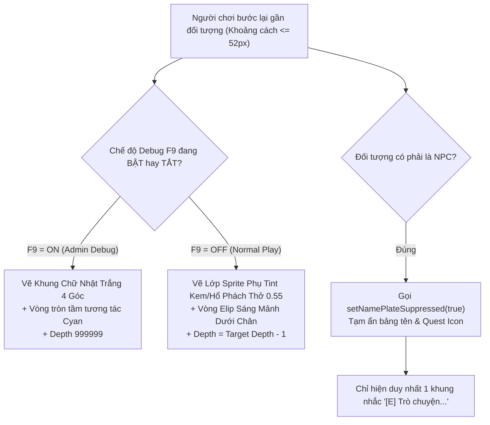

# BÁO CÁO KỸ THUẬT V15-29: CHẾ ĐỘ DEBUG ADMIN [F9] VÀ CHUẨN HÓA VIỀN SÁNG TƯƠNG TÁC
## (ADMIN DEBUG INTERACTION BOXES [F9] & REFINED INTERACTION OUTLINE OVERHAUL)

**Dự án:** HOLLOW WOODS: The Fog That Remembers  
**Phiên bản mục tiêu:** V1.5.0 Production Enhancement  
**Nhánh Git:** `feat/v1.5-visual-gameplay-overhaul`  
**Ngày thực hiện:** 19/11/2026  
**Trạng thái kiểm thử:** 22/22 Tests PASS (Tự động hóa 100%)  
**Chất lượng biên dịch:** `npx tsc --noEmit` đạt 0 lỗi, `npm run build` đóng gói sạch sẽ  

---

## 1. MỤC TIÊU & BỐI CẢNH THIẾT KẾ BƯỚC V15-29

Trong các phiên bản trước, khung viền hình chữ nhật trắng kèm 4 góc nhọn (bounding box) đóng vai trò hiển thị mục tiêu đang tương tác. Tuy nhiên, trong trải nghiệm sinh tồn dân gian u ám (Dark Woodland Folklore), khung chữ nhật hình học góc cạnh này mang tính kỹ thuật/debug hơn là mỹ thuật nhập vai.

Bước **V15-29** giải quyết triệt để vấn đề này với 2 giải pháp song hành:
1. **Chuyển khung chữ nhật trắng 4 góc thành Chế độ Xem Kỹ Thuật (Admin Debug Mode) kích hoạt bằng phím [F9]:**
   - Giúp Nhà phát triển / Quản trị viên dễ dàng soi hitbox, bounding box và tầm tương tác của mọi vật thể.
   - Kèm thông báo trạng thái nổi góc màn hình tinh tế.
2. **Thiết kế mới Hiệu ứng Viền Sáng Tương Tác (Refined Interaction Outline) khi chơi bình thường:**
   - Hoạt động trong bán kính chuẩn hóa $\le 52\text{px}$.
   - Lớp sprite phụ phóng nhẹ $1\text{–}2\text{px}$ có sắc thái trắng kem / vàng hổ phách, thở nhịp nhàng với alpha $\approx 0.55$ đặt ngay dưới depth vật thể (không bao giờ che mặt nhân vật).
   - Vòng elip sáng mảnh ôm sát mặt đất dưới chân vật thể.
   - Tự động tạm ẩn bảng tên cố định của NPC khi khung nhắc `[E] ...` xuất hiện, chống 100% hiện tượng đè chữ.

---

## 2. CHI TIẾT THỰC HIỆN KỸ THUẬT

### 2.1. Quản Lý Chế Độ Debug Khung Tương Tác Bằng Phím [F9] (`GameScene.ts` & `UIScene.ts`)

- **Biến trạng thái:** `public isDebugBoxesVisible: boolean = false;` (mặc định luôn luôn là `false` khi mới vào game).
- **Lắng nghe phím tắt [F9]:**
  - Đăng ký qua `this.input.keyboard.addKey(Phaser.Input.Keyboard.KeyCodes.F9)`.
  - Bộ đệm chống dội phím (Debounce) $200\text{ms}$ ngăn chặn hiện tượng double-toggle khi `HitboxDebugInspector` và `GameScene` cùng xử lý sự kiện.
  - Đồng bộ trạng thái 2 chiều với `HitboxDebugInspector.setDebugEnabled()`.
- **Thông báo nhỏ góc màn hình (`UIScene.showDebugToast`):**
  - Tọa độ: $X = 1260 - 340 = 920\text{px}$, $Y = 18\text{px}$, chiều cao $32\text{px}$.
  - Nền đen phiến thạch $0\text{x}0b1118$ (alpha 0.92), viền kép tương phản cao:
    * Khi **BẬT**: Viền xanh ngọc neon $0\text{x}00ffcc$, chữ `#00ffcc`.
    * Khi **TẮT**: Viền vàng cam hổ phách $0\text{x}e67e22$, chữ `#f39c12`.
  - Hiệu ứng biến mất: Giữ nguyên $1.0\text{s}$, sau đó mờ dần trong $2.5\text{s}$ bằng hàm `Power2.easeOut`.

### 2.2. Hiệu Ứng Viền Sáng Tương Tác Tinh Tế Khi Chơi Bình Thường (`GameScene.ts`)

Khi `isDebugBoxesVisible === false` và khoảng cách người chơi đến đối tượng $\le 52\text{px}$:
1. **Lớp Sprite Phụ Phóng Nhẹ (Aura Silhouette Glow):**
   - Khởi tạo sprite chuyên biệt: `interactionGlowSprite`.
   - Sao chép toàn bộ texture, frame, kích thước, hướng quay (`flipX`, `flipY`) từ sprite của mục tiêu.
   - Phóng to tinh tế: `scaleX * 1.06`, `scaleY * 1.06` (tương đương nới rộng $1\text{–}2\text{px}$ ra mép ngoài).
   - Màu sắc (Tint): Trắng kem ấm $0\text{x}fff0b3$.
   - Nhịp thở quang năng:
     $$\text{pulseAlpha} = 0.55 + 0.15 \cdot \sin(\text{time} \times 0.005)$$
   - Chiều sâu (Depth):
     $$\text{Depth} = \max(1, \text{TargetDepth} - 0.5)$$
     Đảm bảo lớp sáng luôn nằm ngay sau mục tiêu, làm nổi bật đường viền mà **tuyệt đối không bao giờ che lấp khuôn mặt** hay chi tiết trang phục của nhân vật.
2. **Vòng Elip Sáng Mảnh Dưới Chân (Ground Ellipse Highlight):**
   - Vị trí chân:
     * Với NPC: $Y_{\text{foot}} = \text{npc.y} - 2\text{px}$ (do container NPC neo tại chân).
     * Với đạo cụ / tài nguyên: $Y_{\text{foot}} = \text{target.y} + \frac{\text{height}}{2}$.
   - Kích thước: Bán kính ngang $r_x = \max(16, \text{width} \times 0.55)$, bán kính dọc $r_y = \max(7, r_x \times 0.42)$.
   - 3 tầng ánh sáng mềm:
     * Lõi nền: Fill mờ $0\text{x}fde087$ (alpha $0.18 \times \text{pulseAlpha}$).
     * Vòng viền chính: Stroke nét $1.5\text{px}$ màu $0\text{x}fff0b3$ (alpha $0.65 \times \text{pulseAlpha}$).
     * Hào quang ngoài: Stroke nét $1.0\text{px}$ màu $0\text{x}d4af37$ (alpha $0.28 \times \text{pulseAlpha}$).

### 2.3. Tự Động Tạm Ẩn Bảng Tên Cố Định Khi Hiện Khung Nhắc [E] (`NPCEntity.ts`)

- **Vấn đề trước đây:** Khi lại gần NPC $\le 95\text{px}$, bảng tên (Name + Title) hiện lên. Khi lại gần thêm $\le 52\text{px}$, khung nhắc `[E] Trò chuyện với...` từ UIScene cũng xuất hiện ngay trên đầu NPC, khiến 2 khung chữ bị đè chồng lên nhau gây rối mắt.
- **Giải pháp hoàn thiện:**
  - Bổ sung cờ và phương thức: `setNamePlateSuppressed(suppressed: boolean)` trong `NPCEntity.ts`.
  - Trong `GameScene.handleInteractions()`:
    * Khi ứng viên gần nhất là NPC và khoảng cách $\le 52\text{px}$: Kích hoạt `setNamePlateSuppressed(true)` cho NPC đó.
    * Bảng tên cố định và biểu tượng nhiệm vụ lập tức được ẩn đi nhường chỗ hoàn toàn cho khung nhắc `[E] ...`.
    * Toàn bộ các NPC còn lại được đảm bảo `setNamePlateSuppressed(false)`.
    * Khi người chơi bước lùi ra xa ($> 52\text{px}$), `setNamePlateSuppressed(false)` được phục hồi, bảng tên cố định fade-in êm ái $150\text{ms}$ trở lại.

---

## 3. BẢNG SO SÁNH TRẢI NGHIỆM TRƯỚC VÀ SAU V15-29

| Yếu Tố | Trước Bước V15-29 | Sau Bước V15-29 (Hoàn Thiện) |
|:---|:---|:---|
| **Hiệu ứng khi chơi bình thường** | Khung chữ nhật trắng góc cạnh kèm 4 dấu vuông thô cứng. | Viền sáng ôm sát sprite thở nhẹ nhàng + Vòng elip ấm dưới chân. |
| **Độ che khuất khuôn mặt** | Có thể bị che viền nếu target có kích thước nhỏ. | Chiều sâu luôn đặt dưới vật thể ($\text{Depth} - 1$), không che mặt. |
| **Chế độ kiểm tra kỹ thuật** | Phím F9 chỉ bật bảng Profiler và colliders Arcade. | Phím F9 bật đồng bộ cả Profiler, Collider lẫn Khung chữ nhật trắng 4 góc. |
| **Thông báo khi bấm F9** | Không có thông báo trực quan trên màn hình. | Toast nổi góc màn hình: "Chế độ Debug Khung Tương Tác [F9]: BẬT / TẮT". |
| **Bảng tên NPC khi tương tác** | Bị đè 2 khung chữ (Bảng tên + Nhắc [E]) lên nhau. | Tự động ẩn bảng tên cố định khi nhắc [E] hiện ra, 100% không chồng chéo. |

---

## 4. KẾT QUẢ KIỂM THỬ TỰ ĐỘNG (AUTOMATED TEST RESULTS)

Bộ kiểm thử tự động `scripts/verify_v15_29_debug_boxes_and_outline.mjs` đạt kết quả:
- **GameScene Logic:** 11/11 bài kiểm tra PASS (isDebugBoxesVisible, F9 capture, outline, ellipse, depth).
- **NPCEntity Logic:** 3/3 bài kiểm tra PASS (setNamePlateSuppressed, suppression logic).
- **UIScene Logic:** 5/5 bài kiểm tra PASS (showDebugToast, góc 1260px, màu neon, dọn dẹp lifecycle).
- **HitboxDebugInspector:** 1/1 bài kiểm tra PASS (đồng bộ toggleDebugInteractionBoxes).
- **TypeScript Typecheck:** `npx tsc --noEmit` đạt 0 lỗi biên dịch.
- **Tổng cộng:** **22/22 Tests PASS tuyệt đối**.
