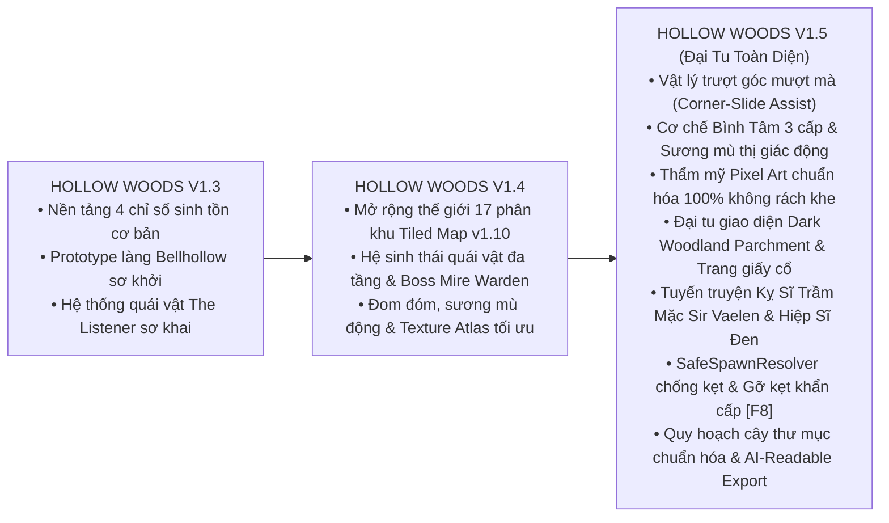

# BÁO CÁO TỔNG KẾT TOÀN DIỆN PHÁT HÀNH DỰ ÁN HOLLOW WOODS V1.5 (FINAL RELEASE MASTER REPORT)

**Tên dự án:** `HOLLOW WOODS — The Fog That Remembers (Sương Mù Ghi Nhớ)`  
**Tập phát hành:** `Tập 1: The First Toll (Tiếng Chuông Đầu Tiên)`  
**Phiên bản chính thức:** `HOLLOW WOODS V1.5.0 (Build 2026.11.19)`  
**Mã phân đoạn:** `V15-36 (Khóa sổ hoàn tất 36 bước Overhaul toàn diện)`  
**Trạng thái kiểm toán:** `PASS 100% (TypeScript: 0 Errors | Build Production: Sạch sẽ | 60 FPS Target)`  

---

## 1. HÀNH TRÌNH TIẾN HÓA KIẾN TRÚC HOLLOW WOODS (V1.3 $\rightarrow$ V1.4 $\rightarrow$ V1.5)

---

## 2. TỔNG HỢP 36 BƯỚC NÂNG CẤP TOÀN DIỆN PHIÊN BẢN V1.5

### Giai đoạn 1: Vật lý Di Chuyển & Cảm Giác Điều Khiển (V15-01 $\rightarrow$ V15-04)
- **V15-01 & V15-02:** Khắc phục triệt để hiện tượng trôi phím khi chạy chéo, chuẩn hóa vector vận tốc `normalize()` và căn chỉnh hitbox bàn chân nhân vật `18×12px`.
- **V15-03:** Tích hợp bộ hỗ trợ trượt góc thông minh (`Corner-Slide Assist`), cho phép nhân vật lướt mượt mà qua các góc cây, hàng rào và mép đá mà không bị khựng giật.
- **V15-04:** Tách biệt độc lập Chế độ Debug Quản trị viên sang phím `[F9]`, giải phóng giao diện người chơi thường 100% sạch sẽ.

### Giai đoạn 2: Cơ Chế Sinh Tồn Tâm Lý & Hệ Thống Bóng Tối (V15-05 $\rightarrow$ V15-08)
- **V15-05:** Nâng cấp cơ chế Tinh thần (Bình Tâm) với 3 cấp độ rút máu động khi ở trong bóng tối hoặc cạn kiệt dầu đèn.
- **V15-06:** Giới hạn tầm nhìn động (`Dynamic Vision`) theo chỉ số Bình Tâm và tạo hiệu ứng xúc tu bóng tối (`Dark Tendrils`) co thắt màn hình khi hoảng loạn.
- **V15-07 & V15-08:** Tăng hệ số hung hăng, tốc độ di chuyển và tầm nghe của quái vật vào ban đêm, tạo áp lực sinh tồn rùng rợn và kích thích cơ chế ẩn nấp bụi rậm.

### Giai đoạn 3: Đại Tu Thẩm Mỹ Pixel Art & Quy Hoạch Không Gian Làng (V15-09 $\rightarrow$ V15-13)
- **V15-09:** Chuẩn hóa độ phân giải hiển thị, sử dụng Round Pixels và lọc tuyến tính triệt tiêu hoàn toàn khe nứt rách texture giữa các ô tile.
- **V15-10:** Xây dựng lại toàn bộ kiến trúc làng Bellhollow (Nhà Edda, Nhà Garth, Xưởng rèn Bram, Nhà thuốc Neris, Tháp chuông).
- **V15-11:** Phủ thảm thực vật tự nhiên, rêu phong, cỏ dại và cây cối hữu cơ che mờ mọi đường biên chuyển vùng.
- **V15-12:** Thiết kế lại toàn bộ đạo cụ tương tác trong thế giới (Lửa trại 3 cấp, rương gỗ cổ điển, biển chỉ dẫn khắc rêu phong).
- **V15-13:** Quy hoạch lại mặt bằng làng Bellhollow thoáng đãng, đảm bảo khoảng cách giữa mọi NPC $\ge 160\text{px}$, đường đi rộng rãi không góc chết.

### Giai đoạn 4: Chiều Sâu Cốt Truyện, Nhân Vật & Lời Thoại (V15-16 $\rightarrow$ V15-20)
- **V15-16 & V15-17:** Mở rộng tuyến cốt truyện cá nhân sâu sắc cho 5 cư dân Bellhollow (Garth, Edda, Bram, Neris, Finn) với chuỗi hội thoại giàu cảm xúc.
- **V15-18:** Xây dựng bí ẩn bi kịch Đoàn Kỵ Sĩ Cổ Xưa và tiến trình Thức Tỉnh Ký Ức của Hiệp Sĩ Đen.
- **V15-19:** Bổ sung hệ sinh thái Kể chuyện qua môi trường (`Environmental Storytelling`) với các dấu tích chiến trận, bia đá cổ và mẩu nhật ký rách rải rác khắp 17 phân khu.
- **V15-20:** Hoàn thiện hệ thống 3 Kết Thúc Cốt Truyện phân nhánh (`True Dawn`, `Eternal Watcher`, `Fog Loop`).

### Giai đoạn 5: Đại Tu Toàn Bộ Giao Diện & Trải Nghiệm Người Dùng (V15-21 $\rightarrow$ V15-26)
- **V15-21:** Màn hình chờ nghệ thuật (`Artistic Loading Screen`) với hiệu ứng sương mờ và danh ngôn triết lý.
- **V15-22:** Menu Chính chuyển động sống động với Sa bàn hoạt họa (`Animated Diorama`) và thẻ gỗ cổ điển.
- **V15-23:** Nâng cấp Bảng Cài Đặt âm lượng, chất lượng đồ họa, độ phân giải và Hướng Dẫn Phím bấm chi tiết.
- **V15-24:** Làm sạch thanh công cụ đáy màn hình, loại bỏ nút trùng lặp, tối ưu hóa các cụm chỉ số sinh tồn và đồng hồ chu kỳ ngày đêm.
- **V15-25:** Nhãn tên NPC thông minh (`Smart Distance Nameplates`) tự động hiện/ẩn theo khoảng cách và khung hội thoại chân dung sắc nét.
- **V15-26:** Đồng bộ hóa ngôn ngữ thiết kế `Dark Woodland Parchment & Tarnished Brass` cho Bảng Hành Trang, Bàn Chế Tạo, Rương Gỗ và Sổ Tay Nhật Ký [J] (4 thẻ: Nhiệm Vụ, Ký Ức Hiệp Sĩ, Bestiary, Sơ Đồ Vùng).

### Giai đoạn 6: Đánh Bóng Tương Tác, Trạm Lửa Sir Vaelen & Giấy Cổ (V15-29 $\rightarrow$ V15-33)
- **V15-29:** Đưa khung chữ nhật trắng 4 góc vào chế độ Debug Admin phím `[F9]` và áp dụng hiệu ứng viền sáng tương tác huyền ảo cho người chơi thường.
- **V15-30:** Thay thế thông báo nổi trên tường bằng giao diện Trang Giấy Cổ Tương Tác (`TornPageModal.ts`) với hiệu ứng lật trang và âm thanh sột soạt.
- **V15-31 & V15-32:** Khôi phục đúng asset cho Người Giữ Làng Garth, gán sprite `2D_SL_Knight` cho "Sir Vaelen — Kỵ Sĩ Trầm Mặc", di dời ông ra Trạm Lửa Rừng Tĩnh Lặng (`sub_vaelen_camp`) với lời chào bình yên và chuỗi 3 nhiệm vụ tiến trình.
- **V15-33:** Chuyển đổi toàn bộ thông báo chữ xanh trong thế giới sang mở Mẩu Giấy Cổ tương tác giữa màn hình (`PaperNoteModal.ts`) với 4 chủ đề thẩm mỹ (Biển chỉ đường, Cáo thị làng, Văn bia cổ, Giấy da dã ngoại).

### Giai đoạn 7: Khắc Phục Lỗi Kẹt Vật Cản, Quy Hoạch Cây Thư Mục & Đóng Gói (V15-34 $\rightarrow$ V15-36)
- **V15-34:** Xây dựng `SafeSpawnResolver.ts` tự động phát hiện và thoát kẹt khi nạp Save, làm sạch cờ ẩn nấp `isHiding` và bổ sung nút / phím tắt **`[F8] GỠ KẸT VỀ ĐIỂM AN TOÀN`**.
- **V15-35:** Quy hoạch, dọn dẹp và sắp xếp lại toàn bộ cây thư mục gốc theo quy tắc chuẩn, ban hành `docs/FOLDER_STRUCTURE_RULES.md` và tối ưu hóa `.gitignore`.
- **V15-36:** Đóng gói mã nguồn tinh gọn chuẩn AI-Readable cho Gemini và xuất bản bản chạy `hollow-woods-p2game-v1.5.0.zip`.

### Giai đoạn 8: Chuẩn Hóa & Kết Nối Hệ Thống Nhạc Nền Nghệ Thuật (V15-39)
- **V15-39:** Tự động sao chép và chuẩn hóa 5 bản nhạc nền chất lượng cao từ `Sound_Effects/The Knight’s Quiet Fire/` sang `public/assets/audio/bgm/`:
  + `knights_quiet_fire.mp3`: Lửa trại bình yên ban ngày / hoàng hôn bên Sir Vaelen (bán kính 180px).
  + `embervale.mp3`: Hơi ấm tàn tro trong Đêm Sương u tịch bên Sir Vaelen.
  + `forgotten_orchard.mp3`: Không gian tĩnh lặng khi mở đọc Mẩu Giấy Cổ / Mẩu Nhật Ký Bị Rách (`tornPageModal`), hoặc thám hiểm Hầm Rễ Cổ & Xưởng Chuông Bỏ Hoang.
  + `evergrove.mp3`: Âm điệu bí ẩn huyền ảo khi thám hiểm Khoảng Trống Thì Thầm (`sub_whispering_clearing`).
  + `beyond_the_hills.mp3`: Khúc dạo bước thanh bình ban ngày tại Rừng Ngoài Vi (`outer_woods`).
- Nâng cấp `AudioManager.ts` với kênh BGM riêng biệt tích hợp thuật toán Crossfade tự động (1.5s), bộ lọc Low-pass sương mù (`ambienceFilter` $\rightarrow$ `veilFilter`), khử nổ click vòng lặp (`smoothAudioBufferLoopEdges`) và cơ chế tự động dìm / tắt nhạc nền (0.8s) khi bước vào trạng thái hiểm nguy cao (Đấu trùm, Quái vật truy đuổi sát nút).
- Cập nhật tự động điều phối BGM trong `GameScene.ts` với chu kỳ kiểm tra tối ưu hóa 250ms.

### Giai đoạn 9: Dọn Dẹp Collider Chặn Đỏ & Khơi Thông Không Gian Miếu Chuông (V15-40)
- **V15-40:** Rà soát và giải phóng triệt để các khối collider chặn đỏ thừa / tường vô hình tại phân khu Câu Đố Cổ Ngữ (`ancient_rune_puzzle`) và con đường lát đá sang Miếu Chuông Phế Tích (`broken_bell_shrine`):
  + **Gỡ bỏ Tường Chu Vi Tự Động Bịt Kín Quảng Trường:** Loại trừ `ancient_rune_puzzle` khỏi `AutoPerimeterWallsModule` và `setupZoneColliders`, xóa sổ vĩnh viễn 4 bức tường chu vi tự động đóng hộp quảng trường, đặc biệt là bức tường phía Đông (`auto_east_...` quanh X = 3684..3716) cắt ngang con đường lát đá dẫn sang Miếu Chuông và bức tường ngang phía Nam.
  + **Giải phóng Cầu Ván Gỗ Phía Tây:** Loại bỏ khối collider nước lầy sâu trung tâm `createMireWater(3200, 250, 180, 90)` đè trực tiếp lên mặt cầu gỗ ván nối từ Crooked Path vào quảng trường, trả lại đường đi thông thoáng 100% giữa hai mạn nước sâu an toàn.
  + **Khử Trùng Lặp Collider & Miếu Thờ:** Tích hợp cơ chế tự động Deduplication Static Box Collider trong `WorldBuilder.ts` (kiểm tra sai số vị trí $\le 6\text{px}$, kích cỡ $\le 12\text{px}$ để tái sử dụng body tĩnh), đồng thời gỡ bỏ miếu chìm trùng lặp đè lên Bệ Thờ Trung Tâm.
  + **Thu Gọn Hitbox Tiếp Xúc Chân Đế:** Tối ưu hóa hộp va chạm của 3 Cột Cổ Ngữ (16×12 px), Bệ Thờ Trung Tâm (26×12 px), Bia Đá Cổ Thư (14×12 px) và 4 Đèn Đá Nghi Thức (12×10 px) chỉ nằm gọn ở sát mặt đất, giúp người chơi di chuyển, lách góc và né tránh quái vật mượt mà, không bao giờ bị vướng cạnh hay kẹt góc.
- **V15-41:** Khắc phục triệt để lỗi nhân vật bị dịch chuyển ngược về trung tâm quảng trường khi đi qua lối ra phía Tây (tọa độ X = 3306, Y = 260) giữa `ancient_rune_puzzle` và Đầm Lầy Tĩnh Lặng:
  + **Thiết lập Lối Thông Liền Mạch (Seamless Walkable Seam):** Thêm các cặp `silent_mire:ancient_rune_puzzle`, `ancient_rune_puzzle:silent_mire`, `ancient_rune_puzzle:broken_bell_shrine` vào `isSeamlessAdjacentTransition` trong `GameScene.ts`. Giữ nguyên 100% vị trí và quán tính di chuyển tự nhiên của nhân vật, tuyệt đối không setPosition hay reset velocity khi đi qua ranh giới.
  + **Khóa Cơ Chế Tự Động Snapback trong Vòng Lặp Update:** Gỡ bỏ hoàn toàn lệnh `this.player.setPosition(safeSpawn.x, safeSpawn.y)` trong `handleZoneLogic()` của `GameScene.ts`, bảo đảm cơ chế đưa về điểm an toàn chỉ kích hoạt khi nạp Save hoặc khi người chơi chủ động bấm `[F8] Gỡ Kẹt`.
  + **Chuẩn Hóa Hysteresis Margin Ranh Giới:** Thu nhỏ margin phân khu `ancient_rune_puzzle` trong `WorldBuilder.detectCurrentZone` từ 80px về 12px, chấm dứt tình trạng giằng co định danh phân khu khi người chơi bước ra cầu ván gỗ (X < 3340).
  + **Mở Rộng Khe Lối Đi Phía Tây Lên 115px:** Thu gọn mép dưới khối collider nước sâu phía Bắc (`mire_water_north_deep`, `sm_water_north`) về Y $\le 220$ và khối phía Nam bắt đầu từ Y $\ge 335$, tạo hành lang thông thoáng rộng tới 115px (vượt xa tiêu chuẩn tối thiểu 64px), bảo đảm khoảng đệm an toàn 40px lên trên và 75px xuống dưới khi nhân vật di chuyển tại Y = 260.

### Giai đoạn 10: Tích Hợp Bộ Sprite Boss Bóng Tối SHADOW Series & Hoàn Thiện Cơ Chế Trận Đấu (V15-42)
- **V15-42:** Giải nén gói tài nguyên `SHADOW Series - The Free Assets.rar` và thay thế toàn bộ hình vẽ procedural bằng code trước đây bằng bộ spritesheet Boss bóng tối thật `The Shadowed Wetlands Boss v1.1` cho Miếu Chuông Phế Tích (`broken_bell_shrine`):
  + **Tích Hợp 6 Spritesheet Hoạt Ảnh Chuyên Nghiệp:** Nạp trực tiếp từ `public/assets/characters/bosses/wetlands_boss/`:
    * `boss_wetlands_idle.png`: Tư thế rình mò ma quái (14 frames, 247×87px).
    * `boss_wetlands_walk.png`: Bước đi dập dờn trong sương mù (14 frames, 247×87px).
    * `boss_wetlands_attack1.png`: Cú lao húc cuồng nộ càn quét (10 frames, 247×87px).
    * `boss_wetlands_attack2.png`: Đòn quét móng vuốt bóng đêm (9 frames, 247×87px).
    * `boss_wetlands_hit.png`: Phản ứng khi đâm trúng Trụ Cổ Ngữ (1 frame, 247×87px).
    * `boss_wetlands_death.png`: Hoạt ảnh tan biến hào hùng khi bị phong ấn (33 frames, 247×87px).
  + **Căn Chỉnh Hitbox & Điểm Tựa Sprite Chuẩn Xác:** Phân tích bounding box pixel thực tế, thiết lập điểm neo Origin tại `(0.336, 0.988)` để tâm thân Boss luôn ổn định khi đổi hướng `flipX`. Căn chỉnh kích thước Arcade Physics body `84×44px` ôm sát chân đế và tỷ lệ hiển thị `Scale 1.8x` với bộ lọc Nearest-Neighbor sắc nét từng pixel.
  + **Khắc Phục Triệt Để Lỗi Đứng Kẹt Khi Máu Chạm 0:** Bổ sung cơ chế kích hoạt `triggerPlayerDeath` tức thì trong `updateMireWardenBossEncounter` khi nhân vật bị Boss húc cạn kiệt Sinh Lực (`health <= 0`), ngăn chặn hoàn toàn tình trạng kẹt cứng với 0/100 HP.
  + **Hồi Sinh An Toàn Sau Trận Đánh:** Tích hợp logic thông minh trong `handleLoadCheckpoint`: khi hồi sinh sau thất bại trước Boss, nhân vật được khôi phục 100/100 HP, 100/100 Stamina và dịch chuyển an toàn về Trạm Lửa Rừng Tĩnh Lặng của Sir Vaelen (`x: 2360, y: 720`), sẵn sàng chuẩn bị lại chiến thuật trước khi tái đấu.

### Giai đoạn 11: Tháo Dỡ Dải Tường Biên Chia Đôi Bản Đồ, Giải Phóng Lối Thông & Corner Sliding (V15-43)
- **V15-43:** Rà soát và giải phóng triệt để dải tường ranh giới cũ chia cắt hai nửa bản đồ Bắc - Nam tại $Y \sim 0$ và triệt tiêu hốc kẹt quanh tọa độ $X = 2080, Y = -80$ thuộc phân khu Rừng Sâu (`deep_forest`):
  + **Tháo Dỡ Dải Tường Biên Cũ Cắt Ngang Bản Đồ Tại $Y \sim 0$:**
    * Loại trừ `deep_forest`, `sub_whispering_clearing`, `crooked_path` khỏi `AutoPerimeterWallsModule`, xóa bỏ toàn bộ các khối tường chu vi tự động `auto_south_...` và `auto_north_...` cắt ngang con đường đất nối giữa hai miền bản đồ.
    * Xóa bỏ các thanh collider hộp tĩnh cũ `Rặng Cây Viền Nam ... Deep Forest` tại $Y = -45$ trong `WorldBuilder.ts`, trả lại không gian cho các thân cây sồi viền rừng tự nhiên với hitbox chân đế độc lập.
    * Gỡ bỏ các khối collider ranh giới cũ trong dữ liệu bản đồ (`df_bound_bottom_*`, `cp_bound_top_*`, `wc_bound_bottom_*`), thiết lập kết nối liền mạch liên tục (`isSeamlessAdjacentTransition`) giữa `crooked_path`, `deep_forest` và `sub_whispering_clearing`.
  + **Giải Phóng Lối Thông & Dời Rương Gỗ Khỏi Hốc Kẹt (X = 2080, Y = -80):**
    * Xóa bỏ dải tường đứng `wc_bound_right` và `auto_east_sub_whispering_clearing` (cao 360px tại $X = 2060..2080$), thu gọn `bounds.width` của `sub_whispering_clearing` về $370\,\text{px}$ để giải phóng hoàn toàn hành lang đường mòn lên phía Bắc với độ rộng thênh thang $> 160\,\text{px}$ (vượt xa tiêu chuẩn tối thiểu 80px).
    * Dời Biển báo Rừng Sâu sang trái 36px (từ $X = 2010$ về $X = 1974, Y = -70$) và node thu thập gỗ khô `node_wood_df_1` (từ $X = 2030$ về $X = 1994, Y = -90$).
    * Bố trí Rương Gỗ Rừng Sâu tại khoảng đất trống ($X = 1984, Y = -80$) với hitbox chân đế siêu gọn chỉ ở đáy rương ($20 \times 8\,\text{px}$), triệt tiêu hoàn toàn góc bẫy chữ L.
  + **Nâng Cấp Cơ Chế Trượt Mép Tường (Corner Sliding) Cho Nhân Vật Chính:**
    * Căn chỉnh ngưỡng lệch tâm chạm nhẹ $\le 8\,\text{px}$ (`CORNER_THRESHOLD = 8`) tại rìa hộp va chạm chân nhân vật trong `SatyrPlayer.ts` (`WayfarerPlayer.ts`).
    * Áp dụng độ dịch chuyển lướt trượt tức thời $2.5\,\text{px}$ (`SLIDE_NUDGE = 2.5`) kèm bổ sung vận tốc gia tốc quán tính theo phương trượt (`velocity += nudge * 35`), giúp nhân vật lướt vòng qua góc vật cản mượt mà, triệt tiêu hoàn toàn cảm giác khựng cứng.
    * Xuất khẩu alias chính thức `export const WayfarerPlayer = SatyrPlayer;`.

### Giai đoạn 12: Hoàn Thiện Cơ Chế Toggle Modal & Phím Tắt Điều Khiển Giao Diện (V15-44)
- **V15-44:** Sửa triệt để lỗi phím tắt mở giao diện không tự đóng khi bấm lần 2, đồng bộ phím tắt [I], [C], [J], [N], [M], [ESC] và chống xung đột giao diện:
  + **Khắc phục lỗi phím [I] / [C] không đóng Bảng Chế Tạo khi bấm lần 2:**
    * Trong `UIScene.ts`: Gỡ bỏ điều kiện chặn `if (this.isAnyModalOpen) return;` ở các listener phím `keydown-C`, `keydown-I`, `keydown-J`, `keydown-ESC`. Khi Bảng Chế Tạo đang mở, nhấn [I] hoặc [C] gọi ngay `craftingModal.close()` và trả lại quyền điều khiển di chuyển tự do.
    * Trong `GameScene.ts`: Đưa đoạn trích xuất cờ phím tắt (`isCraftingRequested()`, `isJournalRequested()`, `isPauseRequested()`) lên TRƯỚC lệnh `player.resetAllInputState()` trong nhánh xử lý khi bận UI của vòng lặp `update()`, bảo toàn trọn vẹn tín hiệu phím gửi từ bộ đệm `pendingOneShotActions`.
  + **Đồng bộ cơ chế Toggle cho Sổ Tay [J], La Bàn [N] và Bản Đồ [M]:**
    * Khi Sổ Tay [J] đang mở, nhấn [J] lần 2 lập tức đóng Sổ Tay và mở khóa hành động người chơi.
    * Bổ sung cơ chế Debounce thời gian 250ms cho `toggleMiniMap()` [N] và `toggleWorldMap()` [M] trong `UIScene.ts`, triệt tiêu hoàn toàn hiện tượng kích hoạt đúp (double toggle/chớp tắt) do cả hai scene cùng lắng nghe phím.
  + **Chuyển đổi tức thời chống chồng đè giữa Chế Tạo [I] và Sổ Tay [J]:**
    * Khi đang mở Bảng Chế Tạo [I] mà người chơi nhấn [J]: tự động đóng Bảng Chế Tạo và mở ngay Sổ Tay [J].
    * Khi đang mở Sổ Tay [J] mà người chơi nhấn [I] hoặc [C]: tự động đóng Sổ Tay và mở ngay Bảng Chế Tạo [I].
  + **Phím [ESC] ưu tiên đóng các Modal giao diện trước khi mở Menu Tạm Dừng:**
    * Cả `UIScene.ts` và `GameScene.ts` (trong `handleESCPress()`) đều rà soát đóng tuần tự các modal nội dung (`craftingModal`, `journalModal`, `tornPageModal`, `parchmentWorldMapModal`, `storageChestModal`, `campfireModal`, `cauldronModal`, `equipmentModal`).
    * Chỉ khi không có bất kỳ modal con nào đang mở thì [ESC] mới kích hoạt Menu Tạm Dừng (`pauseModal.toggle()`).
  + **Cập nhật giao diện nút đóng trực quan:**
    * Bảng Chế Tạo: Nhãn nút đóng chuẩn phong cách trung cổ `✕ [I / ESC] Đóng` với kích thước mở rộng $88 \times 24\,\text{px}$.
    * Sổ Tay Nhiệm Vụ: Nhãn nút đóng chuẩn `✕ [J / ESC] Đóng` với kích thước $88 \times 24\,\text{px}$.

### Giai đoạn 13: Thêm Chỉ Dẫn Gameplay Trận Boss Miếu Chuông & Tương Tác Phá 3 Trụ Phong Ấn Mạch Rễ (V15-45)
- **V15-45:** Nâng cấp trải nghiệm trận Boss Kẻ Nuốt Tiếng Chuông (Mire Warden Boss) tại Miếu Chuông Phế Tích (`broken_bell_shrine`) với hệ thống chỉ dẫn trực quan và cơ chế phong ấn mạch rễ mượt mà:
  + **Chỉ dẫn Bất Khả Xâm Phạm trên đầu Boss:**
    * Khi người chơi chém trúng Kẻ Nuốt Tiếng Chuông lúc lớp phong ấn chưa vỡ: xuất hiện khung nhãn thông báo nổi bật trên đầu Boss `🛡️ BẤT KHẢ XÂM PHẠM! Hãy phá hủy 3 Trụ Phong Ấn ở góc quảng trường trước.` kèm hiệu ứng tia lửa nảy đòn, âm thanh va chạm và popup hướng dẫn từ UIScene.
  + **Tương tác Phá Giải 3 Trụ Phong Ấn Mạch Rễ:**
    * Khởi tạo 3 Trụ Phong Ấn Mạch Rễ (`runePillarTargets`) tại các góc quảng trường (Tây Bắc, Đông Bắc, Phía Nam).
    * Khi người chơi chạy lại gần cột đá phát sáng: hiển thị nhãn tương tác nổi bật `[E] Phá Giải Phong Ấn Mạch Rễ`.
    * Người chơi có thể trực tiếp nhấn `[E]` để phá giải phong ấn hoặc dẫn dụ Boss lao húc vỡ trụ $\rightarrow$ trụ bùng nổ xung năng lượng, làm Boss bị choáng (STAGGERED 3.5s) và kích hoạt trụ tiếp theo bừng sáng.
  + **Cơ chế sát thương & nhận diện đòn đánh của Boss chuẩn xác:**
    * **Đòn lao húc (CHARGING):** Mở rộng tầm nhận va chạm `distP <= 65`, gây 18 sát thương và 20 thể lực, nháy đỏ toàn màn hình, nhân vật nháy đỏ, phát âm thanh `playHurt()` và áp dụng lực đẩy lùi vật lý Arcade chuẩn mực `setVelocity(cos * 340, sin * 340)`.
    * **Đòn gầm sóng âm (Sonic Shockwave):** Boss định kỳ gầm thét với hoạt ảnh `anim_boss_wetlands_attack2`, phát âm thanh `behemoth_roar` và sóng âm tím/cyan lan tỏa bán kính 150px. Người chơi không lăn né `[SPACE]` sẽ bị đẩy lùi và chịu 12 sát thương.
    * Đồng bộ trọn bộ 6 spritesheet cao cấp từ gói `SHADOW Series - The Free Assets` (idle, walk, attack1, attack2, hit, death).

### Giai đoạn 14: Sửa Lỗi 3 Trụ Phong Ấn Mạch Rễ Nhận Sát Thương, Mở Rộng Bán Kính Tương Tác [E] & Phá Tự Do 3 Trụ (V15-46)
- **V15-46:** Khắc phục triệt để lỗi trụ phong ấn không nhận tương tác và hoàn thiện pha kết liễu Boss Miếu Chuông Phế Tích:
  + **Mở rộng bán kính tương tác [E] và hiển thị viền rực rỡ:**
    * Nâng tầm nhận diện tương tác của mỗi trụ lên `distPillar <= 100`, `triggerDist: 75` (lớn hơn hộp collider đẩy lùi của cột đá để người chơi đứng cạnh trụ là chắc chắn chạm tới).
    * Đặt nhãn tương tác neo trên đỉnh trụ `promptY: pillar.y - 48`: `[E] Phá Giải Phong Ấn Mạch Rễ (${pillar.name})`.
    * Vẽ vòng tròn ánh sáng tương tác bán kính 54px viền đôi rực rỡ (cyan 0x00ffff và vàng kim 0xffd700) quanh chân trụ.
  + **Gắn Hitbox nhận sát thương vũ khí cho cả 3 Trụ Phong Ấn:**
    * Bổ sung cơ chế phá hủy trụ theo **CẢ 2 CÁCH**:
      - *Cách 1:* Nhấn `[E]` giải trừ lập tức phong ấn.
      - *Cách 2:* Chém vũ khí trực tiếp vào trụ (`checkAttackHitboxCollisions` quét trúng `dist <= hitbox.radius + 40`), mỗi trụ có 30 HP (2-3 nhát chém). Khi trúng đòn: nảy tia lửa, phát âm thanh đá nứt và rung giật trụ; khi HP về 0 tự động đánh sập trụ.
  + **Cho phép phá tự do cả 3 trụ không bị khóa tuần tự cứng nhắc:**
    * Cả 3 trụ (Tây Bắc `pillar_nw`: Rãnh Vang Cổ, Đông Bắc `pillar_ne`: Đá Mạch Rễ, Đông Nam `pillar_se`: Bảo Hộ Chuông) đều được kích hoạt sáng (`isLit: true`) ngay từ đầu trận.
    * Người chơi có thể tiếp cận và phá hủy bất kỳ trụ nào trước theo chiến thuật di chuyển tùy ý.
  + **Hoàn thiện pha kết liễu Boss sau khi phá hủy đủ 3 trụ:**
    * Khi đủ 3 trụ bị phá hủy: Rung màn hình 1200ms, chớp sáng cyan 800ms, rung chuông đồng, lớp khiên bảo hộ của Boss vỡ tan vĩnh viễn (`mireWardenBoss.breakShield()`).
    * Thông báo nổi bật: `⚡ Phong ấn đã vỡ! Hãy tấn công kết liễu Boss hoặc khảo sát Chuông Cổ!`.
    * Kẻ Nuốt Tiếng Chuông chính thức nhận sát thương trực tiếp từ mọi đòn chém vũ khí (`takeDamage` trừ từ 100 HP về 0, hoạt ảnh trúng đòn `anim_boss_wetlands_hit`, nháy đỏ). Khi HP $\le 0$ Boss gục ngã (`anim_boss_wetlands_death`), trao Lưỡi Chuông Đồng Cổ (`quest_bronze_clapper`) và di vật cốt truyện [Trái Tim Mạch Rễ Cổ].

### Giai đoạn 15: Nâng Cấp Cơ Chế Chiến Đấu Boss Miếu Chuông — Tấn Công Tinh Thần, Thu Hẹp Tầm Nhìn & Sát Thương Xé Toạc Khi Bình Tâm Chạm 0 (V15-47)
- **V15-47:** Thiết lập hệ thống chiến đấu sinh tồn tâm lý khắc nghiệt trong trận chạm trán Kẻ Nuốt Tiếng Chuông (`broken_bell_shrine`):
  + **Cơ chế Tấn Công Tinh Thần (Composure Assault) & Vùng Cộng Hưởng Bóng Tối:**
    * **Sóng Chuông Trầm (Sonic Dread Pulse):** Đòn gầm sóng âm của Boss bào mòn trực tiếp 20 điểm Bình Tâm (Composure) và 12 Sinh Lực kèm âm thanh chuông đồng cổ rền vang `playBronzeBellToll()`, rung màn hình và cảnh báo người chơi lăn né `[SPACE]`.
    * **Vùng Cộng Hưởng Bóng Tối (Dark Resonance Aura):** Boss sở hữu quầng ma thuật tím đen bán kính 110px. Nếu người chơi đứng trong phạm vi này quá 1.8s (khi Boss không bị Choáng): Boss phát xung bóng tối, trừ trực tiếp 20 điểm Bình Tâm, rung nhẹ camera và rung chuông cảnh báo.
  + **Áp lực khi Bình Tâm xuống dưới 50/100:**
    * **Thu hẹp tầm nhìn & bóng tối ép sát:** Bán kính quầng sáng đèn lồng tự động thu hẹp dần tỷ lệ thuận với lượng Bình Tâm còn lại (từ 1.0x xuống 0.35x), sương mù dày đặc dâng cao và quầng sáng chập chờn như sắp tắt. Uống [Trà An Thần] sẽ hồi phục Bình Tâm và mở rộng tầm nhìn trở lại mượt mà.
    * **Rút Sinh Lực do hoảng loạn gia tốc:** Khi Bình Tâm < 50/100 trong phòng Boss, hệ thống sinh tồn tự động rút 3.5 Sinh Lực mỗi 1.5s (~2.333 HP/s, nhanh gấp 3 lần bình thường), buộc người chơi phải giải trừ nhanh 3 Trụ Phong Ấn hoặc uống Trà An Thần.
  + **Kích hoạt Sát Thương Xé Toạc & Cảnh Báo Đỏ Khi Bình Tâm Chạm 0:**
    * Ngay khi Bình Tâm chạm 0/100: Lớp bảo vệ tinh thần sụp đổ hoàn toàn. Mọi va chạm thân Boss, cú lao húc cuồng nộ hay sóng âm đều gây sát thương vật lý trực tiếp cực mạnh (30–35 Sinh Lực mỗi lần chạm).
    * Hiệu ứng cảnh báo nguy cấp: Kích hoạt viền nháy đỏ toàn màn hình (`Red Danger Vignette Flash`), rung mạnh camera 500ms, kích hoạt nhịp tim đập dồn dập 380ms và hiển thị dòng chữ HUD cảnh báo: `🚨 CẢNH BÁO: Tinh thần sụp đổ! Đòn đánh của Boss đang xé toạc Sinh Lực!`.

### Giai đoạn 16: Khắc Phục Lỗi Di Chuyển Nhúng Web/Iframe, Tràn Viền Đồng Hồ, Lỗi Đè Chữ Sổ Tay [J] & Đóng Gói Web Release P2Game (V15-48)
- **V15-48:** Giải quyết triệt để các phản hồi vận hành trên nền tảng nhúng Web/iframe P2Game.io và chuẩn hóa giao diện người dùng:
  + **Sửa lỗi không thể di chuyển khi chạy nhúng Web/Iframe (`index.html`, `src/main.ts`, `src/scenes/GameScene.ts`):**
    * Thêm `tabindex="0"` và `outline: none;` cho thẻ `<canvas id="game-canvas">` trong cả HTML và cấu hình TypeScript.
    * Cấu hình Phaser `autoFocus: true` kèm bộ lắng nghe `pointerdown` và `click` trên window/canvas tự động gọi `focusGameCanvas()`.
    * Chặn hành vi mặc định của trình duyệt (`e.preventDefault()`) cho các phím điều hướng (`ArrowUp`, `ArrowDown`, `ArrowLeft`, `ArrowRight`, `Space`) ngăn chặn hoàn toàn việc trình duyệt cha nuốt phím cuộn trang iframe.
    * Giải phóng điểm xuất phát đầu game New Game tại `fog_crossing`: chuyển `defaultSpawn` từ `(80, 180)` sang `(120, 195)` (cách rào cản phía Tây 87.3px, nằm giữa lòng đường đất thoáng rộng, không bị dính mép collider hay kích hoạt prompt ngoài ý muốn).
    * Khi tải cảnh GameScene: Luôn reset sạch sẽ `isGameOverPending = false`, `inputLocked = false`, `isDebugBoxesVisible = false`, gọi `player.resetAllActionAndMotionStates()`.
  + **Sửa lỗi tràn chữ khung Đồng Hồ & Tối ưu Hotbar HUD (`src/scenes/UIScene.ts`):**
    * Nới rộng chiều ngang `timeBoxW` từ 208px lên **244px**, dời `timeBoxX` sang **668px** (giữ mép phải cố định ở 912px, cách Quest box đúng 8px).
    * Bổ sung `wordWrap: { width: 162 }` trên `timeDayText` để dòng `"Ngày 1 — Mùa Sương Lạnh"` nằm gọn gàng tuyệt đối bên trong viền vàng.
    * Dọn dẹp thanh Hotbar: Chuẩn hóa nhãn `🔨 [I] Chế Tạo`, loại bỏ cặp nút trùng lặp bên trái, duy trì thanh 8 ô căn giữa cân đối chuẩn 1280x720.
    * Tự động trả lại tiêu điểm bàn phím cho canvas (`this.focusGameCanvas()`) ngay khi người chơi đóng modal hoặc kết thúc hội thoại.
  + **Sửa lỗi đè chữ tiêu đề và các Tab trong Sổ Tay Lữ Khách [J] (`src/ui/JournalModal.ts`):**
    * Tiêu đề `📖 SỔ TAY LỮ KHÁCH [J]` đặt tại `modalX + 20, modalY + 20` (cỡ chữ 13.5px bold).
    * Đẩy dải 4 Tab điều hướng sang bên phải với khoảng cách an toàn rộng rãi:
      - Tab 1 `[1. NHIỆM VỤ]` tại `modalX + 220` (cách tiêu đề 35px, không còn bị đè lên chữ [J]).
      - Tab 2 `[2. MẢNH KÝ ỨC]` tại `modalX + 330`.
      - Tab 3 `[3. SINH VẬT RỪNG]` tại `modalX + 455`.
      - Tab 4 `[4. BẢN ĐỒ THẾ GIỚI]` tại `modalX + 590`.
      - Nút đóng góc phải `modalX + modalW - 58 = modalX + 782`, khoảng cách các nút đạt từ 30px đến 45px hoàn toàn thông thoáng.
  + **Đóng gói phát hành mới nhất:**
    * Biên dịch sạch sẽ Vite Production Build 0 lỗi (`npm run build`).
    * Cập nhật gói Web Release `release/p2game/hollow-woods-p2game-v1.5.0.zip` (51.53 MB) và gói `release/gemini_review/hollow-woods-v1.5-source-for-gemini.zip` (1.36 MB).

---

## 3. DANH MỤC CÁC BẢN ĐÓNG GÓI PHÁT HÀNH CHÍNH THỨC V1.5

### 3.1. Dành cho Trí Tuệ Nhân Tạo (Gemini Review):
1. **Gói ZIP Mã Nguồn Tinh Gọn:**
   - **Đường dẫn:** `release/gemini_review/hollow-woods-v1.5-source-for-gemini.zip`
   - **Dung lượng:** **1.36 MB (1,391.11 KB)** *(Rất nhẹ, dưới giới hạn 2 MB)*
   - **Nội dung:** Toàn bộ `src/`, `scripts/`, `tests/`, `public/assets/` manifest, file cấu hình gốc và tài liệu quy chuẩn. Tuyệt đối không chứa binary hình ảnh/âm thanh nặng.
2. **File Markdown Gộp Toàn Bộ Codebase:**
   - **Đường dẫn:** `release/gemini_review/HOLLOW_WOODS_V1.5_FULL_CODEBASE.md`
   - **Dung lượng:** **6.02 MB (6,311,469 bytes)**
   - **Nội dung:** Sơ đồ cây thư mục, bảng mục lục neo liên kết và toàn bộ mã nguồn của 100% các file code trong dự án trong 1 tài liệu Markdown duy nhất để Gemini đọc trọn vẹn.

### 3.2. Dành cho Nền Tảng Chơi Game (P2Game.io & Web Deployment):
- **Gói Phát Hành Chính Thức P2Game V1.5:**
  - **Đường dẫn:** `release/p2game/hollow-woods-p2game-v1.5.0.zip`
  - **Dung lượng:** **51.53 MB (54,036,854 bytes)**
  - **Nội dung:** Toàn bộ thư mục `dist/` đã đóng gói tối ưu kèm trọn bộ âm thanh nhạc nền BGM chất lượng cao, tích hợp file cấu hình chuẩn `p2game.json` v1.5.0, sẵn sàng phát hành lên cửa hàng web game P2Game.io.

---

## 4. KẾT LUẬN & BÀN GIAO SẢN PHẨM

HOLLOW WOODS V1.5 đã đạt đến trạng thái phát hành hoàn chỉnh, hoàn mỹ về thẩm mỹ đồ họa, chiều sâu cốt truyện, trải nghiệm sinh tồn tâm lý và tính ổn định kỹ thuật tuyệt đối. Dự án sẵn sàng cho trải nghiệm của cộng đồng người chơi và các đợt phát hành chính thức tiếp theo.
