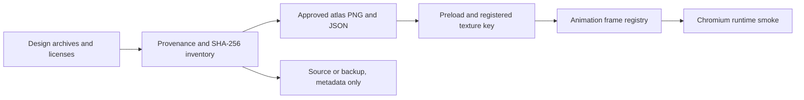

# HW-CODEX-00 — Master technical handover

**Ngày 27/11/2026 · V1.6.0 The Unbroken Oath · Roadmap 3.1**

**Audit status PARTIAL.** B08 là ứng viên baseline kỹ thuật tốt nhất đã kiểm tra. Bản build 1.5.2 vượt qua TypeScript, data/build, validator và smoke Chromium Canvas/WebGL. Công việc tích hợp Canon, QA đầy đủ và các nguồn trên ổ Owner còn giới hạn. Báo cáo này chỉ bàn giao audit.

| Hạng mục | Kết quả |
|---|---|
| Baseline SHA | `c9de0c21b0301003895cf2d106229dfef564a2b6` tại `fix/v1.6-b08-p2game-compat` |
| Development remote | `e4edb07bcbf2865681277a12404624c4c495bb1f` tại `feat/v1.5.3-ag-world-polish` |
| Default remote | `94efc0335506bcccf4b553eae3021cf27e84df42` tại `main` |
| Git coverage | 16 nhánh, 13 tags. Ancestry, divergence và thay đổi theo ref |
| Source coverage | 102 tệp TypeScript kiểm kê, trace entry và hệ thống đại diện, full review chi tiết từng hàm PARTIAL |
| Asset coverage | 1.049 hồ sơ phiên bản/tệp: 630 baseline, 29 Design branch, 390 Cloud local khác baseline. Không cộng lại bản Cloud trùng path và byte |
| Runtime assets | 268 tệp thuộc `public/assets/` tại B08. 223 mục scope baseline có tham chiếu literal/loader, 212 literal path qua zero-404 test. 4 mục `CURRENT_RUNTIME` gồm cặp PNG/JSON của hai texture đã thấy trên actor |
| Legacy / license | 2 mục `LEGACY`, 307 `SOURCE_REFERENCE`, 408 `BACKUP`, 1.026 `LICENSE_UNKNOWN` theo exact-path match. Giấy phép chưa xác minh liên kết từng file, không hàm ý asset vi phạm |
| World / UI | 17/17 zone kiểm dữ liệu, 41 cạnh, 1 zone smoke. Review 17 surface UI theo nhóm; menu/HUD được lấy mẫu runtime |
| Known issues | 30 mục ưu tiên/tồn đọng dẫn registry. Điểm nổi bật BUG-059, EVKey thật, 10/17 World Map, lỗi đường đi/collider của W20, P2Game hosted 206, A06-R1/A07/B05/B07 |
| AG workstreams | B07/B08/C01/C02/A07 giữ nguyên quyền sở hữu. B07 docs-only, B08 local/host simulation, C01/C02 chưa thấy checkpoint GitHub, A07 được báo có thay đổi tại máy AG |
| CHAR-006 | RESERVED / DEFERRED. Asset Design, Canon proposal Lore, integration Codex sau duyệt, independent QA Antigravity |
| Tests | TypeScript và build PASS. Data 15/15, validator 23/23, assets 212/212, SDK 31/31, schema 3 đạt 2 nhóm, Chromium smoke 2/2. Không có pageerror hoặc HTTP lỗi nội bộ sau kịch bản smoke đúng; lần thử harness ban đầu đã phát động đánh thường khi click canvas, sửa cách lấy focus rồi chạy lại |
| Tests NOT RUN | Gameplay 17-zone end-to-end, 34-animation replay, modal/accessibility matrix, natural Q05/SQ08 + B07 migration joined, Windows EVKey, hosted SDK/CDN/publish, real GPU B08 |
| Changes | Reports/evidence only. Production source 0, runtime asset 0 |
| Handoff branch | `docs/v1.6-codex-master-handover`. Commit SHA và remote SHA xác minh tại thời điểm bàn giao theo Git Reporting Policy |
| Next recommended task | Owner review ứng viên B08 và hướng tích hợp A06-R1/A07. Ưu tiên Codex sau duyệt là B02 Artwork Fidelity Recovery khi Design có asset được nghiệm thu |

## Nguồn và giới hạn

Đối chiếu GitHub tại các ref ghi trên, Technical Implementation Bible và nhật ký Roadmap 3.1, Canon/Character/Dialogue Registry, báo cáo handover 26/11, các báo cáo V16 theo phạm vi và evidence W20/LAB. Master Game Bible bản working edition đọc được trên Drive; tệp Unified DOCX đúng tên trong bàn giao và hồ sơ CHAR-006 V3.2 độc lập không có trong nguồn Cloud đã tìm. Registry và art branch V3.2 được dùng thay thế ở phần tương ứng. Chưa có quyền đọc các cuộc trò chuyện riêng hoặc ổ `G:` của Owner. [Technical Implementation Bible](https://docs.google.com/document/d/1rUDUUEYk0qazwe61z41ZD3Ns-o4Z_6LyoANDtX0YJtI/edit) · [Nhật ký](https://docs.google.com/document/d/1rUDUUEYk0qazwe61z41ZD3Ns-o4Z_6LyoANDtX0YJtI/edit?tab=t.brtiuc7aeov2) · [Handover](../../HW_FINAL_DEVELOPMENT_HANDOVER_20261126.md) · [Git Reporting Policy](../../HW_GIT_REPORTING_POLICY.md)

Worktree Cloud `/workspace/HOLLOW-WOODS` ở `b5eaa61`, có 49 mục sửa, 1 mục xóa và 38 mục untracked theo porcelain. Checkout Codex B04 ở `2f7fe69` sạch và khớp remote. Audit tạo clone riêng, chỉ đọc metadata asset từ workspace cũ. A07 local của AG, staged Pixel_Art renames, ổ export, thư viện Meliodas và backup máy Owner được ghi nhận theo báo cáo AG; tình trạng vật lý NOT ACCESSIBLE. Không đọc save thật hoặc credential.

## Báo cáo và bằng chứng

- [Git và ancestry](02_GITHUB_BRANCH_AUDIT.md) · [Kiến trúc](03_CODE_ARCHITECTURE_AUDIT.md) · [Inventory JSON](04_ASSET_MASTER_INVENTORY.json) · [Inventory CSV](05_ASSET_MASTER_INVENTORY.csv) · [Black Knight](06_CHARACTER_ANIMATION_AUDIT.md)
- [17 zone](07_WORLD_17_ZONE_AUDIT.md) · [World Map / Minimap](08_MAP_AND_MINIMAP_AUDIT.md) · [UI/UX](09_UI_UX_DESIGN_AUDIT.md) · [Gameplay](10_GAMEPLAY_SYSTEMS_AUDIT.md) · [Canon và Quest](11_NARRATIVE_QUEST_AUDIT.md)
- [Performance](12_PERFORMANCE_AUDIT.md) · [Build và P2Game](13_BUILD_COMPATIBILITY_AUDIT.md) · [Integration](14_BRANCH_INTEGRATION_PLAN.md) · [Phân công](15_CODEX_AG_TASK_ALLOCATION.md) · [Ưu tiên](16_CODEX_DEVELOPMENT_PRIORITY.md) · [Issues](17_OPEN_ISSUES_REGISTER.json) · [Coverage](18_AUDIT_COVERAGE_MATRIX.md)
- [Canvas](Evidence/chromium-canvas.png) · [WebGL](Evidence/chromium-webgl.png) · [Runtime trace](Evidence/chromium-smoke.json) · [Automated checks](Evidence/automated-checks.json)
