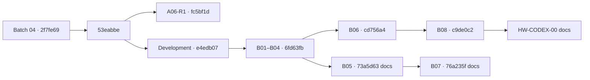

# 02 — GitHub branch audit

Snapshot tại 27/11/2026. Default `main` @ `94efc0335506bcccf4b553eae3021cf27e84df42`. Development `feat/v1.5.3-ag-world-polish` @ `e4edb07bcbf2865681277a12404624c4c495bb1f`. Baseline kỹ thuật của tài liệu `c9de0c21b0301003895cf2d106229dfef564a2b6`.

Ahead/behind tính theo development; số file tính từ merge base đi tới HEAD từng nhánh. Nguồn test là báo cáo tại ref tương ứng trừ khi có bằng chứng độc lập. Dấu thời gian commit không quyết định độ đầy đủ.

| Nhánh GitHub | HEAD | Parent | Merge base với development | Ahead / behind | src / asset / docs / khác | Bằng chứng & giới hạn |
|---|---|---|---|---|---|---|
| `art/char-006-headless-warden-v3.2` | [`339b8ab`](https://github.com/KyoshiroKyo/HOLLOW-WOODS/commit/339b8ab759f694c6d92b669dfd9c5dda12e37ed9) | `f8a666e` | `36f43b6` | 3 / 3 | 0 / 29 / 0 / 0 | Art study only; Gate B requires review; runtime locked. |
| `feat/v1.5-visual-gameplay-overhaul` | [`76fb668`](https://github.com/KyoshiroKyo/HOLLOW-WOODS/commit/76fb668f082c290ac00afdfdd0b743ffa5a6340e) | `5f71dc7`, `b4e8a50` | `b4e8a50` | 4 / 142 | 0 / 0 / 0 / 0 | Earlier overhaul. Historical acceptance only. |
| `feat/v1.5.3-ag-world-polish` | [`e4edb07`](https://github.com/KyoshiroKyo/HOLLOW-WOODS/commit/e4edb07bcbf2865681277a12404624c4c495bb1f) | `9e94b2f` | `e4edb07` | 0 / 0 | 0 / 0 / 0 / 0 | Official development ref; A08–A10 principally documentation. Holds A07 checkpoint. |
| `feat/v1.5.3-batch04` | [`2f7fe69`](https://github.com/KyoshiroKyo/HOLLOW-WOODS/commit/2f7fe691351da438f6e1b11c5ea557152ac049dc) | `6851702` | `2f7fe69` | 0 / 94 | 0 / 0 / 0 / 0 | K1–K3 and Conversion; P0 quest/gate and later hotfix evidence. Windows EVKey still outstanding. |
| `feat/v1.6-a06-r1-identity-evidence` | [`fc5bf1d`](https://github.com/KyoshiroKyo/HOLLOW-WOODS/commit/fc5bf1d5f849f694a6b92e270ef747b2f2914246) | `53eabbe` | `53eabbe` | 1 / 4 | 6 / 0 / 11 / 1 | Conditionally accepted on isolated branch. No integrated R1 gameplay proof. |
| `fix/v1.6-b01-bug058-scale` | [`ce88553`](https://github.com/KyoshiroKyo/HOLLOW-WOODS/commit/ce88553ad2a2a5062e8234c2e36a62edfcce6371) | `e4edb07` | `e4edb07` | 1 / 0 | 2 / 0 / 8 / 0 | AG nine runtime scenarios. Integrated in B08 ancestry. |
| `fix/v1.6-b02-bug059-artwork` | [`c3b6bbf`](https://github.com/KyoshiroKyo/HOLLOW-WOODS/commit/c3b6bbf5e6dd69e67ba5c2d8e822a30f0c25fa26) | `ce88553` | `e4edb07` | 2 / 0 | 3 / 0 / 15 / 0 | AG 48-case matrix. Visual fidelity PARTIAL. |
| `fix/v1.6-b03-movement-ime` | [`3fe8a8f`](https://github.com/KyoshiroKyo/HOLLOW-WOODS/commit/3fe8a8f72857462dba1964b9c536bfc871c4acc3) | `c3b6bbf` | `e4edb07` | 3 / 0 | 10 / 0 / 18 / 0 | AG synthetic/local IME evidence. Real Windows EVKey remains NOT RUN. |
| `fix/v1.6-b04-input-ui` | [`6fd63fb`](https://github.com/KyoshiroKyo/HOLLOW-WOODS/commit/6fd63fb3d566f9f44777155a7cdeb75631520561) | `3fe8a8f` | `e4edb07` | 4 / 0 | 15 / 0 / 25 / 0 | AG modal/input evidence. Combined acceptance after integration still pending. |
| `fix/v1.6-b05-quest-reward` | [`73a5d63`](https://github.com/KyoshiroKyo/HOLLOW-WOODS/commit/73a5d63fc131b5667dad3b75fc21c52a5465bf3d) | `6fd63fb` | `e4edb07` | 5 / 0 | 15 / 0 / 27 / 0 | BLOCKED. Docs-only, waits for A07. |
| `fix/v1.6-b06-audio-lifecycle` | [`cd756a4`](https://github.com/KyoshiroKyo/HOLLOW-WOODS/commit/cd756a4f3cb48f6c177f83a15d1567b355642073) | `6fd63fb` | `e4edb07` | 5 / 0 | 17 / 0 / 29 / 0 | Local AG audio evidence, hardware/ear mix not established. |
| `fix/v1.6-b07-save-migration` | [`76a235f`](https://github.com/KyoshiroKyo/HOLLOW-WOODS/commit/76a235f409ecb46935a775730c5adf958b5d75c1) | `73a5d63` | `e4edb07` | 6 / 0 | 15 / 0 / 30 / 0 | BLOCKED. Docs-only, waits for A06-R1/A07/B05. |
| `fix/v1.6-b08-p2game-compat` | [`c9de0c2`](https://github.com/KyoshiroKyo/HOLLOW-WOODS/commit/c9de0c21b0301003895cf2d106229dfef564a2b6) | `cd756a4` | `e4edb07` | 6 / 0 | 20 / 0 / 34 / 4 | Local/host simulation. Best technical integration candidate. Hosted QA remains NOT RUN. |
| `main` | [`94efc03`](https://github.com/KyoshiroKyo/HOLLOW-WOODS/commit/94efc0335506bcccf4b553eae3021cf27e84df42) | `b5eaa61` | `b5eaa61` | 1 / 132 | 0 / 0 / 1 / 0 | Default; baseline release lineage, much older than active development. |
| `qa/v1.5.3-batch03-r2` | [`0ceffa5`](https://github.com/KyoshiroKyo/HOLLOW-WOODS/commit/0ceffa58f3cb7ffce12b0ba6af9364eb08835eb2) | `b5eaa61` | `0ceffa5` | 0 / 131 | 0 / 0 / 0 / 0 | Archive QA ancestor; no fresh tester sign-off inferred. |
| `recover-classic-sanity-v1506` | [`2ceebf5`](https://github.com/KyoshiroKyo/HOLLOW-WOODS/commit/2ceebf5591f137b687070df8698374a74e32d371) | `59d1b66` | `59d1b66` | 1 / 43 | 1 / 0 / 1 / 0 | Classic Sanity recovery; compare final visual invariant, not raw branch transplant. |

Đây là sơ đồ tổ tiên giản lược. B08 chứa 100 commit sau Batch 04; A06-R1 rẽ nhánh tại `53eabbe`. B08 có 10 commit riêng so với A06-R1 và thiếu 1 commit của R1. PR #1 có ref head khớp nhánh QA; merge ref tự động không phải bằng chứng đã merge main. C01/C02 chưa thấy checkpoint công khai theo ref/commit/task ID; xem kế hoạch tích hợp và risk tại [14](14_BRANCH_INTEGRATION_PLAN.md).

## Tags

- `checkpoint-c4-133-01-audit c4268d2ea6a55e6bbf80c3c07bfcd3a14a9f5f3b 3bf18e7999702ce502086773dfff822fcde85f7b`
- `checkpoint-c4-133-02-release ca2d5d7ac9e3c7a8285042ed72014f9f33950f3c d46c09a25b8f06a1a52b0a89fef56c6088c183a7`
- `checkpoint-c4-134-01-complete a445c63a8a64cbd5a3411f0fcd9f5ae6ec9496bf 78734d9dab5bc6794f570863fa2c438653cc6fdc`
- `checkpoint-c4-134-baseline d81b2cf7d9c6c53728cc5641c27def3f1c1660d9 d46c09a25b8f06a1a52b0a89fef56c6088c183a7`
- `checkpoint-v1.3.2-clean 0e2fe7640c729ab8ba81fc5f64863584f2268dc9 a0b4b425482e512fe674fe6ddf7c8311ec068392`
- `v1.2.0 68f6b9b0ecc3625844eddfe386f2f2ba193a8db8 6f555717da212007db27716a8bf7c911307a4d13`
- `v1.3.0 28fa91a4221ce86d8bee980721b2a15f7ffec7c0 605a0f5ea6845b10f1d1632def89c8d62ebb794e`
- `v1.4.0-survival-expansion aab88a96d891bfc9673eb967fa619c32bce5ae3b 25e4853bcdb6edff7a3695cb9f4322bb7b9f5296`
- `v1.5.0 25a2aab60ee83241c579ed7da4f04c06c61ddd4b aa14fe124077d02b2d439db6965f671417d50558`
- `v1.5.0-complete 7f463b2d8b4317a4441b933bcfd3f42e67a6bfff 771326997741e37d811f26d1cb576c9b90b703d1`
- `v1.5.0-final 876abdf02aee7a314a141d2c3335934f609e2966 6db2cf43f0ceed04fa4bdaac6308ce2130ea0b16`
- `v1.5.1 7b9b1f671f2e9d539fcee13cfe43ef0c85c78cef 7c5f59ae1f3beb625e7e43dc0ba88d44a295dd85`
- `v1.5.2 b5eaa612f7011b7d9fdc657d31310082d08f281b`
