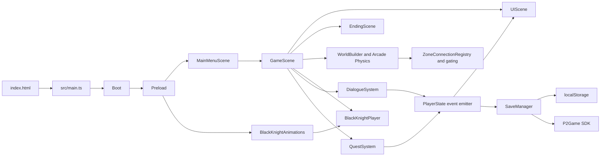
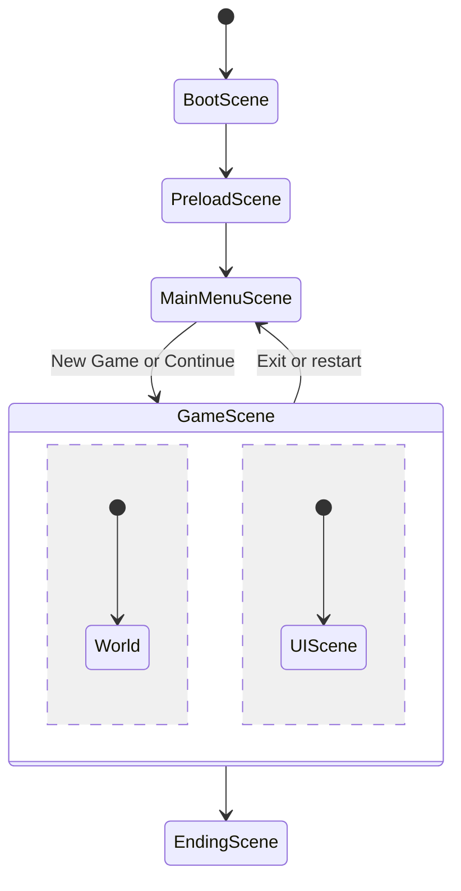

# 03 — Kiến trúc source

Kiểm kê 102 tệp TypeScript. Đọc entry, configs và luồng chính của các hệ thống liệt kê dưới đây. Cột danh mục thể hiện coverage theo module; kiểm toán chi tiết từng hàm vẫn PARTIAL.

| Module | TS | Tệp trong baseline |
|---|---:|---|
| animation | 2 | `BlackKnightAnimations.ts`, `SatyrAnimations.ts` |
| audio | 1 | `AudioManager.ts` |
| config | 4 | `Constants.ts`, `GameConfig.ts`, `TimeConfig.ts`, `tiledPipelineConfig.ts` |
| data | 1 | `tornPagesData.ts` |
| debug | 3 | `DevPanelOverlay.ts`, `DevSessionPolicy.ts`, `DeveloperModeManager.ts` |
| entities | 16 | `AmbushMonsters.ts`, `BlackKnightPlayer.ts`, `BossMireWarden.ts`, `EvilKnights.ts`, `FallenKnightApparition.ts`, `MireWardenBoss.ts`, `NPCEntity.ts`, `SatyrPlayer.ts`, `ShadowMonsters.ts`, `SkullWolfEntity.ts`, `TheEcho.ts`, `TheListener.ts`, `WhisperTrap.ts`, `WildlifeEntity.ts`, `Monster.ts`, `Satyr.ts` |
| (entry) | 1 | `main.ts` |
| registry | 5 | `ContentPackLoader.ts`, `ContentRegistry.ts`, `index.ts`, `registryData.ts`, `types.ts` |
| scenes | 6 | `BootScene.ts`, `EndingScene.ts`, `GameScene.ts`, `MainMenuScene.ts`, `PreloadScene.ts`, `UIScene.ts` |
| services | 2 | `CloudSaveService.ts`, `LeaderboardService.ts` |
| state | 1 | `PlayerState.ts` |
| systems | 27 | `BossEncounterSystem.ts`, `CampSanctuarySystem.ts`, `CampSystem.ts`, `ContentPackValidator.ts`, `CraftingSystem.ts`, `DayNightSystem.ts`, `DialogueSystem.ts`, `EchoSystem.ts`, `EndingSystem.ts`, `EquipmentSystem.ts`, `FarmingSystem.ts`, `GraphicsQualitySystem.ts`, `IdentityRevealResolver.ts`, `InventorySystem.ts`, `ListenerAI.ts`, `PuzzleSystem.ts`, `QuestSystem.ts`, `SafeSpawnResolver.ts`, `SaveManager.ts`, `SettingsManager.ts`, `SurvivalSystem.ts`, `TimeSystem.ts`, `VeilSystem.ts`, `WeatherSystem.ts`, `WildlifeSystem.ts`, `WorldEventSystem.ts`, `CameraSystem.ts` |
| types | 2 | `index.ts`, `p2game.d.ts` |
| ui | 16 | `CampfireModal.ts`, `CauldronModal.ts`, `CraftingModal.ts`, `EquipmentModal.ts`, `GameOverModal.ts`, `ItemTooltipHelper.ts`, `JournalModal.ts`, `KeycapBadgeHelper.ts`, `MiniMapWidget.ts`, `PaperNoteModal.ts`, `ParchmentWorldMapModal.ts`, `PauseModal.ts`, `QuickCraftSidebar.ts`, `SettingsUIHelper.ts`, `StorageChestModal.ts`, `TornPageModal.ts` |
| utils | 7 | `AtlasTextureResolver.ts`, `DebugOverlay.ts`, `HDTextHelper.ts`, `HUDIconGenerator.ts`, `HitboxDebugInspector.ts`, `ItemIconHelper.ts`, `ScaleManager.ts` |
| world | 8 | `WorldBuilder.ts`, `WorldGatingSystem.ts`, `ZoneConnectionRegistry.ts`, `ZoneSafety.ts`, `AutoPerimeterWallsModule.ts`, `CullingOptimizationModule.ts`, `YSortingModule.ts`, `index.ts` |

- `main.ts` và `GameConfig.ts` đều quyết định Canvas/WebGL. Điểm phát startup-ready thực tế là sau POST_RENDER khi menu đã hiển thị. Input DOM của embed, input Phaser của scene, và gate modal cần kiểm cùng nhau sau tích hợp.
- `GameScene` khởi tạo Player/World/UI, xử lý chuyển cảnh, chuyển tuyến, hoàn tất thoại và checkpoint. `PlayerState` là singleton EventEmitter, chia sẻ qua gameplay/UI/Save. `WorldBuilder` dựng stream zone, Arcade static bodies, layer và culling. Các yếu tố phù hợp để review riêng gồm thời điểm hydrate state, CREATE của UI so với sự kiện zone, và cleanup listener khi thoát.
- `QuestSystem` và `DialogueSystem` thao tác tiến trình qua state và game event. `IdentityRevealResolver` đọc quy tắc đã kích hoạt; nhánh R1 nằm ngoài baseline. Tránh nối luồng mới trước khi xác minh thứ tự reconcile flag/stage/Continue.
- `AudioManager` phối âm WebAudio và quản lý asset/cleanup; `SettingsManager` sở hữu thiết lập. B06 sửa cả hai. `SurvivalSystem`, `TimeSystem`, `WeatherSystem` cập nhật chỉ số và môi trường; `BossEncounterSystem` và entities áp dụng gate và vòng đời encounter.
- Nợ kỹ thuật đã thấy ở điểm hội tụ của `GameScene`/`UIScene`, graph UI bản đồ tĩnh tách khỏi registry và nhiều đường tương tác bàn phím. Scope thử nghiệm cần bao phủ lock/timer, cleanup sau restart, và applyFromSave sau stage/quest event. Đây là điểm rủi ro kỹ thuật cần xác nhận theo nhiệm vụ, không phải lỗi mới đã tái hiện.
