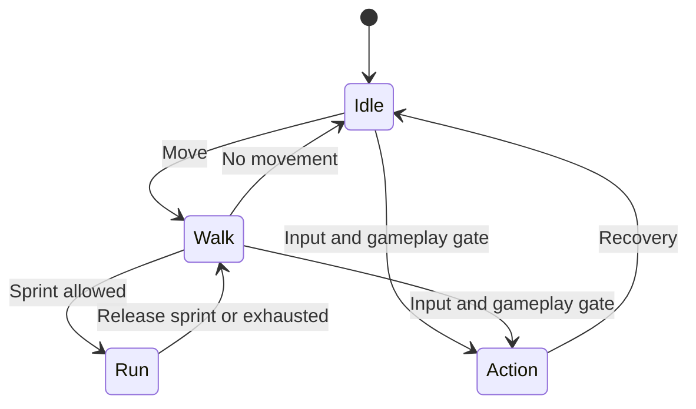

# 06 — Meliodas Blackwood / Black Knight V2

**BUG-058 có bản sửa trong baseline B08. BUG-059 còn PARTIAL.** `ce88553` và `c3b6bbf` đều là tổ tiên. So sánh `public/assets/` từ development `e4edb07` tới B08 cho kết quả không có diff. B02 đổi filtering, giữ file ảnh. [B01](../../V16/HW_V16_B01_BUG058_SCALE_REPORT.md) · [B02](../../V16/HW_V16_B02_BUG059_ARTWORK_REPORT.md)

| Atlas `black_knight_*` | Số frame JSON tại B08 | Vai trò |
|---|---:|---|
| `armed_idle` | 24 | K1 Idle. RIGHT tái sử dụng K2 V2 |
| `movement` | 126 | K2 V2 Armed/Unarmed. Walk, Unarmed Idle, Armed Idle RIGHT. Có frame Run cũ trong atlas |
| `core_combat` | 72 | K3-A |
| `defense` | 216 | K3-B |
| `extended_skills` | 192 | K3-C |
| `conversion_motion` | 192 | Chuyển động và Run hiện hành |
| `conversion_actions` | 156 | Interact/Gather/Use Item và các chuỗi hành động |
| `conversion_combat` | 460 | Các chuỗi combat đủ nguồn |
| `conversion_states` | 320 | Các chuỗi trạng thái đủ nguồn |
| `conversion_air` | 200 | Chuỗi trên không, giữ gate gameplay |
| **Tổng** | **1.958** | Số mục metadata bao gồm các vòng atlas cùng tồn tại |

Preload → filter NEAREST → registry kiểm đủ frame từng hướng → actor áp dụng scale/origin theo texture, collider độc lập. Prefix `wayfarer_*` và `satyr_*` giữ tương thích. Registry ưu tiên Run 12 frame từ Conversion. Chưa lặp 34 chuỗi hoặc Windows test. Bằng chứng full conversion đã ghi 34/34 artwork parity, 5 live và 29 asset-only; B01 ghi 9 nhóm case, B02 ghi 48 case với origin, scale và Armed/Unarmed. [Source parity](../../V153_BLACK_KNIGHT_SOURCE_PARITY_REPORT.md)

Smoke B08 lấy mẫu Idle DOWN (`wayfarer_idle_down → black_knight_armed_idle → armed_idle_down_0`) và Walk RIGHT (`wayfarer_walk_right → black_knight_movement → armed_walk_right_*`), một actor nhìn thấy, zoom 2.2 và scale 1.5 ở cả hai mẫu. Evidence Canvas và WebGL dùng cùng build; phạm vi này chưa xác minh nhóm mới, từng frame hoặc các trạng thái vũ khí. [Trace](Evidence/chromium-smoke.json)

B02 quy chênh lệch chất lượng cho mật độ texel thực: Idle/Walk 64×64 khoảng 30–32 px nhân vật so với Run 84×72 khoảng 39–46,5 px. Yêu cầu tham chiếu **96 frame** tính từ 4 nhóm Idle/Walk Armed/Unarmed × 4 hướng × 6 frame. Mười cặp atlas B08 được kiểm kê. Kho `01_LATEST_ARTWORK`, `02_CURRENT_RUNTIME`, `03_LEGACY_ARCHIVE` của máy Owner **NOT ACCESSIBLE**. Xác minh archive 220 hash là bằng chứng kế thừa. Kiểm lại số frame thiếu khi Design bàn giao archive hiện hành. K1/K2 V1/V2 và K3 giữ theo báo cáo recovery. Tiêu chí nhận artwork kế tiếp: chi tiết giáp/plume/áo/kiếm thống nhất, Unarmed không cầm kiếm, alpha sạch, điểm chân nhất quán, giữ từng frame nguồn và xác minh 24 tổ hợp locomotion trong Chromium. [Recovery](../../HW_CHAR_01_R2_CODEX_BLACK_KNIGHT_V2_RECOVERY.md) · [Archive](../../HW_ART_REF_02_MELODIAS_LATEST_ASSET_ARCHIVE_REPORT.md)
