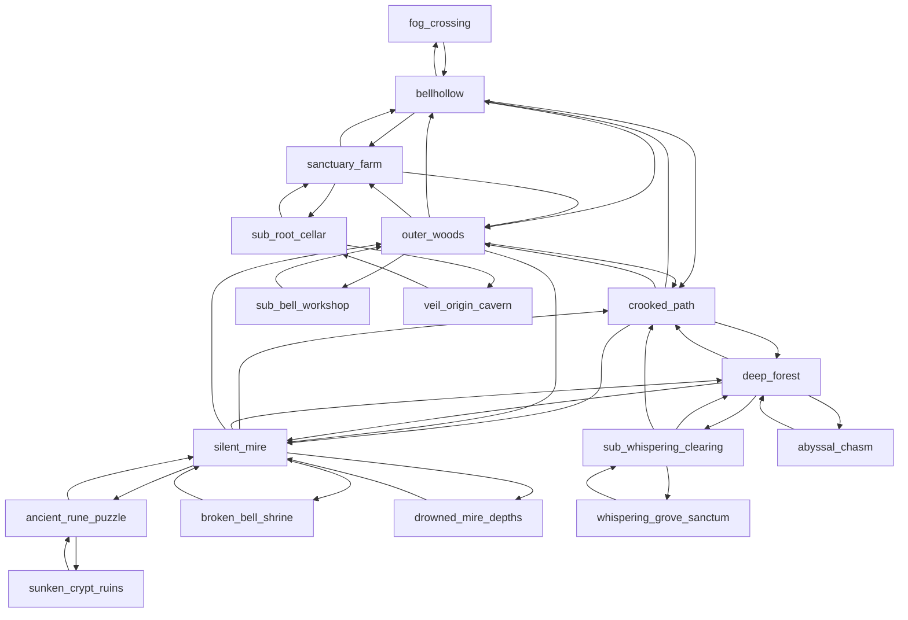

# 07 — 17 zone và topology

Đọc `src/data/zones.json` và từng Tiled JSON tại baseline. Số collider/NPC/spawn/tương tác chỉ đếm khai báo trực tiếp theo zone. WorldBuilder, scene, script boss và lớp Tiled có thể bổ sung đối tượng. Mỗi lối ra đến một ID hợp lệ (0 đích sai). 41 cạnh khai báo. Cạnh không có chiều ngược trực tiếp: [('sub_whispering_clearing', 'crooked_path')]. Phân biệt đường một chiều có chủ ý với lối quay lại bị mất bằng playtest C01/C02.

| Zone ID | Bounds px | Tiled cells × tile size | Lớp Tiled | Collider / NPC / spawn / tương tác | Lối ra | Tồn đọng |
|---|---|---|---|---|---|---|
| `fog_crossing` | 480×360 | 30×23 · 16×16 | Ground, Paths_Decals, Foliage_Details, Objects_Collision, Objects_Interactables, Objects_Portals | 8 / 0 / 0 / 3 | bellhollow | W20-BUG-003; C01/C02. Smoke runtime tại spawn và đi phải. |
| `bellhollow` | 1120×960 | 70×60 · 16×16 | Ground, Paths_Decals, Foliage_Details, Objects_Collision, Objects_Interactables, Objects_Portals | 12 / 5 / 0 / 11 | fog_crossing, sanctuary_farm, outer_woods, crooked_path | W20-BUG-002/012; C01/C02. Rà trục y=260. |
| `crooked_path` | 1280×640 | 80×40 · 16×16 | Ground, Paths_Decals, Foliage_Details, Objects_Collision, Objects_Interactables, Objects_Portals | 4 / 0 / 0 / 20 | bellhollow, outer_woods, deep_forest, silent_mire | W20-BUG-007; kiểm tường phía nam, lối về và gate. |
| `silent_mire` | 1120×640 | 70×40 · 16×16 | Ground, Paths_Decals, Foliage_Details, Objects_Collision, Objects_Interactables, Objects_Portals | 17 / 0 / 0 / 23 | crooked_path, deep_forest, ancient_rune_puzzle, broken_bell_shrine, drowned_mire_depths, outer_woods | W20-BUG-008; nước, cổng nam, route Shrine. |
| `broken_bell_shrine` | 960×600 | 60×38 · 16×16 | Ground, Paths_Decals, Foliage_Details, Objects_Collision, Objects_Interactables, Objects_Portals | 7 / 0 / 0 / 5 | silent_mire | W20-BUG-009; khe cổng, sân gạch, điều kiện boss. |
| `sanctuary_farm` | 640×480 | 40×30 · 16×16 | Ground, Paths_Decals, Foliage_Details, Objects_Collision, Objects_Interactables, Objects_Portals | 7 / 0 / 0 / 5 | bellhollow, outer_woods, sub_root_cellar | W20-BUG-005; kiểm chu vi, vùng an toàn và tương tác. |
| `outer_woods` | 480×480 | 30×30 · 16×16 | Ground, Paths_Decals, Foliage_Details, Objects_Collision, Objects_Interactables, Objects_Portals | 10 / 1 / 0 / 18 | bellhollow, sanctuary_farm, crooked_path, sub_bell_workshop, silent_mire | W20-BUG-006; tuyến ngắn tới Mire và khu Vaelen. |
| `deep_forest` | 1280×640 | 80×40 · 16×16 | Ground, Paths_Decals, Foliage_Details, Objects_Collision, Objects_Interactables, Objects_Portals | 5 / 0 / 0 / 18 | crooked_path, silent_mire, sub_whispering_clearing, abyssal_chasm | W20-BUG-004; chồng collider và lối vào khu phụ. |
| `ancient_rune_puzzle` | 350×280 | 22×18 · 16×16 | Ground, Paths_Decals, Foliage_Details, Objects_Collision, Objects_Interactables, Objects_Portals | 0 / 0 / 0 / 2 | silent_mire, sunken_crypt_ruins | W20-BUG-008; puzzle/seal và lối Crypt. |
| `sub_bell_workshop` | 480×400 | 30×25 · 16×16 | Ground, Paths_Decals, Foliage_Details, Objects_Collision, Objects_Interactables, Objects_Portals | 7 / 0 / 0 / 6 | outer_woods | Đối chiếu checkpoint A2 với tuyến rèn; review nguồn asset nội thất. |
| `sub_root_cellar` | 640×400 | 40×25 · 16×16 | Ground, Paths_Decals, Foliage_Details, Objects_Collision, Objects_Interactables, Objects_Portals | 9 / 0 / 0 / 6 | sanctuary_farm, veil_origin_cavern | W20-BUG-010; thiết kế nội thất và portal. |
| `sub_whispering_clearing` | 370×360 | 30×23 · 16×16 | Ground, Paths_Decals, Foliage_Details, Objects_Collision, Objects_Interactables, Objects_Portals | 10 / 0 / 0 / 3 | deep_forest, crooked_path, whispering_grove_sanctum | W20-BUG-004/007; có tuyến một chiều về Crooked Path. |
| `abyssal_chasm` | 1280×640 | 80×40 · 16×16 | Ground, Paths_Decals, Foliage_Details, Objects_Collision, Objects_Interactables, Objects_Portals | 6 / 0 / 3 / 2 | deep_forest | W20-BUG-011; lối vào hẹp cần đo và ổn định tuyến. |
| `drowned_mire_depths` | 1120×640 | 70×40 · 16×16 | Ground, Paths_Decals, Foliage_Details, Objects_Collision, Objects_Interactables, Objects_Portals | 5 / 0 / 3 / 2 | silent_mire | W20-BUG-011; kiểm layout, spawn và vật cản. |
| `whispering_grove_sanctum` | 960×440 | 60×28 · 16×16 | Ground, Paths_Decals, Foliage_Details, Objects_Collision, Objects_Interactables, Objects_Portals | 5 / 0 / 3 / 2 | sub_whispering_clearing | W20-BUG-004/011; chồng vật thể và mỹ thuật. |
| `sunken_crypt_ruins` | 1130×640 | 71×40 · 16×16 | Ground, Paths_Decals, Foliage_Details, Objects_Collision, Objects_Interactables, Objects_Portals | 4 / 0 / 3 / 2 | ancient_rune_puzzle | W20-BUG-011; layout và tường giữa sân. |
| `veil_origin_cavern` | 1120×640 | 70×40 · 16×16 | Ground, Paths_Decals, Foliage_Details, Objects_Collision, Objects_Interactables, Objects_Portals | 5 / 0 / 3 / 2 | sub_root_cellar | W20-BUG-011; layout, lối ra và progression. |

Các trường Tiled `tilesets.source` gặp trong dữ liệu là {'tilesets/Tileset_Ground.tsx': ['fog_crossing', 'bellhollow', 'crooked_path', 'silent_mire', 'broken_bell_shrine', 'sanctuary_farm', 'outer_woods', 'deep_forest', 'ancient_rune_puzzle', 'sub_bell_workshop', 'sub_root_cellar', 'sub_whispering_clearing', 'abyssal_chasm', 'drowned_mire_depths', 'whispering_grove_sanctum', 'sunken_crypt_ruins', 'veil_origin_cavern'], 'tilesets/Objects_Props.tsx': ['fog_crossing', 'bellhollow', 'crooked_path', 'silent_mire', 'broken_bell_shrine', 'sanctuary_farm', 'outer_woods', 'deep_forest', 'ancient_rune_puzzle', 'sub_bell_workshop', 'sub_root_cellar', 'sub_whispering_clearing', 'abyssal_chasm', 'drowned_mire_depths', 'whispering_grove_sanctum', 'sunken_crypt_ruins', 'veil_origin_cavern'], 'tilesets/Objects_Buildings.tsx': ['fog_crossing', 'bellhollow', 'crooked_path', 'silent_mire', 'broken_bell_shrine', 'sanctuary_farm', 'outer_woods', 'deep_forest', 'ancient_rune_puzzle', 'sub_bell_workshop', 'sub_root_cellar', 'sub_whispering_clearing', 'abyssal_chasm', 'drowned_mire_depths', 'whispering_grove_sanctum', 'sunken_crypt_ruins', 'veil_origin_cavern']}. Đối chiếu runtime theo importer trước khi kết luận về phụ thuộc TSX. Sương, ánh sáng, Y-sort, camera và culling được gắn theo world/scene. Chỉ Fog Crossing có smoke mới; tất cả lượt đi hai chiều, collider/gameplay boss, cảnh quan tree canopy và 16 zone còn lại chưa chạy độc lập trong lượt này. Mỗi tồn đọng ở trên mang trạng thái theo registry, chưa nâng thành lỗi mới hay đóng PASS. [HW-WORLD-20](../../HW_WORLD_20_MAP_BUG_REGISTRY.md) · [LAB-01](../../HW_MAP_LAB_01_PLAYABLE_FOREST_REPORT.md)

Cả ba TSX nêu trên đều có trong Git tại `src/data/maps/tilesets/` ở B08. Xác minh theo baseline này, các đường dẫn nguồn tương đối phân giải được. Kết quả từ checkout cũ về tệp thiếu không chuyển sang B08.
