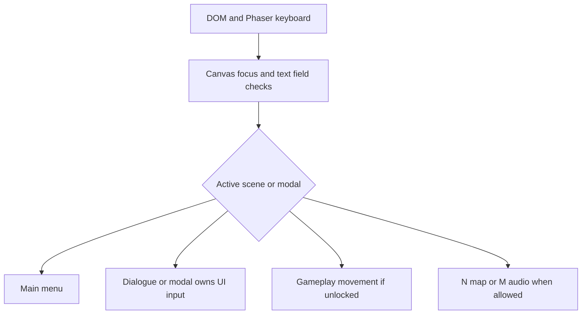

# 09 — UI/UX và Main Menu

B08 giữ UI trên chuỗi B04. Baseline renderer có scale FIT 1280×720 và tải font tiếng Việt. Smoke xác nhận menu vào được gameplay cả hai renderer. B04 dùng bằng chứng input/modal ở checkpoint của AG; từng modal/viewport dưới đây cần kiểm độc lập nếu được Owner giao. [B04](../../V16/HW_V16_B04_INPUT_UI_REGRESSION_REPORT.md)

| Surface | Source và điều cần kiểm trước remaster | Bằng chứng |
|---|---|---|
| Main Menu, New Game, Continue | `MainMenuScene`, button hierarchy và layout, focus, trạng thái save. Đường New Game xóa save theo báo cáo A09 cần gate | New Game smoke bằng handler. Click menu, confirm khi có save và Continue NOT RUN trong Chromium lượt này |
| Settings, Pause | `SettingsManager`, `PauseModal`, slider, ESC, trở lại focus game | B04/B06 kế thừa. Gamepad NOT RUN |
| HUD | `UIScene`, stamina/health/quest, scale/wrapping tiếng Việt ở màn hẹp | HUD xuất hiện trong smoke |
| Inventory, Equipment, Crafting | `InventorySystem`, `EquipmentModal`, `CraftingModal`, item key, inspect/select, ESC, khóa keyboard | B04 kế thừa |
| Journal, Quest Log | `JournalModal`, tracked quest lấy từ PlayerState; wrapping và header `TẤT CẢ` | B04 test layout trong phạm vi AG |
| World Map | `ParchmentWorldMapModal`, 10/17, khóa modal, giữ N/M | Static |
| Dialogue, Bestiary | `DialogueSystem`, `UIScene`, portrait, choice và access theo giai đoạn; bestiary độc lập chưa xác minh | A05/B04 kế thừa, bestiary NOT RUN |
| Loading, Ending, subtitle | `startup-status.js`, `PreloadScene`, `EndingSystem`. Hai font URL được giải quyết lúc chạy, độ đọc và phụ đề còn gate A08/A09 | Startup local chạy. Ending/subtitle NOT RUN |

Đề xuất hệ thống Dark Moss & Ember Gold. Nền `#141712`/panel `#1F241B`, dùng `#C8963E` cho focus/khung, `#E8DFC8` cho chữ; kiểm contrast chữ phụ `#C8CFC2` ở build. Reuse font tiếng Việt đã ship, test dấu và wrap dài. Spacing tính theo lưới 8 px, panel giữ tầm nhìn trung tâm, icon có tooltip, focus và disabled rõ, nút nhấn có visual state. Hiệu ứng mở modal đọc Reduced Motion; panel/text scale theo viewport mà không phá pixel art. Đây là đề xuất cần duyệt, không đổi style baseline. [Iron Rules](../../../../AI_IRON_RULES.md)
