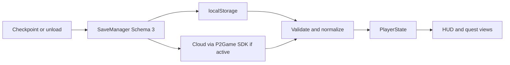

# 10 — Gameplay và core systems

| Cụm | Hệ thống sở hữu | Xác minh |
|---|---|---|
| Move, Walk/Run, Stamina, action lock | BlackKnightPlayer, GameScene, PlayerState. Tách modal/IME từ input gameplay | Walk RIGHT chạy trong Canvas/WebGL; B01–B04 là bằng chứng kế thừa cho run/lock; EVKey phần cứng chưa chạy |
| Health, Hunger, Tinh Thần/Composure | PlayerState, SurvivalSystem, VeilSystem, UIScene | Kiểm hợp đồng source. Classic Sanity 2.1 giữ code 3 lớp `0x280712`, `0x18030b`, `0x0a0105`, SmoothStep; đọc code cạnh viền, không nghiệm thu hình ảnh toàn ma trận Panic Effects, Reduced Motion, Screen Flash, Light Motion |
| Inventory, Equipment, Crafting | InventorySystem, EquipmentSystem, CraftingSystem, UI modal | Integrity 43 item, 18 recipe; chưa thử flow ngược trả item/đầy túi |
| Farming, Gathering, NPC services | FarmingSystem, WorldBuilder, DialogueSystem, GameScene | Save schema suite có round trip farming. Interact/Gather/Use Item dùng evidence conversion; chưa chạy e2e mới |
| Enemy, Boss, Damage | Entity, BossEncounterSystem, Arcade combat overlap và quest gates | Static. Kiểm claim reward một lần, action lock, unload/reload boss sau A07 |
| Reward, Quest, Dialogue | QuestSystem, DialogueSystem, PlayerState; SaveManager giữ marker | A05 evidence kế thừa. B05/B07 blocked do thiếu integration |
| Save và cloud | SaveManager, PlayerState, SDK v1.1 | Hai nhóm test schema/local và QA namespace PASS. Real hosted/legacy fixture NOT RUN |

