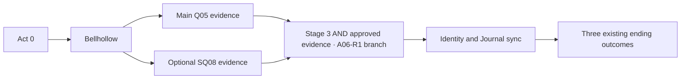

# 11 — Canon, nhiệm vụ và approval gate

Nguồn quyết định là Owner mới nhất, Canon Matrix, Canon/Character/Dialogue Registry và nhật ký. Draft ở các Bible/registry chỉ được dùng làm bối cảnh. Meliodas từng là người thầy và chỉ huy Order of the Black Wolf. Vaelen là The Silent Knight, Mordric là The Dark Knight và gắn với HoodedKnightBoss. Cả hai từng là học trò và bạn cũ của Meliodas. Nguyên nhân mất trí nhớ hiện hành là biến cố xuyên thời gian còn bí ẩn. Bản tự phong ấn cũ đã superseded. [Canon Matrix](../../Narrative/HW_CANON_OWNER_DECISION_MATRIX.md) · [Canon Registry](../../Narrative/CANON_DECISION_REGISTRY.md) · [Characters](../../Narrative/CHARACTER_REGISTRY.md) · [Dialogue](../../Narrative/DIALOGUE_REGISTRY.md)

| Task | Trạng thái / bằng chứng | Việc phải bảo toàn |
|---|---|---|
| A01–A02 | Canon lock và cleanup kế thừa. A02 data/reference và test được báo tại ref; một số legacy wording assertions còn tồn đọng | Stable IDs, phân biệt canon và copy dự thảo |
| A03 | Act 0/Bellhollow có evidence AG. Có fixture Stage 2 và phần giới hạn khi đọc quest/continue | Wording mới chờ Owner |
| A04 | Dialogue Vaelen/Mordric có evidence AG. Legacy suite còn fail theo nhật ký | Số phận/ending copy chưa duyệt |
| A05 | Branching, trust và reward marker theo thoại. Legacy save chưa có marker là điểm kiểm B07 | Idempotency và schema 3 |
| A06/R1 | B08 có resolver với `APPROVED_IDENTITY_EVIDENCE_RULES = []`. R1 Owner duyệt Option 1 ở nhánh riêng và AG báo 24/24 | Cần combined QA đối với evidence đến muộn, Stage 3, Q05/SQ08 và Journal/Torn Pages sau load |
| A07 | PARTIAL, checkpoint dừng bước 2/5 và source local chưa kiểm. B05/B07 docs-only blocked | SQ08 optional. Ending thresholds 50/3/65. Ba ID ổn định |
| A08–A10 | A08 storyboard, 6/12 ca tiền kỳ. A09 blocked bởi media game-ready, 20 ca NOT RUN. A10 registry/draft, 20 ca mới NOT RUN | Approval wording, video/âm thanh/subtitle và integration sau gate |

Sơ đồ thể hiện điều kiện R1, chưa có ở B08. Giữ `true_ending`, `sacrifice_ending`, `fog_loop_ending`; branch R1 report ghi 16 boundary cases. Full natural progression và reload sau tích hợp chưa kiểm trong audit. [Bằng chứng A06-R1](https://github.com/KyoshiroKyo/HOLLOW-WOODS/commit/fc5bf1d5f849f694a6b92e270ef747b2f2914246) · [A07 checkpoint](../../V16/HW_V16_A07_RESUME_CHECKPOINT.md)

**CHAR-006 — DEFERRED.** DEC-LOCK-14 RESERVED; D06/D07/E06 trì hoãn. Registry V3.2 và nhánh art có R7 archive nhưng chưa đủ sign-off Gate B. Cloud chỉ mở được hồ sơ V3.1 trên Drive và thông tin V3.2 qua registry/art branch; bản bàn giao V3.2 độc lập NOT ACCESSIBLE. HW–Design hoàn thiện assets, HW–Lore đề xuất Canon, Codex chờ Owner duyệt tích hợp để thực hiện nhân vật và tuyến nhiệm vụ, Antigravity QA độc lập. Không gán danh tính, vị trí, cốt truyện hay placeholder. [Hold](../../V16/HW_V16_00R2_HEADLESS_WARDEN_HOLD_REPORT.md) · [Nhánh Design](https://github.com/KyoshiroKyo/HOLLOW-WOODS/commit/339b8ab759f694c6d92b669dfd9c5dda12e37ed9)
