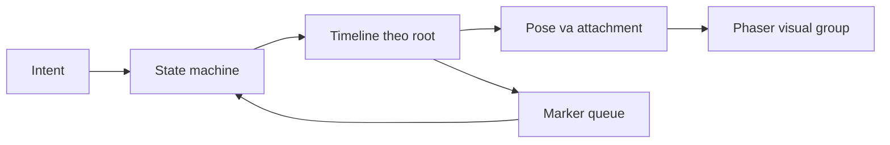

# HW-WDN-T00 · Nền tảng kỹ thuật The Headless Warden V3.2

**KYOSHIRO STUDIO · HOLLOW WOODS V1.6.0 · 27/11/2026**

**AWAITING TECHNICAL FOUNDATION APPROVAL**

Đề xuất dùng **một timeline cho mỗi thực thể trực quan**, trong đó rider và chiến mã dùng cùng timeline và root khi Mounted. Từng lớp có số frame và thời lượng riêng, lấy mẫu tại cùng pha. Phaser tiếp tục đảm nhiệm atlas, texture, hiển thị và vòng đời Scene. Có thể kiểm hợp đồng bằng dữ liệu tổng hợp sau khi nền tảng được duyệt, trước khi có đủ artwork.

Codex chủ trì T00 sau checkpoint Meliodas R1, đang chờ Owner duyệt. Antigravity có thể kiểm thử độc lập ở lượt sau nếu được giao. HW-CODEX-01B tiếp tục trong hàng đợi và chưa bắt đầu sản xuất 9 keyframe.

## Baseline và quyền hạn

| Mục | Trạng thái đã xác minh |
|---|---|
| Workspace và branch | `G:\HOLLOW_WOODS_CODEX`, `feat/v1.6-codex-development`, worktree sạch lúc bắt đầu |
| HEAD local và GitHub | `7a553919bc70ea25052ecf2246321c1c0792274e` |
| Baseline kỹ thuật | B08 `c9de0c21b0301003895cf2d106229dfef564a2b6`. Diff B08 → HEAD chỉ có 29 tệp trong `Read/`. Mã nguồn, runtime asset, script, test và dependency lockfile giữ nguyên |
| GitHub main | `94efc0335506bcccf4b553eae3021cf27e84df42` |
| Checkpoint R7 | `339b8ab759f694c6d92b669dfd9c5dda12e37ed9` trên `art/char-006-headless-warden-v3.2` |
| Art Authority | **V3.2 Original** là chuẩn duy nhất. Bản binary nguyên gốc được ghi pending trong archive. R7 là prototype tĩnh, Gate B only |
| Phạm vi quyết định | T00 được giao để nghiên cứu và lập kế hoạch. D06/D07/E06 **DEFERRED**. DEC-LOCK-14 **RESERVED**. Technical Foundation, sản xuất artwork và Game Integration cần quyết định riêng |

R7 có tám đường dẫn PNG thuộc năm Git blob. Dismounted South có Crown 128×128. Mounted West có Crown, Mane, Tail và Hooves 160×160. Ba ảnh ngựa ở Spectral Warhorse West trùng blob với ba ảnh tương ứng của Mounted West. R7 provenance có phép kiểm layer tĩnh và ghi thay đổi anchor mane/tail. Kích thước, offset và việc dùng chung ảnh trong R7 chưa phải hợp đồng production. [Cây artwork được pin](https://github.com/KyoshiroKyo/HOLLOW-WOODS/tree/339b8ab759f694c6d92b669dfd9c5dda12e37ed9/Asset_Art/The_Headless_Warden) · [Art status](https://github.com/KyoshiroKyo/HOLLOW-WOODS/blob/339b8ab759f694c6d92b669dfd9c5dda12e37ed9/Asset_Art/The_Headless_Warden/ART_STATUS.json) · [R7 provenance](https://github.com/KyoshiroKyo/HOLLOW-WOODS/blob/339b8ab759f694c6d92b669dfd9c5dda12e37ed9/Asset_Art/The_Headless_Warden/05_VFX/R7/PROVENANCE.md) · [Roadmap hold](../../V16/HW_V16_00R2_HEADLESS_WARDEN_HOLD_REPORT.md)

## Current Architecture Assessment và Existing System Reusability

| Hệ thống | Bằng chứng từ baseline | Phần tái sử dụng |
|---|---|---|
| Phaser/Vite và atlas | Phaser 4.2.1, Vite 5.4.21. Preload nạp atlas PNG/JSON, áp NEAREST lên Black Knight. GameConfig có 1280×720, pixelArt, antialias false và roundPixels. GameScene dùng camera 2.2. ScaleManager xử lý CSS sampling ở mức scale nguyên | Dùng loader, texture/frame key, sampler và camera hiện hành. Kiểm pixel trên canvas và ở mức CSS khác nhau. [Preload](../../../../../src/scenes/PreloadScene.ts#L490) · [NEAREST](../../../../../src/scenes/PreloadScene.ts#L931) · [GameConfig](../../../../../src/config/GameConfig.ts#L22) · [Camera](../../../../../src/scenes/GameScene.ts#L502) · [ScaleManager](../../../../../src/utils/ScaleManager.ts#L20) |
| Registry bốn hướng | GameScene đăng ký Black Knight. Registry kiểm đủ frame và bốn hướng trước khi đăng ký clip một sprite với `frameMs`. Run Conversion có 12 frame trong 840 ms và giữ key tương thích `wayfarer_*/satyr_*` | Dùng mẫu tra theo action/hướng, kiểm độ phủ và liên kết atlas. Giữ nguyên registry hiện tại, lookup Warden chỉ bổ sung metadata cho Warden khi được giao. [GameScene](../../../../../src/scenes/GameScene.ts#L323) · [BlackKnightAnimations](../../../../../src/animation/BlackKnightAnimations.ts#L84) |
| Transition và event | BlackKnightPlayer giữ pha khi đổi gait/hướng, cập nhật anchor theo START/UPDATE/REPEAT, xử lý marker theo frame, dọn listener/timer khi complete/stop và chặn hành động phát hai lần | Giữ nguyên tắc điều chuyển pha có điều kiện, marker một lần và cleanup rõ. Timeline Warden cần xử lý marker khi một tick đi qua nhiều frame. [Anchor](../../../../../src/entities/BlackKnightPlayer.ts#L226) · [Gait](../../../../../src/entities/BlackKnightPlayer.ts#L1521) · [Events](../../../../../src/entities/BlackKnightPlayer.ts#L1870) |
| Dread Horseman | Một Arcade Sprite với state patrol, chuẩn bị, charge, cooldown, hurt và death. Có bóng, depth theo Y, một sheet frame số và cleanup | Tái sử dụng mẫu state machine và vòng đời. Dread Horseman sở hữu riêng AI, collider và artwork của nó. [EvilKnights](../../../../../src/entities/EvilKnights.ts#L364) |
| Mire Warden | MireWardenBoss dùng Container cho nhóm hình, origin riêng cho sprite, cập nhật depth theo Y và dọn tween/listener khi destroy. BossEncounterSystem giữ pha và luật trụ phong ấn riêng của boss đó | Dùng mẫu nhóm hiển thị, depth/anchor và init/reset. Warden dùng nội dung encounter được duyệt riêng. [Container](../../../../../src/entities/MireWardenBoss.ts#L93) · [Depth và destroy](../../../../../src/entities/MireWardenBoss.ts#L621) · [Encounter](../../../../../src/systems/BossEncounterSystem.ts#L31) |
| LAB-03 ngoài runtime | Sandbox đọc ba sheet 128×128, origin cố định, thứ tự L1→L2→L3 và gọi `play()` riêng trên từng lớp. Có nút đổi action/hướng, vạch ground và bật/tắt FX | Tham khảo công cụ chẩn đoán hình. Một lần gọi ba `play()` chưa chứng minh đồng bộ khi seek, interrupt hoặc độ dài track khác nhau. `G:\HOLLOW WOODS\HOLLOW_WOODS_EXPORT\World_Labs\LAB_03_HEADLESS_WARDEN_SANDBOX\sandbox.js`, dòng 33–95 |
| Registry nội dung, save và graphics | ContentRegistry ánh xạ content ID/runtime key/asset. SaveManager schema 3 có sanitize, migrate, checkpoint và phục hồi PlayerState. GraphicsQualitySystem có HIGH/MEDIUM/LOW, GameScene có frustum culling | Gắn stable ID và asset vào quy ước sẵn có sau gate. Dùng quality settings và mẫu culling/lifecycle cho QA. [ContentRegistry](../../../../../src/registry/ContentRegistry.ts#L13) · [SaveManager](../../../../../src/systems/SaveManager.ts#L20) · [Quality](../../../../../src/systems/GraphicsQualitySystem.ts#L14) · [Culling](../../../../../src/scenes/GameScene.ts#L6699) |

## Technical Gap Analysis

| Khoảng trống | Việc cần khóa |
|---|---|
| Timeline nhiều layer | Clock chung, thời lượng riêng theo track, quy tắc loop/hold, marker độc lập với pose được render |
| Attachment và occlusion theo frame | Tọa độ chân/móng, yên, tay cầm, Crown, Mane, Tail, Hooves; dữ liệu trim và thứ tự layer theo hướng/pose |
| Mount/dismount và ngựa độc lập | Định nghĩa điểm commit, ownership của root/body và xử lý ngắt giữa transition. Tránh hai actor cùng sở hữu chiến mã |
| Artwork đủ phạm vi | V3.2 binary có provenance/quyền sử dụng, preview cho 12 tổ hợp form/hướng, pose và scale thực tế, danh sách clip và equipment được duyệt |
| QA, tài nguyên và Save/Load | Harness kiểm clock và teardown trước. Benchmark nhiều lớp, Save/Load và quy tắc encounter cần stage riêng sau gate liên quan |

## Proposed Architecture & Data Contract

### Lựa chọn

| Phương án | Đánh đổi |
|---|---|
| Atlas composite dựng sẵn | Ít đối tượng render, thuận tiện làm ảnh chuẩn QA. Mỗi biến thể trang bị/FX làm tăng số frame đóng gói. Có thể gộp các lớp luôn đi cùng sau benchmark |
| Phaser Animation riêng mỗi lớp | Tái dùng playback API, nhưng cần thêm cơ chế đồng bộ start/stop/seek/loop và marker khi track khác thời lượng. LAB-03 minh họa giới hạn của cách này |
| **Một timeline Warden và các Phaser Image dùng `setFrame`** | Một nguồn thời gian cho pose và marker, cho phép test thuần dữ liệu và track khác frame count. Thêm một bộ resolve nhỏ dành riêng cho Warden, tái dùng texture/render/lifecycle của Phaser |

- **Form và state.** Ba form `dismounted`, `mounted`, `warhorse`. State machine chọn action, hướng và cửa chuyển từ intent. Mỗi lượt playback có generation riêng. Clock lấy delta của Scene hoặc clock điều khiển trong test. Mounted có một clock cho cả nhóm. Warhorse hoạt động độc lập chỉ dùng clock và root riêng khi quyền sở hữu đã được chuyển theo đặc tả sau này.
- **Timing.** Track chọn sample theo thời gian clip, cho phép số frame và duration khác nhau. Validator tính sẵn mốc cộng dồn để resolver tra khi đổi pose, tránh cấp phát mỗi tick. Track bám pose phủ kín clip bằng sample hoặc hold khai báo. FX trang trí có thể loop cục bộ theo thời gian clip, đồng thời đọc attachment của pose hiện hành. Qua clip cùng nhóm nhịp, giữ pha khi hợp đồng có mốc chân tương ứng. Clip khác nhóm dùng entry pose hoặc restart. State machine quyết định khi nào đổi hướng trong action có marker.
- **Event và interruption.** Xử lý marker trong khoảng `(t trước, t mới]` theo thứ tự, với entry `t=0` xử lý riêng. Định danh bằng instance/playback/loop/marker để tránh lặp. Một tick có thể đi qua nhiều marker dù chỉ vẽ pose cuối. Cancel hoặc shutdown vô hiệu generation cũ, dọn timer/listener nếu có. Seek để review chỉ lấy pose. Clock pause của Scene không tạo đợt bắt kịp khi resume. Phaser 4.2.1 có cơ chế skip/catch-up, nhưng marker nghiệp vụ Warden do timeline quản lý để tách khỏi display cadence. [Lockfile](../../../../../package-lock.json#L899) · [Hệ thống hiện hành](../../../../../src/animation/BlackKnightAnimations.ts#L130)
- **Mounted ↔ Dismounted.** Transition một lần có source, target và marker handoff. Trước marker, source giữ quyền root/body. Tại marker, chuyển quyền trong một tick và đặt rider theo socket yên hoặc landing pose đã duyệt. Cancel trước marker phục hồi source. Sau marker vào recovery của target. Nếu horse thành actor riêng, xây dựng ownership rõ và test không có duplicate visual/body. Thông số AI, collider, timing và quyền controlling horse thuộc gate gameplay sau.
- **Root, điểm gắn và depth.** Root Dismounted theo neo chân, Mounted/Warhorse theo neo móng. Body vật lý thuộc root world, còn Container con thuần hiển thị. Dùng depth theo Y của root, thứ tự lớp theo form/hướng và override theo pose. Tính vị trí attachment trong hệ pixel của frame chưa trim rồi đổi sang world scale chung. Giữ điểm trụ khi đổi texture và chỉ đổi order khi giá trị thật sự đổi. Trường hợp equipment hoặc FX đi cả trước và sau thân trong cùng pose có thể cần hai lớp do HW–Design cung cấp.

### Hợp đồng dữ liệu đề xuất

| Dữ liệu | Trường và bất biến |
|---|---|
| Manifest | `contractVersion`, `characterId`, `artAuthority`, `assetRevision`, `provenance`, `atlases[]`, `forms`, `clips`. Atlas có hash, PNG/JSON, namespace, nguồn/quyền, kích thước, filter. Nạp và validate cả bundle trước khi cấp quyền render |
| Form | `dismounted/mounted/warhorse`, `rootAnchorKind`, `layerOrderByDirection`, `requiredLayers`, `optionalLayers`, `supportedClips`. Ánh xạ `down/up/left/right` với South/North/West/East. Mirror cần duyệt riêng cho pose, thiết bị và socket |
| Clip | Lookup theo `form + action + direction`. `durationMs`, `loop`, `syncGroup?`, `tracks[]`, `markers[]`, `transitionPolicy?`. Công bố action chỉ khi có clip hợp lệ cho cả bốn hướng của form tương ứng |
| Track/sample | `layerId`, `samples[]` gồm `tMs`, `textureKey`, `frameName`, `visible?`, `socketRef?`, `layerOrderOverride?`. Mốc tăng dần, duration dương, policy `hold` hoặc loop rõ. Mounted lấy rider/horse ở cùng t. Track tùy chọn lỗi thì ẩn lớp và báo |
| Anchor/frame | `sourceSize`, `spriteSourceSize`, trim, `pivotPx`, `anchors` như ground/saddle/hand/crown/mane/tail/hoof. Tọa độ pixel theo top-left frame chưa trim. Điểm gắn theo frame là nguồn chính. Offset tĩnh được khai báo khi đã duyệt. Graph gắn lớp cần rõ chủ sở hữu và không vòng |
| Marker | `id`, `kind`, `tMs`, `payload?`. ID duy nhất trong clip, mốc hữu hạn trong duration. Clip loop dùng mốc trong [0, duration); mốc kết thúc tại duration dành cho clip một lần. Handoff có một mốc commit. Audio/VFX là marker trang trí riêng với marker chuyển state |

Dùng quy trình đóng PNG RGBA + JSON kiểu Phaser, kiểm source bounds, filter, padding/viền, tên key, trang atlas và references. Thiếu layer bắt buộc thì bundle của form báo lỗi với key/lý do, không hiện actor dở dang. Lớp Soulfire trang trí có thể giảm theo quality. Chỉ deduplicate page/frame khi cả dữ liệu origin và vòng đời phù hợp. Dọn visual, listener, timer và tween khi shutdown. Texture resident chỉ được gỡ khi consumer cuối đã rời. Kích thước page và cache policy được quyết định từ benchmark. [Packer Conversion](../../../../../scripts/pack_v153_black_knight_conversion.py#L73) · [QA asset path](../../../../../scripts/verify_zero_404_assets.mjs)

**Save/Load.** Harness độc lập với save. Khi encounter được duyệt, ưu tiên lưu outcome/checkpoint bằng stable IDs rồi dựng lại hình lúc load. Frame index, clock, tween, pending marker và layer order là dữ liệu tạm. Lưu giữa transition chỉ xét khi gameplay yêu cầu và đã có đặc tả recovery/idempotency cho handoff/reward. Phối hợp AG/B07 về default và migration cho save cũ, checkpoint an toàn và cloud khi thích hợp. [Sanitize/migrate](../../../../../src/systems/SaveManager.ts#L157) · [Build/apply](../../../../../src/systems/SaveManager.ts#L485) · [Cloud load](../../../../../src/systems/SaveManager.ts#L755)

## Dependency Matrix

| Phần | Phụ thuộc artwork | Gate hoặc đầu vào |
|---|---|---|
| Validator, timeline, marker, cancel và fixture metadata | Độc lập | Technical Foundation được duyệt và Owner/HW–Code giao T01. Harness riêng, ngoài boot, asset runtime và save |
| Inspector từng frame, overlay anchor và replay theo seed | Độc lập ở mức kỹ thuật | T01 test clock/manifest qua. Chỉ dùng asset QA được cấp phép khi phạm vi test có dựng hình |
| Calibration kích thước form, anchor và shadow | Có | Binary V3.2 có provenance/quyền, preview 3 form × 4 hướng và W01/W02 theo HOLD |
| Production clips, mount transitions, equipment và Soulfire | Có | W02/W03/W04, lớp/pose/slot được HW–Design bàn giao và nghiệm thu |
| Encounter, Lore, persistence, tích hợp | Có, cùng quyết định Owner | W05/W06/W07, DEC-LOCK-14 và checkpoint tích hợp. Xác nhận Save/Load với AG nếu cần persistence |

## Technical Roadmap và Proposed Task Queue

| Thứ tự | Hàng đợi và phụ trách | Entry và exit đề xuất |
|---|---|---|
| 0 | **HW-WDN-T00 · Codex** | Nhận task sau checkpoint Meliodas an toàn. Nghiên cứu hoàn tất, hồ sơ chờ technical approval |
| 1 | **HW-WDN-T01 · Codex, AG có thể review test độc lập khi được giao** | Owner/HW–Code duyệt Foundation và giao việc. Harness cô lập với một timeline Mounted rider 3 frame + horse 5 frame, bốn hướng, hold/loop, cancel trước/sau marker, delta lớn, replay deterministic và manifest lỗi |
| 2 | **HW-WDN-T02 · Codex + đầu vào HW–Design** | T01 đạt và gate W01/W02. Đo anchor/scale 12 tổ hợp form/hướng, đối chiếu source và silhouette ở 1×/4×/2.2 |
| 3 | **HW-WDN-T03 · HW–Design bàn giao, Codex kiểm kỹ thuật** | T02 và W03/W04. Một lát cắt clip đủ hướng trước, rồi QA bundle được duyệt theo timing, transition, occlusion, asset size và benchmark |
| 4 | **HW-WDN-T04 · Codex tích hợp khi được giao, AG QA độc lập** | W05–W07 và đăng ký gameplay. Xác minh encounter, restart/Continue, persistence nếu được yêu cầu và hiệu năng trên thiết bị mục tiêu |
| Song song, giữ queue | **HW-CODEX-01B** | Chưa mở lượt 9 keyframe. Chỉ bắt đầu sau khi scope/art gate của task và quota đủ cho lần sản xuất đạt chất lượng |

## Test & Performance Strategy

| Kiểm tra tương lai | Tiêu chí |
|---|---|
| Contract/clock | Thiếu frame/layer bắt buộc, duplicate key, timeline trống, duration âm hoặc anchor ngoài quy ước phải báo rõ. Test 30/60 FPS, t đúng ranh giới, delta 100–250 ms, loop nhiều vòng, pause/resume và seek. Marker logic đủ lần, thứ tự đúng và 0 event muộn sau cancel |
| Mounted/handoff | Cả bốn hướng, enter/exit, cancel hai phía marker, shutdown giữa transition. Cặp rider–horse lấy pose cùng t, chỉ một chủ thể có quyền root/body tại mọi tick. So anchor trước/sau và điểm trụ trên pose đã duyệt |
| Frame/render | Đọc 1×, 4× nearest, 2.2 theo ground/trim. Kiểm equipment bất đối xứng, thứ tự trước/sau, alpha, scale và silhouette trong cảnh tối. Canvas/WebGL, HIGH/MEDIUM/LOW. Giảm FX trang trí vẫn giữ pose và layer thiết yếu. [QA nguồn Black Knight](../../../../../scripts/qa_v153_black_knight_source_parity.py#L130) |
| Resource lifecycle | Đề xuất 20 vòng enter/exit/restart và đổi quality. Đếm visual, texture pages, listener, timer, tween. Sau teardown trở lại mức đối chứng và 0 lỗi asset local. Cảnh stress ba form dùng để dò giới hạn, workload một Mounted actor dùng cho tiêu chí encounter đại diện |
| Performance | Đo A/B cùng SHA và tuyến/seed, build 1280×720, DPR và môi trường cố định. Warm-up ≥15 s, ba mẫu ≥60 s mỗi cấu hình. Ghi FPS trình bày, P50/P95/P99, 1% low, chi phí CPU update/render, GPU timer khi khả dụng và atlas residency. Mục tiêu dài hạn 60 FPS với ngân sách khoảng 16,67 ms ở 60 Hz. Guardrail thử nghiệm đề xuất: ≤1 ms tăng P95 cho CPU update/render ở workload một Mounted actor. Chốt lại theo thiết bị mục tiêu và art được duyệt |
| Save/regression | Sau gate dùng fixture save cũ/Continue, restart trước và sau handoff đã duyệt, dừng giữa phase theo quy tắc checkpoint. Phục hồi đúng outcome, không nhân đôi marker/reward. T00 xác minh typecheck baseline và lập test plan |

Mốc lịch sử B08 trên Chrome headless, WebGL 1280×720 với GTX 1070 Ti đạt rAF **59,95 FPS**, P95 **16,80 ms** ở Fog Crossing đứng yên. Kết quả đó là mốc môi trường. Benchmark nhiều lớp cần mẫu riêng. Một page 2048² RGBA8 dùng khoảng 16 MiB cho một bản raw, trước các bản sao và overhead. Chọn page size theo giới hạn texture thiết bị, số page cư trú và thay đổi draw/CPU/GPU đo được. [Smoke Windows B08](../HW-CODEX-00-R1/04_LOCAL_RUNTIME_VERIFICATION.json)

## Risks and Blockers

| Rủi ro | Điều kiện giải quyết |
|---|---|
| V3.2 Original và quyền source đầy đủ còn pending trên archive | HW–Design/Owner bàn giao master có version/hash, provenance, quyền sử dụng và preview đủ form/hướng |
| Desync, double commit và foot sliding | Clock chung, marker idempotent, root ownership theo mốc. Kiểm delta lớn, pause, seek, ngắt và footprint |
| VFX, memory hoặc khác biệt hai renderer | Đo atlas residency, thứ tự layer và transparency trên Canvas/WebGL. Chỉ tối ưu/gộp sau khi có bottleneck đo được |
| Kích thước và perspective chưa được duyệt | Kiểm ground/saddle, chiều cao trong world và đọc silhouette với art V3.2 ở camera chuẩn. Tránh suy scale/collider từ kích thước tĩnh R7 |
| Baseline lệch theo công việc AG | Kiểm SHA/ancestry trước task code. Giữ migration B07 và QA tích hợp dưới quyền workstream hiện hành |
| Encounter, Canon và persistence chưa mở | Giữ D06/D07/E06 và DEC-LOCK-14 theo gate. Chốt thông số gameplay, zone và Save/Load sau quyết định Owner |

## Recommended Next Task

Sau khi Technical Foundation được duyệt, mở **HW-WDN-T01 — Animation Contract and Timeline Harness**. Lát cắt đầu tiên dùng fixture metadata thuần dữ liệu cho một Mounted clip với hai track khác số frame, bốn hướng, một lần handoff và hai nhánh ngắt trước/sau marker. Validator và trace đủ để kiểm lại tính xác định trước khi dùng artwork sản xuất.

**Checkpoint T00** · `npm run check` **PASS** trên baseline. Kiểm tra Warden trong game và benchmark mới được lập kế hoạch cho lượt được ủy quyền sau. Hồ sơ ở **AWAITING TECHNICAL FOUNDATION APPROVAL**.
