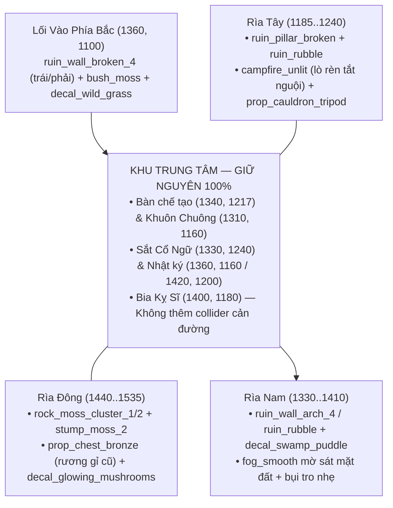

# HW-AG-ENV-01 — ABANDONED BELL WORKSHOP REFINEMENT (PREVIEW PROPOSAL)
**Phân khu:** `sub_bell_workshop` (`x: 1120..1600, y: 1040..1440`, `480×400`)\
**Trạng thái:** **CHỜ OWNER DUYỆT PREVIEW (Chưa chỉnh sửa code/map)**\

---

## 1. CHẨN ĐOÁN HIỆN TRẠNG (`WorldBuilder.ts:7904-7942 & 8023-8039`)

Hiện tại Xưởng Chuông Bỏ Hoang quá trống và mới vì:
- **Nền đá (`renderSubBellWorkshopTerrain`)**: Chỉ phủ 1 hình elip `TILE_STONE_FLOOR` đồng nhất (`brightness 0.58`), chưa có vết nứt, mảng rêu xâm lấn rìa đá hay vũng nước đọng lâu năm.
- **Đạo cụ (`renderSubBellWorkshopDecorations`)**: Chỉ có **1** bàn chế tạo (`SPRITE_CRAFTING_BENCH`), **1** tảng đá rêu (`rock_large_mossy_v14`), vật phẩm nhiệm vụ `SPRITE_RES_RUNED_IRON`, và **1** hình tròn cam phẳng `lampGfx` (`fillCircle`).
- **Ánh sáng & Không khí**: Thiếu lớp bụi/tro lơ lửng, vệt rêu tường đổ, lò rèn tắt nguội (`campfire_unlit`) và quầng sáng ấm dịu từ đèn treo cũ.

---

## 2. SƠ ĐỒ BỐ CỤC ĐỀ XUẤT (BẢO TOÀN 100% KHU VỰC TƯƠNG TÁC)

---

## 3. DANH MỤC ASSET SỬ DỤNG (100% ASSET HIỆN CÓ — KHÔNG CẦN VẼ MỚI)

| Lớp tinh chỉnh | Asset hiện có | Vị trí / Mục đích | Ghi chú an toàn |
|---|---|---|---|
| **Nền đá nứt & rêu bám** | `TILE_STONE_FLOOR` + vẽ vết nứt mảnh & mảng rêu `0x22301d` trực tiếp lên canvas baked `sub_bell_workshop_ground_baked_v15` | Phủ dọc mép elip đá (`(240, 208)`) để đá vỡ dần ra đất rừng | Chỉ baked texture nền, **0 collider** |
| **Độ ẩm & Thảm thực vật** | `decal_swamp_puddle.png`, `decal_pebbles_stones.png`, `decal_fern_cluster.png`, `decal_autumn_leaves.png`, `decal_wild_grass.png` | Rải ở rìa Tây/Nam/Đông (`DEPTH_GROUND_DECALS`) | Chỉ decal mặt đất |
| **Tường đổ & Phế tích** | `resurrected_props_atlas`: `ruin_pillar_broken`, `ruin_rubble`, `ruin_wall_broken_4`, `rock_moss_cluster_1/2`, `stump_moss_1/2` | Đặt dọc chu vi ngoài (`x < 1240`, `x > 1455`, `y > 1340`) | **Không đặt collider**, không chắn lối đi |
| **Đồ vật xưởng cũ** | `campfire_unlit.png`, `prop_cauldron_tripod.png`, `prop_chest_bronze.png` | Lò rèn nguội & vạc gỉ bên trái xưởng; rương đồng cũ góc Đông | Thuần trang trí thị giác (`tint` xỉn màu cũ) |
| **Ánh sáng & Bụi** | `SPRITE_FOG_SMOOTH` (tint xám lạnh `alpha 0.14`) + quầng đèn ấm 2 lớp (`0xffaa33` `alpha 0.12` + lõi `0xffd27a` `alpha 0.18`) + 8–10 hạt bụi tro chậm | Tạo chiều sâu xưởng bỏ hoang ẩm lạnh, tương phản với ánh đèn treo | Tối ưu nhẹ, tuân thủ `Reduced Motion` |

---

## 4. CAM KẾT PHẠM VI

- **Giữ nguyên 100%** tọa độ 6 `interactables`, `defaultSpawn (1360, 1100)`, `bounds` và toàn bộ chức năng nhiệm vụ.
- **Không sửa** collision, physics body hay interaction logic (tôn trọng phạm vi Codex).
- **Không cần** thêm asset mới từ `HW–Design` (tận dụng hoàn toàn `resurrected_props_atlas`, `foliage/decal_*`, `props/*`).

> ⏸️ **Chờ Owner duyệt Preview này trước khi triển khai vào `WorldBuilder.ts`.**
