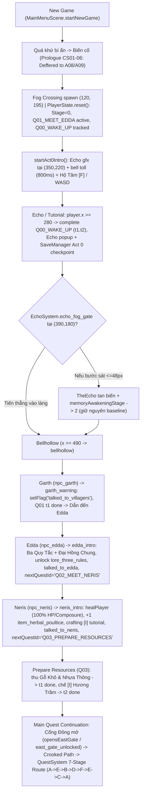

# HW-V16-A03 — PROLOGUE, ACT 0 & BELLHOLLOW NARRATIVE REPORT

- **Task ID:** `HW-V16-A03 — PROLOGUE, ACT 0 & BELLHOLLOW NARRATIVE`
- **Project:** `HOLLOW WOODS — THE UNBROKEN OATH` (`Target: V1.6.0`)
- **Studio:** `KYOSHIRO STUDIO`
- **Agent:** `AG 4 Hydro High`
- **Roadmap:** `3.1` | **Dependency:** `HW-V16-A02` (`PASS`)
- **Baseline:** `4d5b77a74f1ba0987c58b32e127393297ed41a8f` (`feat/v1.5.3-ag-world-polish`)
- **Backup Created:** `Backups/steps/backup_hw_v16_a03/dialogues.json`
- **Status:** **`PASS`** *(Production Canon Alignment Implemented, `DLG-006`/`DLG-007` Prepared as Draft, `A03-T01..T10` Verified)*

---

## 1. Tổng Quan Triển Khai & Tách Biệt Phạm Vi

| Hạng mục | Thực thi thực tế | Ghi chú phạm vi |
|---|---|---|
| **Act 0 (`Fog Crossing` & `EchoSystem`)** | Kiểm tra `GameScene.ts:1393–1430, 2712–2742, 6366–6376` & `EchoSystem.ts:15–125` | `0` spoil `Meliodas / Wolf Lord / Tổng Chỉ Huy`; bắt đầu với `Lữ Khách Rêu Phong`; `Vòng Sáng Hộ Tâm [F]` & lối vào Bellhollow hoạt động bình thường; không khẳng định Chuông/Echo là nguồn phát lời cầu cứu quá khứ; giữ nguyên `Memory Stage` và không thêm encounter mới (`0` thay đổi code). |
| **Bellhollow Act I (`src/data/dialogues.json`)** | Sửa tối thiểu `2` node (`+6/-6` dòng) tại `edda_intro` và `edda_bell_shatter_secret` | Gỡ câu Isekai cũ (`"trở về thế giới của mình"`, `"bờ bên kia ranh giới"`, `"ranh giới giữa hai thế giới"`), bổ sung vai trò `Đại Hồng Chung`, sửa Choice 3 của Edda để **không khẳng định màn sương gây mất trí nhớ**, giữ nguyên toàn bộ dialogue keys (`59/59`), choices, flags, `trustDelta`, `healPlayer`, `rewardItem`, `opensEastGate`, `nextQuestId`. |
| **Garth, Neris, Bram & Finn** | Kiểm tra thực tế `garth_warning`, `garth_reminder_edda`, `neris_intro`, `bram_*`, `finn_*` | Giữ nguyên vì đã khớp vai trò Canon tại Bellhollow (`Garth` cảnh giác & dẫn đến Edda; `Neris` hồi phục `100%` HP/Composure, trao `item_herbal_poultice ×1` & hướng dẫn chế `[I]`; `Bram` & `Finn` nhất quán, không mở rộng quest mới). |
| **Dialogue Preparation (`§6`)** | Chuẩn bị chi tiết `DLG-006`, `DLG-007` & bảng `BEFORE / PROPOSED / APPROVED` | Giữ trạng thái **`DRAFT — PENDING OWNER APPROVAL`** tại [`HW_V16_A03_DIALOGUE_APPROVAL_DRAFT.md`](file:///G:/HOLLOW%20WOODS/Read/V1.5/Reports/V16/HW_V16_A03_DIALOGUE_APPROVAL_DRAFT.md), **chưa** chèn nguyên văn trailer vào runtime. |
| **Prologue Cutscene / Hard Stop Items** | Tách biệt hoàn toàn | Không sản xuất Opening Cutscene (`A08/A09`), không sửa `BUG-058/059`, không động chạm `Headless Warden`, Save Schema hoặc Ending. |

---

## 2. Chi Tiết Chỉnh Sửa Production (`src/data/dialogues.json`)

| Node & Vị trí | Trước (`BEFORE`) | Sau (`AFTER`) | Lý do Canon (`HW-V16-A01 / A03`) |
|---|---|---|---|
| `edda_intro` (`lines[1]`) | *"...Ngươi là một Lữ Khách bước ra từ sương mù rêu phong sao? Nghe như một âm vang vọng lại từ **bờ bên kia ranh giới**."* | *"...Ngươi là Lữ Khách Rêu Phong vừa bước ra từ màn sương sao? Dáng vẻ ngươi giống như một dư âm còn sót lại giữa ranh giới sương mù."* | Bỏ sắc thái *Isekai* xuyên thế giới (`DEC-LOCK-08`), giữ danh xưng `Lữ Khách Rêu Phong`. |
| `edda_intro` (`lines[6..7]`) | *"...Quả Chuông Cổ... **Nếu ngươi muốn tìm đường trở về thế giới của mình**, hãy tìm lại Lưỡi Chuông Đồng cho ta!"* | *"...**Đại Hồng Chung cổ xưa — tiếng ngân của nó từng đẩy lùi màn sương**, nhưng Lưỡi Chuông Đồng đã thất lạc sâu về phía Miếu Chuông Phế Tích. **Nếu ngươi muốn vén màn sương và tìm câu trả lời cho bước chân mình**, hãy tìm lại Lưỡi Chuông Đồng cho làng!"* | Gỡ `"thế giới của mình"` (`DEC-LOCK-08`), bổ sung rõ vai trò của `Đại Hồng Chung` & mục tiêu `Lưỡi Chuông Đồng` (`§4`). |
| `edda_intro` (`choices[2]`) | Choice: *"**Ranh giới bên kia**... dường như ta không còn nhớ mình là ai nữa."* Response: ***"Màn sương đã tước đoạt ký ức của ngươi..."*** | Choice: *"**Trong màn sương ấy**... dường như ta không còn nhớ mình là ai nữa."* Response: ***"Màn sương che khuất nhiều dấu vết, nhưng ta không dám chắc điều gì đã cướp đi ký ức của ngươi..."*** | Tuân thủ chặt quy tắc §4: **Edda không khẳng định chính màn sương là tác nhân chắc chắn gây mất trí nhớ**. |
| `edda_bell_shatter_secret` (`choices[1]`) | *"...sau khi **ranh giới giữa hai thế giới** bị phá vỡ."* | *"...sau khi **màn sương The Veil tràn qua ranh giới thung lũng**."* | Loại bỏ nốt tàn dư ngữ nghĩa "hai thế giới" Isekai trong thoại Bellhollow. |

---

## 3. Narrative Sequence Diagram (`§7` — Đối Chiếu Source Thực Tế)

Luồng khởi đầu từ `New Game` tới `Main Quest Continuation` đối chiếu trực tiếp với `MainMenuScene.ts`, `GameScene.ts`, `EchoSystem.ts`, `PlayerState.ts`, `DialogueSystem.ts` và `QuestSystem.ts`:

- **Xác minh tính nhất quán Quest Graph:** Không chỉnh sửa `QuestSystem.ts`, `quests.json` hay thứ tự `Q00_WAKE_UP` → `Q01_MEET_EDDA` → `Q02_MEET_NERIS` → `Q03_PREPARE_RESOURCES` → `Q04..Q06`.

---

## 4. Kết Quả Kiểm Thử Thực Tế (`A03-T01` – `A03-T10`)

Toàn bộ `A03-T01`–`A03-T09` chạy trên bản production build `dist/` bằng Playwright Chromium headless (`1280×720`, SwiftShader WebGL) sau lần sửa cuối cùng tại `src/data/dialogues.json` (`0` console error, `0` page error, `0` HTTP failure). Chi tiết JSON nằm tại [`hw_v16_a03_playwright_results.json`](file:///G:/HOLLOW%20WOODS/Read/V1.5/Reports/Evidence/HW-V16-A03/hw_v16_a03_playwright_results.json).

| Test ID | Nội dung kiểm thử | Kết quả | Chi tiết quan sát thực tế & Ảnh chụp |
|---|---|---|---|
| **`A03-T01`** | New Game khởi động bình thường | **PASS** | Spawn `fog_crossing (120, 195)`, `currentQuestId = Q01_MEET_EDDA`, `memoryStage = 0`. Ảnh: [01_act0_fog_crossing.png](file:///G:/HOLLOW%20WOODS/Read/V1.5/Reports/Visuals/HW-V16-A03/01_act0_fog_crossing.png) |
| **`A03-T02`** | Không spoil danh tính tại Act 0 | **PASS** | `0` từ khóa `Meliodas`, `Wolf Lord`, `Tổng Chỉ Huy`, `Chỉ Huy Hiệp Sĩ Đen` trong HUD hoặc Journal ban đầu (`lore_three_rules`). |
| **`A03-T03`** | Fog Crossing tới Bellhollow không softlock | **PASS** | Vòng Sáng Hộ Tâm `[F]` kích hoạt (`lanternOn = true`), băng qua transition vào `bellhollow` tại `x=510`, `Q00_WAKE_UP t2 = true`. |
| **`A03-T04`** | Garth chuyển nhiệm vụ đúng | **PASS** | Hoàn tất `garth_warning` đặt `talked_to_villagers = true`, hoàn thành `Q01_MEET_EDDA t1`, giữ mục tiêu gặp Edda. Ảnh: [02_garth_warning.png](file:///G:/HOLLOW%20WOODS/Read/V1.5/Reports/Visuals/HW-V16-A03/02_garth_warning.png) |
| **`A03-T05`** | Edda giữ đủ Ba Quy Tắc và payload | **PASS** | Giữ đủ `QUY TẮC 1..3`, giải thích `Đại Hồng Chung`, hết tàn dư Isekai/khẳng định sương gây mất trí nhớ, đặt `talked_to_edda = true`, mở `lore_three_rules`, chuyển `Q02_MEET_NERIS`. Ảnh: [03_edda_intro_rules.png](file:///G:/HOLLOW%20WOODS/Read/V1.5/Reports/Visuals/HW-V16-A03/03_edda_intro_rules.png) |
| **`A03-T06`** | Neris hồi phục và cấp vật phẩm đúng | **PASS** | HP phục hồi `50 → 100/100`, Composure `55 → 100/100`, nhận `item_herbal_poultice ×1`, mở `lore_herbalist_note`, đặt `talked_to_neris = true`, chuyển `Q03_PREPARE_RESOURCES`, `eastGateUnlocked = true`. Ảnh: [04_neris_intro_heal.png](file:///G:/HOLLOW%20WOODS/Read/V1.5/Reports/Visuals/HW-V16-A03/04_neris_intro_heal.png) |
| **`A03-T07`** | Mọi lựa chọn hiện hành dẫn tới trạng thái hợp lệ | **PASS** | Kiểm chứng đủ `garth_warning` (`3`), `edda_intro` (`3`), `neris_intro` (`3`), `edda_bell_shatter_secret` (`2`) đều đi trọn đến `DialogueSystem` đóng sạch sẽ. |
| **`A03-T08`** | Dialogue tiếng Việt không tràn khung | **PASS** | Đo bounding box `21` lượt thoại render thật trên `UIScene`: chiều cao chữ tối đa `54px`, `0` dòng vượt đáy khung (`overflows: []`), hiển thị rõ dấu tiếng Việt trên cả `4` ảnh chụp. |
| **`A03-T09`** | Save/Continue giữ tiến trình | **PASS** | `handleSaveManual()` → `page.reload()` → `MainMenuScene.continueGame()` khôi phục nguyên `Q03_PREPARE_RESOURCES`, `talked_to_villagers`, `talked_to_edda`, `talked_to_neris`, `item_herbal_poultice`, `eastGateUnlocked = true`. Ảnh: [05_continue_save_restored.png](file:///G:/HOLLOW%20WOODS/Read/V1.5/Reports/Visuals/HW-V16-A03/05_continue_save_restored.png) |
| **`A03-T10`** | `check`, `verify:data` và `build` | **PASS** | `npm run check` (`tsc --noEmit`) exit `0`; `npm run verify:data` **`15/15 PASS`**; `npm run build` (`vite build`, `dist/assets/index-ChDJJWu2.js` `1,186.64 kB`) exit `0`. Bổ sung: `verify_v15_16_story_and_dialogue.mjs` **`90/90 PASS`** (`verify_v15_17_villager_stories.mjs` đạt `47/48`, `1` assertion V1.5.17 cũ tìm chuỗi `"Rad, Isa, Algiz"` trên `edda_rune_guide` không liên quan sửa đổi A03). |
