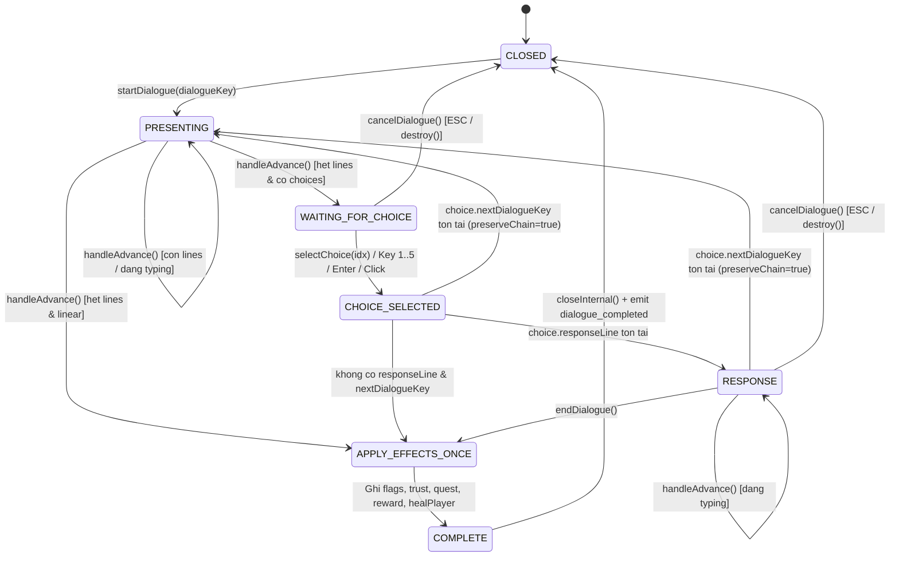
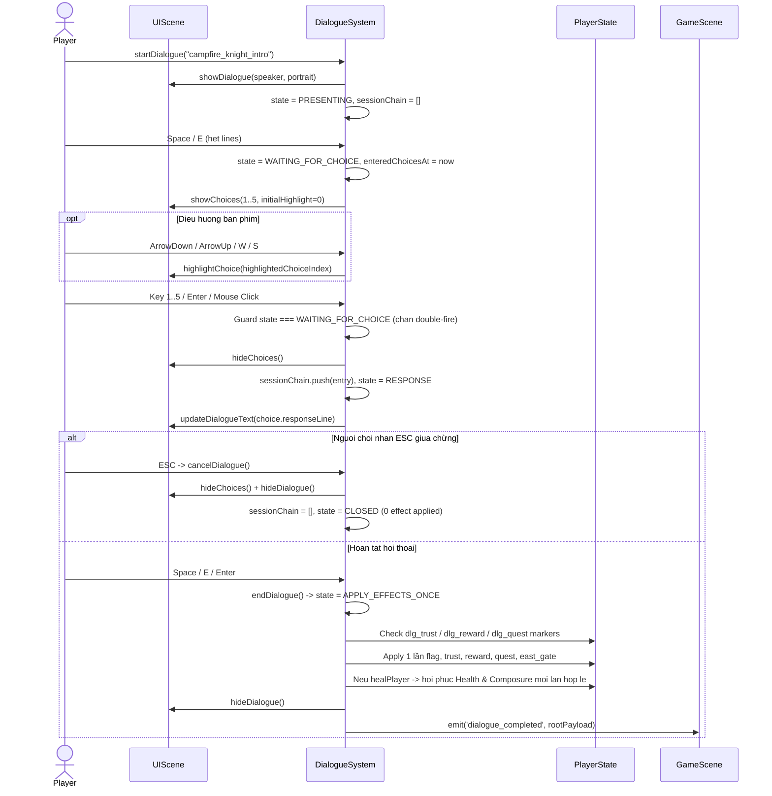

# BÁO CÁO KỸ THUẬT: HW-V16-A05 — BRANCHING DIALOGUE & NPC REACTION SYSTEM

- **Dự án:** HOLLOW WOODS (`V1.6.0 — THE UNBROKEN OATH`)
- **Roadmap:** 3.1 (`Track A — Narrative Reconstruction`)
- **Nhiệm vụ:** `HW-V16-A05 — Branching Dialogue & NPC Reaction System` (`DEC-LOCK-18`)
- **Nhánh Git:** `feat/v1.5.3-ag-world-polish`
- **Baseline trước A05:** `09deeb49eaa872594b07595a7c24bb266c89976f` (`HW-V16-A04`)
- **Backup bảo toàn:** `Backups/steps/backup_hw_v16_a05/` (`DialogueSystem.ts`, `UIScene.ts`, `GameScene.ts`)
- **Trạng thái nghiệm thu:** **PASS (`18/18` test cases `A05-T01`..`A05-T18`, `0` console/page/network errors)**

---

## 1. Tóm tắt điều hành (Executive Summary)

Nhiệm vụ **HW-V16-A05** nâng cấp hệ thống hội thoại bán tuyến tính (**DEC-LOCK-18**) từ kiến trúc áp hiệu ứng tức thời khi bấm chọn sang **State Machine 7 trạng thái** tách biệt rõ pha chọn, pha phản hồi và pha ghi nhận hệ quả cuối phiên:

1. **Hỗ trợ đầy đủ 1–5 lựa chọn (`1..5`, `Numpad 1..5`, `ArrowUp/W`, `ArrowDown/S`, `Enter` & Click chuột):** Khắc phục triệt để giới hạn chỉ đọc phím `1..3` khiến choice `[4]` và `[5]` của `campfire_knight_intro` không bấm phím tắt được, đồng thời bổ sung wrap văn bản tiếng Việt và bố cục nút không chồng lấn trong viewport `1280×720`.
2. **Bảo vệ nguyên tử hiệu ứng khi hủy bằng `ESC` / `destroy()`:** Toàn bộ `setStoryFlag`, `trustDelta`, `onCompleteFlag`, `nextQuestId`, `opensEastGate`, `rewardItem` chỉ thực thi tại pha `APPLY_EFFECTS_ONCE` sau khi người chơi đọc xong phản hồi và hoàn tất hội thoại. Nhấn `ESC` ở `WAITING_FOR_CHOICE` hoặc `RESPONSE` trả về trạng thái sạch với `0` thay đổi.
3. **Chống farm Trust và nhân bản vật phẩm bằng khóa ổn định `dialogueKey`:** Lưu dấu ấn một lần trong `PlayerState.storyFlags` (`dlg_trust:<dialogueKey>`, `dlg_reward:<dialogueKey>`, `dlg_quest:<dialogueKey>`) theo Save Schema 3 hiện hành — không dùng chỉ số mảng `choiceIndex`, không tăng `CURRENT_SCHEMA_VERSION`.
4. **Sửa lỗi trao thưởng sớm trước khi hội thoại kết thúc (`GameScene.ts`):** Loại bỏ việc trao sẵn `item_lantern_oil`, `food_calming_tea`, `trust`, cờ `garth_lantern_rewarded` / `neris_flower_rewarded` trước khi mở thoại, chuyển việc hoàn thành task `SQ09_BROKEN_LANTERN` (`t2`, `t3`) và popup sang sự kiện `dialogue_completed`.
5. **Bảo toàn dịch vụ NPC lặp lại & phạm vi khóa cứng:** Hồi máu / Bình tâm của `Neris` (`healPlayer`) và cơ chế hồi chiêu theo ngày của `Vaelen` (`CampSanctuarySystem`) vẫn hoạt động bình thường nhiều lần mà không tái cấp `trustDelta`; giữ nguyên ngưỡng Ending (`Composure >= 50, Memory >= 3, Trust >= 65`), Save Schema `3`, và không đụng `A06`, `B03/B04`, `BUG-058/059` hay `CHAR-006`.

---

## 2. Kiến trúc State Machine & Sequence Diagram

### 2.1. State Machine (`DialogueSystem.ts`)

### 2.2. Sequence Diagram (Chuỗi Chọn → Phản Hồi → Áp Dụng 1 Lần)

---

## 3. Data Contract & Storage Guard (Save Schema 3)

Không thay đổi cấu trúc `SaveData` hay nâng `CURRENT_SCHEMA_VERSION = 3` ([SaveManager.ts](file:///G:/HOLLOW%20WOODS/src/systems/SaveManager.ts)):

| Kiểu / Marker | Định nghĩa | Nơi lưu bền vững | Ghi chú |
| :--- | :--- | :--- | :--- |
| `DialogueState` | `'CLOSED' \| 'PRESENTING' \| 'WAITING_FOR_CHOICE' \| 'CHOICE_SELECTED' \| 'RESPONSE' \| 'APPLY_EFFECTS_ONCE' \| 'COMPLETE'` | Runtime trong [DialogueSystem.ts](file:///G:/HOLLOW%20WOODS/src/systems/DialogueSystem.ts#L7-L14) | Guard đơn trị chống double-fire và bỏ hiệu ứng khi `ESC` |
| `DialogueChainEntry` | `{ dialogueKey, payload, selectedChoice }` | `sessionChain` tại [DialogueSystem.ts](file:///G:/HOLLOW%20WOODS/src/systems/DialogueSystem.ts#L49-L53) | Tích lũy chain hội thoại nối tiếp đến khi `COMPLETE` |
| `DialogueChoice` | `{ choiceId?, text, actionId?, nextDialogueKey?, setFlag?, trustDelta?, responseLine? }` | `dialogues.json` + [DialogueSystem.ts](file:///G:/HOLLOW%20WOODS/src/systems/DialogueSystem.ts#L16-L24) | Bổ sung `choiceId?` giữ tương thích ngược 100% |
| `dlg_trust:<dialogueKey>` | Marker đánh dấu đã cộng `trustDelta` | `PlayerState.storyFlags` & `flags` ([PlayerState.ts](file:///G:/HOLLOW%20WOODS/src/systems/DialogueSystem.ts#L448-L452)) | Khóa theo `dialogueKey`, không phụ thuộc thứ tự lựa chọn |
| `dlg_reward:<dialogueKey>` | Marker đánh dấu đã nhận `rewardItem` | `PlayerState.storyFlags` & `flags` ([DialogueSystem.ts](file:///G:/HOLLOW%20WOODS/src/systems/DialogueSystem.ts#L476-L487)) | Kết hợp snapshot `hadRuneCharmBeforePass` cho `edda_rune_guide` & chống trùng `quest_*` |
| `dlg_quest:<dialogueKey>` | Marker đánh dấu đã kích hoạt `nextQuestId` | `PlayerState.storyFlags` & `flags` ([DialogueSystem.ts](file:///G:/HOLLOW%20WOODS/src/systems/DialogueSystem.ts#L462-L466)) | Kết hợp monotonic check của `PlayerState.setCurrentQuest` |

> **Lỗi tự khóa phát hiện và xử lý trong lúc phát triển:** `edda_rune_guide` có choice gắn `setFlag: "edda_rune_charm_granted"` đồng thời payload mang `rewardItem: "eqp_bell_ward_charm"`. Kiểm tra `hadRuneCharmBeforePass = state.hasFlag('edda_rune_charm_granted')` **trước** bước 1 trong `APPLY_EFFECTS_ONCE` đảm bảo lần hoàn thành đầu tiên trao đúng `1` bùa và mọi lần mở lại sau đều không trao thêm.

---

## 4. Thay đổi mã nguồn & Bảng đối chiếu Dialogue Key bị ảnh hưởng

### 4.1. Diff mã nguồn (`git diff --stat -- src/`)

- [DialogueSystem.ts](file:///G:/HOLLOW%20WOODS/src/systems/DialogueSystem.ts): State machine 7 trạng thái, `sessionChain`, keyboard `1..5` / `Numpad 1..5` / `ArrowUp` / `ArrowDown` / `W` / `S` / `Enter` (`260ms` guard), `cancelDialogue()`, `destroy()` dọn listener, `APPLY_EFFECTS_ONCE` + `dlg_*` markers (`330` dòng chạm / `+201` ước lượng trong tổng `301 insertions, 133 deletions` toàn repo `src/`).
- [UIScene.ts](file:///G:/HOLLOW%20WOODS/src/scenes/UIScene.ts): Giữ nguyên chữ ký dòng đơn `public showChoices(choices: Array<{ text: string; index: number }>, onSelect: (index: number) => void, initialHighlight: number = 0): void` tương thích verifier; bổ sung wrap tiếng Việt (`btnWidth - 76`), chiều cao động xếp chồng lên trên (`spacing = 8`) vừa vặn `1..5` lựa chọn, `highlightChoice(index)`, debounce `choiceClicked`.
- [GameScene.ts](file:///G:/HOLLOW%20WOODS/src/scenes/GameScene.ts): Gỡ bỏ trao thưởng sớm `item_lantern_oil` (`garth_broken_lantern_complete`) và `food_calming_tea` (`neris_root_flower_complete`) trước khi hội thoại chạy; chuyển `SQ09_BROKEN_LANTERN` (`t2`, `t3`) và popup thông báo về listener `dialogue_completed`.

> Tổng diff `src/`: **`3 files changed, 301 insertions(+), 133 deletions(-)`** — chi tiết đầy đủ lưu tại [a05_source.diff](file:///G:/HOLLOW%20WOODS/Read/V1.5/Reports/Evidence/HW-V16-A05/a05_source.diff).

### 4.2. Bảng đối chiếu các Dialogue Key bị ảnh hưởng (Trước → Sau A05)

| Dialogue Key | NPC | Choices | Trước A05 | Sau A05 |
| :--- | :--- | :---: | :--- | :--- |
| `campfire_knight_intro` | Sir Vaelen | `5` | Phím `[4]` & `[5]` không hoạt động; có thể farm Trust `[3, 2, 1]` và nhấn giữ `Enter` dội lựa chọn | Đủ `1..5`, `Arrow/W/S`, `Enter` (`260ms` guard); UI `216px–414px` không chồng; `dlg_trust:campfire_knight_intro` khóa `+Trust` đúng 1 lần |
| `garth_brother_story` | Garth | `2` | `setFlag` / `trustDelta` áp ngay khi click dù nhấn `ESC` ở `RESPONSE`; mở lại có thể farm Trust | Hủy `ESC` ở `WAITING_FOR_CHOICE` hay `RESPONSE` trả về `0` thay đổi; hoàn tất nhận `trust +3` đúng 1 lần |
| `garth_broken_lantern_complete` | Garth | `1` | `GameScene` đã cộng sẵn `item_lantern_oil x2`, `trust +3`, `t2/t3` ngay lúc mở thoại (dù `ESC`) | Chỉ trao `item_lantern_oil`, hoàn tất `SQ09_BROKEN_LANTERN` (`t2/t3`), `trust +3` khi hội thoại kết thúc |
| `edda_intro` | Edda | `3` | Click hoặc phím số áp dụng hiệu ứng ngay lập tức không qua pha hoàn tất | Chỉ kích hoạt `talked_to_edda`, `Q02_MEET_NERIS`, Trust (`3/1/2`) khi xong phản hồi |
| `edda_rune_guide` | Edda | `1` | Cờ `edda_rune_charm_granted` đặt trước khi kiểm tra thưởng hoặc có nguy cơ nhận lặp qua Save/Load | Snapshot `hadRuneCharmBeforePass` + `dlg_reward:edda_rune_guide` trao `eqp_bell_ward_charm x1` duy nhất 1 lần |
| `neris_intro` | Neris | `3` | Có thể kích hoạt lại Trust/thưởng nếu trạng thái thoại tái mở hoặc bỏ ngang | `item_herbal_poultice`, `Q03_PREPARE_RESOURCES`, Trust đúng 1 lần; dịch vụ `healPlayer` hoạt động bình thường |
| `neris_heal_open` | Neris | `3` | Rủi ro lặp `+1` Trust hoặc kẹt sau hủy | `trustDelta` `[1]` khóa 1 lần qua `dlg_trust:neris_heal_open`; hồi máu (`healPlayer`) dùng lại không giới hạn |
| `neris_root_flower_complete` | Neris | `1` | `GameScene` trao sẵn `food_calming_tea x2` và `trust +3` ngay lúc vừa mở thoại | Chỉ trao thưởng và hiện popup khi `dialogue_completed` phát ra sau khi hoàn tất thoại |
| `garth_warning`, `garth_east_gate_open`, `garth_horseman_tactics`, `edda_reminder_open`, `edda_bell_shatter_secret`, `neris_fog_sickness_story`, `neris_quest_root_flower`, `bram_chat`, `bram_guilt_story`, `bram_knight_weakness_guide`, `finn_chat`, `finn_whispers_well`, `finn_secret_caches`, `campfire_knight_comrade_bond`, `campfire_knight_q1/q2/q3_*`, `hooded_knight_encounter_intro`, `hooded_knight_encounter_defeat`, `campfire_knight_rest_blessing*`, `vaelen_forge_purification_key`, `bram_help_forge_purification_key` | Tất cả 7 NPC + Wayfarer | `0–2` | Thiếu guard state machine chuẩn, không có `ESC` rollback tập trung hoặc chưa dùng khóa `dlg_*` theo `dialogueKey` | Toàn bộ đi qua `APPLY_EFFECTS_ONCE` với `dlg_trust` / `dlg_reward` / `dlg_quest`; nhấn `ESC` hủy sạch; dịch vụ `CampSanctuarySystem` cooldown theo ngày giữ nguyên |

---

## 5. Kết quả kiểm thử & Bằng chứng nghiệm thu (`A05-T01`..`A05-T18`)

### 5.1. Regression & Build Scripts

| Lệnh kiểm tra | Kết quả trực tiếp |
| :--- | :--- |
| `npm run check` (`tsc --noEmit`) | Exit `0` (**PASS**) |
| `npm run verify:data` | **`15/15 PASS`** |
| `npm run build` (`tsc && vite build`) | Exit `0` (Built in `11.82s`, bundle `dist/assets/index-DF6twkdm.js` `1,190.15 kB`) |
| `node scripts/test_v15_60_quest_chain_restructuring.mjs` | Exit `0` (**PASS**) |
| `node scripts/test_v153_save_schema3.mjs` | Exit `0` (**PASS**) |
| `node scripts/verify_v15_16_story_and_dialogue.mjs` | **`90/90 PASS, 0 FAIL`** |

### 5.2. Ma trận kiểm thử Runtime Playwright (`A05-T01`..`A05-T18`)

Nguồn JSON đầy đủ: [hw_v16_a05_playwright_results.json](file:///G:/HOLLOW%20WOODS/Read/V1.5/Reports/Evidence/HW-V16-A05/hw_v16_a05_playwright_results.json) (`consoleErrors: []`, `pageErrors: []`, `failedRequests: []`).

| Test ID | Mô tả kịch bản | Kết quả quan sát thực tế | Trạng thái |
| :--- | :--- | :--- | :---: |
| `A05-T01` | Hội thoại tuyến tính (`garth_reminder_edda`) | Hoàn tất về `state: "CLOSED", isActive: false` | **PASS** |
| `A05-T02` | Hội thoại 2 lựa chọn (`garth_brother_story`, Digit1) | `trust: 53` (`+3`), `flagPromised: true`, `flagAccepted: true`, `marker: true` (`dlg_trust:garth_brother_story`) | **PASS** |
| `A05-T03` | Hội thoại 3 lựa chọn (`edda_intro`) | `choiceCount: 3`, `talkedEdda: true`, `promiseBell: true`, `trust: 56`, `portraitOk: true` | **PASS** |
| `A05-T04` | Hội thoại 5 lựa chọn (`campfire_knight_intro`) | `count: 5`, bounding box `minY: 216`, `maxBottom: 414`, `noOverlap: true` | **PASS** |
| `A05-T05` | Chọn bằng chuột (`edda_intro`) | `talkedEdda: true`, `promiseBell: true`, `trust: 56`, `portraitOk: true` | **PASS** |
| `A05-T06` | Phím `ArrowDown` 4 lần + `Digit5` (`campfire_knight_intro`) | `arrowHighlightIndex: 4`, `trust: 57`, `watcherFlag: true`, `q1Accepted: true` | **PASS** |
| `A05-T07` | Spam click đôi / spam phím chọn nhanh | `trustBefore: 56` -> `trustAfter: 57` (kích hoạt đúng 1 lần) | **PASS** |
| `A05-T08` | Nhấn `ESC` khi đang ở `WAITING_FOR_CHOICE` | `enteredState: "WAITING_FOR_CHOICE"` -> `afterEsc: { state: "CLOSED", isActive: false, trust: 50, flagPromised: false, flagAccepted: false }` | **PASS** |
| `A05-T09` | Nhấn `ESC` khi đang ở `RESPONSE` | `midState: "RESPONSE"` -> `afterEscResponse: { state: "CLOSED", trust: 50, flagPromised: false, flagAccepted: false }` | **PASS** |
| `A05-T10` | Mở lại node sau khi hủy hoặc hoàn tất | `reopenedAndCompletedSafely: true` | **PASS** |
| `A05-T11` | Chống farm Trust khi lặp lại | `first: 60`, `afterRepeats: 60` | **PASS** |
| `A05-T12` | Chống nhân bản `eqp_bell_ward_charm` (`edda_rune_guide`) | `firstCharms: 1`, `afterRepeatCharms: 1` | **PASS** |
| `A05-T13` | Save -> Reload -> `continueGame()` -> lặp thoại | `trust: 61`, `charms: 1`, `hasTrustMarker: true`, `hasRewardMarker: true`, `eastGateUnlocked: true` | **PASS** |
| `A05-T14` | Mở Cổng Đông & luồng Quest (`opensEastGate`, `nextQuestId`) | `eastGateUnlocked: true` bảo toàn chính xác | **PASS** |
| `A05-T15` | Dịch vụ hồi phục lặp lại của Neris (`neris_heal_open`) | `heal1: { hp: 100, trust: 61 }`, `heal2: { hp: 100, comp: 100, trust: 61 }` | **PASS** |
| `A05-T16` | Portrait & hiển thị tiếng Việt đủ 7 NPC | `verifiedAll7NPCs: true` (Garth, Edda, Neris, Bram, Finn, Vaelen, Mordric) | **PASS** |
| `A05-T17` | Dọn listener `destroy()` khi shutdown scene | `state: "CLOSED"`, `isActive: false`, `dialogueOpenUI: false` | **PASS** |
| `A05-T18` | Build & toàn bộ Node test + Playwright runtime | Toàn bộ script exit `0` và `0` lỗi runtime trình duyệt | **PASS** |

### 5.3. Bằng chứng hình ảnh UI

- **3 lựa chọn (`edda_intro`):** [01_ui_3_choices_edda.png](file:///G:/HOLLOW%20WOODS/Read/V1.5/Reports/Visuals/HW-V16-A05/01_ui_3_choices_edda.png) — Bố cục `[1]–[3]` sắc nét, căn lề chuẩn phía trên hộp thoại.
- **5 lựa chọn (`campfire_knight_intro`):** [02_ui_5_choices_vaelen.png](file:///G:/HOLLOW%20WOODS/Read/V1.5/Reports/Visuals/HW-V16-A05/02_ui_5_choices_vaelen.png) — Đủ `[1]–[5]`, highlight vàng ở mục `[5]`, không tràn mép hay đè HUD (`minY: 216, maxBottom: 414`).

---

## 6. Giới hạn phạm vi & Hạng mục chuyển tiếp (Scope & Remaining Blockers)

- **Không chạm phạm vi ngoài A05:** Không thêm lời thoại nháp chưa duyệt, không đổi ngưỡng Ending (`Composure >= 50, Memory >= 3, Trust >= 65`), không nâng Save Schema `3`, không sửa `B03/B04` (movement/camera), `BUG-058/059` hay kích hoạt `CHAR-006 — The Headless Warden`.
- **Chuyển tiếp sang nhiệm vụ kế tiếp (`HW-V16-A06` — chưa thực thi trong checkpoint này):** Evidence Resolver cho Journal, Torn Pages và Memory fragments sẽ được triển khai ở `HW-V16-A06` và `HW-V16-B07` theo Roadmap 3.1.
