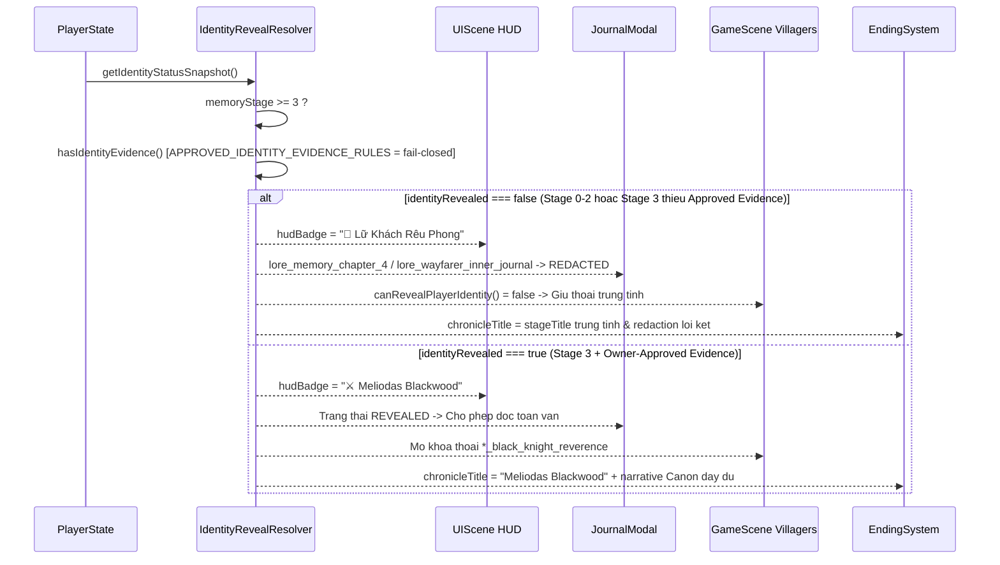

# BÁO CÁO KỸ THUẬT: HW-V16-A06 — JOURNAL, TORN PAGES, MEMORY & IDENTITY REVEAL

- **Dự án:** HOLLOW WOODS (`V1.6.0 — THE UNBROKEN OATH`)
- **Roadmap:** 3.1 (`Track A — Narrative Reconstruction`)
- **Nhiệm vụ:** `HW-V16-A06 — Journal, Torn Pages, Memory & Identity Reveal` (`DEC-LOCK-01..07`, `11`, `18`)
- **Nhánh Git:** `feat/v1.5.3-ag-world-polish`
- **Baseline trước A06:** `21f29943dd1c1a9744cb94028056de32b68f1406` (`HW-V16-A05`)
- **Backup bảo toàn:** `Backups/steps/backup_hw_v16_a06/` (`7` tệp nguồn gốc)
- **Trạng thái tổng thể:** **`PARTIAL`** *(Đã vá triệt để toàn bộ đường dẫn rò rỉ danh tính sớm, thống nhất `IdentityRevealResolver` fail-closed trên HUD / Journal / Torn Page / Dialogue / Ending và kiểm chứng runtime `A06-T01..T04, T07..T12 PASS`; giữ nguyên hiển thị trung tính và báo `PARTIAL` do bảng quy tắc chứng cứ cụ thể & trigger Stage 3 tuyến chính không phụ thuộc `SQ08` còn chờ Owner phê duyệt tại [HW_V16_A06_EVIDENCE_DECISION_MATRIX.md](file:///G:/HOLLOW%20WOODS/Read/V1.5/Reports/V16/HW_V16_A06_EVIDENCE_DECISION_MATRIX.md)).*

---

## 1. Tóm tắt kiểm toán nguồn & các lỗ hổng đã đóng (`§3`)

Kiểm tra trực tiếp mã nguồn thực tế sau `HW-V16-A05` ghi nhận các điểm rò rỉ sau và đã xử lý đồng bộ:

| Điểm rò rỉ tại Baseline | Nguyên nhân kỹ thuật | Biện pháp khắc phục trong `HW-V16-A06` | Tệp / Vị trí mới |
| :--- | :--- | :--- | :--- |
| `PlayerState.ts:610–622` | 9 cờ thoại/boss (`choice_knight_empathy`, `choice_hooded_knight_*`, `boss_hooded_knight_defeated`, `campfire_knight_q3_completed`) mở thẳng `lore_wayfarer_inner_journal` từ Stage 0–2 | Gỡ hoàn toàn nhánh mở sớm `lore_wayfarer_inner_journal` khỏi `checkQuestProgression()` | [PlayerState.ts](file:///G:/HOLLOW%20WOODS/src/state/PlayerState.ts#L619-L632) |
| `PlayerState.ts:768–774` | `setMemoryAwakeningStage(2)` mở luôn `lore_wayfarer_inner_journal` dù Stage 2 chỉ là *Forgotten Oath* | Stage 2 chỉ mở `lore_memory_chapter_3`; `lore_wayfarer_inner_journal` chỉ mở khi `canRevealPlayerIdentity() === true` | [PlayerState.ts](file:///G:/HOLLOW%20WOODS/src/state/PlayerState.ts#L768-L785) |
| `EvilKnights.ts:1002` | `HoodedKnightBoss.defeatBoss()` mở `lore_wayfarer_inner_journal` ngay khi hạ boss ở Stage 2 | Gỡ lời gọi `ps.unlockLore('lore_wayfarer_inner_journal')`, giữ nguyên rơi `quest_corrupted_crest` & flag `boss_hooded_knight_defeated` | [EvilKnights.ts](file:///G:/HOLLOW%20WOODS/src/entities/EvilKnights.ts#L995-L1005) |
| `GameScene.ts:4301, 4391, 4880` | Gán trực tiếp `memoryAwakeningStage = 1` ở Xưởng Chuông & `SQ06`, bỏ qua `setMemoryAwakeningStage(1)` (không mở Chapter 1/2 hay phát event) | Chuyển sang `this.playerState.setMemoryAwakeningStage(1)` + emit `'memory_awakening_stage_changed'` nhất quán | [GameScene.ts](file:///G:/HOLLOW%20WOODS/src/scenes/GameScene.ts#L4300-L4308) |
| `GameScene.ts:4723..4800`, `UIScene.ts:339, 1062`, `EndingSystem.ts:792` | 5 dân làng (Garth, Edda, Neris, Bram, Finn), HUD góc trái & Ending Chronicle kiểm tra trực tiếp `memoryAwakeningStage >= 3`, phát sinh spoil `"Meliodas Blackwood"` dù thiếu chứng cứ | Gom toàn bộ về một resolver duy nhất: `canRevealPlayerIdentity()`, `getPlayerDisplayIdentity()`, `getEndingDisplayLines()` | [IdentityRevealResolver.ts](file:///G:/HOLLOW%20WOODS/src/systems/IdentityRevealResolver.ts) |
| `JournalModal.ts:923–990` | Hiển thị nguyên văn `lore_memory_chapter_4` / `lore_wayfarer_inner_journal` (bao gồm save cũ đã mở sẵn) | Chiếu hiển thị qua `projectLoreEntryForDisplay()` với `REDACTED` an toàn mà **không** xóa ID khỏi save | [JournalModal.ts](file:///G:/HOLLOW%20WOODS/src/ui/JournalModal.ts#L923-L995) |
| `TornPageModal.ts:795–799` | Tái mở trang giấy đã thu thập không có `!this.isAlreadyCollected` quanh `setMemoryAwakeningStage` | Bọc `!this.isAlreadyCollected` để đọc lại Torn Page không lặp ký ức, bình tâm hay thưởng | [TornPageModal.ts](file:///G:/HOLLOW%20WOODS/src/ui/TornPageModal.ts#L794-L800) |

---

## 2. Kiến trúc Resolver & Sequence Diagram (`§5`, `§11`)

### 2.1. Tách biệt 5 trạng thái độc lập (`IdentityStatusSnapshot`)

`IdentityRevealResolver.ts` tách rõ `5` trục: `memoryStage` (`0..3`), `loreUnlocked` (danh sách `unlockedLore`), `npcRecognition` (`NONE | FAINT_FAMILIARITY | COMRADE_OATH | MORDRIC_STANCE_GLINT | VAELEN_CREST_Q05 | FULL_REVEAL`), `identityRevealed` (`memoryStage >= 3 && hasIdentityEvidence(state)`), và `questCompleted` (`q05MireSolved`, `q06ClapperRetrieved`, `sq08Completed`).

### 2.2. Sequence Diagram (Cổng Giải Thân Phận Xuyên Hệ Thống)

---

## 3. Trigger Mapping Tiến Trình Ký Ức (`Stage 0–3`) & Trạng Thái Lore (`§4`, `§7`)

### 3.1. Mapping Trigger hiện hành (`0` thay đổi điều kiện Ending hoặc ngưỡng Stage)

| Stage | Nhãn thiết kế | Trigger kích hoạt hiện có trong Runtime | Mảnh Lore mở tự động | Trạng thái Identity Reveal |
| :---: | :--- | :--- | :--- | :---: |
| **`0`** | *Unknown Identity* | Khởi tạo `New Game` (`PlayerState.reset()`) | `lore_three_rules` | `false` (`Lữ Khách Rêu Phong`) |
| **`1`** | *Memory Echoes* | Khám phá `sub_bell_workshop` (`GameScene.ts:4301, 4391`), hoàn tất `SQ06` (`4880`), hoặc đọc lần đầu Bia Đá / Nhật ký thợ rèn (`TornPageModal.ts:795`) | `lore_memory_chapter_1`, `lore_memory_chapter_2`, `lore_black_knight_chronicle` | `false` |
| **`2`** | *Forgotten Oath* | Gặp `TheEcho` (`EchoSystem.ts:112`) hoặc chạm trán `HoodedKnightBoss` (`EvilKnights.ts:818`) | `lore_memory_chapter_3` *(Đã chặn `lore_wayfarer_inner_journal`)* | `false` (`Tàn Tích Kỵ Sĩ`) |
| **`3`** | *Memory Awakening* | Hiện chỉ kích hoạt ở `SQ08` `campfire_knight_q3_complete` (`GameScene.ts:4842`) — tuyến chính không ép `SQ08` chờ Owner duyệt trigger ở Matrix | `lore_memory_chapter_4` (`REDACTED` nếu chưa đủ bằng chứng) | `false` khi thiếu Approved Evidence (`PARTIAL`) |

### 3.2. Phân loại Lore (`AVAILABLE` / `HIDDEN` / `REDACTED` / `REVEALED`)

| Lore ID | Chưa mở (`!unlocked`) | Stage `1–2` (`unlocked`) | Stage `3` thiếu Approved Evidence | Legacy Save đã mở sẵn (`!revealed`) | Stage `3` + Approved Evidence |
| :--- | :---: | :---: | :---: | :---: | :---: |
| `lore_memory_chapter_1` | `HIDDEN` | `AVAILABLE` | `AVAILABLE` | `AVAILABLE` | `AVAILABLE` |
| `lore_memory_chapter_2` | `HIDDEN` | `AVAILABLE` | `AVAILABLE` | `AVAILABLE` | `AVAILABLE` |
| `lore_black_knight_chronicle` | `HIDDEN` | `AVAILABLE` | `AVAILABLE` | `AVAILABLE` | `AVAILABLE` |
| `lore_knights_memorial_stele` | `HIDDEN` | `AVAILABLE` | `AVAILABLE` | `AVAILABLE` | `AVAILABLE` |
| `lore_memory_chapter_3` | `HIDDEN` | `AVAILABLE` | `AVAILABLE` | `AVAILABLE` | `AVAILABLE` |
| `lore_memory_chapter_4` | `HIDDEN` | `HIDDEN` | **`REDACTED`** | **`REDACTED`** | **`REVEALED`** |
| `lore_wayfarer_inner_journal` | `HIDDEN` | `HIDDEN` *(đã vá leak)* | `HIDDEN` | **`REDACTED`** *(giữ ID trong save)* | **`REVEALED`** |
| `lore_ending_true` / `sacrifice` | `HIDDEN` | `REDACTED` *(nếu mở ở Stage 2)* | **`REDACTED`** | **`REDACTED`** | **`REVEALED`** |

---

## 4. Ma trận Kiểm Thử (`16` Tổ Hợp Stage × Evidence × `SQ08` & `A06-T01`..`T12`)

Nguồn JSON chi tiết: [hw_v16_a06_playwright_results.json](file:///G:/HOLLOW%20WOODS/Read/V1.5/Reports/Evidence/HW-V16-A06/hw_v16_a06_playwright_results.json) (`0` console errors, `0` page errors, `0` failed requests).

### 4.1. Ma trận `16` tổ hợp (`Memory Stage 0–3` × `Evidence Có/Không` × `SQ08`)

> **Phân biệt chế độ kiểm thử (`§10`):**
> - Cột **Runtime Thực Tế (Production Fail-Closed)** phản ánh hành vi thực trong `dist/` khi `APPROVED_IDENTITY_EVIDENCE_RULES = []` (`100% REAL`).
> - Cột **Resolver Contract (`SIMULATED` Fixture)** thử nghiệm hàm thuần `hasIdentityEvidence(mockState, simApprovedRules)` / `getPlayerDisplayIdentity(mockState, simApprovedRules)` bằng rule giả lập tại chỗ mà không cấy cờ giả vào Save/State.

| Stage | Evidence Input (`Simulated`) | `SQ08` | Runtime Thực Tế (`REAL` — Fail-Closed) | Resolver Contract (`SIMULATED` Fixture) | Ending (`comp=50, trust=65`) |
| :---: | :---: | :---: | :---: | :---: | :---: |
| `0` | Không / Có | Chưa / Xong | `revealed = false` (`Lữ Khách Rêu Phong`) | `revealed = false` (`Lữ Khách Rêu Phong`) | `fog_loop_ending` (`4` ca Stage `0` tại `comp 49/50, trust 64/65`) |
| `1` | Không / Có | Chưa / Xong | `revealed = false` (`Lữ Khách Rêu Phong`) | `revealed = false` (`Lữ Khách Rêu Phong`) | `fog_loop_ending` (`4` ca Stage `1`) |
| `2` | Không / Có | Chưa / Xong | `revealed = false` (`Lữ Khách Rêu Phong`) | `revealed = false` (`Lữ Khách Rêu Phong`) | `sacrifice_ending` (`4` ca Stage `2`) |
| `3` | Không (`4` ca) | Chưa / Xong | `revealed = false` (`Lữ Khách Rêu Phong` / Journal `REDACTED`) | `revealed = false` (`Lữ Khách Rêu Phong`) | `sacrifice_ending` (`trust 64` hoặc `comp 49`) / `true_ending` (`comp=50, trust=65`) |
| `3` | **Có (`SIM`)** | Chưa (`Q05` chính) | `false` *(NOT RUN ở gameplay thực vì thiếu Owner rule & Main Stage 3 trigger)* | **`revealed = true`** (`Meliodas Blackwood`) | Đạt logic `true_ending` (`50/3/65`) khi có Stage 3 |
| `3` | **Có (`SIM`)** | Đã xong | `false` *(NOT RUN ở gameplay thực vì thiếu Owner Evidence Lock)* | **`revealed = true`** (`Meliodas Blackwood`) | `true_ending` (`comp >= 50 && stage >= 3 && trust >= 65`) |

*(Toàn bộ **`16/16`** ca boundary của `EndingSystem.determineEndingType()` ở `stage 0..3 × comp 49/50 × trust 64/65` cho kết quả chính xác: `8 fog_loop_ending`, `7 sacrifice_ending`, `1 true_ending` — không thay đổi ngưỡng Ending).*

### 4.2. Tổng hợp `A06-T01`..`A06-T12`

| Test ID | Phân loại thực thi | Kịch bản kiểm tra | Kết quả thực tế | Bằng chứng |
| :--- | :---: | :--- | :--- | :--- |
| **`A06-T01`** | **REAL** | New Game & Main Menu không spoil | `hasSpoiler: false`, HUD=`🌲 Lữ Khách Rêu Phong`, Stage=`0` | [01_new_game_hud_stage0.png](file:///G:/HOLLOW%20WOODS/Read/V1.5/Reports/Visuals/HW-V16-A06/01_new_game_hud_stage0.png) |
| **`A06-T02`** | **REAL** | Journal Stage 1 không reveal | Mở `ch1, ch2, black_knight_chronicle`; `0` Meliodas; `hasInnerJournalUnlocked: false` | [02_journal_stage1_no_reveal.png](file:///G:/HOLLOW%20WOODS/Read/V1.5/Reports/Visuals/HW-V16-A06/02_journal_stage1_no_reveal.png) |
| **`A06-T03`** | **REAL** | Journal Stage 2 + flags thoại/boss không spoil | `choice_knight_empathy` + `boss_hooded_knight_defeated` + Stage 2: `hasInnerJournal: false`, chỉ mở `ch3` | JSON `A06-T03` **PASS** |
| **`A06-T04`** | **REAL** | Stage 3 thiếu Evidence giữ trung tính | HUD=`🌲 Lữ Khách Rêu Phong`, dân làng không reverence, Journal `ch4` hiển thị `[REDACTED]` | [03_journal_stage3_redacted_no_evidence.png](file:///G:/HOLLOW%20WOODS/Read/V1.5/Reports/Visuals/HW-V16-A06/03_journal_stage3_redacted_no_evidence.png) |
| **`A06-T05`** | **SIMULATED** *(Real: `PARTIAL`)* | Stage 3 đủ Evidence mới reveal | Hàm Resolver + fixture giả lập cho `revealed=true`; live runtime giữ fail-closed `false` chờ Owner ký Matrix | JSON `A06-T05` (`SIMULATED PASS / RUNTIME PARTIAL`) |
| **`A06-T06`** | **SIMULATED** *(Real: `PARTIAL`)* | Tuyến chính không cần `SQ08` | Hàm Resolver xác nhận không cần `SQ08`; live runtime còn chờ duyệt điểm kích Stage 3 ở tuyến `Q05` | JSON `A06-T06` + [Matrix](file:///G:/HOLLOW%20WOODS/Read/V1.5/Reports/V16/HW_V16_A06_EVIDENCE_DECISION_MATRIX.md) |
| **`A06-T07`** | **REAL** | Đọc lại Torn Page không lặp ký ức / Mở Journal không skip | Lần 1: `stage=1, comp=65`; Lần 2: `isAlreadyCollected=true`, `0` tăng lại `stage/comp` | JSON `A06-T07` **PASS** |
| **`A06-T08`** | **REAL** | Save/Load Stage `0..3` (Schema 3) | Lưu & `continueGame()` trọn vẹn `saveSchemaVersion: 3`, Stage `0/1/2/3`, `trust: 68`, `Q05_SOLVE_MIRE` | JSON `A06-T08` **PASS** |
| **`A06-T09`** | **REAL** | Save cũ có `lore_wayfarer_inner_journal` giữ ID & che nội dung | `preservedIds` giữ nguyên cả `5` mục (gồm `inner_journal`), hiển thị `[REDACTED]`, `0` leak `Meliodas` | [04_legacy_save_inner_journal_redacted.png](file:///G:/HOLLOW%20WOODS/Read/V1.5/Reports/Visuals/HW-V16-A06/04_legacy_save_inner_journal_redacted.png) |
| **`A06-T10`** | **REAL** | Đồng bộ HUD, Journal, Dialogue, Ending display | `true_ending` ở Stage 3 chưa reveal giữ `Tàn Tích Kỵ Sĩ` và lời dẫn trung tính, `0` từ `Meliodas` | [05_ending_stage3_unrevealed_neutral.png](file:///G:/HOLLOW%20WOODS/Read/V1.5/Reports/Visuals/HW-V16-A06/05_ending_stage3_unrevealed_neutral.png) |
| **`A06-T11`** | **REAL** | Quest & Ending threshold regression (`16` ca + Node suites) | Ending `16` ca = `8 fog_loop / 7 sacrifice / 1 true_ending`; `test_v15_60` & `test_v15_59` `22/22` PASS | JSON `A06-T11` + Node suite |
| **`A06-T12`** | **REAL** | `check`, `verify:data`, `build`, `save_schema3`, `story_and_dialogue` | `tsc=0`, `verify:data=15/15`, `test_v153_save_schema3=0`, `verify_v15_16=90/90`, `test_v15_38=12/12`, `vite build=0` | `a06_source.diff` (`+80/-67` + `IdentityRevealResolver.ts`) |
| **`LIVE_FULL_REVEAL`** | **NOT RUN** | Đạt `Identity Revealed = true` trên luồng chơi thật không qua fixture | Chưa chạy được vì `APPROVED_IDENTITY_EVIDENCE_RULES = []` theo chỉ thị `§6` (cấm tự duyệt quy tắc) | Cần Owner duyệt `HW_V16_A06_EVIDENCE_DECISION_MATRIX.md` |

---

## 5. Tài liệu & Phạm vi tiếp theo (`MEM-04`, `B07` & `HW-V16-A07`)

- **Save Schema & Migration (`§9`):** Giữ nguyên `CURRENT_SCHEMA_VERSION = 3`, giữ trọn inventory/quests/unlockedLoreIds; ghi nhận phạm vi **`MEM-04`** (non-destructive backfill tại `SaveManager.ts:699, 719`) để phối hợp thực thi cùng **`HW-V16-B07`** sau khi công thức chứng cứ được duyệt.
- **Chuyển tiếp:** Chờ Owner phản hồi chọn phương án chứng cứ tại [HW_V16_A06_EVIDENCE_DECISION_MATRIX.md](file:///G:/HOLLOW%20WOODS/Read/V1.5/Reports/V16/HW_V16_A06_EVIDENCE_DECISION_MATRIX.md); **chưa chạy `HW-V16-A07`**, không sửa `Ending thresholds`, `BUG-058/059` hay `CHAR-006`.
