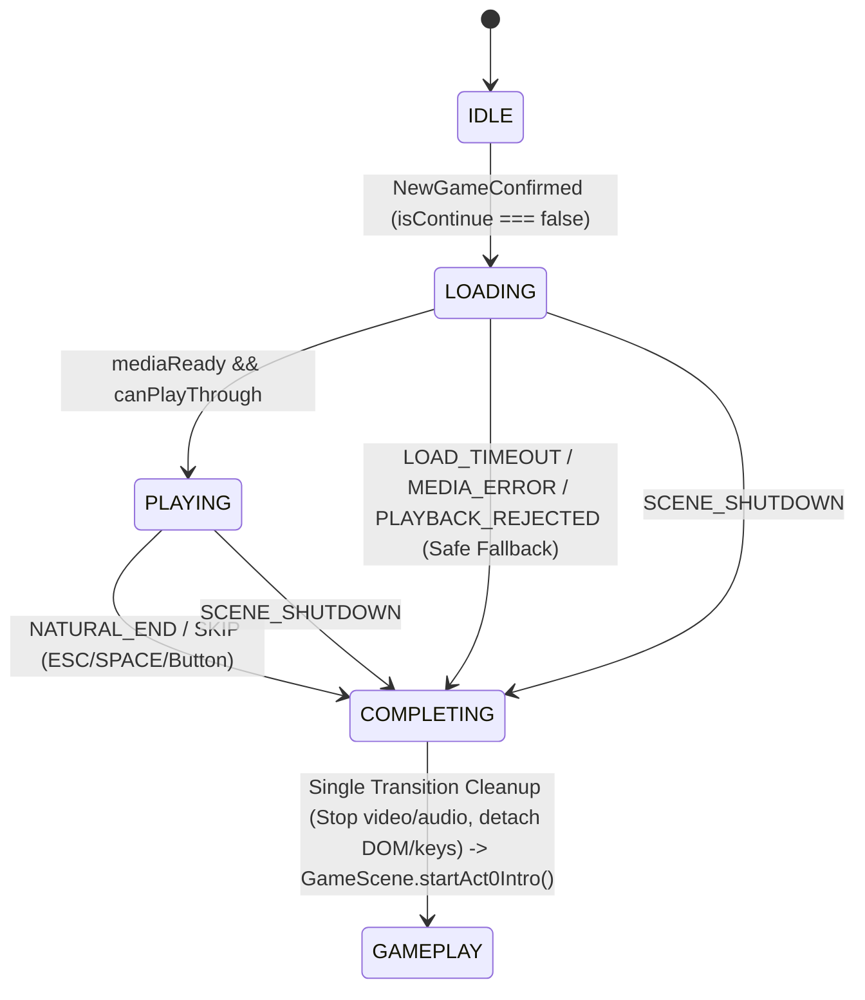

# HW-V16-A09 — OPENING CUTSCENE RUNTIME INTEGRATION REPORT

- **PROJECT:** HOLLOW WOODS
- **STUDIO:** KYOSHIRO STUDIO
- **TARGET:** `V1.6.0 — THE UNBROKEN OATH` (`ROADMAP: 3.1`)
- **TASK ID:** `HW-V16-A09`
- **STATUS:** **`BLOCKED — ENTRY GATE UNMET (A08 PRODUCTION & OWNER APPROVAL PENDING)`**
- **DEPENDENCY GATE:** `HW-V16-A08` Production `PASS` + Owner Media Approval
- **BRANCH:** `feat/v1.5.3-ag-world-polish`
- **RUNTIME CODE CHANGES IN A09:** **`0` tệp nguồn (`src/` và `public/assets/`) được chỉnh sửa** *(HARD STOP enforced tại `§2`)*.

---

## 1. Kiểm Định Entry Gate (`§2` — Lý Do `BLOCKED`)

Thực hiện kiểm tra trực tiếp trên repository tại commit `d2ff9e8d52b0540cdecfda4911b333f4b60d8758` (`HW-V16-A08` Preproduction):

| # | Điều kiện bắt buộc (`HW-V16-A09 §2`) | Kết quả kiểm tra thực tế | Trạng thái Gate |
| :-: | :--- | :--- | :---: |
| 1 | A08 đã hoàn tất sản xuất, không chỉ storyboard | `HW_V16_A08_OPENING_CINEMATIC_REPORT.md` hiện mang trạng thái **`A08 PREPRODUCTION COMPLETE / PRODUCTION PENDING`** (mới có storyboard + keyframe preproduction). | **`FAIL (BLOCKED)`** |
| 2 | Owner đã duyệt media, lời dẫn, subtitle và audio | `HW_V16_A08_STORYBOARD_APPROVAL.md` vẫn ở trạng thái **`PENDING OWNER APPROVAL`**; checklist 5 mục chưa được Owner xác nhận; Voice/Audio track & huy hiệu `CS02` (`DEC-LOCK-06`) đang chờ chốt. | **`FAIL (BLOCKED)`** |
| 3 | Manifest `SHA-256` hợp lệ của bản xuất media | Tệp `HOLLOW_WOODS_EXPORT/Cinematics/Opening_V1/OPENING_CINEMATIC_MANIFEST.json` & `SHA256SUMS.txt` chưa tồn tại (`MANIFEST_EXISTS=False`); mới có manifest preproduction. | **`FAIL (BLOCKED)`** |
| 4 | Game-ready media tồn tại thực tế (`_GAME_READY.mp4`) | Thư mục `HOLLOW_WOODS_EXPORT/Cinematics/Opening_V1/` chưa tồn tại (`GAME_READY_EXISTS=False`, `MASTER_EXISTS=False`). Cấm thay thế bằng trailer `V12.2` hoặc tự render trong `A09`. | **`FAIL (BLOCKED)`** |
| 5 | License và credits đầy đủ | Tài liệu nguồn tham chiếu (`LICENSE_AND_CREDITS.md`, `AUDIO_INTEGRATION_PLAN.md`) hợp lệ cho pha preproduction; chưa có media xuất cuối để đối chiếu credits phát hành. | `PARTIAL (Preprod OK)` |
| 6 | A08 đã có GitHub checkpoint | Đã có commit `d2ff9e8d52b0540cdecfda4911b333f4b60d8758` trên `feat/v1.5.3-ag-world-polish`. | **`PASS`** |

**Kết luận Gate:** Có `4/6` điều kiện tiên quyết chưa thỏa (`Entry Gate Unmet`). Theo đúng chỉ thị `§2` (*"Nếu thiếu bất kỳ điều kiện nào, báo BLOCKED và tạo docs-only checkpoint"*) và `HARD STOP` (*"Không chạy A09 nếu A08 chưa nghiệm thu"*), **`HW-V16-A09` dừng ở trạng thái `BLOCKED`**, giữ nguyên `src/` và toàn bộ vùng làm việc cục bộ (`297` staged `Pixel_Art/`, `4` tệp `src/` `A07` đã bảo toàn).

---

## 2. Kiến Trúc Tích Hợp Đề Xuất Khi Mở Khóa (`§3`–`§7` — Source Read-Only Audit)

Đối chiếu `MainMenuScene.ts`, `GameScene.ts`, `PreloadScene.ts`, `SaveManager.ts`, `SettingsManager.ts`, `PlayerState.ts`:

### 2.1. Gap Hiện Hành Phát Hiện Khi Đọc Source (`MainMenuScene.ts` & `GameScene.ts`)
- `MainMenuScene.startNewGame()` (`MainMenuScene.ts:290-297`) hiện gọi thẳng `SaveManager.clearSave()` trước khi `this.scene.start(SCENE_GAME, { isContinue: false })` **mà chưa có hộp thoại xác nhận khi `SaveManager.hasSave() === true`** — khi mở khóa `A09`, cần thêm bước xác nhận ghi đè trước `clearSave()` (`§4`).
- `MainMenuScene.continueGame()` (`L281-288`) chuyển `SCENE_GAME` với `{ isContinue: true, saveData }` — đường đi `Continue` sẽ bỏ qua hoàn toàn Opening Cutscene kể cả đối với save cũ trước `A09` (`§5`, không cần đổi `Save Schema 3`).
- `GameScene.startAct0Intro()` (`GameScene.ts:1423-1460`) giữ vai trò điểm đón ngay sau Opening Cutscene tại `Fog Crossing (120, 195)` (`memoryAwakeningStage = 0`, `Lữ Khách Rêu Phong`).

### 2.2. State Machine & Sequence Diagram Mục Tiêu Cho Pha Triển Khai Sau Unblock (`§6`)

---

## 3. Trạng Thái Ma Trận Kiểm Thử (`A09-T01` .. `A09-T20` — `NOT RUN / BLOCKED`)

| Phạm vi | Số lượng | Trạng thái | Ghi chú |
| :--- | :---: | :---: | :--- |
| **`A09-T01` – `A09-T20`** | `20` cases | **`NOT RUN — BLOCKED`** | Không được phép chạy tích hợp hoặc thử nghiệm media khi `HOLLOW_WOODS_OPENING_CINEMATIC_V1_GAME_READY.mp4` chưa được sản xuất và phê duyệt ở `A08`. |
| **Static / Bundle Baseline** | Before integration | Reference only | Chưa tích hợp runtime nên không thay đổi bundle `dist/`; `Save Schema 3` (`CURRENT_SCHEMA_VERSION = 3`) giữ nguyên. |

---

## 4. Điều Kiện Mở Khóa `HW-V16-A09` (Owner Action Required)

1. Owner phê duyệt checklist trong [HW_V16_A08_STORYBOARD_APPROVAL.md](file:///G:/HOLLOW%20WOODS/Read/V1.5/Reports/V16/HW_V16_A08_STORYBOARD_APPROVAL.md).
2. Hoàn tất pha Media Production của **`HW-V16-A08`**: xuất `HOLLOW_WOODS_OPENING_CINEMATIC_V1_MASTER.mp4`, `HOLLOW_WOODS_OPENING_CINEMATIC_V1_GAME_READY.mp4`, `.vtt`, `OPENING_CINEMATIC_MANIFEST.json`, `SHA256SUMS.txt` và vượt qua toàn bộ `A08-T07..A08-T12`.
3. Owner xác nhận nghiệm thu media `A08 PASS` và cho phép mở khóa `HW-V16-A09`.
