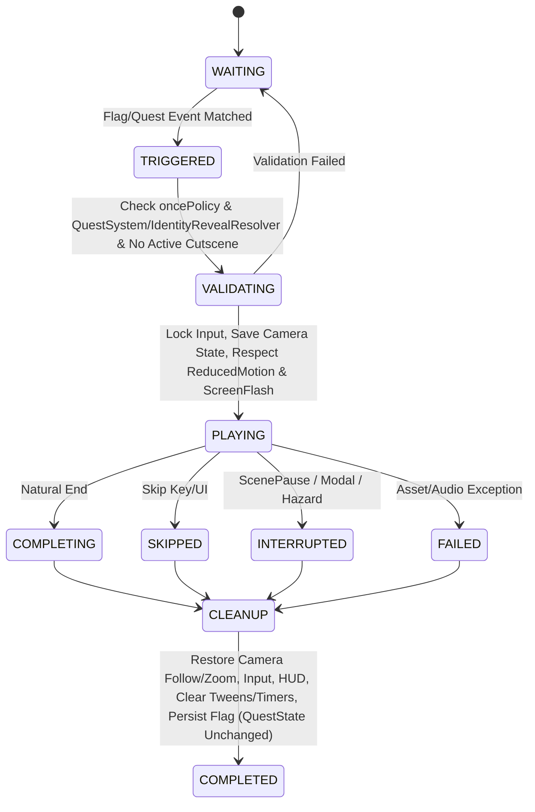

# HW-V16-A10 — IN-GAME CINEMATIC EVENTS & NARRATIVE PRESENTATION REPORT

- **PROJECT:** HOLLOW WOODS
- **STUDIO:** KYOSHIRO STUDIO
- **TARGET:** `V1.6.0 — THE UNBROKEN OATH` (`ROADMAP: 3.1`)
- **TASK ID:** `HW-V16-A10`
- **STATUS:** **`PARTIAL / GATED AT DEPENDENCIES (A07, A08/A09) & OWNER EVENT APPROVAL`**
- **BRANCH:** `feat/v1.5.3-ag-world-polish`
- **RUNTIME CODE CHANGES IN A10:** **`0` tệp nguồn (`src/` và `public/assets/`) được chỉnh sửa** *(Tuân thủ `§5` & `HARD STOP`: hoàn thiện Event Registry, 6 gói phê duyệt ứng viên `DRAFT` và tài liệu Closure tổng kết mà không tự tích hợp cinematic mới trước khi đủ phê duyệt và hoàn tất `A07–A09`).*

---

## 1. Kiểm Kê Hệ Thống Cinematic Hiện Hành & Event Registry (`§3`, `§4`)

Dữ liệu có cấu trúc đủ `18` trường (`eventId` .. `saveMarker`): [CINEMATIC_EVENT_REGISTRY.json](file:///G:/HOLLOW%20WOODS/Read/V1.5/Reports/Evidence/HW-V16-A10/CINEMATIC_EVENT_REGISTRY.json).

| Event ID | Phân loại | Nguồn / Mục tiêu | Chính sách & Guard |
| :--- | :---: | :--- | :--- |
| **`ACT0_FOG_CROSSING_INTRO`** | **`EXISTING`** | `GameScene.ts:1423` (`startAct0Intro()`) | `NEW_GAME_ONLY`, hiệu ứng `act0EchoGfx` + bell toll (`+800ms`) + Fog Crossing banner. |
| **`ECHO_DISSOLVE_STAGE2`** | **`EXISTING`** | `EchoSystem.ts:105` (`dissolveEcho()`) | `ONCE_PER_SPAWN_POINT`, nâng `setMemoryAwakeningStage(2)`. |
| **`FIRST_TOLL_FINALE`** | **`EXISTING`** | `EndingSystem.ts:228` (`triggerTheFirstTollFinale()`) | `ONCE_PER_FINALE` (`isEndingActive`), `1500ms` fail-safe, `50 / 3 / 65` thresholds, `fadeOut -> resetFX -> fadeIn`. |
| **`TIME_RIFT_CREDITS_CUTSCENE`** | **`EXISTING`** | `EndingSystem.ts:999, 1063` | `ONCE_PER_ENDING`, kết thúc với Survival Chronicle & Dual Hotkeys (`ENTER/ESC/SPACE`). |
| **`CIN-BELLHOLLOW`** | **`DRAFT`** | Bellhollow Great Bell Tower (`talked_to_edda`) | Camera pan chậm (`Reduced Motion` tắt pan), skippable, dùng cue được duyệt ở B06/Owner Gate. |
| **`CIN-VAELEN`** | **`DRAFT`** | Trạm Lửa Rừng Tĩnh Lặng (`vaelen_mold_quest_assigned`) | Tôn vinh dấu ấn Hắc Lang tại `Q05` mà **không** vượt qua Identity Reveal Gate (`Stage >= 3 + Evidence`). |
| **`CIN-MORDRIC`** | **`DRAFT`** | Ngưỡng encounter `HoodedKnightBoss` (`SQ08`) | Nhận diện giáp/huy hiệu; **không** sửa combat AI, giữ `SQ08` tùy chọn và số phận Mordric mở (`DEC-LOCK-11`). |
| **`CIN-MEMORY`** | **`DRAFT`** | Lắng nghe `PlayerState` `identity_revealed` (`A06-R1`) | Chỉ phát **1 lần** (`identity_revealed_notified`), phục vụ cả tuyến chính `MAIN_PATH_Q05` lẫn `SIDE_PATH_SQ08`, 0 lặp lore/trust. |
| **`CIN-SHRINE`** | **`DRAFT`** | Phá Phong Ấn Rễ Cổ (`mire_root_seal_broken`) | Gắn kết `QuestSystem.unlockBridge()` khi tiến vào Miếu Chuông, tôn trọng `Screen Flash OFF` & `Reduced Motion`. |
| **`CIN-FIRST-TOLL`** | **`DRAFT`** | Nâng cấp trình diễn `FIRST_TOLL_FINALE` | Bị chặn đến khi Owner chốt văn bản & nhạc kết `E01–E03` (`DEC-LOCK-18`, `A07 Draft`). |
| **`CHAR-006_HEADLESS_WARDEN_CINEMATIC`** | **`DEFERRED`** | `CHAR-006` (`DEC-LOCK-14`) | Loại trừ hoàn toàn khỏi V1.6 (`D06/D07/E06` hoãn). |

---

## 2. Gói Phê Duyệt Cho `6` Sự Kiện Ứng Viên (`§5`) & State Machine Runtime (`§6`, `§7`)

### 2.1. Event State Machine (Chuẩn Tích Hợp Sau Unblock)

### 2.2. Hợp Đồng Bảo Vệ Kỹ Thuật (`§7–§11`)
- **Identity Reveal (`§8`):** `CIN-MEMORY` chỉ nối vào `PlayerState` `identity_revealed` (`IdentityRevealResolver.ts` `A06-R1`), tuyệt đối **không** kích hoạt bằng `memoryAwakeningStage >= 3` đơn lẻ.
- **Quest & Ending (`§9`):** `QuestSystem` và `PlayerState` là nguồn sự thật duy nhất; skip cinematic vẫn giữ tiến trình quest; bảo toàn `true_ending`, `sacrifice_ending`, `fog_loop_ending` và ngưỡng `50 / 3 / 65`.
- **Art, Audio & Accessibility (`§10`, `§11`):** Dùng `Asset_Art/Meliodas_Blackwood/01_LATEST_ARTWORK/` + `02_CURRENT_RUNTIME/`, không thêm voice/soundtrack chưa duyệt, tôn trọng `SettingsManager.isReducedMotionEnabled()` / `isScreenFlashEnabled()`, giữ nguyên `Classic Sanity 2.1`.

---

## 3. Trạng Thái Ma Trận Kiểm Thử (`§12`, `A10-T01`..`A10-T20`)

| Nhóm kiểm thử | Trạng thái | Ghi chú thực tế |
| :--- | :---: | :--- |
| **Baseline Existing Hooks (`ACT0`, `ECHO`, `FIRST_TOLL`, `IDENTITY_REVEAL`, `ENDING 50/3/65`)** | **Verified Prior (`A03–A06-R1`)** | Không sửa đổi trong `A10`; trạng thái runtime của `A06-R1` verified tại nhánh `feat/v1.6-a06-r1-identity-evidence` (`fc5bf1d`), `A07` bảo toàn chờ nối tiếp. |
| **`A10-T01` – `A10-T20` (New `CIN-*` Events)** | **`NOT RUN — GATED`** | Không giả lập PASS cho sự kiện mới chưa được Owner duyệt & chưa có `A07/A08/A09` hoàn tất (`§12`: *"Chỉ đánh PASS cho các event thực sự được kiểm thử"*). |

---

## 4. Liên Kết Bàn Giao & Điều Kiện Mở Khóa

- Biểu đồ tổng quan: [A10_NARRATIVE_PROGRESSION_AND_CINEMATIC_MAP.png](file:///G:/HOLLOW%20WOODS/Read/V1.5/Reports/Visuals/HW-V16-A10/A10_NARRATIVE_PROGRESSION_AND_CINEMATIC_MAP.png)
- Tổng kết toàn Track A: [HW_V16_TRACK_A_CLOSURE_REPORT.md](file:///G:/HOLLOW%20WOODS/Read/V1.5/Reports/V16/HW_V16_TRACK_A_CLOSURE_REPORT.md)
- Sổ tổng hợp JSON: [TRACK_A_CLOSING_LEDGER.json](file:///G:/HOLLOW%20WOODS/Read/V1.5/Reports/Evidence/HW-V16-A10/TRACK_A_CLOSING_LEDGER.json)
