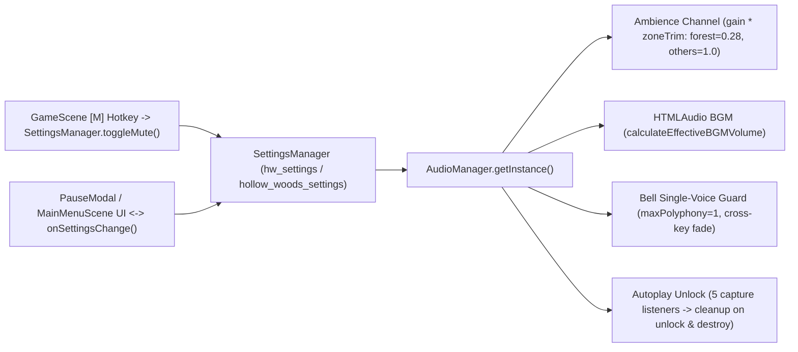

# HW-V16-B06 — AUDIO SETTINGS & LIFECYCLE REPAIR REPORT

- **Project:** HOLLOW WOODS (`V1.6.0 — THE UNBROKEN OATH` / Roadmap 3.1)
- **Task:** `HW-V16-B06 — AUDIO SETTINGS & LIFECYCLE REPAIR`
- **Branch / Worktree:** `fix/v1.6-b06-audio-lifecycle` (`G:\HOLLOW_WOODS_B06`)
- **Baseline Checkpoint:** `6fd63fb3d566f9f44777155a7cdeb75631520561` (`B04` Verified Checkpoint)
- **Status:** **PASS (RUNTIME FIXES VERIFIED — `HUMAN LISTENING NOT RUN`)**
- **Decision Lock Compliance:** `DEC-LOCK-21` (`AUD-K12`)

---

## 1. Tóm Tắt Vấn Đề & Phạm Vi Xử Lý (`DEC-LOCK-21`)

Bản vá thực hiện chuẩn hóa toàn bộ luồng điều khiển âm lượng, phím tắt Mute, vòng đời listener trình duyệt (`H4-NEW-06`), cân bằng công suất `ambience_forest.mp3` phi phá hủy và chống chồng chéo tiếng chuông (`bronze_bell` / `bell_toll_low`) ở tầng runtime — **không** chỉnh sửa hay cắt ngắn tệp âm thanh gốc, **không** thêm stem DAW hay soundtrack trailer V12.2, **không** bổ sung lồng tiếng chưa phê duyệt và **không** chỉnh sửa Headless Warden.

### Luồng Định Tuyến & Đồng Bộ Âm Thanh Sau Khi Sửa

---

## 2. Chi Tiết Các Lỗi Đã Sửa Theo Mã Nguồn Thực Tế

1. **Đồng bộ Music Slider -> Ambience + BGM (`src/audio/AudioManager.ts`):**
   - `setMusicVolume(val)` trước đây chỉ cập nhật `this.ambienceVolume`, bỏ qua `this.bgmVolume` (giữ nguyên mặc định `0.55`).
   - Đã cập nhật `setMusicVolume(val)` để điều chỉnh kênh ambience với `getEffectiveAmbienceGain(...)` **và** gọi `this.setBGMVolume(this.ambienceVolume)`.
   - Thêm `syncCurrentBGMAudioVolume()` (hủy `activeBGMRampInterval` đang chạy dở, cập nhật `currentBGMAudio.volume` theo `calculateEffectiveBGMVolume()`, và đặt `fb.audio.volume = 0` trên `fadingBGMAudios` khi `isMuted`).
2. **Đồng bộ Mute `[M]` <-> `SettingsManager` <-> UI (`src/scenes/GameScene.ts`, `src/ui/PauseModal.ts`, `src/scenes/MainMenuScene.ts`):**
   - `GameScene.handleMutePress()` chuyển từ `this.audioManager.toggleMute()` sang `SettingsManager.getInstance().toggleMute()` để ghi nhận qua `localStorage` (`hw_settings` / `hollow_woods_settings`) và phát sự kiện thay đổi cài đặt.
   - `PauseModal` đăng ký `SettingsManager.getInstance().onSettingsChange(...)` (cập nhật sliders + `renderMuteBtn(false)` trong `updateVolumeTexts()`) và hủy đăng ký trong `destroy()`.
   - `MainMenuScene` đăng ký đồng bộ tương tự khi mở modal cài đặt và dọn sạch trong `closeActiveMenuModal()` + `shutdown`.
3. **Sửa Rò Rỉ Capture Listener `H4-NEW-06` (`src/audio/AudioManager.ts`):**
   - `setupAutoplayUnlock()` trước đây gọi `window.removeEventListener(ev, unlockHandler)` thiếu `{ capture: true }` đối ứng với `window.addEventListener(ev, unlockHandler, { passive: true, capture: true })`, làm rò rỉ vĩnh viễn 5 listener (`pointerdown`, `keydown`, `touchstart`, `mousedown`, `click`).
   - Đã lưu `boundUnlockHandler`, thêm `cleanupAutoplayUnlock()` gọi `removeEventListener(ev, handler, { capture: true })`, khóa idempotent khi `isUnlocked` và gọi lại `cleanupAutoplayUnlock()` trong `destroy()`.
4. **Cắt Giảm Gain Phi Phá Hủy Cho `ambience_forest.mp3` (`src/audio/AudioManager.ts`):**
   - Giữ nguyên tệp `public/assets/audio/ambience/ambience_forest.mp3` (tham chiếu `HW_NR_18`: `-12.8 LUFS`, True Peak `-1.1 dBFS`).
   - Áp dụng `getAmbienceZoneTrim('forest') = 0.28` (`-11.06 dB`) nhất quán qua `getEffectiveAmbienceGain()` tại `setAmbienceZone()`, `setMusicVolume()`, `setWindIntensity()`, `duckAmbience()` và `unduckAmbience()`.
5. **Chống Chồng Tiếng Chuông & Double-BGM Race (`src/audio/AudioManager.ts`, `src/scenes/GameScene.ts`):**
   - `playBronzeBellToll()` (`bronze_bell` = `11.22s`) và `playCrackedBellToll()` (`bell_toll_low` = `11.22s`) được ép `maxPolyphony = 1` và gọi `fadeOutSampledChannel(...)` lên kênh chuông còn lại để không bao giờ phát chồng 2 lượt chuông mà vẫn bảo toàn 100% file gốc.
   - `playBGM()` kiểm tra `if (this.currentBGMAudio !== newAudio || this.currentBGMTrack !== track)` bên trong `playPromise.then(...)` & `.catch(...)` để chặn race điều phối track bất đồng bộ.
   - `GameScene` `shutdown` gọi bổ sung `this.audioManager.stopBGM(0.15)` cùng `cleanupAudioLoops()`, `setHeartbeatActive(false)` và `stopAmbience()`.

---

## 3. Số Liệu So Sánh Trước / Sau (Playwright + WebAudio Runtime)

Bằng chứng lưu tại:
- [before_b06_baseline.json](file:///G:/HOLLOW_WOODS_B06/Read/V1.5/Reports/Evidence/HW-V16-B06/before_b06_baseline.json)
- [after_b06_verification.json](file:///G:/HOLLOW_WOODS_B06/Read/V1.5/Reports/Evidence/HW-V16-B06/after_b06_verification.json)
- [gain_comparison.json](file:///G:/HOLLOW_WOODS_B06/Read/V1.5/Reports/Evidence/HW-V16-B06/gain_comparison.json)

| Hạng Mục Kiểm Đo | Trước Bản Vá (`6fd63fb`) | Sau Bản Vá (`B06`) | Kết Quả |
| :--- | :--- | :--- | :--- |
| Capture listeners (`setupAutoplayUnlock`) | Thêm `5`, gỡ `0`, rò rỉ `5` | Thêm `5`, gỡ `5`, rò rỉ `0` | **PASS** |
| `setMusicVolume(0.25)` -> `getBGMVolume()` | `amMusic=0.25`, `amBgm=0.55` (lệch) | `0 / 0.5 / 1` đồng bộ `amMusic == amBgm` và `HTMLAudio.volume` | **PASS** |
| Phím `[M]` -> `SettingsManager` & Reload | `amMuted=true`, `localStorage` không cập nhật `{}` | Ghi `"isMuted":true`, UI `🔇 TẮT`, giữ nguyên sau Reload + Continue | **PASS** |
| Gain `ambience_forest` (`Music=0.7, Master=1.0`) | `0.7` (nguyên mức `-12.8 LUFS` gốc) | `0.196` (`-11.06 dB` trim), wind `0.197`, duck `0.098` -> unduck `0.196` | **PASS** |
| Gain `village` / `crossing` / `mire` (`Music=0.7`) | `0.7` | `0.7` / `0.696` / `0.7` | **PASS** |
| Chuông `playBronzeBellToll` cách `900ms` | `activeBellCount = 2` (chồng âm) | `afterDoubleBronze = 1`; Cracked thay Bronze (`bronze=0, cracked=1`) | **PASS** |
| Double-BGM race (`playBGM` nối tiếp 0ms) | Không có guard trong `playPromise.then()` | Kết thúc ở `bgm_evergrove`, `fadingAfterRace = 0`, `pageerror = 0` | **PASS** |

---

## 4. Hạng Mục Bị Chặn Phụ Thuộc & Ngoài Phạm Vi

1. **Thoại Sir Vaelen & Sir Mordric — `BLOCKED ON AUDIO ASSET DEPENDENCY`:**
   - Theo `DEC-LOCK-21` / `AUD-K12` và hiện trạng `public/assets/audio/dialogue/` (`dialogue_bram.wav`, `dialogue_edda.wav`, `dialogue_finn.wav`, `dialogue_garth.wav`, `dialogue_neris.wav`, `dialogue_text_blip.wav`), không có tệp thoại riêng được Owner phê duyệt cho `Sir Vaelen` và `Sir Mordric`.
   - Runtime giữ fallback `dialogue_garth` (giọng trầm nam) tại `AudioManager.playNPCSpeech()`; không tự tạo hay chèn giọng chưa phê duyệt.
2. **Cutscene Audio Sync:** **NOT APPLICABLE** — Track `A08`/`A09` (Opening Cutscene) chưa được tích hợp trên nhánh này.
3. **Nghe Kiểm Thực Tế:** **`HUMAN LISTENING NOT RUN`** — Toàn bộ kết quả kiểm chứng được thực hiện qua kiểm tra tĩnh TypeScript, Playwright headless Chromium và WebAudio Gain/Channel inspection.

---

## 5. Kết Quả Kiểm Tra Tổng Hợp

- `npm run check` (`tsc --noEmit`): **PASS** (exit `0`)
- `npm run verify:data` (`node scripts/verify_data_integrity.mjs`): **PASS** (`15/15`)
- `npm run build` (`tsc && vite build`): **PASS** (exit `0`)
- Playwright B06 Audio Matrix (`verify_b06_matrix.py`): **PASS** (`7/7` nhóm kiểm tra đạt, `0 pageerror`, `0 console.error`)
- `node scripts/test_v15_fix_02_audio.mjs`: **PASS** (`12/12`)
- `python scripts/test_hw_bug09_audio.py`: **PASS** (`ALL TESTS PASSED`, Test 1–6 đạt)
- `node scripts/test_v15_39_bgm_system.mjs`: **Dừng ở Mục 2** do `G:\HOLLOW_WOODS_B06\Sound_Effects` là thư mục media gốc bị gitignore ngoài worktree (Mục 1 gồm 5/5 tệp `.mp3` trong `public/assets/audio/bgm/` đều PASS).
- `node scripts/test_v152_02_audio_sanctuary.mjs`: **18 PASS / 4 FAIL** (4 mục FAIL chỉ kiểm tra thư mục lịch sử untracked `Backups/steps/backup_v152_02/root_bak/` không nằm trong git worktree sạch; toàn bộ 18 mục kiểm tra logic/audio đều PASS).
