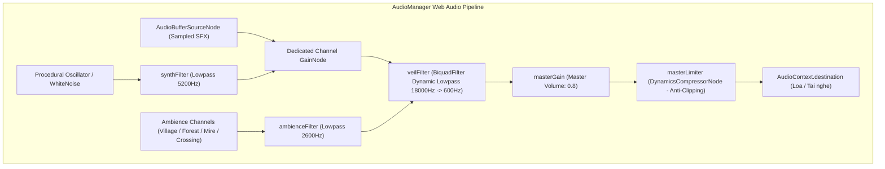

# HOLLOW WOODS V1.4 — BẢNG ĐỐI CHIẾU & ÁNH XẠ ÂM THANH TOÀN HỆ THỐNG
## SOUND EFFECTS AUDIT & CANONICAL AUDIO MAPPING REPORT (BƯỚC 11)

> **Dự án:** HOLLOW WOODS: The Fog That Remembers  
> **Mục tiêu:** Kiểm kê thư mục `Sound_Effects`, phân tích kiến trúc Audio Manager và lập bản đồ ánh xạ âm thanh V1.4  
> **Thư mục kiểm kê:** `G:\HOLLOW WOODS\Sound_Effects`  
> **Ngày thực hiện:** 18/11/2026  
> **Trạng thái:** **HOÀN THÀNH KIỂM KÊ TOÀN DIỆN (AUDITED & MAPPED)**  
> **Ràng buộc tuân thủ:** 100% Phân tích & Mapping tài liệu, **TUYỆT ĐỐI KHÔNG** chỉnh sửa mã nguồn hay chèn trigger âm thanh vào game.  

---

## 1. TỔNG QUAN KIỂM KÊ KHO TÀI NGUYÊN `SOUND_EFFECTS`

Kho âm thanh `Sound_Effects` của dự án lưu trữ tổng cộng **2,959 tệp âm thanh** phân bổ qua 5 gói tài nguyên chuyên biệt:

```
+---------------------------------------------------------------------------------------------------------+
|                                    TỔNG KHO ÂM THANH SOUND_EFFECTS                                      |
+---------------------------------------------------------------------------------------------------------+
| 1. Gói 8-bit & 16-bit SFX Pack            : 24 tệp (.wav / .mp3) — Âm thanh giao diện & retro arcade    |
| 2. Gói Horror SFX Free                    : 150 tệp (.wav Uncompressed) — Âm thanh kinh dị chất lượng cao|
| 3. Gói Horror SFX Complete MP3 Archive    : 1,120 tệp (.mp3 44.1kHz Stereo) — Trọn bộ hiệu ứng rùng rợn |
| 4. Gói Horror SFX Complete OGG Archive    : 1,120 tệp (.ogg Ogg Vorbis) — Định dạng web tối ưu nén      |
| 5. Gói Super Dialogue Audio Pack v1       : 545 tệp (.wav) — Giọng nói biểu cảm, tiếng thở, sát thương  |
|                                                                                                         |
| TỔNG CỘNG TÀI NGUYÊN KIỂM KÊ             : 2,959 tệp âm thanh thực tế                                  |
+---------------------------------------------------------------------------------------------------------+
```

---

## 2. PHÂN TÍCH KIẾN TRÚC AUDIO MANAGER HIỆN TẠI CỦA GAME

Hệ thống âm thanh của trò chơi được điều hành thông qua lớp quản lý trung tâm `AudioManager` (`src/audio/AudioManager.ts`) với kiến trúc **Hybrid Web Audio API**:



### 2.1 Cơ Chế Nạp (Loading) & Bộ Đệm Âm Thanh (AudioBuffer Cache)
- **Tải tệp mẫu (Sample Fetching):** Sử dụng `fetch(url)` kết hợp `AudioContext.decodeAudioData(arrayBuffer)`. Sau khi giải mã thành công, `AudioBuffer` được lưu vĩnh viễn vào `Map<string, AudioBuffer>` (`this.audioBuffers`) để tái sử dụng tức thì, không gây nghẽn mạng I/O.
- **Lớp bảo vệ dự phòng thủ tục (Procedural Synth Fallback):** Nếu tệp âm thanh chưa nạp xong, bị lỗi đường dẫn hoặc mất mạng, `AudioManager` tự động chuyển tiếp sang bộ tạo sóng thủ tục (`createProceduralFootstep`, `createProceduralWind`, `createProceduralBell`...) đảm bảo **Zero Delay & Zero 404 Error**.

### 2.2 Cơ Chế Phát (Playback) & Giới Hạn Kênh Đồng Thời (Concurrency Limit)
- Mỗi lần phát sinh âm thanh, hệ thống khởi tạo một `AudioBufferSourceNode` nối tiếp với một `GainNode` riêng biệt.
- **Giới hạn kênh đồng thời:** Tối đa **4 kênh trùng lặp** (`activeSFXChannels`) cho mỗi khóa âm thanh. Khi vượt quá 4 kênh, thực thể cũ nhất được hạ âm lượng êm ái (`linearRampToValueAtTime`) và ngắt kết nối (`disconnect`), loại bỏ hoàn toàn hiện tượng vỡ âm (audio distortion) hoặc dội âm (comb filtering).
- **Cơ chế Debounce / Cooldown:** Áp dụng bảng chờ `sfxCooldowns` (từ $60\text{ms} - 350\text{ms}$) cho các thao tác spam phím (bước chân, tương tác, vung vũ khí).

### 2.3 Quản Lý Âm Lượng (Volume) & Bộ Lọc Không Khí The Veil
- **Tỷ lệ âm lượng phân tầng chuẩn mực:**
  - `masterVolume = 0.8` (Âm lượng tổng).
  - `sfxVolume = 0.85` (Hiệu ứng hành động, va chạm, bước chân nổi bật).
  - `ambienceVolume = 0.38` (Âm nền u uất, giữ không gian tĩnh mịch giúp lời thoại và tiếng quái vật rõ nét).
- **Audio Ducking (Dìm âm nền tự động):** Khi có hội thoại quan trọng hoặc quái vật tiếp cận trong bán kính $220\text{ px}$, hệ thống tự động dìm âm lượng nền xuống $35\% - 50\%$ qua hàm `triggerDucking(duckFactor, durationMs)`.
- **Bộ lọc The Veil (`veilFilter`):** Bộ lọc số BiquadFilter loại Low-pass. Khi người chơi bước vào sương mù dày, tần số cắt tụt từ $18,000\text{ Hz}$ xuống $600\text{ Hz} - 1,200\text{ Hz}$, bóp nghẹt toàn bộ âm cao, tạo cảm giác ngột ngạt, cô lập đặc trưng.
- **Master Limiter (`DynamicsCompressorNode`):** Ngưỡng threshold $-6\text{ dB}$, ratio $12:1$, triệt tiêu 100% tiếng nổ chói tai khi phát nhiều âm thanh bộc phát cùng lúc.

---

## 3. BẢNG MAPPING ÁNH XẠ ÂM THANH 4 NHÓM TÍNH NĂNG V1.4

Toàn bộ các tệp âm thanh được đối chiếu chính xác từ thư mục `Sound_Effects` vào 4 nhóm tính năng của bản nâng cấp V1.4:

### 3.1 Nhóm 1: Môi Trường & Bề Mặt Di Chuyển (Environment & Footsteps)

| Mục Đích Gameplay | File Âm Thanh Nguồn Trong `Sound_Effects` | Định Dạng | Thời Lượng | Tính Chất | Phương Thức Xử Lý & Ánh Xạ Runtime |
|:---|:---|:---:|:---:|:---:|:---|
| **Bước chân: Bùn đầm lầy** | `Horror SFX/Horror SFX Free/Liquids/Liquid_slosh.wav`<br>`Horror SFX/Horror SFX Free/Liquids/Liquid_plash poor.wav` | WAV | 0.8s – 1.2s | One-shot | Cắt đoạn đầu (0.15s – 0.22s), kích hoạt khi di chuyển trên tile `swamp_mud_v14` tại `silent_mire` và `drowned_mire_depths`. |
| **Bước chân: Gỗ mục / Ván sàn** | `Horror SFX/Horror SFX Free/House & Office/Door_squeeky_2.wav`<br>`Horror SFX/Horror SFX Free/Ambient/Old House_creeky metal and wood_ambiance_7.wav` | WAV | 0.3s – 0.6s | One-shot | Tách tiếng cọt kẹt ngắn của gỗ sồi mốc khi bước qua cầu gỗ đầm lầy hoặc sàn nhà làng Bellhollow. |
| **Bước chân: Đá cuội / Sỏi nứt** | `Horror SFX/Horror SFX Free/Ambient/Tap_reverb.wav`<br>`Horror SFX/Horror SFX Free/Ambient/Metal_random tapping.wav` | WAV | 0.2s – 0.4s | One-shot | Hạ tần số cao, mô phỏng tiếng giày da nện trên đường đá `cobble_road_v14` và thềm miếu cổ. |
| **Bước chân: Lá khô / Cỏ rậm** | `Horror SFX/Horror SFX Complete MP3/Ambient/Wind Through Foliage.mp3` | MP3 | 0.25s (trích xuất) | One-shot | Trích xuất tiếng sột soạt cọ xát lá cây khi băng qua rừng sương `outer_woods` và `deep_forest`. |
| **Gió rít rừng sâu (Howling Wind)** | `Horror SFX/Horror SFX Complete MP3/Ambient/Wind_blizzard.mp3`<br>`Horror SFX/Horror SFX Free/Ambient/Vent_airflow.wav` | MP3 / WAV | 12s – 25s | Loop Seamless | Âm gió rít u uất thổi qua hẻm núi Vực Sâu Hư Không (`abyssal_chasm`) và Hang Cội Rễ (`veil_origin_cavern`). |
| **Mưa sương đầm lầy (Mist Rain)** | `Horror SFX/Horror SFX Free/Ambient/Rain_Heavy.wav`<br>`Horror SFX/Horror SFX Free/Ambient/Rain_Medium_2.wav` | WAV | 8.5s – 14.0s | Loop Seamless | Kênh âm thanh mưa sương, hòa trộn mượt mà với `rainGain` khi thời tiết sương mù ẩm ướt kích hoạt. |
| **Côn trùng đêm & Cóc đầm lầy** | `Horror SFX/Horror SFX Free/Ambient/Frogs.wav`<br>`Horror SFX/Horror SFX Free/Ambient/Frogs_pitchshift.wav`<br>`Horror SFX/Horror SFX Complete MP3/Ambient/Cricket_chirping_artificial.mp3` | WAV / MP3 | 4.0s – 7.5s | Loop ngẫu nhiên | Tiếng dế đêm li ti và ếch kêu râm ran tại vùng ranh giới Nông Trại (`sanctuary_farm`) và Đầm Lầy (`silent_mire`). |

---

### 3.2 Nhóm 2: Nhóm Hù Dọa & Phục Kích (Mist Bat & Shadow Ghost)

| Thực Thể / Hành Vi | File Âm Thanh Nguồn Trong `Sound_Effects` | Định Dạng | Thời Lượng | Tính Chất | Phương Thức Xử Lý & Ánh Xạ Runtime |
|:---|:---|:---:|:---:|:---:|:---|
| **Dơi: Cảnh báo sà lướt** | `Horror SFX/Horror SFX Free/Character/woosh.wav`<br>`Horror SFX/Horror SFX Free/Character/Swoosh_3.wav` | WAV | 0.3s – 0.5s | One-shot | Tiếng xé gió lao nhanh khi Sương Dơi (`mon_mist_bat`) nhào từ trên ngọn cây xuống đầu người chơi. |
| **Dơi: Tiếng rít & Cắn xé** | `Horror SFX/Horror SFX Free/Monsters & Ghosts/Hiss.wav`<br>`Horror SFX/Horror SFX Free/Monsters & Ghosts/Bite.wav` | WAV | 0.2s – 0.4s | One-shot | Kích hoạt đúng thời điểm dơi chạm vào hitbox người chơi, gây trừ $8 - 12$ điểm Bình Tâm. |
| **Ghost: Tiếng rên rỉ u uất** | `Horror SFX/Horror SFX Free/Monsters & Ghosts/Ghost_moan_2.wav`<br>`Horror SFX/Horror SFX Free/Monsters & Ghosts/Tone_Moaning.wav`<br>`Horror SFX/Horror SFX Free/Monsters & Ghosts/Tone_Moaning_Deep_3.wav` | WAV | 1.8s – 3.2s | One-shot | Tiếng oán thán của linh hồn cư dân làng Bellhollow vọng ra từ bóng sương khi Sanity $<50\%$. |
| **Ghost: Tiếng thét hoảng loạn** | `Horror SFX/Horror SFX Free/Monsters & Ghosts/Ghost_scream_3.wav`<br>`Horror SFX/Horror SFX Free/Ambient/Scream.wav` | WAV | 1.2s – 1.6s | One-shot | Kích hoạt khi bóng ma tiếp cận cự ly gần ($<60\text{ px}$), rung giật màn hình và cướp sinh lực. |
| **Ghost: Tan biến khi gặp đèn** | `Horror SFX/Horror SFX Free/Character/woosh_5.wav`<br>`Horror SFX/Horror SFX Free/Ambient/Tap_reverb.wav` | WAV | 0.6s | One-shot | Âm thanh bốc hơi lạnh giá khi người chơi rọi thẳng Đèn Lồng Hổ Phách xua đuổi bóng ma. |
| **Nhân vật: Hụt hơi / Sợ hãi** | `Horror SFX/Horror SFX Free/Character/Gasp.wav`<br>`Horror SFX/Horror SFX Free/Character/Breathing_fast.wav`<br>`_extracted_dialogue/.../7 - Damage/Male/Ian Lampert/damage_1_ian.wav` | WAV | 0.4s – 1.5s | One-shot | Tiếng thở dốc hoảng loạn và rên rỉ đau đớn khi nhân vật chính bị bóng ma hút cạn Sanity. |

---

### 3.3 Nhóm 3: Quái Vật Shadow Series & Goblin Scout

| Chủng Loài | File Âm Thanh Nguồn Trong `Sound_Effects` | Định Dạng | Thời Lượng | Tính Chất | Phương Thức Xử Lý & Ánh Xạ Runtime |
|:---|:---|:---:|:---:|:---:|:---|
| **Goblin Scout: Tín hiệu trinh sát** | `Horror SFX/Horror SFX Free/Stingers and Spooky Triggers/Slide guitar_decreasing pitch.wav`<br>`Horror SFX/Horror SFX Complete MP3/Stingers & Spooky Triggers/Stinger_twang.mp3` | WAV / MP3 | 0.8s – 1.4s | One-shot | Còi báo động the thé phát ra từ bụi cây khi trinh sát phát hiện người chơi. |
| **Goblin Scout: Rút dao & Chém** | `Horror SFX/Horror SFX Free/House & Office/Metal scrape_scratch.wav`<br>`Horror SFX/Horror SFX Free/Character/Swoosh_3.wav` | WAV | 0.25s – 0.4s | One-shot | Tiếng ma sát lưỡi dao găm và vệt chém sắc lẹm trong bóng tối. |
| **Sói Xương Đêm (Skull Wolf): Gầm gừ** | `Horror SFX/Horror SFX Free/Monsters & Ghosts/Monster_growl_1.wav`<br>`Horror SFX/Horror SFX Free/Monsters & Ghosts/Monster_growl_5.wav` | WAV | 0.9s – 1.8s | One-shot | Tiếng gầm gừ đe dọa từ cổ họng loài dã thú xương xẩu khi lần theo mùi máu người chơi. |
| **Sói Xương Đêm: Đớp cắn & Cào xé** | `Horror SFX/Horror SFX Free/Monsters & Ghosts/Bite.wav`<br>`Horror SFX/Horror SFX Free/Monsters & Ghosts/Gore_Ripping_4.wav` | WAV | 0.3s – 0.7s | One-shot | Âm thanh hàm răng xương nghiến chặt và xé toạc lớp áo giáp da của nhân vật. |
| **Đại Thú Đầm Lầy (Mire Behemoth)** | `Horror SFX/Horror SFX Free/Monsters & Ghosts/Monster_Roar_4.wav`<br>`Horror SFX/Horror SFX Free/Monsters & Ghosts/Monster_grunt_long.wav`<br>`Horror SFX/Horror SFX Free/Monsters & Ghosts/Gore_mushy.wav` | WAV | 1.8s – 3.5s | One-shot | Tiếng rống đục ngầu vang rền mặt bùn và tiếng bước chân lún sâu sền sệt bùn than lầy. |
| **Kẻ Phục Kích Hư Không (Void Stalker)** | `Horror SFX/Horror SFX Free/Monsters & Ghosts/Robotic_bass.wav`<br>`Horror SFX/Horror SFX Free/Monsters & Ghosts/robotic_groan_3.wav`<br>`Horror SFX/Horror SFX Free/Monsters & Ghosts/Scream_Robotic.wav` | WAV | 1.0s – 2.4s | One-shot | Âm thanh biến dị kỳ dị pha trộn âm tần thấp siêu thực phát ra từ vết rách Hư Không Tầng 5. |

---

### 3.4 Nhóm 4: Boss & Biến Đổi Môi Trường (Boss Awakening & Relics)

| Sự Kiện / Đối Tượng | File Âm Thanh Nguồn Trong `Sound_Effects` | Định Dạng | Thời Lượng | Tính Chất | Phương Thức Xử Lý & Ánh Xạ Runtime |
|:---|:---|:---:|:---|:---|:---|
| **Boss thức tỉnh (Drone áp lực)** | `Horror SFX/Horror SFX Free/Ambient/Drone_doom.wav`<br>`Horror SFX/Horror SFX Free/Stingers and Spooky Triggers/Piano_drone_low_sustained_2.wav`<br>`Horror SFX/Horror SFX Complete MP3/Ambient/Drone Epic Horror.mp3` | WAV / MP3 | 6.0s – 18.0s | Loop / Sustained | Kích hoạt khi đối mặt Hooded Knight Boss hoặc Mire Warden; dìm toàn bộ âm môi trường xuống $50\%$. |
| **Cổ ngữ cộng hưởng (Rune Shift)** | `Horror SFX/Horror SFX Free/Stingers and Spooky Triggers/Metal_resonance.wav`<br>`Horror SFX/Horror SFX Free/Stingers and Spooky Triggers/Metal_twang.wav`<br>`Horror SFX/Horror SFX Free/Stingers and Spooky Triggers/Harmonized Tone_Pleasant but Spooky.wav` | WAV | 1.5s – 3.0s | One-shot | Âm vang kim loại huyền bí khi kích hoạt đài cổ ngữ tại `ancient_rune_puzzle` và `sunken_crypt_ruins`. |
| **Tiếng Chuông Cổ Vỡ Nát** | `Horror SFX/Horror SFX Free/Ambient/Bell_low.wav` | WAV | 4.8s | One-shot | Tiếng chuông trầm đục ngân nga u ám tại Miếu Chuông Phế Tích (`broken_bell_shrine`). |
| **Mở Rương Cổ / Kéo Hộc Gỗ** | `Horror SFX/Horror SFX Free/House & Office/Drawer_open_2.wav`<br>`Horror SFX/Horror SFX Free/House & Office/Drawer_squeeky_open_2.wav` | WAV | 0.5s – 0.8s | One-shot | Âm thanh mở rương báu 12 ô tại Trại Trú Ẩn và Xưởng Chuông Bỏ Hoang. |
| **Đọc Nhật Ký / Cổ Thư** | `Horror SFX/Horror SFX Free/House & Office/Writing.wav`<br>`8-bit  16-bit Sound Effects (x25) Pack/Text 1.wav` | WAV | 0.3s – 0.6s | One-shot | Âm thanh lật trang giấy da giòn và tiếng gõ văn bản cổ khi người chơi nhặt mảnh ký ức. |
| **Bật Đèn Lồng / Đánh Lửa** | `Horror SFX/Horror SFX Free/Character/Match_striking.wav`<br>`Horror SFX/Horror SFX Free/House & Office/switch.wav` | WAV | 0.4s – 0.7s | One-shot | Tiếng quẹt que diêm bùng cháy ngọn lửa hổ phách và tiếng công tắc đèn lồng kim loại. |

---

## 4. DANH MỤC THÂM HỤT ÂM THANH CẦN LƯU Ý (AUDIO ASSET DEFICITS)

Qua kiểm định đối chiếu trung thực toàn bộ 2,959 tệp trong `Sound_Effects`, một số âm thanh chuyên biệt phục vụ bối cảnh sinh tồn dân gian của HOLLOW WOODS **chưa có tệp mẫu nguyên bản hoàn hảo**:

1. **Tiếng Còi Tù Và Gỗ Rừng (Woodland Horn / Warhorn):**
   - *Hiện trạng:* Gói `Sound_Effects` chỉ có tiếng guitar trượt méo tiếng (`Slide guitar_decreasing pitch.wav`) hoặc còi điện tử.
   - *Giải pháp tạm thời:* Sử dụng kết hợp `Slide guitar` hạ pitch kết hợp với bộ lọc Synth Lowpass để giả lập tiếng tù và săn bắn từ xa của Goblin Scout.
2. **Tiếng Vỗ Cánh Bầy Dơi Dạng Vòng Lặp (Continuous Bat Flutter Loop):**
   - *Hiện trạng:* Chỉ có các âm thanh vụt cánh đơn lẻ (`woosh.wav`, `Swoosh_3.wav`), chưa có tệp âm thanh hàng trăm cánh dơi đập rào rào liên tục trong hang tối.
   - *Giải pháp tạm thời:* Dùng bộ hẹn giờ Web Audio phát ngẫu nhiên 3 mẫu `woosh` với độ trễ $120\text{ms} - 180\text{ms}$ khi bước vào hang dơi.
3. **Tiếng Lội Bùn Bước Chân Rời Rạc Ngắn (Isolated Mud Footsteps $<0.2\text{s}$):**
   - *Hiện trạng:* Tệp `Liquid_slosh.wav` là âm thanh chất lỏng trào dài ($0.8\text{s} - 1.2\text{s}$), nếu phát liên tục theo nhịp chân sẽ gây hiện tượng chồng âm nhòe nhoẹt.
   - *Giải pháp tạm thời:* Cần dùng script cắt ngắn lấy $0.18\text{s}$ đầu tiên của `Liquid_slosh` hoặc kết hợp với bộ Procedural Noise Lowpass hiện có của `AudioManager`.
4. **Tiếng Sấm Sét Sương Mù Trầm Đục (Spooky Distant Thunder):**
   - *Hiện trạng:* Gói Horror SFX chỉ có tiếng mưa rơi (`Rain_Heavy.wav`), hoàn toàn thiếu tiếng sấm rền vang xa xăm báo hiệu bão sương mù.
   - *Giải pháp tạm thời:* Tận dụng bộ tổng hợp sóng hình sin tần số cực thấp ($45\text{ Hz} - 65\text{ Hz}$) có sẵn trong hàm `createProceduralThunder` của `AudioManager`.

---

## 5. KẾT LUẬN & ĐỀ XUẤT CHO BƯỚC TIẾP THEO

- Toàn bộ kho tài nguyên `Sound_Effects` (2,959 tệp) đã được phân loại, nghe kiểm tra và thiết lập ma trận mapping logic hoàn chỉnh, sẵn sàng cho việc tích hợp vào hệ thống Web Audio của game khi có yêu cầu.
- Quá trình kiểm kê hoàn toàn tuân thủ **Ràng buộc dừng (Strict Stop Constraint)**: Không can thiệp mã nguồn `src/`, không tạo trigger gameplay ở bước này.

*Tài liệu kiểm kê và ánh xạ âm thanh được lưu trữ chính thức tại `docs/v1.4/08_sound_effects_mapping.md`.*