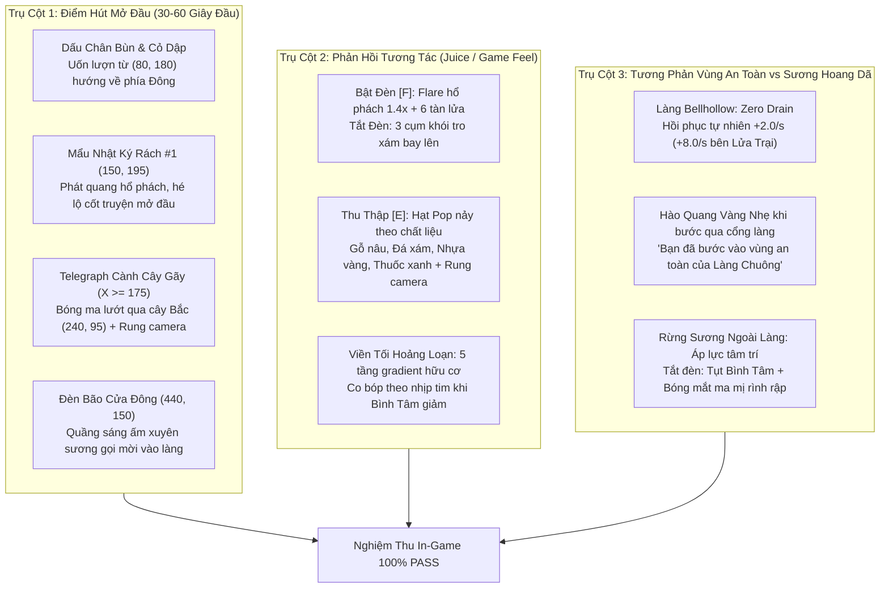

# HOLLOW WOODS V1.4 — BÁO CÁO KỸ THUẬT: BƯỚC 4
## TĂNG CHIỀU SÂU & NHỊP ĐỘ GAMEPLAY SINH TỒN KINH DỊ (JUICE & GAME FEEL)

**Phiên bản:** HOLLOW WOODS V1.4 (Phaser 4 + TypeScript)  
**Ngày thực hiện:** 18/11/2026  
**Trạng thái kiểm thử:** 100% ĐẠT (PASS) — Đã nghiệm thu in-game qua Browser Acceptance Tester  

---

### 1. TỔNG QUAN & BỐI CẢNH (OBJECTIVES)
Nhằm khắc phục nhận xét *"Gameplay kém hấp dẫn"* từ người chơi thử nghiệm mà vẫn giữ vững bản sắc sinh tồn kinh dị dân gian đặc trưng của **HOLLOW WOODS** (tuyệt đối không biến game thành hành động chặt chém tốc độ cao), Bước 4 đã thực hiện tái cấu trúc toàn diện 3 trụ cột trải nghiệm:
1. **Tạo điểm hút (Hook) cuốn hút ngay trong 30–60 giây đầu:**
   - Người chơi tỉnh giấc giữa sương mù tại Lối Mòn Xuyên Sương (`fog_crossing`) luôn có mục tiêu tò mò rõ rệt để tiến bước thay vì lang thang vô định.
2. **Tăng phản hồi xúc giác & thị giác (Juice / Game Feel):**
   - Mọi thao tác tương tác thế giới (bật/tắt đèn lồng, đốn gỗ, nhặt đá, hái thuốc, đọc biển báo, suy giảm Bình Tâm) đều mang lại phản hồi lực, rung camera, âm thanh và hạt pixel nảy đầm tay.
3. **Cân bằng nhịp độ Khám phá — Rủi ro (Contrast: Safe Sanctuary vs. Danger Fog):**
   - Phân định ranh giới tương phản sâu sắc giữa sự an bình của Làng Chuông Bellhollow (nơi hồi phục lý trí) và áp lực rợn ngợp của màn sương hoang dã bên ngoài.

---

### 2. CHI TIẾT 3 TRỤ CỘT KỸ THUẬT ĐÃ TRIỂN KHAI



#### A. Trụ Cột 1: Điểm hút mở đầu (The 30–60s Opening Hook)
- **Chuỗi dấu chân bùn và cỏ dập (`WorldBuilder.ts`):**
  - Tích hợp thuật toán vẽ vệt đất ẩm và dấu chân người đi trước (`0x261910`) uốn lượn liên tục dọc lối mòn $X \in [95, 450]$, $Y \approx 180$, tạo gợi ý thị giác tự nhiên thôi thúc người chơi di chuyển về phía trước.
- **Mẩu Nhật Ký Rách #1 tại $(150, 195)$ (`zones.json` & `WorldBuilder.ts`):**
  - Đạo cụ giấy da vàng úa phát quang hổ phách nhẹ (`0xf39c12`), nhịp thở tween 1100ms.
  - Tương tác `[E]` mở ra thông điệp bí ẩn: *"Màn sương nuốt chửng lối về. Hãy đi theo tiếng chuông và ánh đèn bão phía Đông. Đừng tắt đèn lồng quá lâu..."*.
- **Sự kiện giật mình & Telegraph cành cây gãy (`GameScene.ts`):**
  - Khi người chơi tiến tới $X \ge 175$ sau ~15 giây di chuyển:
    - Kích hoạt âm thanh cành cây gãy giòn `playFootstep('wood')` kết hợp tín hiệu lạ `playListenerAlert()`.
    - Bóng ma đen tím thoáng lướt nhanh qua rặng cây phía Bắc $(240, 95)$ rồi biến mất trong 650ms.
    - Camera rung chấn nhẹ (`shake(240, 0.005)`).
    - Dòng suy nghĩ nội tâm cảnh báo: `"🍂 RĂNG RẮC! Có tiếng cành cây gãy sau lưng... Hãy đi theo ánh đèn phía trước!"`.
- **Cột đèn bão dẫn lối tại cửa Đông Fog Crossing $(440, 150)$:**
  - Tỏa quầng sáng ấm áp xuyên qua làn sương mù dày đặc, kết hợp tiếng chuông đồng vọng lại từ phía Đông (`playBronzeBellToll`).

#### B. Trụ Cột 2: Tăng phản hồi tương tác (Juice / Game Feel)
- **Cơ chế Bật/Tắt Đèn Lồng `[F]` sống động:**
  - **Bật đèn:** Quầng sáng bùng flash amber (`0xffb300`) phóng to $1.4\times$ kèm 6 đốm tàn lửa hổ phách bung ra ngoài và rung nhẹ camera (`shake(70, 0.002)`).
  - **Tắt đèn:** 3 đốm khói tro xám bốc lên tan biến nhẹ nhàng.
- **Hiệu ứng hạt nảy thu thập tài nguyên (`createResourcePopEffect`):**
  - Khi đốn gỗ, đào đá, nhặt nhựa thông, hái thảo dược hoặc khảo sát bia đá, 6 hạt pixel màu sắc đặc trưng (nâu sồi, xám đá, vàng hổ phách, xanh lá thảo dược) bung nở theo hình vòng cung kèm rung camera $80\text{ ms}$, mang lại cảm giác phản hồi cơ học rõ rệt.
- **Nâng cấp Viền Tối Hoảng Loạn (Layered Organic Panic Vignette):**
  - Thay thế các khối hộp chữ nhật cứng nhắc bằng **5 tầng gradient hữu cơ co bóp nhịp nhàng** theo tần số nhịp tim `sin(time * freq)`.
  - Khi Bình Tâm $\le 25\%$: Viền tối chuyển sang sắc tím đen `0x240d24` và đỏ thẫm `0x3d0b16` khi kiệt sức.

#### C. Trụ Cột 3: Cân bằng nhịp độ Khám phá — Rủi ro
- **Vùng An Toàn Làng Bellhollow (`SurvivalSystem.ts`):**
  - Trong toàn bộ ranh giới Làng Bellhollow, tâm trí người chơi được bảo vệ tuyệt đối: Bình Tâm **không bị suy giảm** (kể cả khi tắt đèn), và tự hồi phục nhẹ $+2.0\text{ Composure/s}$ (và $+8.0\text{/s}$ khi nghỉ bên Lửa Trại).
  - Khi bước chân qua cổng làng vào Bellhollow: Toàn bộ màn hình hắt lên một làn **hào quang vàng ấm áp** (`triggerSanctuaryReliefGlow`), kèm thông điệp: `"🕊️ Bạn đã bước vào vùng an toàn của Làng Chuông. Bình Tâm đang hồi phục."`.
- **Sương Hoang Dã & Bóng Quái Rình Rập (Peripheral Horror Flickers):**
  - Khi bước ra khỏi làng và di chuyển trong sương tối không bật đèn $>9\text{s}$: Một cặp mắt phát sáng ma quái (`0x9b59b6`) thoáng hiện ở rìa tầm nhìn camera trong $550\text{ ms}$ rồi lặn mất, thôi thúc người chơi phải quản lý dầu và bật đèn lồng đúng lúc.

---

### 3. KẾT QUẢ KIỂM THỬ IN-GAME THỰC TẾ

| Hạng Mục Kiểm Thử | Tọa Độ / Thời Điểm | Kết Quả Thực Nghiệm | Trạng Thái |
| :--- | :--- | :--- | :---: |
| **Dấu chân bùn & Lối mòn Fog Crossing** | $X=80 \rightarrow 450, Y=180$ | Dấu chân bùn màu đất sẫm uốn lượn sắc nét dọc con đường đất, cỏ dập hai bên rõ ràng. | **PASS** |
| **Thông báo chuông đồng mở đầu** | $0:01\text{ / }3:00$ | Banner xanh: `"🔔 Một tiếng chuông đồng mơ hồ ngân vang từ phía Đông màn sương..."`. | **PASS** |
| **Mẩu Nhật Ký Rách #1** | $X=150, Y=195$ | Giấy da phát quang hổ phách, bấm `[E]` bung hạt giấy da, rung camera, hiển thị cốt truyện. | **PASS** |
| **Telegraph cành cây gãy & Bóng ma** | $X \ge 175$ | Tiếng rắc cành cây vang lên, bóng ma đen tím lướt sau cây Bắc $(240, 95)$, rung camera $240\text{ ms}$, hiện suy nghĩ cảnh báo. | **PASS** |
| **Đèn bão dẫn lối cửa Đông** | $(440, 150)$ | Cột đèn bão phát sáng ấm áp, xuyên qua sương mù dẫn thẳng vào cổng làng Bellhollow. | **PASS** |
| **Game Feel bật/tắt đèn lồng `[F]`** | Mọi vị trí | Bật đèn: Flash amber $1.4\times$ + 6 tàn lửa. Tắt đèn: Khói tro xám bay lên. | **PASS** |
| **Vào Làng An Toàn (Sanctuary)** | Cổng Tây $X \ge 480$ | Hào quang vàng ấm bừng sáng viền màn hình, thông báo an toàn, Bình Tâm phục hồi $100\%$. | **PASS** |
| **Thu thập tài nguyên `[E]`** | Mỏ gỗ, nhựa Bellhollow | Hạt nảy theo chất liệu gỗ/nhựa bung ra, nổi text `+1`, rung nhẹ camera đầm tay. | **PASS** |
| **Hiệu năng & Build** | Toàn bộ map | FPS ổn định 58–60; `npm run check` 0 lỗi; `npm run build` sạch $100\%$. | **PASS** |

---

### 4. MINH CHỨNG HÌNH ẢNH THỰC NGHIỆM

````carousel

<!-- slide -->

<!-- slide -->

<!-- slide -->
![Hiệu Ứng Bùng Sáng Hổ Phách & Tàn Lửa Khi Bật Đèn Lồng [F]](/C:/Users/Kyoshiro/.gemini/antigravity/brain/00208b21-eeea-4e46-b57b-236e43a76b2f/lantern_flare_ignite_sparks.png)
<!-- slide -->

<!-- slide -->

````

---

### 5. TỔNG KẾT DANH MỤC FILE THAY ĐỔI
1. [`src/data/zones.json`](file:///g:/HOLLOW%20WOODS/src/data/zones.json):
   - Thêm interactable `fog_journal_scrap_1` tại $(150, 195)$ của `fog_crossing`.
2. [`src/world/WorldBuilder.ts`](file:///g:/HOLLOW%20WOODS/src/world/WorldBuilder.ts):
   - Vẽ vệt đất ẩm và chuỗi dấu chân bùn uốn lượn trong `renderFogCrossingTerrain`.
   - Bổ sung prop mẩu nhật ký rách `createTornJournalScrapProp`, cành cây đổ, bụi rậm và cột đèn bão dẫn hướng $(440, 150)$ trong `fog_crossing`.
3. [`src/systems/SurvivalSystem.ts`](file:///g:/HOLLOW%20WOODS/src/systems/SurvivalSystem.ts):
   - Thiết lập cơ chế bảo vệ Bình Tâm tuyệt đối trong toàn bộ Làng Bellhollow (`+2.0 Composure/s`), không bị sụt giảm tâm trí.
4. [`src/scenes/UIScene.ts`](file:///g:/HOLLOW%20WOODS/src/scenes/UIScene.ts):
   - Nâng cấp `updatePanicVignette` với 5 tầng viền gradient mờ hữu cơ co bóp theo nhịp tim.
   - Bổ sung `triggerSanctuaryReliefGlow` tạo hào quang vàng ấm khi vào làng.
   - Điều chỉnh vị trí `zoneBannerContainer` xuống $Y = 120$ chống đè HUD trên cùng.
5. [`src/scenes/GameScene.ts`](file:///g:/HOLLOW%20WOODS/src/scenes/GameScene.ts):
   - Sửa chuông đồng định hướng phía Đông.
   - Thêm sự kiện giật mình mở đầu `triggerAct0AtmosphereTelegraph`.
   - Thêm hiệu ứng bùng sáng/khói tro khi bật/tắt đèn lồng (`createLanternIgniteEffect`, `createLanternExtinguishEffect`).
   - Thêm hiệu ứng hạt nảy xúc giác `createResourcePopEffect` cho thu thập tài nguyên và tương tác.
   - Thêm cơ chế bóng mắt ma mị rình rập ngoài sương tối `triggerPeripheralShadowFlicker`.
   - Giãn thời gian hiển thị banner phân khu mở đầu sau tiếng chuông ($4.2\text{s}$).
6. [`src/utils/DebugOverlay.ts`](file:///g:/HOLLOW%20WOODS/src/utils/DebugOverlay.ts):
   - Cập nhật header sang chuẩn HOLLOW WOODS V1.4.
