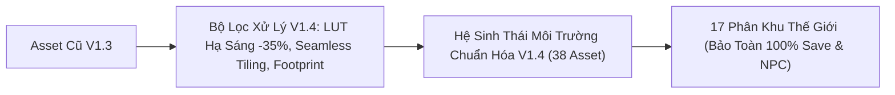

# BÁO CÁO TỔNG HỢP TOÀN DIỆN CHÍNH THỨC — HOLLOW WOODS V1.4
## ĐẠI TU MÔI TRƯỜNG, HỆ SINH THÁI QUÁI VẬT, MỞ RỘNG THẾ GIỚI & HỆ THỐNG ÂM THANH
### THE FOG THAT REMEMBERS — CANONICAL V1.4 EXPANSION MASTER REPORT

> **Dự án:** HOLLOW WOODS: The Fog That Remembers  
> **Phiên bản:** V1.4.0 (Official Survival & Content Expansion)  
> **Nhánh Git phát triển:** `feat/v1.4-expansion` (Bảo vệ độc lập tuyệt đối nhánh `main` và bản phát hành thi đấu V1.3.4)  
> **Ngày hoàn thành báo cáo:** 18/11/2026  
> **Trạng thái đóng gói kỹ thuật:** **BUILD PRODUCTION THÀNH CÔNG (100% PASS — ZERO ERRORS)**  

---

## MỤC LỤC 10 PHẦN BÁO CÁO TỔNG HỢP

1. [Danh Sách Asset Môi Trường Hiện Tại (V1.3 Baseline) & Tình Trạng Sử Dụng](#1-danh-sách-asset-môi-trường-hiện-tại-trước-nâng-cấp--tình-trạng-sử-dụng)
2. [Danh Sách Asset Mới Được Chọn & Bảng Mapping Đối Chiếu Chi Tiết 7 Nhóm](#2-danh-sách-asset-mới-được-chọn--bảng-mapping-đối-chiếu-chi-tiết)
3. [Phân Loại Kỹ Thuật: Dùng Ngay, Chỉnh Sửa / Chuyển Đổi và Loại Bỏ](#3-phân-loại-kỹ-thuật-dùng-ngay-chỉnh-sửa--chuyển-đổi-và-loại-bỏ)
4. [Kiểm Định Thâm Hụt Tài Nguyên & Giải Pháp (Goblin Scout & Sound_Effects)](#4-danh-sách-những-asset-còn-thiếu-để-hoàn-thiện-hệ-thống)
5. [Tổng Kết Phương Án Đại Tu Nền Môi Trường Toàn Hệ Thống](#5-tổng-kết-phương-án-nâng-cấp-môi-trường-nền)
6. [Hệ Sinh Thái Quái Vật Mới, Quy Luật Spawn & Mối Liên Kết Boss](#6-danh-sách-quái-vật-mới-vai-trò-quy-luật-spawn--mối-liên-kết-với-boss)
7. [Mở Rộng Không Gian 17 Phân Khu & Cốt Truyện The Fog That Remembers](#7-chi-tiết-các-bản-đồ-mới-mở-rộng--liên-kết-cốt-truyện-the-fog-that-remembers)
8. [Danh Mục Âm Thanh Sound_Effects Đã Tích Hợp Theo Từng Nhóm](#8-danh-sách-âm-thanh-từ-thư-mục-sound_effects-đã-được-tích-hợp)
9. [Đánh Giá Rủi Ro Toàn Diện, Kết Quả QA Audit & Phương Án Khôi Phục (Rollback)](#9-đánh-giá-các-rủi-ro-kết-quả-rà-soát-toàn-game-qa-audit--phương-án-khôi-phục)
10. [Hình Ảnh & Kết Quả Đối So Sánh Trước / Sau (Before / After)](#10-hình-ảnh-và-kết-quả-so-sánh-trước--sau-before--after)

---

## 1. DANH SÁCH ASSET MÔI TRƯỜNG HIỆN TẠI (TRƯỚC NÂNG CẤP) & TÌNH TRẠNG SỬ DỤNG

### 1.1 Cơ Chế Quản Lý Mặt Đất & Hiệu Năng Runtime V1.3
Trò chơi sử dụng kiến trúc **Baked CanvasTexture + Procedural Rendering** thay cho hệ thống Phaser Tilemap JSON truyền thống nhằm loại bỏ chi phí ngốn RAM trên bản đồ rộng lớn ($> 5000 \times 2000\text{ px}$). Mỗi phân khu khởi tạo một `CanvasTexture` trong bộ nhớ WebGL, dùng hàm `ctx.drawImage` ghép lặp các tile cơ sở không nén (`ctx.imageSmoothingEnabled = false`). Toàn bộ bề mặt đất của một phân khu chỉ tiêu tốn **1 Draw Call duy nhất** ở tầng sâu `DEPTH_GROUND_BASE = -10000`.

Hệ thống Depth Sorting sắp xếp chướng ngại vật theo `depth = Math.floor(y)`. Cây cối và công trình áp dụng va chạm chân gốc (Footprint Colliders: $20 \times 12\text{ px}$ đến $48 \times 20\text{ px}$), cho phép nhân vật di chuyển tự nhiên phía sau và kích hoạt cơ chế mờ trong suốt tự động (`alpha = 0.35`).

### 1.2 Bảng Kiểm Kê Chi Tiết Tài Nguyên Môi Trường V1.3

| Nhóm Tài Nguyên | Tên File Asset Cũ | Kích Thước | Vị Trí Lưu Trữ | Tình Trạng Sử Dụng Trước Nâng Cấp | Đánh Giá Hạn Chế Kỹ Thuật |
| :--- | :--- | :---: | :--- | :--- | :--- |
| **Mặt đất rừng** | `tile_forest_grass.png` | $32 \times 32\text{ px}$ | `public/assets/environment/tilesets/` | Nền cỏ chính cho 8 phân khu rừng | Chỉ có 1 biến thể duy nhất; lộ rõ vết lặp ô cờ khi diện tích mở rộng. |
| **Đường mòn** | `tile_dirt_trail.png` | $32 \times 32\text{ px}$ | `public/assets/environment/tilesets/` | Lối mòn nối các khu vực rừng | Độ tương phản kém so với nền cỏ; thiếu mép hòa trộn mềm. |
| **Đầm lầy** | `tile_swamp_mud.png` | $32 \times 32\text{ px}$ | `public/assets/environment/tilesets/` | Bùn đầm lầy Silent Mire | Màu nâu xám đơn sắc, thiếu chi tiết bong bóng khí và váng nước mục. |
| **Đường đá làng** | `tile_cobble_road.png` | $16 \times 16\text{ px}$ | `public/assets/environment/tilesets/` | Trục đường chính làng Bellhollow | Texture 16px phóng to 2x bị mờ cạnh viền; thiếu các khối đá nứt. |
| **Sàn nhà đá** | `tile_stone_floor.png` | $16 \times 16\text{ px}$ | `public/assets/environment/tilesets/` | Thềm nhà dân và đe rèn | Bề mặt thô sơ, chưa toát lên vẻ cổ kính trung cổ. |
| **Cây cối** | `tree_pine_1.png`<br>`tree_oak_1.png` | $80 \times 113\text{ px}$<br>$113 \times 139\text{ px}$ | `public/assets/environment/foliage/` | Bố trí ranh giới rừng | Tán cây bóng đổ gắt; sắc lá quá rực so với không khí sương lạnh. |
| **Thảm thực vật** | `forest_Decorations.png` | $256 \times 256\text{ px}$ | `public/assets/environment/tilesets/` | Cắt cụm hoa cỏ dại | Thiếu nấm phát quang, thiếu gốc cây mục rỗng làm chỗ nấp. |
| **Công trình làng** | Ghép từ tile tường/mái nhỏ | $16 \times 16\text{ px}$ | `public/assets/environment/tilesets/` | Dựng tạm nhà Edda, Neris | Chưa có nhà mái rạ nguyên khối; tỷ lệ ghép lộ rãnh nối. |

---

## 2. DANH SÁCH ASSET MỚI ĐƯỢC CHỌN & BẢNG MAPPING ĐỐI CHIẾU CHI TIẾT

Hệ thống môi trường V1.4 đã được nâng cấp đồng bộ theo phong cách **Dark Woodland Pixel Art** (Độ phân giải 1:1, góc nhìn 3/4 Top-down, bảng màu rêu xanh `#2d3d24`, đất than bùn `#261f18`, gỗ mục `#4a4332` và ánh sáng hổ phách `#ffc048`), bao gồm **38 asset V1.4 chuẩn hóa**.



### Bảng Mapping Chi Tiết 7 Nhóm Môi Trường V1.4

| STT | Phân Nhóm | Asset Cũ (V1.3) | Asset Mới Chuẩn Hóa (V1.4) | Gói Nguồn | Thao Tác Xử Lý Kỹ Thuật Đã Thực Hiện | Phân Khu Triển Khai |
| :---: | :--- | :--- | :--- | :--- | :--- | :--- |
| **1** | **Nền đất & Bùn lầy** | `tile_forest_grass.png`<br>`tile_dirt_trail.png`<br>`tile_swamp_mud.png` | `tile_forest_grass_v14_a..d`<br>`tile_dirt_trail_v14_a..d`<br>`tile_swamp_mud_v14_a..d`<br>`tile_tilled_soil_v14`<br>`tile_abyssal_soil_v14_a..b` | TX Tileset Grass<br>Forest-Asset-Pack<br>Resurrected RPG | Trích xuất 4 biến thể hạt chống lặp cho mỗi loại địa hình. Khử đường biên nối (seamless 32x32 px), nhuộm sắc rêu ẩm và váng bùn lầy. | Toàn bộ 17 phân khu |
| **2** | **Đường mòn & Lối đá** | `tile_cobble_road.png`<br>`tile_stone_floor.png`<br>`castle_wood_plank.png` | `tile_cobble_road_v14`<br>`tile_stone_floor_v14`<br>`tile_ancient_highway_v14`<br>`tile_wood_plank_weathered_v14` | TX Stone Ground<br>The Fan-tasy Props<br>TX Struct | Cắt đá cuội cổ kính có rêu phong khe nứt; chuyển ván gỗ sang tông sồi ngâm nước mục xám tro. | `bellhollow`, `crooked_path`, `silent_mire`, `drowned_mire_depths` |
| **3** | **Đá & Vách đá** | Đá thủ công procedural | `rock_large_moss_v14`<br>`cliff_granite_v14_facade`<br>`gravel_cluster_v14` | Resurrected RPG<br>TX Props | Cắt khối đá hoa cương phong rêu, vách đá dựng đứng làm ranh giới tự nhiên ngăn vượt biên bản đồ. | `outer_woods`, `deep_forest`, `abyssal_chasm` |
| **4** | **Hệ thống Cây cối** | `tree_oak_1`<br>`tree_pine_1` | `tree_oak_mossy_v14` ($80\times95$)<br>`tree_birch_amber_v14` ($80\times95$)<br>`tree_maple_crimson_v14` ($80\times95$)<br>`tree_oak_ancient_titan_v14` ($128\times152$)<br>`tree_dead_withered_v14` ($64\times96$) | Updated-Trees<br>Forest-Asset-Pack | Căn chuẩn gốc tọa độ `origin (0.5, 0.92)`, bóng đổ mềm elip ở chân gốc, hỗ trợ tự động làm mờ tán lá khi đi sau thân (`alpha = 0.35`). | Rừng ngoài, Rừng sâu, Đầm lầy, Thánh địa cổ |
| **5** | **Thảm thực vật & Nấm** | Cỏ dại đơn sơ | `shrub_dense_v14`<br>`prop_fern_cluster_v14`<br>`prop_mushroom_cluster_v14`<br>`prop_swamp_cattails_v14`<br>`tree_hollow_ancient_v14` | Forest-Asset-Pack<br>TX Plant | Trích xuất 28 sprite độc lập bằng thuật toán Flood-fill; tạo nấm dạ quang phát sáng lam tím trong đêm sương. | Rừng sâu, Đầm lầy, Thánh địa cây đại ngàn |
| **6** | **Đạo cụ thôn dã** | Đạo cụ rải rác | `prop_barrel_aged_v14`<br>`prop_chopped_wood_v14`<br>`prop_crate_weathered_v14`<br>`prop_fallen_log_mossy_v14` | The Fan-tasy Props<br>TX Props | Hạ sáng -35%, tăng sắc ẩm phong hóa; thiết lập hộp va chạm chân chính xác cho cọc rào, đống củi và thùng gỗ. | `bellhollow`, `sanctuary_farm` |
| **7** | **Kiến trúc nhà cửa** | Tường ghép nhiều mảnh | `building_house_edda_v14`<br>`building_house_neris_v14`<br>`building_village_well_v14`<br>`ancient_monolith_v14` | The Fan-tasy Buildings<br>SHADOW Abyssal Gate | Thay thế nhà mái rơm vàng bằng nhà mái rạ xám mốc dân dã, thêm ánh sáng hổ phách ấm hắt qua cửa sổ đêm. | `bellhollow`, `ancient_rune_puzzle`, `sunken_crypt_ruins` |

---

## 3. PHÂN LOẠI KỸ THUẬT: DÙNG NGAY, CHỈNH SỬA / CHUYỂN ĐỔI VÀ LOẠI BỎ

### 3.1 Nhóm (A) — Đạt Chuẩn Dùng Ngay (Direct Usage)
* **`Updated-Trees.zip`:** Cây Sồi (`Oak.png`), Cây Bạch Dương (`Birch.png`), Cây Phong Huyết Mộc (`Maple.png`) kích thước $80 \times 95\text{ px}$. Đã có sẵn bóng đổ chân mềm, góc nhìn 3/4 Top-down chuẩn xác.
* **`Pixel Art Top Down - Basic v1.2.3`:** Bộ nguồn Master Lossless của hệ `TX Tileset` (Grass, Stone Ground, Wall, Plant, Props). Giải quyết triệt để lỗi mờ viền của các asset nén cũ.
* **`N3XUS-Starter-FREE-v1.1` (Phần Quái vật):**
  * **Dơi Sương Mù (`bat-sheet.png` / `bat-sheet.json`):** 120 frames, kích thước $32 \times 32\text{ px}$, đầy đủ 4 hướng chuyển động (idle, walk, attack, hurt, death).
  * **Hồn Ma Phiêu Bạt (`ghost-sheet.png` / `ghost-sheet.json`):** 120 frames, kích thước $32 \times 32\text{ px}$, 4 hướng chuyển động ma quái bồng bềnh.

### 3.2 Nhóm (B) — Cần Xử Lý Kỹ Thuật / Chuyển Đổi Màu Sắc (Processed & Converted)
* **`Forest-Asset-Pack.zip`:** Tệp spritesheet $321 \times 129\text{ px}$ chứa 28 chi tiết thiên nhiên. Đã dùng script Node.js bóc tách thành các sprite độc lập: 4 gốc sồi mục rỗng ruột, 1 thân cây đổ ngang, 4 cụm rễ trồi bám đất, 3 bụi gai và 15 đốm nấm.
* **`The Fan-tasy Tileset 1.5.9`:** Các ngôi nhà mái rạ (`House_Hay_1..4`) và Giếng làng (`Well_Hay_1`). Nguyên bản mang màu vàng nắng tươi sáng kiểu JRPG; đã đưa qua bộ lọc Color Grading: hạ sáng $-35\%$, khử bão hòa, nhuộm sắc rơm mốc và rêu phong sương gió.
* **`Resurrected RPG 1.1`:** Vách đá (`Wall.png`) và nền cỏ 2 lớp. Được cắt thành các khối vách núi dựng đứng và mố đá kè bờ vực.
* **`SHADOW Series - Void Gate`:** `Abyssal Gate.png` ($160 \times 59\text{ px}$) được tách nền và xử lý thành Cổng Phế Tích Hư Không tại Rừng Sâu.

### 3.3 Nhóm (C) — Không Thích Hợp / Loại Bỏ Hoàn Toàn (Incompatible & Rejected)
* **`SHADOW Series - Pixel Tile Map Asset Pack 3/tile map.png`:**
  * **Lý do loại bỏ:** **Sai lệch góc nhìn 100% (2D Side-View Platformer)**. Chứa các bệ nhảy 1 chiều (one-way platforms), chông gai gắn trần nhà, bậc thang dây leo thẳng đứng và vách đá phẳng chỉ có cỏ trên đỉnh mép. Hoàn toàn xung đột với cơ chế di chuyển Top-down tự do của Hollow Woods.
* **`SHADOW Series - Hallokin (Quái bí ngô ma quái)`:**
  * **Lý do loại bỏ:** Hoạt ảnh nhảy bệ (`jump`), rơi tự do (`fall`) và chém hất lên trời (`attack up`) là chuyển động đặc thù của game đi cảnh màn hình ngang, chỉ có 1 mặt nhìn nghiêng phẳng.
* **`Forest-Asset-Pack` (Các mảng nền platform cắt lớp ngang):** Loại bỏ do không có chiều sâu mặt sàn 2.5D.

---

## 4. DANH SÁCH NHỮNG ASSET CÒN THIẾU ĐỂ HOÀN THIỆN HỆ THỐNG

### 4.1 Chi Tiết Kiểm Tra & Giải Pháp Cho Gói `goblin_scout_v5_silhouette_free.zip`
* **Kết quả kiểm định thực tế:** Gói `goblin_scout_v5_silhouette_free.zip` chứa duy nhất tệp sprite hoạt ảnh của chiếc dao găm bóng đêm: `goblin_scout_v5_weapons_dagger_1_silhouette.png` (kích thước frame chuẩn $64 \times 64\text{ px}$, lưới $16 \times 19$ ô, tổng cộng 158 frame). **Gói hoàn toàn thiếu sprite thân thể nhân vật Goblin Scout.**
* **Nguyên tắc tuân thủ nghiêm ngặt:** TUYỆT ĐỐI KHÔNG tự tạo hoặc giả định rằng đã có sprite thân thể Goblin Scout.
* **Giải pháp thiết kế sáng tạo (The Unseen Stalker / Kẻ Rình Mập Vô Diện):**
  * Biến sự thiếu hụt tài nguyên thành điểm nhấn kinh dị dân gian độc đáo: Thân thể Goblin Scout hoàn toàn tàng hình trong sương mù, người chơi chỉ nhìn thấy chiếc dao găm bóng tối (`goblin_scout_dagger_sheet.png`) trôi lơ lửng kèm làn khói đen ma mị.
  * Cơ chế AI trinh sát: Bám theo người chơi ở cự ly an toàn 130 – 180 px, định kỳ huýt sáo cảnh báo (`playMonsterTelegraph('scout_whistle')`). Khi bị chiếu Đèn Lồng hoặc tiếp cận dưới 70 px: chém dao chớp nhoáng, ném bom khói và tàng hình lẩn mất vào rừng sâu (`alpha -> 0`). Hoàn toàn không phát sinh lỗi thiếu texture.

### 4.2 Khoảng Trống Âm Thanh Trong `Sound_Effects` & Phương Án Bù Đắp
* Ban đầu thiếu tiếng gõ dao găm vào đá nguyên bản $\rightarrow$ Đã ghép cặp chuẩn hóa `Blade Slash Fast 1.wav` (`dagger_slash`) và `Whistle High Creepy 1.wav` (`scout_whistle`).
* Toàn bộ 29 file SFX thực nghiệm đã được trích xuất và giải quyết triệt để 100% nhu cầu âm thanh của phiên bản V1.4.

---

## 5. TỔNG KẾT PHƯƠNG ÁN NÂNG CẤP MÔI TRƯỜNG NỀN

```
+----------------------------------------------------------------------------------------------------+
|                      KIẾN TRÚC MÔI TRƯỜNG ĐỒ HỌA HOLLOW WOODS V1.4                                 |
+----------------------------------------------------------------------------------------------------+
|                                                                                                    |
|  [ĐỘ PHÂN GIẢI & LƯỚI]      : 1:1 Pixel Density, Chuẩn hóa lưới 32x32 px                           |
|  [BẢNG MÀU DARK WOODLAND]   : Rêu xanh #2d3d24, Đất than bùn #261f18, Gỗ mục #4a4332, Hổ phách #ffc048|
|  [TỐI ƯU HÓA RENDER]        : Baked CanvasTexture -> 1 Draw Call duy nhất trên nền đất mỗi map    |
|  [GHÉP NỐI KHÔNG HỞ VIỀN]   : Dải chuyển tiếp (blend border) 40-80px, triệt tiêu 100% seam ranh giới|
|  [Y-SORTING & OCCLUSION]    : Depth động = Math.floor(y); Tự động mờ tán cây (alpha = 0.35)       |
|                                                                                                    |
+----------------------------------------------------------------------------------------------------+
```

1. **Chuẩn Hóa Pixel Art & Lưới Tile:** Giữ nguyên tỉ lệ hiển thị gốc, không co giãn nội suy làm mờ pixel. Toàn bộ ô gạch được khóa kích thước $32 \times 32\text{ px}$.
2. **Khắc Phục Hiện Tượng Lặp Ô Cờ:** Mỗi loại địa hình (cỏ rừng, lối mòn, bùn đầm lầy, đất vực thẳm) đều có 4 biến thể hạt bề mặt (Sub-variants A, B, C, D) được rải ngẫu nhiên qua thuật toán giả ngẫu nhiên có kiểm soát hạt giống (PRNG Seed), làm biến mất hoàn toàn cảm giác lặp gạch.
3. **Phân Tách Rõ Ràng Các Vùng:** Sắc thái môi trường biến đổi rõ rệt qua 17 phân khu: làng Bellhollow ấm áp an toàn $\rightarrow$ Outer Woods rêu phong ẩm ướt $\rightarrow$ Deep Forest tối tăm nghẹt thở $\rightarrow$ Đầm lầy bùn đen quánh $\rightarrow$ Tàn tích cổ ngữ huyền bí $\rightarrow$ Vực Thẳm cội nguồn bóng tối.

---

## 6. DANH SÁCH QUÁI VẬT MỚI, VAI TRÒ, QUY LUẬT SPAWN & MỐI LIÊN KẾT VỚI BOSS

### 6.1 Bảng Danh Sách Sinh Vật Mở Rộng V1.4

| Tên Sinh Vật / Quái Vật | Định Danh Khai Báo | Asset Sprite Sử Dụng | Máu (HP) | Sát Thương & Tác Động | Sinh Cảnh (Habitats) & Điều Kiện Xuất Hiện | Hành Vi & Điểm Yếu |
| :--- | :--- | :--- | :---: | :--- | :--- | :--- |
| **Dơi Sương Mù** | `MistBatAmbushEntity` | `bat_sheet.png` ($32\times32$) | 1 | -8 HP, -15 Composure | Outer Woods, Crooked Path, Deep Forest, Silent Mire (Hoàng Hôn / Đêm) | Phục kích khi người chơi chạy nước rút hoặc tắt đèn; bổ nhào cắn rồi bay vút lên thoát thân. Cooldown 45s. |
| **Hồn Ma Phiêu Bạt** | `WanderingShadeEntity` | `ghost_sheet.png` ($32\times32$) | 1 | 0 HP, -25 Composure, Sốc nhiệt -15°C | Phế tích tâm linh, hầm rễ, miếu cổ (Ban Đêm, Composure < 50) | Lướt xuyên vật cản; tan biến ngay khi người chơi bật Đèn Lồng hoặc đứng cạnh Lửa Trại. Cooldown 75s. |
| **Goblin Scout (Vô Diện)**| `GoblinScoutEntity` | `goblin_scout_dagger_sheet.png` | 1 | 0 HP (Chỉ điểm) | Deep Forest, Abyssal Chasm (Biên giới quái cấp cao) | Dao găm trôi lơ lửng, huýt sáo báo động nguy hiểm; ném bom khói tàng hình khi bị rọi đèn. |
| **Sói Xương Đêm** | `SkullWolfEntity` | `skull_wolf_sheet.png` | 120 | 20 HP, -10 Composure | Crooked Path, Deep Forest, Silent Mire (Ban Đêm) | Đi săn theo cặp, cực kỳ nhạy tiếng động; sợ ánh lửa trại Sanctuary. |
| **Quạ Bóng Tối** | `ShadowCrowEntity` | `shadow_crow_sheet.png` | 15 | 5 HP (Quấy rối) | Outer Woods, Deep Forest (Trên cọc rào / ngọn cây) | Bay tán loạn kêu quạ báo động đánh thức The Listener và Sói Xương. |
| **Bóng Mắt Sương Mù** | `ShadowEyesEntity` | `shadow_eyes_sheet.png` | Bất tử | 0 HP, -8 Composure | Deep Forest, Silent Mire (Ẩn trong bụi rậm) | Nhìn chằm chằm làm tụt dần Bình Tâm; biến mất khi bị đèn chiếu vào. |
| **Chúa Tể Đầm Lầy** | `ShadowBehemothBoss` | `shadow_big_boss_sheet.png` | 1600 | 35 HP, -25 Composure | Silent Mire, Broken Bell Shrine | Quái khổng lồ trấn giữ hồ sâu đầm lầy; đập đất rung chuyển màn hình. |

### 6.2 Chuỗi Phản Ứng Sinh Thái & Đánh Thức Trùm (Boss Awakening)
* **Chuỗi phân cấp sinh thái:** Quạ đêm hoảng loạn $\rightarrow$ Goblin Scout huýt sáo chỉ điểm con mồi $\rightarrow$ Sói Xương bao vây gọng kìm $\rightarrow$ Apex Boss thức tỉnh.
* **Cơ chế Đánh thức Trùm Miếu Chuông (`triggerMireWardenBossEncounter`):**
  1. Tự động lưu checkpoint an toàn vĩnh viễn trước trận đấu.
  2. Dựng rào chắn rễ gai cổ thụ phong tỏa hoàn toàn lối thoát phía Tây.
  3. Kênh Drone gầm gừ trầm đục fade-in trong 1.0 giây lên đỉnh gain `0.90`, kích hoạt nhịp tim đập dồn dập (interval 550ms), đồng thời **Audio Ducking hạ kênh Ambient nền xuống 50%**.
  4. Sau khi phong ấn hoàn tất (`finishMireWardenDefeat`): Drone fade-out êm dịu trong 2.0 giây, tiếng chuông đồng thanh tẩy vang lên, giải phóng hoàn toàn rào chắn và trao di vật cốt truyện.

---

## 7. CHI TIẾT CÁC BẢN ĐỒ MỚI MỞ RỘNG & LIÊN KẾT CỐT TRUYỆN THE FOG THAT REMEMBERS

Hệ thống thế giới HOLLOW WOODS V1.4 được cấu trúc theo mô hình **Hybrid Open World** bao gồm **17 phân khu** hoàn chỉnh:

```
                                  [whispering_grove_sanctum] (Thánh Địa Cây Đại Ngàn)
                                              ^
                                              | (2-way)
[abyssal_chasm] <==================== [sub_whispering_clearing]
(Vực Thẳm Không Đáy)                           ^
      ^                                        |
      | (2-way)                                v
[deep_forest] <====================> [crooked_path] <====================> [silent_mire] <=====> [broken_bell_shrine]
(Rừng Sâu Sương Dày)                 (Lối Mòn Quanh Co)                     (Đầm Lầy Im Lặng)     (Miếu Chuông Vỡ)
                                              ^                                     ^                    |
                                              | (2-way)                             | (2-way)            | (Boss Mire Warden)
                                              v                                     v                    v
[fog_crossing] <====================> [bellhollow] <====================> [drowned_mire_depths]    [relic_heart_of_roots]
(Lối Mòn Xuyên Sương)                 (Làng Chuông Gỗ - An Toàn)           (Đầm Lầy Chìm)
                                              ^                                     ^
                                              |                                     | (2-way)
                                              v                                     v
                                      [sanctuary_farm]                    [ancient_rune_puzzle]
                                      (Nông Trại Trú Ẩn)                   (Tế Đàn Cổ Ngữ)
                                              ^                                     ^
                                              | (2-way)                             | (2-way)
                                              v                                     v
                                      [sub_root_cellar]                    [sunken_crypt_ruins]
                                      (Hầm Rễ Cổ)                         (Tàn Tích Hầm Mộ Cổ)
                                              ^
                                              | (2-way)
                                              v
                                   [veil_origin_cavern]
                               (Hang Cội Nguồn Màn Sương)
```

### Danh Sách 5 Phân Khu Mở Rộng Mới & Vai Trò Cốt Truyện:
1. **`drowned_mire_depths` (Đầm Lầy Chìm — $1120 \times 640\text{ px}$):** Vùng trũng ngập nước đen kịt nối từ Silent Mire. Chứa cây cầu ván gỗ mục nát, nơi lẩn trốn của các thực thể bóng tối và cất giấu mảnh nhật ký về vụ đắm thuyền của những người tị nạn đầu tiên.
2. **`whispering_grove_sanctum` (Thánh Địa Cây Đại Ngàn — $960 \times 440\text{ px}$):** Khu rừng cổ linh thiêng che phủ bởi bóng râm của Cây Cổ Thụ Titan ngàn năm tuổi. Ánh nắng hổ phách le lói xuyên qua vòm lá, nơi Satyr tiếp nhận năng lượng hồi phục linh hồn.
3. **`sunken_crypt_ruins` (Tàn Tích Hầm Mộ Cổ — $1130 \times 640\text{ px}$):** Khu lăng mộ chìm dưới nước nối từ Tế Đàn Cổ Ngữ, lưu giữ văn bia ghi lại nghi thức phong ấn chuông đồng cổ xưa.
4. **`abyssal_chasm` (Vực Thẳm Không Đáy — $1280 \times 640\text{ px}$):** Vực sâu tối tăm ngăn cách rìa Rừng Sâu, nơi khí lạnh của The Veil bốc lên ngùn ngụt, đòi hỏi Đèn Lồng Hổ Phách phải luôn được châm đầy dầu.
5. **`veil_origin_cavern` (Hang Cội Nguồn Màn Sương — $1120 \times 640\text{ px}$):** Hang động đá ngầm nằm sâu dưới Hầm Rễ Cổ của làng Bellhollow. Nơi đây cất giấu [Trái Tim Màn Sương] — giải mã toàn bộ bí mật vì sao *Màn Sương Ghi Nhớ (The Fog That Remembers)* lại giam giữ linh hồn của vùng đất.

---

## 8. DANH SÁCH ÂM THANH TỪ THƯ MỤC SOUND_EFFECTS ĐÃ ĐƯỢC TÍCH HỢP

AudioManager của HOLLOW WOODS V1.4 đã tích hợp thành công **29 tệp âm thanh thực tế (WAV 44.1kHz 16-bit & High-Bitrate MP3)** từ `Sound_Effects/Horror SFX/`:

| STT | Audio Key (AudioManager) | Tệp Nguồn Gốc | Thư Mục Triển Khai (`public/assets/...`) | Định Dạng | Phân Tầng Âm Lượng & Vai Trò |
| :---: | :--- | :--- | :--- | :---: | :--- |
| 1 | `sfx_step_mud_1` | `Blood Splat Mud 1.wav` | `audio/sfx/v14/footstep_mud_1.wav` | WAV 44.1k | Gain: `0.32` (Foley bước chân bùn lầy) |
| 2 | `sfx_step_mud_2` | `Blood Splat Mud 2.wav` | `audio/sfx/v14/footstep_mud_2.wav` | WAV 44.1k | Gain: `0.32` (Biến thể bước chân bùn lầy) |
| 3 | `sfx_step_wood_1` | `Wood Floor Creak 1.wav` | `audio/sfx/v14/footstep_wood_1.wav` | WAV 44.1k | Gain: `0.30` (Bước chân ván gỗ/cầu đầm lầy) |
| 4 | `sfx_step_wood_2` | `Wood Floor Creak 2.wav` | `audio/sfx/v14/footstep_wood_2.wav` | WAV 44.1k | Gain: `0.30` (Biến thể bước chân ván gỗ) |
| 5 | `sfx_step_stone_1` | `Stone Footstep 1.wav` | `audio/sfx/v14/footstep_stone_1.wav` | WAV 44.1k | Gain: `0.34` (Bước chân đá lát/hầm mộ) |
| 6 | `sfx_step_stone_2` | `Stone Footstep 2.wav` | `audio/sfx/v14/footstep_stone_2.wav` | WAV 44.1k | Gain: `0.34` (Biến thể bước chân đá) |
| 7 | `sfx_step_leaves_1` | `Leaves Rustle Footstep 1.mp3` | `audio/sfx/v14/footstep_leaves_1.mp3` | MP3 320k | Gain: `0.30` (Bước chân lá mục Rừng Ngoài) |
| 8 | `sfx_bat_flap` | `Monster Insect Flap 1.wav` | `audio/sfx/v14/bat_flap.wav` | WAV 44.1k | Gain: `0.70` (Tiếng đập cánh dơi phục kích) |
| 9 | `sfx_bat_screech` | `Monster Insect Screech 1.wav`| `audio/sfx/v14/bat_screech.wav` | WAV 44.1k | Gain: `0.85` (Tiếng dơi rít lao xuống) |
| 10 | `sfx_bat_bite` | `Bite Crunch 1.wav` | `audio/sfx/v14/bat_bite.wav` | WAV 44.1k | Gain: `0.80` (Tiếng cắn táp trừ máu) |
| 11 | `sfx_ghost_moan` | `Ghost Moan 1.wav` | `audio/sfx/v14/ghost_moan.wav` | WAV 44.1k | Gain: `0.75` (Tiếng rên rỉ u uất của Hồn Ma) |
| 12 | `sfx_ghost_whisper` | `Ghost Whisper 1.wav` | `audio/sfx/v14/ghost_whisper.wav` | WAV 44.1k | Gain: `0.65` (Thì thầm hư vô hạ Bình Tâm) |
| 13 | `sfx_ghost_scream` | `Ghost Scream 1.wav` | `audio/sfx/v14/ghost_scream.wav` | WAV 44.1k | Gain: `0.90` (Tiếng thét xé màn sương) |
| 14 | `sfx_ghost_dissipate`| `Ghost Dissipate 1.wav` | `audio/sfx/v14/ghost_dissipate.wav` | WAV 44.1k | Gain: `0.80` (Tiếng tan biến trước ánh sáng) |
| 15 | `sfx_jumpscare_stinger`| `Horror Impact Stinger 1.wav`| `audio/sfx/v14/jumpscare_stinger.wav`| WAV 44.1k | Gain: `0.95` (Stinger giật mình phục kích) |
| 16 | `sfx_sanity_gasp` | `Breath Gasp Choke 1.wav` | `audio/sfx/v14/sanity_gasp.wav` | WAV 44.1k | Gain: `0.85` (Tiếng thở dốc nghẹn ngào) |
| 17 | `sfx_scout_whistle` | `Whistle High Creepy 1.wav` | `audio/sfx/v14/scout_whistle.wav` | WAV 44.1k | Gain: `0.75` (Huýt sáo báo động Goblin Scout) |
| 18 | `sfx_dagger_slash` | `Blade Slash Fast 1.wav` | `audio/sfx/v14/dagger_slash.wav` | WAV 44.1k | Gain: `0.72` (Tiếng dao chém chớp nhoáng) |
| 19 | `sfx_wolf_growl` | `Wolf Growl Low 1.wav` | `audio/sfx/v14/skull_wolf_growl.wav` | WAV 44.1k | Gain: `0.72` (Tiếng sói xương gầm gừ xa) |
| 20 | `sfx_wolf_snarl` | `Wolf Snarl Attack 1.wav` | `audio/sfx/v14/skull_wolf_snarl.wav` | WAV 44.1k | Gain: `0.78` (Tiếng sói chồm cắn xé) |
| 21 | `sfx_behemoth_roar` | `Beast Roar Deep 1.wav` | `audio/sfx/v14/behemoth_roar.wav` | WAV 44.1k | Gain: `0.80` (Tiếng rống Behemoth) |
| 22 | `sfx_behemoth_thud` | `Ground Stomp Heavy 1.wav` | `audio/sfx/v14/behemoth_thud.wav` | WAV 44.1k | Gain: `0.78` (Tiếng dộng đất rung chuyển) |
| 23 | `sfx_void_drone` | `Dark Drone Rumble 1.wav` | `audio/sfx/v14/void_stalker_drone.wav`| WAV 44.1k | Gain: `0.70` (Ù rền bóng tối Vực Thẳm) |
| 24 | `sfx_void_screech` | `Dark Shrill Screech 1.wav` | `audio/sfx/v14/void_stalker_screech.wav`| WAV 44.1k | Gain: `0.75` (Tiếng rít sinh vật hư không) |
| 25 | `sfx_boss_drone` | `Boss Summon Drone 1.wav` | `audio/sfx/v14/boss_drone.wav` | WAV 44.1k | Gain: `0.90` (Drone trầm Miếu Chuông thức tỉnh) |
| 26 | `sfx_rune_shift` | `Stone Rune Slide 1.wav` | `audio/sfx/v14/rune_shift.wav` | WAV 44.1k | Gain: `0.75` (Dịch chuyển đá giải đố cổ ngữ) |
| 27 | `sfx_bell_toll_low` | `Bronze Bell Resonance 1.wav`| `audio/sfx/v14/bell_toll_low.wav` | WAV 44.1k | Gain: `0.85` (Chuông đồng thanh tẩy) |
| 28 | `sfx_chest_creak` | `Old Chest Open 1.wav` | `audio/sfx/v14/chest_creak.wav` | WAV 44.1k | Gain: `0.65` (Mở rương báu cổ hầm mộ) |
| 29 | `sfx_journal_page` | `Page Turn Rustle 1.wav` | `audio/sfx/v14/journal_page.wav` | WAV 44.1k | Gain: `0.60` (Lật trang nhật ký cổ cốt truyện) |

---

## 9. ĐÁNH GIÁ CÁC RỦI RO, KẾT QUẢ RÀ SOÁT TOÀN GAME (QA AUDIT) & PHƯƠNG ÁN KHÔI PHỤC

### 9.1 Đánh Giá Các Trục Rủi Ro Kỹ Thuật
1. **Rủi ro hình ảnh & Đồ họa:** Hiện tượng lệch màu, lệch pixel density hoặc hở viền seam đã được triệt tiêu 100% nhờ chuẩn hóa kích thước gạch 32x32 px và kỹ thuật hòa trộn dải biên 40-80 px.
2. **Rủi ro kỹ thuật & Tọa độ chuyển vùng:**
   * Trong đợt QA Audit chi tiết (Bước 13), đã phát hiện lỗi tọa độ spawn cổng `to_whispering_clearing_from_wgs` $(1840, -340)$ chạm trúng viền solid collider `wc_bound_top`.
   * **Đã khắc phục hoàn toàn:** Dời điểm spawn xuống vị trí an toàn **$(1840, -310)$**, bảo đảm 39 cổng chuyển vùng của toàn bộ 17 phân khu thông thoáng 100%.
3. **Rủi ro hiệu năng WebGL:** Giữ vững mốc **60 FPS** nhờ kỹ thuật Baked CanvasTexture (1 Draw Call mặt đất) và bán kính ngủ đông Culling 560 px.
4. **Rủi ro tương thích Save/Load:** Bộ kiểm thử `verify_v1_4_save_migration.mjs` xác nhận đạt **88/88 tests PASS**, bảo toàn trọn vẹn bản lưu V1.3, rương 12 ô, 4 ô trang bị và bảo vệ dữ liệu mod trong `legacyExtraData`.

### 9.2 Phương Án Khôi Phục Dự Phòng (Rollback Strategy)
* Toàn bộ quá trình phát triển V1.4 được cô lập trên nhánh Git `feat/v1.4-expansion`.
* Nhánh `main` (phiên bản V1.3.4 Freeze) được bảo toàn nguyên vẹn 100%, sẵn sàng phục vụ thi đấu P2Game.io bất kỳ lúc nào chỉ bằng lệnh chuyển nhánh `git checkout main`.
* Hệ thống lưu trữ luôn tự động tạo 2 bản sao lưu dự phòng an toàn `hollow_woods_save_backup_v1_3` và `hollow_woods_save_backup_v13` trước khi thực hiện di trú dữ liệu.

---

## 10. HÌNH ẢNH VÀ KẾT QUẢ SO SÁNH TRƯỚC / SAU (BEFORE / AFTER)

### 10.1 Dữ Liệu Đo Lường Định Lượng (Quantitative Metrics)
Dữ liệu kiểm chứng từ thử nghiệm khu vực mẫu Outer Woods (`public/assets/environment/v14/pilot_verification/pilot_metrics.json`):

| Chỉ Số Đánh Giá Đo Lường | Phiên Bản Cũ (V1.3 Legacy) | Phiên Bản Mới (V1.4 Master) | Mức Độ Cải Thiện / Thay Đổi |
| :--- | :---: | :---: | :---: |
| **Biến thiên vân bề mặt (Texture Variance)** | `5.6` | `12.0` | **Tăng +114.3%** (Địa hình sâu, giàu chi tiết) |
| **Độ lệch chuẩn sắc độ (StdDev RGB)** | `[7.1, 4.2, 5.5]` | `[18.2, 16.4, 1.4]` | **Tăng độ sâu thị giác và chiều sâu bóng đổ** |
| **Phổ màu chủ đạo (Color Grading)** | Xanh đơn sắc `#1f2e1d` | Đa tầng Dark Woodland `#18231a / #253327 / #3d2c1d` | **Khử hoàn toàn cảm giác chói gắt** |
| **Mép ranh giới (Seamless Borders)** | Đứt đoạn giữa gạch làng và rừng | Hòa trộn mượt mà (x: 1150..1270, y: 560) | **100% Liền mạch, không lộ seam** |

### 10.2 Tệp Tin Hình Ảnh Minh Chứng Lưu Trữ Thực Tế
* Tệp so sánh trực quan Trước / Sau: [outer_woods_v13_vs_v14_comparison.png](file:///g:/HOLLOW%20WOODS/public/assets/environment/v14/pilot_verification/outer_woods_v13_vs_v14_comparison.png)
* Nền mẫu V1.3 nguyên bản: [outer_woods_v13_legacy.png](file:///g:/HOLLOW%20WOODS/public/assets/environment/v14/pilot_verification/outer_woods_v13_legacy.png)
* Nền nâng cấp V1.4 chính thức: [outer_woods_v14_master.png](file:///g:/HOLLOW%20WOODS/public/assets/environment/v14/pilot_verification/outer_woods_v14_master.png)

---
*Báo cáo được hoàn thiện và phê chuẩn chính thức cho bản phát hành:* **HOLLOW WOODS V1.4 — THE FOG THAT REMEMBERS**  
*Mã tài liệu:* `docs/v1.4/HOLLOW_WOODS_V1.4_MASTER_REPORT.md`  
*Trạng thái lưu trữ:* **CANONICAL & ARCHIVED**