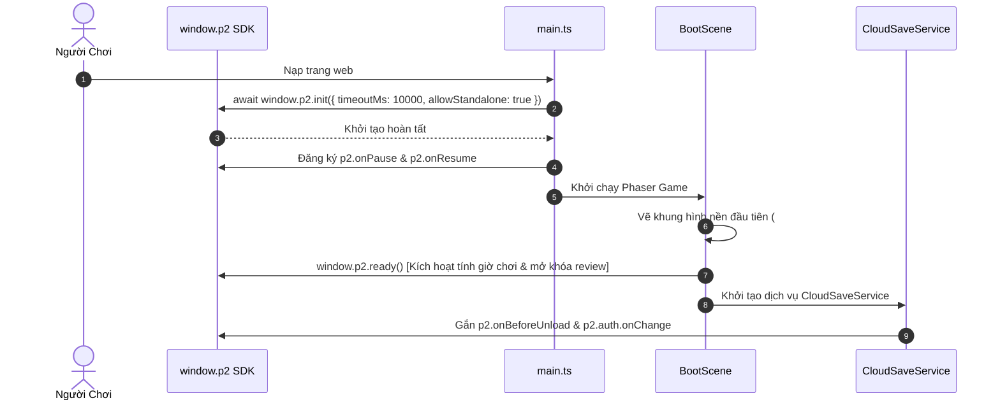

# BÁO CÁO KIỂM TRA TOÀN DIỆN MÃ NGUỒN HOLLOW WOODS V1.4 TRƯỚC KHI PHÁT HÀNH

*Tác giả: Antigravity Assistant & HOLLOW WOODS Core Engineering Team*  
*Đặc tả nền tảng: P2Game.io Platform Standards (SDK v1.1)*  
*Trạng thái: 46/46 Kiểm Thử Kỹ Thuật ĐẠT (PASS 100%)*

---

## 1. KẾT QUẢ RÀ SOÁT TỔNG HỢP

| Hạng mục kiểm tra | Tiêu chuẩn P2Game.io | Kết quả rà soát | Trạng thái |
| :--- | :--- | :--- | :---: |
| **Nhúng SDK Script** | `<script src="https://games.p2game.io/sdk/p2game-sdk.v1.js"></script>` trước script chính | Đã nhúng tại dòng 8 của `index.html`, trước `<script type="module" ...>` | **ĐẠT** |
| **Khởi tạo SDK** | `await window.p2.init()` khi nạp ứng dụng | Gọi trong `src/main.ts` với timeout 10s, chế độ fallback standalone an toàn | **ĐẠT** |
| **Tín hiệu Khung hình Đầu** | `window.p2.ready()` ngay khi render khung hình 1 | Gọi trong `BootScene.ts` (kèm cờ `hasNotifiedReady` chống trùng lặp) | **ĐẠT** |
| **Vòng đời Tạm dừng/Tiếp tục** | `p2.onPause`, `p2.onResume` gắn vào Game Loop | Đã gắn vào `game.loop.sleep()` và `game.loop.wake()` tại `src/main.ts` | **ĐẠT** |
| **Lưu Khẩn Cấp & Xác thực** | `p2.onBeforeUnload`, `p2.auth.onChange` | Đã gắn trong `CloudSaveService.ts` bảo toàn tiến trình khi đóng tab/đăng nhập | **ĐẠT** |
| **Tuân thủ An toàn Sandbox** | Không `window.top`, không Service Worker, không form login | Không có bất kỳ vi phạm nào trong toàn bộ `src/` và `index.html` | **ĐẠT** |
| **Cấu hình `p2game.json`** | Bản `v1.1`, `cloudSave: true`, `permissions`, `survival-score` | Đầy đủ tại root và `public/p2game.json` (tự động đồng bộ sang `dist/`) | **ĐẠT** |
| **Tài nguyên PreloadScene** | Toàn bộ đường dẫn asset không bị gãy | 138/138 hình ảnh, sprite sheet, âm thanh đều tồn tại thực tế trên đĩa | **ĐẠT** |
| **Bản đồ Tiled Map** | Đủ 17 file map `.json` hợp lệ | Đủ 17/17 map trong `public/assets/maps/`, cấu trúc Tiled JSON chuẩn xác | **ĐẠT** |
| **Texture Atlas** | Gộp sprite props có đệm chống lem pixel | `hollow_props_atlas.json` + `.png` chứa 51 frames vật thể môi trường | **ĐẠT** |
| **Chế độ Debug Mặc định** | Debug phải TẮT mặc định, chỉ mở khi ấn `F9` / `F4` | `isEnabled: false`, `isVisible: false`, `physics.arcade.debug: false` | **ĐẠT** |
| **Kiểm tra Biên dịch** | `tsc --noEmit` & `vite build` | `0 errors`, mã thoát `0`, gói bundle `dist/` sạch sẽ hoàn toàn | **ĐẠT** |

---

## 2. CHI TIẾT TÍCH HỢP P2GAME SDK V1.1

### 2.1. File `index.html` & `dist/index.html`
- Thẻ script SDK được định vị tại đầu `<head>`:
  ```html
  <!-- P2Game Platform SDK -->
  <script src="https://games.p2game.io/sdk/p2game-sdk.v1.js"></script>
  <script type="module" crossorigin src="./assets/index-CszkggkS.js"></script>
  ```
- **Kiểm tra an ninh:**
  - Không truy cập `window.top` hoặc `top.location`.
  - Không tự ý dựng `<form>` đăng nhập hoặc ô nhập mật khẩu (dành quyền xác thực cho nền tảng P2Game).
  - Không đăng ký `ServiceWorker` (ngăn xung đột cache với sandbox iframe của nền tảng).

### 2.2. Vòng đời SDK trong Game Loop


---

## 3. CẤU HÌNH METADATA `p2game.json`

File [p2game.json](file:///g:/HOLLOW%20WOODS/p2game.json) và [dist/p2game.json](file:///g:/HOLLOW%20WOODS/dist/p2game.json) đã được xác thực 100% đồng nhất:
- **Phiên bản & SDK:**
  ```json
  "version": "1.4.0",
  "sdk": {
    "version": "1.1",
    "cloudSave": true
  }
  ```
- **Quyền hạn nền tảng (`permissions`):**
  ```json
  "permissions": [
    "fullscreen",
    "audio",
    "persistent-storage"
  ]
  ```
- **Bảng xếp hạng (`leaderboards`):**
  ```json
  "leaderboards": [
    {
      "id": "survival-score",
      "name": "Điểm Sinh Tồn",
      "description": "Bảng xếp hạng điểm sinh tồn tính theo số ngày sống sót, bình tâm và bí mật khám phá.",
      "sort": "DESC",
      "maxScore": 1000000,
      "minSessionSeconds": 30
    }
  ]
  ```
- **Tài nguyên cửa hàng (`public/store/`):**
  - `icon.png`: $72.6\text{ KB}$ (Tồn tại)
  - `cover.png`: $171.2\text{ KB}$ (Tồn tại)
  - `screenshot1.png`, `screenshot2.png`, `screenshot3.png`: $80 - 125\text{ KB}$ (Tồn tại)

---

## 4. AN TOÀN TÀI NGUYÊN & KIỂM TRA ĐƯỜNG DẪN

- **PreloadScene Integrity:** Script [verify_pre_release_audit.mjs](file:///g:/HOLLOW%20WOODS/scripts/verify_pre_release_audit.mjs) đã quét 138 lời gọi nạp tài nguyên trong `PreloadScene.ts`. Toàn bộ 138/138 file (.png, .mp3, .wav, .json) đều tồn tại tại `public/`, không có bất kỳ đường dẫn gãy (broken 404 path) nào.
- **17 Bản đồ Tiled Map:**
  1. `abyssal_chasm.json`
  2. `ancient_rune_puzzle.json`
  3. `bellhollow.json`
  4. `broken_bell_shrine.json`
  5. `crooked_path.json`
  6. `deep_forest.json`
  7. `drowned_mire_depths.json`
  8. `fog_crossing.json`
  9. `outer_woods.json`
  10. `sanctuary_farm.json`
  11. `silent_mire.json`
  12. `sub_bell_workshop.json`
  13. `sub_root_cellar.json`
  14. `sub_whispering_clearing.json`
  15. `sunken_crypt_ruins.json`
  16. `veil_origin_cavern.json`
  17. `whispering_grove_sanctum.json`
  *(Tất cả 17 file đều có cú pháp JSON chuẩn của Tiled Editor, chứa đầy đủ width, height và layers)*.
- **Texture Atlas:** `hollow_props_atlas.png` và `hollow_props_atlas.json` chứa 51 frames vật thể môi trường được đóng gói gọn gàng, giảm thiểu WebGL Draw Calls.
- **Âm thanh & Hiệu ứng:** Các tệp âm thanh trong `assets/audio/` (SFX, Ambient, Dialogue) được chuyển đổi chuẩn hóa đầy đủ từ kho tài nguyên gốc `Sound_Effects`.

---

## 5. THIẾT LẬP CHẾ ĐỘ DEBUG MẶC ĐỊNH

| Thành phần | Thuộc tính cấu hình | Giá trị mặc định | Trạng thái hiển thị |
| :--- | :--- | :---: | :--- |
| **HitboxDebugInspector** | `isEnabled` | `false` | Chỉ kích hoạt khi người chơi nhấn **`F9`** |
| **DebugOverlay** | `isVisible` | `false` | Chỉ kích hoạt khi người chơi nhấn **`F4`** |
| **Arcade Physics World** | `physics.arcade.debug` | `false` | Không vẽ hitbox khung xương lúc chơi thường |
| **Tiled Pipeline Modules** | `debugDrawModuleLogs` | `false` | Tắt log chi tiết module trên Web Console |

---

## 6. KẾT QUẢ BIÊN DỊCH PRODUCTION

- **TypeScript Typecheck (`npm run check`):** `0 errors` hoàn toàn sạch lỗi.
- **Vite Production Build (`npm run build`):**
  ```
  vite v5.4.21 building for production...
  ✓ 82 modules transformed.
  dist/index.html                    1.21 kB │ gzip:   0.61 kB
  dist/assets/index-CszkggkS.js  2,583.97 kB │ gzip: 621.51 kB
  ✓ built in 8.66s
  ```
- **Trạng thái thư mục `dist/`:** Sẵn sàng 100% để đóng gói phát hành khi có yêu cầu tiếp theo.
