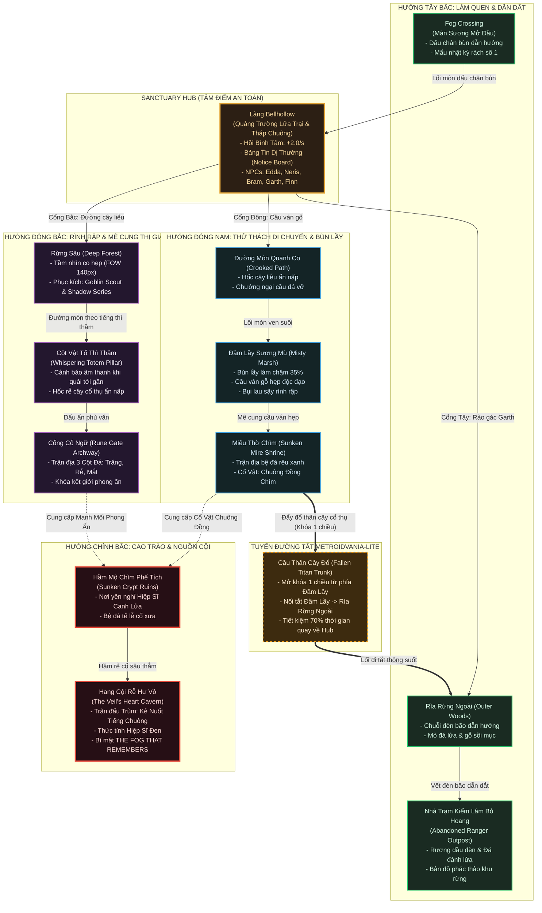

# BẢN THIẾT KẾ QUY HOẠCH SƠ ĐỒ THẾ GIỚI & CẤU TRÚC BẢN ĐỒ HOLLOW WOODS V1.4
## WORLD MAP TOPOLOGY & LANDMARK DENSITY BLUEPRINT
### Mô hình Hybrid Open-World & Triết lý Sinh tồn Kinh dị Dân gian (Dark Woodland Folk Horror)

> **Phiên bản thiết kế:** HOLLOW WOODS V1.4.0 (Gothic Woodland Survival)  
> **Mục tiêu:** Khắc phục triệt để nhận xét *"Gameplay kém hấp dẫn / đi lang thang vô định"* bằng cách tái cấu trúc dòng chảy khám phá, thiết lập hệ thống mốc thị giác dẫn đường (Landmarks), cơ chế mở đường tắt (Metroidvania-lite Shortcuts) và quy chuẩn mật độ điểm nhấn 15-Tile Rule.  
> **Ngày phê duyệt:** 18/11/2026  
> **Trạng thái:** Blueprint thiết kế chính thức (Sẵn sàng cho việc áp dụng vào Tiled Map JSON & WorldBuilder).

---

## 1. TỔNG QUAN TRIẾT LÝ THIẾT KẾ (DESIGN PHILOSOPHY)

### 1.1. Vấn đề cốt lõi của bản đồ cũ (Pain Points)
1. **Thiếu điểm hút thị giác (No Visual Anchor):** Bản đồ cũ có nhiều khoảng đất trống trải dài 40–60 ô gạch không có bất kỳ vật thể tương tác hay dấu vết môi trường nào, khiến người chơi cảm giác đi vô định, không biết mục tiêu tiếp theo ở đâu.
2. **Cấu trúc tuyến tính đơn điệu (Linear Pacing):** Các khu vực nối tiếp nhau theo một chiều thẳng băng, thiếu sự kết nối đan xen (interconnectivity) và thiếu các lối đi tắt, buộc người chơi phải quay lui (backtracking) một quãng đường dài mệt mỏi mỗi khi cần về làng hồi máu.
3. **Mặt bằng rủi ro chưa tương phản rõ rệt:** Vùng an toàn và vùng nguy hiểm chưa có sự khác biệt sâu sắc về cơ chế di chuyển, ánh sáng và âm thanh telegraph.

### 1.2. Giải pháp kiến trúc mới: Mô hình "Bánh Xe Hub & Nan Hoa" (Hub-and-Spoke Topology)
- **Tâm điểm:** Làng Chuông **Bellhollow** đóng vai trò là "Thánh địa trú ẩn" (Sanctuary Safe Hub), nơi duy nhất hồi phục tự nhiên Bình Tâm, tập trung thợ rèn, thầy thuốc, bảng tin manh mối và điểm nghỉ chân.
- **3 Nan hoa khám phá (3 Exploration Spokes):** Từ làng tỏa ra 3 hướng rạch ròi với danh tính môi trường (Biome Identity), cơ chế thử thách và phần thưởng đặc trưng:
  1. *Hướng Tây Bắc:* **Rìa Rừng Ngoài (Outer Woods)** — Vùng làm quen, dẫn dắt câu chuyện ban đầu.
  2. *Hướng Đông Nam:* **Đầm Lầy Sương Mù (Misty Marsh)** — Thử thách di chuyển trên cầu ván hẹp, bùn lầy làm chậm bước chân.
  3. *Hướng Đông Bắc:* **Rừng Sâu (Deep Forest)** — Mê cung thị giác, tầm nhìn co hẹp, rình rập và phục kích.
- **Điểm quy tụ cao trào:** **Tàn Tích Cổ & Hang Nguồn Cội (Ancient Ruins & Shadow Cavern)** nằm ở hướng Bắc sâu thẳm, đòi hỏi kết hợp cổ vật và tri thức từ cả 3 hướng để mở khóa.
- **Cơ chế đường tắt (Metroidvania-lite Shortcut):** Cầu thân cây đại thụ đổ bắc ngang khe vực, mở khóa một chiều từ phía Đầm Lầy để thông ngược về Rìa Rừng Ngoài, khép kín vòng lặp khám phá.

---

## 2. SƠ ĐỒ KẾT NỐI TỔNG THỂ THẾ GIỚI (WORLD TOPOLOGY DIAGRAM)



---

## 3. THIẾT KẾ CHI TIẾT TỪNG PHÂN VÙNG BẢN ĐỒ (SECTOR BLUEPRINTS)

### 3.1. Hub Trung Tâm: Làng Bellhollow (The Sanctuary Hub)
- **Tọa độ trung tâm:** $X = 800, Y = 280$ (Không gian mở rộng $1120 \times 960\text{ px}$).
- **Bầu không khí & Thị giác:**
  - Ánh sáng vàng hổ phách ấm áp tỏa ra từ các trụ đèn bão làng và Lửa Trại Trung Tâm 3 Cấp.
  - Sương mù bị đẩy lùi ra ngoài rào gỗ làng (bán kính chiếu sáng an toàn $260\text{ px}$).
  - Hiệu ứng hồi phục: Nhân vật nhận trạng thái `Sanctuary Relief`, Bình Tâm hồi phục đều đặn $+2.0\text{ Composure/s}$ (và $+8.0\text{/s}$ khi nghỉ bên đống lửa).
- **Điểm nhấn tương tác then chốt (Key Hub Landmarks):**
  1. **Bảng Tin Dị Thường (The Anomaly Notice Board - Tọa độ 750, 270):**  
     Bảng gỗ thông đóng đinh đồng ngay lối vào quảng trường, cung cấp 3 tấm da cừu ghi chú định hướng rõ rệt cho người chơi:
     - *Manh mối 1 (Tây Bắc):* "Khói đen tắt ngấm tại Trạm Kiểm Lâm Rừng Ngoài. Dầu đèn dự trữ vẫn còn kẹt trong rương khóa..."
     - *Manh mối 2 (Đông Nam):* "Tiếng chuông chìm vọng lên từ đáy Đầm Lầy Sương Mù mỗi khi trăng khuất. Cần người gan dạ vượt cầu ván bùn lầy khảo sát..."
     - *Manh mối 3 (Đông Bắc):* "Tiếng gầm của The Listener dội lại từ Rừng Sâu. Hãy lần theo Cột Vật Tổ Thì Thầm để tránh bị quái vật tập kích..."
  2. **Lò Rèn Bram & Bàn Chế Tạo (Tọa độ 1045, 365):** Điểm gia cố vũ khí tự vệ (Gậy Đẩy Lùi, Đuốc Nhựa Thông) và sửa chữa công cụ sinh tồn.
  3. **Hiên Thuốc Neris (Tọa độ 990, 145):** Bàn phơi thảo dược và Nồi Gang Thảo Dược, nơi bào chế Trà Thảo Mộc giảm căng thẳng và Thuốc Cao Đắp Vết Thương.
  4. **Tháp Chuông Cổ Edda (Tọa độ 820, 252):** Nơi bà lão giữ chuông dẫn dắt truyền thuyết và giải mã các Cổ Vật thu thập được.

---

### 3.2. Hướng Tây Bắc: Rìa Rừng Ngoài (Outer Woods — Vùng Làm Quen & Dẫn Dắt)
- **Tọa độ thế giới:** $X \in [1150 .. 1600], Y \in [360 .. 800]$.
- **Mục tiêu gameplay:** Làm quen với việc quản lý dầu đèn, nhặt cành cây khô, đá lửa và cảm nhận nhịp thở của sương mù mà không gặp rủi ro tử vong quá cao.
- **Landmark Trọng Tâm: Nhà Trạm Kiểm Lâm Bỏ Hoang (Abandoned Ranger Outpost — Tọa độ 1420, 620):**
  - *Kiến trúc:* Căn nhà gỗ một gian đổ nát, mái hiên xiêu vẹo phủ rêu, có ánh đèn bão pin cũ leo lét ở bậc cửa.
  - *Vật phẩm sinh tồn:*
    - 01 Bình Dầu Đèn Lớn (+60s thời gian thắp sáng).
    - 03 Khối Đá Lửa (Flint) và 05 Cành Gỗ Sồi Khô.
  - *Manh mối Lore:* Mẩu nhật ký kiểm lâm: *"Sương mù không tự nhiên sinh ra. Nó chảy ra từ kẽ nứt của Hầm Mộ phía Bắc. Khi chuông làng rung lên, sương mù rút lui; nhưng khi chuông câm lặng, bóng ma sẽ gõ cửa từng nhà..."*

---

### 3.3. Hướng Đông Nam: Đầm Lầy Sương Mù (Misty Marsh / Silent Mire — Thử Thách Di Chuyển)
- **Tọa độ thế giới:** $X \in [2880 .. 4000], Y \in [100 .. 740]$.
- **Cơ chế môi trường khắc nghiệt:**
  - **Bùn Lầy Ngập Chân (Deep Quagmire):** Đi trên bùn nước làm giảm tốc độ chạy $35\%$, tiếng bước chân bì bõm thu hút quái vật trong bán kính $180\text{ px}$.
  - **Hệ thống Cầu Ván Gỗ Hẹp (Boardwalk Piers):** Lối đi duy nhất an toàn có bề rộng chỉ $32\text{ px}$. Người chơi phải căn góc bước cẩn thận, dễ rơi vào thế bị quái vật dồn ép hai đầu cầu.
- **Landmark Trọng Tâm: Miếu Thờ Chìm (Sunken Mire Shrine — Tọa độ 3520, 280):**
  - *Kiến trúc:* Bệ đá cổ ngữ hình bán nguyệt ngâm mình dưới ngấn nước lầy, bao quanh bởi 3 trụ đá rêu bám hoa văn ngọc bích.
  - *Phần thưởng then chốt:* **Cổ Vật: Chuông Đồng Chìm (Sunken Bronze Talisman)**. Cổ vật này là chìa khóa vật lý bắt buộc để giải trừ màn sương phong ấn dẫn vào Hầm Mộ phía Bắc.

---

### 3.4. Hướng Đông Bắc: Rừng Sâu (Deep Forest — Mê Cung Thị Giác & Rình Rập)
- **Tọa độ thế giới:** $X \in [1600 .. 2880], Y \in [-640 .. 0]$.
- **Cơ chế môi trường khắc nghiệt:**
  - **Tầm nhìn co hẹp cực hạn (Dense Fog Blindness):** Bán kính chiếu sáng của đèn lồng bị sương nén lại còn $140\text{ px}$.
  - **Tán cây cổ thụ chia cắt tầm nhìn (Visual Occlusion):** Các hàng cây cổ thụ đại ngàn mọc so le dày đặc, che khuất chuyển động phía sau.
  - **Kẻ săn mồi phục kích:** Khu vực tuần tra của **Goblin Scout** (tiếp cận từ góc khuất, đâm trộm dao găm) và **Shadow Stalker** (lẩn khuất trong bóng tối, chỉ lộ cặp mắt tím khi người chơi tắt đèn).
- **Landmark Trọng Tâm: Cột Vật Tổ Thì Thầm (Whispering Totem Pillar — Tọa độ 2100, -320):**
  - *Chức năng gameplay:* Cột đá phù văn cổ phát ra tiếng râm ran như tiếng dế kêu hoặc tiếng gió rít khi có thực thể thù địch tiến vào bán kính $220\text{ px}$, đóng vai trò là "Radar cảnh báo sớm" tự nhiên cho người chơi.
  - *Lối dẫn:* Tuyến đường lát đá cổ ngữ từ cột vật tổ dẫn thẳng tới **Cổng Cổ Ngữ (Abyssal Void Rune Gate)**.

---

### 3.5. Hướng Chính Bắc: Tàn Tích Cổ & Hang Nguồn Cội (Ancient Ruins & Shadow Cavern — Cao Trào)
- **Tọa độ thế giới:** $X \in [3490 .. 4600], Y \in [-640 .. -100]$ và Hang Ngầm $[480 .. 1600, Y = 1440 .. 2080]$.
- **Điều kiện mở khóa:**
  - Phải sở hữu **Chuông Đồng Chìm** (thu thập từ Đầm Lầy Đông Nam).
  - Phải giải mã chuỗi 3 ấn ký (Trăng - Rễ - Mắt) từ **Cổng Cổ Ngữ Rừng Sâu**.
- **Điểm cao trào cốt truyện:**
  - Nơi an nghỉ của các Hiệp Sĩ Canh Lửa đã hy sinh thân xác để giam giữ The Veil.
  - Trận đấu trùm sinh tồn: **Kẻ Nuốt Tiếng Chuông (Mire Warden Boss)** — sinh vật khổng lồ hấp thụ âm thanh, đòi hỏi người chơi dùng Mồi Nhử Tiếng Động [Q] và Đèn Lồng [F] để lừa quái vật húc đầu vào các cột đá phong ấn.
  - Mở khóa trọn vẹn sự thật về lời nguyền *"Sương mù đưa anh đến đây. Khu rừng đã ghi nhớ anh từ trước."*

---

### 3.6. Tuyến Đường Tắt Chiến Lược (Metroidvania-lite Shortcut)
- **Vị trí thiết kế:** Cầu Thân Cây Đại Thụ Đổ (Fallen Titan Trunk Bridge) bắc ngang qua con hào sâu ngăn cách giữa Đầm Lầy Sương Mù ($X \approx 2800, Y \approx 420$) và Rìa Rừng Ngoài ($X \approx 1620, Y \approx 450$).
- **Cơ chế mở khóa một chiều:**
  - Khi người chơi xuất phát từ Làng hoặc Rừng Ngoài, bờ vực bên này chỉ thấy gốc cây đại thụ bị xích sắt gỉ khóa chặt bên kia bờ vực (không thể qua được).
  - Sau khi người chơi dấn thân vượt qua mê cung cầu ván Đầm Lầy Sương Mù và lấy được Cổ Vật tại Miếu Thờ Chìm, họ sẽ tiếp cận được phần ngọn cây bên bờ Đầm Lầy.
  - Tương tác `[E] Tháo xích & Đẩy thân cây đại thụ` $\rightarrow$ Thân cây đổ sập xuống tạo thành cây cầu gỗ bắc ngang vực sâu.
- **Giá trị gameplay:**
  - Giảm quãng đường chạy bộ từ 180 giây xuống còn **25 giây** để quay về Làng Bellhollow.
  - Tạo cảm giác thỏa mãn tột độ (Eureka Moment / Spatial Mastery) khi nhận ra bản đồ thế giới có sự liên kết chặt chẽ và thông minh.

---

## 4. QUY TẮC THIẾT KẾ MẬT ĐỘ ĐIỂM NHẤN (THE 15-TILE RULE ARCHITECTURE)

### 4.1. Định nghĩa & Cơ sở Toán học
- **Quy tắc 15-Tile:** Trên bất kỳ hướng di chuyển nào của người chơi, trong phạm vi tầm nhìn hình học tối đa **$15–20\text{ tiles}$** (tương đương bán kính $240\text{ px} – 320\text{ px}$), màn hình **BẮT BUỘC** phải xuất hiện ít nhất một "Điểm Neo Thị Giác" (Visual Anchor) hoặc "Mồi Kích Thích Tò Mò" (Curiosity Hook).
- **Mục tiêu tâm lý học hành vi:** Triệt tiêu hoàn toàn khoảng chết vô định (Empty Spatial Void), tạo dòng chảy dẫn dắt liên tục (Continuous Breadcrumb Trail) khiến người chơi luôn muốn bước thêm một đoạn nữa để khám phá điểm sáng phía trước.

```
       [Visual Anchor 1] ---- (15 tiles / ~240px) ----> [Interactive Hook 2]
     (Đèn Bão Treo Cây)                               (Dấu Chân Bùn Dập Cỏ)
                                                               |
                                                       (15 tiles / ~240px)
                                                               v
                                                      [Survival Cache 3]
                                                     (Rương Gỗ Bỏ Hoang)
```

---

### 4.2. Hệ Thống 6 Phân Loại Điểm Neo Dẫn Dắt (The 6 Hook Archetypes)

| Nhóm Hook | Biểu hiện thị giác & âm thanh trong game | Vai trò dẫn dắt hành vi người chơi |
| :--- | :--- | :--- |
| **1. Visual Beacon (Ngọn hải đăng ánh sáng)** | • Đèn bão bập bùng treo trên cọc gỗ.<br>• Đèn lồng hổ phách lập lòe trong hốc đá.<br>• Đốm than hồng ấm áp của đống lửa tàn. | Thu hút người chơi tiến về vùng có ánh sáng để tạm thời giải tỏa căng thẳng và định hướng lối mòn. |
| **2. Environmental Trail (Dấu vết môi trường)** | • Chuỗi dấu chân bùn ẩm ướt lún sâu trên cỏ.<br>• Vết cào xước của quái vật trên thân cây sồi.<br>• Cành cây khô gãy dập và vết máu sẫm màu. | Báo hiệu tuyến đường người đi trước đã đi qua hoặc cảnh báo mối nguy hiểm sắp xuất hiện. |
| **3. Archaeological Clue (Dấu tích cổ vật)** | • Bia đá cổ ngữ chạm khắc phát quang ngọc bích.<br>• Trụ đá rêu phong khắc biểu tượng Trăng/Rễ/Mắt.<br>• Đoạn tường đá phế tích đổ nát. | Kích thích trí tò mò khảo cổ, đánh dấu mốc ranh giới sắp bước vào khu vực giải đố hoặc di tích. |
| **4. Interactive Micro-Event (Vi sự kiện sinh động)** | • Cụm đom đóm hổ phách tụ lại khi người chơi đến gần.<br>• Bụi cây xào xạc rung lắc, bầy quạ rừng bay vút lên.<br>• Hốc cây cổ thụ rỗng phát tiếng thở dài nhẹ. | Tạo sức sống cho khu rừng, cảnh báo quái vật ẩn nấp hoặc cung cấp chỗ trốn tạm thời. |
| **5. Audio Telegraph (Tín hiệu âm thanh định hướng)** | • Tiếng chuông đồng ngân vang mơ hồ từ phía Đông.<br>• Tiếng nước nhỏ giọt tong tỏng từ mái miếu cổ.<br>• Tiếng cành cây nứt răng rắc phía sau lưng. | Dẫn dắt không gian bằng thính giác, thúc giục người chơi quay đầu hoặc tiến bước nhanh hơn. |
| **6. Survival Cache (Tiếp tế sinh tồn)** | • Bọc hành trang cũ của thợ săn rách nát.<br>• Mỏ đá lửa lấp lánh cạnh vách đá.<br>• Cụm nấm phát quang và giọt nhựa thông óng ánh. | Phần thưởng khích lệ người chơi dám dấn thân thám hiểm các góc khuất ngoài đường chính. |

---

### 4.3. Bảng Ma Trận Phân Bổ Mật Độ Điểm Nhấn Theo Từng Vùng Bản Đồ

| Khu vực bản đồ | Tần suất xuất hiện Hook | Danh sách Hook chủ đạo | Cảm giác trải nghiệm (Player Emotion) |
| :--- | :---: | :--- | :--- |
| **Fog Crossing (Mở đầu)** | Mỗi **12–15 tiles** | Chuỗi dấu chân bùn $\rightarrow$ Mẩu nhật ký rách phát quang $\rightarrow$ Tiếng cành cây gãy giòn $\rightarrow$ Đèn bão cổng làng. | Tò mò, hồi hộp, có mục tiêu rõ rệt ngay từ 30 giây đầu tiên. |
| **Làng Bellhollow (Hub)** | Mỗi **10–12 tiles** | Đèn bão làng $\rightarrow$ Bảng Tin Dị Thường $\rightarrow$ Lửa Trại ấm $\rightarrow$ Nồi thuốc bốc khói $\rightarrow$ Tháp chuông cao vút. | An toàn, thư thái, cảm giác được che chở (Sanctuary Relief). |
| **Outer Woods** | Mỗi **15–18 tiles** | Chuỗi đèn bão dẫn hướng $\rightarrow$ Bọc hành trang cũ $\rightarrow$ Khúc gỗ sồi mục $\rightarrow$ Trạm kiểm lâm xiêu vẹo. | Thám hiểm làm quen, thu thập tài nguyên cơ bản, nhịp độ vừa phải. |
| **Crooked Path** | Mỗi **14–16 tiles** | Biển chỉ đường tuyến vòng $\rightarrow$ Cầu đá vỡ $\rightarrow$ Bụi rậm ẩn nấp $\rightarrow$ Hốc rễ cây mục rậm rạp. | Bắt đầu cảnh giác, nhận diện các chướng ngại vật tự nhiên. |
| **Misty Marsh** | Mỗi **12–15 tiles** | Trụ đèn cắm cọc nước $\rightarrow$ Cụm lau sậy rung lắc $\rightarrow$ Gốc titan willow mục $\rightarrow$ Bệ đá chìm ngọc bích. | Căng thẳng di chuyển, sợ trượt chân xuống bùn lầy, dồn ép không gian. |
| **Deep Forest** | Mỗi **10–14 tiles** | Cặp mắt ma mị chớp tắt $\rightarrow$ Cột vật tổ thì thầm $\rightarrow$ Cây đổ chắn ngang $\rightarrow$ Cổng Cổ Ngữ Hư Không. | Ám ảnh kinh dị, sợ bị phục kích bất thình lình, thính giác hoạt động tối đa. |
| **Ancient Ruins** | Mỗi **12–15 tiles** | Lư hương cổ ngọc bích $\rightarrow$ Quan tài đá chạm khắc $\rightarrow$ Bức huyết thư phong ấn $\rightarrow$ Trái Tim Màn Sương. | Uy nghiêm, thần bí, cao trào hồi hộp trước trận đánh quyết định. |

---

## 5. BIỂU ĐỒ NHỊP ĐỘ CĂNG THẲNG (PACING CURVE) & VÒNG LẶP SINH TỒN CỐT LÕI

### 5.1. Vòng lặp gameplay cốt lõi (The Core Survival Loop)

```
        ┌─────────────────────────────────────────────────────────────┐
        │                                                             │
        ▼                                                             │
[1. CHUẨN BỊ TẠI HUB] ───► [2. DẤN THÂN VÀO SƯƠNG] ───► [3. CHẠM TRÁN RỦI RO]
(Bình Tâm 100%, Đèn đầy,   (Tầm nhìn thu hẹp,          (Quái vật rình rập,
 Đọc Bảng Tin, Nấu thuốc)   Thời gian đèn đếm ngược)    Bùn lầy làm chậm)
                                                               │
                                                               ▼
[5. RÚT LUI AN TOÀN]  ◄─── [4. PHẦN THƯỞNG KHÁM PHÁ] ◄────────┘
(Về làng, Hồi phục tâm trí,(Nhặt Cổ Vật, Đọc Lore,
 Nâng cấp trang bị cá nhân) Mở Cầu Đường Tắt 1 Chiều)
```

### 5.2. Biểu đồ đường cong căng thẳng (Tension vs. Relief Curve)

```
Mức độ Căng Thẳng (Tension)
 ▲
 │                                        [Trùm Cuối Hang Cội Rễ]
 │                                                 /\
 │                               [Miếu Thờ Chìm]  /  \
 │                      /\             /\        /    \
 │       [Trạm Rừng]   /  \           /  \      /      \
 │           /\       /    \         /    \    /        \
 │          /  \     /      \       /      \  /          \
 │  [Fog]  /    \   /        \     /   (Mở Shortcut)      \
 │   /\   /      \_/          \___/         \              \
 │  /  \_/     (Về Hub)     (Về Hub)         \              \
 └──┴───┴───────┴────────────┴────────────────┴──────────────┴────► Thời gian chơi
    0m 5m      15m          30m              45m            60m+
```

---

## 6. KẾ HOẠCH BÀN GIAO & BƯỚC TIẾP THEO

1. **Tuân thủ triệt để ràng buộc dừng:** Tài liệu này hoàn thiện toàn bộ bản vẽ quy hoạch cấu trúc thế giới, danh sách điểm nhấn 15-tile rule và tuyến đường tắt một chiều. **Chưa chỉnh sửa bất kỳ file Tiled JSON hay source code game nào.**
2. **Kế hoạch cho các lệnh tiếp theo:**
   - **Bước 3:** Áp dụng bản thiết kế vào cấu trúc dữ liệu bản đồ (cập nhật các tọa độ chốt của Trạm Kiểm Lâm, Cầu Đường Tắt, Cột Vật Tổ trong `zones.json` và Tiled maps).
   - **Bước 4:** Bổ sung các sprite tương tác môi trường (Bảng Tin Dị Thường, Cầu Gỗ Thân Cây Đổ) vào `WorldBuilder.ts` theo đúng tọa độ quy hoạch.
   - **Bước 5:** Nghiệm thu dòng chảy khám phá in-game qua công cụ Debug Inspector `[F9]` và kiểm thử thực tế.
